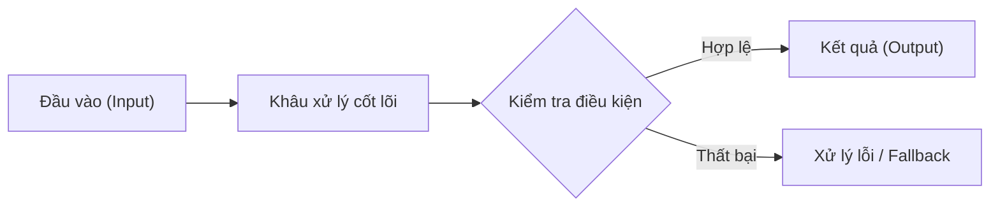

# 📝 Lesson & Post Template (Chuẩn Bài Giảng & Bài Viết Kỹ Thuật)

> Tài liệu này chuẩn hóa cấu trúc bài viết/bài giảng cho **Blog Notebook**, kế thừa mô hình sư phạm chuyên sâu (*From Problem to Production*) kết hợp hỗ trợ kiến trúc **Đa ngôn ngữ (i18n)**.

---

## 1. Hướng dẫn tổ chức thư mục & Đa ngôn ngữ (i18n Structure)

Để chuẩn bị cho hệ thống đa ngôn ngữ trong tương lai, bài viết có thể được tổ chức theo 2 cách:

### Cách 1: Cấu trúc thư mục theo Slug (Khuyến nghị cho bài dài & có assets đi kèm)
```text
frontend/posts/
├── [slug-bai-viet]/
│   ├── vi.md               # Nội dung Tiếng Việt (chính)
│   ├── en.md               # Nội dung Tiếng Anh (dịch)
│   ├── assets/             # Hình ảnh, sơ đồ riêng của bài viết
│   └── code/               # Mã nguồn mẫu, script đính kèm (nếu có)
```

### Cách 2: Cấu trúc Flat File (Hiện tại blog đang dùng)
```text
frontend/posts/
├── [slug-bai-viet].md          # Mặc định là Tiếng Việt (lang: "vi")
├── [slug-bai-viet].en.md       # Phiên bản Tiếng Anh (lang: "en", translationKey: "[slug-bai-viet]")
```

---

## 2. Template Mẫu (Copy phần dưới đây để bắt đầu bài mới)

```markdown
---
title: "[Tiêu đề bài viết: Rõ ràng, trực diện, kích thích tò mò]"
description: "[Mô tả tóm tắt 1-2 câu về giá trị bài viết, phục vụ SEO & RSS feed]"
date: "YYYY-MM-DD"
category: "AI" # Ví dụ: AI, System Design, DevOps, Web Development, v.v.
tags: ["Tag1", "Tag2", "Tag3"]
status: "draft" # draft | published
readingTime: 15 # Số phút ước lượng
lang: "vi" # vi | en
translationKey: "unique-slug-identifier" # Khóa liên kết giữa bản vi và en
coverImage: "" # Đường dẫn ảnh bìa (tùy chọn)
---

> **[Motto / Châm ngôn cốt lõi]**: Đưa ra 1-2 câu đúc kết tư duy quan trọng nhất của bài học. Đây là ý niệm mà độc giả sẽ ghi nhớ lâu nhất ngay cả khi quên chi tiết code.

---

## Thông tin nhanh (Quick Spec)

* **Loại bài (Type):** Thực chiến (Build) / Khái niệm (Concept) / System Design
* **Ngôn ngữ & Công cụ:** Python, TypeScript, Docker, v.v.
* **Kiến thức tiên quyết (Prerequisites):** [Liệt kê các bài trước hoặc kỹ năng cần có]
* **Thời gian thực hành:** ~[Số] phút

---

## Mục tiêu bài học (Learning Objectives)

Sau bài học này, bạn sẽ có khả năng:
- [ ] Hiểu được nguyên lý hoạt động của... và tại sao nó lại được thiết kế như vậy.
- [ ] Tự tay xây dựng phiên bản tối giản (from scratch) mà không cần phụ thuộc thư viện bên ngoài.
- [ ] Nhận diện các cạm bẫy thực tế (pitfalls) khi triển khai trên production.
- [ ] Tự tin so sánh và áp dụng vào các framework hiện đại.

---

## 1. Vấn đề thực tế (The Problem)

> *Tại sao chúng ta phải quan tâm đến điều này? Nếu không có nó, hệ thống sẽ gặp bế tắc gì?*

Mô tả một kịch bản thực tế khi gặp trục trặc:
- Đặt độc giả vào một bài toán đau đầu cụ thể (chậm, tốn tài nguyên, lỗi cascading failure, hallucination...).
- Chỉ ra vì sao các giải pháp ngây thơ (naive approach) thất bại.

---

## 2. Mô hình tư duy & Bản chất (The Concept)

> *Hiểu đúng bản chất trước khi viết một dòng code nào. Không dùng ASCII art, hãy dùng Mermaid hoặc KaTeX.*

Giải thích kiến trúc và cơ chế bằng sơ đồ:



Giải thích chi tiết các thành phần trong sơ đồ:
1. **Thành phần 1:** Vai trò là gì?
2. **Thành phần 2:** Tương tác với thành phần khác như thế nào?

*(Nếu có công thức toán học, hãy dùng định dạng KaTeX)*:
$$L_{total} = \lambda_1 L_{task} + \lambda_2 L_{reg}$$

---

## 3. Tự tay xây dựng từ đầu (Build It: From Scratch)

> *Xây dựng từng bước từ đơn giản nhất, sử dụng code tối giản (ưu tiên Standard Library) để người đọc thấy rõ cơ chế hoạt động.*

### Bước 1: [Khởi tạo cấu trúc dữ liệu / Thành phần cơ sở]

Giải thích ngắn gọn ý tưởng trước khối code:

```python
# Code rõ ràng, tự giải thích (self-explanatory), hạn chế comment thừa
class SimpleEngine:
    def __init__(self):
        self.state = {}

    def process(self, item):
        return item
```

### Bước 2: [Thêm logic xử lý chính]

```python
# Bổ sung logic cốt lõi
```

### Bước 3: [Xử lý trường hợp biên (Edge Cases) & Điều kiện dừng]

---

## 4. Ứng dụng thực tế & So sánh Framework (Use It)

> *Trong thực tế, các framework và công cụ sản xuất (Production) giải quyết vấn đề này như thế nào?*

* **Cách các framework lớn xử lý:** So sánh giải pháp tự build ở trên với các thư viện phổ biến (ví dụ: LangChain, vLLM, PyTorch, React, v.v.).
* **Ưu & Nhược điểm:**
  - *Tự build:* Nhẹ, hiểu sâu, dễ tùy biến theo nhu cầu đặc thù.
  - *Dùng Framework:* Đầy đủ tính năng, cộng đồng hỗ trợ nhưng có chi phí trừu tượng hóa (abstraction overhead).

---

## 5. Đóng gói & Tái sử dụng (Ship It)

> *Sau bài viết này, người đọc mang được gì về cho dự án thực tế của họ?*

Cung cấp một thành phần có thể dùng được ngay:
- Một đoạn Prompt mẫu hoàn chỉnh
- Một Custom Hook / Utility function
- Một Dockerfile / Shell script tự động hóa
- Một bảng Checklist kiểm tra chất lượng

---

## 6. Giải ngố thuật ngữ (Key Terms & Misconceptions)

Bảng phân biệt giữa cách hiểu đại trà và bản chất kỹ thuật:

| Thuật ngữ (Term) | Người ta thường nghĩ là... | Bản chất kỹ thuật thực sự là... |
|---|---|---|
| **[Thuật ngữ 1]** | Lầm tưởng phổ biến... | Thực chất là cơ chế... |
| **[Thuật ngữ 2]** | Hiểu sai về công dụng... | Định nghĩa chuẩn xác... |

---

## 7. Bài tập thử thách (Hands-on Challenges)

1. 🟢 **Cơ bản (Easy):** Chạy thử code mẫu và thay đổi một tham số để quan sát sự thay đổi.
2. 🟡 **Trung bình (Medium):** Bổ sung thêm tính năng xử lý timeout hoặc lưu trữ bộ nhớ đệm (cache).
3. 🔴 **Nâng cao (Hard):** Tối ưu hóa hiệu năng để chạy song song (concurrency) hoặc xử lý khi hệ thống gặp sự cố mất kết nối mạng.

---

## 8. Tài liệu đọc thêm (Further Reading)

- [Tên bài báo / Whitepaper](https://example.com) — *Lý do nên đọc: Phân tích kiến trúc gốc của tác giả.*
- [Tài liệu chính thức của thư viện](https://example.com) — *Xem phần hướng dẫn triển khai production.*
```

---

## 3. Quy chuẩn viết bài (Writing Guidelines)

1. **Ngôn ngữ & Giọng văn:**
   - Sử dụng giọng văn kỹ thuật gãy gọn, tự nhiên, tôn trọng người đọc.
   - Giữ nguyên các thuật ngữ kỹ thuật phổ biến bằng Tiếng Anh (như *Latency*, *Throughput*, *Checkpoint*, *Embedding*, *Context Window*, *Inference*), không cố dịch gượng gạo sang tiếng Việt nếu làm giảm độ chính xác.
2. **Sơ đồ & Hình ảnh:**
   - Ưu tiên biểu đồ Mermaid vì có thể render trực tiếp trên web, dễ bảo trì và responsive tốt trên cả mobile và desktop.
   - Thống nhất màu sắc cho sơ đồ (ví dụ: xanh lá = thành công/input, đỏ/hồng = lỗi/exception, vàng = trạng thái trung gian).
3. **Mã nguồn:**
   - Mỗi khối code mẫu nên có khả năng chạy được độc lập (reproducible).
   - Nêu rõ các dependency cần thiết ở đầu phần code.
