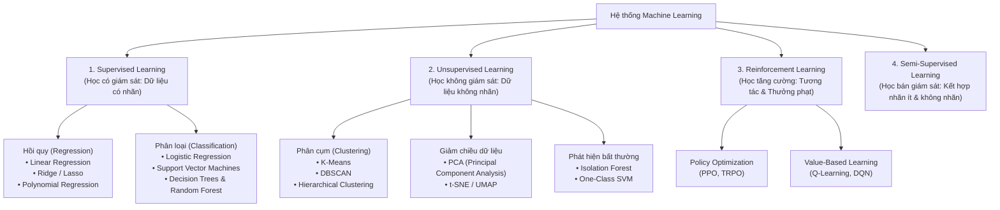
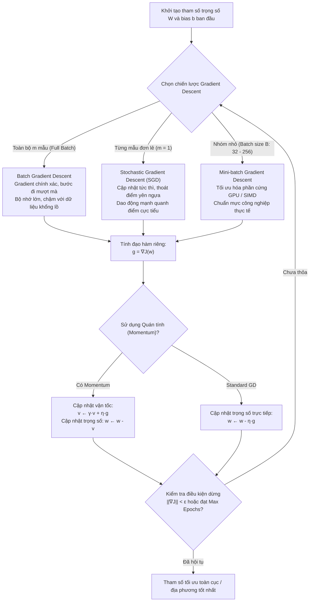
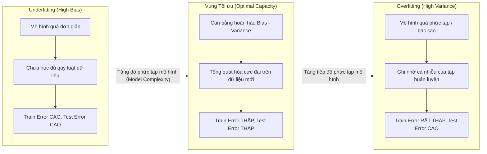

> **Machine Learning (Học máy)** là ngành khoa học máy tính và toán học ứng dụng tập trung vào việc nghiên cứu, phát triển các thuật toán có khả năng tự động học hỏi quy luật tiềm ẩn từ dữ liệu quá khứ để đưa ra quyết định hoặc dự đoán chính xác trên dữ liệu chưa từng thấy mà không cần lập trình các quy tắc logic cứng (rule-based).

Theo định nghĩa kinh điển của Tom Mitchell (1997): *Một chương trình máy tính được coi là học từ kinh nghiệm $E$ đối với một tập tác vụ $T$ và thước đo hiệu suất $P$, nếu hiệu suất của nó tại các tác vụ trong $T$, được đo lường bởi $P$, tự động cải thiện tỉ lệ thuận theo kinh nghiệm $E$.*

---

## 1. Bản chất và Phân loại Machine Learning

### 1.1. Hệ thống phân loại Machine Learning toàn diện

Học máy hiện đại được chia thành 4 nhánh chính dựa trên hình thức phản hồi và bản chất của dữ liệu đầu vào:



### 1.2. So sánh các hình thức học máy

| Tiêu chí | Học có giám sát (Supervised) | Học không giám sát (Unsupervised) | Học tăng cường (Reinforcement) |
| :--- | :--- | :--- | :--- |
| **Bản chất dữ liệu** | Cặp dữ liệu và nhãn $(x_i, y_i) \in \mathcal{X} \times \mathcal{Y}$. | Chỉ có dữ liệu quan sát $x_i \in \mathcal{X}$, không có nhãn chỉ dẫn. | Tương tác tuần tự: Trạng thái (State), Hành động (Action), Tín hiệu thưởng (Reward). |
| **Mục tiêu học** | Học hàm ánh xạ $f: \mathcal{X} \to \mathcal{Y}$ nhằm cực tiểu hóa sai số dự đoán. | Khám phá cấu trúc tiềm ẩn, phân phối xác suất $P(x)$, hoặc biểu diễn thu gọn. | Học chính sách $\pi(a|s)$ cực đại hóa tổng phần thưởng tích lũy theo thời gian. |
| **Phản hồi từ môi trường** | Trực tiếp, tức thì thông qua hàm mất mát $\mathcal{L}(f(x_i), y_i)$. | Hoàn toàn không có phản hồi nhãn bên ngoài. | Phản hồi trễ (Delayed reward) từ môi trường động. |
| **Ứng dụng tiêu biểu** | Dự đoán giá nhà, lọc thư rác Spam, chẩn đoán hình ảnh y tế. | Phân khúc khách hàng, nén dữ liệu, phát hiện gian lận thẻ tín dụng. | Tự hành xe tự lái, điều khiển robot công nghiệp, cờ vua/AlphaGo. |

---

## 2. Nền tảng Toán học và Hàm mất mát (Loss Functions)

Mọi thuật toán Machine Learning đều vận hành trên 3 trụ cột toán học cốt lõi: **Đại số tuyến tính (Linear Algebra)**, **Giải tích đa biến (Multivariate Calculus)**, và **Lý thuyết Xác suất Thống kê (Probability & Statistics)**.

### 2.1. Biểu diễn Dữ liệu dạng Ma trận

Tập dữ liệu huấn luyện gồm $m$ quan sát, mỗi quan sát có $d$ đặc trưng, được biểu diễn bằng ma trận thiết kế (Design Matrix) $\mathbf{X} \in \mathbb{R}^{m \times d}$:

$$
\mathbf{X} = \begin{bmatrix} x_{11} & x_{12} & \dots & x_{1d} \\ x_{21} & x_{22} & \dots & x_{2d} \\ \vdots & \vdots & \ddots & \vdots \\ x_{m1} & x_{m2} & \dots & x_{md} \end{bmatrix}, \qquad \mathbf{y} = \begin{bmatrix} y_1 \\ y_2 \\ \vdots \\ y_m \end{bmatrix} \in \mathbb{R}^m
$$

Một mô hình tuyến tính tổng quát thiết lập giả thuyết ánh xạ:

$$
\hat{y}^{(i)} = h_{\mathbf{w}, b}(\mathbf{x}^{(i)}) = \mathbf{w}^T \mathbf{x}^{(i)} + b = \sum_{j=1}^d w_j x_{ij} + b
$$

Trong đó $\mathbf{w} \in \mathbb{R}^d$ là vector trọng số (Weights) và $b \in \mathbb{R}$ là độ lệch bias (Intercept).

### 2.2. Các hàm mất mát (Loss Functions) tiêu chuẩn

Hàm mất mát $\mathcal{L}(\hat{y}, y)$ lượng hóa mức độ sai khác giữa dự đoán của mô hình và giá trị thực tế của từng mẫu dữ liệu. Hàm chi phí toàn cục $J(\mathbf{w}, b)$ là kỳ vọng trung bình của hàm mất mát trên toàn bộ $m$ mẫu quan sát.

#### 1. Mean Squared Error (MSE) — Bài toán Hồi quy

Dùng trong các bài toán dự đoán đại lượng liên tục:

$$
J(\mathbf{w}, b) = \frac{1}{2m} \sum_{i=1}^m \left( \hat{y}^{(i)} - y^{(i)} \right)^2 = \frac{1}{2m} \|\mathbf{X}\mathbf{w} + b\mathbf{1} - \mathbf{y}\|_2^2
$$

Hệ số $\frac{1}{2}$ được bổ sung có chủ đích để triệt tiêu số mũ $2$ khi tính đạo hàm theo trọng số.

#### 2. Binary Cross-Entropy (Log Loss) — Phân loại Nhị phân

Khi biến mục tiêu $y \in \{0, 1\}$, mô hình xuất ra xác suất $\hat{y} = P(y=1|\mathbf{x}) \in (0, 1)$:

$$
J(\mathbf{w}, b) = -\frac{1}{m} \sum_{i=1}^m \left[ y^{(i)} \log(\hat{y}^{(i)}) + (1 - y^{(i)}) \log(1 - \hat{y}^{(i)}) \right]
$$

Bản chất của hàm mất mát này xuất phát trực tiếp từ nguyên lý ước lượng hợp lý cực đại (**Maximum Likelihood Estimation - MLE**) cho phân phối Bernoulli.

#### 3. Categorical Cross-Entropy — Phân loại Đa lớp ($K > 2$)

Khi biến mục tiêu thuộc một trong $K$ lớp phân biệt, nhãn $y$ được biểu diễn bằng vector One-Hot $\mathbf{y} \in \{0, 1\}^K$:

$$
J(\mathbf{W}) = -\frac{1}{m} \sum_{i=1}^m \sum_{k=1}^K y_{ik} \log(\hat{y}_{ik})
$$

Trong đó vector xác suất đầu ra $\hat{\mathbf{y}}$ được chuẩn hóa bằng hàm **Softmax**:

$$
\hat{y}_k = \frac{e^{z_k}}{\sum_{j=1}^K e^{z_j}}
$$

---

## 3. Các thuật toán Tối ưu hóa và Gradient Descent

Học máy quy về bài toán giải tối ưu hóa liên tục: Tìm bộ tham số $\mathbf{w}^*$ sao cho hàm mục tiêu $J(\mathbf{w})$ đạt cực tiểu:

$$
\mathbf{w}^* = \arg\min_{\mathbf{w}} J(\mathbf{w})
$$

### 3.1. Nguyên lý Gradient Descent

Gradient của hàm khả vi $J(\mathbf{w})$ tại điểm $\mathbf{w}$ ký hiệu là $\nabla J(\mathbf{w})$, là một vector chứa tất cả các đạo hàm riêng theo từng thành phần trọng số:

$$
\nabla J(\mathbf{w}) = \left[ \frac{\partial J}{\partial w_1}, \frac{\partial J}{\partial w_2}, \dots, \frac{\partial J}{\partial w_d} \right]^T
$$

Vector gradient luôn chỉ hướng tăng nhanh nhất của hàm số. Do đó, để đi tới cực tiểu, ta cập nhật tham số theo hướng ngược dấu với gradient:

$$
\mathbf{w}^{(t+1)} = \mathbf{w}^{(t)} - \eta \nabla J(\mathbf{w}^{(t)})
$$

Trong đó $\eta > 0$ là tốc độ học (**Learning Rate**). Nếu $\eta$ quá nhỏ, mô hình hội tụ rất chậm; nếu $\eta$ quá lớn, mô hình sẽ dao động phân kỳ và không thể hội tụ.

### 3.2. So sánh các biến thể của Gradient Descent



### 3.3. Tối ưu hóa với Quán tính (Momentum)

Trong các bề mặt hàm lỗi có dạng thung lũng kéo dài (khe hẹp dốc), Gradient Descent thông thường bị dao động qua lại theo chiều ngang và di chuyển rất chậm dọc theo đáy thung lũng. 

Thuật toán **Momentum** khắc phục nhược điểm này bằng cách tích lũy vector vận tốc $\mathbf{v}$ từ các bước đi trước đó:

$$
\mathbf{v}_t = \gamma \mathbf{v}_{t-1} + \eta \nabla J(\mathbf{w}_t)
$$
$$
\mathbf{w}_{t+1} = \mathbf{w}_t - \mathbf{v}_t
$$

Hệ số quán tính $\gamma \in [0.8, 0.99]$ (thường đặt $\gamma = 0.9$) giúp cộng dồn quán tính theo hướng nhất quán và triệt tiêu các dao động ngược chiều, gia tốc đáng kể tốc độ hội tụ.

---

## 4. Đánh đổi Bias-Variance và Kỹ thuật Regularization

Khả năng tổng quát hóa (**Generalization**) trên dữ liệu chưa từng thấy là thước đo tối thượng để đánh giá một mô hình Machine Learning.

### 4.1. Phân tích sai số dự đoán (Bias-Variance Decomposition)

Với bài toán hồi quy có nhiễu $y = f(x) + \epsilon$ (trong đó $\mathbb{E}[\epsilon] = 0$ và $\text{Var}(\epsilon) = \sigma^2$), sai số kỳ vọng trên một điểm dữ liệu mới $x$ được phân rã thành ba thành phần độc lập:

$$
\mathbb{E}\left[ (y - \hat{f}(x))^2 \right] = \underbrace{\left( \mathbb{E}[\hat{f}(x)] - f(x) \right)^2}_{\text{Bias}^2} + \underbrace{\mathbb{E}\left[ (\hat{f}(x) - \mathbb{E}[\hat{f}(x)])^2 \right]}_{\text{Variance}} + \underbrace{\sigma^2}_{\text{Irreducible Error}}
$$



- **Bias (Độ lệch):** Thể hiện sai lệch giữa dự đoán trung bình của mô hình và sự thật khách quan. Bias cao gây ra hiện tượng **Underfitting** (mô hình không đủ sức mạnh biểu diễn dữ liệu).
- **Variance (Phương sai):** Thể hiện độ nhạy cảm của mô hình đối với những biến động ngẫu nhiên trong tập huấn luyện. Variance cao gây ra hiện tượng **Overfitting** (mô hình học vẹt cả nhiễu, không tổng quát hóa được).
- **Irreducible Error ($\sigma^2$):** Nhiễu nội tại của bản thân phép đo dữ liệu trong thực tế, không thể triệt tiêu bằng bất kỳ mô hình nào.

### 4.2. Các kỹ thuật Regularization

Regularization là kỹ thuật bổ sung một thành phần ràng buộc phạt độ phức tạp của trọng số vào hàm chi phí:

$$
J_{\text{reg}}(\mathbf{w}) = J_0(\mathbf{w}) + \lambda \Omega(\mathbf{w})
$$

Trong đó $\lambda \ge 0$ là siêu tham số điều khiển mức độ phạt (Regularization strength).

#### 1. L2 Regularization (Ridge Regression / Weight Decay)
Sử dụng chuẩn Euclid bậc hai để phạt các trọng số có độ lớn bất thường:

$$
\Omega(\mathbf{w}) = \frac{1}{2} \|\mathbf{w}\|_2^2 = \frac{1}{2} \sum_{j=1}^d w_j^2
$$

Khi tính gradient, đạo hàm của thành phần phạt là $\lambda \mathbf{w}$, dẫn đến quy tắc cập nhật:

$$
\mathbf{w}^{(t+1)} = \mathbf{w}^{(t)} - \eta \left( \nabla J_0(\mathbf{w}^{(t)}) + \lambda \mathbf{w}^{(t)} \right) = (1 - \eta \lambda) \mathbf{w}^{(t)} - \eta \nabla J_0(\mathbf{w}^{(t)})
$$

Ở mỗi bước lặp, trọng số bị thu nhỏ một tỷ lệ $(1 - \eta \lambda)$ trước khi cập nhật gradient, do đó được gọi là **Weight Decay**.

#### 2. L1 Regularization (Lasso Regression)
Sử dụng chuẩn Manhattan bậc một:

$$
\Omega(\mathbf{w}) = \|\mathbf{w}\|_1 = \sum_{j=1}^d |w_j|
$$

Đạo hàm của $|w_j|$ là hàm dấu $\text{sign}(w_j)$, ép trực tiếp các trọng số của những đặc trưng không quan trọng về đúng bằng $0$. Do đó, Lasso đóng vai trò như một cơ chế **chọn lọc đặc trưng tự động (Feature Selection)**, tạo ra mô hình thưa (Sparse model).

### 4.3. Bảng so sánh Ridge, Lasso và Elastic Net

| Đặc tính | Ridge Regression ($L_2$) | Lasso Regression ($L_1$) | Elastic Net ($L_1 + L_2$) |
| :--- | :--- | :--- | :--- |
| **Hàm phạt $\Omega(\mathbf{w})$** | $\frac{1}{2}\sum w_j^2$ | $\sum \|w_j\|$ | $\rho \sum \|w_j\| + \frac{1-\rho}{2} \sum w_j^2$ |
| **Tính chất nghiệm** | Trọng số tiến gần 0 nhưng $\ne 0$. | Ép nhiều trọng số triệt tiêu về đúng bằng 0. | Kết hợp cả làm thưa và kiểm soát nhóm tương quan. |
| **Chọn lọc đặc trưng** | Không loại bỏ đặc trưng nào. | Có (Tự động chọn lọc biến quan trọng). | Có (Xử lý tốt khi các biến tương quan mạnh). |
| **Nghiệm giải tích đóng** | Có: $\mathbf{w}^* = (\mathbf{X}^T\mathbf{X} + \lambda \mathbf{I})^{-1}\mathbf{X}^T\mathbf{y}$. | Không có nghiệm đóng (dùng Coordinate Descent). | Không có nghiệm đóng. |
| **Ứng dụng tối ưu** | Khi tất cả các đặc trưng đều đóng góp thông tin. | Khi số đặc trưng $d$ rất lớn và nghi ngờ có nhiều đặc trưng nhiễu. | Khi số đặc trưng $d > m$ hoặc các đặc trưng đa cộng tuyến mạnh. |

---

## 5. Các thuật toán Học máy Tuyến tính cốt lõi

### 5.1. Hồi quy Tuyến tính (Linear Regression)

#### 1. Phương trình Nghiệm giải tích đóng (Normal Equation)
Đặt ma trận mở rộng $\tilde{\mathbf{X}} = [\mathbf{1}, \mathbf{X}] \in \mathbb{R}^{m \times (d+1)}$ và vector tham số gộp $\tilde{\mathbf{w}} = [b, \mathbf{w}^T]^T \in \mathbb{R}^{d+1}$. Hàm mất mát MSE dưới dạng ma trận:

$$
J(\tilde{\mathbf{w}}) = \frac{1}{2m} (\tilde{\mathbf{X}}\tilde{\mathbf{w}} - \mathbf{y})^T (\tilde{\mathbf{X}}\tilde{\mathbf{w}} - \mathbf{y})
$$

Lấy đạo hàm ma trận theo $\tilde{\mathbf{w}}$ và giải phương trình $\nabla_{\tilde{\mathbf{w}}} J = \mathbf{0}$:

$$
\nabla_{\tilde{\mathbf{w}}} J = \frac{1}{m} \tilde{\mathbf{X}}^T (\tilde{\mathbf{X}}\tilde{\mathbf{w}} - \mathbf{y}) = \mathbf{0} \implies \tilde{\mathbf{X}}^T \tilde{\mathbf{X}}\tilde{\mathbf{w}} = \tilde{\mathbf{X}}^T \mathbf{y}
$$

Khi ma trận $\tilde{\mathbf{X}}^T \tilde{\mathbf{X}}$ khả nghịch, ta thu được nghiệm giải tích duy nhất:

$$
\tilde{\mathbf{w}}^* = (\tilde{\mathbf{X}}^T \tilde{\mathbf{X}})^{-1} \tilde{\mathbf{X}}^T \mathbf{y}
$$

Độ phức tạp tính toán nghịch đảo ma trận là $\mathcal{O}(d^3)$. Do đó khi số chiều $d > 10{,}000$, phương pháp Gradient Descent là lựa chọn tối ưu hơn hẳn về mặt bộ nhớ và tính toán.

### 5.2. Hồi quy Logistic (Logistic Regression)

Dù mang tên "Regression", Logistic Regression là thuật toán nền tảng cho bài toán **Phân loại nhị phân (Binary Classification)**.

#### 1. Ánh xạ xác suất qua hàm Sigmoid
Để đưa giá trị đầu ra tuyến tính $z = \mathbf{w}^T \mathbf{x} + b \in (-\infty, +\infty)$ về miền xác suất hợp lệ $[0, 1]$, ta áp dụng hàm kích hoạt **Sigmoid (Logistic Function)**:

$$
\sigma(z) = \frac{1}{1 + e^{-z}} = \frac{e^z}{e^z + 1}
$$

Đặc tính vi phân xuất sắc của hàm Sigmoid giúp quá trình tính gradient cực kỳ tinh gọn:

$$
\sigma'(z) = \sigma(z) \cdot (1 - \sigma(z))
$$

#### 2. Log-Odds và Hàm Logit
Tỷ số cược (**Odds**) là tỷ lệ giữa xác suất xảy ra biến cố và xác suất không xảy ra: $\frac{p}{1-p}$. Lấy logarit tự nhiên của Odds thu được hàm Logit:

$$
\ln \left( \frac{P(y=1|\mathbf{x})}{1 - P(y=1|\mathbf{x})} \right) = \mathbf{w}^T \mathbf{x} + b
$$

Công thức này chứng minh rằng trong Logistic Regression, **Log-odds là một hàm tuyến tính** theo các biến đầu vào $\mathbf{x}$. Bề mặt phân định quyết định (Decision Boundary) thỏa mãn:

$$
\mathbf{w}^T \mathbf{x} + b = 0
$$

#### 3. Gradient của Hàm mất mát Binary Cross-Entropy
Hàm mất mát cho $m$ mẫu:

$$
J(\mathbf{w}, b) = -\frac{1}{m} \sum_{i=1}^m \left[ y^{(i)} \ln(\hat{y}^{(i)}) + (1 - y^{(i)}) \ln(1 - \hat{y}^{(i)}) \right]
$$

Áp dụng quy tắc chuỗi vi tích phân (Chain Rule):

$$
\frac{\partial J}{\partial \mathbf{w}} = \frac{1}{m} \mathbf{X}^T (\hat{\mathbf{y}} - \mathbf{y})
$$
$$
\frac{\partial J}{\partial b} = \frac{1}{m} \sum_{i=1}^m (\hat{y}^{(i)} - y^{(i)})
$$

Công thức gradient của Logistic Regression có dạng tương đồng với Linear Regression, điểm khác biệt duy nhất là $\hat{\mathbf{y}} = \sigma(\mathbf{X}\mathbf{w} + b)$ thay vì là tổ hợp tuyến tính thuần túy.

---

## 6. Đánh giá Mô hình và Hệ thống Metrics

Một sai lầm phổ biến trong triển khai Machine Learning là chỉ dựa vào độ chính xác (Accuracy) để kết luận chất lượng mô hình, đặc biệt là khi dữ liệu bị mất cân bằng lớp nghiêm trọng.

### 6.1. Ma trận Nhầm lẫn (Confusion Matrix)

Dành cho bài toán phân loại nhị phân giữa lớp Dương (Positive) và Âm (Negative):

| | Dự đoán Dương (Predicted Positive) | Dự đoán Âm (Predicted Negative) |
| :--- | :--- | :--- |
| **Thực tế Dương (Actual Positive)** | **True Positive (TP)**: Đoán đúng bệnh nhân | **False Negative (FN)**: Bỏ sót bệnh nhân (Sai lầm loại II) |
| **Thực tế Âm (Actual Negative)** | **False Positive (FP)**: Báo động giả (Sai lầm loại I) | **True Negative (TN)**: Đoán đúng người khỏe mạnh |

### 6.2. Các chỉ số đánh giá Phân loại cốt lõi

| Chỉ số | Công thức toán | Ý nghĩa thống kê & Ứng dụng thực tế |
| :--- | :--- | :--- |
| **Accuracy** | $\frac{\text{TP} + \text{TN}}{\text{TP} + \text{TN} + \text{FP} + \text{FN}}$ | Tỷ lệ dự đoán đúng trên toàn bộ tập dữ liệu. Vô nghĩa khi dữ liệu mất cân bằng (ví dụ 99% mẫu là âm tính). |
| **Precision** | $\frac{\text{TP}}{\text{TP} + \text{FP}}$ | Trong các mẫu mô hình dự đoán là Dương, có bao nhiêu mẫu thực sự Dương? Dùng khi cái giá của báo động giả (FP) rất đắt đỏ (lọc thư rác, khóa tài khoản giao dịch). |
| **Recall (Sensitivity)** | $\frac{\text{TP}}{\text{TP} + \text{FN}}$ | Trong toàn bộ các mẫu thực sự Dương, mô hình bắt trúng được bao nhiêu? Dùng khi việc bỏ sót (FN) mang lại hậu quả nghiêm trọng (chẩn đoán ung thư, cảnh báo khủng bố). |
| **F1-Score** | $2 \cdot \frac{\text{Precision} \cdot \text{Recall}}{\text{Precision} + \text{Recall}}$ | Trung bình điều hòa (Harmonic Mean) giữa Precision và Recall. Chỉ đạt giá trị cao khi cả Precision và Recall đều cân bằng. |
| **Specificity** | $\frac{\text{TN}}{\text{TN} + \text{FP}}$ | Tỷ lệ nhận diện đúng mẫu thực tế Âm tính (True Negative Rate). |
| **ROC-AUC** | $\int_0^1 \text{TPR}(\text{FPR}) \, d(\text{FPR})$ | Diện tích dưới đường cong ROC (True Positive Rate vs False Positive Rate). Đo lường năng lực phân tách tổng thể ở mọi ngưỡng quyết định xác suất. |

### 6.3. Các chỉ số đánh giá Hồi quy (Regression Metrics)

1. **Mean Absolute Error (MAE):**
   $$\text{MAE} = \frac{1}{m} \sum_{i=1}^m |y^{(i)} - \hat{y}^{(i)}|$$
   Ưu điểm: Giữ nguyên đơn vị đo lường gốc, phản ánh sai số trung bình thực tế, ít bị lệch bởi các giá trị ngoại lai dị biệt.

2. **Mean Squared Error (MSE):**
   $$\text{MSE} = \frac{1}{m} \sum_{i=1}^m (y^{(i)} - \hat{y}^{(i)})^2$$
   Ưu điểm: Khả vi liên tục trên toàn bộ miền xác định, phạt lũy tiến rất nặng các sai lệch lớn.

3. **Root Mean Squared Error (RMSE):**
   $$\text{RMSE} = \sqrt{\text{MSE}}$$
   Đưa đơn vị sai số bình phương trở lại thang đo trực tiếp của biến mục tiêu ban đầu.

4. **Hệ số xác định ($R^2$ Score):**
   $$R^2 = 1 - \frac{\sum_{i=1}^m (y^{(i)} - \hat{y}^{(i)})^2}{\sum_{i=1}^m (y^{(i)} - \bar{y})^2}$$
   Tỷ lệ phương sai của biến mục tiêu được giải thích bởi các đặc trưng đầu vào ($R^2 = 1.0$ là mô hình hoàn hảo; $R^2 = 0$ nghĩa là mô hình không tốt hơn việc luôn dự đoán giá trị trung bình $\bar{y}$).

---

## 7. Cài đặt Python hoàn chỉnh với NumPy

Dưới đây là mã nguồn Python hoàn chỉnh và tự lập (standalone), hiện thực hóa thuật toán **Hồi quy Tuyến tính (Linear Regression)** và **Hồi quy Logistic (Logistic Regression)** sử dụng phép toán ma trận thuần NumPy với hỗ trợ $L_2$ Regularization và theo dõi lịch sử huấn luyện.

```python
import numpy as np

class LinearRegressionGD:
    """
    Hồi quy Tuyến tính sử dụng Batch Gradient Descent và L2 Regularization (Ridge).
    """
    def __init__(self, learning_rate: float = 0.01, n_iterations: int = 1000, l2_penalty: float = 0.0):
        self.learning_rate = learning_rate
        self.n_iterations = n_iterations
        self.l2_penalty = l2_penalty
        self.weights = None
        self.bias = 0.0
        self.loss_history = []

    def fit(self, X: np.ndarray, y: np.ndarray) -> "LinearRegressionGD":
        n_samples, n_features = X.shape
        self.weights = np.zeros(n_features)
        self.bias = 0.0
        self.loss_history = []

        for _ in range(self.n_iterations):
            # 1. Lan truyền tiến tính dự đoán: y_hat = Xw + b
            y_pred = X @ self.weights + self.bias
            residuals = y_pred - y

            # 2. Tính hàm chi phí MSE kèm hình phạt L2
            mse = 0.5 * np.mean(residuals ** 2)
            reg = (0.5 * self.l2_penalty / n_samples) * np.sum(self.weights ** 2)
            self.loss_history.append(mse + reg)

            # 3. Tính gradient theo ma trận giải tích
            dw = (1.0 / n_samples) * (X.T @ residuals) + (self.l2_penalty / n_samples) * self.weights
            db = (1.0 / n_samples) * np.sum(residuals)

            # 4. Cập nhật tham số theo Gradient Descent
            self.weights -= self.learning_rate * dw
            self.bias -= self.learning_rate * db

        return self

    def predict(self, X: np.ndarray) -> np.ndarray:
        return X @ self.weights + self.bias

    def score(self, X: np.ndarray, y: np.ndarray) -> float:
        """Tính hệ số xác định R^2 Score."""
        y_pred = self.predict(X)
        ss_res = np.sum((y - y_pred) ** 2)
        ss_tot = np.sum((y - np.mean(y)) ** 2)
        return float(1.0 - (ss_res / (ss_tot + 1e-12)))


class LogisticRegressionGD:
    """
    Hồi quy Logistic cho bài toán phân loại nhị phân với Gradient Descent và L2 Regularization.
    """
    def __init__(self, learning_rate: float = 0.05, n_iterations: int = 1000, l2_penalty: float = 0.0):
        self.learning_rate = learning_rate
        self.n_iterations = n_iterations
        self.l2_penalty = l2_penalty
        self.weights = None
        self.bias = 0.0
        self.loss_history = []

    @staticmethod
    def _sigmoid(z: np.ndarray) -> np.ndarray:
        # Cắt clip biên để đảm bảo an toàn số học (Numerical Stability)
        z_clipped = np.clip(z, -500.0, 500.0)
        return 1.0 / (1.0 + np.exp(-z_clipped))

    def fit(self, X: np.ndarray, y: np.ndarray) -> "LogisticRegressionGD":
        n_samples, n_features = X.shape
        self.weights = np.zeros(n_features)
        self.bias = 0.0
        self.loss_history = []
        eps = 1e-15

        for _ in range(self.n_iterations):
            # 1. Tính xác suất đầu ra
            z = X @ self.weights + self.bias
            y_proba = self._sigmoid(z)

            # 2. Tính hàm mất mát Binary Cross-Entropy kèm L2 penalty
            y_p_clipped = np.clip(y_proba, eps, 1.0 - eps)
            bce = -np.mean(y * np.log(y_p_clipped) + (1.0 - y) * np.log(1.0 - y_p_clipped))
            reg = (0.5 * self.l2_penalty / n_samples) * np.sum(self.weights ** 2)
            self.loss_history.append(bce + reg)

            # 3. Tính gradient theo Chain Rule
            errors = y_proba - y
            dw = (1.0 / n_samples) * (X.T @ errors) + (self.l2_penalty / n_samples) * self.weights
            db = (1.0 / n_samples) * np.sum(errors)

            # 4. Cập nhật tham số
            self.weights -= self.learning_rate * dw
            self.bias -= self.learning_rate * db

        return self

    def predict_proba(self, X: np.ndarray) -> np.ndarray:
        return self._sigmoid(X @ self.weights + self.bias)

    def predict(self, X: np.ndarray, threshold: float = 0.5) -> np.ndarray:
        return (self.predict_proba(X) >= threshold).astype(int)

    def score(self, X: np.ndarray, y: np.ndarray) -> float:
        """Độ chính xác Accuracy tổng thể."""
        return float(np.mean(self.predict(X) == y))


def evaluate_classifier(y_true: np.ndarray, y_pred: np.ndarray):
    """Tính toán chi tiết các metric ma trận nhầm lẫn."""
    tp = np.sum((y_true == 1) & (y_pred == 1))
    tn = np.sum((y_true == 0) & (y_pred == 0))
    fp = np.sum((y_true == 0) & (y_pred == 1))
    fn = np.sum((y_true == 1) & (y_pred == 0))

    accuracy = (tp + tn) / (tp + tn + fp + fn) if (tp + tn + fp + fn) > 0 else 0.0
    precision = tp / (tp + fp) if (tp + fp) > 0 else 0.0
    recall = tp / (tp + fn) if (tp + fn) > 0 else 0.0
    f1 = 2 * (precision * recall) / (precision + recall) if (precision + recall) > 0 else 0.0

    return {
        "TP": int(tp), "TN": int(tn), "FP": int(fp), "FN": int(fn),
        "Accuracy": float(accuracy),
        "Precision": float(precision),
        "Recall": float(recall),
        "F1-Score": float(f1)
    }


if __name__ == "__main__":
    np.random.seed(42)

    # 1. Thử nghiệm Linear Regression trên dữ liệu tổng hợp
    print("=== 1. KIỂM THỬ HỒI QUY TUYẾN TÍNH (LINEAR REGRESSION) ===")
    X_reg = np.random.randn(150, 3)
    true_weights = np.array([4.2, -1.8, 2.5])
    true_bias = 0.75
    y_reg = X_reg @ true_weights + true_bias + np.random.normal(0, 0.05, 150)

    lin_reg = LinearRegressionGD(learning_rate=0.08, n_iterations=400, l2_penalty=0.01)
    lin_reg.fit(X_reg, y_reg)
    r2_score = lin_reg.score(X_reg, y_reg)
    print(f"Hệ số R^2 đạt được: {r2_score:.5f}")
    print(f"Trọng số học được: {np.round(lin_reg.weights, 3)} (Thực tế: {true_weights})")
    print(f"Bias học được: {lin_reg.bias:.3f} (Thực tế: {true_bias})")

    # 2. Thử nghiệm Logistic Regression trên dữ liệu phân loại nhị phân
    print("\n=== 2. KIỂM THỬ HỒI QUY LOGISTIC (LOGISTIC REGRESSION) ===")
    X_clf = np.random.randn(200, 2)
    # Bề mặt phân định: 2.0*x0 - 1.5*x1 + 0.3 > 0
    y_clf = (X_clf[:, 0] * 2.0 - X_clf[:, 1] * 1.5 + 0.3 > 0).astype(int)

    log_reg = LogisticRegressionGD(learning_rate=0.15, n_iterations=600, l2_penalty=0.005)
    log_reg.fit(X_clf, y_clf)
    y_pred = log_reg.predict(X_clf)
    metrics = evaluate_classifier(y_clf, y_pred)
    print("Kết quả đánh giá ma trận nhầm lẫn:")
    for k, v in metrics.items():
        print(f"  • {k}: {v if isinstance(v, int) else f'{v:.4f}'}")
```

---

## 8. Tài liệu tham khảo và Định hướng mở rộng

Để tiếp tục đào sâu từ Machine Learning truyền thống sang các cấu trúc mạng nơ-ron học sâu nhiều tầng, hãy tiếp tục khám phá bài viết:

- [[Deep Learning từ A-Z: Cẩm nang từ Neural Network đến Optimization]]

### Sách và Tài liệu kinh điển
1. **Bishop, Christopher M.** (2006). *Pattern Recognition and Machine Learning*. Springer New York.
2. **Hastie, Trevor, Tibshirani, Robert, & Friedman, Jerome.** (2009). *The Elements of Statistical Learning: Data Mining, Inference, and Prediction*. Springer Series in Statistics.
3. **Mitchell, Tom M.** (1997). *Machine Learning*. McGraw-Hill Education.
4. **Goodfellow, Ian, Bengio, Yoshua, & Courville, Aaron.** (2016). *Deep Learning*. MIT Press.
