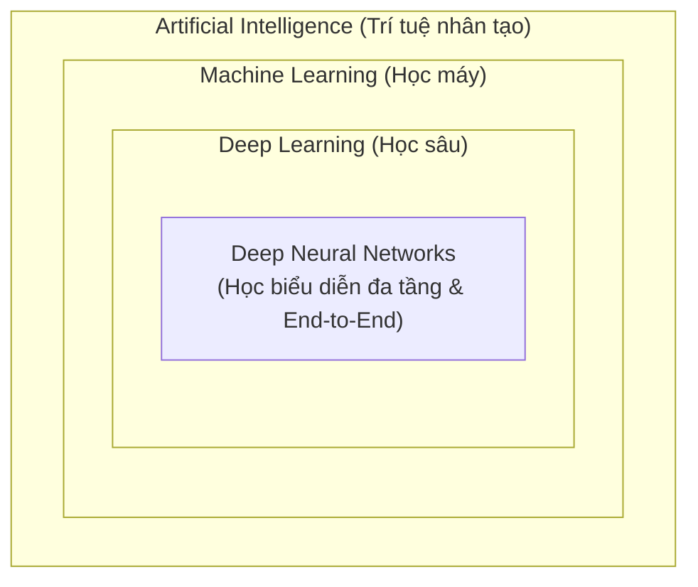
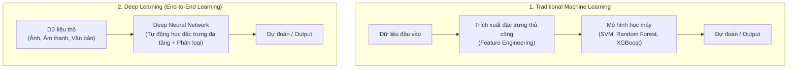
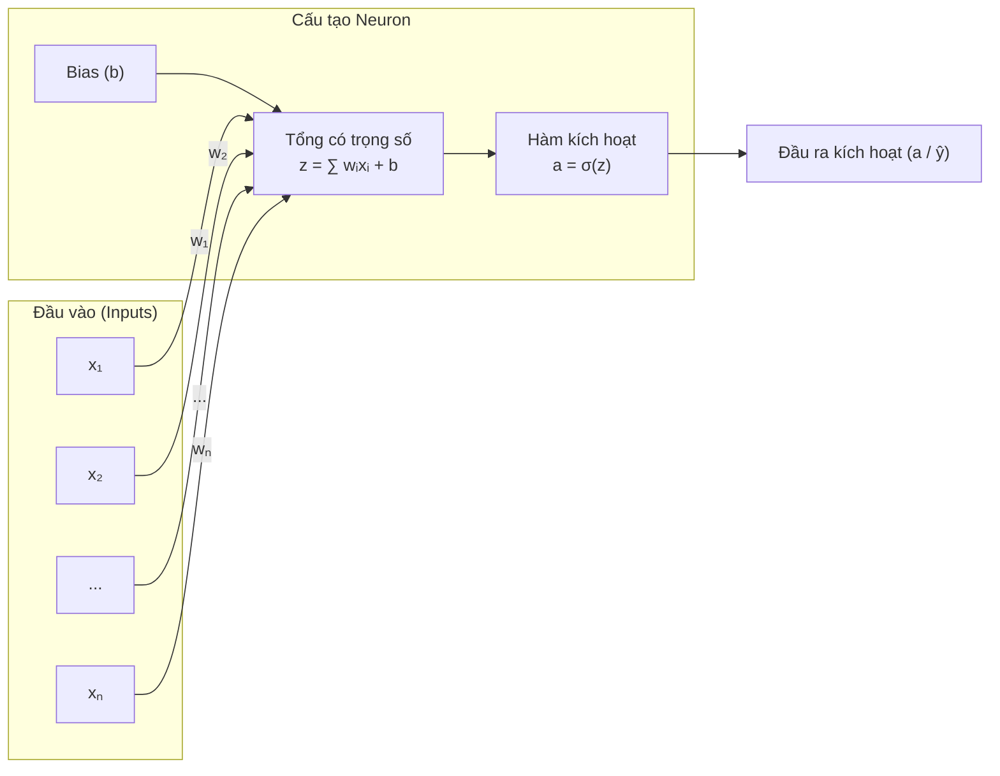
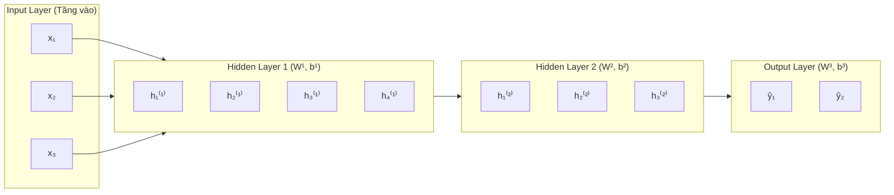
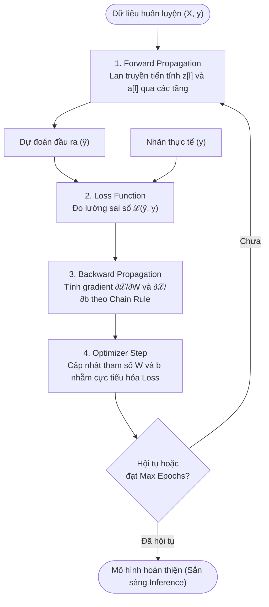
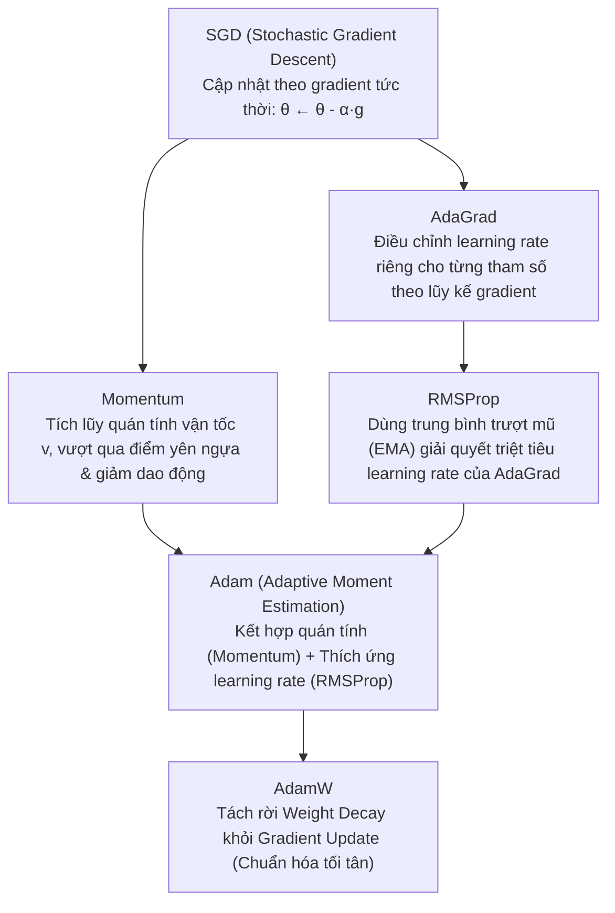
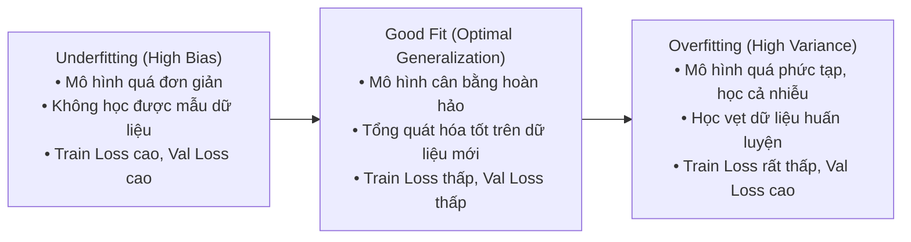
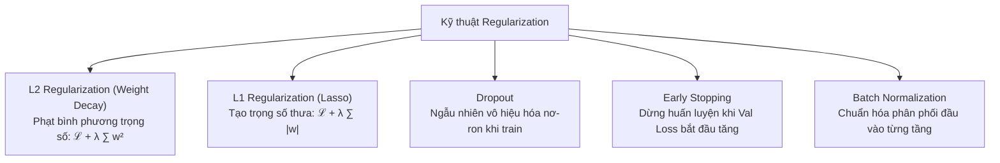
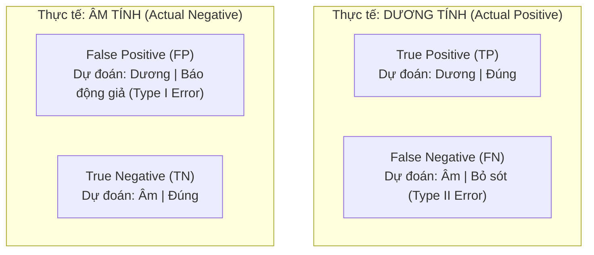
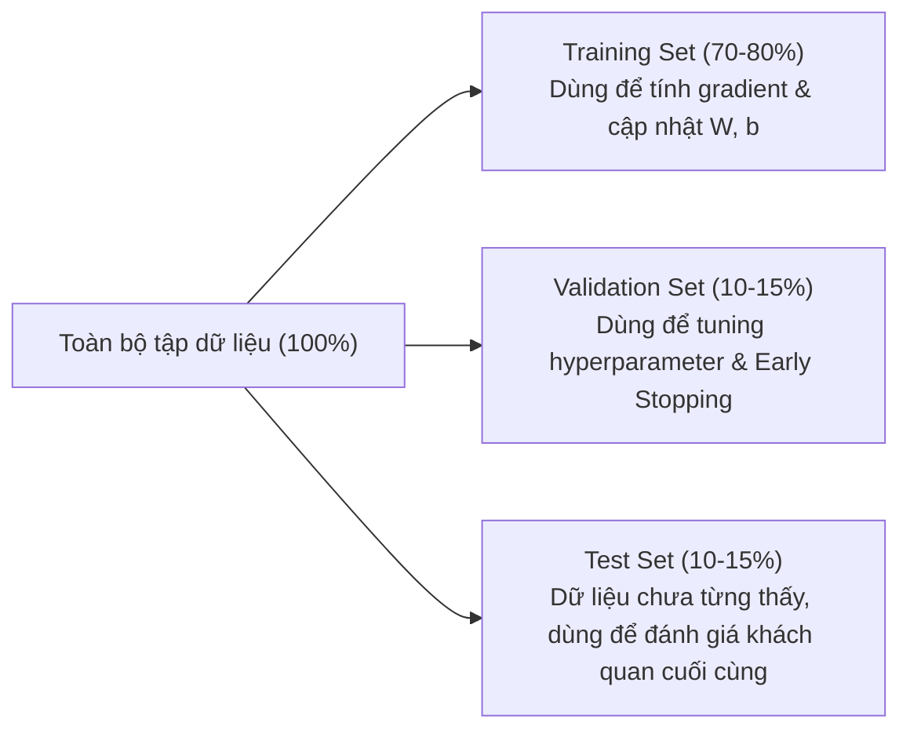

> **Deep Learning (Học sâu)** là phân nhánh cốt lõi của **Machine Learning**, ứng dụng các kiến trúc **Artificial Neural Networks (Mạng nơ-ron nhân tạo)** nhiều tầng ẩn để tự động trích xuất các biểu diễn đặc trưng phân cấp từ lượng lớn dữ liệu thô.

---

## 1. Bản chất Deep Learning & Sự khác biệt với ML truyền thống

### 1.1. Deep Learning là gì?

Deep Learning lấy cảm hứng từ cấu trúc xử lý thông tin dạng mạng lưới của vỏ não sinh học:
- **Tự động trích xuất đặc trưng (Automatic Feature Learning):** Khác với học máy truyền thống cần con người can thiệp thủ công (Feature Engineering), Deep Learning học biểu diễn dữ liệu trực tiếp từ dữ liệu thô.
- **Biểu diễn phân cấp (Hierarchical Representations):** Các tầng đầu tiên học các đặc trưng cấp thấp (đường nét, cạnh, điểm ảnh), các tầng giữa học hình khối và bộ phận, các tầng sâu cùng học các khái niệm hoàn chỉnh trừu tượng (khuôn mặt, đồ vật, ngữ nghĩa câu từ).
- **Quy mô dữ liệu & Tính toán:** Hiệu năng của Deep Learning mở rộng vượt bậc khi khối lượng dữ liệu đạt quy mô lớn (Big Data) và được hỗ trợ bởi phần cứng chuyên dụng (GPU/TPU).

### 1.2. Mối quan hệ giữa AI, Machine Learning và Deep Learning



- **Artificial Intelligence (AI):** Khái niệm bao trùm rộng nhất — nghiên cứu các hệ thống mô phỏng trí tuệ con người để thực hiện các tác vụ giải quyết vấn đề, lập luận và ra quyết định.
- **Machine Learning (ML):** Tập con của AI — tập trung vào các thuật toán thống kê có khả năng tự cải thiện hiệu suất thông qua việc học từ dữ liệu mà không cần lập trình các quy tắc cứng (rule-based).
- **Deep Learning (DL):** Tập con chuyên biệt của ML — sử dụng các mạng nơ-ron nhân tạo sâu (Deep Artificial Neural Networks) để giải quyết các bài toán có tính phi tuyến và độ phức tạp cao.

### 1.3. Traditional Machine Learning vs Deep Learning

Sự khác biệt cốt lõi nằm ở cách xử lý đặc trưng đầu vào và năng lực mở rộng mô hình:



| Tiêu chí | Traditional Machine Learning | Deep Learning |
| :--- | :--- | :--- |
| **Kỹ thuật đặc trưng (Feature Engineering)** | Thủ công, đòi hỏi chuyên gia chuyên ngành (Domain Expert) để tinh chọn đặc trưng. | Tự động hóa hoàn toàn, mô hình tự học biểu diễn từ dữ liệu thô. |
| **Loại dữ liệu sở trường** | Dữ liệu dạng bảng (Tabular / Structured data). | Dữ liệu phi cấu trúc (Unstructured: hình ảnh, video, âm thanh, văn bản). |
| **Quy mô dữ liệu (Data Scaling)** | Hiệu năng nhanh chóng chạm ngưỡng bão hòa khi tăng khối lượng dữ liệu. | Hiệu năng tiếp tục tăng trưởng mạnh khi được bổ sung dữ liệu quy mô lớn. |
| **Tài nguyên tính toán** | CPU thông thường, thời gian huấn luyện từ vài giây đến vài giờ. | Đòi hỏi năng lực xử lý song song mạnh mẽ (GPU, TPU), huấn luyện từ nhiều giờ đến nhiều tuần. |
| **Tính diễn giải (Interpretability)** | Tương đối cao (Cây quyết định, Hệ số hồi quy tuyến tính). | Mô hình "hộp đen" (Black-box), khó diễn giải chi tiết từng quyết định trọng số. |

---

## 2. Nền tảng Neural Network & Đơn vị Neuron Nhân tạo

### 2.1. Cấu trúc một Neuron Nhân tạo (Artificial Neuron)

Một nơ-ron nhân tạo (Perceptron) mô phỏng cấu chế nhận tín hiệu, tích lũy điện thế và phóng xung thần kinh:



### 2.2. Thành phần và Biểu diễn Toán học

Mỗi nơ-ron gồm 5 thành phần căn bản:
1. **Inputs ($\mathbf{x}$):** Vector đầu vào $\mathbf{x} = [x_1, x_2, \dots, x_n]^T$.
2. **Weights ($\mathbf{w}$):** Vector trọng số tương ứng $\mathbf{w} = [w_1, w_2, \dots, w_n]^T$, biểu thị mức độ ảnh hưởng của từng đặc trưng.
3. **Bias ($b$):** Hệ số điều chỉnh độ lệch (ngưỡng kích hoạt độc lập với đầu vào).
4. **Hàm tuyến tính (Affine Transformation):**
   $$z = \sum_{i=1}^n w_i x_i + b = \mathbf{w}^T \mathbf{x} + b$$
5. **Hàm kích hoạt (Activation Function $\sigma$):** Ánh xạ $z$ qua một hàm phi tuyến để tạo đầu ra $a$:
   $$a = \sigma(z)$$

### 2.3. Ví dụ tính toán số học chi tiết

Giả sử ta có một nơ-ron đơn lẻ nhận 3 đặc trưng đầu vào:
- **Inputs:** $x_1 = 1.0, \quad x_2 = 2.0, \quad x_3 = 3.0$
- **Weights:** $w_1 = 0.2, \quad w_2 = 0.5, \quad w_3 = -0.3$
- **Bias:** $b = 0.1$
- **Hàm kích hoạt:** $\text{ReLU}(z) = \max(0, z)$

**Bước 1: Tính tổng tuyến tính có trọng số $z$**
$$z = (1.0 \times 0.2) + (2.0 \times 0.5) + (3.0 \times -0.3) + 0.1$$
$$z = 0.2 + 1.0 - 0.9 + 0.1 = 0.4$$

**Bước 2: Áp dụng hàm kích hoạt $\text{ReLU}$**
$$a = \text{ReLU}(0.4) = \max(0, 0.4) = 0.4$$

Đầu ra của nơ-ron này là $a = 0.4$.

---

## 3. Hàm kích hoạt (Activation Functions)

### 3.1. Vì sao mạng nơ-ron bắt buộc cần Activation Function?

Nếu không có hàm kích hoạt phi tuyến, việc xếp chồng nhiều tầng nơ-ron tuyến tính chỉ tương đương với một phép biến đổi tuyến tính đơn lẻ:
$$\mathbf{W}_2 (\mathbf{W}_1 \mathbf{x} + \mathbf{b}_1) + \mathbf{b}_2 = (\mathbf{W}_2 \mathbf{W}_1) \mathbf{x} + (\mathbf{W}_2 \mathbf{b}_1 + \mathbf{b}_2) = \mathbf{W}_{\text{comb}} \mathbf{x} + \mathbf{b}_{\text{comb}}$$
Mạng nơ-ron dù sâu bao nhiêu cũng sẽ suy biến thành một mô hình hồi quy tuyến tính (Linear Regression), mất hoàn toàn khả năng mô hình hóa các bề mặt quyết định phức tạp trong thế giới thực.

### 3.2. Bảng so sánh các hàm kích hoạt phổ biến

| Hàm kích hoạt | Công thức toán | Miền giá trị | Đạo hàm chính | Ưu & Nhược điểm chính | Vị trí khuyến nghị |
| :--- | :--- | :--- | :--- | :--- | :--- |
| **Sigmoid** | $\sigma(z) = \frac{1}{1 + e^{-z}}$ | $(0, 1)$ | $\sigma(z)(1 - \sigma(z))$ | • Dễ triệt tiêu gradient (Vanishing Gradient)<br/>• Không có tâm tại 0 (Not zero-centered) | Tầng ra (Output layer) cho phân loại nhị phân |
| **Tanh** | $\tanh(z) = \frac{e^z - e^{-z}}{e^z + e^{-z}}$ | $(-1, 1)$ | $1 - \tanh^2(z)$ | • Zero-centered giúp hội tụ nhanh hơn Sigmoid<br/>• Vẫn gặp Vanishing Gradient ở 2 vùng bão hòa | Tầng ẩn trong RNN hoặc mạng phân loại cơ bản |
| **ReLU** | $\max(0, z)$ | $[0, +\infty)$ | $\begin{cases} 1 & \text{khi } z > 0 \\ 0 & \text{khi } z < 0 \end{cases}$ | • Tính toán cực nhanh, giải quyết triệt tiêu gradient<br/>• Lỗi "Dying ReLU" khi nơ-ron nhận $z \le 0$ liên tục | Lựa chọn mặc định tiêu chuẩn cho các Hidden Layers |
| **Leaky ReLU** | $\max(\alpha z, z), \alpha \approx 0.01$ | $(-\infty, +\infty)$ | $\begin{cases} 1 & \text{khi } z > 0 \\ \alpha & \text{khi } z < 0 \end{cases}$ | • Khắc phục triệt để Dying ReLU bằng độ dốc nhỏ $\alpha$ khi $z < 0$ | Thay thế ReLU khi gặp hiện tượng chết nơ-ron |
| **Softmax** | $\frac{e^{z_i}}{\sum_{j=1}^K e^{z_j}}$ | $(0, 1), \sum=1$ | $\frac{\partial S_i}{\partial z_j} = S_i(\delta_{ij} - S_j)$ | • Biến đổi vector logits thành phân phối xác suất | Tầng ra (Output layer) cho phân loại đa lớp (Multi-class) |

### 3.3. Cài đặt Python chuẩn hóa với NumPy

```python
import numpy as np

def sigmoid(z: np.ndarray) -> np.ndarray:
    return 1.0 / (1.0 + np.exp(-np.clip(z, -500, 500)))

def tanh(z: np.ndarray) -> np.ndarray:
    return np.tanh(z)

def relu(z: np.ndarray) -> np.ndarray:
    return np.maximum(0.0, z)

def leaky_relu(z: np.ndarray, alpha: float = 0.01) -> np.ndarray:
    return np.where(z > 0, z, alpha * z)

def softmax(z: np.ndarray) -> np.ndarray:
    # Trừ giá trị cực đại để chống tràn số (Numerical Stability)
    exp_z = np.exp(z - np.max(z, axis=-1, keepdims=True))
    return exp_z / np.sum(exp_z, axis=-1, keepdims=True)
```

---

## 4. Kiến trúc Mạng Nơ-ron Sâu (Deep Neural Networks)

### 4.1. Cấu trúc tổng thể của Deep Neural Network (DNN / MLP)

Một mạng nơ-ron sâu chuẩn bao gồm một **Input Layer**, nhiều **Hidden Layers** và một **Output Layer**:



### 4.2. Lan truyền tiến dưới dạng Ma trận (Matrix Forward Propagation)

Với tầng thứ $l$ trong mạng:
- $\mathbf{a}^{[l-1]}$ là vector đầu ra kích hoạt của tầng trước (với $\mathbf{a}^{[0]} = \mathbf{x}$).
- $\mathbf{W}^{[l]}$ là ma trận trọng số kích thước $(n^{[l]} \times n^{[l-1]})$.
- $\mathbf{b}^{[l]}$ là vector bias kích thước $(n^{[l]} \times 1)$.

Quy trình lan truyền tiến:
$$\mathbf{z}^{[l]} = \mathbf{W}^{[l]} \mathbf{a}^{[l-1]} + \mathbf{b}^{[l]}$$
$$\mathbf{a}^{[l]} = \sigma^{[l]}(\mathbf{z}^{[l]})$$

Đầu ra của toàn bộ mạng $L$ tầng là:
$$\hat{\mathbf{y}} = \mathbf{a}^{[L]} = \sigma^{[L]}\left(\mathbf{W}^{[L]} \dots \sigma^{[1]}(\mathbf{W}^{[1]} \mathbf{x} + \mathbf{b}^{[1]}) \dots + \mathbf{b}^{[L]}\right)$$

### 4.3. Công thức tính tổng số tham số huấn luyện (Trainable Parameters)

Giữa tầng trước có $n_{\text{in}}$ nơ-ron và tầng sau có $n_{\text{out}}$ nơ-ron:
$$\text{Params} = (n_{\text{in}} \times n_{\text{out}}) + n_{\text{out}}$$
Trong đó:
- $(n_{\text{in}} \times n_{\text{out}})$ là tổng số trọng số liên kết (weights).
- $n_{\text{out}}$ là số lượng bias tương ứng với mỗi nơ-ron tầng đích.

**Ví dụ thực tế:** Mạng phân loại chữ số viết tay MNIST với ảnh $28 \times 28$:
- **Input:** $784$ nơ-ron.
- **Hidden 1:** $128$ nơ-ron $\to (784 \times 128) + 128 = 100{,}480$ tham số.
- **Hidden 2:** $64$ nơ-ron $\to (128 \times 64) + 64 = 8{,}256$ tham số.
- **Output:** $10$ nơ-ron $\to (64 \times 10) + 10 = 650$ tham số.
- **Tổng cộng:** $109{,}386$ tham số có thể huấn luyện.

---

## 5. Cơ chế Huấn luyện: Loss Functions & Backpropagation

### 5.1. Chu trình Huấn luyện hoàn chỉnh (The End-to-End Training Loop)

Quá trình học của mạng nơ-ron là một vòng lặp liên tục gồm 4 giai đoạn khép kín:



### 5.2. Các hàm mất mát (Loss Functions) tiêu chuẩn

Hàm mất mát lượng hóa mức độ sai lệch giữa dự đoán của mạng ($\hat{y}$) và nhãn thực tế ($y$):

#### 1. Mean Squared Error (MSE) — Bài toán Hồi quy (Regression)
$$\mathcal{L}_{\text{MSE}} = \frac{1}{N} \sum_{i=1}^N (y_i - \hat{y}_i)^2$$
Đặc tính: Nhạy cảm với nhiễu và ngoại lai (outliers) do phạt theo bình phương sai số.

#### 2. Binary Cross-Entropy (BCE) — Phân loại nhị phân (Binary Classification)
$$\mathcal{L}_{\text{BCE}} = -\frac{1}{N} \sum_{i=1}^N \left[ y_i \log(\hat{y}_i) + (1 - y_i) \log(1 - \hat{y}_i) \right]$$
Kết hợp hoàn hảo với hàm kích hoạt **Sigmoid** ở tầng ra.

#### 3. Categorical Cross-Entropy (CCE) — Phân loại đa lớp (Multi-class Classification)
$$\mathcal{L}_{\text{CCE}} = -\frac{1}{N} \sum_{i=1}^N \sum_{k=1}^K y_{i, k} \log(\hat{y}_{i, k})$$
Trong đó $K$ là số lớp, nhãn $y$ được mã hóa dưới dạng One-Hot vector. Kết hợp chuẩn với hàm **Softmax**.

### 5.3. Lan truyền ngược (Backpropagation) & Quy tắc chuỗi (Chain Rule)

Backpropagation sử dụng **Quy tắc chuỗi (Chain Rule)** trong vi tích phân để tính đạo hàm riêng của hàm mất mát đối với từng trọng số và bias:

1. **Sai số tại tầng ra $L$:**
   $$\boldsymbol{\delta}^{[L]} = \nabla_{\mathbf{a}^{[L]}} \mathcal{L} \odot {\sigma^{[L]}}'(\mathbf{z}^{[L]})$$
   *(với $\odot$ là phép nhân từng phần tử - Hadamard Product).*

2. **Lan truyền sai số ngược về các tầng ẩn $l$ ($l = L-1, L-2, \dots, 1$):**
   $$\boldsymbol{\delta}^{[l]} = \left( (\mathbf{W}^{[l+1]})^T \boldsymbol{\delta}^{[l+1]} \right) \odot {\sigma^{[l]}}'(\mathbf{z}^{[l]})$$

3. **Gradient đối với Weights và Biases tại tầng $l$:**
   $$\frac{\partial \mathcal{L}}{\partial \mathbf{W}^{[l]}} = \boldsymbol{\delta}^{[l]} (\mathbf{a}^{[l-1]})^T, \qquad \frac{\partial \mathcal{L}}{\partial \mathbf{b}^{[l]}} = \boldsymbol{\delta}^{[l]}$$

4. **Cập nhật tham số cơ bản (Gradient Descent):**
   $$\mathbf{W}^{[l]} \leftarrow \mathbf{W}^{[l]} - \alpha \frac{\partial \mathcal{L}}{\partial \mathbf{W}^{[l]}}, \qquad \mathbf{b}^{[l]} \leftarrow \mathbf{b}^{[l]} - \alpha \frac{\partial \mathcal{L}}{\partial \mathbf{b}^{[l]}}$$
   *(với $\alpha > 0$ là tốc độ học - Learning Rate).*

---

## 6. Các thuật toán tối ưu hóa (Optimizers)

### 6.1. Tiến hóa của các thuật toán tối ưu

Thuật toán tối ưu quyết định tốc độ và độ ổn định khi cập nhật trọng số hướng về cực tiểu toàn cục:



### 6.2. Công thức và Cơ chế hoạt động

#### 1. SGD with Momentum
Thêm "quán tính" từ các bước đi trước đó nhằm vượt qua các điểm cực tiểu địa phương nông và điểm yên ngựa (saddle points):
$$\mathbf{v}_t = \beta \mathbf{v}_{t-1} + (1 - \beta) \mathbf{g}_t$$
$$\boldsymbol{\theta}_t = \boldsymbol{\theta}_{t-1} - \alpha \mathbf{v}_t$$
*(Thường chọn $\beta \approx 0.9$).*

#### 2. RMSProp (Root Mean Square Propagation)
Điều chỉnh tốc độ học cho từng tham số bằng cách chia cho căn bậc hai trung bình trượt mũ của bình phương gradient:
$$\mathbf{s}_t = \beta_2 \mathbf{s}_{t-1} + (1 - \beta_2) \mathbf{g}_t^2$$
$$\boldsymbol{\theta}_t = \boldsymbol{\theta}_{t-1} - \frac{\alpha}{\sqrt{\mathbf{s}_t} + \epsilon} \mathbf{g}_t$$

#### 3. Adam (Adaptive Moment Estimation)
Kết hợp cả ước lượng moment bậc 1 (kỳ vọng hướng đi - Momentum) và moment bậc 2 (kỳ vọng độ lớn biến thiên - RMSProp):
- **Moment bậc 1:** $\mathbf{m}_t = \beta_1 \mathbf{m}_{t-1} + (1 - \beta_1) \mathbf{g}_t$
- **Moment bậc 2:** $\mathbf{v}_t = \beta_2 \mathbf{v}_{t-1} + (1 - \beta_2) \mathbf{g}_t^2$
- **Hiệu chỉnh độ lệch khởi tạo (Bias Correction):**
  $$\hat{\mathbf{m}}_t = \frac{\mathbf{m}_t}{1 - \beta_1^t}, \qquad \hat{\mathbf{v}}_t = \frac{\mathbf{v}_t}{1 - \beta_2^t}$$
- **Cập nhật tham số:**
  $$\boldsymbol{\theta}_t = \boldsymbol{\theta}_{t-1} - \frac{\alpha}{\sqrt{\hat{\mathbf{v}}_t} + \epsilon} \hat{\mathbf{m}}_t$$
  *(Tham số tiêu chuẩn: $\beta_1 = 0.9, \beta_2 = 0.999, \epsilon = 10^{-8}, \alpha = 10^{-3}$).*

### 6.3. Bảng so sánh các Optimizer

| Optimizer | Tốc độ hội tụ | Tiêu tốn bộ nhớ | Mức độ nhạy cảm với Learning Rate | Tình huống sử dụng phù hợp |
| :--- | :--- | :--- | :--- | :--- |
| **Vanilla SGD** | Chậm, dễ dao động | Thấp nhất (0 biến phụ) | Rất cao | Hiếm khi dùng trực tiếp |
| **SGD + Momentum** | Trung bình - Nhanh | Thấp (Lưu trữ thêm vector $\mathbf{v}$) | Cao | Computer Vision (khi cần generalization cao nhất) |
| **RMSProp** | Nhanh | Trung bình (Lưu trữ thêm vector $\mathbf{s}$) | Trung bình | RNN, xử lý chuỗi phi dừng |
| **Adam** | Rất nhanh | Cao (Lưu trữ cả $\mathbf{m}$ và $\mathbf{v}$) | Thấp (Robust) | **Lựa chọn mặc định số 1** cho hầu hết tác vụ |
| **AdamW** | Rất nhanh | Cao | Thấp | Transformer, LLM, mô hình thị giác hiện đại |

### 6.4. Cài đặt Mini End-to-End Training Loop với Thuần NumPy

Để thấy rõ cách kết hợp giữa Lan truyền tiến (**Forward Propagation**), Hàm mất mát (**BCE Loss**), Lan truyền ngược (**Backpropagation**) và Bộ tối ưu hóa (**Adam Optimizer**), dưới đây là đoạn mã thực thi hoàn chỉnh huấn luyện một mạng nơ-ron 2 tầng (2 $\to$ 16 $\to$ 1) trên tập dữ liệu phi tuyến (2 vòng tròn đồng tâm):

```python
import numpy as np

def generate_synthetic_data(n_samples: int = 200, seed: int = 42):
    """Sinh tập dữ liệu 2 vòng tròn đồng tâm phi tuyến tính (Concentric Circles)."""
    np.random.seed(seed)
    half = n_samples // 2

    # Vòng tròn trong (Lớp 0)
    r_in = np.random.uniform(0.0, 0.45, half)
    theta_in = np.random.uniform(0, 2 * np.pi, half)
    x_in = np.stack([r_in * np.cos(theta_in), r_in * np.sin(theta_in)], axis=1)
    y_in = np.zeros((half, 1))

    # Vòng tròn ngoài (Lớp 1)
    r_out = np.random.uniform(0.7, 1.15, half)
    theta_out = np.random.uniform(0, 2 * np.pi, half)
    x_out = np.stack([r_out * np.cos(theta_out), r_out * np.sin(theta_out)], axis=1)
    y_out = np.ones((half, 1))

    X = np.vstack([x_in, x_out])
    y = np.vstack([y_in, y_out])

    # Xáo trộn dữ liệu (Shuffle)
    indices = np.random.permutation(n_samples)
    return X[indices], y[indices]


def train_mlp_end_to_end():
    # 1. Chuẩn bị dữ liệu
    X, y = generate_synthetic_data(n_samples=250, seed=42)
    n_samples = X.shape[0]

    # 2. Khởi tạo tham số mạng (Architecture: 2 -> 16 -> 1) với He Initialization
    np.random.seed(42)
    d_in, d_hidden, d_out = 2, 16, 1
    W1 = np.random.randn(d_in, d_hidden) * np.sqrt(2.0 / d_in)
    b1 = np.zeros((1, d_hidden))
    W2 = np.random.randn(d_hidden, d_out) * np.sqrt(2.0 / d_hidden)
    b2 = np.zeros((1, d_out))

    # Khởi tạo trạng thái bộ tối ưu hóa Adam
    mW1, vW1 = np.zeros_like(W1), np.zeros_like(W1)
    mb1, vb1 = np.zeros_like(b1), np.zeros_like(b1)
    mW2, vW2 = np.zeros_like(W2), np.zeros_like(W2)
    mb2, vb2 = np.zeros_like(b2), np.zeros_like(b2)

    lr = 0.05
    beta1, beta2, eps = 0.9, 0.999, 1e-8
    epochs = 200

    print("=== BẮT ĐẦU HUẤN LUYỆN MINI NEURAL NETWORK (ADAM OPTIMIZER) ===")
    for epoch in range(1, epochs + 1):
        # --- A. FORWARD PROPAGATION ---
        z1 = X @ W1 + b1
        a1 = np.maximum(0.0, z1)                       # ReLU activation
        z2 = a1 @ W2 + b2
        z2_clip = np.clip(z2, -500.0, 500.0)
        y_hat = 1.0 / (1.0 + np.exp(-z2_clip))         # Sigmoid output

        # --- B. LOSS COMPUTATION (Binary Cross-Entropy) ---
        eps_loss = 1e-12
        loss = -np.mean(y * np.log(y_hat + eps_loss) + (1.0 - y) * np.log(1.0 - y_hat + eps_loss))

        # --- C. BACKPROPAGATION ---
        # Đạo hàm BCE kết hợp Sigmoid: dL/dz2 = (y_hat - y) / N
        dz2 = (y_hat - y) / n_samples
        dW2 = a1.T @ dz2
        db2 = np.sum(dz2, axis=0, keepdims=True)

        da1 = dz2 @ W2.T
        dz1 = da1 * (z1 > 0).astype(float)             # Đạo hàm ReLU
        dW1 = X.T @ dz1
        db1 = np.sum(dz1, axis=0, keepdims=True)

        # --- D. ADAM OPTIMIZER UPDATE ---
        for param, grad, m, v in [
            (W1, dW1, mW1, vW1), (b1, db1, mb1, vb1),
            (W2, dW2, mW2, vW2), (b2, db2, mb2, vb2)
        ]:
            m[:] = beta1 * m + (1.0 - beta1) * grad
            v[:] = beta2 * v + (1.0 - beta2) * (grad ** 2)
            m_hat = m / (1.0 - beta1 ** epoch)          # Hiệu chỉnh độ lệch khởi tạo
            v_hat = v / (1.0 - beta2 ** epoch)
            param -= lr * m_hat / (np.sqrt(v_hat) + eps)

        # In tiến trình mỗi 40 epochs
        if epoch % 40 == 0 or epoch == 1:
            preds = (y_hat >= 0.5).astype(int)
            acc = np.mean(preds == y) * 100.0
            print(f"Epoch {epoch:3d}/{epochs} - Loss: {loss:.5f} - Training Accuracy: {acc:.2f}%")

    # Đánh giá cuối cùng
    final_preds = (y_hat >= 0.5).astype(int)
    final_acc = np.mean(final_preds == y) * 100.0
    print(f"\n=> Kết quả sau {epochs} epochs: Final Loss = {loss:.5f}, Accuracy = {final_acc:.2f}%")
    return {"final_loss": loss, "final_accuracy": final_acc}

if __name__ == "__main__":
    train_mlp_end_to_end()
```

---

## 7. Kiểm soát Overfitting & Kỹ thuật Regularization

### 7.1. Phổ đánh đổi Bias - Variance (Underfitting vs Overfitting)



### 7.2. Các giải pháp Regularization thông dụng



#### 1. L2 Regularization (Weight Decay)
Thêm hình phạt bằng tổng bình phương độ lớn của trọng số vào hàm mất mát:
$$\mathcal{L}_{\text{total}} = \mathcal{L}_0 + \frac{\lambda}{2N} \sum_w w^2$$
- Kéo các trọng số về gần 0 nhưng không triệt tiêu hẳn.
- Ngăn mô hình phụ thuộc quá mức vào bất kỳ đặc trưng riêng lẻ nào.

#### 2. L1 Regularization (Lasso)
Thêm hình phạt bằng tổng giá trị tuyệt đối:
$$\mathcal{L}_{\text{total}} = \mathcal{L}_0 + \frac{\lambda}{N} \sum_w |w|$$
- Triệt tiêu nhiều trọng số về đúng bằng 0, tạo tính chất thưa (Sparsity) và hỗ trợ lựa chọn đặc trưng tự động.

#### 3. Dropout
Trong mỗi lượt huấn luyện (Training pass), mỗi nơ-ron có xác suất $p$ bị ngắt kết nối ngẫu nhiên:
- Triệt tiêu sự phụ thuộc chéo (Co-adaptation) giữa các nơ-ron lân cận.
- Tương đương với việc huấn luyện một quần thể (Ensemble) vô số mạng nơ-ron con kích thước nhỏ hơn.
- **Lưu ý:** Khi suy luận (Inference/Evaluation), tất cả các nơ-ron luôn được bật và đầu ra được nhân với hệ số điều chỉnh $(1 - p)$.

#### 4. Early Stopping
Theo dõi giá trị mất mát trên tập kiểm định (**Validation Loss**): Dừng quá trình huấn luyện tại thời điểm Validation Loss bắt đầu tăng trở lại liên tục qua $k$ epochs (patience), tránh để mô hình bước vào vùng ghi nhớ nhiễu.

---

## 8. Quá trình Huấn luyện & Đánh giá Mô hình

### 8.1. Các khái niệm cốt lõi: Epoch, Batch Size, Iterations

- **Epoch:** Một chu kỳ duyệt qua toàn bộ $100\%$ các mẫu trong tập dữ liệu huấn luyện.
- **Batch Size:** Số lượng mẫu dữ liệu được đưa vào mạng để tính toán gradient và cập nhật trọng số trong một lần.
- **Iteration:** Số lần cập nhật tham số (bằng $\frac{\text{Tổng số mẫu}}{\text{Batch Size}}$ trong một Epoch).

### 8.2. Ma trận nhầm lẫn (Confusion Matrix)

Dành cho các bài toán phân loại nhị phân và đa lớp:



### 8.3. Metrics đánh giá phân loại (Classification Metrics)

| Chỉ số | Công thức toán | Ý nghĩa & Ứng dụng |
| :--- | :--- | :--- |
| **Accuracy** | $\frac{\text{TP} + \text{TN}}{\text{TP} + \text{TN} + \text{FP} + \text{FN}}$ | Tỷ lệ đoán đúng tổng thể. **Chỉ dùng khi các lớp cân bằng**. |
| **Precision** | $\frac{\text{TP}}{\text{TP} + \text{FP}}$ | Trong những mẫu đoán là Dương, có bao nhiêu mẫu đúng thật? Dùng khi chi phí báo động giả cao (lọc thư rác Spam). |
| **Recall (Sensitivity)** | $\frac{\text{TP}}{\text{TP} + \text{FN}}$ | Trong toàn bộ mẫu thực sự Dương, mô hình tìm ra được bao nhiêu? Dùng khi không được bỏ sót (chẩn đoán bệnh, phát hiện gian lận). |
| **F1-Score** | $2 \times \frac{\text{Precision} \times \text{Recall}}{\text{Precision} + \text{Recall}}$ | Trung bình điều hòa giữa Precision và Recall. Chuẩn mực vàng cho dữ liệu mất cân bằng (Imbalanced data). |
| **ROC-AUC** | Diện tích dưới đường cong ROC | Đo lường năng lực phân tách giữa các lớp ở mọi ngưỡng cắt xác suất (threshold-independent). |

### 8.4. Metrics đánh giá hồi quy (Regression Metrics)

- **MAE (Mean Absolute Error):** $\frac{1}{N} \sum_{i=1}^N |y_i - \hat{y}_i|$ — Sai số trung bình tuyệt đối, ít bị méo bởi outliers.
- **MSE (Mean Squared Error):** $\frac{1}{N} \sum_{i=1}^N (y_i - \hat{y}_i)^2$ — Phạt nặng các sai lệch lớn.
- **RMSE (Root Mean Squared Error):** $\sqrt{\text{MSE}}$ — Cùng đơn vị đo lường với biến mục tiêu ban đầu.
- **$R^2$ Score (Coefficient of Determination):** $1 - \frac{\sum (y_i - \hat{y}_i)^2}{\sum (y_i - \bar{y})^2}$ — Mức độ giải thích phương sai của mô hình (thang điểm tối đa là $1.0$).

### 8.5. Chiến lược phân chia dữ liệu (Data Split)



---

## 9. Quy trình End-to-End & Best Practices thực chiến

### 9.1. Sơ đồ quy trình thực hiện một dự án Deep Learning


### 9.2. Những sai lầm kinh điển cần tránh

1. **Rò rỉ dữ liệu (Data Leakage):** Thực hiện chuẩn hóa dữ liệu (Scaling/Normalization) trên toàn bộ tập dữ liệu trước khi chia Train/Val/Test. Phải luôn fit scaler chỉ trên tập Train rồi transform sang Val và Test.
2. **Bỏ qua Feature Scaling:** Đầu vào không được chuẩn hóa khiến bề mặt mất mát bị méo mó, gradient dao động dữ dội và làm chậm quá trình hội tụ.
3. **Mô hình quá phức tạp so với kích thước dữ liệu:** Sử dụng mạng hàng chục triệu tham số cho tập dữ liệu chỉ có vài nghìn mẫu dẫn đến Overfitting nghiêm trọng.
4. **Không theo dõi đồng thời Training Loss và Validation Loss:** Chỉ nhìn vào Training Loss sẽ dẫn đến ảo tưởng mô hình đang học tốt trong khi nó đang học vẹt nhiễu.
5. **Chọn sai hàm kích hoạt và hàm mất mát ở tầng ra:**
   - Phân loại nhị phân: Tầng ra `Sigmoid` + Loss `Binary Cross-Entropy`.
   - Phân loại đa lớp rời rạc: Tầng ra `Softmax` + Loss `Categorical Cross-Entropy`.
   - Hồi quy giá trị liên tục: Tầng ra `Linear` + Loss `MSE` hoặc `Huber`.

### 9.3. Cẩm nang Công cụ & Hệ sinh thái Thư viện

- **Core Deep Learning Frameworks:** `PyTorch` (linh hoạt, chuẩn nghiên cứu và công nghiệp), `TensorFlow / Keras` (hệ sinh thái triển khai mạnh mẽ).
- **Computer Vision & NLP:** `torchvision`, `timm`, `HuggingFace Transformers`, `OpenCV`.
- **Thử nghiệm & Giám sát:** `Weights & Biases (W&B)`, `TensorBoard`, `MLflow`.
- **Dữ liệu & Tiền xử lý:** `NumPy`, `Pandas`, `scikit-learn`.

---

Xem thêm các bài viết liên quan: [[Nền tảng Machine Learning: Từ Đại số Tuyến tính, Tối ưu hóa đến Thuật toán Dự đoán]] và [[Xây dựng CI/CD Pipeline Tự động Đánh giá RAG trong Production]].
