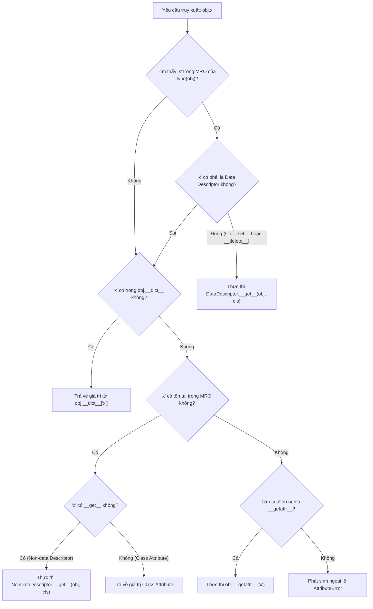
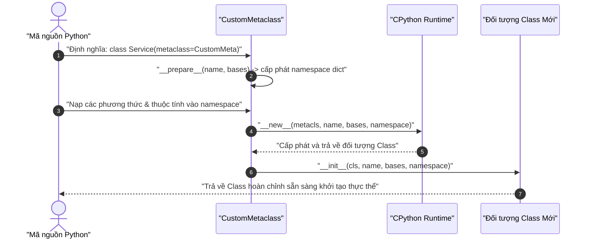
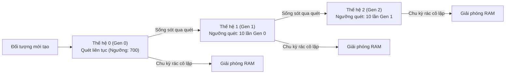

Python thường được biết đến là một ngôn ngữ bậc cao có cú pháp trực quan, dễ tiếp cận cho người mới bắt đầu. Tuy nhiên, đằng sau sự linh hoạt của cú pháp `obj.attr` hay các decorator quen thuộc như `@property`, `@classmethod` là cả một kiến trúc máy ảo CPython cực kỳ tinh vi.

Để chuyển đổi từ mức độ "sử dụng thành thạo" sang "làm chủ kiến trúc", kỹ sư phần mềm cần thấu hiểu bốn trụ cột nền tảng điều khiển thế giới nội tại của Python:
1. **Giao thức Descriptor (Descriptor Protocol)**: Cốt lõi của mọi hành vi truy xuất thuộc tính và phương thức trong hệ thống hướng đối tượng.
2. **Thứ tự giải quyết thuộc tính (Attribute Lookup Resolution)**: Cách hàm `__getattribute__` duyệt qua MRO, Data Descriptors, instance dictionary và Non-data Descriptors.
3. **Metaclasses và Vòng đời Kiến tạo Lớp**: Cơ chế lập trình siêu dữ liệu (Metaprogramming) nơi bản thân class là thực thể được sinh ra và tùy biến động.
4. **Quản lý Bộ nhớ và Global Interpreter Lock (GIL)**: Bản chất của bộ đếm tham chiếu (Reference Counting), bộ thu gom rác thế hệ (Generational GC) và giới hạn đồng thời trong môi trường đa luồng.

Bài viết này đi sâu khảo sát chi tiết từng cấu phần kiến trúc trên với các mô hình toán học, sơ đồ quyết định Mermaid, bảng so sánh kỹ thuật và mã nguồn Python 3.12 thực thi độc lập.

---

## 1. Giao thức Descriptor và Cơ chế Thuộc tính

Trong lập trình hướng đối tượng truyền thống (như Java hay C++), việc truy xuất thuộc tính `obj.x` thường là một thao tác đọc trực tiếp ô nhớ được định vị bởi con trỏ offset. Nhưng trong Python, phép truy xuất `obj.x` là một lời gọi hàm trừu tượng cấp cao được điều khiển bởi **Giao thức Descriptor (Descriptor Protocol)**.

### Bản chất của Giao thức Descriptor

Một Descriptor là một đối tượng Python bất kỳ có hiện thực hóa ít nhất một trong ba phương thức ma thuật (magic methods) sau:

```python
def __get__(self, instance, owner=None) -> Any: ...
def __set__(self, instance, value) -> None: ...
def __delete__(self, instance) -> None: ...
```

Trong đó:
- `self`: Chính là thực thể của bản thân Descriptor class (thường được gắn ở phạm vi class attribute của lớp chứa nó).
- `instance`: Thực thể của lớp đối tượng đang thực hiện truy xuất thuộc tính (nếu gọi từ class như `MyClass.attr`, `instance` sẽ là `None`).
- `owner`: Lớp sở hữu descriptor (chính là `MyClass`).

### Phân loại Data Descriptors và Non-data Descriptors

Python phân biệt rạch ròi giữa hai nhóm Descriptor với mức độ ưu tiên tra cứu hoàn toàn khác nhau:

1. **Data Descriptor**: Một descriptor có định nghĩa phương thức `__set__` hoặc `__delete__` (hoặc cả hai). Ngay cả khi `__set__` chỉ đơn thuần quăng ngoại lệ `AttributeError` (để tạo thuộc tính chỉ đọc - Read-only Descriptor), đối tượng đó vẫn được coi là Data Descriptor.
2. **Non-data Descriptor**: Một descriptor chỉ định nghĩa phương thức `__get__` duy nhất mà không có `__set__` hay `__delete__`.

Sự khác biệt mang tính quyết định nằm ở vị trí ưu tiên khi xung đột với từ điển thể hiện `__dict__` của đối tượng:
- Nếu một thuộc tính là **Data Descriptor**, Python luôn gọi `__get__` / `__set__` của descriptor và **bỏ qua hoàn toàn** giá trị cùng tên lưu trong `instance.__dict__`.
- Nếu thuộc tính là **Non-data Descriptor**, giá trị lưu trong `instance.__dict__` sẽ **chiếm quyền ưu tiên (shadow)** và đè lên descriptor.

| Tiêu chí | Data Descriptor | Non-data Descriptor |
|---|---|---|
| **Phương thức bắt buộc** | Có `__set__` hoặc `__delete__` | Chỉ có `__get__` duy nhất |
| **Độ ưu tiên so với `instance.__dict__`** | Cao hơn `instance.__dict__` | Thấp hơn `instance.__dict__` |
| **Khả năng bị ghi đè bởi instance** | Không thể bị ghi đè trực tiếp bởi gán thuộc tính | Bị che khuất (shadowed) khi gán `obj.x = val` |
| **Ứng dụng tiêu biểu** | `@property`, Field validation trong ORM/Pydantic | Phương thức thông thường, `@classmethod`, `@staticmethod` |

### Cách Python Hiện thực hóa Property, Method và Classmethod

Mọi người lập trình Python đều dùng hàm (methods) và decorator `@property`, nhưng ít ai nhận ra rằng: **Tất cả các hàm trong Python thực chất đều là Non-data Descriptors!**

Khi bạn định nghĩa một hàm bên trong class:
```python
class Worker:
    def work(self):
        return "working"
```
Hàm `work` là một thực thể của lớp `function`. Kiểu `function` trong CPython cài đặt sẵn phương thức `__get__`:
```python
# Mô phỏng nội bộ CPython của function.__get__
class FunctionDescriptor:
    def __init__(self, func):
        self.func = func

    def __get__(self, instance, owner=None):
        if instance is None:
            return self.func  # Truy xuất qua Class: Worker.work -> trả về unbound function
        # Truy xuất qua Instance: w.work -> liên kết instance vào đối số đầu tiên
        import types
        return types.MethodType(self.func, instance)
```

Tương tự:
- `@property`: Là một Data Descriptor hoàn chỉnh. Lớp `property` lưu trữ ba con trỏ hàm `fget`, `fset`, `fdel`. Khi bạn truy xuất `obj.prop`, phương thức `property.__get__` gọi `fget(instance)`. Khi gán `obj.prop = val`, `property.__set__` gọi `fset(instance, val)`.
- `@staticmethod`: Một Non-data Descriptor mà phương thức `__get__` trả về chính hàm nguyên thủy mà không đóng gói qua `types.MethodType`.
- `@classmethod`: Một Non-data Descriptor mà phương thức `__get__` truyền trực tiếp `owner` (tức là class `cls`) vào đối số đầu tiên thay vì `instance`.

---

## 2. Thứ tự Tra cứu Thuộc tính trong getattribute

Khi bạn viết biểu thức `obj.x`, điều gì thực sự xảy ra dưới góc độ máy ảo? Mọi truy xuất đều đi qua cổng ngõ duy nhất: `type(obj).__getattribute__(obj, 'x')`.

### Giải thuật Tra cứu Từng bước (Resolution Algorithm)

Thứ tự ưu tiên được cài đặt nghiêm ngặt theo các bước tuần tự sau:

1. **Bước 1 (Class MRO & Data Descriptor)**: Python duyệt qua Method Resolution Order (MRO) của `type(obj)`. Nếu tìm thấy một thuộc tính cùng tên `'x'` và thuộc tính đó là một **Data Descriptor**, Python lập tức thực thi `x.__get__(obj, type(obj))` và trả về kết quả.
2. **Bước 2 (Instance Dictionary)**: Nếu không có Data Descriptor ở Bước 1, Python kiểm tra trong từ điển thuộc tính riêng của thực thể `obj.__dict__`. Nếu khóa `'x'` tồn tại, giá trị tương ứng trong `__dict__` sẽ được trả về ngay lập tức.
3. **Bước 3 (Non-data Descriptor & Class Attributes)**: Nếu `'x'` không nằm trong `obj.__dict__`, Python quay lại MRO của `type(obj)`:
   - Nếu tìm thấy `'x'` và `'x'` là một **Non-data Descriptor**, thực thi `x.__get__(obj, type(obj))`.
   - Nếu `'x'` là một giá trị thông thường trên class (như biến lớp, hằng số), trả về trực tiếp giá trị đó.
4. **Bước 4 (Fallback getattr)**: Nếu tất cả các bước trên đều thất bại, Python kiểm tra xem lớp có định nghĩa phương thức `__getattr__` hay không. Nếu có, thực thi `obj.__getattr__('x')`. Nếu không, phát sinh ngoại lệ `AttributeError`.

### Sơ đồ Cây Quyết định Tra cứu Thuộc tính



Sơ đồ trên giải thích tại sao bạn không thể ghi đè một `@property` bằng cách gán `obj.__dict__['x'] = 100`, nhưng bạn hoàn toàn có thể ghi đè một method thông thường bằng cách gán `obj.my_method = lambda: "patched"`.

---

## 3. Metaclasses và Chu trình Kiến tạo Class

Trong triết lý thiết kế của Python: *"Mọi thứ đều là đối tượng (Everything is an object)"*. Một con số, một chuỗi, một hàm, và thậm chí bản thân **Lớp (Class)** cũng là một đối tượng nằm trên bộ nhớ heap.

Nếu một thực thể đối tượng được tạo ra từ một Lớp, thì Lớp được tạo ra từ đâu? Câu trả lời là: **Metaclass**.

### Điểm Kỳ dị của Kiểu Dữ liệu: type

Trong CPython, `type` đóng vai trò là metaclass mặc định của toàn bộ hệ thống kiểu. `type` sở hữu mối quan hệ tự quy chiếu (self-referential loop) độc nhất vô nhị:
```python
>>> isinstance(object, type)
True
>>> issubclass(type, object)
True
>>> isinstance(type, type)
True
```

Khi bạn sử dụng từ khóa `class MyClass:` trong mã nguồn:
```python
class MyClass(BaseClass):
    version = 1
    def greet(self):
        return "hello"
```
Trình thông dịch Python thực chất chuyển đổi đoạn mã trên thành một lời gọi hàm tới metaclass:
```python
MyClass = type("MyClass", (BaseClass,), {"version": 1, "greet": greet_func})
```

### Vòng đời Kiến tạo Lớp: __prepare__, __new__, __init__

Khi một class được định nghĩa với metaclass tùy biến:
```python
class CustomMeta(type):
    @classmethod
    def __prepare__(metacls, name, bases, **kwds):
        # 1. Chuẩn bị namespace trước khi nạp thân class
        return dict()

    def __new__(metacls, name, bases, namespace, **kwds):
        # 2. Cấp phát vùng nhớ và kiến tạo đối tượng Class
        cls_instance = super().__new__(metacls, name, bases, namespace)
        return cls_instance

    def __init__(cls, name, bases, namespace, **kwds):
        # 3. Khởi tạo thuộc tính cho đối tượng Class vừa tạo
        super().__init__(name, bases, namespace)
```

Quy trình thực thi diễn ra tuần tự như sau:
1. **Chuẩn bị Namespace (`__prepare__`)**: Metaclass được hỏi để cấp một mapping (mặc định là `dict`, hoặc `OrderedDict` trước Python 3.7) để chứa các biến và hàm được định nghĩa trong class body.
2. **Thực thi Class Body**: Python chạy toàn bộ bytecode trong thân class và lưu các định nghĩa vào namespace mapping đó.
3. **Cấp phát Class (`__new__`)**: Nhận `name` (tên class), `bases` (tuple các lớp cha), và `namespace` (từ điển thuộc tính). `__new__` trả về thực thể class mới. Đây là nơi bạn có thể sửa đổi danh sách kế thừa, tiêm thêm phương thức, hoặc biến đổi thuộc tính.
4. **Khởi tạo Class (`__init__`)**: Cấu hình các metadata cho class sau khi class đã tồn tại.



### Ứng dụng Thực tế: Plugin Registry và Schema Validation

Hai bài toán kiến trúc phổ biến nhất cần đến Metaclass là:
1. **Plugin Architecture (Tự động Đăng ký)**: Tự động phát hiện và đăng ký mọi lớp con vào một trung tâm điều phối (Registry) mà không cần decorator, đồng thời kiểm tra tính tương thích của interface ngay khi module được import.
2. **ORM / Model Schema Compilation**: Duyệt qua namespace lúc khởi tạo class để tìm các trường Descriptor, tính toán schema, và tối ưu hóa cấu trúc dữ liệu trước khi bất kỳ thực thể nào được tạo ra.

---

## 4. Quản lý Bộ nhớ CPython và Garbage Collection

Hiểu được cách CPython cấp phát và thu hồi bộ nhớ là chìa khóa để ngăn ngừa tình trạng rò rỉ bộ nhớ (memory leaks) trong các dịch vụ chạy bền vững (long-running services).

### Cơ chế Đếm Tham chiếu (Reference Counting)

Mọi đối tượng trong CPython đều bắt đầu bằng cấu trúc chuẩn `PyObject` (được định nghĩa trong file nguồn CPython `Include/object.h`):

```c
struct _object {
    _PyObject_HEAD_EXTRA
    Py_ssize_t ob_refcnt;    /* Bộ đếm tham chiếu */
    struct _typeobject *ob_type; /* Con trỏ tới kiểu đối tượng */
};
```

Trường `ob_refcnt` lưu trữ số lượng tham chiếu đang trỏ tới đối tượng đó:
- `ob_refcnt` tăng khi: Đối tượng được gán vào một biến mới, truyền vào hàm, hoặc được thêm vào một cấu trúc dữ liệu (list, dict, set, tuple).
- `ob_refcnt` giảm khi: Biến ra khỏi phạm vi hoạt động (scope exit), lệnh `del var` được gọi, hoặc đối tượng bị xóa khỏi container.

Khi `ob_refcnt == 0`, CPython lập tức giải phóng vùng nhớ của đối tượng về cho bộ cấp phát bộ nhớ (PyMalloc/System Malloc). Đây là cơ chế giải phóng tức thì (deterministic reclamation).

### Vấn đề Chu kỳ Tham chiếu (Cyclic References)

Điểm yếu chí mạng của Reference Counting là nó hoàn toàn bất lực trước **Chu kỳ tham chiếu**:

$$A \longrightarrow B \longrightarrow A$$

Khi hai đối tượng $A$ và $B$ tham chiếu lẫn nhau, nếu ta xóa biến ngoài (`del a`, `del b`), cả hai đối tượng đều giảm `ob_refcnt` từ 2 xuống 1. Do `ob_refcnt` không bao giờ về 0, Reference Counting sẽ giữ cả hai đối tượng này trên RAM vĩnh viễn!

### Bộ Thu gom Rác Chu kỳ Thế hệ (Generational Cyclic GC)

Để giải quyết bài toán chu kỳ tham chiếu, CPython bổ sung **Bộ thu gom rác thế hệ (Generational Garbage Collector)** thông qua module `gc`.

GC chỉ theo dõi các đối tượng dạng container (như `list`, `dict`, `set`, `tuple`, `class instance`) vì các kiểu nguyên thủy bất biến (`int`, `str`, `float`) không thể tạo chu kỳ tham chiếu. Các đối tượng được theo dõi sẽ được gắn thêm một header `PyGC_Head` tạo thành danh sách liên kết đôi (doubly-linked list).

#### Ba Thế hệ Bộ nhớ (Generations 0, 1, 2)
CPython áp dụng giả thuyết thế hệ yếu (*Weak Generational Hypothesis*): *Phần lớn các đối tượng đều chết rất nhanh sau khi sinh ra; những đối tượng sống sót qua các chu kỳ thu gom thường có xu hướng tồn tại lâu dài*.

1. **Thế hệ 0 (Generation 0)**: Nơi chứa tất cả các đối tượng container mới được sinh ra. GC quét thế hệ này với tần suất cao nhất.
2. **Thế hệ 1 (Generation 1)**: Nơi chứa các đối tượng đã sống sót qua một lần quét của Thế hệ 0.
3. **Thế hệ 2 (Generation 2)**: Chứa các đối tượng sống sót qua Thế hệ 1 (các đối tượng sống lâu, singleton, module cache). Tần suất quét thấp nhất.



#### Giải thuật Xóa Thử nghiệm (Trial Deletion)
Khi kích hoạt quét một thế hệ:
1. GC sao chép trường `ob_refcnt` của từng đối tượng vào trường phụ `gc_refs`.
2. GC duyệt qua tất cả con trỏ tham chiếu nội bộ trong tập hợp và trừ `gc_refs` của đối tượng đích đi 1 đơn vị.
3. Sau khi trừ xong, nếu một đối tượng có `gc_refs == 0`, đối tượng đó **chắc chắn chỉ được tham chiếu bởi các phần tử nội bộ trong chu kỳ**.
4. Tập hợp các đối tượng này bị cô lập hoàn toàn khỏi chương trình chính và được gom vào danh sách để giải phóng vùng nhớ.

---

## 5. Global Interpreter Lock và Bản chất Đồng thời

**Global Interpreter Lock (GIL)** là chủ đề gây nhiều tranh luận nhất trong cộng đồng phát triển CPython.

### Tại sao GIL Tồn tại?

GIL là một khóa mutex toàn cục bảo vệ toàn bộ tiến trình CPython. Tại bất kỳ thời điểm nào, chỉ có duy nhất **một luồng OS (Operating System Thread)** được phép thực thi bytecode Python.

Nguyên nhân gốc rễ của GIL xuất phát từ cơ chế quản lý bộ nhớ:
- Trường `ob_refcnt` trong mỗi `PyObject` không được bảo vệ bằng các atomic operations hay fine-grained locks.
- Nếu không có GIL, trong môi trường đa luồng (multithreading), việc hai luồng cùng đọc và cập nhật `ob_refcnt` sẽ gây ra race condition nghiêm trọng, dẫn đến lỗi hỏng bộ nhớ (memory corruption) hoặc crash tiến trình.
- Việc đặt khóa mutex riêng cho từng đối tượng (fine-grained locking) sẽ dẫn đến nguy cơ cao bị deadlock và tạo ra độ trễ cực lớn (overhead) cho các chương trình chạy đơn luồng. Do đó, tác giả CPython chọn giải pháp dùng một khóa đơn giản mà hiệu quả: GIL.

### Tác động Lên Tác vụ CPU-bound vs I/O-bound

Tác động của GIL phụ thuộc hoàn toàn vào bản chất của tác vụ:

1. **Tác vụ CPU-bound (Tính toán nặng)**:
   - Các luồng liên tục tranh chấp GIL.
   - CPython áp dụng cơ chế chuyển giao luồng sau một khoảng thời gian (mặc định `sys.getswitchinterval() == 0.005` giây, tức 5ms).
   - Hiện tượng **Convoy Effect**: Khi luồng A hết thời gian và nhả GIL, luồng B phải thức dậy để tranh chấp. Chi phí chuyển ngữ cảnh (OS context switch overhead) và cache thrashing khiến việc chạy đa luồng cho tác vụ CPU-bound trên Python thường **chậm hơn đáng kể** so với chạy đơn luồng!
2. **Tác vụ I/O-bound (Mạng, File, Database)**:
   - Khi một luồng gọi socket đọc/ghi mạng, truy vấn cơ sở dữ liệu hoặc gọi `time.sleep()`, CPython lập tức nhả GIL thông qua macro `Py_BEGIN_ALLOW_THREADS`.
   - Các luồng khác có thể giành lấy GIL và tiếp tục tính toán trong khi luồng đầu tiên chờ I/O.
   - Vì vậy, `threading` và `asyncio` hoạt động cực kỳ hiệu quả đối với các ứng dụng I/O-bound.

| Tiêu chí | Multithreading (`threading`) | Multiprocessing (`multiprocessing`) | Asynchronous I/O (`asyncio`) |
|---|---|---|---|
| **Cơ chế hoạt động** | Nhiều luồng OS chia sẻ chung một tiến trình và bộ nhớ heap | Nhiều tiến trình OS riêng biệt, mỗi tiến trình có không gian bộ nhớ và GIL riêng | Đơn luồng OS với vòng lặp sự kiện (Event Loop) và hợp tác đa nhiệm (Cooperative multitasking) |
| **Bị ảnh hưởng bởi GIL?** | **Có** (Chỉ 1 luồng chạy bytecode Python tại một thời điểm) | **Không** (Mỗi tiến trình sở hữu 1 GIL độc lập) | **Không** (Bản chất chạy trên đơn luồng, chuyển giao qua `await`) |
| **Phù hợp nhất với** | Tác vụ I/O-bound với API blocking | Tác vụ tính toán nặng CPU-bound (Xử lý ảnh, Machine Learning, Mã hóa) | Tác vụ I/O-bound có tính đồng thời cao (Hàng ngàn kết nối WebSocket, Web API) |
| **Chi phí bộ nhớ (RAM)** | Thấp (Chia sẻ chung không gian địa chỉ ảo) | Cao (Nhân bản toàn bộ môi trường và dữ liệu của tiến trình) | Cực thấp (Chỉ là các task objects nhẹ trong event loop) |
| **Giao tiếp giữa các Worker** | Chia sẻ biến trực tiếp (Cần dùng `Lock`, `Queue` để tránh race condition logic) | Thông qua IPC (`Pipe`, `Queue`, Shared Memory, Serialization/Pickle) | Chia sẻ biến trực tiếp trong cùng luồng |

---

## 6. Hiện thực Thực nghiệm Đầy đủ và Thực thi

Dưới đây là mã nguồn Python 3.12 hoàn chỉnh hiện thực hóa ba cấu phần: Giao thức Descriptor kiểm tra ràng buộc dữ liệu, Metaclass tự động đăng ký plugin, và Kịch bản kiểm chứng chu kỳ thu gom rác GC.

Đoạn mã này hoàn toàn độc lập, không phụ thuộc vào thư viện ngoài và có thể thực thi ngay lập tức.

```python
"""
Python Internals Demonstration: Descriptors, Metaclasses, and Garbage Collection
Thực thi trên Python 3.12+ (Môi trường chuẩn conda 'blog')
"""
from __future__ import annotations

import gc
import sys
from typing import Any, Dict, Type


# ==============================================================================
# 1. GIAO THỨC DESCRIPTOR: VALIDATION DATA DESCRIPTOR
# ==============================================================================

class PositiveInteger:
    """
    Data Descriptor kiểm tra tính hợp lệ của số nguyên dương.
    Sử dụng __set_name__ (PEP 487) để tự động bắt tên biến lớp.
    """

    def __init__(self, default: int = 1) -> None:
        self.default = default
        self.storage_name: str = ""

    def __set_name__(self, owner: Type[Any], name: str) -> None:
        # Tự động gán tên thuộc tính riêng tư trên thực thể để tránh xung đột
        self.storage_name = f"_validated_{name}"

    def __get__(self, instance: Any, owner: Type[Any] | None = None) -> Any:
        if instance is None:
            return self  # Truy xuất qua Class: Product.price -> trả về bản thân descriptor
        return getattr(instance, self.storage_name, self.default)

    def __set__(self, instance: Any, value: Any) -> None:
        if not isinstance(value, int) or isinstance(value, bool):
            raise TypeError(f"Thuộc tính {self.storage_name} phải là kiểu int, nhận được {type(value).__name__}")
        if value <= 0:
            raise ValueError(f"Thuộc tính {self.storage_name} phải có giá trị > 0, nhận được {value}")
        setattr(instance, self.storage_name, value)

    def __delete__(self, instance: Any) -> None:
        if hasattr(instance, self.storage_name):
            delattr(instance, self.storage_name)


class NonDataMethod:
    """
    Non-data Descriptor mô phỏng hành vi liên kết phương thức thông thường.
    Chỉ hiện thực __get__, cho phép instance.__dict__ ghi đè (shadow).
    """

    def __init__(self, func) -> None:
        self.func = func

    def __get__(self, instance: Any, owner: Type[Any] | None = None) -> Any:
        if instance is None:
            return self.func
        # Trả về hàm đã liên kết với instance
        return lambda *args, **kwargs: self.func(instance, *args, **kwargs)


# ==============================================================================
# 2. METACLASS: PLUGIN REGISTRY PATTERN VÀ SCHEMA VALIDATOR
# ==============================================================================

class PluginRegistryMeta(type):
    """
    Metaclass tự động đăng ký các lớp con và xác thực interface.
    Mọi class kế thừa đều phải hiện thực phương thức `execute`.
    """
    registry: Dict[str, Type[Any]] = {}

    def __new__(metacls, name: str, bases: tuple, namespace: dict, **kwargs):
        # 1. Kiến tạo class
        cls_instance = super().__new__(metacls, name, bases, namespace)

        # 2. Bỏ qua lớp cơ sở (BasePlugin)
        if name != "BasePlugin":
            # Kiểm tra ràng buộc Interface
            if "execute" not in namespace or not callable(namespace["execute"]):
                raise TypeError(f"Lớp plugin '{name}' bắt buộc phải hiện thực phương thức 'execute()'")

            # Đăng ký plugin vào từ điển trung tâm
            plugin_id = kwargs.get("plugin_id", name.lower())
            cls_instance._plugin_id = plugin_id
            metacls.registry[plugin_id] = cls_instance

        return cls_instance


class BasePlugin(metaclass=PluginRegistryMeta):
    """Lớp cơ sở cho toàn bộ các plugin trong hệ thống."""

    def execute(self, payload: dict) -> dict:
        raise NotImplementedError


class ImageResizePlugin(BasePlugin, plugin_id="image_resize"):
    """Plugin xử lý thu phóng ảnh hợp lệ."""
    scale = PositiveInteger(default=100)

    def __init__(self, scale: int):
        self.scale = scale

    def execute(self, payload: dict) -> dict:
        return {"action": "resize", "scale": self.scale, "status": "success"}


# ==============================================================================
# 3. QUẢN LÝ BỘ NHỚ: KIỂM CHỨNG CHU KỲ RÁC VÀ GENERATIONAL GC
# ==============================================================================

class Node:
    """Đối tượng phục vụ kiểm chứng chu kỳ tham chiếu rác."""

    def __init__(self, name: str) -> None:
        self.name = name
        self.peer: Node | None = None

    def link(self, other: Node) -> None:
        self.peer = other


def demonstrate_cyclical_garbage_collection() -> Dict[str, int]:
    """
    Minh họa chu kỳ rác không thể giải phóng bằng reference counting
    mà bắt buộc phải nhờ đến Generational GC.
    """
    # Tắt tạm thời GC tự động để quan sát rõ rệt
    gc.disable()
    try:
        # 1. Tạo chu kỳ tham chiếu chéo giữa hai node
        node_a = Node("A")
        node_b = Node("B")
        node_a.link(node_b)
        node_b.link(node_a)

        # Kiểm tra số tham chiếu (sys.getrefcount thêm 1 tham chiếu tạm thời do truyền vào hàm)
        initial_ref_a = sys.getrefcount(node_a)

        # 2. Xóa biến ngoài trỏ tới A và B
        del node_a
        del node_b

        # Lúc này node A và B vẫn còn trên RAM vì tham chiếu lẫn nhau
        # Kích hoạt quét GC thủ công để giải phóng chu kỳ cô lập
        unreachable_objects_collected = gc.collect()

        return {
            "initial_ref_a": initial_ref_a,
            "collected_cycles": unreachable_objects_collected,
        }
    finally:
        gc.enable()


# ==============================================================================
# HÀM CHÍNH KIỂM CHỨNG KẾT QUẢ
# ==============================================================================

if __name__ == "__main__":
    print("--- 1. KIỂM CHỨNG DESCRIPTOR ---")
    plugin = ImageResizePlugin(scale=75)
    print(f"Khởi tạo scale hợp lệ: {plugin.scale}")

    try:
        plugin.scale = -10
    except ValueError as e:
        print(f"Bắt lỗi giá trị âm thành công: {e}")

    try:
        plugin.scale = "invalid_string"  # type: ignore
    except TypeError as e:
        print(f"Bắt lỗi sai kiểu thành công: {e}")

    print("\n--- 2. KIỂM CHỨNG METACLASS PLUGIN REGISTRY ---")
    print(f"Danh sách plugin đã đăng ký tự động: {list(PluginRegistryMeta.registry.keys())}")
    assert "image_resize" in PluginRegistryMeta.registry

    try:
        # Cố tình định nghĩa plugin thiếu phương thức execute
        class BrokenPlugin(BasePlugin):
            pass
    except TypeError as e:
        print(f"Metaclass chặn plugin không hợp lệ thành công: {e}")

    print("\n--- 3. KIỂM CHỨNG THU GOM CHU KỲ RÁC GC ---")
    gc_result = demonstrate_cyclical_garbage_collection()
    print(f"Kết quả thu gom chu kỳ rác: {gc_result}")
    print("\n[OK] Toàn bộ kịch bản kiến trúc CPython đã hoàn thành xuất sắc!")
```

---

## 7. Tổng kết và Khuyến nghị Kiến trúc

Việc hiểu sâu cấu trúc nội tại CPython mang lại lợi thế quyết định khi thiết kế hệ thống lớn:

1. **Giao thức Descriptor**: Nên sử dụng khi cần xây dựng các thư viện trừu tượng hóa truy cập dữ liệu (ORM, Data Validation, Serialization). Với các trường hợp đơn giản trong phạm vi một lớp, hãy ưu tiên `@property` có sẵn.
2. **Metaclasses**: Là vũ khí lập trình siêu dữ liệu mạnh nhất trong Python. Tuy nhiên, kể từ Python 3.6, phương thức đặc tả `__init_subclass__` (PEP 487) cung cấp giải pháp thay thế đơn giản và trực quan hơn cho hầu hết nhu cầu đăng ký plugin và validate lớp con mà không cần đụng tới metaclass. Chỉ sử dụng Metaclass khi bạn thực sự cần can thiệp vào `__prepare__` (tùy biến namespace) hoặc thay đổi kiểu cơ sở trong `__new__`.
3. **Quản lý Bộ nhớ & GC**: Tránh thiết kế cấu trúc dữ liệu tạo chu kỳ tham chiếu chặt chẽ nếu không thực sự cần thiết. Hãy tận dụng module `weakref` khi cần lưu con trỏ cha-con trong cây cấu trúc (Tree/Graph) để cho phép đối tượng được giải phóng tức thì bằng bộ đếm tham chiếu.
4. **Đồng thời dưới tác động của GIL**:
   - Sử dụng `asyncio` cho các dịch vụ microservices, gateway xử lý hàng ngàn luồng I/O mạng.
   - Sử dụng `multiprocessing` hoặc các thư viện tính toán song song biên dịch C/Rust (NumPy, Polars, PyTorch) để giải phóng GIL khi xử lý các bài toán nặng về tính toán.
   - Theo dõi các cải tiến mang tính bước ngoặt của dự án Python No-GIL (PEP 703) được thử nghiệm chính thức từ Python 3.13, mở ra kỷ nguyên thực thi đa luồng tự do (Free-threaded CPython).
