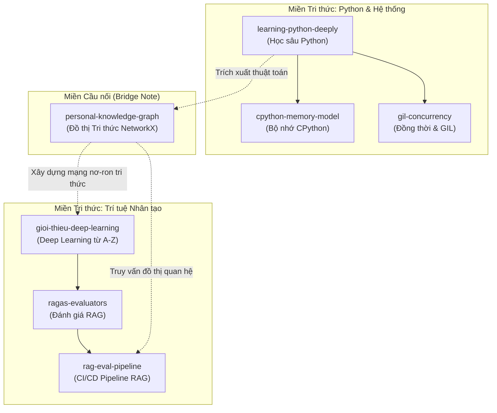
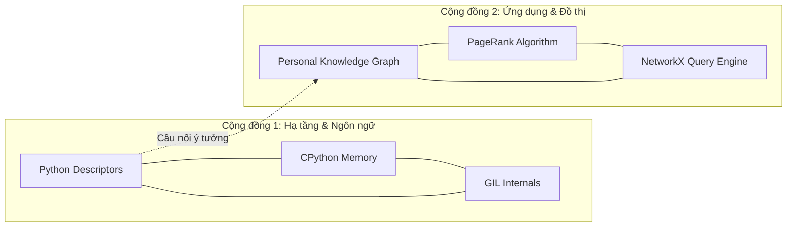
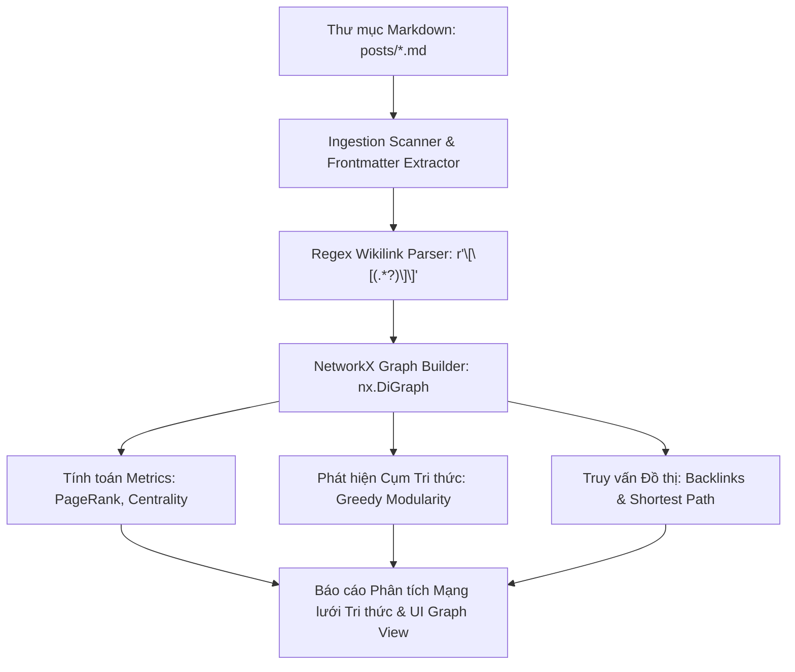

Trong kỷ nguyên bùng nổ thông tin và nghiên cứu chuyên sâu, thách thức lớn nhất của một kỹ sư hay nhà nghiên cứu không nằm ở việc *tìm kiếm* thêm tài liệu, mà nằm ở việc *tổ chức và kết nối* những gì đã tiếp thu thành một hệ thống tri thức có khả năng tổng hợp và phát triển.

Hầu hết các hệ điều hành và công cụ ghi chú truyền thống vẫn dựa trên mô hình **Cây thư mục phân cấp (Hierarchical Directory Tree)** có từ thập niên 1970. Tuy nhiên, tư duy con người không bao giờ vận hành theo các ngăn kéo cô lập. Tư duy con người là **Mạng lưới liên kết (Associative Network)**.

Bài viết này trình bày phương pháp luận và kỹ thuật xây dựng một **Personal Knowledge Graph (Đồ thị Tri thức Cá nhân)** hoàn chỉnh: từ nguyên lý Zettelkasten phi tuyến tính, cấu trúc dữ liệu đồ thị có hướng, các giải thuật lý thuyết đồ thị kinh điển (Degree Centrality, PageRank, Betweenness, Community Detection) cho đến một engine Python hoàn chỉnh sử dụng thư viện `networkx 3.7`.

---

## 1. Giới hạn của Cây Thư mục và Sức mạnh Mạng lưới Tri thức

Để hiểu vì sao cần đồ thị tri thức, trước hết chúng ta cần phân tích sự thất bại mang tính hệ thống của các mô hình tổ chức dữ liệu cũ.

### Nghịch lý Phân loại trong Cây Thư mục

Cấu trúc thư mục là một cây $T = (V, E)$ nghiêm ngặt: mỗi tệp tin chỉ có thể tồn tại tại đúng một vị trí và chỉ có một thư mục cha duy nhất.

Điều này dẫn đến **Nghịch lý vị trí (The Filing Dilemma)**. Giả sử bạn viết một bài phân tích về *"Tối ưu hóa hiệu năng Database với Python"*:
- Bạn sẽ lưu file đó vào thư mục `Python/`?
- Hay thư mục `Database/PostgreSQL/`?
- Hay thư mục `Performance-Tuning/`?

Dù bạn chọn phương án nào, bạn cũng đã cắt đứt mối liên hệ tự nhiên của bài viết với hai lĩnh vực còn lại. Càng tạo nhiều thư mục con sâu hơn, bạn càng rơi vào chiếc bẫy "phân mảnh tri thức" (Knowledge Silos) và gánh nặng tâm lý mỗi khi phải quyết định nơi cất giữ một ý tưởng mới (Categorization Fatigue).

### Nguyên lý Zettelkasten và Tư duy Liên tưởng

Vào thế kỷ 20, nhà xã hội học người Đức Niklas Luhmann đã xuất bản hơn 70 cuốn sách và 400 bài báo khoa học có sức ảnh hưởng sâu rộng nhờ một hệ thống ghi chú giấy mang tên **Zettelkasten (Hộp ghi chú)**.

Nguyên lý cốt lõi của Zettelkasten bao gồm:
1. **Tính nguyên tử (Atomicity)**: Mỗi ghi chú chỉ chứa duy nhất một ý tưởng hoặc khái niệm trọn vẹn.
2. **Liên kết hai chiều (Bi-directional Linking)**: Ý tưởng không đứng độc lập mà luôn kết nối tới các ý tưởng liên quan thông qua các đường dẫn trích dẫn chéo.
3. **Cấu trúc nổi sinh (Emerging Structure)**: Hệ thống không áp đặt mục lục cứng nhắc ngay từ đầu. Thay vào đó, trật tự và các chủ đề lớn tự phát sinh một cách hữu cơ từ mật độ liên kết giữa các nốt ghi chú.

| Tiêu chí | Cây Thư mục (Hierarchical Folders) | Hệ thống Thẻ nhãn (Tags) | Đồ thị Tri thức (Bi-directional Knowledge Graph) |
|---|---|---|---|
| **Cấu trúc toán học** | Cây đơn gốc (Strict Tree $T$) | Tập hợp phẳng (Flat Sets) | Đồ thị có hướng đa chiều (Directed Graph $G = (V, E)$) |
| **Mối quan hệ giữa các ghi chú** | Cha - Con nghiêm ngặt ($1 \to N$) | Nhóm lỏng lẻo theo danh sách nhãn | Ngang hàng, bắc cầu, phân cụm, trích dẫn đa chiều |
| **Gánh nặng phân loại** | Rất cao (Bắt buộc chọn 1 thư mục duy nhất) | Trung bình (Dễ bị lạm phát số lượng thẻ) | Rất thấp (Chỉ cần liên kết ngữ cảnh khi đang viết) |
| **Khả năng mở rộng** | Kém (Càng nhiều thư mục càng khó tìm kiếm) | Trung bình (Thẻ trở nên lộn xộn khi vượt quá 100 thẻ) | Cực tốt (Mạng lưới càng lớn càng thông minh và liên kết chặt chẽ) |
| **Khám phá tri thức mới** | Gần như bằng 0 (Bị giới hạn trong từng folder) | Thấp (Chỉ lọc được các note chung tag) | Rất cao (Tìm đường đi ngắn nhất, phát hiện cụm tri thức bất ngờ) |

---

## 2. Cấu trúc Dữ liệu Đồ thị Tri thức Cá nhân

Một Personal Knowledge Graph được mô hình hóa toán học dưới dạng một **Đồ thị có hướng (Directed Graph)**:

$$G = (V, E)$$

Trong đó:
- **Tập đỉnh $V$ (Nodes)**: Mỗi đỉnh $v \in V$ đại diện cho một ghi chú (Note) độc lập, chứa các thuộc tính như định danh (`slug`), tiêu đề (`title`), nội dung (`content`), danh mục (`category`), mảng thẻ (`tags`), và độ dài từ (`word_count`).
- **Tập cạnh có hướng $E$ (Edges)**: Mỗi cặp đỉnh có thứ tự $(u, v) \in E$ thể hiện một liên kết định hướng xuất phát từ ghi chú $u$ trỏ tới ghi chú $v$.

### Cú pháp Liên kết Wikilink và Piped Wikilink

Trong hệ thống ghi chú hiện đại (như Obsidian, Roam Research, hay hệ thống Blog Notebook này), các cạnh được tạo ra thông qua cú pháp **Wikilink**:
- Liên kết chuẩn: `[[Tên bài viết]]` $\longrightarrow$ trỏ trực tiếp tới note đích có tiêu đề tương ứng.
- Liên kết mở rộng (Piped link): `[[Tên bài viết|Nhãn hiển thị tùy biến]]` $\longrightarrow$ liên kết tới note đích nhưng hiển thị nhãn văn bản thay thế trong mạch văn.

Ví dụ, trong bài viết này chúng ta có thể liên kết trực tiếp tới bài viết kỹ thuật nội bộ: `[[Học sâu Python: Khám phá Descriptors, Metaclasses, GIL và Quản lý Bộ nhớ]]` hoặc `[[Deep Learning từ A-Z: Cẩm nang từ Neural Network đến Optimization]]`.

### Phân biệt Out-links (Forward Links) và In-links (Backlinks)

Đối với mỗi đỉnh $v \in V$:
1. **Out-links (Liên kết đi - $\text{Succ}(v)$)**: Là tập hợp các cạnh xuất phát từ $v$: $E_{out}(v) = \{(v, u) \in E\}$. Đây là những tài liệu mà người viết chủ động tham chiếu khi soạn thảo ghi chú $v$.
2. **In-links / Backlinks (Liên kết đến - $\text{Pred}(v)$)**: Là tập hợp các cạnh trỏ về $v$: $E_{in}(v) = \{(u, v) \in E\}$. 

Backlinks mang giá trị nhận thức to lớn: Khi bạn đang đọc hoặc cập nhật một khái niệm nền tảng (ví dụ: *Gradient Descent*), hệ thống đồ thị sẽ tự động hiển thị cho bạn biết tất cả những bài viết khác trong quá khứ đã từng dựa trên khái niệm này, tạo nên sợi dây kết nối tư duy xuyên thời gian.

### Sơ đồ Tô pô Đồ thị Tri thức



---

## 3. Các Giải thuật Lý thuyết Đồ thị Ứng dụng trong Quản lý Tri thức

Khi cơ sở dữ liệu ghi chú đã được chuyển đổi thành cấu trúc đồ thị $G = (V, E)$, chúng ta có thể áp dụng toàn bộ sức mạnh của các giải thuật toán học để khai phá giá trị tiềm ẩn của dữ liệu.

### 1. Degree Centrality (Độ trung tâm Bậc)

Độ trung tâm bậc là thước đo cơ bản nhất về mức độ kết nối của một đỉnh trong mạng lưới:

$$C_D(v) = \frac{\deg(v)}{|V| - 1}$$

Trong đồ thị có hướng, ta tách thành hai chỉ số riêng biệt:
- **In-degree Centrality (Độ trung tâm Bậc vào)**:
  $$C_{in}(v) = \frac{\deg_{in}(v)}{|V| - 1} = \frac{|\{u \in V : (u, v) \in E\}|}{|V| - 1}$$
  *Ý nghĩa*: Phản ánh các **Ghi chú Nền tảng (Core Foundation Notes)**. Một bài viết có bậc vào cao là một khái niệm cơ sở được nhiều bài viết khác trích dẫn và kế thừa.
- **Out-degree Centrality (Độ trung tâm Bậc ra)**:
  $$C_{out}(v) = \frac{\deg_{out}(v)}{|V| - 1} = \frac{|\{u \in V : (v, u) \in E\}|}{|V| - 1}$$
  *Ý nghĩa*: Phản ánh các **Ghi chú Bản đồ Nội dung (Map of Content - MOC)** hoặc mục lục tổng quan đóng vai trò điều hướng tới nhiều chủ đề nhỏ.

### 2. Giải thuật PageRank (Phát hiện Hub Notes)

Đếm số lượng liên kết đơn thuần có một nhược điểm lớn: Nó coi mọi liên kết đều có giá trị ngang nhau. Trong thực tế, một liên kết đến từ một bài viết tổng quan uy tín (Hub Note) có giá trị nhận thức cao hơn rất nhiều so với một liên kết đến từ một ghi chú sơ sài bên lề.

Giải thuật **PageRank** (được Larry Page và Sergey Brin phát minh năm 1998) giải quyết chính xác bài toán này bằng cách tính điểm đệ quy:

$$PR(v) = \frac{1 - d}{|V|} + d \sum_{u \in M(v)} \frac{PR(u)}{L(u)}$$

Trong đó:
- $PR(v)$: Điểm số PageRank của ghi chú $v$.
- $d$: Hệ số suy giảm (Damping factor, thường chọn chuẩn $d = 0.85$), đại diện cho xác suất người đọc tiếp tục nhấp vào các liên kết thay vì nhảy ngẫu nhiên sang một bài viết bất kỳ.
- $M(v) = \{u \in V : (u, v) \in E\}$: Tập hợp tất cả các ghi chú trỏ trực tiếp tới $v$.
- $L(u) = \deg_{out}(u)$: Tổng số liên kết đi của ghi chú $u$.
- $|V|$: Tổng số ghi chú trong toàn bộ đồ thị.

Một ghi chú đạt điểm PageRank cao khi nó được liên kết bởi nhiều ghi chú khác, hoặc được liên kết bởi những ghi chú vốn dĩ đã có điểm PageRank rất lớn. Đây là phương pháp tối ưu nhất để tự động phát hiện các **Bài viết Trụ cột (Pillar Articles)** trong hệ thống của bạn.

### 3. Betweenness Centrality (Độ trung tâm Trung gian)

Betweenness Centrality đo lường tần suất một ghi chú nằm trên đường đi ngắn nhất giữa hai ghi chú bất kỳ khác:

$$C_B(v) = \sum_{s \neq v \neq t \in V} \frac{\sigma_{st}(v)}{\sigma_{st}}$$

Trong đó:
- $\sigma_{st}$: Tổng số đường đi ngắn nhất nối từ đỉnh $s$ tới đỉnh $t$.
- $\sigma_{st}(v)$: Số lượng đường đi ngắn nhất từ $s$ tới $t$ có đi xuyên qua đỉnh $v$.

*Ý nghĩa nhận thức*: Những nốt có Betweenness Centrality cao chính là các **Ghi chú Cầu nối (Bridge Notes)**. Chúng kết nối hai cụm tri thức dường như biệt lập (ví dụ: một ghi chú kết nối giữa lý thuyết tối ưu hóa toán học và kiến trúc triển khai hệ thống phân tán). Nếu xóa bỏ nốt này, đồ thị có nguy cơ bị đứt gãy thành các thành phần rời rạc.

### 4. Community Detection (Phân cụm Cộng đồng Tự động)

Thay vì phải ngồi suy nghĩ gán danh mục thủ công, chúng ta có thể sử dụng giải thuật phát hiện cộng đồng dựa trên **Tối ưu hóa Độ mô-đun (Modularity Maximization)**:

$$Q = \frac{1}{2m} \sum_{i, j} \left[ A_{ij} - \frac{k_i k_j}{2m} \right] \delta(c_i, c_j)$$

Trong đó:
- $A_{ij}$: Ma trận kề của đồ thị.
- $k_i, k_j$: Bậc của các đỉnh $i$ và $j$.
- $m$: Tổng số cạnh trong mạng lưới.
- $\delta(c_i, c_j)$: Hàm Kronecker, nhận giá trị 1 nếu đỉnh $i$ và $j$ thuộc cùng một cộng đồng $c$, ngược lại bằng 0.

Giải thuật gom các ghi chú có mật độ liên kết dày đặc với nhau thành các cụm tri thức chuyên biệt một cách hoàn toàn tự động.



| Chỉ số | Công thức KaTeX | Bản chất Đồ thị | Ý nghĩa trong Hệ tri thức Cá nhân | Hành động Tối ưu |
|---|---|---|---|---|
| **In-Degree** | $\deg_{in}(v)$ | Số liên kết trỏ tới đỉnh | Khái niệm nền tảng được dùng làm định nghĩa cho bài khác | Cần trau chuốt nội dung chính xác, chuẩn mực |
| **Out-Degree** | $\deg_{out}(v)$ | Số liên kết trỏ đi từ đỉnh | Bài viết tổng hợp, bản đồ chủ đề (Map of Content) | Dùng làm bài viết dẫn nhập (Index / Gateway) |
| **PageRank** | $\frac{1-d}{\|V\|} + d \sum \frac{PR(u)}{L(u)}$ | Độ uy tín đệ quy của đỉnh | Trọng tâm tri thức tích lũy nhiều giá trị nhất | Đặt làm bài viết nổi bật (Featured Articles) |
| **Betweenness** | $\sum \frac{\sigma_{st}(v)}{\sigma_{st}}$ | Tỷ lệ nằm trên đường đi ngắn nhất | Khái niệm liên ngành kết nối các chủ đề khác biệt | Phát triển thêm các hướng nghiên cứu giao thoa mới |

---

## 4. Kiến trúc Knowledge Graph Engine

Một hệ thống Knowledge Graph Engine hiện đại bao gồm 4 giai đoạn xử lý tuần tự:



1. **Ingestion & Metadata Extraction**: Quét toàn bộ kho tài liệu markdown, tách khối YAML frontmatter ở đầu file để lấy các thuộc tính định danh (`title`, `slug`, `tags`, `category`).
2. **Wikilink Parsing**: Sử dụng biểu thức chính quy (Regex) tối ưu `r'\[\[([^\]\|]+)(?:\|[^\]]+)?\]\]'` để bóc tách toàn bộ các liên kết chuẩn và piped link trong phần thân bài viết.
3. **Graph Construction**: Khởi tạo đối tượng `networkx.DiGraph()`. Mỗi bài viết được thêm vào làm một node kèm metadata, và mỗi liên kết wikilink hợp lệ được thêm vào làm một cạnh có hướng từ bài viết nguồn tới bài viết đích.
4. **Graph Analysis & Query API**: Cung cấp các phương thức truy vấn tốc độ cao để tìm backlinks, tính khoảng cách ngữ nghĩa (đường đi ngắn nhất giữa hai ý tưởng), xếp hạng tài liệu bằng PageRank và gom cụm chủ đề tự động.

---

## 5. Hiện thực Thực nghiệm Toàn diện với Python và NetworkX

Dưới đây là mã nguồn Python hoàn chỉnh hiện thực hóa lớp `PersonalKnowledgeGraph`. Mã nguồn sử dụng thư viện `networkx 3.7` (đã được cài đặt sẵn trong môi trường conda `blog`), tuân thủ nghiêm ngặt chuẩn định kiểu Python 3.12 và có thể chạy trực tiếp.

```python
"""
Personal Knowledge Graph Engine with NetworkX 3.7
Phân tích liên kết Wikilink, tính toán PageRank, Degree, Betweenness và phát hiện cộng đồng.
"""
from __future__ import annotations

import re
from dataclasses import dataclass, field
from typing import Any, Dict, List, Optional, Set, Tuple

import networkx as nx


# ==============================================================================
# CẤU TRÚC DỮ LIỆU GHI CHÚ
# ==============================================================================

@dataclass
class NoteDocument:
    """Đại diện cho một bài viết hoặc ghi chú trong hệ thống."""
    slug: str
    title: str
    content: str
    category: str = "General"
    tags: List[str] = field(default_factory=list)
    word_count: int = 0


# ==============================================================================
# ENGINE ĐỒ THỊ TRI THỨC CÁ NHÂN
# ==============================================================================

class PersonalKnowledgeGraph:
    """
    Hệ thống phân tích Đồ thị Tri thức Cá nhân dựa trên NetworkX.
    Hỗ trợ trích xuất Wikilink, phân tích PageRank, Centrality và truy vấn Backlinks.
    """

    # Biểu thức chính quy bắt cả wikilink đơn giản [[Title]] và piped link [[Title|Alias]]
    WIKILINK_PATTERN = re.compile(r"\[\[([^\[\]\|]+)(?:\|[^\]]+)?\]\]")

    def __init__(self) -> None:
        self.graph = nx.DiGraph()
        # Ánh xạ chuẩn hóa tiêu đề (lowercase) sang slug để tra cứu nhanh chóng
        self._title_to_slug: Dict[str, str] = {}
        # Lưu trữ nội dung nguyên bản của các note
        self._documents: Dict[str, NoteDocument] = {}

    def extract_wikilinks(self, markdown_text: str) -> List[str]:
        """
        Trích xuất danh sách tiêu đề đích từ cú pháp [[Wikilink]] trong nội dung.
        Loại bỏ khoảng trắng thừa ở hai đầu tiêu đề.
        """
        if not markdown_text:
            return []
        matches = self.WIKILINK_PATTERN.findall(markdown_text)
        return [match.strip() for match in matches if match.strip()]

    def add_document(self, doc: NoteDocument) -> None:
        """Đăng ký một tài liệu vào hệ thống."""
        self._documents[doc.slug] = doc
        self._title_to_slug[doc.title.strip().lower()] = doc.slug

        # Thêm đỉnh vào đồ thị NetworkX kèm metadata
        self.graph.add_node(
            doc.slug,
            title=doc.title,
            category=doc.category,
            tags=doc.tags,
            word_count=doc.word_count,
        )

    def build_graph(self) -> None:
        """
        Duyệt qua tất cả các tài liệu đã nạp, trích xuất liên kết
        và tạo các cạnh có hướng trong đồ thị.
        """
        for source_slug, doc in self._documents.items():
            targets = self.extract_wikilinks(doc.content)
            for target_title in targets:
                target_slug = self._title_to_slug.get(target_title.lower())
                if target_slug:
                    # Thêm cạnh có hướng từ source_slug -> target_slug
                    self.graph.add_edge(source_slug, target_slug)
                else:
                    # Trường hợp trích dẫn một note chưa được tạo (Ghost / Dangling Note)
                    ghost_slug = target_title.lower().replace(" ", "-")
                    if not self.graph.has_node(ghost_slug):
                        self.graph.add_node(ghost_slug, title=target_title, category="Uncreated", tags=[], word_count=0)
                    self.graph.add_edge(source_slug, ghost_slug)

    def compute_centrality_metrics(self, alpha: float = 0.85) -> Dict[str, Dict[str, float]]:
        """
        Tính toán toàn bộ các chỉ số độ trung tâm lý thuyết đồ thị:
        - In-degree & Out-degree Centrality
        - PageRank Score (Hệ số alpha = 0.85)
        - Betweenness Centrality
        """
        if len(self.graph) == 0:
            return {}

        in_degree = nx.in_degree_centrality(self.graph)
        out_degree = nx.out_degree_centrality(self.graph)
        pagerank = nx.pagerank(self.graph, alpha=alpha)
        betweenness = nx.betweenness_centrality(self.graph)

        metrics: Dict[str, Dict[str, float]] = {}
        for node in self.graph.nodes():
            metrics[node] = {
                "in_degree": in_degree.get(node, 0.0),
                "out_degree": out_degree.get(node, 0.0),
                "pagerank": pagerank.get(node, 0.0),
                "betweenness": betweenness.get(node, 0.0),
            }
        return metrics

    def get_backlinks(self, target_identifier: str) -> List[str]:
        """
        Truy vấn toàn bộ danh sách các bài viết trỏ tới bài viết mục tiêu (In-edges).
        Nhận diện cả slug hoặc tiêu đề chính xác.
        """
        target_slug = self._title_to_slug.get(target_identifier.strip().lower(), target_identifier)
        if not self.graph.has_node(target_slug):
            return []
        # Các đỉnh trỏ vào target_slug chính là predecessors trong DiGraph
        return list(self.graph.predecessors(target_slug))

    def find_shortest_path(self, source_identifier: str, target_identifier: str) -> Optional[List[str]]:
        """
        Tìm chuỗi liên kết ngắn nhất giữa hai ghi chú bất kỳ.
        Giúp người dùng phát hiện mối quan hệ logic xuyên suốt giữa hai chủ đề xa nhau.
        """
        s_slug = self._title_to_slug.get(source_identifier.strip().lower(), source_identifier)
        t_slug = self._title_to_slug.get(target_identifier.strip().lower(), target_identifier)

        if not self.graph.has_node(s_slug) or not self.graph.has_node(t_slug):
            return None

        try:
            return nx.shortest_path(self.graph, source=s_slug, target=t_slug)
        except (nx.NetworkXNoPath, nx.NodeNotFound):
            return None

    def detect_communities(self) -> List[Set[str]]:
        """
        Phân cụm cộng đồng tri thức tự động bằng giải thuật Greedy Modularity.
        Chuyển đổi tạm thời sang đồ thị vô hướng để phát hiện cụm chủ đề liên kết dày.
        """
        if len(self.graph) < 2:
            return [set(self.graph.nodes())]

        undirected = self.graph.to_undirected()
        communities = list(nx.community.greedy_modularity_communities(undirected))
        return [set(comm) for comm in communities]


# ==============================================================================
# HÀM CHẠY THỰC THI MINH HỌA
# ==============================================================================

if __name__ == "__main__":
    print("=== KHỞI TẠO MÔ PHỎNG PERSONAL KNOWLEDGE GRAPH ===")
    pkg = PersonalKnowledgeGraph()

    # Nạp kho bài viết mẫu dựa trên blog
    sample_notes = [
        NoteDocument(
            slug="gioi-thieu-deep-learning",
            title="Deep Learning từ A-Z",
            content="Kiến thức nền tảng về mạng nơ-ron và đạo hàm. Xem thêm [[Học sâu Python]] để tối ưu hóa mã nguồn.",
            category="AI",
            tags=["AI", "Deep Learning"],
            word_count=3500,
        ),
        NoteDocument(
            slug="learning-python-deeply",
            title="Học sâu Python",
            content="Khảo sát Descriptors, Metaclasses và GIL trong CPython. Ứng dụng trong [[Xây dựng Personal Knowledge Graph]].",
            category="Python",
            tags=["Python", "OOP"],
            word_count=2800,
        ),
        NoteDocument(
            slug="personal-knowledge-graph",
            title="Xây dựng Personal Knowledge Graph",
            content="Mô hình hóa tri thức bằng đồ thị. Kết nối với [[Deep Learning từ A-Z]] và [[Hệ thống Đánh giá RAGAS]].",
            category="Developer Tools",
            tags=["Graph Theory", "NetworkX"],
            word_count=3100,
        ),
        NoteDocument(
            slug="ragas-evaluators",
            title="Hệ thống Đánh giá RAGAS",
            content="Đánh giá hệ thống RAG sử dụng LLM. Cần hiểu rõ [[Deep Learning từ A-Z]] để tinh chỉnh mô hình.",
            category="AI",
            tags=["RAG", "LLM"],
            word_count=2200,
        ),
    ]

    for note in sample_notes:
        pkg.add_document(note)

    # Xây dựng các cạnh đồ thị từ liên kết
    pkg.build_graph()

    print(f"Đã nạp thành công: {pkg.graph.number_of_nodes()} ghi chú và {pkg.graph.number_of_edges()} liên kết.")

    # 1. Tính toán các chỉ số Centrality & PageRank
    metrics = pkg.compute_centrality_metrics()
    print("\n--- BẢNG XẾP HẠNG METRICS VÀ PAGERANK ---")
    for slug, m in sorted(metrics.items(), key=lambda item: item[1]["pagerank"], reverse=True):
        title = pkg.graph.nodes[slug].get("title", slug)
        print(f"[{title}]")
        print(f"  -> PageRank:    {m['pagerank']:.4f}")
        print(f"  -> In-Degree:   {m['in_degree']:.4f}")
        print(f"  -> Out-Degree:  {m['out_degree']:.4f}")
        print(f"  -> Betweenness: {m['betweenness']:.4f}")

    # 2. Kiểm tra truy vấn Backlinks
    target = "Deep Learning từ A-Z"
    backlinks = pkg.get_backlinks(target)
    print(f"\n--- BACKLINKS TRỎ VỀ '{target}' ---")
    for bl_slug in backlinks:
        print(f"  <- [{pkg.graph.nodes[bl_slug].get('title', bl_slug)}]")

    # 3. Tìm đường đi liên kết ngắn nhất
    path = pkg.find_shortest_path("learning-python-deeply", "ragas-evaluators")
    print(f"\n--- ĐƯỜNG ĐI LIÊN KẾT TRI THỨC NGẮN NHẤT ---")
    if path:
        print(" -> ".join([pkg.graph.nodes[p].get("title", p) for p in path]))
    else:
        print("Không tìm thấy đường đi trực tiếp.")

    # 4. Phân cụm cộng đồng tự động
    communities = pkg.detect_communities()
    print(f"\n--- PHÂN CỤM CỘNG ĐỒNG TRI THỨC (TỔNG CỘNG: {len(communities)} CỤM) ---")
    for idx, comm in enumerate(communities, start=1):
        titles = [pkg.graph.nodes[n].get("title", n) for n in comm]
        print(f"Cụm {idx}: {', '.join(titles)}")

    print("\n[OK] Engine Personal Knowledge Graph hoạt động hoàn hảo trên NetworkX 3.7!")
```

---

## 6. Tổng kết và Lộ trình Phát triển

Xây dựng một Personal Knowledge Graph không đơn thuần là việc thay đổi công cụ ghi chép, mà là một bước chuyển dịch căn bản về phương pháp tư duy:

1. **Từ Ngăn kéo Cô lập đến Mạng lưới Cộng hưởng**: Bằng việc loại bỏ hệ thống phân cấp cứng nhắc và áp dụng liên kết hai chiều, mỗi ghi chú bạn viết ra hôm nay sẽ trở thành một nơ-ron mới củng cố mạng lưới tri thức sẵn có.
2. **Sức mạnh Định lượng của Lý thuyết Đồ thị**: Các giải thuật toán học như PageRank, Betweenness Centrality và Modularity mang lại khả năng đo lường khách quan về cấu trúc thông tin của bạn. Chúng giúp bạn phát hiện đâu là những điểm mù tri thức, đâu là những bài viết trụ cột cần nâng cấp, và đâu là những khái niệm cầu nối liên ngành đầy tiềm năng.
3. **Lộ trình Mở rộng Tương lai (GraphRAG)**:
   - **Tích hợp Vector Embeddings**: Kết hợp đồ thị quan hệ cấu trúc với không gian vector ngữ nghĩa (Semantic Vector Search) để phát hiện liên kết ngay cả khi người viết chưa kịp đặt cú pháp `[[...]]`.
   - **Mô hình Hybrid GraphRAG**: Sử dụng mạng lưới tri thức cá nhân làm cơ sở tri thức tăng cường cho các mô hình ngôn ngữ lớn (LLMs), giúp trợ lý AI cá nhân hóa câu trả lời dựa trên phong cách tư duy và toàn bộ ghi chú của chính bạn.

### Tài liệu Tham khảo Uy tín
- Niklas Luhmann (1992). *Communicating with Slip Boxes*. An Empirical Account of Sociological Writing.
- Page, L., Brin, S., Motwani, R., & Winograd, T. (1998). *The PageRank Citation Ranking: Bringing Order to the Web*. Stanford InfoLab Publication.
- Hagberg, A., Swart, P., & S Chult, D. (2008). *Exploring Network Structure, Dynamics, and Function using NetworkX*. Los Alamos National Laboratory.
- Tiago Forte (2022). *Building a Second Brain: A Proven Method to Organize Your Digital Life and Unlock Your Creative Potential*. Atria Books.
