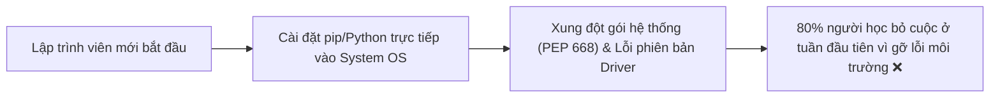
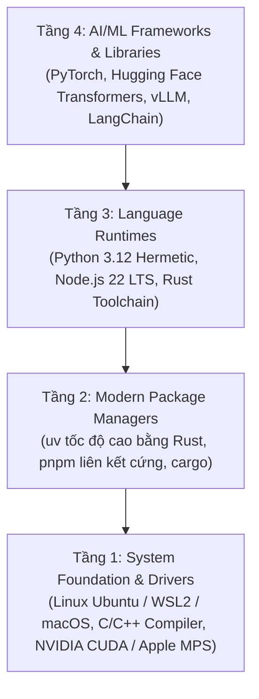

> **"Công cụ định hình tư duy của bạn. Thiết lập chuẩn một lần, học nhàn cả đời."** — Nền tảng môi trường ổn định là điều kiện tiên quyết của mọi kỹ sư AI chuyên nghiệp. Khi trạm làm việc (workstation) được cô lập chuẩn xác từ driver, runtime đến thư viện toán học, bạn sẽ dành trọn vẹn tâm trí cho thuật toán và kiến trúc mô hình thay vì lãng phí hàng giờ gỡ lỗi xung đột phiên bản.

---

## Thông tin nhanh (Quick Spec)

* **Loại bài (Type):** Thực chiến & Kiến trúc hạ tầng (Build & Architecture)
* **Ngôn ngữ & Công cụ:** Python 3.12, Node.js 22 LTS, uv, pnpm, bash / zsh, PyTorch 2.x (CUDA / MPS)
* **Kiến thức tiên quyết (Prerequisites):** Thao tác dòng lệnh Terminal cơ bản (Linux/macOS/WSL2)
* **Thời gian thực hành:** ~40 phút
* **Độ khó:** Cơ bản đến Trung cấp (Foundational)

---

## Mục tiêu bài học (Learning Objectives)

Sau bài học này, bạn sẽ:
- [ ] Làm chủ **Mô hình kim tự tháp 4 tầng** của hạ tầng AI: từ Hệ điều hành & Driver phần cứng đến Runtime, Trình quản lý gói và Thư viện AI.
- [ ] Thiết lập môi trường Python 3.12 độc lập (Hermetic Python) và quản lý gói bằng **uv** viết bằng Rust, đạt tốc độ cài đặt gấp 10–100 lần so với pip truyền thống.
- [ ] Cấu hình toolchain Node.js 22 LTS với **fnm** và **pnpm** để sẵn sàng phục vụ phát triển AI Agent, MCP Server và TypeScript SDKs.
- [ ] Tự tay viết và chạy script kiểm chứng tăng tốc phần cứng song song: NVIDIA CUDA trên Linux/WSL2 và Apple Silicon Metal Performance Shaders (MPS) trên macOS.
- [ ] Nhận diện và xử lý triệt để 3 cạm bẫy thực chiến: bẫy giả lập Rosetta 2 trên Apple Silicon, bẫy biến môi trường PATH trên Linux/WSL2, và chiến lược dự phòng CPU/Cloud GPU.

---

## 1. Vấn đề thực tế (The Problem)

Bước vào thế giới AI Engineering, bạn sẽ làm việc với một hệ sinh thái đa ngôn ngữ và phần cứng phức tạp: Python cho mô hình học sâu, C++/CUDA cho kernel tăng tốc, Rust cho inference engine hiệu năng cao, và TypeScript cho các giao thức Agent & Tooling. Nếu thiết lập môi trường theo cảm tính hoặc chắp vá, bạn sẽ ngay lập tức rơi vào **"Địa ngục môi trường" (Environment Hell)**:

1. **Xung đột Python hệ thống (System Python Collision):** Trên Ubuntu và các bản phân phối Linux hiện đại, hệ điều hành gắn liền với một bản Python riêng để chạy các tiến trình quản lý gói (APT, dnf) và dịch vụ mạng. Khi người mới gõ lệnh `sudo pip install torch` hoặc cài đặt gói bừa bãi, các thư viện của bên thứ ba sẽ ghi đè lên thư viện hệ thống, dẫn đến việc hỏng hóc toàn bộ hệ thống quản lý gói. Chuẩn PEP 668 đưa ra cơ chế khóa `externally-managed-environment` để chặn đứng rủi ro này, nhưng nhiều người lại cố tình vượt rào bằng cờ `--break-system-packages`.
2. **Lệch pha giữa CUDA Driver, CUDA Toolkit và PyTorch Wheels:** Card đồ họa NVIDIA yêu cầu driver tương thích từ Host OS. Nếu driver chỉ hỗ trợ CUDA 11.8 mà bạn cài PyTorch phiên bản build cho CUDA 12.4, lệnh gọi tensor sẽ báo lỗi `CUDA driver version is insufficient for CUDA runtime version`. Ngược lại, nếu quên chỉ định chỉ mục wheel chuyên biệt, pip sẽ tự động tải bản PyTorch chỉ hỗ trợ CPU, khiến các phép tính ma trận chậm đi 50 đến 100 lần.
3. **Thiếu C/C++ Build Toolchain khi biên dịch Native Extensions:** Các thư viện AI hiện đại như FlashAttention, bitsandbytes, vLLM hoặc triton thường xuyên biên dịch native C++/CUDA kernel ngay trong lần đầu khởi chạy (Just-In-Time compilation). Nếu thiếu `build-essential`, `gcc`, `g++` hoặc kernel headers, terminal sẽ phun ra hàng nghìn dòng lỗi biên dịch C đỏ rực mà người mới không thể tự giải mã.



Hậu quả là hơn 80% người mới bắt đầu lãng phí trọn vẹn tuần học đầu tiên chỉ để cài đi cài lại thư viện thay vì học bản chất toán học và thuật toán. Chúng ta sẽ giải quyết dứt điểm vấn đề này bằng một tư duy kiến trúc phân tầng vững chắc.

---

## 2. Mô hình tư duy & Bản chất (The Concept)

Để xây dựng một trạm làm việc AI chuyên nghiệp, chúng ta không cài đặt ngẫu nhiên từng gói phần mềm. Thay vào đó, môi trường được phân định thành **Kim tự tháp hạ tầng 4 tầng (The 4-Layer AI Stack)**. Mỗi tầng chỉ phụ thuộc vào tầng ngay bên dưới nó và hoàn toàn độc lập với các tầng bên ngoài:



### Bóc tách bản chất 4 tầng hạ tầng:

1. **Tầng 1 — Nền tảng hệ thống & Driver phần cứng (System Foundation & Drivers):**
   - Hệ điều hành tuân thủ chuẩn POSIX: Ubuntu Linux (khuyến nghị bản LTS 22.04 hoặc 24.04), Windows Subsystem for Linux 2 (WSL2), hoặc macOS (Apple Silicon).
   - Shell hiện đại: `bash` hoặc `zsh` với cấu hình PATH chuẩn mực.
   - Trình biên dịch C/C++: `gcc`, `g++`, `make`, `clang` cùng các thư viện hệ thống (`ca-certificates`, `curl`, `git`).
   - Lớp trừu tượng phần cứng (Hardware Acceleration): NVIDIA Display Driver & CUDA Runtime cho GPU rời; hoặc Metal framework tích hợp sâu trong macOS Apple Silicon.
2. **Tầng 2 — Trình quản lý gói hiện đại (Modern Package Managers):**
   - Thay thế các công cụ thế hệ cũ chậm chạp bằng thế hệ công cụ hiện đại viết bằng Rust:
     - **uv** (thay thế pip, virtualenv, poetry): Được phát triển bởi Astral bằng Rust, uv phân tích đồ thị phụ thuộc (dependency resolution) đa luồng, tận dụng bộ nhớ đệm toàn cục và tạo môi trường ảo trong chưa đầy 100 mili-giây.
     - **pnpm** (thay thế npm truyền thống): Sử dụng content-addressable storage và liên kết cứng (hard links) để chia sẻ module giữa các dự án, tiết kiệm hàng chục gigabyte ổ cứng.
     - **cargo**: Trình quản lý gói chuẩn của hệ sinh thái Rust.
3. **Tầng 3 — Môi trường thực thi độc lập (Hermetic Language Runtimes):**
   - Tuyệt đối không can thiệp vào Python mặc định của hệ điều hành.
   - Chúng ta sử dụng `uv` để tải về các bản Python độc lập (Hermetic standalone builds) như Python 3.12. Khi cần nâng cấp hay xóa bỏ, bạn chỉ cần một lệnh duy nhất mà không để lại bất kỳ rác hệ thống nào.
   - Node.js 22 LTS được quản lý độc lập thông qua `fnm` (Fast Node Manager).
4. **Tầng 4 — Thư viện AI & Framework học máy (AI/ML Libraries):**
   - PyTorch 2.x (với backend CUDA 12.4 hoặc Apple Metal MPS).
   - Hệ sinh thái Hugging Face (`transformers`, `datasets`, `accelerate`, `safetensors`).
   - Các công cụ AI Agent & Tooling: LangChain, vLLM, LiteLLM, MCP SDKs.

Khi tuân thủ nguyên lý cài đặt từ dưới lên (Bottom-up), bất kỳ sự cố nào xảy ra ở Tầng 4 cũng có thể khoanh vùng chính xác: do thiếu driver ở Tầng 1, thiếu trình quản lý ở Tầng 2, hay sai phiên bản runtime ở Tầng 3.

---

## 3. Tự tay cấu hình từ đầu (Build It / Hands-on)

Chúng ta sẽ từng bước dựng trọn vẹn 4 tầng hạ tầng trên máy trạm của bạn.

### Bước 1: Thiết lập nền tảng hệ điều hành (Tầng 1)

**Trên Ubuntu Linux hoặc Windows WSL2:**

Mở terminal và cài đặt bộ công cụ biên dịch cơ sở và các tiện ích mạng:

```bash
sudo apt update && sudo apt install -y \
    build-essential \
    git \
    curl \
    wget \
    unzip \
    ca-certificates
```

*Giải thích:* Gói `build-essential` bao gồm `gcc`, `g++` và `make` — điều kiện bắt buộc để biên dịch các C/CUDA extension khi cài đặt các thư viện AI chuyên sâu. Gói `unzip` và `ca-certificates` đảm bảo các script cài đặt qua HTTPS không gặp lỗi chứng chỉ SSL.

**Trên macOS (Apple Silicon M1/M2/M3/M4):**

Cài đặt Command Line Tools và trình quản lý Homebrew:

```bash
# Cài đặt trình biên dịch Clang và bộ công cụ Apple Developer
xcode-select --install

# Cài đặt Homebrew (nếu máy chưa có)
/bin/bash -c "$(curl -fsSL https://raw.githubusercontent.com/Homebrew/install/HEAD/install.sh)"

# Cài đặt các tiện ích bổ trợ
brew install git curl wget
```

---

### Bước 2: Cài đặt uv và thiết lập Python 3.12 độc lập (Tầng 2 & Tầng 3)

Cài đặt công cụ `uv` thông qua script cài đặt chính thức của Astral:

```bash
# Cài đặt uv
curl -LsSf https://astral.sh/uv/install.sh | sh

# Nạp biến môi trường cho phiên terminal hiện tại
source $HOME/.local/bin/env
```

Kiểm tra phiên bản uv đã cài đặt thành công:

```bash
uv --version
```

Bây giờ, hãy dùng `uv` để tải về bản Python 3.12 độc lập hoàn toàn với hệ điều hành:

```bash
# Tải về Python 3.12 hermetic build
uv python install 3.12

# Khởi tạo thư mục dự án thử nghiệm
mkdir -p ~/ai-workspace && cd ~/ai-workspace

# Tạo môi trường ảo cô lập (.venv) sử dụng Python 3.12
uv venv .venv --python 3.12

# Kích hoạt môi trường ảo
source .venv/bin/activate
```

Khi môi trường ảo được kích hoạt, dấu nhắc dòng lệnh sẽ có tiền tố `(.venv)`. Thử cài đặt các thư viện toán học cơ bản:

```bash
# Cài đặt siêu tốc với uv pip
uv pip install numpy matplotlib jupyter
```

Bạn sẽ nhận thấy tốc độ cài đặt diễn ra trong nháy mắt (thường dưới 2 giây) nhờ cơ chế cache bánh xe (wheel cache) và liên kết tượng trưng của `uv`.

---

### Bước 3: Thiết lập Node.js 22 LTS & pnpm cho AI Agent Tooling (Tầng 2 & Tầng 3)

Trong kỷ nguyên AI 2026, kỹ sư AI không chỉ viết code Python mà còn phải xây dựng các giao diện Agent, máy chủ Model Context Protocol (MCP) và các công cụ tích hợp trình duyệt bằng TypeScript. Chúng ta sử dụng `fnm` (Fast Node Manager viết bằng Rust) để quản lý Node.js:

```bash
# Cài đặt fnm
curl -fsSL https://fnm.vercel.app/install | bash

# Kích hoạt fnm cho shell hiện tại
export PATH="$HOME/.local/share/fnm:$PATH"
eval "$(fnm env --use-on-cd)"

# Cài đặt và sử dụng bản Node.js 22 LTS
fnm install 22
fnm use 22

# Cài đặt pnpm toàn cục
npm install -g pnpm
```

Kiểm tra phiên bản:

```bash
node -e "console.log('Node.js runtime ready:', process.version)"
pnpm --version
```

---

### Bước 4: Cài đặt PyTorch và kiểm chứng tăng tốc phần cứng (Tầng 4)

Tùy thuộc vào phần cứng bạn đang sở hữu, hãy chạy lệnh cài đặt PyTorch phù hợp:

**Lựa chọn A — Dành cho Linux / Windows WSL2 có GPU NVIDIA:**

```bash
# Đảm bảo bạn đang ở trong môi trường ảo (.venv)
uv pip install torch torchvision torchaudio --index-url https://download.pytorch.org/whl/cu124
```

*Lưu ý:* Cờ `--index-url` trỏ thẳng tới kho lưu trữ wheel của PyTorch được biên dịch riêng cho CUDA 12.4.

**Lựa chọn B — Dành cho macOS (Apple Silicon M-Series) hoặc máy chỉ có CPU:**

```bash
# PyTorch mặc định trên macOS đã tích hợp sẵn backend Apple Metal (MPS)
uv pip install torch torchvision torchaudio
```

*Tuyệt đối không* thêm cờ `--index-url .../cu124` trên macOS, vì các bản build CUDA không hỗ trợ kiến trúc ARM của Mac.

---

### Bước 5: Script kiểm chứng môi trường toàn diện (`verify_env.py`)

Tạo một file Python có tên `verify_env.py` trong thư mục làm việc để tự động quét toàn bộ 4 tầng hạ tầng:

```python
"""
verify_env.py — Tiền kiểm định hạ tầng phát triển AI (Preflight Check)
Kiểm tra tính sẵn sàng của Python Runtime, Package Isolation, và Tăng tốc phần cứng GPU.
"""

from __future__ import annotations

import os
import sys
import time

# Mã màu ANSI định dạng terminal
GREEN = "\033[92m"
YELLOW = "\033[93m"
RED = "\033[91m"
BLUE = "\033[94m"
RESET = "\033[0m"
BOLD = "\033[1m"


def print_status(layer: str, status: bool, message: str) -> None:
    badge = f"{GREEN}[PASS]{RESET}" if status else f"{RED}[FAIL]{RESET}"
    print(f"{badge} {BOLD}{layer}:{RESET} {message}")


def check_runtime_isolation() -> bool:
    print(f"\n{BLUE}{BOLD}=== 1. KIỂM TRA RUNTIME & CÔ LẬP MÔI TRƯỜNG ==={RESET}")
    python_ver = sys.version.split()[0]
    print(f"  * Python Executable: {sys.executable}")
    print(f"  * Phiên bản Python: {python_ver}")

    # Kiểm tra xem có đang chạy trong virtualenv không
    in_venv = sys.prefix != sys.base_prefix
    if in_venv:
        print_status("Tầng 3 (Runtime)", True, f"Môi trường ảo cô lập an toàn tại '{sys.prefix}'")
    else:
        print_status(
            "Tầng 3 (Runtime)",
            False,
            "CẢNH BÁO: Đang chạy trực tiếp trên Python hệ thống! Hãy kích hoạt .venv.",
        )
    return in_venv


def check_core_libraries() -> bool:
    print(f"\n{BLUE}{BOLD}=== 2. KIỂM TRA THƯ VIỆN TOÁN HỌC CƠ BẢN ==={RESET}")
    try:
        import numpy as np

        a = np.array([1.0, 2.0, 3.0], dtype=np.float32)
        dot_product = float(np.dot(a, a))
        print_status("Tầng 4 (NumPy)", True, f"NumPy v{np.__version__} — Phép tính Vector Dot: {dot_product}")
        return True
    except ImportError as e:
        print_status("Tầng 4 (NumPy)", False, f"Không thể nạp NumPy: {e}")
        return False


def check_hardware_acceleration() -> None:
    print(f"\n{BLUE}{BOLD}=== 3. KIỂM TRA TĂNG TỐC PHẦN CỨNG (GPU / ACCELERATION) ==={RESET}")
    try:
        import torch

        print(f"  * Phiên bản PyTorch: {torch.__version__}")

        cuda_available = torch.cuda.is_available()
        mps_available = hasattr(torch.backends, "mps") and torch.backends.mps.is_available()

        if cuda_available:
            device_name = torch.cuda.get_device_name(0)
            device_count = torch.cuda.device_count()
            vram_gb = torch.cuda.get_device_properties(0).total_memory / (1024**3)
            print_status(
                "Tầng 1 (NVIDIA CUDA)",
                True,
                f"Phát hiện {device_count} GPU: {device_name} ({vram_gb:.2f} GB VRAM)",
            )
            target_device = torch.device("cuda:0")
        elif mps_available:
            print_status(
                "Tầng 1 (Apple MPS)",
                True,
                "Phát hiện Apple Silicon Metal Performance Shaders (MPS) sẵn sàng!",
            )
            target_device = torch.device("mps")
        else:
            print_status(
                "Tầng 1 (Phần cứng)",
                False,
                f"{YELLOW}Không phát hiện GPU chuyên dụng (CUDA/MPS). Hệ thống sẽ chạy trên CPU.{RESET}",
            )
            target_device = torch.device("cpu")

        # Thực hiện bài đo kiểm tra phép nhân ma trận (Tensor Benchmark)
        print(f"\n  * Đang chạy bài kiểm tra nhân ma trận 1000x1000 trên thiết bị: {BOLD}{target_device}{RESET}...")
        start_time = time.perf_counter()
        x = torch.randn(1000, 1000, device=target_device, dtype=torch.float32)
        y = torch.randn(1000, 1000, device=target_device, dtype=torch.float32)
        z = torch.matmul(x, y)

        # Đồng bộ luồng tính toán nếu dùng CUDA để đo thời gian chính xác
        if target_device.type == "cuda":
            torch.cuda.synchronize()
        elif target_device.type == "mps":
            torch.mps.synchronize()

        elapsed_ms = (time.perf_counter() - start_time) * 1000.0
        print_status(
            "Tầng 4 (Tensor Test)",
            True,
            f"Phép nhân ma trận hoàn tất trong {elapsed_ms:.2f} ms! Ma trận kết quả: {z.shape}",
        )

    except ImportError as e:
        print_status("Tầng 4 (PyTorch)", False, f"Chưa cài đặt PyTorch: {e}")


if __name__ == "__main__":
    print(f"{BOLD}======================================================{RESET}")
    print(f"{BOLD}   BÁO CÁO TIỀN KIỂM ĐỊNH MÔI TRƯỜNG PHÁT TRIỂN AI   {RESET}")
    print(f"{BOLD}======================================================{RESET}")
    check_runtime_isolation()
    check_core_libraries()
    check_hardware_acceleration()
    print(f"\n{BOLD}Hoàn tất quá trình tiền kiểm định.{RESET}\n")
```

Thực thi script:

```bash
python verify_env.py
```

Nếu cả 3 tầng đều hiện nhãn `[PASS]`, trạm làm việc của bạn đã sẵn sàng cho mọi tác vụ huấn luyện và phát triển AI chuyên nghiệp.

---

## 4. Ứng dụng thực tế & Cạm bẫy Production (Use It / Production Tips)

Trong môi trường làm việc thực tế tại các công ty AI và phòng lab nghiên cứu, đây là 3 cạm bẫy thực chiến phổ biến nhất mà bạn cần đề phòng:

### Cạm bẫy 1: Bẫy giả lập Rosetta 2 trên Apple Silicon (M1/M2/M3/M4)

Khi bạn chuyển dữ liệu từ một máy Mac Intel cũ sang máy Mac chip M-Series mới bằng Migration Assistant, hoặc ứng dụng Terminal vô tình bị bật tùy chọn *"Open using Rosetta"*, terminal của bạn sẽ vận hành dưới chế độ giả lập x86:

- Lệnh `arch` trên terminal sẽ trả về `i386` hoặc `x86_64` thay vì `arm64`.
- **Hậu quả:** Trình quản lý Homebrew sẽ cài đặt toàn bộ package dạng x86 vào `/usr/local` thay vì thư mục chuẩn `/opt/homebrew`. Khi cài PyTorch, Python sẽ nạp bản build x86_64; bản build này **hoàn toàn không hỗ trợ Apple Metal (MPS)**, khiến tốc độ tính toán suy giảm từ 5 đến 10 lần.
- **Cách khắc phục:**
  1. Kiểm tra kiến trúc hiện tại:
     ```bash
     arch
     ```
  2. Nếu kết quả in ra `x86_64`, hãy ép terminal mở phiên làm việc ARM64 native:
     ```bash
     arch -arm64 /bin/zsh
     ```
  3. Cài đặt lại các công cụ then chốt với cờ `arch -arm64` để đảm bảo binary tận dụng 100% Neural Engine và GPU lõi của Apple.

---

### Cạm bẫy 2: Bẫy biến môi trường PATH trên Linux/WSL2

Các công cụ hiện đại như `uv`, `cargo` (Rust) và `fnm` (Node.js) tuân thủ quy tắc bảo mật không yêu cầu quyền `sudo`. Thay vào đó, chúng cài đặt các file binary thực thi vào thư mục người dùng:
- `~/.local/bin` (uv, các CLI tool của Python)
- `~/.cargo/bin` (cargo, rustc)
- `~/.local/share/fnm` (fnm)

Nếu file khởi động shell (`~/.bashrc` trên Ubuntu hoặc `~/.zshrc` trên macOS) không nạp các đường dẫn này vào biến `PATH`, mỗi khi bạn mở một cửa sổ terminal mới, shell sẽ ném lỗi: `uv: command not found` hoặc `fnm: command not found`.

**Giải pháp dứt điểm:** Thêm đoạn khai báo sau vào cuối file `~/.bashrc` (hoặc `~/.zshrc`):

```bash
# Nạp các thư mục binary người dùng vào PATH
export PATH="$HOME/.local/bin:$HOME/.cargo/bin:$PATH"

# Nạp fnm runtime
if command -v fnm &> /dev/null; then
    eval "$(fnm env --use-on-cd)"
fi
```

Sau đó áp dụng thay đổi ngay lập tức bằng lệnh `source ~/.bashrc`.

---

### Cạm bẫy 3: Chiến lược dự phòng phần cứng (CPU vs Google Colab vs Cloud GPU)

Nhiều người lầm tưởng rằng bắt đầu học AI là bắt buộc phải có máy tính trang bị card đồ họa NVIDIA đắt tiền hàng chục triệu đồng:

1. **Hiểu đúng nhu cầu thực tế:**
   - Hơn 70% các bài học về Prompt Engineering, Xây dựng ứng dụng RAG (Retrieval-Augmented Generation), và Lập trình Agent ReAct chỉ tương tác với mô hình qua API bên ngoài (OpenAI, Anthropic, Gemini). Các bài học này chạy hoàn hảo trên CPU thông thường hoặc chip Apple Silicon M-series.
   - Các bài toán suy luận mô hình nhỏ (Small Language Models như Qwen 2.5 1.5B, Phi-3 mini) hoặc nhúng văn bản (Embedding models) chạy mượt mà ngay trên CPU với thư viện `llama.cpp` hoặc `vllm`.
2. **Khi nào bắt buộc cần GPU rời mạnh mẽ?**
   - Khi bạn trực tiếp huấn luyện mạng nơ-ron từ đầu (Pre-training), hoặc Tinh chỉnh tham số (Fine-tuning mô hình ngôn ngữ lớn 7B-70B bằng LoRA/QLoRA).
3. **Chiến lược tối ưu hóa chi phí:**
   - Sử dụng **Google Colab**: Phiên bản miễn phí cung cấp GPU NVIDIA T4 (16GB VRAM) hoàn toàn đủ cho các bài tập thực hành. Gói Colab Pro có giá khoảng \$10/tháng cung cấp GPU A100.
   - Sử dụng **Cloud GPU theo giờ (On-demand Serverless)**: Các nền tảng như RunPod, Vast.ai, hoặc Lambda Labs cho phép bạn thuê card RTX 4090 hoặc A10G với chi phí chỉ từ \$0.2 đến \$1.5 mỗi giờ. Huấn luyện xong mô hình trong 2 tiếng chỉ tốn chưa tới \$3, tiết kiệm hơn rất nhiều so với việc đầu tư hàng nghìn USD mua phần cứng vật lý.

---

## 5. Giải ngố thuật ngữ (Key Terms)

| Thuật ngữ | Người ta thường nghĩ là... | Bản chất kỹ thuật thực sự là... |
|---|---|---|
| **Python venv** | Một máy ảo hệ điều hành mini độc lập hoàn toàn | Thực chất chỉ là một thư mục chứa liên kết tượng trưng (symlink) trỏ tới binary Python có sẵn, kết hợp với biến môi trường `VIRTUAL_ENV` để định hướng đường dẫn tìm kiếm thư viện `site-packages` riêng biệt cho dự án. |
| **uv vs pip** | `uv` chỉ là một công cụ thay thế đồ chơi mới nổi của pip | `uv` là bộ công cụ quản lý Python toàn diện viết bằng Rust. Nó tích hợp thuật toán giải quyết phụ thuộc (PubGrub resolver) theo đồ thị DAG đa luồng, hỗ trợ quản lý nhiều phiên bản Python độc lập (hermetic builds) và bộ nhớ đệm toàn cục, mang lại tốc độ vượt trội gấp 10-100 lần. |
| **CUDA vs MPS** | Hai công nghệ tương tự nhau có thể hoán đổi tùy ý | **CUDA** là nền tảng tính toán song song độc quyền của NVIDIA chạy trên GPU rời (PCIe). **MPS (Metal Performance Shaders)** là API đồ họa và điện toán của Apple, tận dụng kiến trúc bộ nhớ hợp nhất (Unified Memory Architecture - UMA) chia sẻ chung giữa CPU và GPU trên chip Apple Silicon. |
| **Native ARM64 vs Rosetta 2** | Mã nguồn chạy kiểu nào cũng có hiệu năng như nhau | **Native ARM64** thực thi trực tiếp tập lệnh kiến trúc Apple Silicon với quyền truy cập đầy đủ GPU Metal và Neural Engine. **Rosetta 2** là tầng dịch mã động x86 sang ARM, làm suy giảm 20-30% hiệu năng CPU và **vô hiệu hóa hoàn toàn backend MPS** trong PyTorch. |

---

## 6. Bài tập thử thách (Hands-on Challenges)

### 🟢 Dễ (Easy): Thu thập thông số trạm làm việc
1. Chạy script `verify_env.py` đã tạo ở Bước 5.
2. Ghi lại các thông số kỹ thuật thực tế của máy bạn vào một file ghi chú: Hệ điều hành, phiên bản Python, đường dẫn môi trường ảo, loại chip xử lý (x86_64 hay arm64), và trạng thái khả dụng của CUDA / MPS.
3. Giải thích ngắn gọn ý nghĩa của từng dòng kết quả `[PASS]` được in ra trên màn hình console.

### 🟡 Vừa (Medium): Thử nghiệm ma trận và đo lường tốc độ tăng tốc (Matrix Benchmark)
1. Sử dụng lệnh `uv init ai-matrix-benchmark` để tạo một dự án mới hoàn toàn độc lập.
2. Cài đặt `torch` vào môi trường ảo của dự án.
3. Viết một script Python khởi tạo hai ma trận ngẫu nhiên $A, B \in \mathbb{R}^{2048 \times 2048}$:
   - Đo thời gian thực hiện phép nhân ma trận $C = A \times B$ trên CPU trong 10 vòng lặp, tính thời gian trung bình (latency bằng mili-giây).
   - Chuyển tensor lên thiết bị tăng tốc (GPU CUDA nếu có card NVIDIA, hoặc `mps` nếu dùng Apple Silicon) và đo thời gian tương tự.
   - Tính hệ số tăng tốc (Speedup Factor): $\text{Speedup} = \frac{\text{Thời gian CPU}}{\text{Thời gian GPU}}$.

### 🔴 Khó (Hard): Cấu hình GPU Pass-through trên Windows WSL2
1. Trên máy tính Windows có GPU NVIDIA, kích hoạt WSL2 với bản phân phối Ubuntu 24.04 LTS.
2. Cài đặt driver NVIDIA GeForce hoặc Studio mới nhất trên **Windows Host**.
3. **Thử thách then chốt:** Tuyệt đối *không* cài đặt bất kỳ driver hiển thị Linux NVIDIA nào (`nvidia-driver-xxx`) bên trong máy ảo WSL2.
4. Chỉ cài đặt `nvidia-container-toolkit` hoặc thư viện CUDA bên trong WSL2. Chạy lệnh `nvidia-smi` bên trong terminal WSL2 để xác nhận máy ảo nhận diện trọn vẹn GPU từ Windows Host.
5. Giải thích cơ chế giao tiếp giữa kernel driver `dxgkrnl` của Microsoft trên Windows và thư viện `libcuda.so` bên trong nhân Linux của WSL2.
