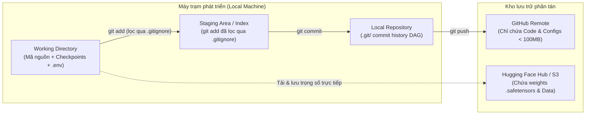

> **"Mã nguồn quản lý bằng Git, trọng số mô hình quản lý bằng kho chuyên biệt. Đừng bao giờ nhồi nhét cả hai vào cùng một commit."** — Git sinh ra để theo dõi sự biến đổi của các dòng mã nguồn dạng văn bản thuần túy (text diff). Khi bạn nhồi nhét hàng gigabyte file checkpoint nhị phân vào Git, kho lưu trữ sẽ sụp đổ dưới sức nặng của chính nó.

---

## Thông tin nhanh (Quick Spec)

* **Loại bài (Type):** Quy trình thực chiến & MLOps Foundations (Workflow & Best Practices)
* **Ngôn ngữ & Công cụ:** Git CLI, Shell, Python (`nbstripout`)
* **Kiến thức tiên quyết (Prerequisites):** Đã hoàn thành Bài 01 (Thiết lập môi trường phát triển AI)
* **Thời gian thực hành:** ~35 phút
* **Độ khó:** Cơ bản đến Trung cấp (Foundational)

---

## Mục tiêu bài học (Learning Objectives)

Sau bài học này, bạn sẽ:
- [ ] Nắm vững chu trình 4 vùng của Git và cơ chế Directed Acyclic Graph (DAG) bên dưới mỗi commit.
- [ ] Xây dựng file `.gitignore` tiêu chuẩn cấp độ production cho dự án AI, ngăn chặn triệt để rò rỉ checkpoint nặng (`.pt`, `.safetensors`) và thông tin nhạy cảm (`.env`, khóa API).
- [ ] Làm chủ chiến lược phân nhánh thử nghiệm mô hình (**Experiment Branching**) và chuẩn hóa lịch sử commit theo quy ước **Conventional Commits**.
- [ ] Thành thạo các bước giải cứu kho Git khẩn cấp khi lỡ tay commit file nhị phân nặng hàng trăm megabyte trước khi làm phình to lịch sử vĩnh viễn.
- [ ] Phân định rõ ranh giới và vai trò của **Tam giác lưu trữ AI**: Git (mã nguồn), Git LFS / DVC (dữ liệu & siêu dữ liệu), và Hugging Face Hub / S3 (trọng số mô hình).

---

## 1. Vấn đề thực tế (The Problem)

Trong quá trình phát triển phần mềm truyền thống, lập trình viên chủ yếu làm việc với các file văn bản có dung lượng vài kilobyte. Nhưng trong các dự án AI/ML, trạm làm việc của bạn ngập tràn những artifact khổng lồ: file trọng số mô hình (`.safetensors`, `.pt`), bộ dữ liệu dạng bảng (`.parquet`, `.csv`), và các file log thực nghiệm (`wandb/`). Nếu áp dụng thói quen Git thông thường, bạn sẽ lập tức đối mặt với hai thảm họa kinh điển:

### Cơn ác mộng 1: Commit file checkpoint 2GB vào Git

Giả sử sau 8 tiếng huấn luyện mô hình, script tự động lưu file `model_epoch_10.safetensors` nặng 2.1GB vào thư mục dự án. Theo thói quen, bạn gõ `git add .` rồi `git commit -m "save checkpoint"` và chạy `git push origin main`. Ngay lập tức, GitHub sẽ chặn đứng lệnh đẩy lên với thông báo lỗi đỏ rực:

```text
remote: error: Trace: 4b29c18f3a8b
remote: error: See https://gh.io/lfs for more information.
remote: error: File checkpoints/model_epoch_10.safetensors is 2147.48 MB; this exceeds GitHub's file size limit of 100.00 MB
remote: error: GH001: Large files detected. You may want to try Git Large File Storage.
To github.com:your-org/ai-project.git
 ! [remote rejected] main -> main (pre-receive hook declined)
error: failed to push some refs to 'github.com:your-org/ai-project.git'
```

**Ảo tưởng tai hại về lệnh `git rm`:**
Nhiều kỹ sư phản xạ bằng cách gõ:
```bash
git rm checkpoints/model_epoch_10.safetensors
git commit -m "fix: xoa file nang"
git push origin main
```
Nhưng GitHub **vẫn tiếp tục từ chối** và ném ra đúng lỗi cũ! 

Tại sao lại như vậy? Bởi vì Git là một hệ thống lưu trữ bất biến (Immutable Directed Acyclic Graph - DAG). Lệnh `git rm` ở trên chỉ tạo ra một commit mới biểu thị rằng file đã bị xóa khỏi cây thư mục làm việc, nhưng commit ngay trước đó vẫn chứa nguyên vẹn blob nhị phân 2.1GB nằm trong thư mục `.git/objects/`. Khi bạn thực hiện `git push`, Git sẽ đóng gói toàn bộ lịch sử (packfile) bao gồm cả commit chứa file 2.1GB và cố gắng đẩy lên remote!

Hậu quả: Toàn bộ thư mục `.git` phình to vĩnh viễn từ 5MB lên hàng gigabyte. Bất kỳ đồng nghiệp nào clone repo cũng phải tải toàn bộ khối dữ liệu vô ích đó, gây lãng phí băng thông và tắc nghẽn pipeline CI/CD.

### Cơn ác mộng 2: Xung đột (Merge Conflict) trong Jupyter Notebook

Jupyter Notebook (`.ipynb`) thực chất là một file JSON khổng lồ chứa lẫn lộn: mã nguồn Python, văn bản Markdown, số thứ tự thực thi (`execution_count`), và toàn bộ đầu ra (`outputs`) — bao gồm cả chuỗi base64 của các biểu đồ matplotlib dài hàng chục nghìn ký tự. 

Khi hai kỹ sư cùng chỉnh sửa một notebook và merge nhánh, Git sẽ so sánh từng dòng JSON. Chỉ một sự khác biệt nhỏ về `execution_count` hoặc thời gian chạy cell cũng tạo ra hàng trăm dòng xung đột vô nghĩa. Việc gỡ xung đột thủ công bằng mắt trên file JSON thường dẫn tới việc file bị sai cú pháp (syntax error) và không thể mở lại trên giao diện JupyterLab.

---

## 2. Mô hình tư duy & Bản chất (The Concept)

Để làm chủ Git trong kỷ nguyên AI, bạn cần nắm vững hai mô hình tư duy then chốt: **Chu trình 4 vùng của Git** và **Tam giác lưu trữ AI (The AI Storage Trinity)**.



### 1. Chu trình 4 vùng của Git:
- **Working Directory (Thư mục làm việc):** Nơi chứa tất cả các file vật lý trên ổ cứng của bạn (code, model weights, file cấu hình `.env`, thư mục cache).
- **Staging Area / Index (Vùng đệm chuẩn bị):** Nơi lưu trữ ảnh chụp (snapshot) của những thay đổi bạn chủ động chọn lọc thông qua `git add`. Đây là tuyến phòng thủ then chốt: chỉ những file hợp lệ mới được đưa vào đây nhờ sự bảo vệ của `.gitignore`.
- **Local Repository (Kho lưu trữ cục bộ):** Nằm ẩn trong thư mục `.git/`. Khi gõ `git commit`, Git tạo ra một nút commit mới trong đồ thị DAG, lưu trữ hash SHA của toàn bộ trạng thái code.
- **Remote Repository (Kho lưu trữ máy chủ):** Nơi đồng bộ mã nguồn với đồng nghiệp (GitHub, GitLab). GitHub áp dụng giới hạn cứng (hard limit) 100MB cho mỗi file đơn lẻ.

### 2. Tam giác lưu trữ AI (The AI Storage Trinity):
Kỹ sư AI hiện đại không bắt Git phải gánh vác mọi thứ. Chúng ta phân định rạch ròi 3 đỉnh của tam giác lưu trữ:

1. **Git (Code & Pipelines):** Chỉ lưu trữ mã nguồn văn bản (`.py`, `.ts`, Dockerfile, shell scripts, configs YAML). Dung lượng toàn bộ repo thường chỉ vài chục megabyte.
2. **Git LFS / DVC (Metadata & Data Pointers):** Lưu trữ các file con trỏ văn bản nhỏ (pointer files) trỏ tới các phiên bản dữ liệu hoặc artifacts trung gian.
3. **Model Hub & Object Storage (Weights & Big Data):** Hugging Face Hub, AWS S3, Cloudflare R2 hoặc Google Cloud Storage — nơi chuyên biệt lưu trữ các file nhị phân hàng chục gigabyte thông qua giao thức truyền tải phân đoạn (chunked streaming).

---

## 3. Tự tay cấu hình từ đầu (Build It / Hands-on)

Chúng ta sẽ thiết lập cấu hình Git chuẩn chỉnh cho trạm làm việc AI theo từng bước.

### Bước 1: Cấu hình danh tính và Alias tăng tốc dòng lệnh

Thiết lập thông tin danh tính tác giả và nhánh mặc định toàn cục:

```bash
# Cấu hình danh tính chuẩn
git config --global user.name "Nguyen Van A"
git config --global user.email "a.nguyen@example.com"

# Đặt tên nhánh mặc định khi khởi tạo repo mới là 'main'
git config --global init.defaultBranch main

# Xử lý tự động ký tự ngắt dòng LF / CRLF giữa Windows và Linux
git config --global core.autocrlf input
```

Thiết lập các alias giúp rút ngắn thao tác và hiển thị đồ thị commit trực quan:

```bash
# Kiểm tra trạng thái ngắn gọn
git config --global alias.st status

# Hiển thị đồ thị commit trực quan có màu sắc
git config --global alias.lg "log --graph --pretty=format:'%Cred%h%Creset -%C(yellow)%d%Creset %s %Cgreen(%cr) %C(bold blue)<%an>%Creset' --abbrev-commit"
```

---

### Bước 2: Xây dựng file `.gitignore` tiêu chuẩn cho dự án AI

File `.gitignore` là tấm khiên vững chắc nhất bảo vệ kho chứa của bạn. Trong thư mục gốc của dự án AI, hãy tạo file `.gitignore` với nội dung chuẩn hóa sau:

```gitignore
# ==========================================
# 1. AI Model Weights & Checkpoints (BẮT BUỘC CHẶN)
# ==========================================
*.pt
*.pth
*.bin
*.safetensors
*.onnx
*.engine
*.tflite
*.ckpt
checkpoints/
weights/
models/saved/

# ==========================================
# 2. Datasets & Large Data Files
# ==========================================
data/raw/
data/processed/
*.parquet
*.arrow
*.feather
*.csv
*.tsv
*.jsonl
*.h5
*.hdf5

# ==========================================
# 3. Secrets & API Keys (BẢO MẬT TUYỆT ĐỐI)
# ==========================================
.env
.env.local
.env.*.local
*.pem
*.key
secrets.yaml

# ==========================================
# 4. Experiment Tracking & Training Logs
# ==========================================
wandb/
runs/
lightning_logs/
tensorboard/
*.log
events.out.tfevents.*

# ==========================================
# 5. Python Runtime & Virtual Environments
# ==========================================
__pycache__/
*.py[cod]
*$py.class
.venv/
venv/
env/
.pytest_cache/
.ruff_cache/
.mypy_cache/

# ==========================================
# 6. Jupyter Notebook Temporary Checkpoints
# ==========================================
.ipynb_checkpoints/
*-checkpoint.ipynb

# ==========================================
# 7. OS & Editor Artifacts
# ==========================================
.DS_Store
Thumbs.db
.vscode/
.idea/
```

*Kiểm tra nhanh hiệu quả của `.gitignore`:*
Nếu bạn tạo thử một file checkpoint giả: `touch checkpoints/test.safetensors`, sau đó gõ `git status`, Git sẽ hoàn toàn bỏ qua file này và không liệt kê trong danh sách untracked files.

---

### Bước 3: Quy trình nhánh thử nghiệm (Experiment Branching) & Conventional Commits

Khi huấn luyện mô hình, bạn thường xuyên thử nghiệm nhiều siêu tham số (hyperparameters), kiến trúc LoRA, hoặc prompt template khác nhau. Không bao giờ commit trực tiếp lên nhánh `main`.

**1. Quy ước đặt tên nhánh thử nghiệm:**
- `exp/<tên-mo-hinh>-<ý-tuong>`: ví dụ `exp/lora-mistral-r16`, `exp/dpo-lr5e6`.
- `feat/<tinh-nang>`: ví dụ `feat/add-vllm-engine`, `feat/custom-tokenizer`.
- `fix/<loi-ky-thuat>`: ví dụ `fix/cuda-oom-batching`, `fix/pad-token-id`.

Tạo và chuyển sang nhánh thử nghiệm mới:

```bash
git checkout -b exp/lora-mistral-r16
```

**2. Chuẩn hóa thông điệp với Conventional Commits:**
Mỗi commit message nên tuân thủ cấu trúc: `<loại>(<phạm vi>): <mô tả ngắn bằng thể mệnh lệnh>`

Các tiền tố chuẩn:
- `feat`: Thêm tính năng mới (thêm module dữ liệu, kiến trúc mô hình mới).
- `exp`: Ghi nhận thử nghiệm huấn luyện mới (thay đổi learning rate, optimizer).
- `fix`: Sửa lỗi kỹ thuật (khắc phục tràn bộ nhớ CUDA OOM, lỗi NaN loss).
- `docs`: Cập nhật tài liệu kỹ thuật hoặc README.
- `refactor`: Tái cấu trúc code nhưng không thay đổi hành vi logic.

*Ví dụ commit thực tế:*
```bash
git add src/train.py
git commit -m "exp(lora): tăng rank r từ 8 lên 16 và bật target_modules all-linear"
```

---

### Bước 4: Kỹ thuật cứu hộ khẩn cấp khi lỡ commit file nặng

Nếu vô tình commit file nặng vài trăm megabyte, hãy bình tĩnh áp dụng đúng kỹ thuật cứu hộ tương ứng với trạng thái hiện tại:

#### Tình huống A: File mới nằm trong Staging Area (`git add` nhưng chưa `git commit`)
Đây là tình huống đơn giản nhất. Hãy loại bỏ file khỏi staging mà không xóa file thật trên đĩa:

```bash
# Loại bỏ file khỏi staging
git rm --cached path/to/large_model.safetensors

# Hoặc dùng git restore (từ Git 2.23+)
git restore --staged path/to/large_model.safetensors
```

#### Tình huống B: File đã nằm trong commit mới nhất (`git commit` nhưng chưa `git push`)
Bạn vừa gõ `git commit`, chưa đẩy lên GitHub:

```bash
# 1. Hủy bỏ commit gần nhất nhưng GIỮ NGUYÊN toàn bộ code trên ổ cứng
git reset --soft HEAD~1

# 2. Thêm file nặng vào .gitignore ngay lập tức
echo "path/to/large_model.safetensors" >> .gitignore

# 3. Gỡ bỏ file khỏi staging
git rm --cached path/to/large_model.safetensors

# 4. Tạo lại commit sạch sẽ
git commit -m "feat(pipeline): hoàn thiện pipeline huấn luyện"
```

#### Tình huống C: File nặng đã bị commit ở nhiều commit trước đó trong quá khứ
Nếu file nặng đã bị commit từ nhiều ngày trước, lệnh `git reset` thông thường sẽ làm mất lịch sử các commit tiếp theo. Chúng ta dùng công cụ hiện đại `git-filter-repo` viết bằng Python để quét sạch file khỏi toàn bộ lịch sử Git DAG:

```bash
# Cài đặt git-filter-repo qua uv
uv tool install git-filter-repo

# Quét sạch file nặng khỏi toàn bộ lịch sử commit trong quá khứ
git-filter-repo --path path/to/large_model.safetensors --invert-paths
```

Lệnh này sẽ viết lại đồ thị commit một cách triệt để, xóa vĩnh viễn blob nặng khỏi `.git/objects/` và giúp kho lưu trữ lấy lại dung lượng siêu nhẹ ban đầu.

---

## 4. Ứng dụng thực tế & Cạm bẫy Production (Use It / Production Tips)

### Cạm bẫy 1: Thói quen nguy hiểm `git add .` mù quáng

Trong môi trường AI, lệnh `git add .` là nguyên nhân của hơn 90% sự cố bảo mật và phình to kho chứa:
- **Rò rỉ API Keys:** File `.env` chứa `OPENAI_API_KEY`, `ANTHROPIC_API_KEY`, hoặc `HUGGINGFACE_TOKEN` nếu vô tình bị stage và push lên GitHub công khai, các bot quét bảo mật tự động trên Internet sẽ chiếm đoạt khóa chỉ trong vòng 30 giây, dẫn đến việc tài khoản bị trừ hàng nghìn USD.
- **Vô tình nạp checkpoint:** Một file checkpoint tạm vài trăm megabyte phát sinh trong lúc chạy code có thể lập tức bị đưa vào staging.

**Quy tắc bất biến:**
- Luôn kiểm tra `git status` trước khi thêm file.
- Ưu tiên sử dụng lệnh thêm có chọn lọc: `git add <tên-file-cụ-thể>` hoặc `git add -p` (chế độ patch mode) để tự review từng đoạn thay đổi trước khi commit.

---

### Cạm bẫy 2: Xử lý triệt để xung đột Jupyter Notebook với `nbstripout`

Để không bao giờ phải đối mặt với thảm họa merge conflict trong file JSON của Jupyter Notebook, giải pháp chuẩn ngành là tự động làm sạch cell outputs trước khi commit bằng công cụ `nbstripout`:

1. Cài đặt `nbstripout` vào môi trường ảo của dự án:
   ```bash
   uv pip install nbstripout
   ```
2. Kích hoạt bộ lọc tự động cho Git repo hiện tại:
   ```bash
   nbstripout --install
   ```

**Cơ chế hoạt động bên dưới:**
Lệnh trên sẽ tự động cấu hình một Git Clean Filter trong file `.git/config`. Mỗi khi bạn chạy lệnh `git add notebook.ipynb`, Git sẽ chuyển tiếp nội dung file qua `nbstripout` trước khi lưu vào Staging Area. Toàn bộ hình ảnh đồ họa base64 và số lần chạy cell sẽ bị tước bỏ, chỉ giữ lại code Python và văn bản Markdown nguyên bản. Nhờ đó, file `.ipynb` được lưu trữ dưới dạng text diff cực kỳ tinh gọn và không bao giờ xảy ra xung đột cell output khi làm việc nhóm.

---

### Cạm bẫy 3: Phân định ranh giới giữa Git LFS, DVC và Hugging Face Hub

| Tiêu chí so sánh | Git LFS (Large File Storage) | DVC (Data Version Control) | Hugging Face Hub |
|---|---|---|---|
| **Mục đích chính** | Lưu trữ các asset nhị phân nhỏ gắn liền mã nguồn (ảnh demo, file âm thanh mẫu, icon). | Quản lý phiên bản bộ dữ liệu huấn luyện (Datasets) và Data Pipelines MLOps. | Kho lưu trữ và chia sẻ trọng số mô hình AI (Model Weights: `.safetensors`, GGUF). |
| **Dung lượng tối ưu** | Vài megabyte đến dưới 100MB. | Hàng chục gigabyte đến hàng terabyte. | 1GB đến hơn 100GB cho mỗi mô hình. |
| **Hạ tầng lưu trữ vật lý** | Máy chủ lưu trữ LFS của GitHub/GitLab (bị giới hạn dung lượng miễn phí). | Đám mây cá nhân/doanh nghiệp: AWS S3, Google Cloud Storage, Cloudflare R2, MinIO. | Mạng lưới phân phối nội dung toàn cầu (CDN) tối ưu hóa của Hugging Face. |
| **Cách tích hợp** | Tự động hóa qua Git CLI (`git lfs track`). | Lệnh độc lập `dvc add`, `dvc push`, `dvc pull`. | Tích hợp trực tiếp vào mã nguồn Python qua thư viện `transformers` và `huggingface_hub`. |

**Lời khuyên thực chiến:** Với các trọng số mô hình lớn, hãy đẩy trực tiếp lên Hugging Face Hub hoặc AWS S3, sau đó trong mã nguồn Git chỉ lưu đường dẫn định danh mô hình (Model ID như `Qwen/Qwen2.5-7B-Instruct`). Đây là cách các đội ngũ kỹ thuật AI chuyên nghiệp trên thế giới vận hành.

---

## 5. Giải ngố thuật ngữ (Key Terms)

| Thuật ngữ | Người ta thường nghĩ là... | Bản chất kỹ thuật thực sự là... |
|---|---|---|
| **Git Commit vs Model Checkpoint** | Hai cách gọi của cùng một hành động lưu trạng thái dự án | **Git Commit** là ảnh chụp (snapshot) của cây mã nguồn văn bản trong Git DAG. **Model Checkpoint** là toàn bộ trọng số (weights), gradient và trạng thái bộ tối ưu hóa (optimizer state) tại một bước huấn luyện được tuần tự hóa (serialize) ra file nhị phân lớn. |
| **Git LFS vs DVC** | Cùng là công cụ để lưu file nặng lên GitHub | **Git LFS** thay thế file nặng bằng file con trỏ text trong Git và lưu file gốc trên server của Git host. **DVC (Data Version Control)** tách rời hoàn toàn: lưu metadata phiên bản dữ liệu vào file `.dvc` nhỏ trong Git, còn dữ liệu thực tế được đẩy lên cloud storage độc lập (S3/GCS) do bạn làm chủ. |
| **Git Rebase vs Git Merge** | Hai lệnh gộp code hoàn toàn giống nhau | **Merge** tạo ra một commit gộp mới có hai commit cha, bảo toàn nguyên vẹn mọi nhánh lịch sử; **Rebase** viết lại lịch sử bằng cách chuyển toàn bộ các commit của nhánh hiện tại đặt tiếp nối lên đỉnh của nhánh đích, tạo ra một lịch sử commit tuyến tính, phẳng và sạch sẽ. |
| **Tracked vs Untracked Files** | File nằm trong thư mục dự án thì mặc định được Git theo dõi | File chỉ trở thành **Tracked** khi đã từng được đưa vào Staging Area (`git add`) hoặc đã nằm trong commit trước đó. Mọi file mới tạo ra trên ổ cứng đều ở trạng thái **Untracked** và hoàn toàn vô hình với Git cho đến khi bạn chủ động thêm vào. |

---

## 6. Bài tập thử thách (Hands-on Challenges)

### 🟢 Dễ (Easy): Khởi tạo kho chứa và commit chuẩn mực đầu tiên
1. Khởi tạo một Git repository mới trong một thư mục thử nghiệm bằng lệnh `git init`.
2. Tạo file `.gitignore` tiêu chuẩn theo mẫu ở Bước 2.
3. Tạo file `train.py` đơn giản in ra thông báo `"Training pipeline initialized"`.
4. Đưa các file vào staging và tạo commit đầu tiên tuân thủ nghiêm ngặt quy ước Conventional Commits: `feat(core): khởi tạo pipeline huấn luyện và cấu hình gitignore`.
5. Sử dụng alias `git lg` hoặc `git log --oneline` để kiểm tra cây lịch sử commit.

### 🟡 Vừa (Medium): Giả lập sự cố file nhị phân và giải cứu kho Git
1. Giả lập một tình huống thực tế: tạo một file nhị phân ngẫu nhiên nặng 120MB bằng lệnh:
   ```bash
   dd if=/dev/urandom of=checkpoints/weights_epoch_1.bin bs=1M count=120
   ```
2. Chạy `git status` để kiểm chứng xem file có bị `.gitignore` chặn lại không.
3. Tạm thời xóa dòng `*.bin` khỏi `.gitignore`, sau đó thực hiện `git add checkpoints/weights_epoch_1.bin` và `git commit -m "save checkpoint"`.
4. Thực hiện quy trình giải cứu khẩn cấp:
   - Dùng `git reset --soft HEAD~1` để hủy commit vừa tạo.
   - Thêm lại `*.bin` vào `.gitignore`.
   - Dùng `git rm --cached` để gỡ bỏ file nhị phân khỏi staging.
   - Commit lại mã nguồn sạch sẽ và kiểm tra xem dung lượng thư mục `.git` có an toàn không.

### 🔴 Khó (Hard): Thiết lập pre-commit hook phòng thủ 2 lớp
1. Trong repository của bạn, cài đặt và cấu hình thư viện `pre-commit`:
   ```bash
   uv pip install pre-commit nbstripout
   ```
2. Tạo file `.pre-commit-config.yaml` tích hợp hook `nbstripout` để tự động làm sạch mọi file `.ipynb` trước khi commit.
3. **Thử thách nâng cao:** Viết thêm một bash script hook đặt tại `.git/hooks/pre-commit` để tự động quét toàn bộ các file chuẩn bị commit:
   - Nếu phát hiện bất kỳ file nào có dung lượng lớn hơn 50MB $\rightarrow$ lập tức hủy lệnh commit và cảnh báo ra màn hình terminal.
   - Nếu phát hiện bất kỳ file nào có đuôi mở rộng `.safetensors` hoặc `.pt` $\rightarrow$ lập tức hủy lệnh commit và yêu cầu đẩy lên Hugging Face Hub.
4. Chạy thử nghiệm thực tế với cả trường hợp hợp lệ và vi phạm để xác nhận hàng rào phòng thủ hoạt động 100%.
