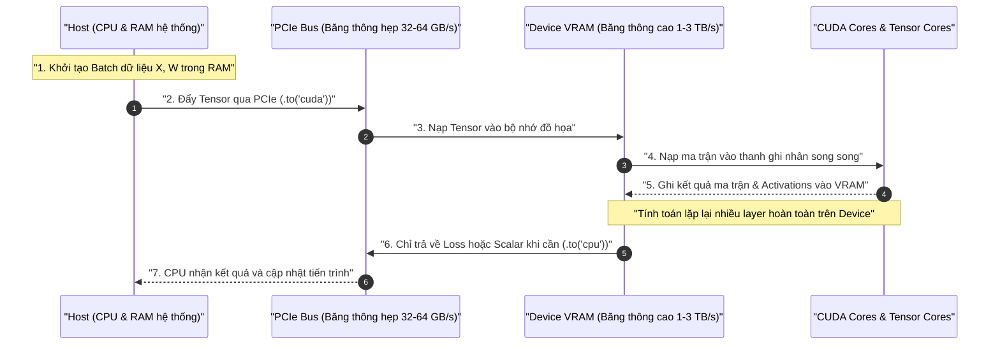

> **Châm ngôn cốt lõi:** Huấn luyện trên CPU là để hiểu khái niệm, tăng tốc trên GPU là để tồn tại trong thực tế. Nhưng hiểu rõ giới hạn VRAM mới giúp bạn không phá sản.

---

## Thông tin nhanh (Quick Spec)

* **Loại bài (Type):** Thực chiến & Đo kiểm hiệu năng (Build & Benchmark)
* **Ngôn ngữ & Công cụ:** Python 3.11+, PyTorch 2.x, Bash, NVIDIA CUDA 12.x, Apple Metal Performance Shaders (MPS)
* **Kiến thức tiên quyết (Prerequisites):** Đã hoàn thành Bài 01 (Môi trường Python với `uv`)
* **Thời gian thực hành:** ~45 phút

---

## Mục tiêu bài học (Learning Objectives)

Sau bài học này, bạn sẽ làm chủ:
- [ ] Phân biệt rạch ròi giữa CUDA Driver API và CUDA Runtime Toolkit, chấm dứt hoàn toàn các lỗi xung đột phiên bản driver.
- [ ] Cấu hình và kích hoạt tăng tốc phần cứng trên cả máy tính NVIDIA (CUDA) và macOS Apple Silicon (Metal Performance Shaders - MPS).
- [ ] Tự viết script benchmark đo đạc thời gian nhân ma trận lớn và tính toán tốc độ tăng tốc thực tế (Speedup Ratio) với kỹ thuật đồng bộ luồng `synchronize()`.
- [ ] Nắm vững công thức ước tính ngân sách VRAM cho cả bài toán huấn luyện (Training với AdamW) và suy luận (Inference với FP16 / INT4), chủ động ngăn chặn lỗi `RuntimeError: CUDA out of memory`.
- [ ] Định vị chiến lược sử dụng hạ tầng Cloud GPU phù hợp từ miễn phí (Google Colab, Kaggle) đến thuê theo giờ (RunPod, Lambda Labs, Vast.ai).

---

## 1. Vấn đề thực tế (The Problem)

Trong học máy cổ điển (Scikit-Learn, Random Forest, XGBoost cỡ nhỏ), CPU đa nhân xử lý mượt mà. Tuy nhiên, khi bước chân vào học sâu (Deep Learning), Computer Vision và Mô hình Ngôn ngữ Lớn (LLM), bản chất phép toán chuyển dịch hoàn toàn sang **nhân ma trận khổng lồ** (GEMM - General Matrix Multiply) với độ phức tạp $O(N^3)$.

Một mô hình Transformer hoặc mạng tích chập ResNet nếu huấn luyện một epoch trên CPU 16 luồng có thể mất tới **14 tiếng**, nhưng trên một GPU tầm trung như NVIDIA RTX 4070 hoặc RTX 3090 chỉ mất vỏn vẹn **4 phút** — tốc độ tăng gấp hơn 200 lần!

Thế nhưng, hành trình thiết lập GPU của kỹ sư AI thường xuyên vấp phải ba rào cản chí mạng:

1. **Ma trận xung đột phiên bản (CUDA Hell):** Lệnh `nvidia-smi` báo hỗ trợ CUDA 12.6, nhưng PyTorch cài qua pip lại là bản CPU-only hoặc biên dịch cho CUDA 11.8, dẫn đến kết quả cay đắng: `torch.cuda.is_available() == False`.
2. **Cơn ác mộng CUDA Out of Memory (OOM):** Code vừa chạy được 2 batch thì văng lỗi `RuntimeError: CUDA out of memory`. Nhiều bạn vội vàng giảm batch size về 1 hoặc mù quáng mua GPU đắt tiền hơn trong khi nguyên nhân thực sự đến từ rò rỉ tensor trong vòng lặp hoặc bộ nhớ đệm optimizer chiếm dụng không kiểm soát.
3. **Hiểu lầm về máy Mac Apple Silicon:** Rất nhiều kỹ sư cho rằng lập trình học sâu chỉ dành cho máy bàn chạy card NVIDIA, bỏ quên sức mạnh khủng khiếp của kiến trúc Bộ nhớ Hợp nhất (Unified Memory) trên các dòng chip Apple M-series (M1/M2/M3/M4) qua backend `mps`.

---

## 2. Mô hình tư duy & Bản chất (The Concept)

Để làm chủ GPU, bạn cần nắm vững hai mô hình kiến trúc phần cứng: **Mô hình Rời rạc (Discrete GPU)** và **Mô hình Bộ nhớ Hợp nhất (Unified Memory)**.

### Luồng dữ liệu tính toán song song trên GPU rời

Trên máy tính dùng card đồ họa rời (NVIDIA RTX / A100 / H100), hệ thống chia làm hai lãnh địa tách biệt:
- **Host:** Bao gồm CPU điều khiển và bộ nhớ RAM hệ thống (System RAM).
- **Device:** Bao gồm GPU xử lý song song và bộ nhớ đồ họa tốc độ cao (VRAM GDDR6X hoặc HBM3).

Đường giao tiếp duy nhất giữa Host và Device là khe cắm **PCIe Bus** (PCIe 4.0 x16 đạt băng thông lý thuyết ~31.5 GB/s; PCIe 5.0 x16 đạt ~63 GB/s). Băng thông này cực kỳ nhỏ bé so với băng thông nội bộ của chính VRAM (vốn đạt từ 1,000 GB/s đến hơn 3,000 GB/s). Do đó, cạm bẫy hiệu năng số 1 là việc liên tục sao chép dữ liệu qua lại giữa CPU và GPU.



### Kiến trúc Bộ nhớ Hợp nhất (Unified Memory) trên Apple Silicon

Khác biệt hoàn toàn với mô hình rời rạc, các chip Apple Silicon (M1/M2/M3/M4 Series) tích hợp CPU, GPU và Neural Engine trên cùng một die silicon. 

Cả CPU và GPU đều truy cập vào **cùng một không gian bộ nhớ RAM duy nhất**. Khi PyTorch chuyển đổi `tensor.to("mps")`, hệ thống không cần sao chép dữ liệu qua đường truyền PCIe nào cả. Đây là lợi thế vô tiền khoáng hậu: Một chiếc MacBook Pro trang bị 64GB hay 128GB Unified Memory có thể nạp toàn bộ một mô hình LLM 70B (ở định dạng lượng tử hóa 4-bit) để chạy suy luận — điều mà một card đồ họa rời dân dụng 24GB VRAM (như RTX 4090) hoàn toàn bất khả thi nếu không ghép nhiều card!

---

## 3. Tự tay cấu hình từ đầu (Build It: Hands-on)

Chúng ta sẽ thiết lập môi trường tăng tốc phần cứng chuẩn chỉ cho cả ba kịch bản: Máy NVIDIA cá nhân, máy macOS Apple Silicon, và Cloud GPU.

### Lựa chọn 1: Cấu hình NVIDIA GPU trên Linux / Windows WSL2

#### 1. Kiểm tra CUDA Driver

Mở terminal và gõ:

```bash
nvidia-smi
```

Bảng thông tin xuất hiện cho bạn biết hai thông số tối quan trọng:
* **Driver Version:** Phiên bản driver NVIDIA đang cài trên máy (ví dụ: `550.54.14`).
* **CUDA Version:** Phiên bản CUDA tối đa mà driver này hỗ trợ (ví dụ: `CUDA Version: 12.4`). Bạn hoàn toàn có thể cài PyTorch chạy bản CUDA thấp hơn hoặc bằng số này.

#### 2. Cài đặt PyTorch với CUDA Runtime chuẩn qua uv

Đừng dùng lệnh `pip install torch` mặc định nếu bạn không chắc chắn nó trỏ về wheel nào. Hãy chỉ định rõ kênh phân phối chính thức của PyTorch:

```bash
# Tạo môi trường ảo với uv
uv venv .venv
source .venv/bin/activate

# Cài đặt PyTorch biên dịch sẵn với CUDA 12.4
uv pip install torch torchvision torchaudio --index-url https://download.pytorch.org/whl/cu124
```

Kiểm tra xác nhận trong Python:

```python
import torch

print(f"PyTorch version: {torch.__version__}")
print(f"CUDA khả dụng: {torch.cuda.is_available()}")
if torch.cuda.is_available():
    print(f"Tên GPU: {torch.cuda.get_device_name(0)}")
    print(f"Số lượng GPU: {torch.cuda.device_count()}")
    print(f"Phiên bản CUDA Runtime: {torch.version.cuda}")
    print(f"VRAM khả dụng: {torch.cuda.get_device_properties(0).total_memory / (1024**3):.2f} GB")
```

### Lựa chọn 2: Cấu hình Metal Performance Shaders (MPS) trên macOS

Trên macOS (M1/M2/M3/M4), bạn chỉ cần cài đặt bản PyTorch chính thức:

```bash
uv pip install torch torchvision torchaudio
```

Kiểm tra tính khả dụng của backend Apple Silicon Metal:

```python
import torch

print(f"MPS khả dụng: {torch.backends.mps.is_available()}")
print(f"MPS đã build: {torch.backends.mps.is_built()}")

if torch.backends.mps.is_available():
    device = torch.device("mps")
    x = torch.ones(5, device=device)
    print(f"Khởi tạo Tensor thành công trên: {x.device}")
```

> **Mẹo sống còn trên macOS:** Một số toán tử PyTorch hiếm gặp chưa được Apple hỗ trợ native trên MPS. Hãy xuất biến môi trường sau vào file `.zshrc` để PyTorch tự động fallback về CPU mà không làm văng chương trình:
> ```bash
> export PYTORCH_ENABLE_MPS_FALLBACK=1
> ```

### Lựa chọn 3: Tận dụng Cloud GPU miễn phí và giá rẻ

Nếu bạn không có sẵn GPU rời tại nhà, đây là các phương án tối ưu:

1. **Google Colab (Miễn phí):** Cung cấp 1 GPU NVIDIA T4 (15GB VRAM) hoặc L4 miễn phí theo từng phiên làm việc (session). Vào menu `Runtime` $\rightarrow$ `Change runtime type` $\rightarrow$ chọn `T4 GPU`.
2. **Kaggle Notebooks (Miễn phí):** Cung cấp tới **30 giờ sử dụng GPU mỗi tuần** hoàn toàn miễn phí, hỗ trợ tùy chọn 2x NVIDIA T4 (tổng cộng 32GB VRAM). Đây là nền tảng luyện tập học máy tốt nhất thế giới hiện nay.
3. **Cloud GPU trả theo giờ (Rent-by-the-hour):**
   * **RunPod & Vast.ai:** Nền tảng chia sẻ GPU cộng đồng, giá chỉ từ **\$0.20 - \$0.40/giờ** cho RTX 3090/4090, cực kỳ tiết kiệm để chạy Fine-tuning qua đêm.
   * **Lambda Labs:** Đám mây GPU chuyên dụng cao cấp, cho thuê A100 (80GB VRAM) với giá khoảng **\$1.50 - \$2.00/giờ**.

### Viết script Benchmark đo kiểm tốc độ CPU vs GPU/MPS

Một sai lầm kinh điển khi đo thời gian chạy GPU là dùng `time.time()` ngay trước và sau phép toán mà quên mất GPU thực thi **hoàn toàn bất đồng bộ (asynchronous)**! Lệnh CPU gọi `C = A @ B` chỉ đẩy lệnh vào hàng đợi (command queue) của GPU rồi trả quyền điều khiển về CPU ngay lập tức. Để đo chuẩn xác, bạn bắt buộc phải gọi hàm `synchronize()`.

Hãy tạo file `benchmark_acceleration.py`:

```python
import time
import torch

def benchmark_matmul(device_name: str, size: int = 5000, num_runs: int = 5):
    """
    Đo đạc thời gian thực hiện phép nhân ma trận vuông size x size.
    Sử dụng synchronize để đảm bảo GPU hoàn thành 100% trước khi bấm giờ.
    """
    device = torch.device(device_name)
    print(f"\n--- Đang đo kiểm trên thiết bị: {device_name.upper()} ---")

    # 1. Khởi tạo dữ liệu trên thiết bị chỉ định (kiểu FP32)
    a = torch.randn(size, size, device=device, dtype=torch.float32)
    b = torch.randn(size, size, device=device, dtype=torch.float32)

    # 2. Warm-up (Khởi động GPU để tải kernel và context)
    for _ in range(2):
        _ = torch.matmul(a, b)

    if device_name == "cuda":
        torch.cuda.synchronize()
    elif device_name == "mps":
        torch.mps.synchronize()

    # 3. Đo đạc thời gian chạy thực tế
    start_time = time.perf_counter()
    for _ in range(num_runs):
        c = torch.matmul(a, b)

    if device_name == "cuda":
        torch.cuda.synchronize()
    elif device_name == "mps":
        torch.mps.synchronize()

    elapsed = (time.perf_counter() - start_time) / num_runs

    # Tính toán khối lượng tính toán (FLOPs cho phép nhân 2 ma trận size x size là 2 * size^3)
    tflops = (2 * (size ** 3)) / (elapsed * 1e12)

    print(f"Kích thước ma trận: {size}x{size}")
    print(f"Thời gian trung bình: {elapsed * 1000:.2f} ms")
    print(f"Hiệu năng ước tính: {tflops:.2f} TFLOPs")
    return elapsed

if __name__ == "__main__":
    matrix_dim = 6000

    # Đo CPU làm mốc đối chứng
    cpu_time = benchmark_matmul("cpu", size=matrix_dim, num_runs=3)

    # Đo GPU nếu có
    if torch.cuda.is_available():
        gpu_time = benchmark_matmul("cuda", size=matrix_dim, num_runs=10)
        speedup = cpu_time / gpu_time
        print(f"\n🚀 NVIDIA CUDA nhanh gấp: {speedup:.1f}x lần so với CPU!")
    elif torch.backends.mps.is_available():
        mps_time = benchmark_matmul("mps", size=matrix_dim, num_runs=10)
        speedup = cpu_time / mps_time
        print(f"\n🚀 Apple Silicon MPS nhanh gấp: {speedup:.1f}x lần so với CPU!")
```

---

## 4. Ứng dụng thực tế & Cạm bẫy Production (Use It / Production Tips)

### Công thức tính toán ngân sách VRAM chuẩn xác

Đừng bao giờ đoán mò xem mô hình của bạn có vừa VRAM hay không. Hãy dùng công thức kỹ thuật dưới đây:

#### 1. Ngân sách VRAM cho bài toán Suy luận (Inference)

Khi chỉ chạy suy luận (Inference / Forward pass), bộ nhớ cần dùng bao gồm trọng số mô hình (Weights), một lượng nhỏ activations và bộ nhớ đệm KV-Cache (đối với LLM):

$$\text{VRAM}_{\text{Inference}} \approx (\text{Số lượng tham số} \times \text{Bytes trên mỗi tham số}) \times 1.2 + \text{KV-Cache}$$

* Với **FP32** (Single Precision): $4\text{ bytes / param}$.
* Với **FP16 / BF16** (Half Precision): $2\text{ bytes / param}$.
* Với **INT8** (Quantized): $1\text{ byte / param}$.
* Với **INT4** (Quantized GPTQ/AWQ/GGUF): $0.5\text{ bytes / param}$.

*Ví dụ thực tế:* Mô hình LLaMA-3-8B chạy ở FP16:
$$\text{Trọng số} \approx 8 \times 10^9 \times 2\text{ bytes} \approx 16\text{ GB}$$
Nhân hệ số overhead $1.2$ cùng KV-cache cho ngữ cảnh dài, bạn sẽ cần tối thiểu **~19-20 GB VRAM**. Một chiếc card 16GB sẽ bị OOM ngay lập tức nếu không lượng tử hóa sang INT4 (khi đó chỉ tốn khoảng $5.5\text{ GB VRAM}$).

#### 2. Ngân sách VRAM cho bài toán Huấn luyện (Training với AdamW)

Huấn luyện tốn bộ nhớ hơn gấp nhiều lần suy luận. Hãy nhìn vào bảng phân bổ cho mỗi tham số khi huấn luyện mô hình ở chế độ Mixed Precision (FP16/BF16) sử dụng optimizer phổ biến nhất là **AdamW**:

| Thành phần lưu trữ | Kiểu dữ liệu | Số byte / tham số |
|---|---|---|
| Model Weights | FP16 | $2\text{ bytes}$ |
| Gradients | FP16 | $2\text{ bytes}$ |
| Optimizer State (Momentum) | FP32 | $4\text{ bytes}$ |
| Optimizer State (Variance) | FP32 | $4\text{ bytes}$ |
| FP32 Master Weights (cho cập nhật) | FP32 | $4\text{ bytes}$ |
| **Tổng cộng phần tĩnh** | | **$16\text{ bytes / tham số}$** |

Chưa dừng lại ở đó, bạn cần cộng thêm **Activations** (lưu lại ở mỗi layer để phục vụ lan truyền ngược - Backpropagation). Tổng lượng VRAM thực tế dao động từ **$18\text{ đến }24\text{ bytes / tham số}$**!

*Hệ quả:* Để Full Fine-tune một mô hình 7B ở FP16, bạn cần:
$$7 \times 10^9 \times 18\text{ bytes} \approx 126\text{ GB VRAM}$$
Đó là lý do tại sao một mình card RTX 4090 (24GB) không thể Full Fine-tune mô hình 7B, mà bắt buộc phải sử dụng kỹ thuật **LoRA / QLoRA** (đóng băng trọng số gốc, chỉ train adapter chiếm chưa đầy $8\text{ GB VRAM}$).

---

### 4 Kỹ thuật cứu nguy chống lỗi CUDA OOM

Khi hệ thống gặp lỗi OOM, đừng vội nản lòng. Hãy áp dụng lần lượt các biện pháp sau:

1. **Automatic Mixed Precision (AMP):** Sử dụng `torch.cuda.amp.autocast()`. Kỹ thuật này tự động tính toán các phép nhân ma trận ở định dạng FP16/BF16, giảm ngay 50% kích thước activations và tận dụng Tensor Cores tăng tốc gấp 3 lần.
2. **Gradient Accumulation (Tích lũy đạo hàm):** Nếu batch size bằng 32 gây OOM, hãy giảm batch size thực tế xuống 4, và thực hiện `optimizer.step()` sau mỗi 8 bước:
   ```python
   accumulation_steps = 8
   for idx, (data, target) in enumerate(dataloader):
       loss = model(data) / accumulation_steps
       loss.backward()
       if (idx + 1) % accumulation_steps == 0:
           optimizer.step()
           optimizer.zero_grad()
   ```
3. **Gradient Checkpointing:** Thay vì lưu toàn bộ activations của mọi tầng trong quá trình forward pass, ta chỉ lưu lại ở một số tầng chốt (checkpoints). Khi backpropagation đến tầng nào, ta tính lại forward pass tầng đó. Kỹ thuật này giảm đến 60% VRAM bộ nhớ động với chi phí tăng chỉ ~20% thời gian tính toán.
4. **Thu hồi bộ nhớ đúng cách:** Luôn gọi `del tensor` và ép thu hồi bằng `gc.collect()` cùng `torch.cuda.empty_cache()` sau các batch nặng hoặc khi chuyển từ tập Train sang tập Validation.

---

### Đóng gói module tiện ích: `gpu_utils.py`

Hãy lưu lại module dưới đây vào dự án của bạn để tự động điều phối thiết bị tối ưu trên bất kỳ máy nào:

```python
import os
import gc
import torch

def get_optimal_device() -> torch.device:
    """
    Tự động phát hiện và trả về thiết bị tính toán tối ưu nhất có sẵn:
    Ưu tiên 1: NVIDIA CUDA
    Ưu tiên 2: Apple Silicon MPS
    Mặc định cuối: CPU
    """
    if torch.cuda.is_available():
        return torch.device("cuda")
    elif torch.backends.mps.is_available():
        # Đảm bảo fallback CPU được kích hoạt cho các toán tử chưa hỗ trợ
        os.environ.setdefault("PYTORCH_ENABLE_MPS_FALLBACK", "1")
        return torch.device("mps")
    return torch.device("cpu")

def print_memory_stats(device: torch.device):
    """In ra trạng thái sử dụng bộ nhớ của thiết bị chỉ định."""
    if device.type == "cuda":
        allocated = torch.cuda.memory_allocated() / (1024**3)
        reserved = torch.cuda.memory_reserved() / (1024**3)
        print(f"[CUDA Memory] Đã cấp phát: {allocated:.2f} GB | Bộ nhớ đệm dự trữ: {reserved:.2f} GB")
    elif device.type == "mps":
        print("[MPS Memory] Apple Silicon sử dụng Unified Memory chia sẻ với hệ điều hành.")
    else:
        print("[CPU Memory] Chạy trên RAM hệ thống.")

def clear_hardware_cache():
    """Giải phóng triệt để bộ nhớ rác và cache phân mảnh trên GPU."""
    gc.collect()
    if torch.cuda.is_available():
        torch.cuda.empty_cache()
        torch.cuda.ipc_collect()
    elif torch.backends.mps.is_available():
        # PyTorch 2.0+ hỗ trợ giải phóng bộ nhớ đệm MPS
        if hasattr(torch.mps, "empty_cache"):
            torch.mps.empty_cache()
```

---

## 5. Giải ngố thuật ngữ (Key Terms)

| Thuật ngữ (Term) | Người ta thường nghĩ là... | Bản chất kỹ thuật thực sự là... |
|---|---|---|
| **CUDA Driver vs CUDA Runtime** | Là một thứ duy nhất đi kèm khi cài driver card màn hình. | **CUDA Driver API** (đi cùng `nvidia-smi`) thuộc tầng kernel OS. **CUDA Runtime** (đi cùng PyTorch wheel hoặc `nvcc`) thuộc tầng ứng dụng. PyTorch có thể tự mang runtime riêng mà không cần bạn cài CUDA Toolkit cả chục GB vào hệ điều hành. |
| **VRAM vs System RAM** | Đều là RAM, chỉ khác là gắn trên card màn hình. | VRAM sử dụng chuẩn bộ nhớ băng thông siêu rộng (GDDR6X hoặc HBM) đạt từ $1,000\text{ GB/s}$ đến $3,000\text{ GB/s}$, cao gấp 20 đến 50 lần so với băng thông RAM hệ thống DDR4/DDR5 ($40\text{ - }80\text{ GB/s}$). |
| **FP32 vs FP16 vs BF16** | Giảm từ 32-bit xuống 16-bit sẽ làm mô hình học dốt đi một nửa. | FP16/BF16 giữ độ chính xác thực tế tương đương FP32 cho 99% tác vụ học sâu nhưng tiết kiệm 50% bộ nhớ và kích hoạt phần cứng chuyên dụng Tensor Cores giúp tính toán nhanh gấp bội. |
| **CUDA Cores vs Tensor Cores** | Chỉ là tên gọi marketing cho các nhân tính toán của NVIDIA. | **CUDA Cores** là các ALU tính toán song song đơn lẻ (Scalar). **Tensor Cores** là các mạch tích hợp phần cứng chuyên dụng chỉ để nhân và cộng ma trận 4x4 hoặc 16x16 trong một chu kỳ xung nhịp (Fused Multiply-Add). |
| **Unified Memory (Bộ nhớ Hợp nhất)** | Giống như card đồ họa tích hợp (onboard) chia sẻ RAM làm chậm máy. | Là kiến trúc SoC băng thông cực cao (~$150\text{ GB/s}$ đến $800\text{ GB/s}$ trên các dòng M-Max/Ultra), nơi CPU và GPU cùng chia sẻ một không gian địa chỉ bộ nhớ thực, loại bỏ hoàn toàn nút thắt cổ chai copy qua PCIe. |

---

## 6. Bài tập thử thách (Hands-on Challenges)

### 🟢 Cơ bản (Easy): Khảo sát năng lực phần cứng

Viết một script Python độc lập `check_hardware_specs.py` thực hiện:
1. Phát hiện thiết bị chạy tốt nhất trên máy (`cuda`, `mps` hoặc `cpu`).
2. Nếu là CUDA: In ra tên thương mại của GPU, phiên bản Compute Capability (ví dụ: `8.9` trên Ada Lovelace), tổng lượng VRAM, và kiểm tra xem GPU đó có hỗ trợ kiểu dữ liệu `bfloat16` hay không (`torch.cuda.is_bf16_supported()`).
3. Nếu là MPS: In ra thông tin phiên bản macOS và xác nhận tensor khởi tạo thành công trên backend Metal.

### 🟡 Trung bình (Medium): Bảng ma trận so sánh tốc độ tăng tốc

Mở rộng script benchmark trong bài để kiểm tra với dải kích thước ma trận vuông tăng dần:
$$N \in \{1000, 2000, 4000, 8000\}$$
Chạy đo thời gian trên cả CPU và GPU/MPS (sử dụng đầy đủ bước warm-up và `synchronize()`). Sau đó, in kết quả ra màn hình dưới dạng bảng Markdown hoàn chỉnh hiển thị: `Kích thước`, `CPU Time (ms)`, `GPU Time (ms)`, và `Tỷ lệ tăng tốc (Speedup X-fold)`. Quan sát xem tại kích thước nào thì GPU bắt đầu phát huy ưu thế áp đảo so với CPU.

### 🔴 Nâng cao (Hard): Xây dựng bộ điều phối OOM Recovery tự động

Hãy viết một lớp huấn luyện giả lập `SafeTrainingLoop`:
1. Vòng lặp liên tục tạo các tensor ngẫu nhiên với kích thước batch tăng dần theo cấp số mũ ($2, 4, 8, 16, 32, 64, 128, \dots$) để ép bộ nhớ VRAM chạm ngưỡng tới hạn.
2. Bọc lời gọi hàm trong khối `try...except RuntimeError as e`.
3. Khi bắt được ngoại lệ chứa chuỗi `"CUDA out of memory"` hoặc lỗi phân bổ bộ nhớ:
   - Ngăn không cho tiến trình Python bị crash.
   - Tự động gọi `clear_hardware_cache()`.
   - Giảm kích thước batch về mức an toàn gần nhất ($N_{\text{safe}} = N // 2$).
   - In ra thông báo log cảnh báo và tiếp tục chạy mượt mà ở kích thước an toàn.
