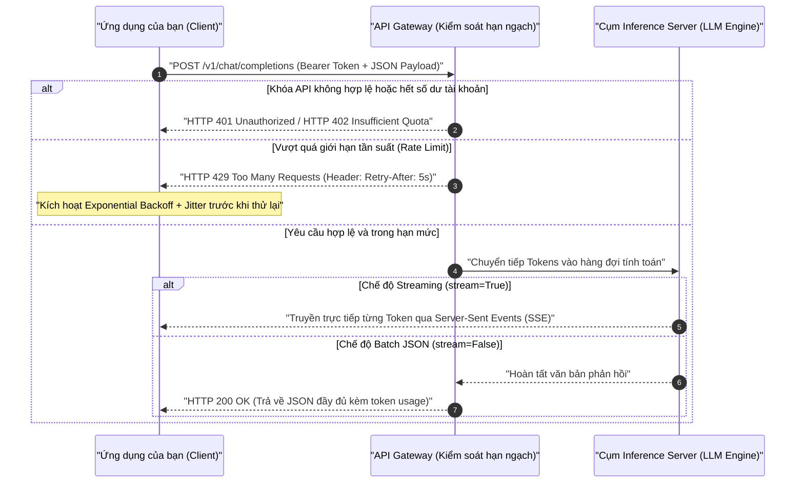

> **Châm ngôn cốt lõi:** API key là chiếc ví tiền và danh tính số của bạn. Một phút bất cẩn đẩy key lên GitHub công khai có thể phải trả giá bằng hàng ngàn đô la hóa đơn chỉ sau một đêm.

---

## Thông tin nhanh (Quick Spec)

* **Loại bài (Type):** Thực chiến & Bảo mật hạ tầng (Build & Security)
* **Ngôn ngữ & Công cụ:** Python 3.11+, TypeScript, `pydantic-settings`, `tenacity`, `curl`
* **Kiến thức tiên quyết (Prerequisites):** Đã hoàn thành Bài 01 & Bài 02 (Git và biến môi trường)
* **Thời gian thực hành:** ~35 phút

---

## Mục tiêu bài học (Learning Objectives)

Sau bài học này, bạn sẽ làm chủ:
- [ ] Hiểu rõ bản chất giao vận HTTP thuần đằng sau mọi SDK AI: Header xác thực Bearer Token, JSON Payload và Server-Sent Events (SSE).
- [ ] Thiết lập hệ thống quản lý khóa bảo mật chuyên nghiệp bằng `pydantic-settings` và file `.env`, ngăn chặn 100% rủi ro lộ secret lên kho mã nguồn.
- [ ] Kết nối thành thạo ba nhà cung cấp LLM lớn nhất hiện nay: OpenAI, Anthropic Claude và Google Gemini (tận dụng tầng miễn phí 15 RPM).
- [ ] Tự tay xây dựng cuộc gọi API bằng cả SDK chính thức lẫn cURL / Raw HTTP bằng thư viện chuẩn `urllib` để sẵn sàng debug khi SDK gặp sự cố.
- [ ] Xây dựng cơ chế phòng vệ cấp độ Production: Xử lý triệt để mã lỗi `HTTP 429 Too Many Requests` bằng thuật toán Exponential Backoff kết hợp Full Jitter.
- [ ] Triển khai tính năng Streaming phản hồi theo thời gian thực giúp tối ưu hóa chỉ số Time to First Token (TTFT).

---

## 1. Vấn đề thực tế (The Problem)

Không giống như các thư viện phần mềm truyền thống (nơi bạn chỉ cần tải mã nguồn về máy rồi chạy ngoại tuyến), kỷ nguyên Generative AI hoạt động dựa trên các **Mô hình Dịch vụ (Model-as-a-Service - MaaS)**. Mỗi lần bạn gửi một prompt hỏi đáp, tóm tắt tài liệu hay chạy một Agent tự hành trong vòng lặp (ReAct loop), bạn đang thực hiện một giao dịch tài chính vi mô với các siêu máy tính của OpenAI, Anthropic hay Google.

Sự phụ thuộc vào Cloud API đem lại hai rủi ro sống còn cho kỹ sư phần mềm:

### 1. Thảm họa rò rỉ chìa khóa (Secret Leakage)
Một câu chuyện kinh điển nhưng lặp lại hàng ngày: Một kỹ sư mới viết script test nhanh, hardcode trực tiếp chuỗi API key bí mật vào file Python:
```python
# CÁCH LÀM TỰ SÁT VỀ BẢO MẬT:
api_key = "sk-proj-abc123xyz..."
```
Sau đó, người này vô tình gõ lệnh `git commit -am "test api" && git push origin main` lên repository công khai. Chỉ trong vòng **vỏn vẹn 3 phút**, các bot tự động chuyên quét dữ liệu công khai trên GitHub sẽ bắt được chuỗi key này. Chúng lập tức khai thác tối đa băng thông để đào coin, bòn rút token hoặc spam dịch vụ. Kết quả: Sáng hôm sau thức dậy, kỹ sư đó nhận được email thông báo tài khoản bị khóa kèm hóa đơn nợ thẻ tín dụng trị giá hơn **\$2,000**!

### 2. Sự cố nghẽn mạng và sụp đổ dây chuyền (Rate Limits & Cascading Failures)
Khi ứng dụng AI của bạn có nhiều người dùng cùng truy cập, hoặc khi các AI Agent chạy đa luồng gọi hàm liên tục, bạn sẽ chạm vào trần giới hạn tần suất:
* **RPM (Requests Per Minute):** Số lượt gọi tối đa trong một phút.
* **TPM (Tokens Per Minute):** Tổng số token (cả prompt và completion) được phép xử lý trong một phút.

Nếu không có cơ chế bắt lỗi và thử lại thông minh (Exponential Backoff), server sẽ đồng loạt trả về lỗi `HTTP 429 Too Many Requests`. Ứng dụng của bạn sẽ bị sập toàn bộ (cascading failure), làm tê liệt trải nghiệm của khách hàng.

---

## 2. Mô hình tư duy & Bản chất (The Concept)

Rất nhiều lập trình viên lầm tưởng rằng các SDK như `openai` hay `anthropic` sở hữu những giao thức truyền tin kỳ bí. Nhưng trên thực tế: **Mọi API của các mô hình ngôn ngữ lớn (LLM) suy cho cùng chỉ là một HTTP POST Request thông thường!**

Cấu tạo của một cuộc gọi LLM API bao gồm 4 phần cơ bản:
1. **Endpoint (URL):** Địa chỉ máy chủ (ví dụ: `https://api.openai.com/v1/chat/completions` hoặc `https://api.anthropic.com/v1/messages`).
2. **Headers:** Mang thông tin định danh và bảo mật:
   * `Authorization: Bearer sk-...` (đối với OpenAI, Gemini)
   * `x-api-key: sk-ant-...` (đối với Anthropic)
   * `Content-Type: application/json`
3. **Request Body (JSON):** Chứa các tham số cấu hình: tên model (`model`), danh sách hội thoại (`messages`), độ sáng tạo (`temperature`), độ dài tối đa (`max_tokens`), và cờ streaming (`stream: true/false`).
4. **Response Body (JSON hoặc Event Stream):** Dữ liệu trả về chứa nội dung phản hồi cùng số lượng token đã tiêu hao (`usage`).



---

## 3. Tự tay cấu hình từ đầu (Build It: Hands-on)

Chúng ta sẽ xây dựng kiến trúc quản lý API chuẩn mực từ tầng cấu hình đến tầng thực thi giao vận.

### Bước 1: Quản lý biến môi trường an toàn với pydantic-settings

Thay vì đọc biến môi trường thô bằng `os.environ["KEY"]` (dễ gây lỗi `KeyError` lúc runtime hoặc thiếu validate kiểu dữ liệu), chúng ta sử dụng thư viện `pydantic-settings` chuẩn sản xuất:

```bash
uv pip install pydantic-settings python-dotenv
```

Tạo file `.env.example` (file này an toàn và **được phép** đẩy lên Git để đồng đội biết cấu trúc):

```env
# .env.example - Mẫu cấu hình môi trường (KHÔNG CHỨA KEY THẬT)
GEMINI_API_KEY=your_gemini_api_key_here
OPENAI_API_KEY=your_openai_api_key_here
ANTHROPIC_API_KEY=your_anthropic_api_key_here
LLM_MODEL=gemini-2.0-flash
```

Tạo file cấu hình thật `.env` (file này chứa key thật của bạn và **bắt buộc phải nằm trong `.gitignore`**):

```env
# .env - Chứa chìa khóa thật
GEMINI_API_KEY=AIzaSyB...
OPENAI_API_KEY=sk-proj-...
ANTHROPIC_API_KEY=sk-ant-...
LLM_MODEL=gemini-2.0-flash
```

Xây dựng module nạp cấu hình `config.py`:

```python
from pydantic_settings import BaseSettings, SettingsConfigDict
from pydantic import Field
from typing import Optional

class Settings(BaseSettings):
    gemini_api_key: Optional[str] = Field(default=None, alias="GEMINI_API_KEY")
    openai_api_key: Optional[str] = Field(default=None, alias="OPENAI_API_KEY")
    anthropic_api_key: Optional[str] = Field(default=None, alias="ANTHROPIC_API_KEY")
    llm_model: str = Field(default="gemini-2.0-flash", alias="LLM_MODEL")

    model_config = SettingsConfigDict(
        env_file=".env",
        env_file_encoding="utf-8",
        extra="ignore"
    )

settings = Settings()
```

### Bước 2: Tận dụng Google Gemini API (Miễn phí 15 RPM - Tối ưu cho học tập)

Google cung cấp tầng miễn phí cực kỳ hào phóng cho mô hình **Gemini 2.0 Flash / Gemini 1.5 Flash** (15 yêu cầu mỗi phút - 15 RPM, hoàn toàn miễn phí mà không cần gắn thẻ tín dụng quốc tế):

1. Truy cập [Google AI Studio](https://aistudio.google.com/) và bấm nút **Get API key**.
2. Sao chép chuỗi key dán vào file `.env` ở biến `GEMINI_API_KEY`.
3. Cài đặt thư viện chính thức mới nhất của Google:

```bash
uv pip install google-genai
```

Thực thi đoạn mã gọi Gemini `call_gemini.py`:

```python
from google import genai
from config import settings

if not settings.gemini_api_key:
    raise ValueError("Thiếu GEMINI_API_KEY trong file .env!")

# Khởi tạo client với API key đã nạp tự động
client = genai.Client(api_key=settings.gemini_api_key)

response = client.models.generate_content(
    model="gemini-2.0-flash",
    contents="Giải thích khái niệm 'Backpropagation' trong học sâu trong đúng 2 câu ngắn gọn.",
)

print("--- Phản hồi từ Google Gemini ---")
print(response.text)
```

### Bước 3: Tích hợp OpenAI và Anthropic Claude SDK

Khi cần sử dụng các mô hình thương mại cao cấp phục vụ dự án thực tế, bạn cài đặt SDK chính thức:

```bash
uv pip install openai anthropic
```

#### Gọi OpenAI bằng Python:

```python
from openai import OpenAI
from config import settings

client = OpenAI(api_key=settings.openai_api_key)

response = client.chat.completions.create(
    model="gpt-4o-mini",
    messages=[
        {"role": "system", "content": "Bạn là trợ lý AI chuyên về kỹ thuật phần mềm."},
        {"role": "user", "content": "Tại sao lập trình viên không nên lưu mật khẩu dạng plaintext trong database?"}
    ],
    temperature=0.2,
    max_tokens=256
)

print(response.choices[0].message.content)
print(f"Tổng token tiêu hao: {response.usage.total_tokens}")
```

#### Gọi Anthropic Claude bằng TypeScript:

Đối với các dự án Full-stack hoặc Node.js:

```bash
npm install @anthropic-ai/sdk dotenv
```

File `call_claude.ts`:

```typescript
import Anthropic from "@anthropic-ai/sdk";
import * as dotenv from "dotenv";

dotenv.config();

const anthropic = new Anthropic({
  apiKey: process.env.ANTHROPIC_API_KEY,
});

async function main() {
  const message = await anthropic.messages.create({
    model: "claude-3-5-sonnet-20241022",
    max_tokens: 300,
    messages: [
      { role: "user", content: "Viết hàm TypeScript đảo ngược một chuỗi ký tự UTF-8 an toàn." }
    ],
  });

  const block = message.content[0];
  if (block.type === "text") {
    console.log(block.text);
  }
}

main().catch(console.error);
```

### Bước 4: Bản chất Raw HTTP (cURL và Python urllib không cần thư viện ngoài)

Hiểu được bản chất HTTP giúp bạn tự tin gỡ lỗi (debug) khi môi trường máy chủ mạng nội bộ công ty chặn cài đặt thư viện bên thứ ba hoặc thiết lập proxy nghiêm ngặt.

#### Lệnh cURL gọi trực tiếp OpenAI:

```bash
curl https://api.openai.com/v1/chat/completions \
  -H "Content-Type: application/json" \
  -H "Authorization: Bearer $OPENAI_API_KEY" \
  -d '{
    "model": "gpt-4o-mini",
    "messages": [{"role": "user", "content": "Xin chào thế giới!"}]
  }'
```

#### Mã Python thuần sử dụng thư viện chuẩn `urllib` (Standard Library):

```python
import os
import json
import urllib.request

url = "https://api.openai.com/v1/chat/completions"
headers = {
    "Content-Type": "application/json",
    "Authorization": f"Bearer {os.environ.get('OPENAI_API_KEY', '')}"
}

payload = {
    "model": "gpt-4o-mini",
    "messages": [{"role": "user", "content": "Viết 1 dòng chào lập trình viên AI."}],
    "max_tokens": 50
}

data = json.dumps(payload).encode("utf-8")
request = urllib.request.Request(url, data=data, headers=headers, method="POST")

with urllib.request.urlopen(request) as response:
    status_code = response.getcode()
    body = response.read().decode("utf-8")
    result = json.loads(body)
    print(f"Mã HTTP Status: {status_code}")
    print("Nội dung:", result["choices"][0]["message"]["content"])
```

### Bước 5: Kỹ thuật Streaming Token thời gian thực (Server-Sent Events)

Chế độ mặc định (`stream=False`) khiến người dùng phải đợi toàn bộ câu trả lời hoàn tất (có thể mất 5 - 15 giây) mới nhìn thấy kết quả. Chế độ Streaming (`stream=True`) sử dụng giao thức Server-Sent Events (SSE) để đẩy từng token vừa sinh ra về client ngay lập tức:

```python
import sys
from openai import OpenAI
from config import settings

client = OpenAI(api_key=settings.openai_api_key)

print("Đang nhận phản hồi dạng Streaming: ", end="", flush=True)

stream = client.chat.completions.create(
    model="gpt-4o-mini",
    messages=[{"role": "user", "content": "Đếm từ 1 đến 10 và giải thích ngắn gọn ý nghĩa của số 7."}],
    stream=True,
)

for chunk in stream:
    token = chunk.choices[0].delta.content or ""
    sys.stdout.write(token)
    sys.stdout.flush()

print("\n--- Hoàn tất ---")
```

---

## 4. Ứng dụng thực tế & Cạm bẫy Production (Use It / Production Tips)

### 1. Thiết lập Hạn mức Chi tiêu Cứng (Hard Budget Limit)

Đừng bao giờ để tài khoản API ở chế độ thanh toán tự động không giới hạn (Uncapped Auto-reload). Hãy vào cài đặt thanh toán của tài khoản:
* **OpenAI Dashboard:** Truy cập `Settings` $\rightarrow$ `Billing` $\rightarrow$ `Usage Limits`. Thiết lập **Soft Limit** là **\$10** (hệ thống gửi email cảnh báo) và **Hard Limit** là **\$20** (hệ thống lập tức ngắt toàn bộ cuộc gọi API, bảo vệ ví tiền của bạn khỏi các vòng lặp vô tận do bug mã nguồn).
* **Anthropic Console:** Truy cập `Settings` $\rightarrow$ `Spend Limits` và đặt mức trần ngân sách hàng tháng phù hợp.

### 2. Thuật toán Exponential Backoff kết hợp Full Jitter xử lý HTTP 429

Khi bị Rate Limit (HTTP 429), nếu bạn lập tức gửi lại request ngay sau 1 giây, server của nhà cung cấp vẫn đang quá tải và sẽ tiếp tục từ chối bạn. Thậm chí nếu 1,000 tiến trình cùng chờ đúng 2 giây rồi cùng gửi lại một lúc, chúng sẽ tạo ra hiện tượng **Sóng thần yêu cầu (Thundering Herd Problem)**.

Công thức chuẩn mực là tính thời gian chờ tăng theo cấp số nhân ($2^{\text{attempt}}$) kết hợp thêm yếu tố ngẫu nhiên (Jitter):

$$t_{\text{wait}} = \text{random}(0, \min(t_{\text{max}}, t_{\text{base}} \times 2^{\text{attempt}}))$$

Trong Python, bạn không cần tự code vòng lặp `while` phức tạp. Hãy sử dụng thư viện chuyên dụng `tenacity`:

```bash
uv pip install tenacity
```

```python
import logging
from tenacity import retry, stop_after_attempt, wait_random_exponential, retry_if_exception_type
from openai import OpenAI, RateLimitError, APIConnectionError
from config import settings

logger = logging.getLogger(__name__)
client = OpenAI(api_key=settings.openai_api_key)

@retry(
    # Thử lại tối đa 4 lần trước khi ném ngoại lệ
    stop=stop_after_attempt(4),
    # Chờ tăng theo cấp số nhân với Jitter ngẫu nhiên từ 1s đến 10s
    wait=wait_random_exponential(multiplier=1, max=10),
    # Chỉ thử lại khi gặp lỗi Rate Limit (429) hoặc lỗi rớt kết nối mạng
    retry=retry_if_exception_type((RateLimitError, APIConnectionError)),
    reraise=True
)
def call_llm_resilient(prompt: str) -> str:
    """Hàm gọi LLM có khả năng tự phục hồi khi gặp nghẽn mạng hoặc Rate Limit."""
    logger.info(f"Đang gửi request tới OpenAI...")
    response = client.chat.completions.create(
        model="gpt-4o-mini",
        messages=[{"role": "user", "content": prompt}],
        max_tokens=150
    )
    return response.choices[0].message.content
```

### 3. Phòng vệ chống rò rỉ khóa bằng Pre-commit Hook

Trước khi gõ lệnh push lên GitHub, hãy cài đặt công cụ phát hiện khóa tự động ngay tại máy của bạn:

```bash
# Cài đặt detect-secrets
uv pip install detect-secrets

# Khởi tạo baseline phát hiện bí mật
detect-secrets scan > .secrets.baseline
```

Đồng thời, hãy vào trang cài đặt của GitHub Repository: `Settings` $\rightarrow$ `Code security and analysis` $\rightarrow$ Kích hoạt tính năng **Secret Scanning** và **Push Protection**. Nếu bạn lỡ commit nhầm file chứa API key, GitHub sẽ chặn đứng lệnh `git push` ngay tại cửa khẩu máy chủ.

### 4. Ma trận so sánh các nhà cung cấp API cho kỹ sư AI

| Tiêu chí so sánh | Google Gemini | OpenAI | Anthropic Claude | OpenRouter / Groq |
|---|---|---|---|---|
| **Tầng miễn phí** | Rất tốt (15 RPM miễn phí cho bản Flash) | Không có sẵn (tặng credit dùng thử ban đầu) | Không có sẵn (phải nạp trước tối thiểu **\$5**) | Cung cấp một số model mã nguồn mở miễn phí |
| **Thế mạnh kỹ thuật** | Tốc độ cực nhanh, Context window khổng lồ (1M - 2M tokens) | Hệ sinh thái Tooling/Function Calling phong phú nhất | Khả năng suy luận, phân tích logic và lập trình vượt trội | Tổng hợp hàng trăm mô hình mã nguồn mở (Llama 3, DeepSeek) |
| **Giá cả mô hình mini** | **\$0.075 / 1M input tokens** (Gemini Flash) | **\$0.15 / 1M input tokens** (GPT-4o-mini) | **\$0.80 / 1M input tokens** (Claude 3.5 Haiku) | Rất rẻ, tính theo giá thị trường mở |
| **Mục đích sử dụng tối ưu** | Học tập, nghiên cứu, xử lý tài liệu PDF dung lượng lớn | Xây dựng sản phẩm Production, AI Agent tích hợp API | Lập trình chuyên sâu, phân tích mã nguồn phức tạp | Thử nghiệm mô hình nguồn mở, chống Vendor Lock-in |

---

## 5. Giải ngố thuật ngữ (Key Terms)

| Thuật ngữ (Term) | Người ta thường nghĩ là... | Bản chất kỹ thuật thực sự là... |
|---|---|---|
| **API Key vs Bearer Token** | Là hai cách gọi khác nhau của một mật khẩu cố định. | **API Key** là chuỗi bí mật dài hạn định danh dự án của bạn. **Bearer Token** là cơ chế ủy quyền trong tiêu chuẩn HTTP: Bất kỳ ai "nắm giữ" (bear) token này trong Request Header đều có quyền truy cập mà không cần xác thực danh tính lại. |
| **Rate Limit: RPM vs TPM** | Chỉ là quy định số lần bấm nút gửi tin nhắn trên ứng dụng. | **RPM (Requests Per Minute):** Giới hạn số lượng phiên HTTP POST gửi tới server trong 60 giây. **TPM (Tokens Per Minute):** Giới hạn tổng thể tích văn bản xử lý. Bạn có thể chỉ gửi 2 request nhưng nếu mỗi request chứa prompt dài 100,000 tokens thì vẫn bị chặn bởi TPM! |
| **Input Tokens vs Output Tokens** | Đều là chữ nên được nhà cung cấp tính giá như nhau. | **Output Tokens luôn đắt gấp 3 đến 4 lần Input Tokens!** Lý do: Quá trình xử lý Prompt (Input) được tính toán song song ma trận cùng lúc (Prefill Phase). Quá trình sinh chữ (Output) phải chạy tuần tự từng token một (Autoregressive Decode Phase), chiếm dụng băng thông VRAM lâu hơn nhiều. |
| **Streaming (SSE) vs Batch JSON** | Streaming làm cho AI thông minh hơn và suy nghĩ nhanh hơn. | Tốc độ tính toán của mô hình là hoàn toàn như nhau. Streaming sử dụng Server-Sent Events để trả về ngay chữ đầu tiên khi vừa sinh xong, giúp giảm chỉ số **Time to First Token (TTFT)** từ vài giây xuống còn vài trăm mili-giây, tạo cảm giác phản hồi tức thì cho người dùng. |
| **Temperature vs Top-P** | Càng tăng cao thì AI càng sáng tạo và đưa ra câu trả lời chính xác hơn. | `Temperature` làm phẳng phân phối xác suất softmax của các từ tiếp theo (tăng độ ngẫu nhiên nhưng cũng tăng nguy cơ bịa đặt - Hallucination). `Top-P` (Nucleus Sampling) giới hạn tập hợp các từ được chọn trong vùng tích lũy xác suất $p$. Trong các tác vụ lập trình và trích xuất dữ liệu JSON, nên đặt `temperature` thấp ($0.0 - 0.2$). |

---

## 6. Bài tập thử thách (Hands-on Challenges)

### 🟢 Cơ bản (Easy): Khởi tạo cuộc gọi API miễn phí đầu tiên

1. Truy cập Google AI Studio, lấy API key miễn phí.
2. Thiết lập file `.env` chứa `GEMINI_API_KEY`.
3. Viết script Python ngắn gọn sử dụng `pydantic-settings` để đọc cấu hình, gửi một câu hỏi kỹ thuật: *"Trình bày sự khác biệt giữa Thread và Process trong hệ điều hành"* và in phản hồi ra màn hình.

### 🟡 Trung bình (Medium): Module gọi API phòng vệ chống HTTP 429

1. Viết một wrapper function `call_llm_with_retry(prompt: str)` sử dụng thư viện `tenacity`.
2. Cấu hình tự động retry tối đa 3 lần khi bắt gặp lỗi `RateLimitError` hoặc mã HTTP 429.
3. Áp dụng chiến lược chờ thời gian tăng dần có thêm Jitter ngẫu nhiên từ 1 đến 5 giây.
4. Ghi log hiển thị rõ: Số lần đã thử lại, thời gian chờ trước lần thử tiếp theo để kiểm chứng hoạt động.

### 🔴 Nâng cao (Hard): Xoay vòng khóa (Key Rotation) & Fallback đa nhà cung cấp

Xây dựng lớp điều phối `ResilientMultiProviderClient`:
1. Cho phép cấu hình danh sách nhiều API Key dự phòng hoặc kết hợp 2 nhà cung cấp khác nhau (ví dụ: Nhà cung cấp chính là OpenAI `gpt-4o-mini`, nhà cung cấp dự phòng là Google Gemini `gemini-2.0-flash`).
2. Khi thực hiện gọi API:
   - Nếu nhà cung cấp chính trả về mã lỗi HTTP 401 (Key hết hạn/sai key) hoặc HTTP 429 kéo dài quá số lần retry, tự động chuyển tiếp prompt sang nhà cung cấp dự phòng.
   - Ghi nhận metrics cảnh báo sự cố sang hệ thống log mà không làm gián đoạn trải nghiệm của người dùng cuối.
