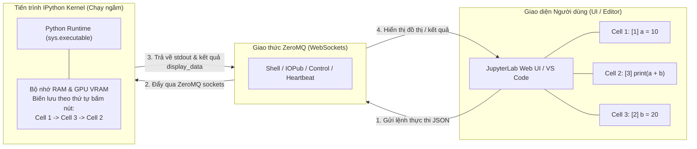
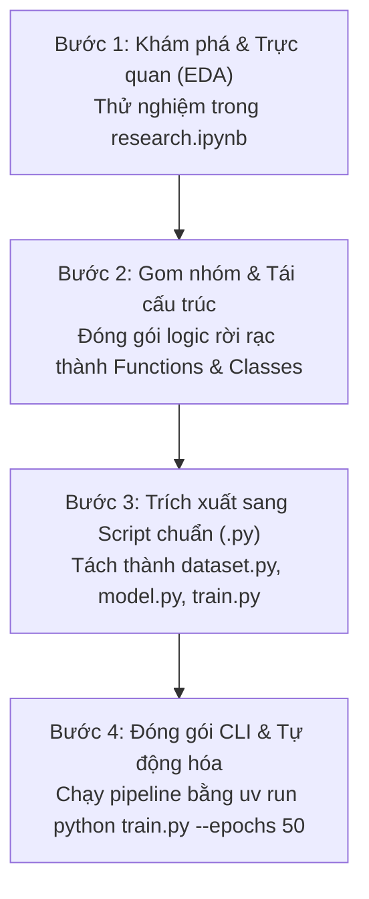

> **Thử nghiệm trong Notebook, đưa lên Production bằng Script.** Đừng biến bàn thí nghiệm thành dây chuyền lắp ráp. Hãy xem Notebook là cuốn sổ ghi chép tương tác để mổ xẻ dữ liệu, trực quan hóa và kiểm chứng giả thuyết; nhưng khi mã nguồn đã sẵn sàng phục vụ người dùng, hãy đóng gói thành Python script (.py) chuẩn mực, có kiểm thử và logging rõ ràng.

---

## Thông tin nhanh

* **Loại bài:** Thực chiến & Quy chuẩn (Build & Best Practices)
* **Ngôn ngữ & Công cụ:** Python 3.12, JupyterLab, VS Code Jupyter, ipykernel, nbstripout, uv
* **Kiến thức tiên quyết:** Khái niệm môi trường ảo (Bài 01), thao tác dòng lệnh cơ bản
* **Thời gian thực hành:** ~35 phút
* **Độ khó:** Cơ bản đến Trung bình (Beginner - Intermediate)

---

## Mục tiêu bài học

Sau bài học này, bạn sẽ có khả năng:
- Hiểu sâu sắc kiến trúc phân tách giữa giao diện tương tác (JupyterLab / VS Code) và tiến trình tính toán nền (IPython Kernel) qua giao thức ZeroMQ WebSocket.
- Tự tay tạo và liên kết môi trường ảo cô lập (`uv venv`) vào danh sách Kernel của Jupyter thông qua công cụ `ipykernel`, xóa bỏ vĩnh viễn lỗi không tìm thấy package.
- Làm chủ các câu lệnh ma thuật (Magic Commands: `%timeit`, `%%time`, `%autoreload 2`, `%env`) để đo lường benchmark chuẩn xác và tự động tải lại code module ngoài.
- Thiết lập cơ chế tự động dọn dẹp metadata và dữ liệu base64 output của `.ipynb` với `nbstripout` kết hợp Git Hooks để ngăn ngừa xung đột merge Git thảm họa.
- Nắm vững cơ chế giải phóng bộ nhớ GPU VRAM trong Kernel: hiểu vì sao xóa cell không lập tức trả lại VRAM cho hệ thống, và cách dọn dẹp bộ nhớ với `gc.collect()` cùng `torch.cuda.empty_cache()`.
- Thấu suốt triết lý "Explore in Notebook, Ship in Script" cùng quy trình chuyển đổi 4 bước từ nghiên cứu sang sản xuất.

---

## 1. Vấn đề thực tế

Mọi kỹ sư AI, nhà khoa học dữ liệu và tác giả bài báo nghiên cứu đều sử dụng Jupyter Notebook (`.ipynb`). Khả năng thực thi từng khối mã lệnh (cell), xem kết quả trực quan ngay dưới dòng code, kết hợp ghi chú Markdown và đồ thị sống động khiến Notebook trở thành môi trường khám phá dữ liệu (Exploratory Data Analysis - EDA) số một thế giới.

Thế nhưng, nếu không hiểu rõ bản chất vận hành của Notebook, bạn sẽ rơi vào 3 cạm bẫy kinh điển:

1. **Cạm bẫy "Nó chạy ngon trên máy tôi" (Out-of-order Execution & Ghost State):** Bạn viết Cell 1 (khởi tạo biến), viết tiếp Cell 2 (sửa giá trị), rồi nhảy xuống Cell 10, xong lại quay lên Cell 3 chạy lại. Các biến tạm vô hình vẫn lưu trong RAM của tiến trình Kernel. Kết quả hiển thị hoàn hảo, nhưng khi gửi file notebook cho đồng nghiệp hoặc bấm **Restart Kernel & Run All Cells**, toàn bộ chương trình đổ vỡ với lỗi `NameError` hoặc đưa ra số liệu hoàn toàn sai lệch.
2. **Cạm bẫy xung đột Git (Merge Conflict Nightmare):** File `.ipynb` không phải là file text thông thường. Nó là một tệp JSON khổng lồ lưu trữ cấu trúc cells, số lần thực thi (`execution_count`), và đặc biệt là toàn bộ chuỗi ký tự base64 dài hàng chục ngàn dòng của các hình ảnh biểu đồ Matplotlib đã render. Hai người cùng chạy lại một notebook và commit lên Git sẽ tạo ra xung đột merge không thể giải quyết bằng mắt thường. Thư mục `.git` phình to bất thường vì lưu các chuỗi base64 nhị phân vô nghĩa.
3. **Cạm bẫy "Xác sống VRAM" (GPU Memory Zombie):** Bạn huấn luyện xong Model A trên GPU rời ngốn 18GB VRAM. Bạn xóa cell tạo model và viết cell mới để thử Model B. Nhưng khi bấm chạy, màn hình ném ra ngoại lệ quen thuộc: `RuntimeError: CUDA out of memory`. Dù bạn không còn dùng Model A, tiến trình Kernel vẫn giữ chặt phân vùng bộ nhớ VRAM trên GPU cho đến khi bạn biết cách thu hồi hoặc khởi động lại tiến trình.

---

## 2. Mô hình tư duy và bản chất

### Kiến trúc phân tách Client-Server của Jupyter

Nhiều người lầm tưởng Jupyter Notebook là một trình soạn thảo mã nguồn giống như Notepad hay VS Code thông thường. Thực chất, Jupyter là một hệ thống **Client-Server phân tán**:



1. **Giao diện người dùng (Client / UI):** JupyterLab trên trình duyệt web hoặc tiện ích mở rộng Jupyter trong VS Code chỉ là lớp vỏ hiển thị. Nó chịu trách nhiệm render các cell dưới dạng Markdown, ô nhập code, và hiển thị kết quả HTML/hình ảnh mà Kernel trả về.
2. **Kênh truyền thông điệp ZeroMQ (Protocol):** Giao tiếp giữa giao diện và môi trường thực thi được thực hiện thông qua thư viện mạng ZeroMQ (hoặc WebSocket). ZeroMQ duy trì 5 kênh chuyên biệt: *Heartbeat* (kiểm tra tiến trình còn sống hay đã chết), *Shell* (gửi lệnh thực thi và nhận phản hồi), *IOPub* (phát sóng luồng stdout, stderr và ảnh render), *Stdin* (nhận input từ bàn phím), và *Control* (lệnh ngắt interrupt/restart).
3. **Tiến trình tính toán (IPython Kernel):** Đây là một tiến trình Python độc lập chạy ngầm trên hệ điều hành của bạn. Khi bạn bấm phím thực thi cell, mã nguồn được đóng gói thành tin nhắn JSON và gửi tới Kernel. Kernel chạy mã bằng trình thông dịch Python thực sự, lưu trữ các đối tượng biến, ma trận tensor vào bộ nhớ RAM/VRAM, rồi truyền kết quả trả về UI.

### Bản chất của file `.ipynb`

Tệp `.ipynb` chỉ là một file JSON có cấu trúc gồm 4 trường cốt lõi:
- `cells`: Mảng danh sách các cell (`markdown` hoặc `code`), mỗi cell chứa mã nguồn (`source`), kết quả thực thi (`outputs`), và trạng thái thực thi (`execution_count`).
- `metadata`: Chứa thông tin về tên kernel, phiên bản ngôn ngữ Python.
- `nbformat` và `nbformat_minor`: Phiên bản định dạng tài liệu Jupyter (hiện tại là phiên bản 4).

Khi bạn chạy một ô lệnh có sinh ra đồ thị, toàn bộ dữ liệu ảnh PNG được mã hóa dưới dạng chuỗi `image/png: "iVBORw0KGgoAAAANSUhEUgAA..."` và lưu thẳng vào trường `outputs` của file JSON. Đây chính là lý do vì sao Git bị quá tải nếu bạn commit trực tiếp file notebook mà không dọn dẹp.

---

## 3. Tự tay cấu hình từ đầu

Hãy xây dựng một môi trường làm việc chuẩn hóa cho Jupyter Notebook với trình quản lý gói siêu tốc `uv`.

### Bước 1: Khởi tạo môi trường ảo và cài đặt JupyterLab

Tạo một thư mục dự án và khởi tạo môi trường Python 3.12 cô lập:

```bash
# Tạo thư mục làm việc
mkdir -p ~/projects/ai-notebook-lab
cd ~/projects/ai-notebook-lab

# Khởi tạo môi trường ảo bằng uv
uv venv .venv --python 3.12

# Kích hoạt môi trường ảo
source .venv/bin/activate

# Cài đặt các thư viện lõi cho Jupyter và AI
uv pip install jupyterlab ipykernel matplotlib numpy torch nbstripout
```

### Bước 2: Đăng ký Virtualenv thành Jupyter Kernel chuyên dụng

Đây là bước quan trọng nhất mà 90% người mới thường bỏ quên. Nếu chỉ mở JupyterLab từ terminal mặc định, Jupyter sẽ sử dụng Python của hệ thống. Bạn sẽ gặp lỗi `ModuleNotFoundError: No module named 'torch'` dù bạn đã cài đặt PyTorch trong thư mục dự án.

Để khắc phục triệt để, ta đăng ký môi trường ảo hiện tại thành một Kernel mang tên riêng:

```bash
# Đăng ký môi trường ảo .venv vào danh sách Jupyter Kernel
uv run python -m ipykernel install --user --name=ai-lab-312 --display-name="Python 3.12 (AI-Lab uv)"
```

Kiểm tra danh sách Kernel đang có trên hệ thống:

```bash
jupyter kernelspec list
```

Kết quả sẽ hiển thị đường dẫn trỏ thẳng tới môi trường ảo của bạn:
```text
Available kernels:
  ai-lab-312    /home/trieuphi-admin/.local/share/jupyter/kernels/ai-lab-312
  python3       /usr/share/jupyter/kernels/python3
```

*(Mẹo: Khi không còn dùng dự án này nữa, bạn có thể gỡ bỏ sạch sẽ bằng lệnh `jupyter kernelspec uninstall ai-lab-312`)*.

Bây giờ bạn có thể khởi động giao diện JupyterLab:

```bash
uv run jupyter lab
```

Trong giao diện JupyterLab hoặc VS Code, ở góc trên bên phải, hãy bấm vào ô chọn Kernel và chọn đúng **"Python 3.12 (AI-Lab uv)"**.

### Bước 3: Làm chủ các lệnh ma thuật (Magic Commands)

IPython cung cấp các lệnh ma thuật bắt đầu bằng `%` (áp dụng cho một dòng - Line Magic) hoặc `%%` (áp dụng cho toàn bộ cell - Cell Magic) giúp tăng năng suất vượt bậc:

#### 1. Đo kiểm hiệu năng với `%timeit` và `%%time`

```python
# Cell Magic: Đo thời gian thực tế để chạy cả khối code (Wall time và CPU time)
%%time
import torch
x = torch.randn(5000, 5000)
y = torch.matmul(x, x)
```

```python
# Line Magic: Thực hiện microbenchmark khoa học (chạy nhiều lần để tính trung bình và độ lệch chuẩn)
import numpy as np
arr = list(range(100000))
%timeit sum(arr)
# So sánh với NumPy
np_arr = np.array(arr)
%timeit np.sum(np_arr)
```

#### 2. Tự động tải lại module ngoài với `%autoreload 2`

Khi bạn chuyển dần code từ notebook sang file `.py` bên ngoài để dùng chung, mặc định Python chỉ nạp module một lần khi chạy `import`. Nếu bạn chỉnh sửa file `.py`, notebook sẽ không nhận thay đổi trừ khi bạn khởi động lại Kernel. Hãy đặt lệnh này ở ngay cell đầu tiên của notebook:

```python
%load_ext autoreload
%autoreload 2

# Giờ đây mọi sửa đổi trong src/utils.py sẽ tự động cập nhật ngay khi bạn gọi hàm!
import src.utils as utils
```

#### 3. Quản lý biến môi trường với `%env`

```python
# Xem một biến môi trường hoặc gán giá trị trực tiếp trong phiên làm việc
%env CUDA_VISIBLE_DEVICES=0
%env TOKENIZERS_PARALLELISM=false
```

### Bước 4: Thiết lập tự động dọn dẹp Git với `nbstripout`

Để không bao giờ vô tình đẩy hàng megabyte dữ liệu nhị phân output lên GitHub, ta tích hợp `nbstripout` trực tiếp vào Git Filter của kho mã nguồn:

```bash
# Đăng ký nbstripout làm bộ lọc Git cho repository hiện tại
nbstripout --install
```

Lệnh trên sẽ tự động cấu hình file `.git/config` và file `.gitattributes`. Mỗi khi bạn thực hiện lệnh `git add my_experiment.ipynb`, Git sẽ tự động chuyển file qua bộ lọc `nbstripout`, lột bỏ sạch sẽ các trường `outputs` và `execution_count`, nhưng giữ nguyên 100% nội dung code và markdown của bạn trên ổ đĩa.

Bạn cũng có thể cấu hình file `.pre-commit-config.yaml` để tự động kiểm tra trên toàn bộ máy của các thành viên trong nhóm:

```yaml
repos:
  - repo: https://github.com/kynan/nbstripout
    rev: 0.7.1
    hooks:
      - id: nbstripout
```

---

## 4. Ứng dụng thực tế và cạm bẫy Production

### Triết lý: "Explore in Notebook, Ship in Script"

Notebook là công cụ nghiên cứu khám phá tuyệt vời nhất, nhưng đưa file `.ipynb` trực tiếp lên server production chạy ngầm là một sai lầm kiến trúc nghiêm trọng. File notebook thiếu khả năng truyền đối số dòng lệnh (`argparse`), khó viết unit test tự động, khó cấu hình logging chuẩn (logrotate), và tiêu tốn tài nguyên do lớp bọc giao thức.

Hãy tuân thủ quy trình chuyển đổi 4 bước sau:



1. **Bước 1 (Khám phá):** Viết nhanh code trong notebook để vẽ đồ thị phân phối dữ liệu, thử nghiệm các siêu tham số learning rate sơ bộ.
2. **Bước 2 (Tái cấu trúc):** Chuyển các khối lệnh lặp lại thành hàm (`def train_epoch(...)`) và đóng gói trạng thái vào lớp dữ liệu (`dataclass`).
3. **Bước 3 (Trích xuất):** Tạo thư mục `src/`, chuyển các hàm vào các module Python độc lập. Notebook lúc này chỉ đóng vai trò gọi lại các hàm đó để vẽ biểu đồ tổng kết.
4. **Bước 4 (Đóng gói Script):** Viết file `train.py` với điểm vào `if __name__ == "__main__":`, nhận tham số cấu hình và chạy trên máy chủ huấn luyện bằng lệnh `uv run python train.py`.

*(Ghi chú: Nếu quy trình nghiệp vụ của bạn bắt buộc phải sinh báo cáo dưới dạng notebook theo định kỳ, hãy sử dụng công cụ headless execution như `papermill` để truyền tham số và chạy notebook từ dòng lệnh mà không cần mở giao diện UI)*.

### Hóa giải cạm bẫy rò rỉ bộ nhớ GPU VRAM

Khi bạn huấn luyện mạng nơ-ron với PyTorch trên GPU, tại sao lệnh xóa cell hoặc gọi `del model` không lập tức giải phóng bộ nhớ trên `nvidia-smi`?

Bản chất có 2 tầng giữ bộ nhớ:
1. **Bộ gom rác của Python (Python Garbage Collector):** Lệnh `del model` chỉ xóa biến trỏ `model`. Nếu đối tượng mô hình đó vẫn còn tham chiếu vòng (circular reference) hoặc bị giữ lại trong danh sách biến nội bộ của IPython (`_`, `_oh`, lịch sử output cell), Python sẽ chưa thể thu hồi vùng nhớ RAM.
2. **Cơ chế cấp phát đệm của PyTorch (PyTorch Caching Allocator):** Để tăng tốc độ và tránh chi phí gọi hàm cấp phát bộ nhớ của hệ điều hành CUDA (`cudaMalloc` / `cudaFree`) liên tục giữa các batch, PyTorch không trả bộ nhớ về cho GPU ngay. Nó giữ phần VRAM đó ở trạng thái "Reserved" để tái sử dụng cho các phép tính tiếp theo.

Đoạn mã chuẩn mực để cưỡng chế dọn dẹp VRAM mà không cần khởi động lại Kernel:

```python
import gc
import torch

def free_gpu_cache():
    # 1. Thu hồi các tham chiếu rác trong Python runtime
    gc.collect()
    
    # 2. Yêu cầu PyTorch trả lại toàn bộ VRAM reserved về cho driver GPU
    if torch.cuda.is_available():
        torch.cuda.empty_cache()
        torch.cuda.ipc_collect()
        allocated = torch.cuda.memory_allocated() / (1024 ** 2)
        reserved = torch.cuda.memory_reserved() / (1024 ** 2)
        print(f"VRAM Đã dùng thực tế: {allocated:.2f} MB | VRAM Đang giữ (Reserved): {reserved:.2f} MB")
    elif torch.backends.mps.is_available():
        torch.mps.empty_cache()
        print("Đã dọn dẹp cache MPS trên Apple Silicon.")

# Gọi hàm sau khi hoàn tất một thử nghiệm mô hình
free_gpu_cache()
```

*(Quy tắc ngón tay cái: Nếu bạn vừa kết thúc huấn luyện một mô hình lớn và muốn chuyển sang tải một mô hình hoàn toàn khác, hãy bấm nút **Restart Kernel** trên thanh công cụ. Đây là cách dứt khoát và sạch sẽ nhất để hủy tiến trình Python cũ và giải phóng 100% VRAM)*.

---

## 5. Giải ngố thuật ngữ

| Thuật ngữ | Người ta thường nghĩ là... | Bản chất kỹ thuật thực sự là... |
|---|---|---|
| **Jupyter Kernel** | Một tính năng chỉnh sửa text bên trong trình duyệt. | Tiến trình hệ điều hành độc lập (Python subprocess) chạy ngầm, quản lý bộ nhớ và giao tiếp với UI qua giao thức ZeroMQ. |
| **Magic Command (`%` vs `%%`)** | Các cú pháp đặc biệt của ngôn ngữ Python. | Tiện ích mở rộng của riêng trình thông dịch IPython; `%` áp dụng trên 1 dòng mã, trong khi `%%` can thiệp và xử lý toàn bộ nội dung của ô cell. |
| **File Notebook (`.ipynb`)** | Một định dạng nhị phân đóng gói kín của Jupyter. | Tệp văn bản định dạng JSON thuần túy, lưu trữ danh sách các cell, metadata thực thi và dữ liệu ảnh output được mã hóa base64. |
| **Ghost State (Trạng thái ẩn)** | Lỗi phần mềm ngẫu nhiên của Jupyter. | Hiện tượng các biến trong bộ nhớ RAM của Kernel không khớp với thứ tự hiển thị từ trên xuống dưới của code do người dùng thực thi các cell lộn xộn. |
| **nbstripout** | Một công cụ nén file notebook để giảm dung lượng. | Bộ lọc Git CLI chuyên dụng can thiệp vào tầng chuyển đổi của Git (smudge/clean filter) để loại bỏ toàn bộ dữ liệu output và metadata trước khi commit. |
| **PyTorch Caching Allocator** | Lỗi rò rỉ bộ nhớ của thư viện PyTorch trên GPU. | Cơ chế tối ưu hiệu năng giữ lại bộ nhớ VRAM đã cấp phát để tái sử dụng cho các tensor tiếp theo, tránh độ trễ lớn khi gọi `cudaFree`. |

---

## 6. Bài tập thử thách

### 🟢 Cơ bản (Dễ): Đo kiểm hiệu năng tính toán với `%timeit`
Tạo một notebook mới mang tên `benchmark_basics.ipynb`. Hãy sử dụng Line Magic `%timeit` để so sánh tốc độ thực thi của 3 cách tính tổng bình phương của 1,000,000 số nguyên ($0^2 + 1^2 + ... + 999999^2$):
1. Dùng vòng lặp `for` và danh sách Python thuần.
2. Dùng List Comprehension kết hợp hàm built-in `sum()`.
3. Dùng mảng số học `numpy.arange()` kết hợp phương thức tính tổng vector hóa `np.sum()`.
*Yêu cầu:* Ghi lại kết quả microbenchmark (thời gian trung bình và độ lệch chuẩn) và giải thích vì sao phép tính vector hóa lại nhanh hơn gấp hàng chục lần.

### 🟡 Trung bình (Vừa): Đăng ký Virtualenv và thiết lập quy trình `%autoreload`
1. Sử dụng lệnh `uv venv` để tạo một môi trường ảo hoàn toàn mới mang tên `.test-env`. Cài đặt thư viện `cowsay` vào môi trường ảo này.
2. Dùng lệnh `uv run python -m ipykernel install` để đăng ký kernel với tên hiển thị `"Python (Test Cow)"`.
3. Tạo một file `my_string_tools.py` nằm cạnh notebook với hàm `shout(text: str) -> str` trả về chuỗi viết hoa kèm dấu chấm than.
4. Mở notebook, chọn đúng Kernel vừa tạo, nạp extension `%load_ext autoreload` và `%autoreload 2`.
5. Gọi hàm `shout("xin chao")`. Không tắt notebook, mở file `my_string_tools.py` ra sửa logic hàm để trả về chuỗi có chèn thêm biểu tượng cảm xúc. Quay lại notebook chạy lại cell và chứng minh kết quả thay đổi ngay lập tức mà không cần bấm Restart Kernel.

### 🔴 Nâng cao (Khó): Thiết lập hàng rào phòng thủ Git với `nbstripout`
1. Khởi tạo một kho Git cục bộ mới bằng lệnh `git init test-nb-repo`.
2. Tạo một file notebook `heavy_plot.ipynb`, viết code sinh một biểu đồ phân tán Matplotlib chứa 50,000 điểm ngẫu nhiên để tạo ra hình ảnh render base64 dung lượng lớn trong file JSON.
3. Chạy lệnh `git status` và quan sát kích thước của file `heavy_plot.ipynb` trên ổ đĩa.
4. Cài đặt và cấu hình `nbstripout --install` cho kho git này.
5. Thực hiện `git add heavy_plot.ipynb` và `git commit -m "feat: add heavy experiment"`.
6. Sử dụng lệnh `git show HEAD:heavy_plot.ipynb` và chuyển hướng ra file kiểm tra. Chứng minh rằng trong commit của Git, trường `outputs` của cell vẽ đồ thị đã trở thành mảng rỗng `[]`, nhưng khi bạn mở file `heavy_plot.ipynb` trên trình soạn thảo cục bộ, hình ảnh biểu đồ vẫn còn nguyên vẹn.
