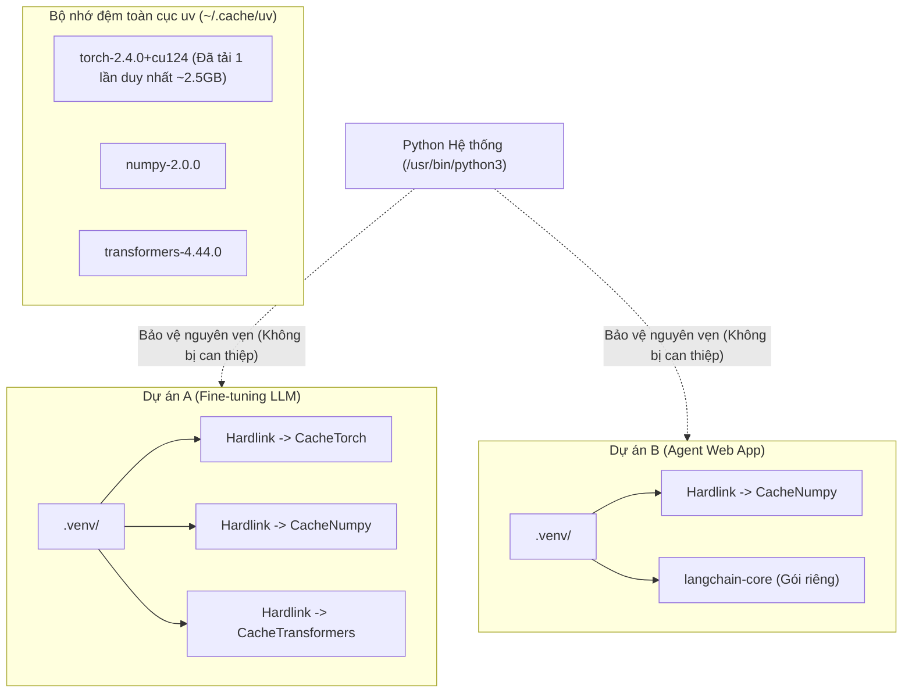

> **Địa ngục phụ thuộc là có thật. Cô lập môi trường bằng uv và khóa chặt phiên bản bằng lockfile là cách duy nhất để dự án của bạn luôn tái lập được.** Đừng bao giờ cài đặt package vào Python hệ thống, đừng trộn lẫn pip với conda, và luôn cam kết rằng mọi thành viên trong nhóm hoặc máy chủ production đều chạy trên cùng một byte mã nguồn thông qua lockfile chuẩn.

---

## Thông tin nhanh

* **Loại bài:** Thực chiến & Công cụ (Build & Tooling)
* **Ngôn ngữ & Công cụ:** Python 3.12, uv, pyproject.toml, uv.lock, venv, conda
* **Kiến thức tiên quyết:** Thao tác dòng lệnh cơ bản (Bash/Zsh), cấu trúc thư mục dự án
* **Thời gian thực hành:** ~35 phút
* **Độ khó:** Cơ bản đến Trung bình (Beginner - Intermediate)

---

## Mục tiêu bài học

Sau bài học này, bạn sẽ có khả năng:
- Hiểu rõ bản chất hoạt động cốt lõi của một môi trường ảo (Virtual Environment - venv): cơ chế symlink, biến môi trường `PATH`, biến `VIRTUAL_ENV` và cách hệ điều hành định tuyến trình thông dịch Python.
- Nhận diện bản chất gây ra "Địa ngục phụ thuộc" (Dependency Hell) trong các dự án AI: xung đột C-bindings, ma trận phiên bản CUDA wheels và các phụ thuộc gián tiếp (transitive dependencies).
- Sử dụng thành thạo bộ công cụ `uv` hiện đại theo quy chuẩn phát triển dự án chuyên nghiệp: `uv init`, `uv add`, `uv sync`, `uv lock`, và `uv run`.
- Thiết kế tệp cấu hình `pyproject.toml` chuẩn mực theo đặc tả PEP 517/518/621, phân tách rạch ròi các nhóm phụ thuộc (`[dependency-groups]` hoặc `[project.optional-dependencies]`) cho huấn luyện (train), kiểm thử (dev) và phục vụ API (serve).
- Nắm vững cơ chế hoạt động của `uv.lock` và bộ nhớ đệm toàn cục (Global Content-Addressable Cache), đảm bảo việc tái lập môi trường 100% giống nhau (reproducibility) giữa máy cá nhân và máy chủ chỉ trong vài giây.
- So sánh đa chiều và phân định chính xác ranh giới sử dụng giữa `venv`, `uv` và `conda` trong hệ sinh thái AI.
- Phòng tránh 5 sai lầm chết người làm vỡ môi trường làm việc khi cộng tác nhóm hoặc triển khai sản phẩm.

---

## 1. Vấn đề thực tế

Trong lập trình web hay ứng dụng truyền thống, bạn thường chỉ cài đặt một vài thư viện thuần Python nhẹ nhàng như `requests`, `fastapi` hay `flask`. Nhưng trong kỹ thuật AI (AI Engineering), bạn phải đối mặt với một bức tranh hoàn toàn khác:

Các thư viện nền tảng như PyTorch, JAX, TensorFlow hay vLLM không chỉ là code Python. Chúng là những khối nhị phân khổng lồ (binary wheels) chứa hàng gigabyte thư viện C++, CUDA runtime bindings, thư viện toán học MKL/oneDNN và các driver tăng tốc phần cứng biên dịch sẵn. 

Nếu không quản lý môi trường bài bản, bạn sẽ lập tức rơi vào "Địa ngục phụ thuộc" (Dependency Hell):

1. **Bi kịch "Dự án mới đè bẹp dự án cũ":** Tuần trước, bạn làm việc trên Dự án A yêu cầu `torch==2.1.2` (biên dịch cho CUDA 11.8). Tuần này, bạn nhận Dự án B thử nghiệm mô hình thị giác mới nhất yêu cầu `torch==2.4.0` (biên dịch cho CUDA 12.4). Nếu bạn cài đặt chung vào một môi trường Python toàn cục, lệnh `pip install` thứ hai sẽ gỡ bỏ bản cũ, đè bản mới và làm vỡ tan tành Dự án A mà không có cách nào khôi phục tự động.
2. **Cơn ác mộng phụ thuộc gián tiếp (Transitive Dependency Clashes):** Bạn cài đặt thư viện suy luận A, thư viện này âm thầm kéo theo `numpy>=1.24,<2.0.0`. Sau đó bạn cài thêm thư viện trực quan hóa B, nó lại yêu cầu `numpy>=2.0.0`. Trình giải quyết phụ thuộc (solver) của `pip` truyền thống sẽ rơi vào vòng lặp backtracking hàng chục phút, hoặc tệ hơn là cài đặt một phiên bản gây lỗi `ImportError: cannot import name ...` kỳ quái lúc runtime.
3. **Lãng phí thời gian và dung lượng lưu trữ:** Mỗi lần bạn tạo một môi trường mới cho một bài toán mới bằng `pip`, hệ thống lại tải lại gói wheel PyTorch nặng 2.5GB từ internet. 5 dự án ngốn của bạn hơn 12GB dung lượng ổ đĩa trùng lặp và tiêu tốn hàng giờ đồng hồ chờ tải mạng.

Giải pháp sống còn: Mỗi dự án phải được cô lập hoàn toàn trong một môi trường riêng, được khai báo tường minh qua tệp cấu hình và khóa chặt phiên bản từng byte bằng lockfile.

---

## 2. Mô hình tư duy và bản chất

### Bản chất thực sự của một Virtual Environment (venv)

Nhiều lập trình viên ngộ nhận rằng môi trường ảo Python là một cỗ máy ảo (Virtual Machine) thu nhỏ hoặc một container giống như Docker. Thực chất, một Virtual Environment không có ma thuật nào cả! Nó chỉ là một **cơ chế chuyển hướng đường dẫn (Path Redirection)** cực kỳ đơn giản trên hệ điều hành.

Khi bạn tạo một thư mục `.venv/`, hệ thống chỉ tạo ra 3 thành phần:
1. **Thư mục `bin/` (hoặc `Scripts/` trên Windows):** Chứa các file thực thi `python`, `pip`. Bản chất các file này chỉ là các đường dẫn liên kết mềm (symbolic link) trỏ ngược về file thực thi Python gốc của hệ thống.
2. **Tệp cấu hình `pyvenv.cfg`:** Một tệp văn bản nhỏ chỉ chứa 2 dòng chính: đường dẫn tới Python gốc (`home = ...`) và cờ chỉ định `include-system-site-packages = false` (ngăn không cho Python nhìn thấy các package cài ở hệ thống).
3. **Thư mục `lib/python3.12/site-packages/`:** Nơi lưu trữ mã nguồn của các thư viện bạn cài đặt riêng cho dự án này.

Khi bạn chạy lệnh `source .venv/bin/activate`, script này chỉ thực hiện đúng một nhiệm vụ: **Đưa đường dẫn `.venv/bin` lên vị trí đầu tiên của biến môi trường `$PATH`** và đặt biến `$VIRTUAL_ENV`. Từ thời điểm đó, mỗi khi bạn gõ lệnh `python` hay gọi một module, hệ điều hành sẽ quét thư mục `.venv/bin` đầu tiên, và Python sẽ nạp các gói từ `.venv/lib/.../site-packages` thay vì từ hệ điều hành.

### Sức mạnh đột phá của `uv`: Global Content-Addressable Cache

Được viết hoàn toàn bằng ngôn ngữ Rust bởi Astral, `uv` đã thay đổi hoàn toàn cục diện quản lý gói Python. `uv` nhanh gấp 10 đến 100 lần so với `pip` và `poetry` nhờ hai phát kiến kiến trúc:

1. **Bộ giải phụ thuộc song song (PubGrub Solver):** Giải quyết đồ thị phụ thuộc cực nhanh bằng thuật toán PubGrub (tương tự như `cargo` của Rust), phát hiện xung đột phiên bản trong vài mili-giây thay vì treo máy hàng chục phút như `pip`.
2. **Bộ nhớ đệm toàn cục định danh theo nội dung (Global Content-Addressable Cache):** Khi bạn cài đặt PyTorch một lần, `uv` sẽ lưu wheel đã giải nén vào thư mục `~/.cache/uv`. Khi bạn tạo dự án thứ hai, thứ ba, `uv` không tải lại và cũng không nhân bản dữ liệu; nó sử dụng cơ chế **Hardlink** (hoặc Copy-on-Write) trên hệ thống tệp để trỏ trực tiếp vào kho đệm.



Kết quả: Thời gian khởi tạo một môi trường AI đầy đủ với PyTorch và Transformers từ `uv` giảm từ **15 phút xuống còn dưới 1 giây**!

### Lockfile (`uv.lock`) vs `requirements.txt`

Tại sao `requirements.txt` không còn đủ chuẩn mực cho các dự án hiện đại?
- Trong `requirements.txt`, người ta thường chỉ ghi tên gói cấp cao: `transformers>=4.40.0`. Khi đồng nghiệp clone repo về máy sau 3 tháng, `pip` sẽ kéo bản `transformers==4.44.0`, kéo theo các phiên bản con mới của `huggingface-hub`, `tokenizers`... và toàn bộ hệ thống có thể bị gãy do thay đổi API ngầm (breaking changes).
- **`uv.lock`** là một tập tin khóa toàn diện (Universal Lockfile). Nó lưu lại cấu trúc đồ thị chính xác của mọi gói phụ thuộc trực tiếp lẫn gián tiếp, kèm theo mã băm SHA-256 của từng tệp binary wheel tương ứng cho từng hệ điều hành (Linux x86_64, Windows, macOS ARM64). Bất kỳ ai, ở bất kỳ đâu, khi chạy `uv sync` đều được cam kết nhận chính xác 100% cùng một hệ thống mã nguồn không sai lệch một bit.

---

## 3. Tự tay cấu hình từ đầu

Hãy xây dựng một dự án AI chuyên nghiệp từ đầu bằng `uv` với tệp cấu hình chuẩn hóa hiện đại.

### Bước 1: Khởi tạo dự án AI chuẩn mực

Khởi tạo cấu trúc dự án chuẩn với phiên bản Python 3.12:

```bash
# Cài đặt uv (nếu chưa có)
curl -LsSf https://astral.sh/uv/install.sh | sh

# Tạo dự án mới
uv init ai-rag-service --python 3.12
cd ai-rag-service
```

Kiểm tra cây thư mục vừa được sinh ra:
```text
ai-rag-service/
├── .python-version    # Chỉ định phiên bản Python 3.12
├── pyproject.toml     # Tệp đặc tả cấu hình & phụ thuộc của dự án
├── README.md          # Tài liệu dự án
└── hello.py           # File mã nguồn khởi đầu
```

### Bước 2: Thêm thư viện cốt lõi và phân chia nhóm phụ thuộc

Trong dự án AI, bạn không nên nhồi nhét tất cả các package vào cùng một nhóm. Hãy chia thành 3 nhóm rõ ràng:
1. Phụ thuộc chính (Runtime dependencies): Những package cần thiết để ứng dụng chạy.
2. Phụ thuộc huấn luyện (Training dependencies): PyTorch, CUDA, Accelerate (nặng hàng gigabyte, chỉ cần trên máy train).
3. Phụ thuộc phát triển (Development dependencies): Ruff, Pytest, Mypy (chỉ cần khi lập trình viên viết code).

Thực hiện thêm các phụ thuộc bằng lệnh:

```bash
# 1. Thêm phụ thuộc runtime cốt lõi
uv add fastapi uvicorn pydantic httpx

# 2. Thêm nhóm công cụ phát triển (Dev group)
uv add pytest ruff mypy --group dev

# 3. Thêm nhóm huấn luyện với PyTorch phiên bản CUDA 12.4
uv add torch --group train --index-url https://download.pytorch.org/whl/cu124
```

### Bước 3: Soi sáng cấu hình chuẩn trong `pyproject.toml`

Sau các câu lệnh trên, file `pyproject.toml` của bạn sẽ có cấu trúc chuẩn PEP 621 như sau:

```toml
[project]
name = "ai-rag-service"
version = "0.1.0"
description = "Hệ thống RAG thông minh phục vụ doanh nghiệp"
readme = "README.md"
requires-python = ">=3.12"
dependencies = [
    "fastapi>=0.115.0",
    "httpx>=0.27.0",
    "pydantic>=2.9.0",
    "uvicorn>=0.30.0",
]

[dependency-groups]
dev = [
    "mypy>=1.11.0",
    "pytest>=8.3.0",
    "ruff>=0.6.0",
]
train = [
    "torch>=2.4.0",
]

[[tool.uv.index]]
name = "pytorch-cu124"
url = "https://download.pytorch.org/whl/cu124"
explicit = true

[tool.uv.sources]
torch = { index = "pytorch-cu124" }
```

### Bước 4: Đồng bộ môi trường và thực thi với `uv sync` & `uv run`

Để áp dụng các phụ thuộc vào môi trường ảo cục bộ `.venv`, ta dùng lệnh:

```bash
# Đồng bộ toàn bộ các nhóm (cả dev và train) cho máy phát triển cá nhân
uv sync --all-groups
```

Trên máy chủ triển khai phục vụ API (Production Server), bạn không cần các công cụ kiểm thử `dev` và cũng không cần PyTorch huấn luyện nặng nề:

```bash
# Chỉ cài đặt runtime dependencies chính, loại bỏ nhóm dev và train, khóa chặt theo lockfile
uv sync --no-group dev --no-group train --frozen
```

Thực thi mã nguồn mà **không cần kích hoạt môi trường ảo thủ công**:

```bash
# uv run sẽ tự động định tuyến vào môi trường ảo .venv tương ứng
uv run uvicorn hello:app --reload
```

### Bước 5: Chạy script độc lập với PEP 723 Inline Metadata

Đôi khi bạn chỉ muốn viết một file script duy nhất để xử lý dữ liệu hoặc tải model mà không muốn khởi tạo cả một thư mục dự án cồng kềnh. `uv` hỗ trợ chuẩn PEP 723 cho phép khai báo trực tiếp phụ thuộc vào phần chú thích đầu file:

Tạo file `download_weights.py`:

```python
# /// script
# requires-python = ">=3.12"
# dependencies = [
#     "huggingface-hub>=0.24.0",
#     "rich>=13.8.0",
# ]
# ///

from huggingface_hub import hf_hub_download
from rich import print

print("[bold green]Bắt đầu tải tệp cấu hình mô hình...[/bold green]")
# Thực hiện tải file một cách an toàn
```

Bây giờ bạn có thể chia sẻ file `download_weights.py` này cho bất kỳ ai. Người nhận chỉ cần chạy một lệnh duy nhất:

```bash
uv run download_weights.py
```

`uv` sẽ tự động tạo một môi trường ảo tạm thời (sandbox), cài đặt đúng phiên bản `huggingface-hub` và `rich` được yêu cầu, thực thi script và dọn dẹp sạch sẽ. Không làm bẩn môi trường của máy chủ!

---

## 4. Ứng dụng thực tế và cạm bẫy Production

### Ma trận so sánh: venv vs uv vs conda

Nên lựa chọn công cụ nào cho dự án AI của bạn?

| Tiêu chí | `venv` (Built-in) | `uv` (Hiện đại - Khuyến nghị) | `conda` / `mamba` |
|---|---|---|---|
| **Tốc độ cài đặt** | Chậm (dùng pip tuần tự) | Cực nhanh (nhanh gấp 10-100 lần) | Chậm (bộ giải môi trường nặng nề) |
| **Quản lý phiên bản Python** | Phụ thuộc Python đã cài trên OS | Tự động tải & cài đặt mọi phiên bản (`uv python install 3.11`) | Tự cài đặt Python độc lập |
| **Hỗ trợ Lockfile chuẩn** | Không (chỉ có requirements.txt thủ công) | Có (`uv.lock` đa nền tảng, chuẩn SHA-256) | Có (`conda-lock` hoặc `environment.yml`) |
| **Thư viện phi-Python & CUDA Driver** | Không hỗ trợ (phụ thuộc OS host) | Tải wheel biên dịch sẵn kèm CUDA runtime | Hỗ trợ tốt nhất (cài đặt được cả cudatoolkit, ffmpeg, C++ libs) |
| **Mức tiêu hao ổ đĩa** | Cao (mỗi venv nhân bản toàn bộ package) | Tối ưu tuyệt đối (dùng hardlink từ Global Cache) | Cao (nhân bản package trừ khi dùng hardlink mamba) |

*Lời khuyên thực chiến:* 
- Sử dụng **`uv`** làm công cụ mặc định cho 95% dự án AI Engineering, phát triển Agent, fine-tuning mô hình và dịch vụ backend.
- Chỉ cân nhắc sử dụng **`conda`** khi bạn buộc phải làm việc với các thư viện khoa học cổ điển đòi hỏi biên dịch Fortran/C cấp thấp đặc thù hoặc các thư viện không thể phân phối qua PyPI wheel.

### 5 sai lầm chết người trong quản trị môi trường Python

1. **Sai lầm 1: Dùng lệnh `sudo pip install` trên Linux/macOS:** Lệnh này sẽ cài đặt thư viện đè thẳng vào thư mục gốc của hệ điều hành (`/usr/lib/python3...`). Một khi package hệ thống bị xung đột phiên bản, các công cụ quản lý gói của OS (như `apt` trên Ubuntu) có thể bị tê liệt hoàn toàn, buộc bạn phải cài lại cả hệ điều hành.
2. **Sai lầm 2: Trộn lẫn `pip` và `conda` trong cùng một môi trường:** `conda` và `pip` có cơ sở dữ liệu theo dõi package hoàn toàn riêng biệt. Nếu bạn `conda install pytorch` rồi sau đó chạy `pip install torchvision`, `pip` có thể không nhận diện được bản PyTorch của conda và tải thêm một bản PyTorch khác đè lên, dẫn đến lỗi xung đột symbol nhị phân `Segmentation Fault`.
3. **Sai lầm 3: Commit thư mục `.venv/` lên Git:** Thư mục `.venv` nặng hàng trăm megabyte đến hàng gigabyte và chứa các symlink mang tính cục bộ của máy bạn. Đưa `.venv/` lên Git sẽ làm phình to repository và khiến đồng nghiệp không thể chạy được do sai lệch đường dẫn tuyệt đối. Luôn đưa `.venv/` vào file `.gitignore`!
4. **Sai lầm 4: Di chuyển hoặc đổi tên thư mục chứa `.venv`:** Khi bạn đổi tên thư mục cha, các file thực thi trong `.venv/bin/` sẽ bị gãy dòng khai báo shebang (dòng đầu tiên trỏ tới `#!/home/.../.venv/bin/python`). Kết quả là lệnh `python` sẽ báo lỗi `No such file or directory`. Nếu lỡ đổi tên thư mục, hãy xóa `.venv` và chạy lại `uv sync` để tái tạo trong 2 giây.
5. **Sai lầm 5: Lệch pha giữa CUDA Driver trên host và CUDA wheel của PyTorch:** Máy chủ của bạn cài driver NVIDIA phiên bản cũ (ví dụ hỗ trợ tối đa CUDA 11.8), nhưng trong `pyproject.toml` bạn lại khai báo gói `torch` biên dịch cho CUDA 12.4. Khi chạy, PyTorch sẽ ném ra lỗi kinh điển: `CUDA driver version is insufficient for CUDA runtime version`. Hãy luôn kiểm tra `nvidia-smi` trên máy chủ trước khi cấu hình phiên bản wheel.

---

## 5. Giải ngố thuật ngữ

| Thuật ngữ | Người ta thường nghĩ là... | Bản chất kỹ thuật thực sự là... |
|---|---|---|
| **Virtual Environment (venv)** | Một máy ảo (VM) hoặc container cô lập hệ điều hành. | Thư mục chứa symlink trỏ tới Python nhị phân và cơ chế ghi đè biến môi trường `PATH` để cô lập đường dẫn `site-packages`. |
| **Transitive Dependency** | Các thư viện bạn tự tay gõ lệnh cài đặt. | Phụ thuộc gián tiếp: Các thư viện mà chính các thư viện bạn cài đặt yêu cầu để có thể hoạt động (phụ thuộc của phụ thuộc). |
| **requirements.txt** | Tiêu chuẩn quản lý gói tối ưu và hiện đại nhất của Python. | Tệp danh sách phẳng sơ khai, không biểu diễn được đồ thị phụ thuộc phân nhánh và dễ dẫn đến sai lệch phiên bản theo thời gian. |
| **Universal Lockfile (`uv.lock`)** | Một file cấu hình mà lập trình viên phải tự gõ bằng tay. | Tập tin tự động sinh bởi trình giải phụ thuộc, cố định chính xác 100% phiên bản và mã băm SHA-256 của toàn bộ cây phụ thuộc cho mọi hệ điều hành. |
| **Wheel (`.whl`)** | Mã nguồn Python nén dưới dạng file zip. | Định dạng đóng gói phân phối chuẩn đã được biên dịch sẵn (built package), chỉ cần giải nén vào `site-packages` là chạy được ngay mà không cần trình biên dịch C/C++. |
| **Source Distribution (`sdist` / `.tar.gz`)** | Bản cài đặt nhanh hơn file wheel. | Gói chứa mã nguồn thô chưa biên dịch; khi cài đặt, máy của bạn bắt buộc phải có sẵn bộ công cụ lập trình C/C++ (`build-essential`, `cmake`) để tự biên dịch. |

---

## 6. Bài tập thử thách

### 🟢 Cơ bản (Dễ): Khởi tạo dự án và giải phẫu tệp Lockfile với `uv`
1. Khởi tạo một dự án mới mang tên `mini-classifier` bằng lệnh `uv init mini-classifier --python 3.12`.
2. Di chuyển vào thư mục dự án và thêm 2 thư viện: `numpy` và `scikit-learn` bằng lệnh `uv add`.
3. Mở tệp `pyproject.toml` và kiểm tra xem hai thư viện trên xuất hiện ở đâu.
4. Mở tệp `uv.lock` vừa được tự động sinh ra, tìm kiếm từ khóa `scikit-learn` và chỉ ra: Có bao nhiêu gói phụ thuộc gián tiếp (transitive dependencies) đã được cài đặt kèm theo? Mã băm SHA-256 của từng gói được lưu ở trường nào?

### 🟡 Trung bình (Vừa): Phân tách môi trường đa tầng với Dependency Groups
1. Trong dự án trên, hãy thêm nhóm công cụ kiểm thử `dev` chứa `pytest` và `ruff` bằng lệnh `uv add pytest ruff --group dev`.
2. Thêm nhóm phục vụ `serve` chứa `fastapi` và `httpx` bằng lệnh `uv add fastapi httpx --group serve`.
3. Xóa thư mục `.venv` hiện tại bằng lệnh `rm -rf .venv`.
4. Giả lập tình huống triển khai trên máy chủ kiểm thử tự động (CI Server) chỉ cần chạy test: Hãy chạy lệnh `uv sync` sao cho môi trường `.venv` chỉ cài đặt nhóm `dev` mà không cài đặt nhóm `serve`.
5. Viết một script ngắn kiểm chứng: Thử nghiệm `import pytest` thành công, trong khi `import fastapi` ném ra ngoại lệ `ModuleNotFoundError`.

### 🔴 Nâng cao (Khó): Tự tạo công cụ CLI độc lập với PEP 723 Inline Metadata
1. Tạo một tệp script độc lập mang tên `inspect_gpu_model.py` ở một thư mục bất kỳ bên ngoài dự án.
2. Thêm khối chú thích PEP 723 ở đầu file khai báo phiên bản Python `>=3.11` và các phụ thuộc bắt buộc: `rich` (để in màu đẹp mắt) và `pydantic` (để định nghĩa schema dữ liệu).
3. Viết code sử dụng `pydantic.BaseModel` để định nghĩa một cấu trúc dữ liệu `ModelCard` chứa các trường: `name: str`, `context_length: int`, `recommended_vram_gb: float`.
4. Dùng thư viện `rich` để in thông tin của một mô hình mẫu (ví dụ: `Llama-3.1-8B`) ra màn hình terminal dưới dạng bảng (Table) có màu sắc trực quan.
5. Đảm bảo môi trường Python toàn cục của bạn chưa hề cài đặt `rich`. Thực thi script bằng lệnh `uv run inspect_gpu_model.py` và chứng minh script vẫn chạy trơn tru, hiển thị bảng màu hoàn hảo và không để lại dấu vết rác trên hệ thống.
