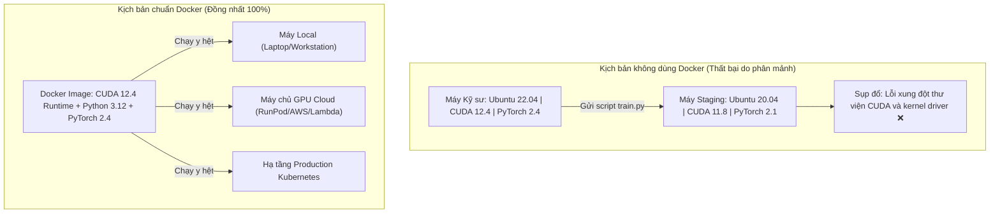
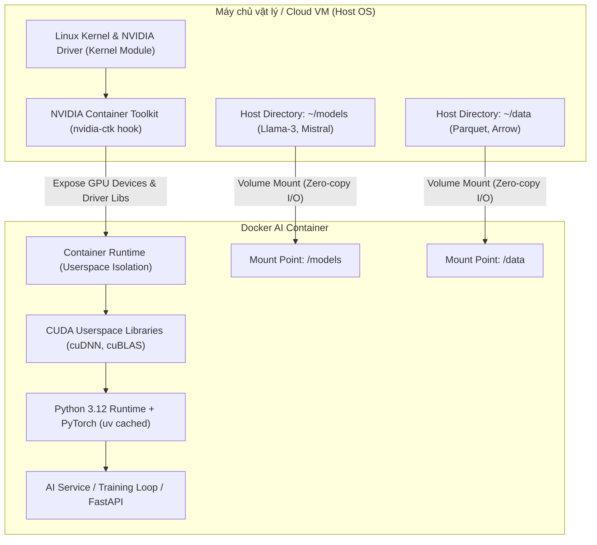

> **Nếu không chạy được trong container, mô hình của bạn chưa sẵn sàng lên production.** Mọi thử nghiệm AI dù rực rỡ đến đâu trên Jupyter Notebook cá nhân đều vô nghĩa nếu không thể tái lập 100% trên cụm máy chủ huấn luyện hoặc môi trường phục vụ suy luận. Docker không chỉ đóng gói mã nguồn, mà đóng gói toàn bộ trạng thái tính toán của hệ thống.

---

## Thông tin nhanh (Quick Spec)

* **Loại bài:** Thực chiến & Kiến trúc (Build & Concept)
* **Ngôn ngữ & Công cụ:** Docker, Docker Compose, NVIDIA Container Toolkit, PyTorch, uv, Qdrant
* **Kiến thức tiên quyết:** Bài 01 (Môi trường Dev), Bài 03 (GPU & CUDA)
* **Thời gian thực hành:** ~45 phút
* **Độ khó:** Trung bình (Intermediate)

---

## Mục tiêu bài học (Learning Objectives)

Sau bài học này, bạn sẽ:
- Hiểu rõ ranh giới kiến trúc phần cứng: Sự khác biệt bản chất giữa NVIDIA Driver ở tầng Host và CUDA Userspace Toolkit bên trong Container.
- Cài đặt và cấu hình hoàn chỉnh NVIDIA Container Toolkit để expose GPU vật lý vào môi trường container an toàn.
- Tự tay viết Dockerfile hiện đại chuẩn công nghiệp: Tận dụng `uv` và Docker BuildKit cache mounts để giảm thời gian build từ 15 phút xuống dưới 60 giây.
- Giải quyết triệt để lỗi sập ngầm PyTorch DataLoader do thiếu hụt bộ nhớ chia sẻ `/dev/shm`.
- Thiết lập file `docker-compose.yml` điều phối toàn diện một hệ thống RAG thực tế gồm AI Inference Service (có GPU reservation) và Qdrant Vector Database.

---

## 1. Vấn đề thực tế (The Problem)

Mọi kỹ sư AI từng làm việc trong môi trường thực tế đều ít nhất một lần nếm trải kịch bản cay đắng sau:

Bạn hoàn thành việc fine-tune một mô hình ngôn ngữ lớn trên máy trạm cá nhân chạy Ubuntu 22.04 với PyTorch 2.4, CUDA 12.4 và Python 3.12. Mã nguồn chạy trơn tru, suy luận ra kết quả chính xác tuyệt đối. Nhưng khi chuyển giao code sang máy chủ của đồng nghiệp hoặc đẩy lên cụm máy ảo Cloud (chạy Ubuntu 20.04, CUDA 11.8 và Python 3.10), hệ thống văng hàng loạt lỗi nghiêm trọng:

```text
RuntimeError: CUDA error: no kernel image is available for execution on the device
ImportError: libcudart.so.12: cannot open shared object file: No such file or directory
```

Các dự án phần mềm truyền thống chỉ cần quan tâm đến phiên bản ngôn ngữ và thư viện ứng dụng. Nhưng các dự án AI Engineering là một **cơn ác mộng phụ thuộc 4 tầng**:
1. Phiên bản Linux Kernel và NVIDIA Driver của máy vật lý.
2. Phiên bản CUDA Toolkit, cuDNN và thư viện C/C++ cấp thấp (như FlashAttention, Triton, NCCL).
3. Phiên bản Python Runtime và các package wheel được biên dịch riêng cho từng kiến trúc GPU.
4. Trọng số mô hình (weights) và các biến môi trường cấu hình bộ nhớ.



Nếu không sử dụng container, bạn sẽ mất hàng tuần chỉ để gỡ lỗi môi trường giữa các máy. Nếu sử dụng Docker ngây thơ, bạn sẽ đối mặt với các cạm bẫy sau:
- **Image phình to 30GB:** Copy toàn bộ dataset và file trọng số mô hình `.safetensors` vào Docker context khiến mỗi lần build mất nửa tiếng và làm tràn ổ cứng máy chủ.
- **Lỗi chết người SIGBUS crash:** PyTorch DataLoader sử dụng Shared Memory (`/dev/shm`) để truyền tải tensor giữa các tiến trình worker. Docker mặc định chỉ cấp vỏn vẹn **64MB** cho phân vùng này, khiến quá trình huấn luyện sụp đổ bí ẩn ngay khi nạp batch dữ liệu đầu tiên.

---

## 2. Mô hình tư duy & Bản chất (The Concept)

### 2.1. Bản chất cơ chế chia sẻ GPU trong Container

Một hiểu lầm kinh điển là: *"Cài Docker thì phải cài lại Driver NVIDIA vào trong Image"*. **Điều này hoàn toàn sai và sẽ phá hỏng container.**

Container thực chất không phải là một máy ảo (Virtual Machine) hoàn chỉnh; nó chỉ là các tiến trình được cô lập bằng Linux Namespaces và cgroups, dùng chung Linux Kernel với máy chủ. Vì GPU Driver gắn chặt với Kernel Module của máy host, chúng ta không thể và không được phép cài GPU Driver bên trong Docker Image.

Thay vào đó, **NVIDIA Container Toolkit (nvidia-ctk)** đóng vai trò là một cầu nối runtime hook. Khi Docker khởi tạo container với cờ `--gpus all`, NVIDIA Runtime Hook sẽ:
1. Phát hiện các card GPU vật lý trên máy host (`/dev/nvidia0`, `/dev/nvidiactl`, `/dev/nvidia-uvm`).
2. Gắn trực tiếp các device node này vào container.
3. Liên kết động (mount) các file thư viện driver userspace từ host (ví dụ `libcuda.so`) vào container.

Bên trong Docker Image, bạn chỉ cần cài đặt **CUDA Userspace Toolkit** (trình biên dịch nvcc, thư viện cuDNN, cuBLAS) và các thư viện Python.



### 2.2. Ba dạng Container trong vòng đời AI

Một hệ thống AI chuyên nghiệp luôn phân tách rõ 3 mô hình container:

1. **Dev Container:** Chứa đầy đủ công cụ gỡ lỗi, Jupyter Lab, git, compiler, Pylance server. Dùng cho kỹ sư viết code và thử nghiệm ý tưởng.
2. **Training Container:** Tối giản tối đa. Không có IDE hay Jupyter, chỉ chứa mã nguồn huấn luyện, script phân tán (PyTorch DDP, DeepSpeed) và checkpoint handler.
3. **Inference Container:** Kích thước siêu nhẹ, thời gian khởi động (cold start) tính bằng giây. Chỉ chứa runtime suy luận tối ưu (vLLM, TensorRT-LLM, TGI, FastAPI) nhằm phục vụ người dùng cuối.

---

## 3. Tự tay cấu hình từ đầu (Build It / Hands-on)

Chúng ta sẽ xây dựng một môi trường hoàn chỉnh theo chuẩn sản xuất: Cài đặt toolkit, viết `.dockerignore`, tạo `Dockerfile` tối ưu hóa đa tầng với `uv`, và điều phối cụm RAG bằng `docker-compose.yml`.

### Bước 1: Cài đặt NVIDIA Container Toolkit trên Host

Chạy các lệnh sau trên máy chủ Ubuntu/Debian có gắn GPU NVIDIA:

```bash
# 1. Thiết lập repository chính thức của NVIDIA
curl -fsSL https://nvidia.github.io/libnvidia-container/gpgkey | sudo gpg --dearmor -o /usr/share/keyrings/nvidia-container-toolkit-keyring.gpg
curl -s -L https://nvidia.github.io/libnvidia-container/stable/deb/nvidia-container-toolkit.list | \
  sed 's#deb [^ ]*#deb [signed-by=/usr/share/keyrings/nvidia-container-toolkit-keyring.gpg] https://nvidia.github.io/libnvidia-container/stable/deb/amd64/ /#' | \
  sudo tee /etc/apt/sources.list.d/nvidia-container-toolkit.list

# 2. Cài đặt toolkit
sudo apt-get update
sudo apt-get install -y nvidia-container-toolkit

# 3. Cấu hình Docker daemon sử dụng NVIDIA runtime hook
sudo nvidia-ctk runtime configure --runtime=docker
sudo systemctl restart docker

# 4. Kiểm chứng GPU bên trong container
docker run --rm --gpus all nvidia/cuda:12.4.1-base-ubuntu22.04 nvidia-smi
```

Nếu lệnh cuối cùng hiển thị bảng thông số GPU (tên GPU, VRAM, Driver version), hạ tầng của bạn đã sẵn sàng 100%.

### Bước 2: Thiết lập file `.dockerignore` chuẩn AI

Tuyệt đối không bao giờ gửi file dữ liệu và checkpoint vào build context của Docker. Hãy tạo file `.dockerignore` ngay tại thư mục gốc của dự án:

```text
# Git & cấu hình môi trường cục bộ
.git
.gitignore
.env
.env.*

# Bộ nhớ đệm Python & Virtual Environments
__pycache__
*.pyc
*.pyo
*.pyd
.venv
venv/
env/

# Trọng số mô hình và Checkpoint lớn (Mount qua volume, không nạp vào image)
checkpoints/
models/
*.bin
*.pt
*.pth
*.safetensors
*.onnx

# Dữ liệu huấn luyện & Cache
data/
datasets/
*.parquet
*.csv
*.arrow
.cache/
.pytest_cache/
.ruff_cache/

# Nhật ký và artifacts tạm
*.log
logs/
wandb/
outputs/
```

### Bước 3: Viết Dockerfile hiện đại với uv và Cache Mounts

Thay vì cài đặt Python bằng `apt-get` lỗi thời và dùng `pip install` chậm chạp, chúng ta sử dụng image chính thức từ NVIDIA, kéo binary `uv` tốc độ cao và kích hoạt Docker BuildKit cache mount để tái sử dụng package cache giữa các lần build.

Tạo file `Dockerfile`:

```dockerfile
# syntax=docker/dockerfile:1.6

# 1. Sử dụng CUDA Runtime base image chính thức từ NVIDIA
FROM nvidia/cuda:12.4.1-runtime-ubuntu22.04 AS base

# Ngăn chặn các câu hỏi tương tác trong quá trình cài đặt apt
ENV DEBIAN_FRONTEND=noninteractive \
    PYTHONUNBUFFERED=1 \
    PYTHONDONTWRITEBYTECODE=1 \
    PIP_NO_CACHE_DIR=off

# 2. Cài đặt Python 3.12 và các công cụ hệ thống tối thiểu
RUN apt-get update && apt-get install -y --no-install-recommends \
    python3.12 \
    python3.12-venv \
    python3-pip \
    ca-certificates \
    curl \
    git \
    && rm -rf /var/lib/apt/lists/*

# Tạo symlink chuẩn cho python
RUN ln -sf /usr/bin/python3.12 /usr/bin/python && \
    ln -sf /usr/bin/python3.12 /usr/bin/python3

# 3. Kéo binary uv siêu tốc từ image chính thức của Astral
COPY --from=ghcr.io/astral-sh/uv:0.5.11 /uv /bin/uv

WORKDIR /app

# 4. Tách riêng bước cài dependencies để tận dụng Docker layer cache
# Sử dụng Cache Mount: uv lưu wheel tại /root/.cache/uv, không làm phình Image
COPY pyproject.toml requirements.txt* ./

RUN --mount=type=cache,target=/root/.cache/uv \
    uv pip install --system --break-system-packages \
    torch torchvision torchaudio --index-url https://download.pytorch.org/whl/cu124 && \
    uv pip install --system --break-system-packages \
    fastapi uvicorn[standard] qdrant-client sentence-transformers pydantic

# 5. Tạo user phi đặc quyền (non-root) để bảo vệ an ninh hệ thống
RUN groupadd -g 1000 aigroup && \
    useradd -u 1000 -g aigroup -m -s /bin/bash aiuser && \
    chown -R aiuser:aigroup /app

USER aiuser

# 6. Copy mã nguồn ứng dụng ở layer cuối cùng
COPY --chown=aiuser:aigroup . /app

EXPOSE 8000

# Khởi chạy FastAPI inference service
CMD ["uvicorn", "main:app", "--host", "0.0.0.0", "--port", "8000"]
```

### Bước 4: Tạo ứng dụng AI mẫu `main.py`

Tạo file `main.py` để làm dịch vụ kiểm tra suy luận và kết nối vector database:

```python
import os
import torch
from fastapi import FastAPI
from qdrant_client import QdrantClient

app = FastAPI(title="AI Inference Service")

QDRANT_HOST = os.getenv("QDRANT_HOST", "qdrant")
QDRANT_PORT = int(os.getenv("QDRANT_PORT", "6333"))

@app.get("/")
def health_check():
    cuda_available = torch.cuda.is_available()
    device_name = torch.cuda.get_device_name(0) if cuda_available else "CPU Only"
    
    # Kiểm tra kết nối tới Qdrant Vector DB
    qdrant_status = "Disconnected"
    try:
        client = QdrantClient(host=QDRANT_HOST, port=QDRANT_PORT, timeout=2.0)
        collections = client.get_collections()
        qdrant_status = f"Connected ({len(collections.collections)} collections)"
    except Exception as e:
        qdrant_status = f"Error: {str(e)}"

    return {
        "status": "healthy",
        "cuda_available": cuda_available,
        "device": device_name,
        "qdrant_status": qdrant_status
    }
```

### Bước 5: Điều phối toàn diện với `docker-compose.yml`

Tạo file `docker-compose.yml` liên kết AI Inference service và Qdrant Vector Database, đồng thời cấu hình GPU reservation và mở rộng `/dev/shm`:

```yaml
services:
  ai-service:
    build:
      context: .
      dockerfile: Dockerfile
    container_name: ai_inference_service
    ports:
      - "8000:8000"
    environment:
      - QDRANT_HOST=qdrant
      - QDRANT_PORT=6333
      - NVIDIA_VISIBLE_DEVICES=all
    # Khắc phục triệt để lỗi sập DataLoader IPC: Cấp 16GB Shared Memory
    shm_size: "16gb"
    volumes:
      - ./models:/models:ro
      - ./data:/data:ro
    deploy:
      resources:
        reservations:
          devices:
            - driver: nvidia
              count: all
              capabilities: [gpu]
    depends_on:
      - qdrant
    restart: unless-stopped

  qdrant:
    image: qdrant/qdrant:v1.12.5
    container_name: ai_qdrant_vectordb
    ports:
      - "6333:6333"
      - "6334:6334"
    volumes:
      - qdrant_storage:/qdrant/storage
    restart: unless-stopped

volumes:
  qdrant_storage:
    name: ai_qdrant_data
```

Khởi chạy cụm dịch vụ:

```bash
docker compose up -d --build
```

Kiểm tra kết quả hoạt động:

```bash
curl http://localhost:8000/
```

Kết quả phản hồi JSON minh chứng GPU và Vector DB đã kết nối đồng nhất:

```json
{
  "status": "healthy",
  "cuda_available": true,
  "device": "NVIDIA A100-SXM4-80GB",
  "qdrant_status": "Connected (0 collections)"
}
```

---

## 4. Ứng dụng thực tế & Cạm bẫy Production (Use It / Production Tips)

### Cạm bẫy 1: Sự cố sập Shared Memory `/dev/shm` khi dùng PyTorch DataLoader

Trong PyTorch, khi bạn đặt `DataLoader(..., num_workers=4)`, PyTorch sẽ khởi tạo 4 tiến trình con (multiprocessing). Để truyền tải dữ liệu tensor từ các tiến trình con này về tiến trình chính mà không tốn chi phí copy qua bộ nhớ heap thông thường, PyTorch sử dụng hệ thống tệp bộ nhớ dùng chung `/dev/shm`.

Mặc định của Docker chỉ cấp **64MB** cho `/dev/shm`. Khi batch size hoặc kích thước ảnh/văn bản lớn hơn 64MB, container sẽ lập tức bị hệ điều hành tiêu diệt với lỗi:
`ERROR: Unexpected bus error encountered in worker. This might be caused by an out of shared memory (shm) error.`

**Giải pháp triệt để:**
- Trong `docker run`: Luôn truyền cờ `--shm-size=16g` hoặc `--ipc=host`.
- Trong `docker-compose.yml`: Bổ sung thuộc tính `shm_size: "16gb"` (hoặc `ipc: host` nếu bạn hoàn toàn tin cậy host).

### Cạm bẫy 2: Lỗi quyền sở hữu file (Permission Denied) khi ghi Checkpoint

Theo mặc định, tiến trình bên trong container chạy dưới quyền `root` (UID 0). Nếu bạn mount volume từ máy host vào thư mục output:

```bash
docker run -v $(pwd)/checkpoints:/app/checkpoints my-training-image
```

Mỗi checkpoint `.pt` được lưu ra sẽ thuộc quyền sở hữu của `root`. Khi bạn muốn xóa, chỉnh sửa hoặc push checkpoint này lên cloud từ máy cá nhân, hệ thống sẽ báo lỗi `Permission denied`.

**Giải pháp:**
Truyền cờ User ID và Group ID của người dùng hiện tại vào lệnh chạy:

```bash
docker run --user $(id -u):$(id -g) -v $(pwd)/checkpoints:/app/checkpoints my-training-image
```

### Cạm bẫy 3: Xếp sai thứ tự lệnh làm hỏng Docker Layer Cache

Docker build từng bước theo cơ chế layer caching. Nếu một layer bị thay đổi, **toàn bộ các layer phía sau nó bắt buộc phải build lại từ đầu**.

- **Cách làm sai:** Copy mã nguồn (`COPY . /app`) trước khi cài thư viện (`RUN pip install ...`). Mỗi lần bạn sửa một ký tự trong file Python, Docker sẽ tải lại 5GB PyTorch từ đầu.
- **Cách làm đúng:** Copy file định nghĩa gói (`pyproject.toml`, `requirements.txt`) trước $\rightarrow$ chạy lệnh cài đặt thư viện $\rightarrow$ copy mã nguồn ứng dụng ở bước cuối cùng.

### Cạm bẫy 4: Tràn đĩa máy chủ do tích tụ Docker rác

Sau vài tuần chạy thử nghiệm, máy chủ thường xuyên báo đầy 100% ổ cứng do các image dangling và anonymous volumes. Hãy thực thi lệnh dọn dẹp định kỳ:

```bash
# Dọn dẹp an toàn các container đã tắt và image vô danh
docker system prune -f

# Dọn dẹp chuyên sâu giải phóng hàng chục GB (xóa cả build cache và volume không dùng)
docker system prune -a --volumes -f
```

---

## 5. Giải ngố thuật ngữ (Key Terms)

| Thuật ngữ | Người ta thường nghĩ là... | Bản chất kỹ thuật thực sự là... |
|---|---|---|
| **Container vs Image** | "Chỉ là hai cách gọi khác nhau của gói Docker" | **Image** là khuôn mẫu chỉ đọc (read-only snapshot) gồm nhiều tầng layer. **Container** là một phiên bản tiến trình đang thực thi (runtime instance) được tạo ra từ Image, có thêm một tầng đọc-ghi (writable layer) trên cùng. |
| **NVIDIA Container Toolkit** | "Driver card đồ họa ảo cài vào Docker" | Là một **Runtime Hook** cấp độ hệ thống (`nvidia-container-runtime`), nhận diện phần cứng GPU trên Host và ánh xạ trực tiếp các device nodes (`/dev/nvidia*`) cùng thư viện driver vào không gian tên của container. |
| **Shared Memory (`/dev/shm`)** | "Bộ nhớ RAM thông thường của máy tính" | Là một phân vùng ảo dựa trên RAM (tmpfs), được hệ điều hành dành riêng cho việc chia sẻ dữ liệu liên tiến trình (IPC - Inter-Process Communication). PyTorch DataLoader dùng nó để truyền tải tensor mà không qua serialization. |
| **Bind Mount vs Volume** | "Đều là cách chia sẻ thư mục máy chủ" | **Bind Mount** ánh xạ trực tiếp một đường dẫn tùy ý trên Host vào Container (hiệu năng cao, phụ thuộc cấu trúc file của Host). **Named Volume** được quản lý hoàn toàn bởi Docker bên trong `/var/lib/docker/volumes/`, an toàn và dễ sao lưu hơn. |
| **Base Image `devel` vs `runtime`** | "Cứ dùng devel cho đầy đủ tính năng" | `devel` chứa toàn bộ header C++, nvcc compiler và công cụ phát triển (dung lượng thường 4-7GB). `runtime` chỉ chứa binary để thực thi mô hình đã biên dịch (dung lượng chỉ 1.5-2.5GB), tối ưu vượt trội cho production. |

---

## 6. Bài tập thử thách (Hands-on Challenges)

### 🟢 Cơ bản (Dễ)
1. Tạo một thư mục dự án mới, viết file `.dockerignore` chuẩn loại bỏ toàn bộ file checkpoint (`*.safetensors`, `*.pt`) và thư mục virtualenv.
2. Viết một Dockerfile tối giản kế thừa từ `nvidia/cuda:12.4.1-base-ubuntu22.04`, thực thi lệnh `nvidia-smi` để in ra danh sách GPU khi container khởi chạy.
3. Chạy container với cờ `--gpus all` và xác nhận kết quả khớp với thông số card đồ họa trên máy host.

### 🟡 Trung bình (Vừa)
1. Sử dụng file `docker-compose.yml` đã học trong bài, khởi chạy stack gồm AI Service và Qdrant Vector DB.
2. Viết một script Python chạy từ máy host (hoặc từ một container thứ ba) gửi yêu cầu HTTP POST tới `ai-service` để tạo một collection mới trên Qdrant thông qua mạng nội bộ `http://qdrant:6333`.
3. Kiểm tra tính bền vững của dữ liệu: Dừng cụm container bằng `docker compose down`, sau đó bật lại bằng `docker compose up -d` và chứng minh collection vừa tạo trên Qdrant vẫn tồn tại nguyên vẹn nhờ Docker named volume.

### 🔴 Nâng cao (Khó)
1. Tối ưu hóa Dockerfile sử dụng mô hình Đa tầng (Multi-stage build):
   - **Tầng Builder:** Kế thừa từ `nvidia/cuda:12.4.1-devel-ubuntu22.04`, cài đặt công cụ biên dịch để build wheel riêng cho một thư viện C-extension (ví dụ: `flash-attn` hoặc `bitsandbytes`).
   - **Tầng Final:** Kế thừa từ `nvidia/cuda:12.4.1-runtime-ubuntu22.04`, chỉ copy các wheel đã build xong từ tầng Builder và cài đặt qua `uv`.
2. Kích hoạt Docker BuildKit cache mount (`--mount=type=cache,target=/root/.cache/uv`).
3. Đo lường và chứng minh: Kích thước image cuối cùng giảm ít nhất 50% so với khi dùng `devel`, và thời gian build lại sau khi sửa đổi một dòng code trong `main.py` chỉ mất dưới **15 giây**.
