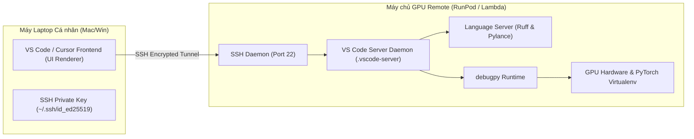

> **Editor của bạn là bạn đồng hành. Cấu hình đúng một lần để nó không cản trở tư duy của bạn.** Một môi trường làm việc chuẩn mực giúp bạn bắt gọn lỗi kiểu dữ liệu và sai lệch chiều Tensor ngay khi gõ phím, thay vì chờ đến khi GPU bốc cháy sau 20 phút chạy training loop mới phát hiện ra lỗi ngớ ngẩn.

---

## Thông tin nhanh (Quick Spec)

* **Loại bài:** Thực chiến & Năng suất (Build & Productivity)
* **Ngôn ngữ & Công cụ:** VS Code, Cursor, Remote SSH, Pylance, Ruff, debugpy
* **Kiến thức tiên quyết:** Bài 01 (Môi trường Dev), Bài 06 (Môi trường Python)
* **Thời gian thực hành:** ~30 phút
* **Độ khó:** Cơ bản - Trung bình (Beginner - Intermediate)

---

## Mục tiêu bài học (Learning Objectives)

Sau bài học này, bạn sẽ:
- Hiểu rõ cơ chế hoạt động của Language Server Protocol (LSP) và kiến trúc Client - Server của VS Code Remote SSH.
- Cài đặt và cấu hình bộ công cụ tối ưu cho kỹ sư AI: Thay thế Black, Flake8, isort bằng một mình Ruff với tốc độ vượt trội.
- Thiết lập file `.vscode/settings.json` chuẩn mực: Bật kiểm tra kiểu tĩnh (static type checking), tự động format khi lưu, và loại trừ quét dữ liệu lớn để chống treo RAM máy chủ.
- Làm chủ kết nối Remote SSH qua khóa bảo mật Ed25519 và cấu hình Port Forwarding an toàn cho TensorBoard, MLflow, FastAPI.
- Xây dựng file context rules (`.cursorrules` hoặc Copilot Instructions) để điều hướng các trợ lý AI sinh code chính xác theo chuẩn kiến trúc của dự án.

---

## 1. Vấn đề thực tế (The Problem)

Là một kỹ sư AI, bạn sẽ dành phần lớn thời gian trong ngày trước màn hình editor: viết mã huấn luyện, tinh chỉnh kiến trúc mô hình, xem đồ thị tensor, phân tích log và kết nối vào các cụm máy chủ GPU từ xa (Cloud VMs, RunPod, Lambda Labs, cụm máy trường học/công ty).

Nếu không thiết lập môi trường soạn thảo bài bản, bạn sẽ rơi vào 4 tình cảnh ức chế kinh điển sau:

1. **Lập trình "mù" trên Server Remote:**
   Rất nhiều lập trình viên mới bắt đầu thường dùng trình soạn thảo dòng lệnh thô sơ như `nano` hay `vim` trần trên máy chủ, hoặc chỉnh sửa code ở máy local rồi dùng `scp`/`rsync` đẩy từng file lên server mỗi khi đổi một dòng lệnh. Quy trình này cực kỳ chậm chạp, dễ mất đồng bộ code và triệt tiêu toàn bộ cảm hứng làm việc.

2. **Lỗi Tensor Shape chỉ phát hiện sau khi GPU đã chạy nửa tiếng:**
   Bạn viết một hàm tính loss hoặc biến đổi dữ liệu, nhưng truyền nhầm tensor 1 chiều thay vì 2 chiều. Vì editor không bật Language Server và Static Type Checking, code vẫn lưu bình thường. Bạn khởi chạy script huấn luyện, chờ đợi nạp dataset 15 phút, nạp trọng số mô hình vào VRAM, và rồi chương trình quăng ngoại lệ:
   ```text
   RuntimeError: The size of tensor a (64) must match the size of tensor b (128) at non-singleton dimension 1
   ```
   Toàn bộ thời gian chờ đợi và chi phí GPU bị đốt cháy vô ích.

3. **Xung đột định dạng code trong nhóm (Format Wars):**
   Trong cùng một nhóm kỹ sư, người dùng thụt lề 2 space, người dùng 4 space, người dùng dấu nháy đơn, người dùng nháy kép. Các công cụ định dạng cũ như Black hay Flake8 chạy quá chậm khi dự án phình to, khiến Git Diff tràn ngập các dòng sửa formatting rác, gây khó khăn cho việc code review.

4. **Máy chủ GPU Cloud bị đơ CPU/RAM do Editor:**
   Khi mở một thư mục chứa dataset 500,000 file ảnh hoặc các file checkpoint dung lượng 20GB, tiến trình `vscode-server` trên máy chủ cố gắng quét và lập chỉ mục (indexing) toàn bộ cây thư mục. Kết quả là tiến trình ngầm chiếm 100% CPU và hàng chục GB RAM, làm máy chủ bị treo cứng trước khi kịp nạp model.

---

## 2. Mô hình tư duy & Bản chất (The Concept)

### 2.1. Kiến trúc Client - Server của VS Code Remote Development

Nhiều người lầm tưởng Remote SSH chỉ là "mở một cửa sổ terminal từ xa". Thực chất, VS Code áp dụng mô hình phân tách hoàn toàn giữa giao diện người dùng (Frontend UI) và môi trường thực thi (Backend Server):

- **Phía Laptop Cá nhân (Client):** Chỉ chịu trách nhiệm hiển thị giao diện đồ họa (render DOM thông qua Electron) và nhận tương tác bàn phím/chuột. Máy tính cá nhân hoàn toàn không cần cài đặt Python, CUDA hay PyTorch.
- **Phía Máy chủ GPU (Remote Server):** Khi kết nối qua SSH, VS Code tự động tải và khởi chạy một tiến trình daemon siêu nhỏ tên là `vscode-server` (nằm tại thư mục `~/.vscode-server`). Tiến trình này trực tiếp giao tiếp với Python Virtualenv, nạp các extension phân tích cú pháp (Pylance, Ruff) và kết nối với debugger `debugpy`.

Mọi thao tác autocomplete, tìm kiếm định nghĩa hàm, chạy Jupyter kernel hay gỡ lỗi từng dòng lệnh đều diễn ra trực tiếp trên phần cứng của máy chủ GPU, sau đó kết quả được truyền về máy cá nhân qua một đường truyền SSH mã hóa duy nhất.



### 2.2. Cuộc cách mạng Ruff và Language Server Protocol (LSP)

Trước đây, một môi trường phát triển Python chuẩn mực đòi hỏi cài đặt một chuỗi công cụ cồng kềnh:
- `black` để định dạng code (formatting).
- `isort` để sắp xếp thư viện import.
- `flake8` để kiểm tra lỗi cú pháp và style (linting).
- `pylint` hoặc `mypy` để kiểm tra kiểu dữ liệu nâng cao.

Mỗi khi lưu file, 3-4 tiến trình Python độc lập phải khởi động, phân tích cú pháp mã nguồn thành Abstract Syntax Tree (AST), khiến editor bị khựng lại từ 1 đến 3 giây trên các file lớn.

**Ruff** (được viết hoàn toàn bằng ngôn ngữ Rust) đã thay đổi hoàn toàn cục diện. Ruff tích hợp toàn bộ tính năng của Flake8, isort, Black, pydocstyle vào một binary duy nhất. Với tốc độ xử lý nhanh hơn từ **10 đến 50 lần**, Ruff có thể phân tích và tự động sửa lỗi một codebase hàng chục ngàn dòng trong vỏn vẹn vài chục mili-giây.

---

## 3. Tự tay cấu hình từ đầu (Build It / Hands-on)

### Bước 1: Cài đặt danh sách Extension thiết yếu qua CLI

Mở terminal trên máy cá nhân và chạy các lệnh sau để cài đặt chính xác các tiện ích phục vụ AI Engineering:

```bash
# 1. Hỗ trợ cốt lõi cho Python và kiểm tra kiểu dữ liệu
code --install-extension ms-python.python
code --install-extension ms-python.vscode-pylance

# 2. Bộ linter và formatter siêu tốc bằng Rust (thay thế Black/Flake8)
code --install-extension charliermarsh.ruff

# 3. Làm việc trực tiếp với Jupyter Notebooks bên trong editor
code --install-extension ms-toolsai.jupyter

# 4. Phát triển từ xa qua SSH
code --install-extension ms-vscode-remote.remote-ssh

# 5. Bộ gỡ lỗi từng bước cho Python
code --install-extension ms-python.debugpy

# 6. Kiểm soát phiên bản và lịch sử commit theo từng dòng code
code --install-extension eamodio.gitlens
```

### Bước 2: Thiết lập file `.vscode/settings.json` tối ưu cho AI

Tạo thư mục `.vscode` trong thư mục gốc của dự án và tạo file `settings.json`. Cấu hình này sẽ tự động áp dụng cho tất cả thành viên trong nhóm làm việc trên cùng repository:

```json
{
  // 1. Chỉ định Ruff làm Formatter mặc định cho toàn bộ code Python
  "[python]": {
    "editor.defaultFormatter": "charliermarsh.ruff",
    "editor.formatOnSave": true,
    "editor.codeActionsOnSave": {
      "source.fixAll.ruff": "explicit",
      "source.organizeImports.ruff": "explicit"
    }
  },

  // 2. Cấu hình phân tích tĩnh với Pylance
  "python.analysis.typeCheckingMode": "basic",
  "python.analysis.autoImportCompletions": true,
  "python.analysis.diagnosticSeverityOverrides": {
    "reportUnusedImport": "warning",
    "reportUnusedVariable": "warning",
    "reportGeneralTypeIssues": "warning"
  },

  // 3. Đường kẻ giới hạn độ dài dòng code (88 chuẩn Ruff/Black, 120 cho Docstrings)
  "editor.rulers": [88, 120],

  // 4. Giới hạn scroll của Jupyter Notebook để chống tràn màn hình khi train
  "notebook.output.scrolling": true,
  "notebook.output.textLineLimit": 100,

  // 5. Tự động lưu để tránh chạy nhầm code cũ trên terminal
  "files.autoSave": "afterDelay",
  "files.autoSaveDelay": 1000,

  // 6. CỰC KỲ QUAN TRỌNG: Loại trừ quét dữ liệu lớn và checkpoint tránh đơ máy chủ
  "files.watcherExclude": {
    "**/.git/objects/**": true,
    "**/.git/subtree-cache/**": true,
    "**/node_modules/**": true,
    "**/.venv/**": true,
    "**/venv/**": true,
    "**/data/**": true,
    "**/datasets/**": true,
    "**/models/**": true,
    "**/checkpoints/**": true,
    "**/*.safetensors": true,
    "**/*.parquet": true
  },
  "search.exclude": {
    "**/data": true,
    "**/models": true,
    "**/checkpoints": true,
    "**/*.safetensors": true
  }
}
```

### Bước 3: Cấu hình SSH Key và file `~/.ssh/config` chuyên nghiệp

Thay vì phải gõ mật khẩu dài dằng dặc mỗi lần kết nối, hãy sử dụng cặp khóa mã hóa hiện đại Ed25519 (an toàn và nhẹ hơn chuẩn RSA cũ).

1. Khởi tạo SSH Key trên laptop của bạn:
```bash
ssh-keygen -t ed25519 -C "ai-engineer@company.com"
```

2. Copy public key lên máy chủ GPU:
```bash
ssh-copy-id -i ~/.ssh/id_ed25519.pub ubuntu@203.0.113.50
```

3. Mở file cấu hình `~/.ssh/config` trên máy cá nhân và định nghĩa Host Alias:
```text
# Máy chủ GPU Cloud chính
Host gpu-cloud
    HostName 203.0.113.50
    User ubuntu
    IdentityFile ~/.ssh/id_ed25519
    # Giữ kết nối luôn sống động, chống rớt mạng khi treo máy
    ServerAliveInterval 60
    ServerAliveCountMax 5
    ForwardAgent yes
    # Tự động forward sẵn cổng TensorBoard và Jupyter
    LocalForward 6006 127.0.0.1:6006
    LocalForward 8888 127.0.0.1:8888
```

Bây giờ, trên VS Code, bạn chỉ cần bấm `F1` (hoặc `Ctrl+Shift+P` / `Cmd+Shift+P`), gõ `Remote-SSH: Connect to Host...`, chọn `gpu-cloud`, toàn bộ workspace trên máy chủ sẽ hiển thị mượt mà như đang chạy trên máy local.

### Bước 4: Thiết lập file `.cursorrules` cho các AI-First Code Editor

Nếu bạn sử dụng các trình soạn thảo AI-native hiện đại như **Cursor** hay **Windsurf**, việc tạo file `.cursorrules` ở thư mục gốc của dự án giúp định hình ngữ cảnh (context) cho LLM, ngăn chặn AI sinh ra code lỗi thời:

Tạo file `.cursorrules`:

```markdown
# Cẩm nang quy chuẩn code cho dự án AI Engineering

## Nguyên tắc cốt lõi:
- Toàn bộ code Python viết theo tiêu chuẩn Python 3.11+.
- Mọi hàm xử lý Tensor trong PyTorch PHẢI có docstring ghi rõ shape đầu vào và đầu ra.
  Ví dụ: # [Batch_Size, Sequence_Length, Hidden_Dim] -> [B, S, D].
- Tuyệt đối không sử dụng hàm `print()` cho training log; luôn sử dụng thư viện `logging` hoặc log metrics vào TensorBoard / WandB.
- Sử dụng Pydantic v2 cho toàn bộ schema dữ liệu đầu vào/ra của API.
- Định dạng code theo chuẩn Ruff (độ dài tối đa 88 ký tự).
- Không tự ý import thêm các package ngoài danh sách dependencies trong `pyproject.toml`.
- Khi viết PyTorch, luôn kiểm tra thiết bị qua `device = torch.device("cuda" if torch.cuda.is_available() else "cpu")`.
```

---

## 4. Ứng dụng thực tế & Cạm bẫy Production (Use It / Production Tips)

### Bí kíp 1: Tận dụng Port Forwarding an toàn qua SSH Tunnel

Khi bạn huấn luyện mô hình trên cloud, bạn thường khởi chạy:
- TensorBoard để xem loss: chạy tại cổng `6006`.
- FastAPI server suy luận: chạy tại cổng `8000`.
- MLflow tracking server: chạy tại cổng `5000`.

**Cạm bẫy:** Rất nhiều kỹ sư mở firewall public các cổng này trên cloud provider để truy cập qua IP `http://203.0.113.50:6006`. Thao tác này cực kỳ nguy hiểm vì dữ liệu huấn luyện, mã nguồn và API key có thể bị hacker quét và xâm nhập.

**Giải pháp với VS Code:**
Khi bạn đã kết nối Remote SSH, VS Code tích hợp sẵn tab **Ports** ở thanh công cụ phía dưới (cạnh tab Terminal).
1. Bấm vào nút **Forward a Port**.
2. Nhập `6006` (hoặc `8000`).
3. Mở trình duyệt trên laptop cá nhân và truy cập `http://localhost:6006`. Toàn bộ lưu lượng mạng được truyền qua đường hầm SSH mã hóa an toàn 100%.

### Bí kíp 2: Xử lý sự cố máy chủ Remote bị đầy đĩa do `.vscode-server`

Mỗi khi ứng dụng VS Code trên laptop của bạn được cập nhật (khoảng 2 tuần một lần), nó sẽ tải một bản build node binary mới lên thư mục `~/.vscode-server/bin/<commit-id>/` trên máy chủ từ xa. Sau vài tháng, các phiên bản cũ không tự xóa và có thể chiếm tới **5 đến 10GB** phân vùng ổ đĩa root của server.

Khi thấy máy chủ báo dung lượng disk sắp đầy, hãy chạy lệnh dọn dẹp sau trên terminal remote:

```bash
# Xem dung lượng hiện tại của vscode-server
du -sh ~/.vscode-server

# Xóa các binary cũ không còn sử dụng (VS Code sẽ tự tải lại bản mới nhất khi kết nối)
rm -rf ~/.vscode-server/bin/*
```

### Bí kíp 3: Cấu hình gỡ lỗi trực quan với `.vscode/launch.json`

Đừng lạm dụng lệnh `print()` để gỡ lỗi. Hãy tạo file `.vscode/launch.json` để có thể đặt Breakpoint dừng tiến trình, inspect tensor shape và xem giá trị từng layer:

```json
{
  "version": "0.2.0",
  "configurations": [
    {
      "name": "Python: Huấn luyện Mô hình Hiện tại",
      "type": "debugpy",
      "request": "launch",
      "program": "${file}",
      "console": "integratedTerminal",
      "args": ["--batch-size", "32", "--epochs", "5", "--learning-rate", "1e-4"],
      "env": {
        "CUDA_VISIBLE_DEVICES": "0",
        "PYTHONPATH": "${workspaceFolder}"
      },
      "justMyCode": true
    }
  ]
}
```

Bấm phím `F5`, chương trình sẽ tự động kích hoạt debugger, cho phép bạn nhảy qua từng dòng lệnh và xem trực quan giá trị tensor trong bảng điều khiển Variables.

---

## 5. Giải ngố thuật ngữ (Key Terms)

| Thuật ngữ | Người ta thường nghĩ là... | Bản chất kỹ thuật thực sự là... |
|---|---|---|
| **LSP (Language Server Protocol)** | "Chỉ là bộ gõ tự động hoàn thành từ (Autocomplete)" | Là giao thức chuẩn hóa mở do Microsoft khởi xướng, tách rời trình soạn thảo khỏi trình phân tích ngôn ngữ. Editor gửi sự kiện mở/sửa file, LSP Server thực hiện parse cú pháp, tìm kiếm định nghĩa và trả về gợi ý cùng cảnh báo lỗi kiểu dữ liệu. |
| **Remote SSH Daemon** | "Giống như teamviewer hay remote desktop vào máy chủ" | Không hề truyền hình ảnh màn hình. Daemon `vscode-server` chạy dưới dạng tiến trình Node.js không đầu (headless) trên máy chủ, chỉ trao đổi dữ liệu JSON qua socket SSH với UI Client ở local. |
| **Linter vs Formatter** | "Đều là công cụ định dạng code cho đẹp" | **Linter** (như Flake8, Ruff) phân tích logic để tìm kiếm lỗi tiềm ẩn, biến không dùng, import thừa hoặc nguy cơ bảo mật. **Formatter** (như Black, Ruff format) chỉ can thiệp vào cách trình bày khoảng trắng, ngắt dòng mà không thay đổi bất kỳ logic thực thi nào. |
| **Port Forwarding (SSH Tunnel)** | "Mở port trên modem/firewall của server" | Tạo một đường hầm mã hóa (Encrypted Tunnel) từ một cổng mạng trên máy cục bộ trỏ xuyên qua kết nối SSH tới một cổng nội bộ của server mà không cần mở port ra ngoài Internet công cộng. |
| **Context Window Rules (`.cursorrules`)** | "File ghi chú thông thường cho lập trình viên" | Tập hợp các chỉ thị hệ thống (system prompt directives) được tự động nhúng vào ngữ cảnh mỗi khi AI assistant phân tích hoặc sinh mã nguồn, giúp AI hiểu được kiến trúc và phong cách riêng của dự án. |

---

## 6. Bài tập thử thách (Hands-on Challenges)

### 🟢 Cơ bản (Dễ)
1. Cài đặt tiện ích mở rộng **Ruff** trên VS Code.
2. Tạo một file Python thử nghiệm `test_style.py` cố tình chứa các lỗi: import thư viện thừa, đặt khoảng trắng lộn xộn, biến định nghĩa nhưng không dùng.
3. Kích hoạt tính năng Format on Save và chứng kiến Ruff tự động sắp xếp lại import, xóa khoảng trắng thừa và cảnh báo biến chưa dùng trong vòng dưới 5 mili-giây.

### 🟡 Trung bình (Vừa)
1. Tạo một cặp khóa SSH Ed25519 trên máy tính của bạn và cấu hình file `~/.ssh/config` với một Host Alias rõ ràng (nếu không có máy chủ cloud thật, bạn có thể dùng một máy ảo WSL2, Linux VM hoặc máy tính khác trong mạng LAN).
2. Kết nối thành công bằng Remote SSH mà không cần nhập mật khẩu.
3. Khởi chạy một dummy server đơn giản bằng lệnh `python -m http.server 8080` trên remote host, sau đó sử dụng tính năng Port Forwarding của VS Code để mở trang web đó trên trình duyệt laptop tại địa chỉ `http://localhost:8080`.

### 🔴 Nâng cao (Khó)
1. Xây dựng một thư mục dự án mẫu chuẩn doanh nghiệp gồm cấu trúc hoàn chỉnh:
   - Thư mục `.vscode/` chứa `settings.json`, `extensions.json` và `launch.json`.
   - File cấu hình `.cursorrules` đặt ra các tiêu chuẩn khắt khe cho một pipeline Computer Vision: Yêu cầu kích thước ảnh luôn là `[B, C, H, W]`, dùng `torch.Tensor` với type annotation đầy đủ.
2. Cấu hình `files.watcherExclude` trong `settings.json` để bảo vệ tài nguyên: Tạo một script Python giả lập sinh ra 50,000 file text rác trong thư mục `data/temp/`, sau đó mở VS Code và kiểm tra CPU/RAM của tiến trình `code` không bị tăng vọt nhờ bộ lọc exclusion.
