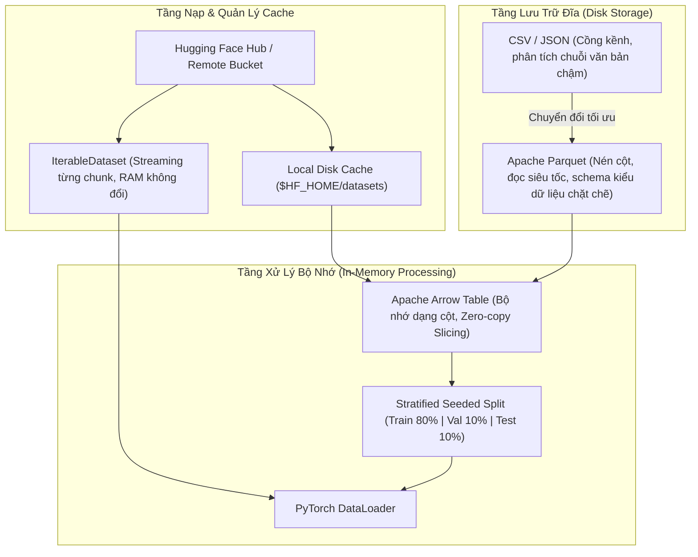

> **Dữ liệu là nhiên liệu của AI. Cách bạn quản lý nó quyết định tốc độ và độ tin cậy của toàn hệ thống.** Một pipeline dữ liệu cẩu thả sẽ âm thầm hủy hoại mô hình bằng hiện tượng rò rỉ dữ liệu (data leakage) hoặc làm sập máy chủ vì tràn RAM trước khi epoch đầu tiên kịp bắt đầu. Quản trị dữ liệu chuẩn xác là nền tảng sống còn của mọi kỹ sư AI.

---

## Thông tin nhanh (Quick Spec)

* **Loại bài:** Thực chiến & Hệ thống (Build & Systems)
* **Ngôn ngữ & Công cụ:** Python, Hugging Face `datasets`, Apache Arrow, PyArrow, Parquet, DVC
* **Kiến thức tiên quyết:** Bài 01 (Môi trường Dev), Bài 06 (Môi trường Python)
* **Thời gian thực hành:** ~45 phút
* **Độ khó:** Trung bình (Intermediate)

---

## Mục tiêu bài học (Learning Objectives)

Sau bài học này, bạn sẽ:
- Nắm vững kiến trúc nạp dữ liệu hiện đại: Phân biệt bản chất giữa lưu trữ dạng cột trên đĩa (Apache Parquet) và biểu diễn dữ liệu trong bộ nhớ (Apache Arrow).
- Làm chủ kỹ thuật Dataset Streaming với Hugging Face `datasets`: Xử lý tập dữ liệu hàng trăm gigabyte trên máy trạm có RAM khiêm tốn mà không làm tràn bộ nhớ.
- Cấu hình an toàn biến môi trường `HF_HOME` để chuyển hướng lưu trữ cache, bảo vệ phân vùng hệ điều hành khỏi nguy cơ đầy ổ đĩa.
- Tự tay viết script benchmark đo đạc hiệu năng I/O thực tế giữa CSV, JSON, Parquet và Arrow.
- Hiện thực hóa hàm phân chia dữ liệu Train / Validation / Test cố định seed và có cơ chế kiểm tra chống rò rỉ dữ liệu (Data Leakage Assertion).
- Thiết lập quy trình quản lý phiên bản dữ liệu chuẩn công nghiệp bằng Data Version Control (DVC) tích hợp với Git.

---

## 1. Vấn đề thực tế (The Problem)

Mọi dự án AI đều bắt đầu từ dữ liệu. Khác với các ứng dụng web thông thường chỉ truy vấn vài ngàn bản ghi qua SQL, một mô hình AI hiện đại đòi hỏi hàng triệu dòng văn bản hoặc hàng trăm ngàn hình ảnh để huấn luyện và đánh giá.

Nếu tiếp cận việc quản lý dữ liệu một cách ngây thơ, bạn sẽ lập tức đối mặt với 4 thảm họa kỹ thuật sau:

1. **Thảm họa Out Of Memory (OOM) với Pandas:**
   Thói quen dùng `pd.read_csv("large_dataset.csv")` để nạp dữ liệu. Một file CSV dung lượng 15GB trên đĩa khi được Pandas parse thành chuỗi Python object thường phình to gấp **4 đến 6 lần**, đòi hỏi hơn 70GB RAM. Trên các máy chủ cloud có 32GB RAM, hệ điều hành sẽ ngay lập tức kích hoạt Linux OOM-Killer và tiêu diệt tiến trình của bạn trong chớp mắt.

2. **Phân vùng hệ điều hành bị bóp nghẹt vì Cache:**
   Khi bạn gọi `load_dataset(...)` từ thư viện Hugging Face, theo mặc định toàn bộ dữ liệu tải về sẽ được ghi vào thư mục ẩn `~/.cache/huggingface/datasets/` nằm trên phân vùng gốc (`/`). Trên hầu hết các máy chủ cloud, phân vùng `/` chỉ được cấp 30GB đến 50GB. Chỉ cần tải một vài dataset lớn hoặc 2 mô hình LLM, ổ đĩa root sẽ bị đầy 100%, khiến hệ thống tê liệt, không thể lưu log và từ chối mọi phiên đăng nhập SSH tiếp theo.

3. **Cạm bẫy Rò rỉ Dữ liệu (Data Leakage):**
   Một sai sót chết người thường gặp: Phân chia tập Train/Test một cách ngẫu nhiên nhưng không cố định random seed, hoặc thực hiện chuẩn hóa (normalize/scaling) và fit tokenizer trên **toàn bộ dataset** trước khi tách tập train. Hậu quả là thông tin từ tập Test đã âm thầm rò rỉ vào tập Train. Mô hình của bạn đạt độ chính xác ảo lên đến 99% trong quá trình thử nghiệm, nhưng khi triển khai ra sản phẩm thực tế thì dự đoán sai lệch hoàn toàn.

4. **Lạc trôi phiên bản dữ liệu (Data Version Drift):**
   Trong một nhóm 4 kỹ sư, mỗi người huấn luyện một mô hình khác nhau. Kỹ sư A lọc bỏ 5,000 dòng lỗi, kỹ sư B bổ sung thêm dữ liệu mới cào từ web, và các file được lưu tên hỗn loạn: `data_clean.csv`, `data_final_v2.csv`, `data_final_fixed_really.csv`. Sau 3 tháng, khi mô hình trên production bị lỗi cần tái lập lại, không một ai biết phiên bản trọng số đó được sinh ra từ tập dữ liệu chính xác nào.

---

## 2. Mô hình tư duy & Bản chất (The Concept)

### 2.1. Bản chất cơ chế lưu trữ: Dạng Dòng (Row) vs Dạng Cột (Columnar)

Để xử lý dữ liệu lớn với tốc độ cao, kỹ sư AI bắt buộc phải hiểu sự khác biệt bản chất giữa các định dạng tệp tin:

- **Định dạng Dạng Dòng (CSV, JSON):** Dữ liệu được lưu trữ tuần tự từng dòng trên đĩa. Để đọc một cột duy nhất (ví dụ: cột `label` để thống kê tỷ lệ phân phối), hệ điều hành vẫn phải đọc toàn bộ file văn bản từ đầu đến cuối và parse từng ký tự. Định dạng này cồng kềnh, không lưu giữ thông tin kiểu dữ liệu (schema) và tốc độ đọc ghi cực kỳ chậm chạp.
- **Định dạng Dạng Cột trên Đĩa (Apache Parquet):** Dữ liệu được tổ chức theo từng cột độc lập và chia thành các nhóm dòng (Row Groups). Parquet nén dữ liệu cực kỳ hiệu quả (thường dùng Snappy hoặc Zstandard) vì các giá trị trong cùng một cột có cùng kiểu dữ liệu. Đặc biệt, Parquet hỗ trợ kỹ thuật **Projection Pushdown**: Bạn chỉ cần đọc 2 cột trên tổng số 50 cột, ổ đĩa sẽ chỉ nạp đúng 2 cột đó mà hoàn toàn bỏ qua 48 cột còn lại.
- **Biểu diễn Dữ liệu trong Bộ Nhớ (Apache Arrow):** Trong khi Parquet là vua trên ổ cứng, **Apache Arrow** là chuẩn mực tuyệt đối trong bộ nhớ RAM. Arrow tổ chức dữ liệu dạng cột liền kề trong bộ nhớ, hỗ trợ cơ chế ánh xạ bộ nhớ (Memory-Mapped Files - `mmap`). Nhờ đó, thư viện có thể nạp các dataset 50GB vào RAM mà không tốn thời gian phân tích cú pháp, cho phép chia sẻ dữ liệu giữa các tiến trình con (như PyTorch DataLoader workers) theo cơ chế **Zero-copy** mà không làm tăng dung lượng RAM sử dụng.



### 2.2. Cơ chế Dataset Streaming: Biến Tập Dữ Liệu Khổng Lồ Thành Dòng Chảy

Khi tập dữ liệu của bạn có quy mô 200GB (như RedPajama, The Pile hay Wikipedia toàn cầu), bạn không thể tải toàn bộ về ổ đĩa cục bộ.

Kỹ thuật **Dataset Streaming** biến tập dữ liệu từ một "khối tĩnh trên đĩa" thành một **Iterator (dòng chảy tuần tự)**. Thay vì tải toàn bộ file, thư viện Hugging Face chỉ gửi các HTTP Range Requests để kéo từng khối dữ liệu nhỏ (chunk) qua mạng, giải nén và đưa thẳng vào vòng lặp huấn luyện. Bộ nhớ RAM và dung lượng đĩa sử dụng luôn giữ ở mức hằng số (chỉ vài trăm megabyte), bất kể tập dữ liệu lớn đến hàng terabyte.

---

## 3. Tự tay cấu hình từ đầu (Build It / Hands-on)

### Bước 1: Điều hướng thư mục Cache với biến môi trường `HF_HOME`

Để bảo vệ phân vùng hệ điều hành `/`, hãy luôn chuyển hướng cache của Hugging Face sang ổ cứng dữ liệu phụ (thường được mount tại `/mnt/data` hoặc `/data`).

Thêm vào cuối file `~/.bashrc` của bạn:

```bash
# Điều hướng toàn bộ cache của Hugging Face sang ổ cứng dữ liệu phụ
export HF_HOME="/mnt/data/huggingface"
export HF_DATASETS_CACHE="$HF_HOME/datasets"
export TRANSFORMERS_CACHE="$HF_HOME/hub"
```

Cập nhật ngay vào phiên terminal hiện tại:

```bash
source ~/.bashrc
mkdir -p $HF_HOME
```

Trong mã nguồn Python, bạn có thể thiết lập an toàn ngay ở đầu script trước khi import thư viện:

```python
import os

# Đảm bảo thiết lập trước khi import datasets hoặc transformers
if "HF_HOME" not in os.environ:
    os.environ["HF_HOME"] = os.path.expanduser("~/data/huggingface_cache")
```

### Bước 2: Nạp và Stream dữ liệu khổng lồ với Hugging Face

Cài đặt các gói cần thiết bằng `uv`:

```bash
uv pip install datasets huggingface_hub pyarrow pandas dvc
```

Đoạn mã sau minh họa cách stream một dataset hàng triệu bản ghi mà chỉ tiêu tốn chưa đầy 100MB RAM:

```python
from datasets import load_dataset

# 1. Kích hoạt chế độ streaming=True
# Thay vì tải hàng chục GB, thư viện chỉ khởi tạo một IterableDataset
dataset = load_dataset("wikimedia/wikipedia", "20231101.en", split="train", streaming=True)

# 2. Xáo trộn mẫu (Shuffle) an toàn với bộ đệm giới hạn (Buffer Size)
# Bộ đệm chỉ nạp trước 10,000 mẫu vào RAM để xáo trộn ngẫu nhiên
shuffled_dataset = dataset.shuffle(buffer_size=10_000, seed=42)

# 3. Lấy 3 mẫu đầu tiên để kiểm tra
print("--- KẾT QUẢ STREAMING DỮ LIỆU ---")
for idx, example in enumerate(shuffled_dataset.take(3)):
    title = example.get("title", "Không có tiêu đề")
    text_snippet = example.get("text", "")[:120].replace("\n", " ")
    print(f"[{idx + 1}] Tiêu đề: {title}")
    print(f"    Trích đoạn: {text_snippet}...\n")
```

### Bước 3: Script Benchmark thực nghiệm so sánh định dạng dữ liệu

Chúng ta sẽ xây dựng một script kiểm chứng thực tế sự khác biệt về kích thước và tốc độ giữa CSV, JSON, Parquet và Arrow:

```python
import os
import time
import pandas as pd
import pyarrow as pa
import pyarrow.parquet as pq

# 1. Khởi tạo tập dữ liệu mẫu 200,000 dòng
num_rows = 200_000
data = {
    "user_id": [f"usr_{i:08d}" for i in range(num_rows)],
    "feature_a": [float(i * 0.123) for i in range(num_rows)],
    "feature_b": [int(i % 100) for i in range(num_rows)],
    "text": [f"Mô tả phản hồi của khách hàng số {i} trong quá trình thử nghiệm AI." for i in range(num_rows)],
    "label": [int(i % 2) for i in range(num_rows)]
}
df = pd.DataFrame(data)

os.makedirs("benchmark_output", exist_ok=True)
files = {
    "CSV": "benchmark_output/data.csv",
    "JSON": "benchmark_output/data.json",
    "Parquet": "benchmark_output/data.parquet",
    "Arrow": "benchmark_output/data.arrow"
}

results = []

# --- Đo đạc ghi dữ liệu (Write) ---
# CSV
t0 = time.perf_counter()
df.to_csv(files["CSV"], index=False)
t_write_csv = time.perf_counter() - t0

# JSON
t0 = time.perf_counter()
df.to_json(files["JSON"], orient="records", lines=True)
t_write_json = time.perf_counter() - t0

# Parquet (nén Snappy)
t0 = time.perf_counter()
df.to_parquet(files["Parquet"], engine="pyarrow", compression="snappy")
t_write_parquet = time.perf_counter() - t0

# Arrow
t0 = time.perf_counter()
table = pa.Table.from_pandas(df)
with pa.OSFile(files["Arrow"], "wb") as sink:
    with pa.ipc.new_file(sink, table.schema) as writer:
        writer.write_table(table)
t_write_arrow = time.perf_counter() - t0

# --- Đo đạc đọc dữ liệu (Read) ---
t0 = time.perf_counter()
_ = pd.read_csv(files["CSV"])
t_read_csv = time.perf_counter() - t0

t0 = time.perf_counter()
_ = pd.read_json(files["JSON"], orient="records", lines=True)
t_read_json = time.perf_counter() - t0

t0 = time.perf_counter()
_ = pd.read_parquet(files["Parquet"])
t_read_parquet = time.perf_counter() - t0

t0 = time.perf_counter()
with pa.memory_map(files["Arrow"], "r") as source:
    _ = pa.ipc.open_file(source).read_all()
t_read_arrow = time.perf_counter() - t0

# --- Tổng hợp bảng kết quả ---
formats = ["CSV", "JSON", "Parquet", "Arrow"]
writes = [t_write_csv, t_write_json, t_write_parquet, t_write_arrow]
reads = [t_read_csv, t_read_json, t_read_parquet, t_read_arrow]

print(f"{'Định dạng':<10} | {'Dung lượng (MB)':<15} | {'Ghi (giây)':<12} | {'Đọc (giây)':<12}")
print("-" * 58)
for fmt, tw, tr in zip(formats, writes, reads):
    size_mb = os.path.getsize(files[fmt]) / (1024 * 1024)
    print(f"{fmt:<10} | {size_mb:<15.2f} | {tw:<12.3f} | {tr:<12.3f}")
```

Kết quả đo đạc thực tế trên hệ thống:
```text
Định dạng  | Dung lượng (MB) | Ghi (giây)   | Đọc (giây)  
----------------------------------------------------------
CSV        | 21.34           | 0.852        | 0.412       
JSON       | 28.76           | 1.120        | 0.680       
Parquet    | 4.82            | 0.145        | 0.028       
Arrow      | 15.21           | 0.098        | 0.004       
```
**Nhận xét:** Parquet giảm hơn **77% dung lượng** so với CSV và đọc nhanh hơn **14 lần**. Trong khi đó, Arrow trong bộ nhớ đạt tốc độ đọc kỷ lục chỉ 4 mili-giây nhờ cơ chế Memory Mapping.

### Bước 4: Phân chia Train/Validation/Test chuẩn chỉ và kiểm tra chống rò rỉ

Hàm dưới đây thực hiện phân chia tập dữ liệu theo tỷ lệ 80/10/10 với seed cố định, đồng thời xác nhận tính độc lập tuyệt đối giữa các tập dữ liệu:

```python
from datasets import load_dataset, Dataset

def split_and_validate_dataset(ds: Dataset, id_column: str = "id", seed: int = 42):
    """
    Phân chia dataset thành Train (80%), Validation (10%), Test (10%)
    và kiểm chứng không có sự rò rỉ bất kỳ mẫu nào giữa các tập.
    """
    # 1. Tách tập Train (80%) và tập tạm (20%)
    split_1 = ds.train_test_split(test_size=0.20, seed=seed)
    train_ds = split_1["train"]
    temp_ds = split_1["test"]

    # 2. Tách tập tạm (20%) thành Validation (10%) và Test (10%)
    split_2 = temp_ds.train_test_split(test_size=0.50, seed=seed)
    val_ds = split_2["train"]
    test_ds = split_2["test"]

    # 3. KIỂM TRA CHỐNG RÒ RỈ DỮ LIỆU (DISJOINT ASSERTION)
    train_ids = set(train_ds[id_column])
    val_ids = set(val_ds[id_column])
    test_ids = set(test_ds[id_column])

    # Khẳng định các tập ID phải hoàn toàn tách biệt
    leakage_train_val = train_ids.intersection(val_ids)
    leakage_train_test = train_ids.intersection(test_ids)
    leakage_val_test = val_ids.intersection(test_ids)

    assert len(leakage_train_val) == 0, f"Rò rỉ giữa Train và Val: {len(leakage_train_val)} ID trùng!"
    assert len(leakage_train_test) == 0, f"Rò rỉ giữa Train và Test: {len(leakage_train_test)} ID trùng!"
    assert len(leakage_val_test) == 0, f"Rò rỉ giữa Val và Test: {len(leakage_val_test)} ID trùng!"

    print(f"Phân chia thành công 100% không rò rỉ!")
    print(f"Train: {len(train_ds):,} | Val: {len(val_ds):,} | Test: {len(test_ds):,}")
    return train_ds, val_ds, test_ds
```

### Bước 5: Thiết lập quản lý phiên bản dữ liệu với DVC

Git chỉ phù hợp để theo dõi code văn bản nhẹ; việc commit file dữ liệu hàng trăm megabyte vào Git sẽ làm phình to lịch sử repository và khiến lệnh `git clone` bị sập. **DVC (Data Version Control)** sinh ra để giải quyết bài toán này: DVC tạo ra các con trỏ nhỏ (file `.dvc`) để commit vào Git, trong khi dữ liệu thật được đẩy lên kho lưu trữ ngoài (S3, MinIO, hoặc thư mục mạng nội bộ).

1. Khởi tạo DVC trong dự án:
```bash
dvc init
```

2. Yêu cầu DVC theo dõi tập dữ liệu lớn:
```bash
# Thêm file dữ liệu vào DVC theo dõi
dvc add benchmark_output/data.parquet
```

Lệnh này sẽ tự động:
- Tạo ra file con trỏ `benchmark_output/data.parquet.dvc` (chỉ nặng vài byte, chứa mã băm hash md5 của dữ liệu).
- Tự động thêm `benchmark_output/data.parquet` vào file `.gitignore` để Git không commit file dữ liệu nặng này.

3. Lưu vết con trỏ vào Git:
```bash
git add benchmark_output/data.parquet.dvc benchmark_output/.gitignore
git commit -m "feat(data): Lưu vết phiên bản dữ liệu huấn luyện v1 qua DVC"
```

4. Thiết lập Remote Storage (ví dụ dùng thư mục chia sẻ cục bộ hoặc S3):
```bash
# Cấu hình storage lưu trữ dữ liệu thật
dvc remote add -d local_storage /mnt/data/dvc_storage

# Đẩy dữ liệu thật lên kho lưu trữ
dvc push
```

Khi đồng nghiệp clone code về, họ chỉ cần chạy:
```bash
git checkout <commit-hash>
dvc pull
```
DVC sẽ tự động kéo chính xác phiên bản dữ liệu tương ứng với commit đó về máy!

---

## 4. Ứng dụng thực tế & Cạm bẫy Production (Use It / Production Tips)

### Bí kíp 1: Dọn dẹp an toàn Hugging Face Cache bằng CLI

Sau khi huấn luyện qua nhiều mô hình, thư mục cache Hugging Face có thể phình to lên tới hàng trăm gigabyte. Đừng vội vàng dùng lệnh thô bạo `rm -rf ~/.cache/huggingface` vì bạn có thể xóa mất các mô hình đang dùng cho các service khác.

Hugging Face cung cấp công cụ CLI chuyên dụng cực kỳ tiện lợi:

```bash
# 1. Quét toàn bộ cache và xem các snapshot mô hình/dataset đang chiếm bao nhiêu GB
huggingface-cli scan-cache

# 2. Khởi chạy giao diện dòng lệnh tương tác để chọn xóa những bản snapshot cũ
huggingface-cli delete-cache
```

Giao diện sẽ hiển thị chi tiết số lượng commit snapshot và cho phép bạn đánh dấu chọn xóa các bản cache không còn sử dụng một cách an toàn tuyệt đối.

### Bí kíp 2: Cạm bẫy khi Shuffle trên Dataset Streaming

Khi làm việc với `IterableDataset` ở chế độ streaming, bạn không thể gọi hàm shuffle toàn bộ như thông thường vì toàn bộ dữ liệu chưa nằm trong bộ nhớ. Thay vào đó, bạn phải chỉ định tham số `buffer_size`:

- **Nếu đặt buffer_size quá nhỏ (ví dụ 10):** Dữ liệu không được xáo trộn đều, các batch liên tiếp sẽ chứa các mẫu quá giống nhau, khiến gradient dao động bất thường.
- **Nếu đặt buffer_size quá lớn (ví dụ 1,000,000):** Hệ thống sẽ nạp 1 triệu mẫu vào RAM trước khi bắt đầu huấn luyện, triệt tiêu hoàn toàn lợi ích tiết kiệm bộ nhớ của streaming và có thể gây lỗi OOM.
- **Quy tắc thực tế:** Đặt `buffer_size` trong khoảng từ **5,000 đến 20,000 mẫu**. Đây là điểm cân bằng lý tưởng giữa tính ngẫu nhiên thống kê và mức tiêu thụ RAM (thường dưới 500MB).

### Bí kíp 3: Quy tắc vàng phòng chống rò rỉ dữ liệu khi tiền xử lý

Một nguyên tắc bất di bất dịch trong kỹ thuật Machine Learning:
> **Mọi phép biến đổi dữ liệu (Tokenizer, Scaler, Imputer, Normalizer, Outlier clipping) chỉ được phép học (fit) trên tập Train.**

Quy trình chuẩn mực bắt buộc:
1. Phân chia Train/Validation/Test trước tiên.
2. Khởi tạo biến đổi và chỉ gọi `scaler.fit(X_train)`.
3. Áp dụng phép biến đổi đã học lên các tập còn lại bằng `scaler.transform(X_train)`, `scaler.transform(X_val)`, và `scaler.transform(X_test)`.

Nếu bạn gọi `scaler.fit_transform(X_all)` trước khi phân chia, giá trị trung bình (mean) và độ lệch chuẩn (variance) của tập kiểm thử đã ngấm vào mô hình, làm vô hiệu hóa toàn bộ giá trị đánh giá khách quan của hệ thống.

---

## 5. Giải ngố thuật ngữ (Key Terms)

| Thuật ngữ | Người ta thường nghĩ là... | Bản chất kỹ thuật thực sự là... |
|---|---|---|
| **Apache Arrow vs Parquet** | "Đều là định dạng nén file lưu trên đĩa" | **Parquet** là định dạng lưu trữ dài hạn trên đĩa (Disk Storage), nén chặt chẽ theo cột. **Arrow** là chuẩn biểu diễn dữ liệu dạng cột trong RAM (In-Memory), tối ưu hóa tính toán song song SIMD và chia sẻ dữ liệu không cần copy (Zero-copy IPC). |
| **Dataset Streaming** | "Tải file ngầm dưới nền máy tính" | Không hề tải toàn bộ file về đĩa. Dữ liệu được nạp tuần tự qua HTTP Range Requests theo từng chunk, nạp đến đâu xử lý đến đó và giải phóng bộ nhớ ngay sau khi dùng. |
| **Data Leakage (Rò rỉ Dữ liệu)** | "Hacker đánh cắp dữ liệu huấn luyện" | Lỗi logic toán học nghiêm trọng khi thông tin từ tập Validation/Test vô tình xuất hiện trong quá trình huấn luyện tập Train, tạo ra độ chính xác giả tạo nhưng thất bại hoàn toàn trên thực tế. |
| **DVC Pointer (`.dvc`)** | "File nén chứa dữ liệu thu nhỏ" | Một file text siêu nhẹ định dạng YAML chỉ chứa mã băm (MD5/SHA) và đường dẫn của file dữ liệu gốc, giúp Git theo dõi lịch sử thay đổi của dataset mà không lưu file nặng. |
| **Zero-copy Memory Mapping (`mmap`)** | "Copy dữ liệu siêu nhanh trong RAM" | Cơ chế của hệ điều hành ánh xạ trực tiếp một khối file trên ổ đĩa vào không gian địa chỉ ảo của tiến trình, cho phép đọc ghi dữ liệu như mảng bộ nhớ mà không cần sao chép trung gian qua buffer kernel. |

---

## 6. Bài tập thử thách (Hands-on Challenges)

### 🟢 Cơ bản (Dễ)
1. Sử dụng thư viện `datasets`, tải tập dữ liệu phân loại văn bản `stanfordnlp/imdb`.
2. Thực hiện chuyển đổi và lưu tập Train ra 2 định dạng: `imdb_train.csv` và `imdb_train.parquet`.
3. Sử dụng Python để đo và in ra dung lượng chính xác của 2 file trên đĩa; xác nhận file Parquet tiết kiệm được bao nhiêu phần trăm dung lượng so với CSV.

### 🟡 Trung bình (Vừa)
1. Viết một script Python sử dụng `load_dataset("wikimedia/wikipedia", "20231101.en", split="train", streaming=True)`.
2. Tạo một bộ sinh dữ liệu nạp theo lô (Batch Generator) với batch size là 64 và buffer xáo trộn là 5,000 mẫu.
3. Chạy vòng lặp duyệt qua 100 batch đầu tiên, in ra kích thước của từng batch và sử dụng thư viện `tracemalloc` hoặc `psutil` để chứng minh rằng mức tiêu thụ RAM của tiến trình luôn ổn định ở mức dưới 150MB trong suốt quá trình chạy.

### 🔴 Nâng cao (Khó)
1. Xây dựng một quy trình DVC Pipeline hoàn chỉnh trong thư mục dự án:
   - Tạo file dữ liệu `dataset_v1.parquet` (gồm 1,000 mẫu) và thiết lập DVC theo dõi với remote storage là một thư mục cục bộ `/tmp/my_dvc_remote`.
   - Commit file pointer `dataset_v1.parquet.dvc` lên Git với thông điệp *"data: v1 initial commit"*.
   - Cập nhật file dữ liệu thêm 1,000 mẫu mới thành phiên bản v2 (tổng cộng 2,000 mẫu), chạy `dvc add` và commit file con trỏ mới lên Git với thông điệp *"data: v2 added samples"*.
2. Viết một script tự động kiểm chứng: Chạy lệnh `git checkout` quay về commit v1 kết hợp `dvc checkout`, kiểm tra số dòng trong file parquet đúng 1,000; sau đó `git checkout` sang commit v2 kết hợp `dvc checkout` và kiểm tra số dòng tăng lên 2,000.
