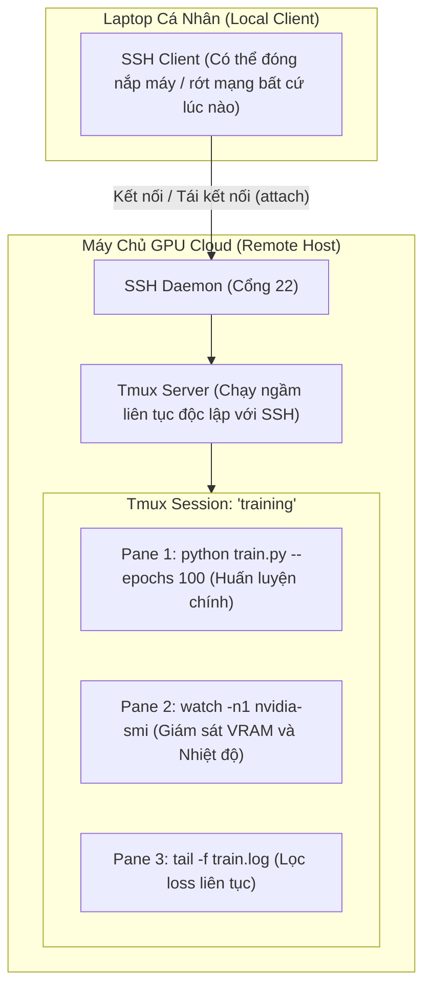

> **Terminal là ngôi nhà thực sự của kỹ sư AI. Làm chủ nó để biến những tác vụ phức tạp thành phản xạ tự nhiên.** Bạn sẽ dành phần lớn thời gian làm việc trên dòng lệnh hơn bất kỳ IDE đồ họa hào nhoáng nào: từ việc khởi chạy các tiến trình training, theo dõi cấp phát bộ nhớ GPU, lọc hàng gigabyte log theo thời gian thực, cho đến việc duy trì phiên làm việc từ xa an toàn qua SSH.

---

## Thông tin nhanh (Quick Spec)

* **Loại bài:** Hướng dẫn thực hành (Learn & Build)
* **Công cụ:** Bash/Zsh, tmux, htop, nvtop, nvidia-smi, rsync
* **Kiến thức tiên quyết:** Bài 01 (Môi trường phát triển AI)
* **Thời gian thực hành:** ~35 phút
* **Độ khó:** Cơ bản đến Trung bình

---

## Mục tiêu bài học (Learning Objectives)

Sau bài học này, bạn sẽ có khả năng:
- Vận hành thành thạo `tmux` để duy trì các phiên huấn luyện dài ngày, tự do ngắt kết nối (detach) và gắn lại (reattach) mà không lo gián đoạn tiến trình.
- Làm chủ kỹ thuật điều hướng luồng dữ liệu (piping, redirection) với `grep`, `awk`, `tail` và `tee` để trích xuất metric huấn luyện từ các file log khổng lồ.
- Giám sát tài nguyên phần cứng chuyên sâu với `htop`, `nvtop`, và các câu lệnh truy vấn cấu trúc của `nvidia-smi`.
- Nhận diện và tiêu diệt triệt để các tiến trình GPU zombie (tiến trình ma giữ chặt VRAM) trả lại tài nguyên cho hệ thống.
- Thiết lập bộ alias và cấu hình SSH tối ưu giúp tăng tốc thao tác hằng ngày trên máy chủ GPU từ xa.

---

## 1. Vấn đề thực tế (The Problem)

Trong vai trò kỹ sư AI, một phần lớn công việc của bạn diễn ra trên các máy chủ tính toán từ xa (cloud GPU instance như RunPod, Lambda Labs, AWS EC2, GCP). Tại đây, bạn hoàn toàn không có giao diện đồ họa (GUI), chuột hay trình quản lý file trực quan. Mọi thao tác đều phải thông qua giao diện dòng lệnh (CLI).

Nếu không nắm vững kỹ năng terminal, bạn sẽ liên tục đối mặt với những cơn ác mộng sau:
1. **Mất kết nối SSH giữa đêm:** Bạn khởi chạy một script huấn luyện mô hình dự kiến mất 12 tiếng. Lúc 2 giờ sáng, mạng Wi-Fi tại nhà chập chờn, phiên kết nối SSH bị đứt. Khi kết nối SSH chết, tín hiệu `SIGHUP` (Signal Hangup) được gửi tới toàn bộ tiến trình con, script training bị tiêu diệt ngay lập tức, lãng phí toàn bộ chi phí GPU thuê theo giờ và công sức chờ đợi.
2. **Tiến trình GPU zombie "nuốt chửng" VRAM:** Khi một script PyTorch bị crash hoặc ngắt bằng `Ctrl+C` thiếu đồng bộ, tiến trình Python có thể đã biến mất khỏi bảng điều khiển thông thường nhưng CUDA runtime context vẫn bị kẹt trên GPU. Khi bạn chạy lại lệnh huấn luyện, hệ thống ném ra lỗi `CUDA out of memory` dù bạn đinh ninh là GPU đang hoàn toàn rảnh rỗi.
3. **Mở file log 10GB làm treo máy:** Khi log huấn luyện tích tụ hàng triệu dòng, việc mở file bằng các text editor như `nano` hay tải về máy local qua VS Code sẽ làm tràn RAM và đóng băng hệ thống. Bạn cần trích xuất nhanh xem loss ở epoch 50 là bao nhiêu hoặc kiểm tra xem có xuất hiện giá trị `NaN` nào không mà không cần load toàn bộ file vào bộ nhớ.

---

## 2. Mô hình tư duy & Bản chất (The Concept)

Giải pháp mấu chốt để vận hành bền bỉ trên môi trường từ xa là **tách rời hoàn toàn vòng đời của phiên giao tiếp mạng (SSH Session) khỏi vòng đời của tiến trình ứng dụng**. 

Đây chính là cơ chế mà một công cụ quản lý phiên dòng lệnh (Terminal Multiplexer) như `tmux` mang lại.



Khi bạn kết nối SSH vào máy chủ và khởi chạy `tmux`, chương trình tạo ra một `tmux server` daemon chạy độc lập trên hệ điều hành. Khi bạn ngắt kết nối mạng hoặc chủ động thực hiện lệnh **detach**, các tiến trình con bên trong các pane của `tmux` vẫn tiếp tục chạy với đầy đủ quyền hạn. Bất cứ lúc nào sau đó, bạn chỉ cần mở lại kết nối SSH và chạy lệnh **attach** để khôi phục nguyên vẹn màn hình làm việc.

---

## 3. Tự tay cấu hình từ đầu (Build It / Hands-on)

### Bước 1: Quản trị phiên làm việc bền bỉ với tmux

Cài đặt `tmux` trên hệ thống:

```bash
# Trên Ubuntu/Debian
sudo apt update && sudo apt install -y tmux

# Trên macOS
brew install tmux
```

Tạo một file cấu hình tối ưu tại `~/.tmux.conf` để hỗ trợ thao tác chuột mượt mà và mở rộng bộ đệm cuộn trang (scrollback buffer):

```bash
cat << 'EOF' > ~/.tmux.conf
# Cho phép dùng chuột để click chọn pane, đổi kích thước và cuộn văn bản
set -g mouse on

# Tăng bộ nhớ đệm cuộn trang lên 50,000 dòng (hữu ích khi đọc log dài)
set -g history-limit 50000

# Đổi phím prefix mặc định từ Ctrl+B sang Ctrl+A (tùy chọn, dễ bấm hơn)
# unbind C-b
# set -g prefix C-a
# bind C-a send-prefix

# Phân chia màn hình trực quan hơn: | cho chia dọc, - cho chia ngang
bind | split-window -h -c "#{pane_current_path}"
bind - split-window -v -c "#{pane_current_path}"

# Giữ màu sắc hiển thị 256 color cho terminal
set -g default-terminal "screen-256color"
EOF
```

Sau khi lưu file, áp dụng cấu hình ngay mà không cần khởi động lại máy:

```bash
tmux source-file ~/.tmux.conf
```

**Quy trình vận hành chuẩn cho một đợt huấn luyện AI:**

```bash
# 1. Tạo một session mới có tên 'llm-finetune'
tmux new -s llm-finetune

# 2. Bên trong tmux, chia đôi màn hình:
# Bấm tổ hợp: Ctrl+B sau đó bấm dấu " (chia ngang)
# Bấm tổ hợp: Ctrl+B sau đó bấm dấu % (chia dọc pane dưới)

# 3. Điều hướng giữa các pane:
# Bấm tổ hợp: Ctrl+B sau đó dùng các phím mũi tên (Lên/Xuống/Trái/Phải)

# 4. Tại Pane 1 (trên): Chạy lệnh training
python train.py --batch_size 32 --lr 2e-5

# 5. Tại Pane 2 (dưới trái): Giám sát GPU theo thời gian thực
watch -n 1 nvidia-smi

# 6. Tại Pane 3 (dưới phải): Theo dõi log trích xuất loss
tail -f train.log

# 7. Rời khỏi session an toàn (Detach):
# Bấm tổ hợp: Ctrl+B sau đó bấm phím d
# Lúc này bạn đã thoát ra ngoài shell thông thường, training vẫn chạy ngầm 100%!

# 8. Xem danh sách các session đang hoạt động
tmux ls

# 9. Gắn trở lại session sau khi kết nối SSH lại vào server
tmux attach -t llm-finetune
```

---

### Bước 2: Kỹ thuật đường ống (Piping) và xử lý log huấn luyện tốc độ cao

Kỹ sư AI không đọc thủ công từng dòng log. Chúng ta sử dụng sức mạnh kết hợp của các tiện ích Unix chuẩn (`grep`, `awk`, `sed`, `sort`, `tee`) để chắt lọc thông tin:

```bash
# 1. Chạy training vừa in ra màn hình console, vừa lưu file log chuẩn xác:
python train.py 2>&1 | tee train.log

# 2. Đếm xem trong toàn bộ quá trình có bao nhiêu bước gặp cảnh báo hoặc NaN:
grep -i "nan" train.log | wc -l

# 3. Theo dõi log liên tục nhưng chỉ in ra các dòng có chứa 'loss':
tail -f train.log | grep --line-buffered "loss"

# 4. Trích xuất cột loss từ file log có định dạng "Epoch 1/10 - Step 50 - loss: 0.4215":
grep "loss:" train.log | awk '{print $NF}' > extracted_losses.txt

# 5. Tìm 5 epoch có validation loss thấp nhất:
grep "val_loss:" train.log | awk '{print $4, $NF}' | sort -k2 -n | head -n 5

# 6. Kiểm tra kích thước và loại trừ các checkpoint lớn hơn 2GB:
find ./checkpoints -type f -name "*.pt" -size +2G -exec ls -lh {} +
```

---

### Bước 3: Giám sát phần cứng và tiêu diệt tiến trình ma (Zombie Processes)

Khi huấn luyện trên card đồ họa NVIDIA, công cụ mặc định là `nvidia-smi`. Dưới đây là các câu lệnh trích xuất chuyên sâu:

```bash
# Kiểm tra tổng quan GPU (Nhiệt độ, VRAM tiêu thụ, Công suất điện)
nvidia-smi

# Theo dõi liên tục mỗi 1 giây (không làm tràn màn hình console)
watch -n 1 nvidia-smi

# Truy vấn có cấu trúc dạng CSV để lập trình parser hoặc kiểm tra nhanh
nvidia-smi --query-gpu=index,name,utilization.gpu,memory.used,memory.total,temperature.gpu --format=csv,noheader

# Kiểm tra chính xác các PID đang chiếm dụng tài nguyên tính toán của GPU:
nvidia-smi --query-compute-apps=pid,process_name,used_memory --format=csv
```

**Tuyệt chiêu xử lý tiến trình GPU Zombie:**

Khi `nvidia-smi` báo bộ nhớ VRAM bị chiếm dụng (ví dụ 14GB/24GB) nhưng mục "Processes" ở dưới lại trống rỗng, hoặc script training đã bị tắt nhưng VRAM không hạ:

```bash
# Bước 1: Liệt kê tất cả các tiến trình đang mở file device của NVIDIA
sudo fuser -v /dev/nvidia*

# Bước 2: Tiêu diệt triệt để tiến trình ma bằng PID thu được
kill -9 <PID_TIEN_TRINH>

# Bước 3: Hoặc tiêu diệt hàng loạt tất cả các tiến trình Python đang chạy ngầm:
pkill -9 -f "python.*train"
```

---

### Bước 4: Bộ Shell Aliases đắc lực cho Kỹ sư AI

Thêm đoạn script sau vào cuối file `~/.bashrc` (hoặc `~/.zshrc` trên máy Mac):

```bash
# --- Cấu hình AI Engineering Shell Aliases ---
# Kích hoạt nhanh môi trường ảo chuẩn
alias ae='source .venv/bin/activate || source venv/bin/activate'

# Xem trạng thái GPU rút gọn một dòng
alias gpu='nvidia-smi --query-gpu=index,name,utilization.gpu,memory.used,memory.total,temperature.gpu --format=csv,noheader'

# Theo dõi GPU liên tục
alias wgpu='watch -n 1 "nvidia-smi --format=nounits --query-gpu=utilization.gpu,memory.used,memory.total,temperature.gpu"'

# Tiêu diệt nhanh toàn bộ tiến trình training python
alias killtrain='pkill -9 -f "python.*train"'

# Dọn dẹp cache đĩa an toàn (HuggingFace cache, pip cache, pycache)
alias cleancache='find . -type d -name "__pycache__" -exec rm -rf {} +; pip cache purge'

# Kiểm tra dung lượng đĩa phân vùng hiện tại
alias dftop='df -h . && du -sh ./* 2>/dev/null | sort -hr | head -n 10'
```

Kích hoạt lại shell:

```bash
source ~/.bashrc
```

---

## 4. Ứng dụng thực tế & Cạm bẫy Production (Use It / Production Tips)

### Kỹ thuật đồng bộ Checkpoint dung lượng lớn qua rsync

Tuyệt đối không dùng `scp` thông thường để chuyển checkpoint mô hình (hàng chục GB). Nếu đường truyền mạng bị ngắt ở 99%, `scp` sẽ hủy toàn bộ file và bạn phải tải lại từ đầu. Thay vào đó, hãy luôn dùng `rsync`:

```bash
# Đồng bộ từ remote server về máy local với khả năng tải tiếp (resume) khi mất mạng:
rsync -avz --partial --progress user@gpu-server.cloud:~/project/checkpoints/ ./local_checkpoints/
```

- `-a` (archive): Giữ nguyên phân quyền, timestamps và symlinks.
- `-v` (verbose): Hiển thị chi tiết file đang truyền.
- `-z` (compress): Nén dữ liệu trong quá trình truyền qua mạng.
- `--partial`: Giữ lại phần file đã tải nếu bị ngắt kết nối giữa chừng.
- `--progress`: Hiển thị thanh tiến độ, tốc độ truyền và thời gian ước tính.

### Cạm bẫy chỉ định GPU trên máy chủ nhiều card (Multi-GPU Pitfalls)

Khi bạn làm việc trên máy chủ có 4 hoặc 8 GPU, các lập trình viên khác có thể đang dùng chung GPU 0. Nếu bạn chạy thẳng script PyTorch mà không chỉ định rõ ràng, code mặc định sẽ cố gắng cấp phát bộ nhớ lên GPU 0 và gây lỗi xung đột:

```bash
# Cách 1: Chỉ định biến môi trường trước lệnh chạy
CUDA_VISIBLE_DEVICES=2,3 python train.py

# Cách 2: Export trực tiếp trong phiên shell hiện tại
export CUDA_VISIBLE_DEVICES=2
python train.py
```

*Lưu ý quan trọng:* Khi thiết lập `CUDA_VISIBLE_DEVICES=2`, bên trong mã nguồn PyTorch, thiết bị này sẽ được đánh số lại thành `cuda:0`.

---

## 5. Giải ngố thuật ngữ (Key Terms)

| Thuật ngữ | Người ta thường nghĩ là... | Bản chất kỹ thuật thực sự là... |
|---|---|---|
| **Terminal vs Shell** | Cả hai là một thứ giống nhau, chỉ là cửa sổ màu đen gõ lệnh. | **Terminal** là giao diện đồ họa hiển thị ký tự (TTY emulator như iTerm2, Kitty, Alacritty); **Shell** là chương trình thông dịch dòng lệnh bên trong (Bash, Zsh, Fish) phân tích cú pháp và kích hoạt system calls. |
| **tmux** | Chỉ là công cụ chia đôi màn hình terminal cho đẹp mắt. | Một **Client-Server Architecture**: tmux daemon duy trì trạng thái phiên làm việc trong bộ nhớ hệ điều hành, cho phép các tiến trình con sống sót độc lập với kết nối mạng người dùng. |
| **Pipe (`\|`)** | Đơn thuần là viết hai câu lệnh liền nhau trên một dòng. | Cơ chế **Inter-Process Communication (IPC)** của Unix: Nối `STDOUT` (bộ đệm đầu ra) của tiến trình trước trực tiếp vào `STDIN` (bộ đệm đầu vào) của tiến trình sau qua một hàng đợi bộ nhớ trong RAM kernel mà không ghi xuống đĩa. |
| **SIGINT vs SIGKILL** | Đều là lệnh tắt ứng dụng bằng phím bấm hoặc dòng lệnh. | `SIGINT` (Ctrl+C) gửi tín hiệu ngắt có thể đón bắt (catchable) để ứng dụng dọn dẹp bộ nhớ; `SIGKILL` (kill -9) ra lệnh trực tiếp cho Linux Kernel tiêu diệt ngay lập tức tiến trình mà không cho phép dọn dẹp tài nguyên. |
| **Zombie GPU Process** | Tiến trình phần mềm độc hại xâm nhập vào card đồ họa. | Tiến trình máy chủ CPU đã bị ngắt hoặc bỏ rơi bởi tiến trình cha, nhưng handle thiết bị `/dev/nvidia*` trong kernel module vẫn chưa được giải phóng, giữ nguyên khối VRAM đã cấp phát. |

---

## 6. Bài tập thử thách (Hands-on Challenges)

### 🟢 Cơ bản (Dễ): Thiết lập phiên làm việc 3 Pane với Tmux
* **Yêu cầu:** Khởi tạo một tmux session có tên `ai-lab`. Chia giao diện làm 3 pane: 
  - Pane 1: Chạy một script Python in ra số đếm từ 1 đến 500 kèm khoảng dừng 1 giây (`python3 -c "import time; [print(f'Step {i}') or time.sleep(1) for i in range(500)]"`).
  - Pane 2: Giám sát tài nguyên CPU bằng `top` hoặc `htop`.
  - Pane 3: Hiển thị đồng hồ thời gian thực với `watch -n 1 date`.
* **Tiêu chí nghiệm thu:** Thực hiện thao tác Detach (`Ctrl+B`, `d`), thoát hoàn toàn khỏi terminal. Mở một terminal mới, kiểm tra `tmux ls` và dùng `tmux attach -t ai-lab` để chứng minh script đếm số vẫn đang chạy liên tục không bị gián đoạn.

### 🟡 Trung bình (Vừa): Bộ lọc phân tích Loss và phát hiện bất thường tự động
* **Yêu cầu:** Tạo một file log giả lập quá trình huấn luyện gồm 200 bước:
  ```bash
  for i in $(seq 1 200); do
    loss=$(awk -v i="$i" 'BEGIN {print (10.0 / (i + 1)) + (rand() * 0.05)}')
    echo "$(date '+%Y-%m-%d %H:%M:%S') - Epoch 1 - Step $i - loss: $loss"
  done > mock_training.log
  ```
  Viết một dòng lệnh Unix (one-liner) kết hợp `grep`, `awk`, và `sort` để:
  1. Trích xuất ra giá trị loss ở các step chẵn.
  2. Tìm ra 3 step có mức loss nhỏ nhất.
  3. Ghi kết quả vào file `best_steps.txt`.
* **Gợi ý:** Sử dụng `awk` kiểm tra toán tử modulo `$6 % 2 == 0` và dùng `sort -k8 -n`.

### 🔴 Nâng cao (Khó): Xây dựng Bash Daemon tự động hóa huấn luyện khi GPU rảnh
* **Yêu cầu:** Viết một bash script `auto_train_on_idle.sh`. Kịch bản:
  1. Script sử dụng `nvidia-smi` để kiểm tra mức sử dụng VRAM của GPU 0 mỗi 10 giây.
  2. Nếu VRAM đang được sử dụng vượt quá 2GB (nghĩa là có đồng nghiệp đang dùng máy), in ra thông báo chờ và tiếp tục vòng lặp.
  3. Khi VRAM trống (< 1GB) liên tục trong 30 giây, script tự động tạo một tmux session ngầm và kích hoạt lệnh training: `python3 -c "import time; print('Training started...'); time.sleep(20); print('Done!')"`.
  4. Sau khi khởi động tiến trình, script ghi nhận PID vào file `train.pid` và gửi một thông báo hoàn tất ra màn hình console.
* **Tiêu chí nghiệm thu:** Script tự phục hồi nếu câu lệnh kiểm tra GPU gặp lỗi tạm thời và không tạo ra nhiều session trùng lặp khi điều kiện idle đã được kích hoạt.
