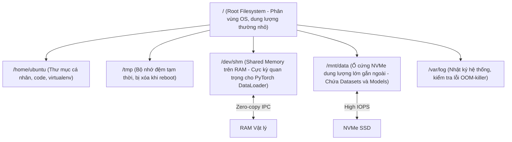

> **Phần lớn AI vận hành trên Linux. Nắm vững hệ điều hành để làm chủ hoàn toàn hạ tầng tính toán.** Cho dù bạn viết mã trên macOS hay Windows, đích đến cuối cùng của các mô hình AI — từ các cụm huấn luyện phân tán nhiều card H100 cho đến các node phục vụ suy luận (inference endpoints) — hầu như 100% đều là môi trường Linux Ubuntu. Hiểu cách hệ điều hành quản lý bộ nhớ, quyền truy cập và tiến trình là sự khác biệt giữa một mô hình chạy ổn định và một hệ thống sụp đổ bí ẩn giữa đêm.

---

## Thông tin nhanh (Quick Spec)

* **Loại bài:** Khái niệm & Thực hành (Concept & Hands-on)
* **Hệ điều hành:** Ubuntu 22.04 / 24.04 LTS, Debian, WSL2
* **Kiến thức tiên quyết:** Bài 01 (Môi trường phát triển), Bài 10 (Làm chủ Terminal & Shell)
* **Thời gian thực hành:** ~40 phút
* **Độ khó:** Cơ bản đến Trung bình

---

## Mục tiêu bài học (Learning Objectives)

Sau bài học này, bạn sẽ có khả năng:
- Định hướng cấu trúc cây thư mục Linux và hiểu vai trò của từng phân vùng đối với khối lượng công việc AI (`/dev/shm`, `/mnt/data`, `/tmp`, `/var/log`).
- Khắc phục triệt để lỗi sập worker của PyTorch DataLoader do thiếu bộ nhớ chia sẻ (Shared Memory) bằng kỹ thuật tinh chỉnh `/dev/shm`.
- Thiết lập quy hoạch lưu trữ thông minh: Điều hướng cache Hugging Face (`HF_HOME`) và checkpoint sang ổ đĩa gắn ngoài thông qua Symbolic Links (symlink).
- Đóng gói ứng dụng AI/LLM thành một `systemd service` chuẩn production có cơ chế tự khởi động cùng hệ thống và tự phục hồi khi crash.
- Đọc hiểu nhật ký hạt nhân (Kernel dmesg) để truy vết chính xác các vụ "thảm sát tiến trình" do cơ chế Linux OOM-Killer thực hiện.

---

## 1. Vấn đề thực tế (The Problem)

Khi bước chân vào thế giới kỹ thuật AI thực chiến, bạn sẽ thường xuyên thuê máy chủ cloud (RunPod, Lambda Labs, AWS EC2, GCP). Khoảnh khắc hoàn tất lệnh SSH, bạn đối diện với một màn hình đen ngòm: không chuột, không Finder, không Task Manager trực quan.

Tại đây, những vấn đề mang tính hệ thống sẽ lập tức phát sinh nếu bạn chỉ quen với lập trình ứng dụng thông thường:
1. **Lỗi `Bus error (core dumped)` bí ẩn khi huấn luyện:** Bạn tăng `num_workers=8` trong PyTorch DataLoader để tăng tốc nạp dữ liệu ảnh/text. Vừa chạy được vài batch, chương trình đột ngột văng ra với lỗi `Bus error` hoặc `DataLoader worker exited unexpectedly`. Đây không phải là bug Python, mà là do phân vùng Shared Memory (`/dev/shm`) trên RAM bị tràn.
2. **Phân vùng gốc (`/`) bị đầy 100% làm tê liệt máy chủ:** Hầu hết máy chủ cloud tạo một ổ đĩa hệ điều hành nhỏ (khoảng 30GB đến 50GB) và gắn kèm một ổ cứng dữ liệu lớn (NVMe 500GB-2TB) tại `/workspace` hoặc `/mnt`. Nếu không cấu hình, các thư viện như Hugging Face, TorchHub, và Pip sẽ âm thầm tải hàng chục GB weights mô hình về thư mục mặc định `~/.cache`. Kết quả: đĩa gốc đầy cứng, SSH không thể ghi file tạm, máy chủ bị khóa và không thể đăng nhập.
3. **Mô hình phục vụ suy luận "chết ngắt" sau khi khởi động lại server:** Bạn dựng một API FastAPI hoặc vLLM bằng lệnh `python main.py &`. Máy chủ cloud tự động reboot sau lịch bảo trì định kỳ của nhà cung cấp, API bị tắt và toàn bộ ứng dụng người dùng phía trước bị mất kết nối.
4. **Lỗi phân quyền và thói quen dùng `sudo` bừa bãi:** Gặp lỗi `Permission denied`, phản xạ tự nhiên của nhiều người là gõ thêm `sudo`. Điều này khiến các file checkpoint được ghi với quyền sở hữu của `root`. Sau đó, code Python chạy bằng user thông thường không thể ghi đè hay xóa file, tạo nên chuỗi lỗi dây chuyền khó gỡ.

---

## 2. Mô hình tư duy & Bản chất (The Concept)

Trong Linux, **mọi thứ đều là file** (Everything is a file) — từ ổ cứng vật lý, tiến trình đang chạy, cho đến chính bộ nhớ RAM. Cây thư mục Linux bắt đầu từ một gốc duy nhất là `/` (root), không có các ổ đĩa riêng biệt như `C:\` hay `D:\` của Windows.



### Các phân vùng trọng yếu đối với Kỹ sư AI:
1. **`/dev/shm` (Shared Memory):** Đây là một ramdisk sử dụng kiến trúc `tmpfs`. Dữ liệu ghi vào đây thực chất nằm trực tiếp trên thanh RAM vật lý, cho phép các tiến trình con (như các worker của PyTorch DataLoader) chia sẻ các mảng Tensor đa chiều với tiến trình chính mà **không cần qua bước serialize/deserialize** (cơ chế Zero-copy IPC). Nếu `/dev/shm` quá nhỏ, việc nạp batch lớn sẽ làm crash chương trình ngay lập tức.
2. **`/mnt` hoặc `/workspace`:** Điểm gắn (Mount point) của các ổ cứng NVMe thứ cấp có dung lượng lớn. Đây là nơi bắt buộc phải đặt các tập dữ liệu huấn luyện (Parquet, TFRecords, Image folders) và các file trọng số mô hình lớn (Safetensors).
3. **`/var/log`:** Nơi lưu trữ nhật ký hệ thống (`syslog`, `kern.log`). Khi một tiến trình AI bỗng nhiên biến mất mà không có bất kỳ dòng traceback nào trong console, `/var/log` là nơi duy nhất lưu bằng chứng việc Linux Kernel đã ra tay tiêu diệt tiến trình.

---

## 3. Tự tay cấu hình từ đầu (Build It / Hands-on)

### Bước 1: 15 Lệnh sinh tồn cốt lõi trên máy chủ Linux

```bash
# 1. Điều hướng và vị trí
pwd                             # Xem đường dẫn thư mục hiện tại
ls -lah                         # Liệt kê tất cả file (kèm dung lượng dạng đọc được và file ẩn)
cd /mnt/data                    # Chuyển đến thư mục dữ liệu

# 2. Quản lý ổ đĩa (Sống còn với AI)
df -h                           # Xem dung lượng các phân vùng đang gắn
du -sh * | sort -h              # Đo dung lượng từng thư mục con ở vị trí hiện tại và sắp xếp tăng dần

# 3. Tìm kiếm file lớn
find . -type f -name "*.safetensors" -size +5G    # Tìm các file trọng số lớn hơn 5GB
grep -rn "CUDA_VISIBLE_DEVICES" .                 # Tìm kiếm đoạn cấu hình trong tất cả file code

# 4. Phân quyền chuẩn xác
chmod +x start_training.sh      # Cấp quyền thực thi cho script
chmod 644 config.yaml           # Quyền đọc/ghi cho chủ sở hữu, người khác chỉ đọc
chown -R ubuntu:ubuntu project/ # Đổi chủ sở hữu toàn bộ thư mục về user 'ubuntu'

# 5. Giám sát hệ thống
htop                            # Giám sát tải CPU, RAM và tiến trình
free -h                         # Xem RAM vật lý và Swap còn trống bao nhiêu
dmesg -T | tail -n 50           # Đọc 50 dòng log nhân Linux mới nhất
```

---

### Bước 2: Tinh chỉnh và mở rộng Shared Memory (/dev/shm) cho PyTorch

Kiểm tra dung lượng `/dev/shm` hiện tại:

```bash
df -h /dev/shm
```

Nếu dung lượng hiển thị quá nhỏ (ví dụ chỉ có 64MB hoặc 4GB trên máy có 64GB RAM), bạn có thể tạm thời remount tăng kích thước lên 32GB ngay lập tức mà không cần reboot:

```bash
sudo mount -o remount,size=32G /dev/shm
```

Để giữ cấu hình này vĩnh viễn mỗi khi khởi động lại máy, mở file `/etc/fstab`:

```bash
sudo nano /etc/fstab
```

Thêm vào cuối file dòng sau:

```text
tmpfs /dev/shm tmpfs defaults,size=32G 0 0
```

Kiểm tra lại bằng `df -h /dev/shm` để đảm bảo kích thước mới đã được áp dụng thành công.

---

### Bước 3: Điều hướng Cache và Dữ liệu lớn bằng Symbolic Link (Symlink)

Mặc định, Hugging Face sẽ tải model về `~/.cache/huggingface/hub`. Nếu thư mục `~` nằm trên phân vùng OS nhỏ, máy của bạn sẽ nhanh chóng hết dung lượng.

**Giải pháp 1: Sử dụng biến môi trường (Khuyến nghị trong code và shell)**

Thêm vào file `~/.bashrc`:

```bash
export HF_HOME="/mnt/data/cache/huggingface"
export TORCH_HOME="/mnt/data/cache/torch"
```

**Giải pháp 2: Sử dụng Symbolic Link (Bền vững ở tầng hệ điều hành)**

Tạo symlink trỏ thư mục cache mặc định sang ổ cứng dữ liệu lớn `/mnt/data`:

```bash
# 1. Tạo thư mục đích trên ổ cứng phụ
sudo mkdir -p /mnt/data/cache/huggingface
sudo chown -R $USER:$USER /mnt/data/cache

# 2. Xóa hoặc di chuyển thư mục cache cũ nếu có
mv ~/.cache/huggingface /mnt/data/cache/ 2>/dev/null || true

# 3. Tạo symbolic link (ln -s <đường-dẫn-thực> <đường-dẫn-ảo>)
ln -s /mnt/data/cache/huggingface ~/.cache/huggingface

# 4. Kiểm tra symlink
ls -l ~/.cache/huggingface
# Kết quả hiển thị dạng: ~/.cache/huggingface -> /mnt/data/cache/huggingface
```

---

### Bước 4: Đóng gói AI API thành systemd Service chuẩn Production

Khi triển khai API phục vụ suy luận (Inference Server với FastAPI, vLLM hoặc Ollama), bạn cần đảm bảo:
- Ứng dụng tự chạy khi bật máy.
- Ứng dụng tự khởi động lại nếu bị crash do ngoại lệ.
- Có log hệ thống theo dõi rõ ràng.

Tạo file service tại `/etc/systemd/system/ai-inference.service`:

```bash
sudo cat << 'EOF' > /etc/systemd/system/ai-inference.service
[Unit]
Description=AI Model Inference Service (FastAPI / vLLM)
After=network.target

[Service]
Type=simple
User=ubuntu
WorkingDirectory=/home/ubuntu/ai-service
Environment="PATH=/home/ubuntu/ai-service/.venv/bin:/usr/local/cuda/bin:/usr/bin"
Environment="CUDA_VISIBLE_DEVICES=0"
Environment="HF_HOME=/mnt/data/cache/huggingface"

# Lệnh thực thi chính
ExecStart=/home/ubuntu/ai-service/.venv/bin/uvicorn app:app --host 0.0.0.0 --port 8000 --workers 1

# Cơ chế tự phục hồi: tự khởi động lại sau 5 giây nếu tiến trình chết
Restart=always
RestartSec=5

# Giới hạn số file mở tối đa (cần thiết khi phục vụ nhiều kết nối đồng thời)
LimitNOFILE=65535

[Install]
WantedBy=multi-user.target
EOF
```

**Kích hoạt và quản lý service:**

```bash
# 1. Báo cho systemd nạp lại danh sách file cấu hình mới
sudo systemctl daemon-reload

# 2. Bật tính năng tự khởi động cùng hệ thống khi boot
sudo systemctl enable ai-inference

# 3. Bắt đầu chạy service
sudo systemctl start ai-inference

# 4. Kiểm tra trạng thái hoạt động
sudo systemctl status ai-inference

# 5. Theo dõi log ứng dụng theo thời gian thực (như lệnh tail -f)
journalctl -u ai-inference -f
```

---

## 4. Ứng dụng thực tế & Cạm bẫy Production (Use It / Production Tips)

### Cạm bẫy 1: Sự cố "Gãy" Driver NVIDIA do Ubuntu tự nâng cấp Kernel

Ubuntu mặc định bật dịch vụ `unattended-upgrades` để tự tải và cài đặt các bản vá bảo mật, bao gồm cả Linux Kernel mới (ví dụ từ `6.5.0-35-generic` lên `6.5.0-41-generic`).

Sau khi máy khởi động lại với kernel mới, NVIDIA Kernel Module (`nvidia.ko`) cũ không còn tương thích, câu lệnh `nvidia-smi` sẽ ném ra lỗi kinh hoàng:
```text
NVIDIA-SMI has failed because it couldn't communicate with the NVIDIA driver. 
Make sure that the latest driver is installed and running.
```

**Cách phòng chống chủ động:**

Khóa phiên bản kernel hiện tại, không cho phép hệ điều hành tự ý nâng cấp phiên bản hạt nhân:

```bash
# Kiểm tra phiên bản kernel đang chạy mượt mà với GPU
uname -r

# Khóa phiên bản kernel hiện tại (giữ chân package)
sudo apt-mark hold linux-image-generic linux-headers-generic
sudo apt-mark hold linux-image-$(uname -r) linux-headers-$(uname -r)
```

### Cạm bẫy 2: Tiến trình AI bị OOM-Killer "ám sát" không để lại dấu vết

Khi mã nguồn huấn luyện bị rò rỉ bộ nhớ RAM (Memory Leak từ tập dữ liệu) hoặc bạn thiết lập batch size quá lớn, tổng dung lượng RAM vật lý sẽ cạn kiệt. Lúc này, cơ chế **Out-Of-Memory Killer (OOM-Killer)** của nhân Linux sẽ được kích hoạt. Nó lựa chọn tiến trình đang tiêu thụ nhiều RAM nhất và lập tức gửi tín hiệu `SIGKILL` (`kill -9`).

Tiến trình Python bị tắt ngúm mà không in ra bất kỳ dòng thông báo lỗi nào trên màn hình console.

**Cách điều tra nguyên nhân:**

```bash
# Kiểm tra log kernel xem có sự kiện OOM-killer nào vừa kích hoạt không:
dmesg -T | grep -E -i "oom-killer|killed process"

# Hoặc dùng journalctl:
sudo journalctl -k --since "1 hour ago" | grep -i "out of memory"
```

Nếu kết quả trả về dòng chữ `Out of memory: Killed process <PID> (python3)`, bạn đã xác định được thủ phạm 100% là do RAM hệ thống bị cạn kiệt, chứ không phải do code Python bị syntax error.

### Cạm bẫy 3: Ký tự xuống dòng Windows (CRLF) làm gãy Shell Script

Nếu bạn viết script `run.sh` trên máy tính Windows rồi đẩy lên Git hoặc copy sang server Linux, mỗi khi chạy script bạn sẽ gặp lỗi:
```text
bash: ./run.sh: /bin/bash^M: bad interpreter: No such file or directory
```

Nguyên nhân là Windows dùng cặp ký tự `\r\n` (CRLF) để xuống dòng, trong khi Linux chỉ dùng `\n` (LF). Ký tự `\r` thừa biến đường dẫn thông dịch thành `/bin/bash\r`.

**Khắc phục trong 1 giây:**

```bash
# Cài đặt dos2unix nếu chưa có
sudo apt install -y dos2unix

# Chuyển đổi định dạng file về chuẩn Linux
dos2unix run.sh
```

---

## 5. Giải ngố thuật ngữ (Key Terms)

| Thuật ngữ | Người ta thường nghĩ là... | Bản chất kỹ thuật thực sự là... |
|---|---|---|
| **Root vs Regular User** | Root chỉ đơn giản là người dùng có quyền gõ thêm chữ `sudo`. | **Root (UID 0)** là siêu người dùng toàn năng bỏ qua mọi cơ chế kiểm tra phân quyền của hệ điều hành; Regular user bị giới hạn trong không gian tài nguyên được cấp phép để đảm bảo an toàn hệ thống. |
| **Chmod 777** | Cách nhanh nhất để sửa lỗi "Permission denied" cho tiện làm việc. | Lỗ hổng bảo mật chết người: Cấp toàn quyền Đọc, Ghi và Thực thi (`rwx`) cho tất cả mọi người; bất kỳ ai hoặc tiến trình nào cũng có thể sửa đổi hoặc xóa sạch file của bạn. |
| **`/dev/shm` (Shared Memory)** | Một thư mục lưu file tạm thông thường trên ổ cứng SSD. | Hệ thống tập tin ảo (`tmpfs`) được ánh xạ trực tiếp trên **thanh RAM vật lý**, cho phép truyền dữ liệu giữa các tiến trình với độ trễ cực thấp và zero-copy. |
| **Linux OOM-Killer** | Lỗi sập phần mềm do trình thông dịch Python bị lỗi code. | Cơ chế tự vệ tối hậu của **Linux Kernel**: Khi bộ nhớ RAM cạn kiệt đe dọa làm sập toàn bộ hệ điều hành, kernel tự động tính điểm (`badness score`) và cưỡng chế tiêu diệt tiến trình ngốn nhiều bộ nhớ nhất. |
| **Systemd Service** | Một câu lệnh chạy ngầm thêm dấu `&` ở cuối dòng lệnh. | Hệ thống quản lý khởi tạo hệ thống (Init System & Service Manager) giám sát trạng thái tiến trình dưới dạng **Daemon**, quản lý phụ thuộc (dependencies), ghi log tập trung và tự động phục hồi khi có sự cố. |
| **Symlink vs Hardlink** | Cả hai đều là cách tạo shortcut copy file trên máy tính. | **Symlink** là một file đặc biệt chứa chuỗi đường dẫn trỏ tới file gốc (hoạt động xuyên các ổ đĩa khác nhau); **Hardlink** là một con trỏ trỏ trực tiếp tới cùng một khối dữ liệu vật lý (inode) trên cùng một phân vùng ổ đĩa. |

---

## 6. Bài tập thử thách (Hands-on Challenges)

### 🟢 Cơ bản (Dễ): Kiểm toán tài nguyên hệ thống và phân quyền dự án
* **Yêu cầu:** 
  1. Đăng nhập vào một máy Linux (hoặc môi trường WSL2/Ubuntu container).
  2. Dùng các lệnh chuẩn xác để kiểm tra: số lượng nhân CPU (`nproc`), tổng dung lượng RAM vật lý (`free -h`), dung lượng trống của phân vùng gốc `/` và phân vùng `/dev/shm` (`df -h`).
  3. Tạo một thư mục `~/ai-test`, bên trong tạo một script `check_env.sh` in ra phiên bản Python và thời gian hiện tại.
  4. Phân quyền cho script sao cho: Người sở hữu có toàn quyền (rwx), nhóm và người khác chỉ có quyền đọc và thực thi (rx), không ai khác được quyền sửa file.
* **Tiêu chí nghiệm thu:** Lệnh `ls -l check_env.sh` hiển thị chính xác `-rwxr-xr-x` (tương ứng mã quyền 755) và script chạy thành công với `./check_env.sh`.

### 🟡 Trung bình (Vừa): Xây dựng và kiểm thử khả năng tự phục hồi của Systemd Service
* **Yêu cầu:**
  1. Viết một script Python đơn giản `mock_server.py` lắng nghe hoặc in log liên tục mỗi 2 giây ghi nhận tiến trình đang sống kèm PID.
  2. Tạo một file service systemd có tên `mock-ai.service` quản lý script này với cấu hình `Restart=always` và `RestartSec=3`.
  3. Kích hoạt service với `systemctl start mock-ai`.
  4. Tìm PID của script và thực hiện lệnh tiêu diệt cưỡng chế: `sudo kill -9 <PID>`.
  5. Dùng `systemctl status mock-ai` và `journalctl -u mock-ai` để theo dõi hành vi của hệ điều hành.
* **Tiêu chí nghiệm thu:** Báo cáo chỉ ra được rằng sau khi bị kill, systemd tự động phát hiện trạng thái exited và khởi động lại một tiến trình mới với PID hoàn toàn mới sau đúng 3 giây trễ.

### 🔴 Nâng cao (Khó): Giải cứu máy chủ bị đầy đĩa 100% và Mở rộng Shared Memory
* **Yêu cầu:** Giả lập tình huống phân vùng hệ điều hành `/` bị đầy cứng do log và cache rác:
  1. Viết một script shell tự động hóa `server_cleanup.sh` thực hiện quét tìm 10 file có dung lượng lớn nhất hệ thống, dọn dẹp cache `pip`, xóa các thư mục `__pycache__` và xóa các file log cũ hơn 7 ngày trong `/var/log`.
  2. Trong cùng script, bổ sung câu lệnh kiểm tra kích thước hiện tại của `/dev/shm`. Nếu kích thước nhỏ hơn 16GB, tự động remount tăng kích thước `/dev/shm` lên 16GB mà không cần khởi động lại máy.
  3. Thiết lập một symbolic link an toàn chuyển hướng thư mục `~/.cache/huggingface` sang `/tmp/fake_large_disk/huggingface`.
* **Tiêu chí nghiệm thu:** Chạy script với quyền `sudo`, kiểm tra dung lượng `/dev/shm` đạt 16GB qua `df -h /dev/shm`, và symlink hoạt động hoàn hảo khi tải thử một file vào `~/.cache/huggingface`.
