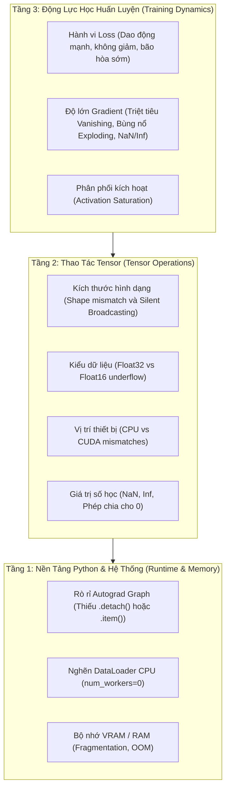

> **Lỗi AI tồi tệ nhất không bao giờ làm sập chương trình. Chúng âm thầm huấn luyện trên rác và cho ra loss curve tuyệt đẹp.** Khác với kỹ thuật phần mềm truyền thống nơi một lỗi logic sẽ lập tức ném ra ngoại lệ (exception) hoặc làm sập ứng dụng, mã nguồn AI thường tiếp tục chạy êm ru. Mô hình của bạn vẫn ngốn hàng trăm giờ tính toán GPU đắt đỏ, loss vẫn giảm dần đều, nhưng trọng số hội tụ về một hàm số vô nghĩa vì những sai lệch tinh vi ở tầng dữ liệu và đồ thị tính toán.

---

## Thông tin nhanh (Quick Spec)

* **Loại bài:** Thực chiến & Đo lường (Build & Profiling)
* **Ngôn ngữ & Công cụ:** Python 3.10+, PyTorch 2.x, PyTorch Profiler, TensorBoard, tracemalloc
* **Kiến thức tiên quyết:** Bài 01 (Môi trường Dev), Bài 06 (Môi trường Python), kiến thức PyTorch cơ bản
* **Thời gian thực hành:** ~50 phút
* **Độ khó:** Trung bình đến Nâng cao

---

## Mục tiêu bài học (Learning Objectives)

Sau bài học này, bạn sẽ có khả năng:
- Bắt quả tang lỗi broadcasting ngầm trong PyTorch — nguyên nhân hàng đầu khiến hàm mất mát tính sai kích thước tensor mà không hề báo lỗi cú pháp.
- Ngăn chặn hoàn toàn hiện tượng rò rỉ bộ nhớ đồ thị tự động (Autograd Computation Graph Leak) làm tràn VRAM (CUDA OOM) sau vài trăm bước huấn luyện.
- Sử dụng `breakpoint()` có điều kiện và register hook để chặn bắt tức thì giá trị `NaN` và `Inf` ngay tại tensor nguồn trước khi chúng lan truyền phá hủy toàn bộ trọng số mạng.
- Đo lường và phân rã chính xác thời gian vòng lặp (Data Loading vs Forward vs Backward pass) để tìm ra điểm nghẽn thắt cổ chai (bottleneck).
- Vận hành PyTorch Profiler để xuất dữ liệu trực quan hóa trên TensorBoard hoặc Chrome Trace viewer (`chrome://tracing`).

---

## 1. Vấn đề thực tế (The Problem)

Trong phát triển phần mềm thông thường, nếu bạn truy cập một mảng vượt quá chỉ số hoặc truyền sai kiểu dữ liệu, chương trình sẽ crash ngay lập tức kèm một stack trace rõ ràng. Bạn chỉ việc mở file, nhảy tới đúng dòng code và sửa lỗi.

Trong kỹ thuật học máy và mô hình ngôn ngữ lớn (LLM), lỗi vận hành theo một cách hoàn toàn khác — **Lỗi âm thầm (Silent Failures)**:
1. **Đốt cháy ngân sách tính toán vì lỗi broadcasting ngầm:** Bạn huấn luyện mô hình dự đoán giá trị liên tục suốt 12 tiếng và tiêu tốn \$200 tiền thuê GPU cloud. Mã nguồn chạy từ đầu đến cuối không văng ra bất kỳ dòng lỗi nào, đường cong loss trên TensorBoard đi xuống rất đẹp mắt. Nhưng khi đem ra dự đoán thực tế, mô hình luôn trả về giá trị trung bình cộng của tập dữ liệu. Nguyên nhân: `y_pred` có shape `[32]` trong khi `y_true` có shape `[32, 1]`. Phép trừ `y_pred - y_true` không báo lỗi kích thước mà âm thầm áp dụng quy tắc broadcast sinh ra ma trận `[32, 32]`, làm hàm loss tính toán trung bình của 1024 phần tử rác thay vì 32 mẫu ban đầu.
2. **Tràn bộ nhớ VRAM âm thầm sau 500 bước:** Chương trình chạy mượt mà ở 100 bước đầu tiên. Đến bước thứ 520, PyTorch ném ra lỗi `torch.cuda.OutOfMemoryError`. Bạn bối rối vì batch size không hề thay đổi. Nguyên nhân: Dòng lệnh ghi log lịch sử `history.append(loss)` thay vì `history.append(loss.item())`. Việc lưu cả tensor `loss` đã vô tình neo giữ toàn bộ đồ thị đạo hàm (Computation Graph) của cả 520 bước trước đó trong bộ nhớ GPU, ngăn cản Garbage Collector giải phóng VRAM.
3. **GPU "đói dữ liệu" (GPU Starvation):** Bạn bỏ ra chi phí thuê GPU khủng như A100/H100 nhưng chỉ số `GPU Utilization` đo bằng `nvidia-smi` chỉ lẹt đẹt ở mức 15-30%. GPU liên tục rơi vào trạng thái rảnh rỗi chờ CPU giải nén và tiền xử lý dữ liệu ảnh/text vì DataLoader thiết lập `num_workers=0` hoặc thiếu cấu hình `pin_memory=True`.

---

## 2. Mô hình tư duy & Bản chất (The Concept)

Để gỡ lỗi hệ thống AI một cách có phương pháp thay vì đoán mò, chúng ta phân chia quy trình chẩn đoán theo **Kim tự tháp gỡ lỗi AI 3 tầng**:



Hầu hết các kỹ sư ít kinh nghiệm thường chỉ nhìn chằm chằm vào Tầng 3 (nhìn đường cong loss trên TensorBoard rồi hoang mang đổi kiến trúc mô hình hay đổi learning rate). Trong khi đó, **hơn 80% nguyên nhân cốt lõi thực sự nằm ở Tầng 1 và Tầng 2**.

---

## 3. Tự tay cấu hình từ đầu (Build It / Hands-on)

### Bước 1: Kỹ thuật in kiểm toán Tensor (Tensor Audit Inspection)

Khi nghi ngờ một phép toán ma trận, việc dùng `print(x)` thông thường sẽ chỉ in ra một mớ số dài vô tận làm tràn console. Hãy sử dụng một hàm in kiểm toán gọn gàng hiển thị toàn bộ thuộc tính quan trọng:

```python
import torch

def inspect_tensor(name: str, tensor: torch.Tensor) -> None:
    """In ra toàn bộ metadata sống còn của một Tensor."""
    has_nan = torch.isnan(tensor).any().item()
    has_inf = torch.isinf(tensor).any().item()
    status = "OK"
    if has_nan or has_inf:
        status = "CANH BAO: CHUA NAN/INF!"

    print(
        f"[{name}] shape={list(tensor.shape)} | "
        f"dtype={tensor.dtype} | device={tensor.device} | "
        f"min={tensor.min().item():.4e} | max={tensor.max().item():.4e} | "
        f"mean={tensor.mean().item():.4e} | status={status}"
    )

# Chạy thử nghiệm:
x = torch.randn(32, 128, device="cpu")
inspect_tensor("Encoder Output", x)
```

---

### Bước 2: Bẫy lỗi có điều kiện với breakpoint() và Tensor Hooks

Thay vì dừng lại ở từng step khiến quá trình chạy bị chậm hàng nghìn lần, hãy đặt điểm dừng **có điều kiện (Conditional Breakpoint)**. Debugger chỉ kích hoạt khi phát hiện bất thường:

```python
import torch
import torch.nn as nn

class SafeTrainingStep:
    def __init__(self, model, optimizer, criterion):
        self.model = model
        self.optimizer = optimizer
        self.criterion = criterion

    def step(self, batch_idx: int, x: torch.Tensor, y_true: torch.Tensor):
        self.optimizer.zero_grad()
        
        # Phòng ngừa lỗi Silent Broadcasting ngay tại cửa ngõ:
        assert x.shape[0] == y_true.shape[0], "Batch size khong dong nhat!"
        
        y_pred = self.model(x)
        
        # Bắt buộc kiểm tra kích thước shape tương thích hoàn toàn:
        if y_pred.shape != y_true.shape:
            print(f"[LOI SHAPE] y_pred={y_pred.shape} vs y_true={y_true.shape}")
            breakpoint()  # Dung debugger de kiem tra nguyen nhan

        loss = self.criterion(y_pred, y_true)

        # Chặn bắt NaN Loss trước khi gọi backward:
        if torch.isnan(loss) or torch.isinf(loss) or loss.item() > 1e4:
            print(f"[LOSS BAT THUONG] Step {batch_idx}: loss = {loss}")
            breakpoint()  # Go 'p y_pred' hoac 'p loss' trong console

        loss.backward()

        # Kiểm tra Gradient NaN ở các tầng trọng số:
        for name, param in self.model.named_parameters():
            if param.grad is not None:
                if torch.isnan(param.grad).any():
                    print(f"[GRADIENT NAN] Phat hien NaN tai lop: {name}")
                    breakpoint()

        self.optimizer.step()
        return loss.item()
```

Khi debugger dừng lại trong terminal, bạn có thể thực thi các lệnh hữu ích:
- `p y_pred.shape`: Kiểm tra shape.
- `p torch.isnan(y_pred).nonzero()`: Vị trí chính xác của các phần tử NaN.
- `c`: Tiếp tục chạy (Continue).
- `q`: Thoát hoàn toàn (Quit).

---

### Bước 3: Đo lường thời gian vòng lặp với Timer Context Manager

Để xác định chính xác thời gian đang bị tiêu tốn ở khâu nạp dữ liệu hay khâu tính toán GPU, hãy tự xây dựng một context manager đo thời gian chuẩn xác:

```python
import time
from contextlib import contextmanager

class ProfilingTimer:
    def __init__(self):
        self.records = {}

    @contextmanager
    def time_block(self, name: str):
        # Đảm bảo CUDA đồng bộ hóa trước khi bấm giờ để đo chính xác thời gian GPU
        if torch.cuda.is_available():
            torch.cuda.synchronize()
        start = time.perf_counter()
        
        yield
        
        if torch.cuda.is_available():
            torch.cuda.synchronize()
        elapsed_ms = (time.perf_counter() - start) * 1000
        
        if name not in self.records:
            self.records[name] = []
        self.records[name].append(elapsed_ms)

    def print_summary(self):
        print("\n=== BANG PHAN TICH THOI GIAN VONG LAP (ms) ===")
        for name, times in self.records.items():
            avg_time = sum(times) / len(times)
            max_time = max(times)
            print(f"{name:<25}: Trung binh = {avg_time:8.2f} ms | Max = {max_time:8.2f} ms")
```

Cách dùng trong vòng lặp huấn luyện:

```python
timer = ProfilingTimer()

# for epoch in range(epochs):
#     for batch in data_loader:
#         with timer.time_block("1_Data_Loading"):
#             inputs, targets = batch
#         with timer.time_block("2_Forward_Pass"):
#             outputs = model(inputs)
#             loss = criterion(outputs, targets)
#         with timer.time_block("3_Backward_Pass"):
#             loss.backward()
#             optimizer.step()

# timer.print_summary()
```

---

### Bước 4: Chẩn đoán rò rỉ bộ nhớ VRAM với torch.cuda

Để phát hiện sớm hiện tượng rò rỉ VRAM, bạn có thể theo dõi lượng bộ nhớ được cấp phát (`allocated`) và lượng bộ nhớ được dành riêng (`reserved`):

```python
def check_vram_usage(step: int) -> None:
    if not torch.cuda.is_available():
        return
    allocated_mb = torch.cuda.memory_allocated() / (1024 ** 2)
    reserved_mb = torch.cuda.memory_reserved() / (1024 ** 2)
    max_allocated_mb = torch.cuda.max_memory_allocated() / (1024 ** 2)
    print(
        f"[VRAM Step {step:4d}] "
        f"Allocated: {allocated_mb:7.2f} MB | "
        f"Reserved: {reserved_mb:7.2f} MB | "
        f"Peak: {max_allocated_mb:7.2f} MB"
    )

# Ví dụ minh họa lỗi Rò rỉ Autograd Graph:
# SAI:
# history.append(loss)        # Giữ nguyên toàn bộ đồ thị đạo hàm! VRAM tăng vọt!
# DUNG:
# history.append(loss.item()) # Chỉ lưu giá trị số thực float đơn thuần!
```

---

### Bước 5: Sử dụng PyTorch Profiler chuẩn công nghiệp

PyTorch Profiler là công cụ tối thượng cho phép ghi lại chi tiết từng toán tử C++/CUDA Kernel chạy trên máy chủ:

```python
import torch
from torch.profiler import profile, record_function, ProfilerActivity

activities = [ProfilerActivity.CPU]
if torch.cuda.is_available():
    activities.append(ProfilerActivity.CUDA)

with profile(
    activities=activities,
    schedule=torch.profiler.schedule(wait=1, warmup=1, active=3, repeat=1),
    on_trace_ready=torch.profiler.tensorboard_trace_handler("./log/profiler_trace"),
    record_shapes=True,
    profile_memory=True,
    with_stack=True
) as prof:
    for step in range(5):
        # inputs, targets = get_batch()
        with record_function("forward_pass"):
            # outputs = model(inputs)
            pass
        prof.step()

# In kết quả dạng bảng tóm tắt 10 toán tử tốn thời gian tự thân (Self CPU Time) nhất:
print(prof.key_averages().table(sort_by="self_cpu_time_total", row_limit=10))
```

File trace sinh ra trong `./log/profiler_trace` có thể mở trực tiếp trong trình duyệt bằng cách gõ `chrome://tracing` hoặc xem qua giao diện TensorBoard.

---

## 4. Ứng dụng thực tế & Cạm bẫy Production (Use It / Production Tips)

### Cạm bẫy 1: Silent Broadcasting trong Hàm Mất Mát (Loss Function)

Đây là cạm bẫy phổ biến nhất trong các bài toán hồi quy (Regression) hoặc nhị phân (Binary Classification):

```python
import torch
import torch.nn as nn

# Giả lập batch gồm 4 mẫu:
y_pred = torch.tensor([2.0, 3.0, 4.0, 5.0])       # Shape: [4]
y_true = torch.tensor([[2.0], [3.0], [4.0], [5.0]]) # Shape: [4, 1]

# Phép trừ hai tensor khác shape nhưng hợp lệ theo luật broadcasting:
diff = y_pred - y_true
print("diff shape:", diff.shape)  # Kết quả: torch.Size([4, 4])! Ma trận 16 phần tử!

criterion = nn.MSELoss()
wrong_loss = criterion(y_pred, y_true)

# Cách khắc phục chuẩn mực trong production:
# Luôn đưa về cùng 1 chiều vector trước khi tính loss:
correct_loss = criterion(y_pred.view(-1), y_true.view(-1))
print(f"Wrong Loss: {wrong_loss.item():.4f} vs Correct Loss: {correct_loss.item():.4f}")
```

### Cạm bẫy 2: Nghẽn DataLoader và Kỹ thuật Pin Memory

Khi huấn luyện trên GPU, CPU cần nạp dữ liệu từ đĩa, tiền xử lý và chuyển dữ liệu sang bộ nhớ GPU. Nếu không bật `pin_memory=True`, dữ liệu phải sao chép qua bộ nhớ RAM ảo (pageable memory) trước khi nạp vào VRAM, làm giảm 30-50% tốc độ truyền tải:

```python
from torch.utils.data import DataLoader

# Cấu hình tối ưu DataLoader cho GPU:
train_loader = DataLoader(
    dataset,
    batch_size=64,
    shuffle=True,
    num_workers=4,          # Sử dụng 4 tiến trình con song song trên CPU
    pin_memory=True,        # Cố định RAM vật lý để truyền tải DMA tốc độ cao sang GPU
    persistent_workers=True # Giữ worker sống qua các epoch, tránh chi phí fork lại
)
```

### Cạm bẫy 3: Rủi ro Underflow khi dùng FP16 Mixed Precision

Khi huấn luyện với độ chính xác hỗn hợp FP16 (Automatic Mixed Precision - AMP) để tiết kiệm VRAM và tăng tốc độ tính toán, các giá trị gradient nhỏ hơn $2^{-14} \approx 6 \times 10^{-5}$ sẽ bị làm tròn về $0$ (Underflow). Trọng số mô hình ngừng cập nhật mà bạn không hề hay biết.

**Giải pháp:** Luôn luôn sử dụng `torch.cuda.amp.GradScaler` để phóng đại gradient trước khi tính toán backward và thu nhỏ lại trước khi cập nhật trọng số:

```python
scaler = torch.cuda.amp.GradScaler()

for inputs, targets in loader:
    optimizer.zero_grad()
    with torch.autocast(device_type="cuda", dtype=torch.float16):
        outputs = model(inputs)
        loss = criterion(outputs, targets)
        
    scaler.scale(loss).backward()
    scaler.step(optimizer)
    scaler.update()
```

---

## 5. Giải ngố thuật ngữ (Key Terms)

| Thuật ngữ | Người ta thường nghĩ là... | Bản chất kỹ thuật thực sự là... |
|---|---|---|
| **Silent Failure** | Lỗi phần mềm nhưng máy tính không phát ra tiếng chuông cảnh báo. | Lỗi logic toán học hoặc xử lý dữ liệu mà chương trình **vẫn thực thi thành công không văng ngoại lệ**, nhưng kết quả mô hình hội tụ về một hàm số sai hoàn toàn. |
| **Tensor Broadcasting** | Tính năng tiện lợi tự động co giãn kích thước ma trận để tính toán. | Cơ chế ngầm của NumPy/PyTorch sao chép dữ liệu ảo khi hai tensor lệch chiều (chiều bằng 1 hoặc thiếu chiều); dễ gây ra phép toán ma trận ngoài ý muốn nếu không kiểm soát shape. |
| **Autograd Graph Leak** | Tràn bộ nhớ do rò rỉ bộ nhớ con trỏ trong ngôn ngữ C. | Hiện tượng lưu trữ trực tiếp Tensor có `requires_grad=True` vào biến Python dài hạn (như list lịch sử); biến này **neo giữ toàn bộ cây đồ thị tính toán đạo hàm** khiến Garbage Collector không thể giải phóng VRAM. |
| **GPU Utilization** | Mức độ card đồ họa đang hoạt động hết công suất 100%. | Tỷ lệ phần trăm thời gian trong 1 giây mà ít nhất một CUDA Kernel đang chạy trên GPU; không đồng nghĩa với việc các nhân Tensor Cores đang được tính toán tối ưu. |
| **Pin Memory (Page-locked)** | Khóa RAM để các ứng dụng khác không chiếm mất. | Vùng nhớ RAM vật lý được hệ điều hành cam kết **không bị tráo đổi (swap) ra ổ đĩa**, cho phép GPU sao chép dữ liệu trực tiếp thông qua kênh DMA (Direct Memory Access) với tốc độ tối đa. |
| **PyTorch Profiler** | Một thư viện vẽ biểu đồ thời gian giống như Matplotlib. | Hệ thống công cụ đo lường cấp thấp tích hợp sẵn hook vào C++ runtime và NVIDIA CUPTI để ghi nhận vết thực thi thời gian thực của từng toán tử CPU và CUDA kernel. |

---

## 6. Bài tập thử thách (Hands-on Challenges)

### 🟢 Cơ bản (Dễ): Thiết lập Breakpoint có điều kiện bắt giá trị NaN
* **Yêu cầu:** Cho một hàm xử lý batch giả lập:
  ```python
  import torch
  def process_batch(x):
      # Giả lập một phép toán ngẫu nhiên thỉnh thoảng sinh ra phép chia cho 0
      weights = torch.randn_like(x)
      return x / (weights.abs() - 0.05).clamp(min=-0.01)
  ```
  Viết một vòng lặp chạy 100 lần, bổ sung đoạn mã kiểm tra điều kiện để tự động kích hoạt `breakpoint()` ngay tại thời điểm đầu tiên phát hiện tensor trả về chứa giá trị `NaN` hoặc `Inf`.
* **Tiêu chí nghiệm thu:** Sử dụng debugger để in ra tọa độ `(row, col)` của phần tử bị lỗi đầu tiên và giá trị của phần tử đó.

### 🟡 Trung bình (Vừa): Khắc phục lỗi Silent Broadcasting làm sai lệch Loss
* **Yêu cầu:** Cho đoạn code huấn luyện hồi quy tuyến tính tối giản bị lỗi ngầm:
  ```python
  import torch
  import torch.nn as nn
  
  torch.manual_seed(42)
  x = torch.randn(64, 10)
  true_w = torch.randn(10, 1)
  y = x @ true_w + 0.1 * torch.randn(64, 1)
  
  # Lỗi: model định nghĩa trả về vector 1D shape [64]
  class BadModel(nn.Module):
      def __init__(self):
          super().__init__()
          self.linear = nn.Linear(10, 1)
      def forward(self, x):
          return self.linear(x).squeeze(-1) # Trả về shape [64] thay vì [64, 1]
  
  model = BadModel()
  criterion = nn.MSELoss()
  # Viết assert và điều chỉnh code để đảm bảo không bị silent broadcasting!
  ```
  1. Chứng minh rằng `criterion(model(x), y)` tính toán trên tensor kích thước `[64, 64]`.
  2. Bổ sung `assert` kiểm tra nghiêm ngặt và viết lại hàm forward hoặc bước tính loss để sửa triệt để lỗi này.
* **Tiêu chí nghiệm thu:** In ra shape chính xác của phép trừ sai lệch trước khi tính bình phương (`[64]`), so sánh giá trị loss giữa cách tính sai và cách tính đúng.

### 🔴 Nâng cao (Khó): Profiling và Tối ưu hóa Pipeline GPU Bottleneck
* **Yêu cầu:** Xây dựng một kịch bản huấn luyện giả lập sử dụng `torch.profiler`:
  1. Tạo một custom `Dataset` nhân tạo có độ trễ I/O cố ý bằng cách gọi `time.sleep(0.01)` trong phương thức `__getitem__`.
  2. Khởi tạo `DataLoader` với `num_workers=0` và đo thời gian thực thi của 10 epoch. Sử dụng PyTorch Profiler để ghi vết thực thi và xuất file trace.
  3. Mở file trace hoặc in bảng tổng kết `key_averages()` để chứng minh thời gian CPU chờ nạp dữ liệu chiếm trên 70% tổng thời gian vòng lặp (GPU starvation).
  4. Tối ưu hóa bằng cách thiết lập `num_workers=4`, `pin_memory=True` và tiền xử lý dạng vector theo batch.
* **Tiêu chí nghiệm thu:** Báo cáo thời gian vòng lặp giảm tối thiểu 60% và PyTorch Profiler ghi nhận tỷ lệ thời gian tính toán của CUDA kernels tăng vượt bậc so với thời gian chờ nạp dữ liệu.
