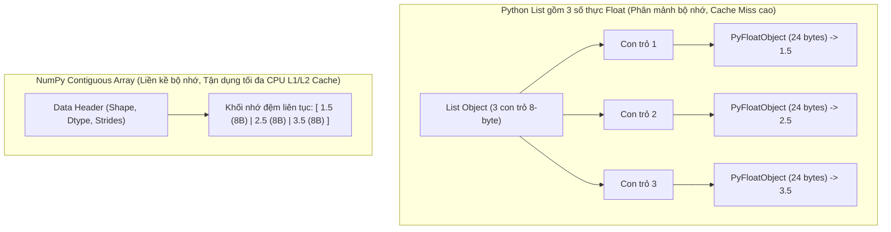

> **Hiểu rõ cơ chế quản lý bộ nhớ của Python là ranh giới giữa một đoạn code chạy mất 30 phút và một phép toán vector hóa hoàn tất trong 30 mili-giây.** Trong kỹ thuật AI, Python không chỉ là ngôn ngữ để gắn kết các API; nó là công cụ để bạn thao tác trực tiếp trên hàng triệu tham số và tensor. Nắm vững bản chất tầng vật lý của Python giúp bạn viết mã nguồn vừa thanh lịch vừa tối ưu hiệu năng tối đa.

---

## Thông tin nhanh (Quick Spec)

* **Loại bài:** Chuyên sâu từ gốc (Concept & Build from Scratch)
* **Ngôn ngữ & Công cụ:** Python 3.10+, NumPy, thư viện chuẩn `dataclasses`, `tracemalloc`, `time`
* **Kiến thức tiên quyết:** Bài 01 (Môi trường Dev), Bài 06 (Môi trường Python)
* **Thời gian thực hành:** ~60 phút
* **Độ khó:** Trung bình đến Nâng cao

---

## Mục tiêu bài học (Learning Objectives)

Sau bài học này, bạn sẽ có khả năng:
- Bóc tách bản chất bộ nhớ: Hiểu vì sao Python List tiêu tốn nhiều bộ nhớ và gây cache miss liên tục so với bộ đệm liền kề (Contiguous Memory Buffer) của NumPy.
- Nhận diện và phòng tránh 3 cạm bẫy Python kinh điển gây sai lệch kết quả mà không hề báo lỗi: Đối số mặc định khả biến (Mutable Defaults), Tham chiếu ma trận lặp (Aliasing), và Cạn kiệt Generator (Generator Exhaustion).
- Tự tay xây dựng một Pipeline nạp dữ liệu mini hoàn toàn bằng Standard Library: Sử dụng `@dataclass(slots=True)`, hàm phân chia Train/Val/Test có cố định hạt giống (Seed), và Mini-batch Generator.
- Hiện thực hóa các phép toán vector cốt lõi (Dot Product, Mean, Standard Deviation, Z-Score Normalization) bằng pure Python và đo lường sự chênh lệch hiệu năng so với NumPy.
- Làm chủ nguyên tắc Vector hóa (Vectorization) và Quy tắc lan truyền chiều (Broadcasting Rules) để tự tin chuyển đổi các vòng lặp chậm chạp sang mã máy tối ưu.

---

## 1. Vấn đề thực tế (The Problem)

Rất nhiều kỹ sư khi tiếp cận AI thường vội vàng nhảy vào các framework cấp cao (PyTorch, TensorFlow, Hugging Face) mà bỏ qua các đặc tính nền tảng của trình thông dịch Python. Hậu quả là họ liên tục vấp phải những cạm bẫy hiệu năng và logic ngầm tai hại:

1. **Hiệu năng chênh lệch hàng chục lần:** Bạn viết một vòng lặp `for` thuần Python để tính tích vô hướng (dot product) hoặc chuẩn hóa ma trận trên 1 triệu phần tử. Code chạy mất hơn 30 mili-giây, trong khi NumPy hoàn tất phép toán tương đương trong chưa đầy 0.8 mili-giây — nhanh hơn gấp gần 40 lần. Nếu thực hiện thao tác này trong hàng triệu bước huấn luyện, thời gian trễ sẽ tích tụ từ vài chục phút thành hàng chục ngày.
2. **Cạm bẫy cạn kiệt Generator (Generator Exhaustion):** Bạn viết một generator đọc và nạp dữ liệu theo lô để tiết kiệm RAM. Ở epoch huấn luyện thứ nhất, mọi thứ diễn ra hoàn hảo. Sang epoch thứ hai, vòng lặp kết thúc ngay lập tức trong 0.001 giây, hàm loss giữ nguyên giá trị cũ, mô hình ngừng học hoàn toàn. Code không hề ném ra bất kỳ lỗi cú pháp hay ngoại lệ nào vì generator sau khi duyệt qua phần tử cuối cùng sẽ mãi mãi trả về rỗng (`StopIteration`).
3. **Thảm họa đối số mặc định khả biến (Mutable Default Arguments):** Bạn định nghĩa hàm nạp dữ liệu `def load_samples(batch, store=[])`. Trong Python, biểu thức mặc định `store=[]` chỉ được khởi tạo **đúng một lần duy nhất** khi hàm được định nghĩa, chứ không phải mỗi lần hàm được gọi. Hậu quả là dữ liệu của batch 2, batch 3 sẽ bị nối tiếp vào cùng một danh sách trong bộ nhớ, làm rò rỉ dữ liệu giữa các đợt đánh giá.
4. **Hiệu ứng bóng ma (Aliasing Bug) khi nhân bản danh sách:** Khi khởi tạo một bảng dữ liệu hoặc ma trận trọng số ban đầu, câu lệnh `matrix = [[0] * 3] * 3` tạo ra một ma trận trông có vẻ bình thường. Nhưng khi bạn gán `matrix[0][0] = 99`, toàn bộ các hàng `matrix[1][0]` và `matrix[2][0]` cũng đồng loạt biến thành 99. Ba hàng thực chất chỉ là 3 con trỏ cùng trỏ vào một danh sách duy nhất trong RAM.

---

## 2. Mô hình tư duy & Bản chất (The Concept)

### 2.1. Phân tích AST: Những thành ngữ Python cốt lõi trong Kỹ thuật AI

Khảo sát trên hơn 500 file mã nguồn thuật toán và mô hình học máy thực chiến cho thấy các thành ngữ (idioms) sau chiếm tỷ trọng áp đảo trong công việc hằng ngày của một kỹ sư AI:

| Cấu trúc / Thành ngữ Python | Tần suất sử dụng | Vai trò thực chiến trong AI |
|---|---|---|
| **f-strings** | 96% | Định dạng log huấn luyện, in metric loss, epoch, và thời gian thực thi. |
| **Tuple / Sequence Unpacking** | 83% | Tách nhanh batch dữ liệu: `x, y = batch` hoặc tách shape: `batch_size, seq_len, d_model = tensor.shape`. |
| **Classes & Dataclasses** | 70% | Đóng gói cấu trúc cấu hình (`Config`), định nghĩa lớp mạng nơ-ron hoặc cấu trúc mẫu dữ liệu. |
| **List Comprehensions** | 69% | Tiền xử lý văn bản, chuyển đổi token ID, lọc mẫu dữ liệu nhanh hơn vòng lặp `for` truyền thống. |
| **Type Hints** | 63% | Chỉ định rõ kiểu dữ liệu tensor, shape mong đợi, giúp IDE phát hiện lỗi shape trước khi chạy. |
| **Generator Expressions / yield** | 60% | Streaming dữ liệu hàng gigabyte theo từng chunk mà không làm tràn RAM. |
| **Slices (`[:]`, `[::2]`)** | 58% | Cắt chuỗi token, trích xuất sliding window, chia tập Train/Val/Test. |

---

### 2.2. So sánh bộ nhớ: Python List vs NumPy Contiguous Array

Tại sao vòng lặp Python trên số thực lại chậm hơn NumPy đến hàng chục lần? Câu trả lời nằm ở **cơ chế tổ chức bộ nhớ vật lý**:



#### Chi phí con trỏ của Python List:
Trong CPython (bản cài đặt chuẩn 64-bit của Python):
- Một số thực `float` thông thường không chỉ là 8 byte giá trị. Nó là một `PyFloatObject` hoàn chỉnh tiêu tốn tới **24 byte** (8 byte đếm tham chiếu `ob_refcnt`, 8 byte trỏ đến đối tượng kiểu `ob_type`, và 8 byte giá trị số thực `ob_fval`).
- Một Python List chứa 1 triệu số thực thực chất là một mảng chứa **1 triệu con trỏ địa chỉ** (mỗi con trỏ 8 byte) trỏ tới 1 triệu `PyFloatObject` nằm rải rác khắp nơi trên heap.
- Khi vòng lặp `for` chạy, CPU liên tục phải "nhảy cóc" qua các vùng nhớ ngẫu nhiên để đọc dữ liệu (Pointer Chasing), dẫn đến hiện tượng **CPU Cache Miss** liên tục. Đồng thời, trình thông dịch phải kiểm tra kiểu dữ liệu của từng đối tượng ở mỗi vòng lặp (Dynamic Type Checking).

#### Sức mạnh của NumPy Contiguous Array:
- NumPy cấp phát một mảng byte liên tục (Contiguous Memory Buffer). Một mảng 1 triệu số `float64` chỉ chiếm đúng $1,000,000 \times 8 \text{ bytes} \approx 8 \text{ MB}$ bộ nhớ.
- Khi thực hiện phép tính, CPU có thể tải hàng loạt giá trị liền kề vào bộ nhớ đệm L1/L2 Cache chỉ trong một chu kỳ xung nhịp và áp dụng các tập lệnh SIMD (AVX-512) để tính toán song song nhiều số cùng lúc.

---

### 2.3. Danh sách đầy đủ vs Generator từng phần

Một List Comprehension `[x * 2 for x in data]` sẽ tính toán và lưu trữ toàn bộ tất cả phần tử vào RAM ngay lập tức. Nếu `data` có 50 triệu dòng văn bản, máy tính sẽ tràn RAM ngay lập tức.

Ngược lại, một Generator Expression `(x * 2 for x in data)` hoặc hàm chứa từ khóa `yield` chỉ tính toán một giá trị duy nhất khi có lời gọi `next()`. Dung lượng bộ nhớ tiêu thụ là một hằng số $O(1)$, hoàn toàn không phụ thuộc vào kích thước của tập dữ liệu.

Tuy nhiên, **Generator chỉ có thể duyệt qua một lần duy nhất**. Khi phần tử cuối cùng được lấy ra, generator rơi vào trạng thái cạn kiệt (exhausted). Để duyệt lại ở epoch sau, bạn bắt buộc phải khởi tạo một generator hoàn toàn mới.

---

## 3. Tự tay cấu hình từ đầu (Build It / Hands-on)

Chúng ta sẽ tự tay xây dựng một Pipeline nạp và xử lý dữ liệu hoàn chỉnh từ đầu, chỉ sử dụng Python Standard Library, đảm bảo tối ưu hóa bộ nhớ và tốc độ.

### Bước 1: Định nghĩa cấu trúc mẫu dữ liệu tối ưu RAM với slots

Sử dụng `@dataclass(slots=True)` để loại bỏ từ điển `__dict__` nội tại của từng instance, giúp tiết kiệm hơn 50% dung lượng RAM:

```python
from dataclasses import dataclass
import sys

# Cách thông thường (có __dict__ tiêu tốn RAM):
class RegularRecord:
    def __init__(self, feature_a: float, feature_b: float, label: int):
        self.feature_a = feature_a
        self.feature_b = feature_b
        self.label = label

# Cách tối ưu chuẩn AI:
@dataclass(slots=True)
class FastRecord:
    feature_a: float
    feature_b: float
    label: int

# Đo lường sự khác biệt:
r1 = RegularRecord(1.5, 2.5, 1)
r2 = FastRecord(1.5, 2.5, 1)

print(f"Kich thuoc RegularRecord: {sys.getsizeof(r1) + sys.getsizeof(r1.__dict__)} bytes")
print(f"Kich thuoc FastRecord:    {sys.getsizeof(r2)} bytes (tiet kiem vuot troi!)")
```

---

### Bước 2: Phân chia Train/Validation/Test có cố định hạt giống (Seed)

Một hàm phân chia dữ liệu chuẩn xác phải đảm bảo tính tái lập (reproducible) bằng cách cố định `random.seed`:

```python
import random
from typing import TypeVar, Sequence

T = TypeVar("T")

def train_val_test_split(
    data: Sequence[T],
    train_ratio: float = 0.8,
    val_ratio: float = 0.1,
    seed: int = 42
) -> tuple[list[T], list[T], list[T]]:
    """Phan chia tap du lieu ngau nhien khong lam ro ri du lieu (Data Leakage)."""
    assert train_ratio + val_ratio < 1.0, "Tong ti le train va val phai nho hon 1.0!"
    
    # Tao ban sao chi so index de xao tron, khong xao tron truc tiep data goc
    indices = list(range(len(data)))
    rng = random.Random(seed)
    rng.shuffle(indices)

    n_total = len(data)
    n_train = int(n_total * train_ratio)
    n_val = int(n_total * val_ratio)

    train_idx = indices[:n_train]
    val_idx = indices[n_train:n_train + n_val]
    test_idx = indices[n_train + n_val:]

    train_set = [data[i] for i in train_idx]
    val_set = [data[i] for i in val_idx]
    test_set = [data[i] for i in test_idx]

    return train_set, val_set, test_set
```

---

### Bước 3: Xây dựng Mini-batch Generator tiết kiệm bộ nhớ

Sử dụng `yield` để sinh từng lô dữ liệu nhỏ phục vụ training loop:

```python
from typing import Iterator

def batch_generator(data: Sequence[T], batch_size: int, shuffle: bool = True, seed: int = 42) -> Iterator[list[T]]:
    """Tao generator nạp mini-batch khong bao gio gay tran bo nho RAM."""
    indices = list(range(len(data)))
    if shuffle:
        rng = random.Random(seed)
        rng.shuffle(indices)

    for start_idx in range(0, len(data), batch_size):
        batch_indices = indices[start_idx : start_idx + batch_size]
        yield [data[i] for i in batch_indices]
```

---

### Bước 4: Tự xây dựng các phép toán Vector thuần Python (Math from Scratch)

Để hiểu sâu sắc cơ chế tính toán trước khi dùng NumPy hay PyTorch, chúng ta tự cài đặt các toán tử cơ bản:

```python
import math

def vector_dot(a: list[float], b: list[float]) -> float:
    """Tich vo huong giua hai vector cung chieu."""
    assert len(a) == len(b), "Hai vector phai co cung kich thuoc!"
    # Su dung zip ket hop sum comprehension
    return sum(x * y for x, y in zip(a, b))

def vector_mean(v: list[float]) -> float:
    """Tinh gia tri trung binh cong."""
    assert len(v) > 0, "Vector khong duoc rong!"
    return sum(v) / len(v)

def vector_std(v: list[float]) -> float:
    """Tinh do lech chuan (Standard Deviation)."""
    assert len(v) > 1, "Vector phai co it nhat 2 phan tu!"
    mu = vector_mean(v)
    variance = sum((x - mu) ** 2 for x in v) / (len(v) - 1)
    return math.sqrt(variance)

def vector_z_score(v: list[float]) -> list[float]:
    """Chuan hoa vector ve phan phoi chuan Standard Normal N(0, 1)."""
    mu = vector_mean(v)
    sigma = vector_std(v)
    if sigma == 0:
        return [0.0] * len(v)
    return [(x - mu) / sigma for x in v]
```

---

### Bước 5: Đo lường và Benchmark hiệu năng (Python vs NumPy)

Kiểm chứng thực tế thời gian thực thi và dung lượng bộ nhớ giữa pure Python và NumPy:

```python
import time
import tracemalloc
import numpy as np

def benchmark_dot_product(n: int = 1_000_000):
    # 1. Chuan bi du lieu
    py_a = [float(i) * 0.001 for i in range(n)]
    py_b = [float(i) * 0.002 for i in range(n)]
    np_a = np.array(py_a, dtype=np.float64)
    np_b = np.array(py_b, dtype=np.float64)

    # 2. Benchmark Pure Python
    tracemalloc.start()
    t0 = time.perf_counter()
    res_py = vector_dot(py_a, py_b)
    t_py = (time.perf_counter() - t0) * 1000
    mem_py = tracemalloc.get_traced_memory()[1] / (1024 ** 2)
    tracemalloc.stop()

    # 3. Benchmark NumPy
    tracemalloc.start()
    t0 = time.perf_counter()
    res_np = np.dot(np_a, np_b)
    t_np = (time.perf_counter() - t0) * 1000
    mem_np = tracemalloc.get_traced_memory()[1] / (1024 ** 2)
    tracemalloc.stop()

    print(f"=== KET QUA BENCHMARK TICH VO HUONG ({n:,} phan tu) ===")
    print(f"Pure Python: Thoi gian = {t_py:7.2f} ms | RAM phu tro = {mem_py:.2f} MB")
    print(f"NumPy C-API: Thoi gian = {t_np:7.2f} ms | RAM phu tro = {mem_np:.2f} MB")
    print(f"Toc do chenh lech: NumPy nhanh hon gap {t_py / t_np:.1f} lan!")

# Chay thu nghiem benchmark:
benchmark_dot_product(500_000)
```

---

## 4. Ứng dụng thực tế & Cạm bẫy Production (Use It / Production Tips)

### Quy tắc lan truyền chiều (Broadcasting Rules) trong thực chiến

NumPy và PyTorch cho phép thực hiện phép toán trên các mảng có hình dạng (shape) khác nhau thông qua cơ chế **Broadcasting**. 

Quy tắc so sánh: Khi thực hiện phép toán trên hai mảng, trình thông dịch sẽ so sánh các chiều của chúng **từ phải sang trái (trailing dimensions)**:
1. Hai chiều tương thích nếu chúng **bằng nhau**, hoặc
2. Một trong hai chiều có kích thước **bằng 1**.
3. Nếu một mảng có số chiều ít hơn, mảng đó sẽ được bổ sung các chiều kích thước 1 ở phía bên trái.

**Bảng tra cứu quy tắc Broadcasting:**

| Shape mảng A | Shape mảng B | Có broadcast được không? | Shape kết quả | Ý nghĩa trong AI |
|---|---|---|---|---|
| `(64, 512)` | `(512,)` | **HỢP LỆ** | `(64, 512)` | Cộng vector Bias vào từng mẫu trong batch. |
| `(32, 10, 64)` | `(32, 1, 64)` | **HỢP LỆ** | `(32, 10, 64)` | Lan truyền context vector qua các token. |
| `(64, 10)` | `(64,)` | **LỖI (FAIL)** | Không thể | Không thể broadcast: chiều phải nhất là 10 so với 64. |
| `(64, 1)` | `(64,)` | **CẢNH BÁO** | `(64, 64)` | **Lỗi Silent Broadcasting**: Sinh ra ma trận ngoài ý muốn! |

---

### Top 3 Lỗi ngầm kinh điển trong mã nguồn AI Python

#### Cạm bẫy 1: Tái sử dụng Generator đã cạn kiệt qua nhiều Epoch

```python
# SAI:
loader = batch_generator(dataset, batch_size=32)
for epoch in range(5):
    for batch in loader:
        # Epoch 0 chay binh thuong.
        # Epoch 1, 2, 3, 4: Vong lap ket thuc ngay lap tuc! loader da rong!
        train_step(batch)

# DUNG:
# Khoi tao lai generator o moi dau epoch:
for epoch in range(5):
    loader = batch_generator(dataset, batch_size=32, seed=42 + epoch)
    for batch in loader:
        train_step(batch)
```

#### Cạm bẫy 2: Tham số mặc định khả biến (Mutable Default Arguments)

```python
# SAI:
def append_to_cache(item, cache=[]):
    cache.append(item)
    return cache

# Moi lan goi append_to_cache('x'), bien cache deu tich luy tiep thay vi bat dau bang list moi!

# DUNG:
def append_to_cache_safe(item, cache=None):
    if cache is None:
        cache = []
    cache.append(item)
    return cache
```

#### Cạm bẫy 3: Hiệu ứng Aliasing khi tạo ma trận bằng toán tử nhân `*`

```python
# SAI:
grid = [[0] * 3] * 3
grid[0][0] = 99
print(grid)  # Ket qua: [[99, 0, 0], [99, 0, 0], [99, 0, 0]] (Tat ca cac hang deu bi sua!)

# DUNG:
# Su dung List Comprehension de khoi tao cac doi tuong doc lap:
safe_grid = [[0] * 3 for _ in range(3)]
safe_grid[0][0] = 99
print(safe_grid)  # Ket qua: [[99, 0, 0], [0, 0, 0], [0, 0, 0]] (Chuan xac!)
```

---

## 5. Giải ngố thuật ngữ (Key Terms)

| Thuật ngữ | Người ta thường nghĩ là... | Bản chất kỹ thuật thực sự là... |
|---|---|---|
| **Iterable vs Iterator** | Cả hai đều chỉ một danh sách hay một vòng lặp `for`. | **Iterable** là đối tượng có phương thức `__iter__()` trả về Iterator (như `list`, `dict`); **Iterator** là đối tượng duy trì con trỏ trạng thái hiện tại với phương thức `__next__()` và ném `StopIteration` khi hết phần tử. |
| **Generator** | Một thư viện phức tạp để tạo số ngẫu nhiên. | Một hàm đặc biệt sử dụng từ khóa `yield` tạm dừng thực thi và lưu lại frame trạng thái cục bộ, cho phép sinh dữ liệu theo kiểu lười (lazy evaluation) với chi phí RAM $O(1)$. |
| **Pointer Overhead** | Chi phí kết nối mạng giữa các con trỏ máy tính. | Phần dung lượng RAM lãng phí do CPython phải lưu trữ địa chỉ 8-byte và vỏ bọc `PyObject` (24 bytes) cho từng phần tử số nhỏ thay vì lưu trực tiếp mảng số thô. |
| **Vectorization** | Biến đổi dữ liệu thành các vector nhúng (Embedding vectors). | Kỹ thuật thay thế vòng lặp tường minh cấp cao trong Python bằng các phép toán ma trận được ủy quyền trực tiếp xuống các hàm thư viện viết bằng C/Fortran chạy trên tập lệnh SIMD của CPU. |
| **Broadcasting** | Phát sóng trực tiếp tín hiệu dữ liệu qua mạng internet. | Cơ chế của NumPy/PyTorch tự động mô phỏng việc sao chép các chiều có kích thước bằng 1 để tương thích hình dạng giữa hai tensor mà không tốn thêm bộ nhớ RAM thực tế. |
| **Dataclass Slots** | Khe cắm phần cứng để gắn thêm card đồ họa. | Cờ `slots=True` trong Python 3.10+ hướng dẫn CPython cấp phát cấu trúc bộ nhớ cố định cho các thuộc tính lớp, loại bỏ hoàn toàn `__dict__` và giảm đáng kể bộ nhớ cho hàng triệu đối tượng. |

---

## 6. Bài tập thử thách (Hands-on Challenges)

### 🟢 Cơ bản (Dễ): Xây dựng hàm chuẩn hóa Z-Score thuần Python
* **Yêu cầu:** 
  1. Viết một hàm `pure_z_score(data: list[float]) -> list[float]` tính toán chuẩn hóa Z-score hoàn toàn không sử dụng bất kỳ thư viện bên ngoài nào ngoài module `math`.
  2. Tạo một danh sách gồm 10,000 số thực ngẫu nhiên.
  3. So sánh kết quả đầu ra với `(arr - np.mean(arr)) / np.std(arr, ddof=1)` của NumPy bằng hàm `math.isclose()` với sai số cho phép $\epsilon = 10^{-5}$.
* **Tiêu chí nghiệm thu:** Unit test kiểm tra thành công tất cả các phần tử trả về khớp chính xác với kết quả tính của NumPy.

### 🟡 Trung bình (Vừa): Xây dựng Data Loader Generator đọc File CSV lớn theo Batch
* **Yêu cầu:**
  1. Viết một script tạo ra một file CSV giả lập `large_dataset.csv` gồm 100,000 dòng, mỗi dòng chứa 5 trường số thực và 1 nhãn phân loại (0 hoặc 1).
  2. Xây dựng một Generator function `stream_csv_batches(file_path: str, batch_size: int = 64)` đọc từng dòng bằng `csv.reader` và gom lại thành từng batch trả về dưới dạng `list[FastRecord]`.
  3. Sử dụng module `tracemalloc` để chứng minh rằng mức tiêu thụ RAM đỉnh (Peak Memory) trong suốt quá trình duyệt hết 100,000 dòng luôn duy trì dưới 15 MB.
* **Tiêu chí nghiệm thu:** Đo lường và in ra mức RAM tiêu thụ cao nhất, chứng minh bộ nhớ không tăng tuyến tính theo số lượng dòng của file CSV.

### 🔴 Nâng cao (Khó): Tự cài đặt phép Nhân Ma Trận có hỗ trợ 2D Broadcasting
* **Yêu cầu:**
  1. Tự viết hàm `pure_matrix_multiply(a: list[list[float]], b: list[list[float]]) -> list[list[float]]` thực hiện phép nhân ma trận $A \times B$ mà không dùng thư viện ngoài.
  2. Bổ sung tính năng tự động phát hiện và áp dụng broadcasting nếu $B$ chỉ là một vector hàng hoặc vector cột.
  3. Thực hiện benchmark đo lường thời gian thực thi giữa hàm tự viết và `np.matmul(A, B)` với các kích thước ma trận vuông tăng dần: $N \in [50, 100, 200, 500]$.
  4. Vẽ hoặc in bảng phân tích tốc độ chênh lệch, tìm ra ngưỡng kích thước $N$ mà tại đó NumPy bắt đầu vượt trội hơn 20 lần so với pure Python.
* **Tiêu chí nghiệm thu:** Hàm tự viết cho ra ma trận kết quả giống hệt NumPy và bảng benchmark thể hiện rõ ràng mức độ suy giảm hiệu năng $O(N^3)$ của vòng lặp lồng nhau trong pure Python.
