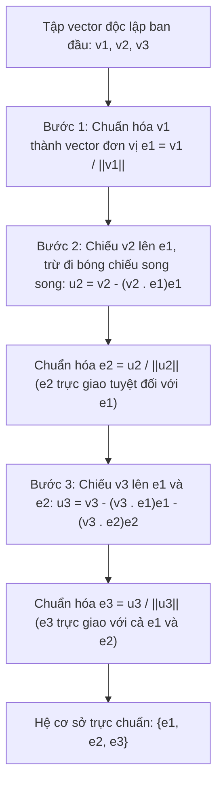
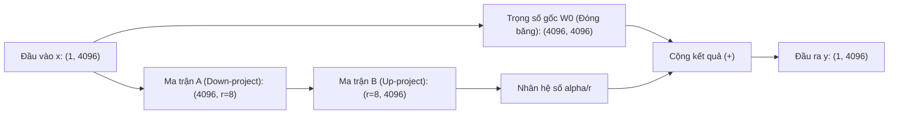

> **"Mọi mô hình AI thực chất là các phép biến đổi hình học trong không gian vector nhiều chiều."** — Hiểu được bản chất hình học giúp kỹ sư AI nhìn thấu cơ chế hoạt động của Attention, Embedding Space và LoRA thay vì xem chúng là những hộp đen ma thuật.

---

## Thông tin nhanh (Quick Spec)

* **Loại bài (Type):** Trực giác Khái niệm & Thực chiến Nền tảng (Intuition & Build)
* **Ngôn ngữ & Thư viện:** Python 3.10+, NumPy (thuần túy tư duy giải thuật từ số 0, không dùng hàm black-box)
* **Kiến thức tiên quyết (Prerequisites):** Tọa độ không gian Cartesian cơ bản, lập trình Python căn bản
* **Thời gian thực hành:** ~45–60 phút
* **Độ khó:** Cơ bản đến Trung bình (Foundational)

---

## Mục tiêu bài học (Learning Objectives)

Sau bài học này, bạn sẽ có khả năng:
- [ ] Nắm vững mô hình trực giác hình học: Vector là mũi tên định hướng và tọa độ; Ma trận là cỗ máy biến đổi không gian tuyến tính.
- [ ] Phân biệt rành mạch các khái niệm cốt lõi: Không gian con (Subspace), Không gian sinh (Span), Độc lập tuyến tính (Linear Independence), Hệ cơ sở (Basis) và Hạng (Rank).
- [ ] Tự tay xây dựng thuật toán trực giao hóa Gram-Schmidt từ đầu bằng Python thuần túy, chứng minh tính trực chuẩn toán học ($e_i \cdot e_j = 0$ khi $i \ne j$, và $\|e_i\| = 1$).
- [ ] Giải mã ứng dụng trực tiếp trong AI Engineering: Không gian nhúng ngữ nghĩa (Embedding Space trong RAG/LLM) và cơ chế thích ứng thứ hạng thấp LoRA (Low-Rank Adaptation).

---

## 1. Vấn đề thực tế (The Problem)

Khi bước vào thế giới AI hiện đại — từ các mô hình ngôn ngữ lớn (LLMs như GPT-4, LLaMA), hệ thống sinh ảnh (Diffusion Models), cho tới các kiến trúc tìm kiếm ngữ nghĩa (RAG Vector Search) — bạn liên tục làm việc với các tensor hàng nghìn chiều:
- Mô hình `text-embedding-3-small` của OpenAI biểu diễn mỗi văn bản thành một vector 1536 chiều.
- Trọng số ẩn của LLaMA-3-70B vận hành trong không gian vector 8192 chiều.
- Một ma trận chiếu Query-Key có kích thước $4096 \times 4096$, chứa hơn 16 triệu tham số số thực.

Nếu chỉ nhìn nhận vector như "một mảng số" (`list` hay `np.ndarray`) và ma trận như "cái bảng 2 chiều", bạn sẽ lập tức va phải ba cạm bẫy thực tế chết người sau:

1. **Cạm bẫy đa cộng tuyến (Multicollinearity & Rank Collapse):** Nếu các vector đặc trưng đầu vào bị phụ thuộc tuyến tính lẫn nhau, ma trận dữ liệu trở nên suy biến (ill-conditioned / singular). Hậu quả là phép tối ưu hóa hồi quy sụp đổ, gradient trong mạng nơ-ron tiêu biến hoặc bùng nổ, và mô hình không thể học được thông tin mới.
2. **Lãng phí tham số và chi phí tính toán khổng lồ:** Một ma trận trọng số $4096 \times 4096$ ngốn hơn 67 MB VRAM chỉ cho một tầng đơn lẻ ở định dạng FP32. Nếu không hiểu khái niệm **Hạng ma trận (Rank)** và **Không gian con (Subspace)**, bạn sẽ fine-tune toàn bộ 16.7 triệu tham số, trong khi thông tin thích nghi thực chất chỉ dao động trong một không gian con thứ hạng cực thấp ($r = 8$ hoặc $16$).
3. **Mù mờ trong tính toán tương đồng (Vector Search trong RAG):** Khi xây dựng cơ sở dữ liệu vector, nếu không hiểu bản chất của tích vô hướng (Dot Product) và phép chiếu trực giao (Orthogonal Projection), bạn sẽ chọn sai metric khoảng cách (L2 vs Cosine vs Inner Product), gây suy giảm nghiêm trọng độ chính xác truy hồi ngữ nghĩa.

Đại số tuyến tính không sinh ra để làm khó sinh viên qua các bài tập tính tay máy móc. Nó là ngôn ngữ hình học chính xác nhất để mô tả cách thông tin di chuyển, xoay chuyển và nén lại trong không gian đa chiều.

---

## 2. Mô hình tư duy & Bản chất (The Concept)

### 2.1 Vector: Mũi tên định hướng và Điểm tọa độ

Trong đại số tuyến tính phục vụ AI, một vector $v \in \mathbb{R}^n$ có hai cách hiểu tương đương:
- **Góc nhìn đại số:** Một danh sách gồm $n$ số thực có thứ tự: $v = [x_1, x_2, \dots, x_n]^T$.
- **Góc nhìn hình học:** Một mũi tên xuất phát từ gốc tọa độ $O(0, \dots, 0)$ chỉ tới điểm $(x_1, \dots, x_n)$. Mũi tên này có hai đặc tính bất biến: **Độ lớn (Magnitude / Length)** và **Hướng (Direction)**.

Độ dài hình học của vector (chuẩn $L_2$) được định nghĩa qua định lý Pythagoras mở rộng:

$$
\|v\|_2 = \sqrt{\sum_{i=1}^n x_i^2} = \sqrt{v^T v}
$$

### 2.2 Tích vô hướng (Dot Product): Thước đo sự thẳng hàng

Cho hai vector $a, b \in \mathbb{R}^n$. Tích vô hướng của chúng được tính bằng:

$$
a \cdot b = \sum_{i=1}^n a_i b_i = a^T b
$$

Nhưng ý nghĩa hình học của nó mới là chìa khóa:

$$
a \cdot b = \|a\| \|b\| \cos \theta
$$

Trong đó $\theta$ là góc tạo bởi hai vector trong không gian:
- Khi $\theta = 0^\circ \implies \cos\theta = 1$: Hai vector cùng hướng hoàn toàn, tích vô hướng đạt cực đại dương.
- Khi $\theta = 90^\circ \implies \cos\theta = 0$: Hai vector vuông góc (**trực giao - orthogonal**). Chúng độc lập tuyệt đối; chuyển động dọc theo $a$ hoàn toàn không tạo ra bất kỳ độ dịch chuyển nào theo hướng $b$.
- Khi $\theta = 180^\circ \implies \cos\theta = -1$: Hai vector ngược hướng đối lập, tích vô hướng đạt cực tiểu âm.

Trong AI, toàn bộ cơ chế **Attention** của Transformer ($\text{Softmax}(Q K^T / \sqrt{d_k})$) thực chất là tính tích vô hướng giữa Query và Key để đo lường mức độ "thẳng hàng" về mặt ngữ nghĩa giữa các từ.

### 2.3 Phép chiếu trực giao (Orthogonal Projection)

Chiếu vector $v$ lên phương của vector $u$ chính là tìm bóng của $v$ rơi trên đường thẳng sinh bởi $u$:

$$
\text{proj}_u(v) = \left( \frac{v \cdot u}{u \cdot u} \right) u
$$

Phần bù trực giao (Residual vector):

$$
v_{\perp} = v - \text{proj}_u(v)
$$

Vector $v_{\perp}$ luôn đảm bảo tính chất hình học hoàn hảo: $v_{\perp} \cdot u = 0$. Đây chính là cốt lõi của việc khử nhiễu và lọc bỏ thông tin trùng lặp.

### 2.4 Không gian sinh (Span), Độc lập tuyến tính và Hệ cơ sở (Basis)

- **Tổ hợp tuyến tính (Linear Combination):** Với tập vector $\{v_1, v_2, \dots, v_k\}$ và các hệ số vô hướng $\{c_1, c_2, \dots, c_k\}$, biểu thức $\sum_{i=1}^k c_i v_i$ được gọi là một tổ hợp tuyến tính.
- **Không gian sinh (Span):** Tập hợp tất cả các vector có thể tạo ra bằng cách lấy tổ hợp tuyến tính của $\{v_1, \dots, v_k\}$. Ví dụ: 2 vector không cùng phương trong không gian 3 chiều sẽ sinh ra một mặt phẳng 2D.
- **Độc lập tuyến tính (Linear Independence):** Một tập vector là độc lập tuyến tính nếu không có bất kỳ vector nào trong tập có thể biểu diễn dưới dạng tổ hợp tuyến tính của các vector còn lại.
  $$c_1 v_1 + c_2 v_2 + \dots + c_k v_k = 0 \iff c_1 = c_2 = \dots = c_k = 0$$
- **Hệ cơ sở (Basis):** Một tập vector độc lập tuyến tính vừa đủ để sinh ra toàn bộ không gian. Số lượng vector trong một hệ cơ sở chính là **Số chiều (Dimension)** của không gian đó.
- **Hệ cơ sở trực chuẩn (Orthonormal Basis):** Hệ cơ sở lý tưởng nhất, trong đó mọi vector đều có độ dài bằng $1$ và đôi một vuông góc với nhau:
  $$e_i \cdot e_j = \begin{cases} 1 & \text{khi } i = j \\ 0 & \text{khi } i \ne j \end{cases}$$

### 2.5 Thuật toán Trực giao hóa Gram-Schmidt

Làm thế nào để từ một tập vector bất kỳ $\{v_1, v_2, \dots, v_k\}$ độc lập tuyến tính, ta biến đổi thành một hệ cơ sở trực chuẩn $\{e_1, e_2, \dots, e_k\}$ sinh ra cùng một không gian? Thuật toán Gram-Schmidt thực hiện điều này một cách tuần tự:



Công thức toán học tổng quát:

$$
u_k = v_k - \sum_{j=1}^{k-1} (v_k \cdot e_j) e_j, \quad e_k = \frac{u_k}{\|u_k\|}
$$

---

## 3. Tự tay xây dựng từ đầu (Build It: From Scratch)

Dưới đây là mã nguồn Python thuần túy, tự xây dựng toàn bộ các phép toán vector và thuật toán Gram-Schmidt mà không cần dùng bất kỳ thư viện giải tích hộp đen nào (`scipy.linalg` hay `np.linalg.qr`).

```python
"""
Chương trình: Trực giao hóa Gram-Schmidt từ số 0 bằng Python thuần.
Mục tiêu: Xây dựng hệ cơ sở trực chuẩn và tự động kiểm chứng tính trực giao.
"""
import math

def dot_product(a: list[float], b: list[float]) -> float:
    """Tính tích vô hướng giữa hai vector a và b."""
    assert len(a) == len(b), "Hai vector phải cùng kích thước."
    return sum(x * y for x, y in zip(a, b))

def vector_norm(v: list[float]) -> float:
    """Tính độ dài Euclidean (chuẩn L2) của vector."""
    return math.sqrt(dot_product(v, v))

def vector_sub(a: list[float], b: list[float]) -> list[float]:
    """Phép trừ hai vector: a - b."""
    return [x - y for x, y in zip(a, b)]

def scalar_mul(v: list[float], s: float) -> list[float]:
    """Nhân vector với một số vô hướng: s * v."""
    return [x * s for x in v]

def project(v: list[float], u: list[float]) -> list[float]:
    """
    Tính hình chiếu trực giao của vector v lên vector u:
    proj_u(v) = (v . u / u . u) * u
    """
    u_norm_sq = dot_product(u, u)
    if u_norm_sq < 1e-12:
        return [0.0] * len(v)
    scale = dot_product(v, u) / u_norm_sq
    return scalar_mul(u, scale)

def gram_schmidt_from_scratch(vectors: list[list[float]]) -> list[list[float]]:
    """
    Biến đổi danh sách vector thành hệ cơ sở trực chuẩn (Orthonormal Basis).
    Tự động phát hiện và loại bỏ các vector phụ thuộc tuyến tính.
    """
    orthonormal_basis: list[list[float]] = []

    for idx, v in enumerate(vectors):
        # Bắt đầu với vector gốc
        w = list(v)

        # Trừ đi hình chiếu lên tất cả các vector trực chuẩn đã tìm được trước đó
        for e in orthonormal_basis:
            proj = scalar_mul(e, dot_product(w, e))
            w = vector_sub(w, proj)

        # Tính độ lớn của phần dư trực giao
        magnitude = vector_norm(w)

        # Nếu độ lớn quá nhỏ (< 1e-10), vector này phụ thuộc tuyến tính vào các vector trước
        if magnitude > 1e-10:
            e_new = scalar_mul(w, 1.0 / magnitude)
            orthonormal_basis.append(e_new)
        else:
            print(f"Cảnh báo: Vector thứ {idx + 1} bị triệt tiêu do phụ thuộc tuyến tính!")

    return orthonormal_basis

def verify_orthonormality(basis: list[list[float]]) -> bool:
    """Kiểm tra tính chuẩn hóa (norm == 1) và tính trực giao (dot == 0)."""
    k = len(basis)
    print(f"\n--- Kiểm tra kiểm thử hệ cơ sở ({k} vector) ---")
    
    # 1. Kiểm tra độ dài chuẩn L2 xấp xỉ 1.0
    for i in range(k):
        norm_i = vector_norm(basis[i])
        print(f"Vector e_{i+1} độ dài: {norm_i:.6f}")
        assert abs(norm_i - 1.0) < 1e-9, f"Lỗi: Vector e_{i+1} không có độ dài đơn vị!"

    # 2. Kiểm tra đôi một trực giao (tích vô hướng = 0)
    for i in range(k):
        for j in range(i + 1, k):
            dot_ij = dot_product(basis[i], basis[j])
            print(f"Tích vô hướng <e_{i+1}, e_{j+1}>: {dot_ij:e}")
            assert abs(dot_ij) < 1e-9, f"Lỗi: e_{i+1} và e_{j+1} không trực giao!"

    print("=> Kết quả: Hệ vector trực chuẩn HOÀN HẢO!")
    return True

if __name__ == "__main__":
    # Thử nghiệm với 3 vector trong không gian R3
    input_vectors = [
        [1.0, 1.0, 0.0],
        [1.0, 0.0, 1.0],
        [0.0, 1.0, 1.0]
    ]

    print("Các vector đầu vào:")
    for v in input_vectors:
        print(" ", v)

    basis = gram_schmidt_from_scratch(input_vectors)

    print("\nHệ cơ sở trực chuẩn thu được:")
    for i, e in enumerate(basis):
        formatted = [round(val, 6) for val in e]
        print(f" e_{i+1} = {formatted}")

    # Chạy kiểm thử tự động
    verify_orthonormality(basis)
```

Khi chạy đoạn code trên, hệ cơ sở trực chuẩn thu được thỏa mãn hoàn toàn:
1. $\|e_1\| = \|e_2\| = \|e_3\| = 1.000000$
2. $\langle e_1, e_2 \rangle = 0.000000$, $\langle e_1, e_3 \rangle = 0.000000$, $\langle e_2, e_3 \rangle = 0.000000$.

---

## 4. Ứng dụng AI Engineering & Thực tế Production (Use It)

### 4.1 Không gian nhúng ngữ nghĩa (Embedding Space trong RAG & Vector DBs)

Trong các ứng dụng tìm kiếm tài liệu (Retrieval-Augmented Generation - RAG), các văn bản được chuyển thành vector đặc trưng trong không gian ngữ nghĩa:
- Tọa độ vector đại diện cho vị trí của ý niệm: từ "vua" và "hoàng hậu" sẽ có các vector chỉ về hướng tương tự nhau.
- Độ đo tương đồng phổ biến nhất là **Cosine Similarity**:

$$
\text{CosineSim}(a, b) = \frac{a \cdot b}{\|a\| \|b\|}
$$

**Tối ưu hóa Production trong Vector Databases (FAISS, Milvus, Qdrant):**
Tại sao các hệ thống vector database luôn khuyến nghị bạn chuẩn hóa vector (L2 normalization: $v \leftarrow v / \|v\|$) trước khi lưu trữ?
Bởi vì khi $\|a\| = 1$ và $\|b\| = 1$, công thức Cosine Similarity trở thành:

$$
\text{CosineSim}(a, b) = a \cdot b = \sum_{i=1}^n a_i b_i
$$

Điều này cho phép các engine C++/CUDA chỉ cần thực hiện một lệnh SIMD nhân vô hướng (FMA - Fused Multiply-Add) cực nhanh trên chip phần cứng mà không phải tốn chu kỳ tính toán căn bậc hai và phép chia đắt đỏ.

### 4.2 Kỹ thuật thích ứng thứ hạng thấp LoRA (Low-Rank Adaptation)

Khi tinh chỉnh (fine-tuning) một mô hình ngôn ngữ lớn (ví dụ LLaMA-3 có $d = 4096$), mỗi tầng nơ-ron sở hữu một ma trận trọng số $W_0 \in \mathbb{R}^{d \times d}$ (hơn 16.7 triệu tham số).

Nghiên cứu của Hu et al. (Microsoft) chứng minh rằng: **Sự thay đổi trọng số khi học một nhiệm vụ mới ($\Delta W$) có "hạng nội tại" (Intrinsic Rank) cực kỳ nhỏ.** Nghĩa là, thông tin cập nhật không trải dài trên toàn bộ 4096 chiều tự do, mà chỉ tập trung trong một không gian con (Subspace) có số chiều rất nhỏ $r$ ($r \in \{4, 8, 16\}$).

Thay vì cập nhật trực tiếp ma trận khổng lồ $\Delta W \in \mathbb{R}^{d \times d}$, LoRA phân rã:

$$
W = W_0 + \frac{\alpha}{r} B A
$$

Trong đó:
- $A \in \mathbb{R}^{r \times d}$ (chiếu vector từ không gian $d$ chiều xuống không gian con $r$ chiều).
- $B \in \mathbb{R}^{d \times r}$ (chiếu ngược từ không gian con $r$ chiều trở lại không gian $d$ chiều).
- Trọng số gốc $W_0$ bị đóng băng hoàn toàn (frozen).



**Bảng so sánh hiệu quả tài nguyên:**

| Tham số | Fine-tuning toàn bộ (Full) | Fine-tuning bằng LoRA ($r=8$) | Mức độ tối ưu |
|---|---|---|---|
| Số tham số cần huấn luyện | $4096 \times 4096 = 16,777,216$ | $2 \times (4096 \times 8) = 65,536$ | **Giảm 99.6%** |
| VRAM Gradient & Optimizer | ~67 MB / tầng | ~0.26 MB / tầng | **Giảm > 250 lần** |
| Bản chất hình học | Dịch chuyển tự do mọi hướng | Chỉ dịch chuyển trong không gian con $r=8$ | **Chống Overfitting** |

---

## 5. Giải ngố thuật ngữ & Ngộ nhận (Key Terms)

| Thuật ngữ (Term) | Người ta thường nghĩ là... | Bản chất kỹ thuật thực sự là... |
|---|---|---|
| **Vector** | Chỉ đơn thuần là một mảng hay danh sách số học (`list` hay `np.ndarray`). | Một điểm hoặc mũi tên định hướng trong không gian $n$ chiều, có độ lớn (magnitude) và hướng (direction) bất biến qua các phép đổi hệ quy chiếu. |
| **Matrix (Ma trận)** | Một bảng chữ nhật 2D dùng để lưu bảng dữ liệu như bảng Excel. | Một cỗ máy biến đổi tuyến tính: xoay, co giãn, trượt hoặc chiếu không gian vector này sang không gian vector khác. |
| **Dot Product (Tích vô hướng)** | Công thức nhân từng cặp số tương ứng rồi tính tổng. | Phép đo độ cùng phương (alignment) giữa hai vector, bằng độ dài hình chiếu của vector này lên vector kia nhân với độ dài của nó. |
| **Linear Independence (Độc lập tuyến tính)** | Các vector không bằng nhau hoặc không nằm trùng lên nhau. | Không một vector nào trong tập hợp có thể tạo ra bằng tổ hợp tuyến tính của các vector còn lại; mỗi vector đại diện cho một chiều thông tin độc nhất. |
| **Basis (Hệ cơ sở)** | Các trục tọa độ vuông góc $x, y, z$ cố định trong sách giáo khoa. | Bất kỳ tập hợp vector độc lập tuyến tính tối thiểu nào đủ sức sinh ra (span) toàn bộ không gian con đó. |
| **Rank (Hạng ma trận)** | Số hàng hoặc số cột của ma trận ($m \times n$). | Số chiều tự do thực sự (số cột/hàng độc lập tuyến tính) mà ma trận đó có thể biến đổi không gian thành; kích thước không gian cột $C(A)$. |
| **Orthogonality (Tính trực giao)** | Hai đường thẳng cắt nhau góc 90 độ trong hình học 2D. | Hai vector có tích vô hướng bằng 0; biểu thị hai luồng thông tin hoàn toàn độc lập, không gây nhiễu cho nhau. |
| **Embedding** | Một dãy số ngẫu nhiên do mạng nơ-ron tạo ra như một hộp đen ma thuật. | Tọa độ không gian phản ánh quan hệ ngữ nghĩa; các thực thể có quan hệ gần gũi sẽ có khoảng cách góc nhỏ trong không gian vector. |

---

## 6. Bài tập thử thách (Hands-on Challenges)

### 🟢 Dễ (Easy): Tính góc giữa các vector nhúng ngữ nghĩa
Viết hàm `vector_angle(a, b)` nhận vào 2 vector tùy ý, tính góc $\theta$ (theo đơn vị độ từ $0^\circ$ đến $180^\circ$) giữa chúng dựa trên công thức tích vô hướng và chuẩn Euclid.
- Thử nghiệm với 3 cặp vector kiểm thử:
  1. $v_1 = [2.0, 0.0]$, $v_2 = [5.0, 0.0]$ (cùng hướng $\implies 0^\circ$).
  2. $v_1 = [1.0, 0.0]$, $v_2 = [0.0, 3.0]$ (vuông góc $\implies 90^\circ$).
  3. $v_1 = [0.0, 4.0]$, $v_2 = [0.0, -2.0]$ (ngược hướng $\implies 180^\circ$).

### 🟡 Vừa (Medium): Phát hiện và loại bỏ đa cộng tuyến trong dữ liệu bảng
Tạo một ma trận dữ liệu chứa 4 vector trong không gian 3 chiều:
- $v_1 = [1.0, 2.0, 0.0]$
- $v_2 = [0.0, 1.0, 1.0]$
- $v_3 = [1.0, 0.0, 1.0]$
- $v_4 = 2.0 v_1 - 3.0 v_2 + v_3$ (tổ hợp tuyến tính hoàn toàn phụ thuộc vào 3 vector đầu).

Truyền 4 vector này vào hàm `gram_schmidt_from_scratch` đã viết ở Mục 3. Kiểm chứng rằng:
1. Hàm sẽ in ra cảnh báo phát hiện $v_4$ phụ thuộc tuyến tính và loại bỏ nó.
2. Hệ cơ sở trực chuẩn trả về chỉ có đúng 3 vector, khẳng định không gian chỉ có 3 chiều tự do dù đưa vào 4 vector quan sát.

### 🔴 Khó (Hard): Xây dựng Modified Gram-Schmidt (MGS) chống trôi số thực
Thuật toán Gram-Schmidt cổ điển (Classical Gram-Schmidt - CGS) gặp phải nhược điểm chí mạng trong thực tế: do sai số làm tròn số thực dấu phẩy động (floating-point roundoff errors), khi số lượng vector tăng lên, các vector đầu ra bị mất dần tính trực giao.
- **Nhiệm vụ:** Lập trình thuật toán **Modified Gram-Schmidt (MGS)**: Tại mỗi bước sau khi tìm được vector trực chuẩn $e_i$, cập nhật ngay lập tức tất cả các vector còn lại $v_j$ ($j > i$) bằng cách trừ đi hình chiếu của chúng lên $e_i$.
- **Thử nghiệm đối đầu:** Sinh một ma trận Hilbert kích thước $5 \times 5$ ($H_{ij} = \frac{1}{i + j - 1}$), đây là ma trận nổi tiếng siêu nhạy cảm và kém điều kiện (ill-conditioned).
- Chạy cả CGS và MGS trên ma trận Hilbert, tính ma trận sai số $\|Q^T Q - I\|$ và chứng minh MGS duy trì độ trực giao vượt trội hơn CGS gấp nhiều bậc độ chính xác.
