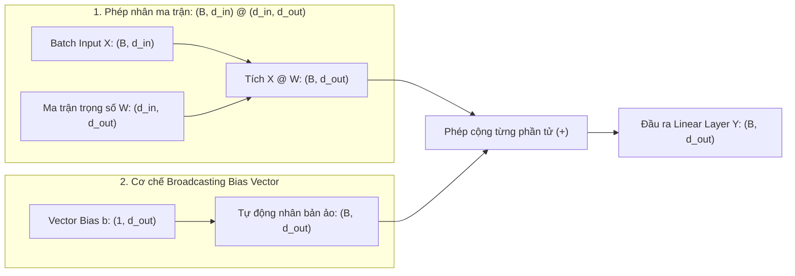
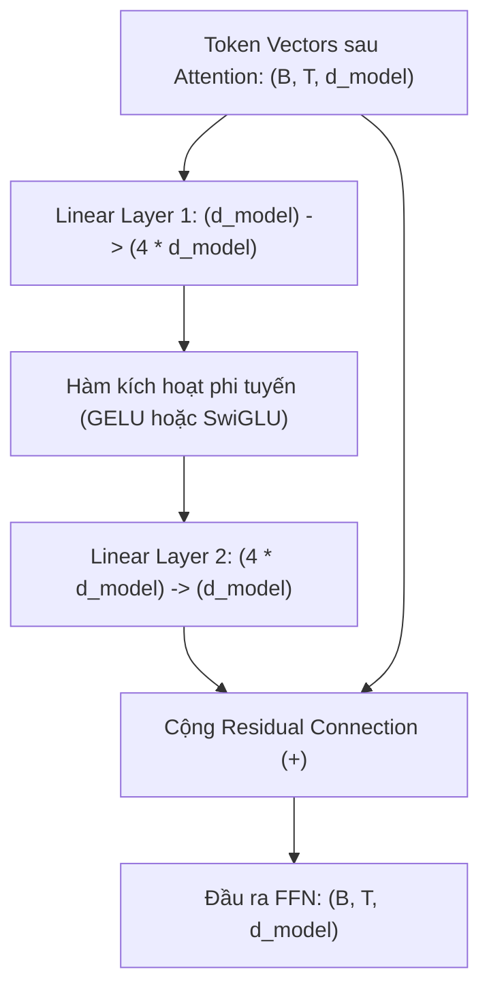

> **"Khớp chiều ma trận (shape alignment) và hiểu đúng phép nhân là 90% thành công khi thiết kế và gỡ lỗi mạng nơ-ron."** — Khi bạn làm chủ được dòng chảy kích thước (tensor shapes) và các phép toán ma trận cơ bản, mọi kiến trúc từ Multi-Layer Perceptron đến Transformer đều trở nên trong suốt.

---

## Thông tin nhanh (Quick Spec)

* **Loại bài (Type):** Thực chiến Thuật toán & Nền tảng Kiến trúc (Build & Concept)
* **Ngôn ngữ & Thư viện:** Python 3.10+, NumPy (tự tay xây dựng từ số 0, không dùng hàm black-box)
* **Kiến thức tiên quyết (Prerequisites):** Bài 01 (Trực giác không gian vector, tích vô hướng, chiều và hệ cơ sở)
* **Thời gian thực hành:** ~45–60 phút
* **Độ khó:** Cơ bản (Foundational)

---

## Mục tiêu bài học (Learning Objectives)

Sau bài học này, bạn sẽ có khả năng:
- [ ] Phân biệt triệt để sự khác nhau bản chất giữa phép nhân từng phần tử (Hadamard product: $A \odot B$) và phép nhân ma trận ($A \times B$).
- [ ] Nắm vững ý nghĩa hình học của phép Chuyển vị ($A^T$), Vết ($\text{Tr}(A)$) và Định thức ($\det(A)$ đo sự co giãn diện tích/thể tích và kiểm tra tính suy biến).
- [ ] Tự tay lập trình từ đầu (from scratch) phép nhân ma trận, chuyển vị, vết, và định thức $2 \times 2$, $3 \times 3$ bằng công thức giải tích giải mã bản chất.
- [ ] Xây dựng tầng tuyến tính $Y = XW + b$ hoàn chỉnh từ đầu, giải thích chi tiết cơ chế Broadcasting kéo giãn bias vector trong PyTorch/NumPy.

---

## 1. Vấn đề thực tế (The Problem)

Nếu bạn hỏi bất kỳ kỹ sư Machine Learning hoặc Deep Learning nào về lỗi phổ biến nhất mà họ gặp phải hàng ngày khi làm việc với PyTorch hay TensorFlow, câu trả lời 99% sẽ là: **Cơn ác mộng kích thước (Shape Mismatch Errors)**:

```text
RuntimeError: mat1 and mat2 shapes cannot be multiplied (64x128 and 64x256)
The size of tensor a (128) must match the size of tensor b (64) at non-singleton dimension 1
```

Những lỗi này bắt nguồn từ việc thiếu hụt nền tảng toán học về các phép toán ma trận cơ sở:

1. **Nhầm lẫn tai hại giữa `@` (Matmul) và `*` (Element-wise multiplication):** Trong Python, toán tử `*` là phép nhân Hadamard (nhân từng phần tử tương ứng). Nếu hai ma trận vô tình có cùng kích thước vuông (ví dụ $128 \times 128$), chương trình sẽ chạy êm ru mà không ném ra bất kỳ lỗi cú pháp nào, nhưng toàn bộ logic lan truyền thông tin của mạng bị phá hủy hoàn toàn.
2. **Không hiểu quy tắc chiều trong (Inner Dimension Alignment):** Khi ghép nối các khối nơ-ron (như Attention nối sang Feed-Forward Network), kích thước đầu ra của phép biến đổi trước bắt buộc phải khớp với chiều đầu vào của ma trận trọng số tiếp theo. Nếu không kiểm soát được dòng chảy kích thước, bạn không thể debug được các mô hình khổng lồ như Transformer.
3. **Cạm bẫy ma trận suy biến khi tối ưu hóa:** Khi giải các hệ phương trình bình phương tối thiểu (Ordinary Least Squares) hay tính ma trận hiệp phương sai, nếu định thức của ma trận bằng 0 ($\det(A) = 0$), ma trận không thể đảo ngược ($A^{-1}$ không tồn tại). Việc gọi `np.linalg.inv` sẽ lập tức bắn ra ngoại lệ `LinAlgError: Singular matrix` hoặc làm bùng nổ số vô cực (`NaN` / `Inf`).

Để trở thành một AI Engineer vững tay, bạn không thể xem ma trận là một "hộp đen". Bạn cần nắm rõ cơ chế từng phép toán được tính toán như thế nào ở mức thanh ghi và bộ nhớ.

---

## 2. Mô hình tư duy & Bản chất (The Concept)

### 2.1 Phép nhân ma trận (Matrix Multiplication): Dòng chảy kết hợp chiều không gian

Cho ma trận $A \in \mathbb{R}^{m \times k}$ và ma trận $B \in \mathbb{R}^{k \times n}$. Phép nhân ma trận $C = A B$ cho ra ma trận kết quả $C \in \mathbb{R}^{m \times n}$.

Công thức đại số phần tử:

$$
C_{ij} = \sum_{p=1}^k A_{ip} B_{pj}
$$

**Mô hình tư duy hình học:**
- Mỗi phần tử $C_{ij}$ thực chất là **tích vô hướng** giữa hàng thứ $i$ của ma trận $A$ (vector hàng kích thước $1 \times k$) và cột thứ $j$ của ma trận $B$ (vector cột kích thước $k \times 1$).
- Chiều trong $k$ (inner dimension) đóng vai trò là chiều không gian trung gian kết nối: nó bị co lại (tính tổng tích phân) để ánh xạ từ không gian $k$ chiều sang không gian $n$ chiều mới.
- Điều kiện sống còn: Chiều thứ hai của $A$ phải bằng chiều thứ nhất của $B$.

$$
(m \times \mathbf{k}) \times (\mathbf{k} \times n) \longrightarrow (m \times n)
$$

### 2.2 Phép nhân Hadamard ($A \odot B$) vs Phép nhân ma trận ($A @ B$)

- **Phép nhân Hadamard (Element-wise):** Yêu cầu $A$ và $B$ có cùng kích thước chính xác $(m \times n)$.
  $$(A \odot B)_{ij} = A_{ij} \cdot B_{ij}$$
  Ứng dụng thực tế: Cơ chế cổng đóng mở thông tin (Gating mechanism) như Forget Gate trong LSTM, hay hàm kích hoạt SwiGLU trong LLaMA-2/3:
  $$\text{SwiGLU}(x) = (\text{Swish}(x W_{\text{gate}})) \odot (x W_{\text{up}})$$
- **Phép nhân ma trận đại số ($A @ B$):** Dùng để đổi hệ cơ sở, xoay chuyển và chiếu không gian dữ liệu sang số chiều khác.

### 2.3 Phép chuyển vị (Transpose): Đổi vai trò Hàng và Cột

Ma trận chuyển vị $A^T$ thu được bằng cách lật ma trận $A$ qua đường chéo chính:

$$
A^T_{ij} = A_{ji}
$$

Nếu $A \in \mathbb{R}^{m \times n}$ thì $A^T \in \mathbb{R}^{n \times m}$.

**Tính chất vàng:**
1. $(A B)^T = B^T A^T$ (Đảo ngược thứ tự nhân ma trận khi chuyển vị).
2. $(A^T)^T = A$.
3. Ma trận đối xứng khi $A = A^T$.
4. Ma trận trực giao khi $A^T A = A A^T = I$.

Ứng dụng AI: Phép chuyển vị xuất hiện ở khắp mọi nơi:
- Tính tích Attention $Q K^T$ trong Transformer (chuyển vị Key để nhân vô hướng với Query).
- Tính đạo hàm lan truyền ngược (Backpropagation): Nếu forward là $Y = XW$, thì backward gradient theo đầu vào là $\frac{\partial L}{\partial X} = \frac{\partial L}{\partial Y} W^T$.

### 2.4 Vết của ma trận (Trace): Tổng năng lượng đường chéo

Vết của ma trận vuông $A \in \mathbb{R}^{n \times n}$, ký hiệu là $\text{Tr}(A)$, là tổng các phần tử trên đường chéo chính:

$$
\text{Tr}(A) = \sum_{i=1}^n A_{ii}
$$

**Tính chất kỳ diệu trong tối ưu hóa:**
- Tính giao hoán tuần hoàn (Cyclic Property): $\text{Tr}(A B) = \text{Tr}(B A)$.
- Chuẩn Frobenius của ma trận đo lường độ lớn trọng số trong điều chuẩn L2 (Weight Decay):
  $$\|A\|_F = \sqrt{\sum_{i=1}^m \sum_{j=1}^n A_{ij}^2} = \sqrt{\text{Tr}(A^T A)}$$

### 2.5 Định thức (Determinant): Thước đo co giãn thể tích không gian

Định thức $\det(A)$ hay $|A|$ của một ma trận vuông $n \times n$ là một giá trị vô hướng mang ý nghĩa hình học sâu sắc: **Hệ số phóng đại diện tích (2D) hoặc thể tích (3D/nD) của khối không gian sau khi bị ma trận $A$ biến đổi.**

1. **Ma trận $2 \times 2$:**
   $$\det \begin{pmatrix} a & b \\ c & d \end{pmatrix} = ad - bc$$
2. **Ma trận $3 \times 3$ (Khai triển Laplace theo hàng đầu tiên):**
   $$\det \begin{pmatrix} a_{11} & a_{12} & a_{13} \\ a_{21} & a_{22} & a_{23} \\ a_{31} & a_{32} & a_{33} \end{pmatrix} = a_{11}(a_{22}a_{33} - a_{23}a_{32}) - a_{12}(a_{21}a_{33} - a_{23}a_{31}) + a_{13}(a_{21}a_{32} - a_{22}a_{31})$$

**Ý nghĩa sinh tử đối với AI:**
- Nếu $\det(A) > 0$: Không gian được mở rộng/co lại và giữ nguyên định hướng (orientation).
- Nếu $\det(A) < 0$: Không gian bị lật ngược (như nhìn qua gương).
- **Nếu $\det(A) = 0$:** Không gian bị ép dẹp hoàn toàn (ví dụ: không gian 3D bị ép phẳng thành mặt phẳng 2D hoặc đường thẳng 1D). Thể tích biến thành 0, thông tin bị mất vĩnh viễn, ma trận bị **suy biến (singular)** và không thể tồn tại ma trận nghịch đảo $A^{-1}$.

### 2.6 Cơ chế Broadcasting và Tầng Tuyến Tính (Linear Layer)

Trong một tầng nơ-ron tuyến tính cơ bản:

$$
Y = X W + b
$$

- $X \in \mathbb{R}^{B \times d_{\text{in}}}$: Batch dữ liệu gồm $B$ mẫu, mỗi mẫu có $d_{\text{in}}$ đặc trưng.
- $W \in \mathbb{R}^{d_{\text{in}} \times d_{\text{out}}}$: Ma trận trọng số ánh xạ sang $d_{\text{out}}$ chiều.
- $X W \in \mathbb{R}^{B \times d_{\text{out}}}$: Kết quả tích ma trận.
- $b \in \mathbb{R}^{1 \times d_{\text{out}}}$: Vector bias (độ lệch).

Khi thực hiện phép cộng $(XW + b)$, framework AI tự động kích hoạt cơ chế **Broadcasting**: vector $b$ kích thước $(1, d_{\text{out}})$ được sao chép ảo thành $(B, d_{\text{out}})$ để cộng tương ứng vào từng mẫu trong batch.



---

## 3. Tự tay xây dựng từ đầu (Build It: From Scratch)

Dưới đây là module mã nguồn Python thuần túy tự xây dựng các phép toán ma trận cốt lõi, hoàn toàn độc lập, không sử dụng `numpy.matmul`, `@`, `numpy.linalg.det`, hay `numpy.transpose`.

```python
"""
Chương trình: Thư viện phép toán ma trận & Tầng tuyến tính từ số 0.
Mục tiêu: Cài đặt matmul, transpose, trace, det và Linear Layer với verification tự động.
"""

def matmul_from_scratch(A: list[list[float]], B: list[list[float]]) -> list[list[float]]:
    """
    Nhân hai ma trận A (m x k) và B (k x n) thành C (m x n).
    Kiểm tra chiều trong một cách chặt chẽ.
    """
    rows_A = len(A)
    cols_A = len(A[0])
    rows_B = len(B)
    cols_B = len(B[0])

    assert cols_A == rows_B, (
        f"Lỗi khớp chiều: Ma trận A ({rows_A}x{cols_A}) không thể nhân với B ({rows_B}x{cols_B}). "
        f"Chiều trong {cols_A} != {rows_B}."
    )

    # Khởi tạo ma trận kết quả kích thước m x n chứa toàn số 0.0
    C = [[0.0 for _ in range(cols_B)] for _ in range(rows_A)]

    # Ba vòng lặp lồng kinh điển O(m * k * n)
    for i in range(rows_A):
        for j in range(cols_B):
            dot_sum = 0.0
            for p in range(cols_A):
                dot_sum += A[i][p] * B[p][j]
            C[i][j] = dot_sum

    return C

def transpose_from_scratch(A: list[list[float]]) -> list[list[float]]:
    """Chuyển vị ma trận A (m x n) thành A^T (n x m)."""
    rows = len(A)
    cols = len(A[0])
    return [[A[i][j] for i in range(rows)] for j in range(cols)]

def trace_from_scratch(A: list[list[float]]) -> float:
    """Tính vết của ma trận vuông (tổng đường chéo chính)."""
    rows = len(A)
    cols = len(A[0])
    assert rows == cols, f"Ma trận phải vuông để tính Trace, nhận được {rows}x{cols}."
    return sum(A[i][i] for i in range(rows))

def determinant_2x2(A: list[list[float]]) -> float:
    """Tính định thức ma trận 2x2: ad - bc."""
    assert len(A) == 2 and len(A[0]) == 2, "Ma trận phải có kích thước 2x2."
    return A[0][0] * A[1][1] - A[0][1] * A[1][0]

def determinant_3x3(A: list[list[float]]) -> float:
    """Tính định thức ma trận 3x3 theo khai triển Laplace hàng 1."""
    assert len(A) == 3 and len(A[0]) == 3, "Ma trận phải có kích thước 3x3."
    term1 = A[0][0] * (A[1][1] * A[2][2] - A[1][2] * A[2][1])
    term2 = A[0][1] * (A[1][0] * A[2][2] - A[1][2] * A[2][0])
    term3 = A[0][2] * (A[1][0] * A[2][1] - A[1][1] * A[2][0])
    return term1 - term2 + term3

def linear_layer_forward(
    X: list[list[float]],
    W: list[list[float]],
    b: list[float]
) -> list[list[float]]:
    """
    Thực hiện lan truyền xuôi của tầng tuyến tính: Y = XW + b.
    Mô phỏng cơ chế broadcasting vector bias b vào từng hàng của XW.
    """
    # 1. Thực hiện nhân ma trận X @ W
    XW = matmul_from_scratch(X, W)

    rows_XW = len(XW)
    cols_XW = len(XW[0])
    assert len(b) == cols_XW, f"Độ dài bias {len(b)} phải khớp với out_features {cols_XW}."

    # 2. Cộng broadcasting bias b vào từng hàng
    Y = [[XW[i][j] + b[j] for j in range(cols_XW)] for i in range(rows_XW)]
    return Y

def run_self_verification():
    """Hàm tự kiểm thử độ chính xác số học của module."""
    print("=== BẮT ĐẦU KIỂM THỬ ĐỘC LẬP TỪ SỐ 0 ===")

    # Dữ liệu thử nghiệm tầng tuyến tính: Batch 2 mẫu, 2 đặc trưng vào, 3 đặc trưng ra
    X = [
        [1.0, 2.0],
        [3.0, 4.0]
    ]
    W = [
        [0.5, -0.5,  1.0],
        [1.5,  0.0, -1.0]
    ]
    b = [0.1, 0.2, 0.3]

    # Lan truyền xuôi
    Y = linear_layer_forward(X, W, b)

    print("Kết quả đầu ra Y = XW + b:")
    for row in Y:
        print(" ", [round(v, 4) for v in row])

    # Kỳ vọng giải tích chuẩn:
    # Hàng 1: [1*0.5 + 2*1.5 + 0.1, 1*(-0.5) + 2*0 + 0.2, 1*1.0 + 2*(-1.0) + 0.3] = [3.6, -0.3, -0.7]
    # Hàng 2: [3*0.5 + 4*1.5 + 0.1, 3*(-0.5) + 4*0 + 0.2, 3*1.0 + 4*(-1.0) + 0.3] = [7.6, -1.3, -0.7]
    assert abs(Y[0][0] - 3.6) < 1e-9
    assert abs(Y[0][1] - (-0.3)) < 1e-9
    assert abs(Y[0][2] - (-0.7)) < 1e-9
    assert abs(Y[1][0] - 7.6) < 1e-9
    assert abs(Y[1][1] - (-1.3)) < 1e-9
    assert abs(Y[1][2] - (-0.7)) < 1e-9
    print("-> Lan truyền xuôi Linear Layer: CHÍNH XÁC 100%!")

    # Kiểm tra ma trận chuyển vị
    WT = transpose_from_scratch(W)
    assert len(WT) == 3 and len(WT[0]) == 2
    assert WT[0][1] == 1.5
    print("-> Phép chuyển vị Transpose: CHÍNH XÁC 100%!")

    # Kiểm tra Trace và Determinant trên ma trận 3x3
    M = [
        [1.0, 2.0, 3.0],
        [0.0, 4.0, 5.0],
        [1.0, 0.0, 6.0]
    ]
    tr_M = trace_from_scratch(M)
    det_M = determinant_3x3(M)

    print(f"Ma trận M 3x3: Trace = {tr_M}, Det = {det_M}")
    # Trace = 1 + 4 + 6 = 11
    # Det = 1*(24 - 0) - 2*(0 - 5) + 3*(0 - 4) = 24 + 10 - 12 = 22
    assert abs(tr_M - 11.0) < 1e-9
    assert abs(det_M - 22.0) < 1e-9
    print("-> Phép tính Trace và Determinant 3x3: CHÍNH XÁC 100%!")
    print("=== TOÀN BỘ KIỂM THỬ ĐÃ VƯỢT QUA THÀNH CÔNG ===")

if __name__ == "__main__":
    run_self_verification()
```

---

## 4. Ứng dụng AI Engineering & Thực tế Production (Use It)

### 4.1 Bí mật thiết kế `nn.Linear` trong PyTorch: Tại sao lại là $Y = X W^T + b$?

Nếu bạn mở mã nguồn C++/Python của lớp `torch.nn.Linear(in_features, out_features)` trong PyTorch, bạn sẽ phát hiện ra một điều thú vị: Trọng số nội bộ `linear.weight` không có kích thước `(in_features, out_features)` như cách viết lý thuyết, mà có hình dạng ngược lại:

$$\text{Shape của weight} = (\text{out\_features}, \text{in\_features})$$

Do đó, công thức tính toán thực tế của PyTorch là:

$$
Y = X W^T + b
$$

**Tại sao các kỹ sư tạo nên PyTorch lại làm như vậy?**
1. **Tối ưu hóa bộ nhớ C/CUDA (Row-Major Contiguity):** Trong ngôn ngữ C và CUDA, mảng 2 chiều được lưu theo từng hàng liên tiếp trong bộ nhớ (Row-major order). Khi ma trận trọng số được lưu là `(out_features, in_features)`, mỗi hàng chính là toàn bộ trọng số kết nối tới MỘT nơ-ron đầu ra. Điều này giúp GPU đọc đồng thời dữ liệu vào bộ nhớ đệm L1/Shared Memory mà không bị phân mảnh.
2. **Tối ưu hóa phép tính đạo hàm ngược (Backward Pass):** Khi tính toán gradient theo trọng số:
   $$\frac{\partial L}{\partial W} = \left( \frac{\partial L}{\partial Y} \right)^T X$$
   Cách bố trí này giúp phép tính đạo hàm và cập nhật trọng số khớp trực tiếp với kernel tăng tốc BLAS (GEMM) mà không cần thêm bước chuyển vị tốn kém.

### 4.2 Khối Feed-Forward Network (FFN) trong Kiến trúc Transformer

Mọi khối Transformer (từ GPT-4, Claude, đến LLaMA) đều chứa một mạng con FFN (Feed-Forward Network) chiếm khoảng 2/3 tổng số tham số của toàn bộ mô hình:



Quy trình tính toán FFN tiêu chuẩn:

$$
\text{FFN}(x) = \text{Activation}(x W_1 + b_1) W_2 + b_2
$$

- **Bước 1: Phóng đại số chiều (Up-projection):** Nhân với $W_1 \in \mathbb{R}^{d_{\text{model}} \times 4d_{\text{model}}}$. Ví dụ với $d_{\text{model}} = 4096$, không gian được giải nén lên $16,384$ chiều. Tại không gian cực lớn này, các đặc trưng phức tạp của ngôn ngữ dễ dàng được phân tách tuyến tính.
- **Bước 2: Kích hoạt phi tuyến:** Đi qua hàm kích hoạt GELU hoặc SiLU.
- **Bước 3: Nén số chiều (Down-projection):** Nhân với $W_2 \in \mathbb{R}^{4d_{\text{model}} \times d_{\text{model}}}$ để đưa tensor trở lại kích thước $4096$ ban đầu, sẵn sàng cộng với luồng Residual Connection.

---

## 5. Giải ngố thuật ngữ & Ngộ nhận (Key Terms)

| Thuật ngữ (Term) | Người ta thường nghĩ là... | Bản chất kỹ thuật thực sự là... |
|---|---|---|
| **Matrix Multiplication ($A @ B$)** | Nhân các con số ở vị trí tương ứng giữa hai ma trận với nhau. | Tích vô hướng kết hợp giữa các hàng của ma trận thứ nhất và các cột của ma trận thứ hai, biến đổi không gian tọa độ. |
| **Hadamard Product ($A \odot B$)** | Phép nhân ma trận đặc biệt ít khi dùng trong thực tế. | Phép nhân trực tiếp từng phần tử có cùng chỉ số $(i, j)$; là chìa khóa của cơ chế cổng (gating) và hàm kích hoạt hiện đại (SwiGLU). |
| **Transpose ($A^T$)** | Chỉ là thao tác lật ngược bảng dữ liệu cho thuận mắt nhìn. | Phép hoán đổi vị trí hàng và cột; có vai trò sống còn trong việc định hướng dòng lan truyền đạo hàm trong Backpropagation. |
| **Trace ($\text{Tr}(A)$)** | Một phép tính cộng chéo vô nghĩa ít khi ứng dụng trong AI. | Tổng các phần tử trên đường chéo chính của ma trận vuông; bất biến qua phép đổi cơ sở và bằng tổng tất cả các trị riêng (Eigenvalues). |
| **Determinant ($\det(A)$)** | Một con số phức tạp tính theo công thức cồng kềnh dùng để giải đề thi. | Hệ số co giãn diện tích hoặc thể tích của không gian sau biến đổi; nếu bằng 0 chứng tỏ không gian bị ép xẹp và mất thông tin vĩnh viễn. |
| **Broadcasting** | Một tính năng sửa lỗi kích thước tự động của Python khi lập trình viên viết ẩu. | Cơ chế chuẩn hóa kích thước mảng bằng cách lặp lại ảo các chiều đơn vị mà không tốn thêm bộ nhớ RAM, tối ưu hóa tính toán song song. |
| **Linear Layer** | Một thuật toán học máy phức tạp chứa hàng ngàn quy tắc logic. | Phép biến đổi Affine đơn giản gồm một phép nhân ma trận trọng số và một phép cộng vector độ lệch: $Y = XW + b$. |

---

## 6. Bài tập thử thách (Hands-on Challenges)

### 🟢 Dễ (Easy): Kiểm tra tính đối xứng và trực giao của ma trận
Sử dụng các hàm `transpose_from_scratch` và `matmul_from_scratch` đã xây dựng ở Mục 3:
1. Viết hàm `is_symmetric_matrix(A)` kiểm tra xem ma trận có thỏa mãn $A = A^T$ (với sai số $< 10^{-9}$).
2. Viết hàm `is_orthogonal_matrix(A)` kiểm tra xem ma trận có thỏa mãn $A^T A = I$ (tích với ma trận chuyển vị tạo thành ma trận đơn vị).
3. Kiểm thử với ma trận quay góc $90^\circ$:
   $$R = \begin{pmatrix} 0 & -1 \\ 1 & 0 \end{pmatrix}$$
   Chứng minh rằng $R$ là ma trận trực giao nhưng không đối xứng.

### 🟡 Vừa (Medium): Tự xây dựng ma trận nghịch đảo $3 \times 3$ bằng ma trận phụ hợp
Phương pháp nghịch đảo cổ điển bằng ma trận phụ hợp (Adjugate Matrix):

$$
A^{-1} = \frac{1}{\det(A)} \text{adj}(A) = \frac{1}{\det(A)} C^T
$$

trong đó $C_{ij} = (-1)^{i+j} M_{ij}$ là phần phụ đại số (Cofactor), và $M_{ij}$ là định thức của ma trận con cấp 2 bỏ đi hàng $i$, cột $j$.
- Hãy viết hàm `inverse_3x3_from_scratch(A)`. Nếu $\det(A) == 0$, ném ra ngoại lệ `ValueError("Ma trận suy biến, không thể nghịch đảo!")`.
- Kiểm chứng với ma trận $M$ ở Mục 3: nhân $M @ M^{-1}$ và xác nhận kết quả trả về đúng ma trận đơn vị $I_3$ với sai số dấu phẩy động $< 10^{-9}$.

### 🔴 Khó (Hard): Tự xây dựng trọn vẹn mạng Multi-Layer Perceptron (MLP) 2 tầng
Sử dụng toàn bộ các hàm cơ bản tự viết ở Mục 3 (tuyệt đối không dùng thư viện ngoài):
- Xây dựng một mạng nơ-ron MLP gồm 2 tầng ẩn:
  $$\text{Input } (4) \longrightarrow \text{Hidden } (8) \longrightarrow \text{Output } (2)$$
- Xử lý một mini-batch gồm 16 mẫu dữ liệu ngẫu nhiên $X \in \mathbb{R}^{16 \times 4}$.
- Tự viết hàm kích hoạt ReLU: $\text{ReLU}(z) = \max(0, z)$ cho mảng 2D.
- Tính toán lan truyền xuôi hoàn chỉnh:
  $$H = \text{ReLU}(X W_1 + b_1), \quad \hat{Y} = H W_2 + b_2$$
- Tính toán hàm mất mát Mean Squared Error (MSE) so với một nhãn mục tiêu ngẫu nhiên $Y_{\text{true}} \in \mathbb{R}^{16 \times 2}$.
