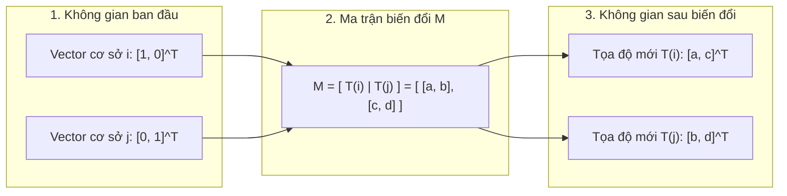
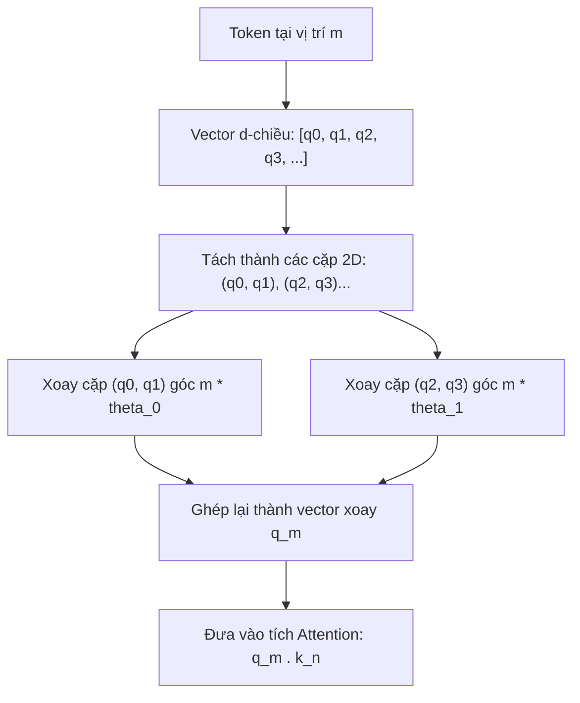

> **"Ma trận không phải là một bảng số vô hồn — nó là một cỗ máy bẻ cong không gian. Biết nơi các vector cơ sở hạ cánh, bạn nắm trọn toàn bộ biến đổi."** — *Tư duy hình học trong Đại số tuyến tính.*

---

## Thông tin nhanh (Quick Spec)

* **Loại bài (Type):** Khái niệm Hình học & Thực chiến Thuật toán (Concept & Build)
* **Ngôn ngữ & Thư viện:** Python 3.10+, NumPy (thuần túy tư duy biến đổi từ số 0, không dùng hàm black-box)
* **Kiến thức tiên quyết (Prerequisites):** Bài 01 (Linear Algebra Intuition), Bài 02 (Vectors & Matrices Operations)
* **Thời gian thực hành:** ~60–90 phút
* **Độ khó:** Trung bình (Intermediate)

---

## Mục tiêu bài học (Learning Objectives)

Sau bài học này, bạn sẽ có khả năng:
- [ ] Hiểu sâu sắc bản chất ma trận là ánh xạ tuyến tính biến đổi không gian: bảo toàn gốc tọa độ và duy trì tính thẳng song song của các đường lưới tọa độ.
- [ ] Thiết lập và lập trình từ đầu các ma trận biến đổi cơ bản: Phép quay (Rotation), Co giãn (Scaling), Trượt (Shear), và Phản chiếu (Reflection) trong không gian 2D và 3D.
- [ ] Hiểu rõ ý nghĩa hình học của phép nhân ma trận là phép hợp thành (composition) và giải thích tại sao $A \cdot B \neq B \cdot A$ (tính không giao hoán).
- [ ] Tự tay xây dựng pipeline biến đổi Affine bằng tọa độ đồng nhất (Homogeneous Coordinates) trên đám mây điểm (point cloud) từ số 0.
- [ ] Giải mã cơ chế Rotary Position Embedding (RoPE) trong các mô hình ngôn ngữ lớn hiện đại (LLaMA-3, Mistral, Qwen): cách RoPE ứng dụng ma trận quay 2D để bảo toàn khoảng cách tương đối giữa các token.

---

## 1. Vấn đề thực tế (The Problem)

Trong quá trình phát triển các hệ thống AI hiện đại — từ thị giác máy tính (Computer Vision), đồ họa không gian 3D (NeRF, 3D Gaussian Splatting) cho đến xử lý ngôn ngữ tự nhiên (Large Language Models) — dữ liệu liên tục bị biến dạng, xoay chuyển và chiếu qua các không gian đặc trưng khác nhau:

1. **Sự mơ hồ trong tăng cường dữ liệu (Data Augmentation) & Khớp không gian:**
   Khi huấn luyện mô hình thị giác hoặc xe tự hành, dữ liệu ảnh và đám mây điểm LiDAR phải trải qua các phép xoay, co giãn, nghiêng và tịnh tiến. Nếu xem ma trận chỉ là một mảng 2 chiều và nhân số một cách máy móc, bạn sẽ không kiểm soát được tại sao một chuỗi biến đổi lại làm lật ngược hình ảnh (flip), gây méo mó diện tích, hay làm suy biến (rank collapse) toàn bộ vector đặc trưng.
2. **Cơn ác mộng thứ tự biến đổi (Non-commutative Transformations):**
   Một sai lầm kinh điển của các kỹ sư là hoán đổi tùy tiện thứ tự biến đổi: *xoay rồi mới tịnh tiến* khác hoàn toàn với *tịnh tiến rồi mới xoay*. Trong đại số, $A \cdot B \neq B \cdot A$. Việc nhầm lẫn thứ tự này phá hỏng hệ thống tọa độ camera trong robotics và làm sai lệch ma trận chiếu trong mạng nơ-ron.
3. **Bế tắc của mã hóa vị trí tuyệt đối trong LLMs:**
   Trong cơ chế Self-Attention của Transformer, mô hình không tự nhận biết được thứ tự trước sau của các từ. Ban đầu, các nhà nghiên cứu cộng một vector vị trí tuyệt đối (Absolute Positional Embedding) vào token embedding. Cách tiếp cận ngây thơ này bộc lộ nhược điểm chí mạng: mô hình không thể khái quát hóa khi độ dài văn bản vượt quá context window được huấn luyện, và không phản ánh được quan hệ vị trí *tương đối* giữa hai từ cách nhau $k$ vị trí.

Câu hỏi đặt ra là: **Làm thế nào để biến đổi một vector sao cho tích vô hướng giữa hai vector chỉ phụ thuộc thuần túy vào khoảng cách tương đối giữa chúng?** Lời giải đáp nằm ở chính hình học biến đổi ma trận — cụ thể là phép quay trực giao 2D.

---

## 2. Mô hình tư duy & Bản chất (The Concept)

### 2.1 Quy tắc vàng: Nơi hạ cánh của các Vector Cơ sở (Basis Vectors)

Một hàm $T: \mathbb{R}^n \to \mathbb{R}^m$ được gọi là **Biến đổi Tuyến tính (Linear Transformation)** nếu và chỉ nếu nó thỏa mãn hai điều kiện tiên quyết:
1. Tính cộng: $T(u + v) = T(u) + T(v)$
2. Tính thuần nhất: $T(c \cdot u) = c \cdot T(u)$

Hệ quả hình học trực quan nhất:
- Gốc tọa độ $(0, 0)$ luôn phải đứng yên: $T(\mathbf{0}) = \mathbf{0}$.
- Tất cả các đường thẳng sau biến đổi vẫn phải là đường thẳng (không bị bẻ cong).
- Các đường thẳng song song cách đều nhau vẫn duy trì tính song song cách đều.

**Quy tắc vàng của biến đổi ma trận:**
Bất kỳ biến đổi tuyến tính 2D nào được xác định **hoàn toàn và duy nhất** bởi tọa độ mới của hai vector cơ sở chuẩn $\hat{i} = \begin{bmatrix} 1 \\ 0 \end{bmatrix}$ và $\hat{j} = \begin{bmatrix} 0 \\ 1 \end{bmatrix}$ sau biến đổi:

$$
M = \begin{bmatrix} T(\hat{i}) & T(\hat{j}) \end{bmatrix} = \begin{bmatrix} a & b \\ c & d \end{bmatrix}
$$

Để biến đổi bất kỳ vector $v = \begin{bmatrix} x \\ y \end{bmatrix} = x \hat{i} + y \hat{j}$, ta chỉ cần lấy tổ hợp tuyến tính của tọa độ mới:

$$
T(v) = x T(\hat{i}) + y T(\hat{j}) = x \begin{bmatrix} a \\ c \end{bmatrix} + y \begin{bmatrix} b \\ d \end{bmatrix} = \begin{bmatrix} ax + by \\ cx + dy \end{bmatrix} = M v
$$



### 2.2 Các Phép Biến Đổi Cơ Bản Trong 2D

#### 1. Phép quay góc $\theta$ (Rotation Matrix)
Khi quay mặt phẳng một góc $\theta$ ngược chiều kim đồng hồ quanh gốc tọa độ:
- Vector $\hat{i} = [1, 0]^T$ hạ cánh tại $[\cos\theta, \sin\theta]^T$.
- Vector $\hat{j} = [0, 1]^T$ hạ cánh tại $[-\sin\theta, \cos\theta]^T$.

Ghép hai cột này lại, ta có ma trận quay kinh điển:

$$
R(\theta) = \begin{bmatrix} \cos\theta & -\sin\theta \\ \sin\theta & \cos\theta \end{bmatrix}
$$

**Đặc tính hình học:**
- Định thức $\det(R) = \cos^2\theta - (-\sin^2\theta) = \cos^2\theta + \sin^2\theta = 1$. Diện tích hoàn toàn được bảo toàn!
- $R(\theta)^T R(\theta) = I \implies R$ là ma trận trực giao (Orthogonal Matrix). Nó bảo toàn độ dài vector và góc giữa mọi cặp vector.

#### 2. Phép co giãn (Scaling Matrix)
Co giãn theo trục $x$ với hệ số $s_x$ và trục $y$ với hệ số $s_y$:

$$
S(s_x, s_y) = \begin{bmatrix} s_x & 0 \\ 0 & s_y \end{bmatrix}
$$

Định thức $\det(S) = s_x s_y$: diện tích mọi hình khối tăng hoặc giảm đúng $s_x s_y$ lần.

#### 3. Phép trượt (Shear Matrix)
Trượt theo phương ngang (trục $x$) một lượng $k$:

$$
Sh_x(k) = \begin{bmatrix} 1 & k \\ 0 & 1 \end{bmatrix}
$$

Vector $\hat{i}$ đứng yên, nhưng $\hat{j}$ bị đẩy lệch thành $[k, 1]^T$. Hình vuông đơn vị bị biến thành hình bình hành nhưng diện tích vẫn bằng $1$ vì $\det(Sh_x) = 1$.

#### 4. Phép phản chiếu (Reflection Matrix)
Phản chiếu qua trục $y$ (đảo chiều trục $x$):

$$
Ref_y = \begin{bmatrix} -1 & 0 \\ 0 & 1 \end{bmatrix}
$$

Định thức $\det(Ref_y) = -1$. Dấu âm của định thức cho thấy định hướng không gian đã bị lật ngược (từ quy tắc bàn tay phải sang quy tắc bàn tay trái).

### 2.3 Hợp thành biến đổi (Composition) & Tính không giao hoán

Nếu bạn áp dụng phép quay $R$ rồi sau đó áp dụng phép co giãn $S$ lên vector $x$:

$$
y = S (R x) = (S \cdot R) x
$$

Ma trận tích $M_{\text{total}} = S \cdot R$ đại diện cho toàn bộ chuỗi biến đổi.
Tuy nhiên, vì phép nhân ma trận **không có tính giao hoán**:

$$
S \cdot R \neq R \cdot S
$$

*Ví dụ trực quan:* Co giãn $2\times$ theo chiều $x$ rồi xoay $90^\circ$ sẽ biến vector $[1, 0]^T$ thành $[0, 2]^T$. Nhưng xoay $90^\circ$ trước (thành $[0, 1]^T$) rồi mới co giãn theo chiều $x$ sẽ giữ nguyên vector thành $[0, 1]^T$! Thứ tự nhân từ phải sang trái đại diện cho thứ tự áp dụng theo thời gian.

### 2.4 Tọa độ đồng nhất (Homogeneous Coordinates): Biến Phép Tịnh Tiến thành Ma Trận

Phép tịnh tiến (Translation) dịch chuyển một vector $x$ một lượng $t$:

$$
T_{\text{trans}}(x) = x + t
$$

Phép toán này **không phải là biến đổi tuyến tính** trong $\mathbb{R}^2$ vì $T_{\text{trans}}(\mathbf{0}) = t \neq \mathbf{0}$ (gốc tọa độ bị di chuyển).
Do đó, không tồn tại bất kỳ ma trận $2 \times 2$ nào có thể biểu diễn phép tịnh tiến.

**Giải pháp: Tọa độ đồng nhất trong $\mathbb{R}^3$:**
Bằng cách thêm một chiều ảo $w = 1$ vào vector: $\begin{bmatrix} x \\ y \\ 1 \end{bmatrix}$, ta có thể biểu diễn phép biến đổi Affine (gồm cả xoay, co giãn và tịnh tiến) bằng ma trận $3 \times 3$:

$$
\begin{bmatrix} x' \\ y' \\ 1 \end{bmatrix} = \begin{bmatrix} r_{11} & r_{12} & t_x \\ r_{21} & r_{22} & t_y \\ 0 & 0 & 1 \end{bmatrix} \begin{bmatrix} x \\ y \\ 1 \end{bmatrix} = \begin{bmatrix} r_{11} x + r_{12} y + t_x \\ r_{21} x + r_{22} y + t_y \\ 1 \end{bmatrix}
$$

Đây chính là chuẩn mực công nghiệp trong OpenGL, game engine và mô hình thị giác máy tính.

---

## 3. Tự tay xây dựng từ đầu (Build It: From Scratch)

Dưới đây là module mã nguồn Python thuần túy tự cài đặt toàn bộ các ma trận biến đổi 2D/3D, hệ tọa độ đồng nhất và chứng minh tính chất hình học từ số 0.

```python
"""
Chương trình: Công cụ biến đổi ma trận hình học từ số 0.
Mục tiêu: Xây dựng ma trận quay, co giãn, trượt, tọa độ đồng nhất và kiểm chứng hình học.
"""
import math

def matmul(A: list[list[float]], B: list[list[float]]) -> list[list[float]]:
    """Phép nhân ma trận thuần túy A (m x k) @ B (k x n)."""
    rows_A, cols_A = len(A), len(A[0])
    rows_B, cols_B = len(B), len(B[0])
    assert cols_A == rows_B, f"Không khớp kích thước: {cols_A} != {rows_B}"
    C = [[0.0 for _ in range(cols_B)] for _ in range(rows_A)]
    for i in range(rows_A):
        for j in range(cols_B):
            C[i][j] = sum(A[i][p] * B[p][j] for p in range(cols_A))
    return C

def rotation_2d(theta_rad: float) -> list[list[float]]:
    """Tạo ma trận quay 2D góc theta (radian) ngược chiều kim đồng hồ."""
    c = math.cos(theta_rad)
    s = math.sin(theta_rad)
    return [
        [c, -s],
        [s,  c]
    ]

def scaling_2d(sx: float, sy: float) -> list[list[float]]:
    """Tạo ma trận co giãn 2D theo hệ số sx, sy."""
    return [
        [sx, 0.0],
        [0.0, sy]
    ]

def shearing_2d(kx: float, ky: float) -> list[list[float]]:
    """Tạo ma trận trượt 2D: x' = x + kx*y, y' = y + ky*x."""
    return [
        [1.0, kx],
        [ky,  1.0]
    ]

def affine_transform_2d(R: list[list[float]], t: list[float]) -> list[list[float]]:
    """
    Tạo ma trận Affine 3x3 trong tọa độ đồng nhất từ ma trận xoay/co giãn R (2x2)
    và vector tịnh tiến t = [tx, ty].
    """
    return [
        [R[0][0], R[0][1], t[0]],
        [R[1][0], R[1][1], t[1]],
        [0.0,     0.0,     1.0]
    ]

def transform_points_2d(points: list[list[float]], M: list[list[float]]) -> list[list[float]]:
    """
    Biến đổi danh sách điểm N x 2 bằng ma trận M (2x2).
    Công thức: P' = P @ M^T (hoặc áp dụng M * p cho từng điểm).
    """
    transformed = []
    for p in points:
        x_new = M[0][0] * p[0] + M[0][1] * p[1]
        y_new = M[1][0] * p[0] + M[1][1] * p[1]
        transformed.append([x_new, y_new])
    return transformed

def transform_points_affine(points: list[list[float]], M_3x3: list[list[float]]) -> list[list[float]]:
    """
    Biến đổi danh sách điểm N x 2 bằng ma trận Affine 3x3 trong tọa độ đồng nhất.
    """
    transformed = []
    for p in points:
        # Nhúng vào tọa độ đồng nhất [x, y, 1]
        x_new = M_3x3[0][0] * p[0] + M_3x3[0][1] * p[1] + M_3x3[0][2] * 1.0
        y_new = M_3x3[1][0] * p[0] + M_3x3[1][1] * p[1] + M_3x3[1][2] * 1.0
        transformed.append([x_new, y_new])
    return transformed

def polygon_area_2d(pts: list[list[float]]) -> float:
    """Tính diện tích đa giác đơn giản bằng công thức Shoelace."""
    n = len(pts)
    area = 0.0
    for i in range(n):
        j = (i + 1) % n
        area += pts[i][0] * pts[j][1]
        area -= pts[j][0] * pts[i][1]
    return abs(area) / 2.0

def run_geometric_verification():
    """Kiểm chứng tính đúng đắn của các quy luật hình học."""
    print("=== BẮT ĐẦU KIỂM THỬ HÌNH HỌC TỪ SỐ 0 ===")

    # 1. Định nghĩa hình vuông đơn vị 4 đỉnh: (0,0), (1,0), (1,1), (0,1)
    square = [
        [0.0, 0.0],
        [1.0, 0.0],
        [1.0, 1.0],
        [0.0, 1.0]
    ]
    orig_area = polygon_area_2d(square)
    print(f"1. Diện tích hình vuông ban đầu: {orig_area:.4f}")
    assert abs(orig_area - 1.0) < 1e-9

    # 2. Phép quay 90 độ (pi/2)
    R_90 = rotation_2d(math.pi / 2.0)
    rotated_square = transform_points_2d(square, R_90)
    rot_area = polygon_area_2d(rotated_square)
    print(f"2. Diện tích sau khi xoay 90 độ: {rot_area:.4f} (Bảo toàn diện tích hoàn hảo!)")
    assert abs(rot_area - 1.0) < 1e-9

    # 3. Phép co giãn: sx = 3.0, sy = 2.0
    S = scaling_2d(3.0, 2.0)
    scaled_square = transform_points_2d(square, S)
    scaled_area = polygon_area_2d(scaled_square)
    print(f"3. Diện tích sau co giãn (3x, 2y): {scaled_area:.4f} (Đúng bằng det(S) = 6.0!)")
    assert abs(scaled_area - 6.0) < 1e-9

    # 4. Chứng minh tính không giao hoán: S @ R != R @ S
    SR = matmul(S, R_90)
    RS = matmul(R_90, S)

    print("\nMa trận S @ R (Xoay trước, Co giãn sau):")
    for row in SR:
        print(" ", [round(v, 4) for v in row])

    print("Ma trận R @ S (Co giãn trước, Xoay sau):")
    for row in RS:
        print(" ", [round(v, 4) for v in row])

    # Kiểm tra hai ma trận khác nhau
    diff = sum(abs(SR[i][j] - RS[i][j]) for i in range(2) for j in range(2))
    assert diff > 1.0, "Hai ma trận phải khác nhau do tính không giao hoán!"
    print("-> Xác nhận: S @ R != R @ S (Tính không giao hoán được chứng minh)")

    # 5. Phép biến đổi Affine với tọa độ đồng nhất: Xoay 90 độ + Tịnh tiến [5.0, -3.0]
    M_affine = affine_transform_2d(R_90, [5.0, -3.0])
    origin = [[0.0, 0.0]]
    transformed_origin = transform_points_affine(origin, M_affine)
    print(f"\n5. Gốc tọa độ [0, 0] sau Affine biến thành: {transformed_origin[0]}")
    assert abs(transformed_origin[0][0] - 5.0) < 1e-9
    assert abs(transformed_origin[0][1] - (-3.0)) < 1e-9

    print("=== TOÀN BỘ KIỂM THỬ HÌNH HỌC ĐÃ VƯỢT QUA ===")

if __name__ == "__main__":
    run_geometric_verification()
```

---

## 4. Ứng dụng AI Engineering & Thực tế Production (Use It)

### 4.1 Giải mã Rotary Position Embedding (RoPE) trong LLaMA-3, Mistral, Qwen

Trong kiến trúc Transformer nguyên bản, việc đưa thông tin thứ tự từ ngữ vào mô hình gặp bế tắc khi muốn mở rộng context window. Năm 2021, Jianlin Su đề xuất **Rotary Position Embedding (RoPE)** — giải pháp hiện là tiêu chuẩn công nghiệp thống trị toàn bộ các mô hình LLM mã nguồn mở hàng đầu.

#### Bản chất hình học của RoPE:
Thay vì cộng một vector vị trí vào embedding, RoPE **xoay vector Query và Key trong không gian 2D** theo góc tỷ lệ thuận với vị trí của token!

Giả sử vector Query có số chiều $d$. Ta nhóm các chiều thành từng cặp 2D: $(q_0, q_1), (q_2, q_3), \dots, (q_{d-2}, q_{d-1})$.
Tại vị trí token thứ $m$, cặp 2D thứ $i$ được nhân với ma trận quay:

$$
R_{\Theta, m}^{(i)} = \begin{bmatrix} \cos(m \theta_i) & -\sin(m \theta_i) \\ \sin(m \theta_i) & \cos(m \theta_i) \end{bmatrix}
$$

với $\theta_i = 10000^{-2(i-1)/d}$.



#### Phép màu toán học: Tích vô hướng bảo toàn khoảng cách tương đối
Giả sử vector Query ở vị trí token $m$ và vector Key ở vị trí token $n$. Tích Attention giữa chúng là:

$$
\langle R_m q, R_n k \rangle = (R_m q)^T (R_n k) = q^T R_m^T R_n k
$$

Do tính chất của ma trận quay: $R_m^T = R(-m\theta)$. Khi nhân hai ma trận quay với nhau:

$$
R(-m\theta) \cdot R(n\theta) = R((n - m)\theta)
$$

Do đó:

$$
\langle R_m q, R_n k \rangle = q^T R((n - m)\theta) k = g(q, k, n - m)
$$

**Ý nghĩa đột phá:** Tích Attention giữa hai từ chỉ phụ thuộc vào độ lệch khoảng cách tương đối $(n - m)$, hoàn toàn độc lập với việc hai từ đó xuất hiện ở đầu câu (vị trí 1 và 4) hay ở cuối văn bản 100k tokens (vị trí 90,001 và 90,004)!

Dưới đây là đoạn code thực nghiệm kiểm chứng tính chất này bằng Python thuần:

```python
def rope_verify_relative_shift():
    """Minh chứng tích vô hướng RoPE chỉ phụ thuộc vào (n - m)."""
    theta = 0.05
    q = [1.2, -0.8]
    k = [0.5,  1.1]

    # Cặp 1: Vị trí m = 5, n = 9 (khoảng cách lệch = 4)
    R_m1 = rotation_2d(5 * theta)
    R_n1 = rotation_2d(9 * theta)
    qm1 = [R_m1[0][0]*q[0] + R_m1[0][1]*q[1], R_m1[1][0]*q[0] + R_m1[1][1]*q[1]]
    kn1 = [R_n1[0][0]*k[0] + R_n1[0][1]*k[1], R_n1[1][0]*k[0] + R_n1[1][1]*k[1]]
    score1 = qm1[0]*kn1[0] + qm1[1]*kn1[1]

    # Cặp 2: Vị trí m = 100, n = 104 (khoảng cách lệch = 4)
    R_m2 = rotation_2d(100 * theta)
    R_n2 = rotation_2d(104 * theta)
    qm2 = [R_m2[0][0]*q[0] + R_m2[0][1]*q[1], R_m2[1][0]*q[0] + R_m2[1][1]*q[1]]
    kn2 = [R_n2[0][0]*k[0] + R_n2[0][1]*k[1], R_n2[1][0]*k[0] + R_n2[1][1]*k[1]]
    score2 = qm2[0]*kn2[0] + qm2[1]*kn2[1]

    print(f"Score tại (5, 9):   {score1:.8f}")
    print(f"Score tại (100, 104): {score2:.8f}")
    assert abs(score1 - score2) < 1e-9
    print("-> RoPE bảo toàn khoảng cách tương đối chính xác tuyệt đối!")

rope_verify_relative_shift()
```

### 4.2 Lưới Affine và Spatial Transformer Networks trong Thị giác máy tính

Trong PyTorch, hàm `torch.nn.functional.affine_grid` và `grid_sample` sử dụng trực tiếp ma trận biến đổi Affine $2 \times 3$ để nắn chỉnh, xoay và căn chỉnh hình ảnh đầu vào trước khi đưa vào mạng CNN/ViT. Toàn bộ phép nắn ảnh này có thể tính đạo hàm ngược (differentiable), cho phép mạng nơ-ron tự học cách xoay vật thể về hướng chuẩn trực diện.

---

## 5. Giải ngố thuật ngữ & Ngộ nhận (Key Terms)

| Thuật ngữ (Term) | Người ta thường nghĩ là... | Bản chất kỹ thuật thực sự là... |
|---|---|---|
| **Biến đổi tuyến tính (Linear Transformation)** | Bất kỳ hàm toán học nào có đồ thị là đường thẳng. | Ánh xạ bảo toàn phép cộng và phép nhân vô hướng; luôn cố định gốc tọa độ $(0, 0)$ và giữ thẳng các đường lưới không gian. |
| **Phép tịnh tiến (Translation)** | Là biến đổi tuyến tính vì nó di chuyển theo một đường thẳng. | Không phải biến đổi tuyến tính trong $\mathbb{R}^n$ vì nó làm di dời gốc tọa độ; chỉ trở thành biến đổi tuyến tính khi nhúng vào không gian tọa độ đồng nhất $\mathbb{R}^{n+1}$. |
| **Hợp thành ma trận (Composition)** | Có thể nhân ma trận theo bất kỳ thứ tự nào tùy thích. | Phép nhân ma trận không có tính giao hoán ($A B \neq B A$); biến đổi được áp dụng trước nằm ở phía bên phải trong biểu thức toán ($B A x = B(Ax)$). |
| **Định thức (Determinant)** | Một con số tính từ quy tắc nhân chéo trừ chéo phức tạp dùng để giải bài tập. | Hệ số co giãn diện tích (2D) hoặc thể tích (3D/nD) của không gian; nếu mang giá trị âm có nghĩa là không gian đã bị lật ngược định hướng. |
| **RoPE (Rotary Position Embedding)** | Một lớp mạng nơ-ron học thêm các trọng số vị trí token. | Phép quay ma trận trực giao 2D cố định áp dụng lên từng cặp chiều của Query và Key, giúp tích Attention phản ánh trực tiếp khoảng cách tương đối $n - m$. |
| **Tọa độ đồng nhất (Homogeneous Coordinates)** | Một mẹo vặt hình học vô dụng ngoài đời. | Chuẩn mực biểu diễn không gian xạ ảnh giúp gộp toàn bộ các phép xoay, co giãn, cắt và tịnh tiến vào một ma trận vuông duy nhất. |

---

## 6. Bài tập thử thách (Hands-on Challenges)

### 🟢 Dễ (Easy): Xoay và kiểm chứng tính bất biến khoảng cách
Sử dụng hàm `rotation_2d` đã viết ở Mục 3:
1. Tạo 4 đỉnh của một hình chữ nhật: $A(0, 0), B(3, 0), C(3, 1), D(0, 1)$.
2. Xoay hình chữ nhật này một góc $45^\circ$ ($\pi / 4$).
3. Viết hàm tính khoảng cách Euclid giữa hai điểm bất kỳ.
4. Kiểm chứng rằng khoảng cách giữa $A$ và $C$ trước khi xoay ($d = \sqrt{3^2 + 1^2} = \sqrt{10} \approx 3.162277$) bằng chính xác khoảng cách giữa $A'$ và $C'$ sau khi xoay (sai số $< 10^{-9}$).

### 🟡 Vừa (Medium): Pipeline biến đổi Affine tổng hợp
Xây dựng một pipeline biến đổi tổng hợp bao gồm:
1. Co giãn $2\times$ theo trục $x$ và $0.5\times$ theo trục $y$.
2. Trượt ngang với hệ số $k_x = 0.5$.
3. Xoay góc $30^\circ$ ($\pi / 6$).
4. Tịnh tiến vector $t = [4.0, -2.0]$.
- **Yêu cầu:** Hãy nhân các ma trận tọa độ đồng nhất $3 \times 3$ tương ứng để tạo ra MỘT ma trận Affine duy nhất $M_{\text{final}}$. Áp dụng $M_{\text{final}}$ lên một tam giác gồm 3 đỉnh $P_1(1, 1), P_2(4, 1), P_3(2, 5)$.
- Đổi thứ tự phép tịnh tiến lên trước phép xoay và so sánh tọa độ đầu ra để chứng minh sự sai khác của thứ tự toán tử.

### 🔴 Khó (Hard): Xây dựng RoPE hoàn chỉnh cho Tensor Query đa chiều
Dựa trên nguyên lý ở Mục 4:
- Viết hàm `apply_rope(Q, theta_base=10000.0)` nhận vào một tensor Query giả lập dưới dạng list lồng nhau có kích thước `(seq_len=8, head_dim=64)` biểu diễn chuỗi 8 tokens, mỗi token có 64 chiều embedding.
- Chia 64 chiều thành 32 cặp chiều $(2i, 2i+1)$.
- Tính tần số $\theta_i = \text{theta\_base}^{-2i / \text{head\_dim}}$ cho từng cặp $i \in [0, 31]$.
- Áp dụng ma trận quay tại mỗi vị trí token $m \in [0, 7]$.
- Tính tích vô hướng Attention giữa token vị trí 2 và token vị trí 5 (độ lệch 3) và so sánh với tích vô hướng giữa token vị trí 4 và token vị trí 7 (cũng có độ lệch 3). Xác nhận hai giá trị này bằng nhau với độ lệch $< 10^{-7}$.
