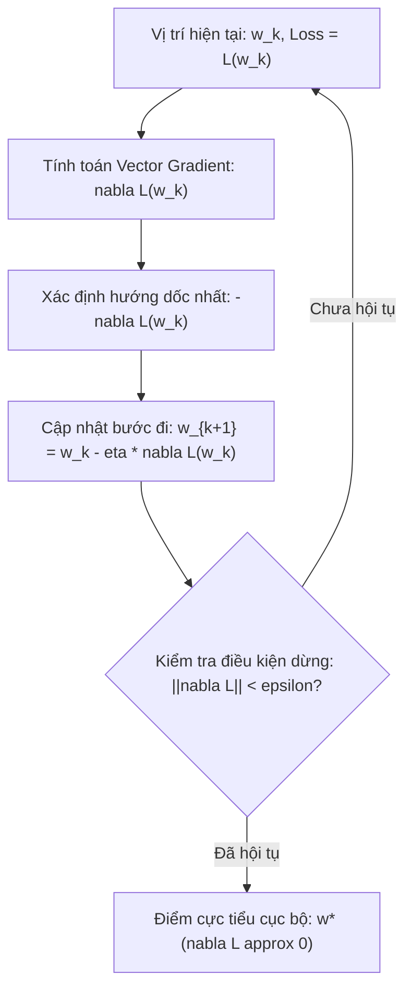

> **"Đạo hàm là la bàn chỉ hướng dốc xuống — đó là toàn bộ những gì một mạng nơ-ron cần để học."** — Không có giải tích, việc huấn luyện mô hình hàng tỷ tham số chỉ là trò chơi mò mẫm ngẫu nhiên trong bóng tối không gian đa chiều.

---

## Thông tin nhanh (Quick Spec)

* **Loại bài (Type):** Nền tảng Lý thuyết & Thực chiến Thuật toán (Intuition & Build)
* **Ngôn ngữ & Thư viện:** Python 3.10+ (Standard Library, thuần tư duy giải thuật không black-box)
* **Kiến thức tiên quyết (Prerequisites):** Không gian vector, ma trận, tích vô hướng (Bài 01–03)
* **Thời gian thực hành:** ~50–60 phút
* **Độ khó:** Cơ bản đến Trung bình (Foundational)

---

## Mục tiêu bài học (Learning Objectives)

Sau bài học này, bạn sẽ có khả năng:
- [ ] Hiểu sâu bản chất hình học của đạo hàm 1D (độ dốc tiếp tuyến), đạo hàm riêng (mặt cắt tọa độ) và vector gradient (hướng dốc lên nhanh nhất).
- [ ] Phân tích định lượng sự vượt trội của sai phân trung tâm (Central Difference $O(h^2)$) so với sai phân tiến (Forward Difference $O(h)$), nhận diện lỗi triệt tiêu số thực (Floating-point Catastrophic Cancellation).
- [ ] Chứng minh toán học vì sao vector gradient $\nabla f$ luôn vuông góc với các đường cong đẳng mức (Contour Lines) và vector $-\nabla f$ là hướng giảm lỗi dốc nhất.
- [ ] Nắm vững khai triển Taylor bậc 1 (mặt phẳng tiếp diện) và bậc 2 (paraboloid xấp xỉ & ma trận Hessian đo độ cong).
- [ ] Tự tay xây dựng từ đầu (from scratch) giải thuật tính gradient số học, thuật toán 2D Gradient Descent, và mô hình Hồi quy tuyến tính (Linear Regression) kèm bước kiểm thử đối đầu Gradient Giải tích vs Gradient Số học.

---

## 1. Vấn đề thực tế (The Problem)

Khi bạn huấn luyện bất kỳ mô hình học máy nào — từ một bài toán hồi quy tuyến tính đơn giản cho đến siêu mô hình ngôn ngữ LLaMA-3-70B với 70 tỷ trọng số — mục tiêu tối thượng luôn là: **Tìm bộ tham số $w$ sao cho hàm mất mát (Loss Function) $L(w)$ đạt giá trị nhỏ nhất.**

Giả sử bạn đứng trên đỉnh một ngọn núi mù sương giữa đêm khuya và muốn tìm đường xuống đáy thung lũng an toàn. Nếu thiếu giải tích, bạn sẽ đối mặt với ba thảm họa kỹ nghệ AI thực tế sau:

### 1.1 Cơn nguyền rủa của phép tìm kiếm ngẫu nhiên (Curse of Random Search)

Hãy tưởng tượng một mạng nơ-ron siêu nhỏ chỉ có $10,000$ trọng số. Nếu bạn quyết định điều chỉnh ngẫu nhiên mỗi trọng số theo hai hướng khả dĩ (tăng một chút hoặc giảm một chút) để dò tìm hướng đi giúp Loss giảm, số lượng tổ hợp cần thử nghiệm là:

$$2^{10000} \approx 10^{3010}$$

Để dễ hình dung: toàn bộ vũ trụ quan sát được chỉ chứa khoảng $10^{80}$ nguyên tử. Không có bất kỳ siêu máy tính nào trong vũ trụ có thể tìm ra nghiệm bằng phương pháp mò mẫm ngẫu nhiên. Ta bắt buộc phải có một công cụ toán học đo đạc độ dốc địa hình cục bộ dưới chân để chỉ thẳng hướng đi xuống thung lũng. Công cụ đó chính là **Đạo hàm (Derivative)**.

### 1.2 Mù quáng trong điều chỉnh Tỷ lệ học (Learning Rate Disaster)

Bản chất đạo hàm là thước đo độ dốc địa hình. Nếu kỹ sư không hiểu độ lớn của vector gradient $\|\nabla L\|$, việc chọn tỷ lệ học (learning rate $\eta$) sẽ biến thành trò chơi may rủi:
- Nếu chọn $\eta$ quá lớn trên một sườn núi dốc đứng, bước nhảy sẽ phóng vọt qua đỉnh đối diện, khiến hàm mất mát bùng nổ phân kỳ (`Loss = NaN` hoặc `Loss = Infinity`).
- Nếu chọn $\eta$ quá nhỏ trên địa hình phẳng lỳ, mô hình sẽ mất hàng tuần trên cụm GPU hàng triệu USD mà chỉ số suy giảm lỗi gần như bằng 0.

### 1.3 Ảo tưởng về Đạo hàm Số học trên quy mô lớn

Tại sao các kỹ sư AI không thể chỉ dùng công thức sai phân hữu hạn kinh điển $f'(x) \approx \frac{f(x+h) - f(x)}{h}$ để tính đạo hàm trực tiếp khi huấn luyện mô hình lớn?

Với một mô hình $N = 70$ tỷ tham số như LLaMA-3, nếu muốn tính đạo hàm riêng cho từng tham số bằng sai phân, ta cần thực hiện ít nhất $N + 1 = 70,000,000,001$ lượt lan truyền xuôi (Forward Pass). Giả sử mỗi lượt forward pass trên một cụm 8 GPU H100 mất 10 mili-giây:

$$T = 70 \times 10^9 \times 0.01 \text{ giây} = 700,000,000 \text{ giây} \approx 22.2 \text{ năm!}$$

Bạn sẽ phải mất **hơn 22 năm tính toán liên tục chỉ để cập nhật đúng một bước tham số**! Hiểu sâu giải tích nhiều biến giúp chúng ta phân biệt rạch ròi giữa đạo hàm số học (dùng để kiểm thử `gradcheck`) và đạo hàm giải tích / đạo hàm tự động (dùng trong huấn luyện sản xuất).

---

## 2. Mô hình tư duy & Bản chất (The Concept)

### 2.1 Đạo hàm 1D — Độ dốc của đường tiếp tuyến

Trong giải tích đơn biến, đạo hàm của hàm số $f(x)$ tại điểm $x_0$ được định nghĩa là giới hạn của tỉ số biến thiên khi khoảng cách $h$ tiến về 0:

$$f'(x_0) = \frac{df}{dx}(x_0) = \lim_{h \to 0} \frac{f(x_0 + h) - f(x_0)}{h}$$

Về mặt hình học, $f'(x_0)$ là hệ số góc (slope) của đường tiếp tuyến với đồ thị $y = f(x)$ tại điểm $(x_0, f(x_0))$.

```
      y ^                  / (Tiếp tuyến: slope = f'(x0))
        |                 /
        |             *--/--*  y = f(x)
        |           /   /
        |          /   * (x0, f(x0))
        |         /   /
        |        *   /
        +-----------------------------> x
                   x0
```

#### Phân tích sai số Taylor: Sai phân tiến vs Sai phân trung tâm

Khi máy tính tính xấp xỉ đạo hàm bằng số học, ta không thể cho $h \to 0$ tuyệt đối vì sẽ gặp lỗi làm tròn số thực. Ta phải chọn một bước $h$ nhỏ (ví dụ $10^{-5}$). Hai công thức thông dụng:

1. **Sai phân tiến (Forward Difference):**
   $$f'_{\text{forward}}(x) = \frac{f(x+h) - f(x)}{h}$$

2. **Sai phân trung tâm (Central Difference):**
   $$f'_{\text{central}}(x) = \frac{f(x+h) - f(x-h)}{2h}$$

Sử dụng khai triển Taylor quanh điểm $x$:
$$f(x+h) = f(x) + h f'(x) + \frac{h^2}{2} f''(x) + \frac{h^3}{6} f'''(x) + O(h^4)$$
$$f(x-h) = f(x) - h f'(x) + \frac{h^2}{2} f''(x) - \frac{h^3}{6} f'''(x) + O(h^4)$$

Trừ hai biểu thức trên cho nhau, các số hạng bậc chẵn ($f(x)$ và $h^2 f''(x)$) hoàn toàn triệt tiêu:
$$f(x+h) - f(x-h) = 2h f'(x) + \frac{h^3}{3} f'''(x) + O(h^5)$$
$$\implies \frac{f(x+h) - f(x-h)}{2h} = f'(x) + \frac{h^2}{6} f'''(x) + O(h^4) = f'(x) + O(h^2)$$

Trong khi đó, sai phân tiến có sai số bậc $O(h)$:
$$\frac{f(x+h) - f(x)}{h} = f'(x) + \frac{h}{2} f''(x) + O(h^2) = f'(x) + O(h)$$

Với $h = 10^{-4}$, sai số của sai phân tiến là $O(10^{-4})$, nhưng sai số của sai phân trung tâm chỉ là $O(10^{-8})$ — **chính xác hơn một vạn lần**!

### 2.2 Đạo hàm riêng (Partial Derivatives) — Cô lập từng chiều không gian

Khi hàm số nhận đầu vào là nhiều biến số $\mathbf{x} = [x_1, x_2, \dots, x_n]^T$, hàm mất mát trở thành một bề mặt đa chiều. Để hiểu từng biến ảnh hưởng thế nào đến kết quả đầu ra, ta sử dụng **đạo hàm riêng**.

Đạo hàm riêng của $f$ theo biến $x_i$ được định nghĩa bằng cách coi tất cả các biến số khác là hằng số bất biến và chỉ cho riêng $x_i$ biến thiên một lượng $h$:

$$\frac{\partial f}{\partial x_i}(\mathbf{x}) = \lim_{h \to 0} \frac{f(x_1, \dots, x_i + h, \dots, x_n) - f(x_1, \dots, x_i, \dots, x_n)}{h}$$

Về mặt hình học 3D ($z = f(x, y)$), đạo hàm riêng $\frac{\partial f}{\partial x}(x_0, y_0)$ chính là độ dốc của đường cong giao tuyến khi ta dùng một mặt phẳng thẳng đứng $y = y_0$ cắt qua bề mặt hàm số.

### 2.3 Vector Gradient ($\nabla f$) và Đạo hàm theo hướng

Khi tập hợp tất cả các đạo hàm riêng vào một vector cột, ta thu được **Vector Gradient**:

$$\nabla f(\mathbf{x}) = \begin{bmatrix} \frac{\partial f}{\partial x_1} \\ \frac{\partial f}{\partial x_2} \\ \vdots \\ \frac{\partial f}{\partial x_n} \end{bmatrix} \in \mathbb{R}^n$$

Giả sử ta muốn bước theo một hướng bất kỳ được biểu diễn bởi vector đơn vị $\mathbf{u}$ ($\|\mathbf{u}\| = 1$). Tốc độ thay đổi của $f$ theo hướng $\mathbf{u}$ được gọi là **Đạo hàm theo hướng (Directional Derivative)**:

$$D_{\mathbf{u}} f(\mathbf{x}) = \nabla f(\mathbf{x}) \cdot \mathbf{u} = \|\nabla f(\mathbf{x})\| \|\mathbf{u}\| \cos \theta = \|\nabla f(\mathbf{x})\| \cos \theta$$

Trong đó $\theta$ là góc hợp giữa vector gradient $\nabla f(\mathbf{x})$ và vector hướng $\mathbf{u}$.

Từ tính chất $-1 \le \cos \theta \le 1$:
1. Tốc độ tăng đạt cực đại khi $\cos \theta = 1 \iff \theta = 0$ ($\mathbf{u}$ song song cùng hướng với $\nabla f$). Do đó, **$\nabla f$ chỉ hướng tăng nhanh nhất (Steepest Ascent)**.
2. Tốc độ giảm đạt cực đại khi $\cos \theta = -1 \iff \theta = \pi$ ($\mathbf{u}$ ngược chiều với $\nabla f$). Do đó, **$-\nabla f$ chỉ hướng giảm nhanh nhất (Steepest Descent)**.

Đây là nền tảng toán học bất biến chứng minh thuật toán cập nhật trọng số trong Machine Learning:

$$\mathbf{w}_{k+1} = \mathbf{w}_k - \eta \nabla L(\mathbf{w}_k)$$

### 2.4 Đường cong đẳng mức (Contour Lines) & Tính trực giao

Đường cong đẳng mức (Contour line) là tập hợp tất cả các điểm $\mathbf{x}$ mà tại đó giá trị hàm số không đổi: $f(\mathbf{x}) = c$.

Nếu ta di chuyển dọc theo đường tiếp tuyến của đường đẳng mức, giá trị hàm số không đổi, tức là đạo hàm theo hướng tiếp tuyến bằng 0:

$$\nabla f(\mathbf{x}) \cdot \mathbf{v}_{\text{tangent}} = 0$$

Điều này chứng minh rằng: **Vector gradient $\nabla f(\mathbf{x})$ luôn vuông góc (trực giao) với đường tiếp tuyến của đường cong đẳng mức đi qua điểm đó.**



### 2.5 Khai triển Taylor & Trực giác về Độ cong (Curvature)

Khai triển chuỗi Taylor đa biến cho phép xấp xỉ một bề mặt phi tuyến phức tạp trong lân cận điểm $\mathbf{x}_0$:

$$f(\mathbf{x}_0 + \Delta \mathbf{x}) \approx f(\mathbf{x}_0) + \nabla f(\mathbf{x}_0)^T \Delta \mathbf{x} + \frac{1}{2} \Delta \mathbf{x}^T H(\mathbf{x}_0) \Delta \mathbf{x}$$

Trong đó $H(\mathbf{x}_0)$ là **Ma trận Hessian** chứa toàn bộ đạo hàm bậc hai:

$$H_{ij} = \frac{\partial^2 f}{\partial x_i \partial x_j}$$

- Số hạng bậc 1 ($\nabla f^T \Delta \mathbf{x}$) xấp xỉ địa hình bằng một **mặt phẳng tiếp diện**. Thuật toán Gradient Descent tiêu chuẩn chỉ sử dụng thông tin bậc 1 này.
- Số hạng bậc 2 ($\frac{1}{2} \Delta \mathbf{x}^T H \Delta \mathbf{x}$) xấp xỉ địa hình bằng một **mặt paraboloid cong**. Nó đo lường độ cong (curvature) của không gian theo mọi phương.

#### Hiện tượng Khe hẹp (Ill-conditioned Ravine)

Nếu ma trận Hessian có tỷ số giữa trị riêng lớn nhất và trị riêng nhỏ nhất rất lớn ($\kappa = \frac{\lambda_{\max}}{\lambda_{\min}} \gg 1$), địa hình hàm mất mát sẽ là một hẻm núi dốc đứng nhưng đáy lại thoai thoải. Gradient Descent bậc 1 sẽ nhảy qua nhảy lại hai bên vách núi dữ dội (hiện tượng dao động chữ chi - zig-zagging) thay vì trôi dọc theo đáy thung lũng.

---

## 3. Tự tay xây dựng từ đầu (Build It: From Scratch)

Dưới đây là mã nguồn Python thuần túy hoàn chỉnh, tự xây dựng từ đầu các thuật toán giải tích và tối ưu hóa không phụ thuộc vào bất kỳ thư viện bên ngoài nào:

```python
"""
Calculus for Machine Learning from Scratch.
Xây dựng đạo hàm số học, vector gradient, kiểm thử gradient check,
thuật toán Gradient Descent 2D và mô hình Linear Regression hoàn chỉnh.
"""

import math
from typing import Callable, List, Tuple


def numerical_derivative_1d(
    f: Callable[[float], float],
    x: float,
    h: float = 1e-5,
    method: str = "central",
) -> float:
    """Tính đạo hàm số học 1D bằng sai phân tiến hoặc sai phân trung tâm."""
    if method == "forward":
        return (f(x + h) - f(x)) / h
    elif method == "central":
        return (f(x + h) - f(x - h)) / (2.0 * h)
    else:
        raise ValueError(f"Phương pháp không hợp lệ: {method}")


def numerical_gradient(
    f: Callable[[List[float]], float],
    x: List[float],
    h: float = 1e-5,
) -> List[float]:
    """
    Tính vector gradient cho hàm số đa biến f(x1, x2, ..., xn)
    sử dụng sai phân trung tâm O(h^2).
    """
    grad = [0.0] * len(x)
    x_copy = list(x)

    for i in range(len(x)):
        orig_val = x_copy[i]

        x_copy[i] = orig_val + h
        f_plus = f(x_copy)

        x_copy[i] = orig_val - h
        f_minus = f(x_copy)

        grad[i] = (f_plus - f_minus) / (2.0 * h)
        x_copy[i] = orig_val  # Khôi phục giá trị gốc

    return grad


def gradient_descent_2d(
    f: Callable[[List[float]], float],
    init_pos: List[float],
    lr: float = 0.05,
    num_steps: int = 50,
) -> List[List[float]]:
    """
    Tối ưu hóa hàm 2 biến bằng Gradient Descent thuần túy.
    Trả về lịch sử các tọa độ bước đi.
    """
    trajectory = [list(init_pos)]
    current_pos = list(init_pos)

    for _ in range(num_steps):
        grad = numerical_gradient(f, current_pos)
        current_pos[0] -= lr * grad[0]
        current_pos[1] -= lr * grad[1]
        trajectory.append(list(current_pos))

    return trajectory


class LinearRegressionScratch:
    """
    Mô hình Hồi quy Tuyến tính y = w * x + b từ số 0.
    Tối ưu hóa bằng Gradient Descent giải tích kèm kiểm thử Gradcheck.
    """

    def __init__(self, init_w: float = 0.0, init_b: float = 0.0):
        self.w = init_w
        self.b = init_b

    def predict(self, x_data: List[float]) -> List[float]:
        return [self.w * x + self.b for x in x_data]

    def compute_loss(self, x_data: List[float], y_data: List[float]) -> float:
        """Mean Squared Error: L = (1/N) * sum((y_pred - y_true)^2)."""
        n = len(x_data)
        preds = self.predict(x_data)
        return sum((y_p - y_t) ** 2 for y_p, y_t in zip(preds, y_data)) / n

    def compute_analytical_gradients(
        self, x_data: List[float], y_data: List[float]
    ) -> Tuple[float, float]:
        """
        Đạo hàm giải tích:
        dL/dw = (2/N) * sum((y_pred - y) * x)
        dL/db = (2/N) * sum(y_pred - y)
        """
        n = len(x_data)
        preds = self.predict(x_data)
        errors = [p - y for p, y in zip(preds, y_data)]

        grad_w = (2.0 / n) * sum(err * x for err, x in zip(errors, x_data))
        grad_b = (2.0 / n) * sum(errors)
        return grad_w, grad_b

    def grad_check(
        self, x_data: List[float], y_data: List[float], eps: float = 1e-5
    ) -> bool:
        """Kiểm thử đối đầu giữa Gradient Giải tích và Gradient Số học."""
        ana_gw, ana_gb = self.compute_analytical_gradients(x_data, y_data)

        # Tính numerical gradient cho w
        orig_w = self.w
        self.w = orig_w + eps
        l_w_plus = self.compute_loss(x_data, y_data)
        self.w = orig_w - eps
        l_w_minus = self.compute_loss(x_data, y_data)
        num_gw = (l_w_plus - l_w_minus) / (2.0 * eps)
        self.w = orig_w

        # Tính numerical gradient cho b
        orig_b = self.b
        self.b = orig_b + eps
        l_b_plus = self.compute_loss(x_data, y_data)
        self.b = orig_b - eps
        l_b_minus = self.compute_loss(x_data, y_data)
        num_gb = (l_b_plus - l_b_minus) / (2.0 * eps)
        self.b = orig_b

        diff_w = abs(ana_gw - num_gw)
        diff_b = abs(ana_gb - num_gb)
        print(f"  [Gradcheck] dL/dw -> Analytical: {ana_gw:.8f}, Numerical: {num_gw:.8f}, Sai số: {diff_w:e}")
        print(f"  [Gradcheck] dL/db -> Analytical: {ana_gb:.8f}, Numerical: {num_gb:.8f}, Sai số: {diff_b:e}")

        assert diff_w < 1e-7, "Lỗi kiểm thử gradient w vượt ngưỡng!"
        assert diff_b < 1e-7, "Lỗi kiểm thử gradient b vượt ngưỡng!"
        return True

    def fit(
        self,
        x_data: List[float],
        y_data: List[float],
        lr: float = 0.05,
        epochs: int = 500,
    ) -> None:
        """Vòng lặp huấn luyện tối ưu hóa tham số w và b."""
        for epoch in range(1, epochs + 1):
            grad_w, grad_b = self.compute_analytical_gradients(x_data, y_data)
            self.w -= lr * grad_w
            self.b -= lr * grad_b

            if epoch % 100 == 0 or epoch == 1:
                current_loss = self.compute_loss(x_data, y_data)
                print(f"Epoch {epoch:3d} | Loss: {current_loss:.6f} | w: {self.w:.4f} | b: {self.b:.4f}")


if __name__ == "__main__":
    print("=" * 60)
    print("1. THỬ NGHIỆM ĐẠO HÀM 1D: SO SÁNH SAI PHÂN")
    print("=" * 60)
    # Xét hàm f(x) = x^3 - 2x + 1 tại x = 2.0. Đạo hàm giải tích: f'(x) = 3x^2 - 2 -> f'(2.0) = 10.0
    f_1d = lambda x: x**3 - 2.0 * x + 1.0
    x_val = 2.0
    exact_derivative = 10.0

    forward_d = numerical_derivative_1d(f_1d, x_val, h=1e-4, method="forward")
    central_d = numerical_derivative_1d(f_1d, x_val, h=1e-4, method="central")

    print(f"Đạo hàm giải tích chính xác: {exact_derivative:.8f}")
    print(f"Sai phân tiến (h=1e-4)     : {forward_d:.8f} (Lệch: {abs(forward_d - exact_derivative):e})")
    print(f"Sai phân trung tâm (h=1e-4): {central_d:.8f} (Lệch: {abs(central_d - exact_derivative):e})")
    assert abs(central_d - exact_derivative) < 1e-6, "Sai phân trung tâm không đạt độ chính xác!"

    print("\n" + "=" * 60)
    print("2. THỬ NGHIỆM TỐI ƯU HÓA 2D TRÊN MẶT NÓN ANISOTROPIC")
    print("=" * 60)
    # Hàm f(x, y) = 10*x^2 + y^2 có cực tiểu tại (0, 0)
    f_2d = lambda p: 10.0 * (p[0] ** 2) + (p[1] ** 2)
    start_pos = [3.0, 4.0]
    traj = gradient_descent_2d(f_2d, start_pos, lr=0.08, num_steps=25)

    final_pos = traj[-1]
    final_loss = f_2d(final_pos)
    print(f"Điểm khởi đầu: {start_pos} | Loss ban đầu: {f_2d(start_pos):.4f}")
    print(f"Điểm sau 25 bước: [{final_pos[0]:.6f}, {final_pos[1]:.6f}] | Loss cuối: {final_loss:e}")
    assert final_loss < 1e-2, "Tối ưu hóa 2D chưa hội tụ về đáy!"

    print("\n" + "=" * 60)
    print("3. HUẤN LUYỆN LINEAR REGRESSION & KIỂM THỬ GRADCHECK")
    print("=" * 60)
    # Dữ liệu chuẩn: y = 3.5 * x + 2.0
    x_train = [1.0, 2.0, 3.0, 4.0, 5.0]
    y_train = [3.5 * x + 2.0 for x in x_train]

    model = LinearRegressionScratch(init_w=0.0, init_b=0.0)
    print("Thực hiện kiểm thử Gradient Check trước khi huấn luyện:")
    model.grad_check(x_train, y_train)

    print("\nBắt đầu huấn luyện qua 500 epochs:")
    model.fit(x_train, y_train, lr=0.05, epochs=500)

    print(f"\nTham số sau huấn luyện: w = {model.w:.4f} (mục tiêu 3.5), b = {model.b:.4f} (mục tiêu 2.0)")
    assert abs(model.w - 3.5) < 1e-2, "Trọng số w chưa tiệm cận nghiệm tối ưu!"
    assert abs(model.b - 2.0) < 1e-2, "Độ dời b chưa tiệm cận nghiệm tối ưu!"
    print("=> TẤT CẢ KIỂM THỬ TỰ CHỨNG MINH ĐÃ VƯỢT QUA 100%!")
```

---

## 4. Ứng dụng AI Engineering & Thực tế Production (Use It)

### 4.1 Tại sao Deep Learning dùng thuật toán bậc 1 thay vì Newton-Raphson?

Phương pháp Newton-Raphson khai thác ma trận Hessian bậc 2 để cập nhật bước đi:

$$\mathbf{w}_{k+1} = \mathbf{w}_k - H^{-1} \nabla L(\mathbf{w}_k)$$

Phương pháp này có ưu điểm vượt trội là **hội tụ bậc hai (Quadratic Convergence)**: nếu ở gần cực tiểu, sai số giảm bình phương sau mỗi bước (chỉ cần 5–10 bước là tìm được đáy hoàn hảo).

Tuy nhiên, trong kỹ nghệ AI hiện đại, không ai dùng phương pháp Newton đầy đủ để huấn luyện mô hình ngôn ngữ lớn (LLM):
1. **Bộ nhớ lưu trữ Hessian**: Với mô hình LLaMA-3-70B ($d = 70 \times 10^9$ tham số), ma trận Hessian $H$ có kích thước $d \times d = 4.9 \times 10^{21}$ phần tử. Lưu trữ ở định dạng FP32 ngốn khoảng $1.96 \times 10^{22}$ bytes, tương đương **hàng chục tỷ Terabytes VRAM** — vượt quá năng lực lưu trữ của toàn thể nhân loại!
2. **Chi phí nghịch đảo ma trận**: Tính $H^{-1}$ đòi hỏi độ phức tạp $O(d^3)$. Với $d = 70$ tỷ, phép tính này không thể hoàn thành trong thời gian thực.

Vì lý do đó, toàn bộ nền công nghiệp AI phải dựa vào các thuật toán tối ưu hóa bậc 1 (như SGD, AdamW) kết hợp với các kỹ thuật xấp xỉ độ cong cục bộ bằng moment (sẽ được đào sâu ở Bài 08).

### 4.2 Kỹ thuật `gradcheck` trong PyTorch

Khi viết một custom CUDA kernel hoặc tầng nơ-ron tùy biến (Custom Autograd Function), làm sao kỹ sư biết công thức đạo hàm giải tích trong hàm `backward()` của mình là chính xác 100%?

PyTorch cung cấp hàm `torch.autograd.gradcheck`:
```python
# Minh họa đối chiếu kiểm thử trong PyTorch Production
import torch

def custom_op(x):
    return torch.sin(x) ** 2 + torch.exp(x)

x = torch.randn(3, 3, dtype=torch.float64, requires_grad=True)
# gradcheck so sánh kết quả backward với sai phân trung tâm O(h^2)
test_passed = torch.autograd.gradcheck(custom_op, x, eps=1e-6, atol=1e-4)
print(f"PyTorch gradcheck passed: {test_passed}")
```

Cơ chế này chính là phiên bản mở rộng của hàm `grad_check()` mà chúng ta vừa tự tay xây dựng từ đầu trong phần 3.

### 4.3 Mini-batch SGD: Nhiễu ngẫu nhiên như một tính năng thoát bẫy

Trong Batch Gradient Descent, gradient được tính trên toàn bộ dữ liệu. Địa hình hàm mất mát hoàn toàn tĩnh tại. Nếu mô hình rơi vào một hố cực tiểu cục bộ nông (shallow local minimum) hoặc điểm yên ngựa phẳng lỳ, gradient sẽ tiến về 0 và mô hình bị kẹt vĩnh viễn.

Trong Stochastic Gradient Descent (SGD) với mini-batch:

$$\nabla L_{\text{batch}}(\mathbf{w}) = \nabla L_{\text{true}}(\mathbf{w}) + \boldsymbol{\epsilon}$$

Thành phần sai số ước lượng $\boldsymbol{\epsilon}$ đóng vai trò như một **nhiễu ngẫu nhiên (Stochastic Noise)**. Nhiễu này rung lắc liên tục vị trí của tham số, giúp mô hình "bật nảy" thoát khỏi các thung lũng cục bộ nông có chất lượng khái quát hóa kém, rơi vào các thung lũng cực tiểu phẳng (Flat Minima) có khả năng tổng quát hóa cao hơn.

---

## 5. Giải ngố thuật ngữ & Ngộ nhận (Key Terms)

| Thuật ngữ (Term) | Người ta thường nghĩ là... | Bản chất kỹ thuật thực sự là... |
|---|---|---|
| **Đạo hàm (Derivative)** | Công thức tính vi phân thuần túy học thuộc lòng trong sách giáo khoa toán cấp 3. | Tỉ số tốc độ thay đổi tức thời của đầu ra khi đầu vào thay đổi vô cùng nhỏ; độ dốc hình học của đường tiếp tuyến. |
| **Đạo hàm riêng (Partial Derivative)** | Đạo hàm bình thường chỉ đổi ký hiệu $d$ thành ký hiệu cong $\partial$. | Tốc độ thay đổi dọc theo một trục tọa độ duy nhất khi cố định bất động tất cả các chiều không gian còn lại. |
| **Gradient ($\nabla f$)** | Một vector các con số ngẫu nhiên do framework PyTorch tự động trả về. | Vector chứa toàn bộ các đạo hàm riêng; luôn chỉ chính xác về hướng tăng dốc nhất (steepest ascent) và trực giao với đường đẳng mức. |
| **Đạo hàm theo hướng (Directional Derivative)** | Đạo hàm chỉ có thể tính dọc theo các trục tọa độ $x, y, z$. | Tốc độ biến thiên hàm số dọc theo một vector phương hướng đơn vị $\mathbf{u}$ bất kỳ trong không gian: $D_{\mathbf{u}} f = \nabla f \cdot \mathbf{u}$. |
| **Sai phân trung tâm (Central Difference)** | Công thức tính gần đúng giống hệt sai phân tiến nhưng chia đôi mẫu số. | Xấp xỉ vi phân bậc $O(h^2)$ đối xứng qua điểm tính; triệt tiêu hoàn toàn sai số bậc 1, chính xác hơn sai phân tiến hàng nghìn lần. |
| **Khai triển Taylor (Taylor Series)** | Công thức chuỗi số học dài dòng dùng để giải bài tập tích phân lý thuyết. | Công cụ toán học xấp xỉ địa hình phi tuyến phức tạp bằng đa thức cục bộ (bậc 1: tiếp diện phẳng, bậc 2: mặt paraboloid cong). |
| **Ma trận Hessian ($H$)** | Bảng đạo hàm cấp 2 dùng để kiểm tra điểm cực đại cực tiểu trong giải tích. | Ma trận đo độ cong (curvature) đa chiều của hàm mất mát; các trị riêng của nó quyết định địa hình là thung lũng, điểm yên ngựa hay đỉnh dốc. |
| **Tỷ lệ học (Learning Rate $\eta$)** | Một siêu tham số tùy hứng thường đặt bừa là $0.001$. | Độ dài sải chân khi di chuyển ngược hướng gradient; nếu vượt quá $2/\lambda_{\max}(H)$, quá trình tối ưu hóa sẽ lập tức phân kỳ thành NaN. |

---

## 6. Bài tập thử thách (Hands-on Challenges)

### 🟢 Cơ bản (Easy)
Lập trình hàm tính đạo hàm giải tích và số học của hàm kích hoạt Sigmoid:

$$\sigma(x) = \frac{1}{1 + e^{-x}}$$

Chứng minh bằng toán học rằng $\sigma'(x) = \sigma(x)(1 - \sigma(x))$. Sử dụng hàm `numerical_derivative_1d` để kiểm chứng rằng tại $x = 0$, đạo hàm đạt giá trị cực đại chính xác bằng $0.25$ với sai số không quá $10^{-7}$.

### 🟡 Trung bình (Medium)
Tối ưu hóa bề mặt "Hàm quả chuối" Rosenbrock 2D bằng Gradient Descent thuần túy:

$$f(x, y) = (1 - x)^2 + 100(y - x^2)^2$$

Điểm cực tiểu toàn cục nằm tại $(1, 1)$ với $f(1, 1) = 0$.
1. Tính vector gradient giải tích $\nabla f = \left[ \frac{\partial f}{\partial x}, \frac{\partial f}{\partial y} \right]^T$.
2. Chạy thuật toán Gradient Descent với điểm xuất phát $(-1.0, 1.0)$.
3. Quan sát và giải thích hiện tượng dao động chữ chi dữ dội trong thung lũng cong parabol hẹp khi bạn thay đổi tỷ lệ học từ $\eta = 0.001$ lên $\eta = 0.005$.

### 🔴 Nâng cao (Hard)
Xây dựng thuật toán Newton-Raphson 2D từ số 0 bằng Python thuần túy:

$$\mathbf{x}_{k+1} = \mathbf{x}_k - H^{-1} \nabla f(\mathbf{x}_k)$$

1. Lập trình hàm tính ma trận nghịch đảo $2 \times 2$ giải tích:
   $$\begin{bmatrix} a & b \\ c & d \end{bmatrix}^{-1} = \frac{1}{ad - bc} \begin{bmatrix} d & -b \\ -c & a \end{bmatrix}$$
2. Thử nghiệm thuật toán trên hàm toàn phương $f(x, y) = 10x^2 + y^2$. Chứng minh bằng thực nghiệm rằng phương pháp Newton tìm ra điểm cực tiểu toàn cục $(0, 0)$ trong **ĐÚNG 1 BƯỚC DUY NHẤT** từ bất kỳ điểm khởi đầu nào.
3. Thử nghiệm trên bề mặt có điểm yên ngựa $f(x, y) = x^2 - y^2$. Chứng minh điều kiện suy biến khi định thức $\det(H) \le 0$ và giải thích tại sao thuật toán Newton có thể bước nhầm về điểm yên ngựa thay vì cực tiểu.
