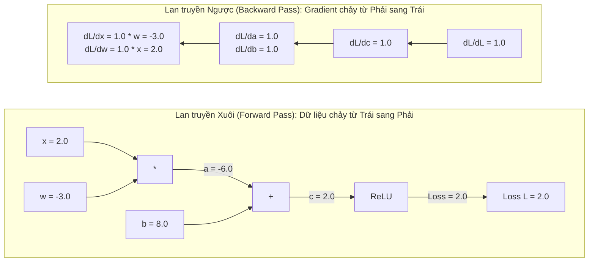

> **"Vi phân tự động biến phép tính đạo hàm tượng trưng phức tạp thành các phép toán cục bộ đơn giản trên đồ thị tính toán có hướng."** — Đây là giải thuật nền tảng biến ý tưởng mạng nơ-ron sâu từ lý thuyết thành hiện thực, là động cơ thúc đẩy toàn bộ các thư viện PyTorch, JAX và TensorFlow.

---

## Thông tin nhanh (Quick Spec)

* **Loại bài (Type):** Thực chiến Thuật toán Đỉnh cao (Deep Build & Core Architecture)
* **Ngôn ngữ & Thư viện:** Python 3.10+ (Standard Library, xây dựng engine Autograd hoàn chỉnh từ số 0)
* **Kiến thức tiên quyết (Prerequisites):** Đạo hàm, gradient, phép nhân ma trận (Bài 01–04)
* **Thời gian thực hành:** ~60–80 phút
* **Độ khó:** Trung bình đến Nâng cao (Core Deep Learning)

---

## Mục tiêu bài học (Learning Objectives)

Sau bài học này, bạn sẽ có khả năng:
- [ ] Nắm vững bản chất toán học của Quy tắc dây chuyền nhiều biến (Multivariate Chain Rule) và định luật vàng: "Nhân dọc theo từng nhánh đường đi, Cộng trên các nhánh phân kỳ hội tụ".
- [ ] So sánh thấu đáo 4 phương pháp tính vi phân: Thủ công (Manual), Tượng trưng (Symbolic), Số học (Numerical), và Tự động (Autodiff: Forward vs Reverse Mode).
- [ ] Tự tay xây dựng lớp `Value` hỗ trợ đầy đủ các phép toán số học (`+`, `-`, `*`, `/`, `**`) và phi tuyến (`tanh`, `relu`) kèm hàm `_backward()` cục bộ.
- [ ] Cài đặt thuật toán Sắp xếp Topo (Topological Sort) bằng DFS để duyệt ngược đồ thị tính toán (DAG), đảm bảo nguyên tắc tích lũy gradient `+=`.
- [ ] Xây dựng mô hình Mạng nơ-ron Đa tầng (MLP) hoàn chỉnh trên nền engine tự viết và huấn luyện thành công bài toán phi tuyến XOR.
- [ ] Lập trình hàm `gradcheck` kiểm thử tự động tính chính xác tuyệt đối của engine đối đầu với sai phân trung tâm số học.

---

## 1. Vấn đề thực tế (The Problem)

Trong bài học trước, ta đã biết rằng để cập nhật trọng số mạng nơ-ron, ta cần vector gradient $\nabla L = \left[ \frac{\partial L}{\partial w_1}, \dots, \frac{\partial L}{\partial w_n} \right]^T$. Nhưng câu hỏi hóc búa nhất là: **Làm thế nào để tính được toàn bộ các đạo hàm riêng này một cách chính xác và hiệu quả khi mạng có hàng triệu tầng và hàng tỷ tham số?**

Nếu không có giải thuật Vi phân Tự động (Automatic Differentiation - Autodiff), bạn sẽ va phải bốn thảm họa kinh hoàng sau:

### 1.1 Sự bùng nổ biểu thức của Đạo hàm Tượng trưng (Symbolic Expression Swell)

Nếu sử dụng các hệ thống đại số máy tính (như SymPy hay Mathematica) để tính đạo hàm giải tích bằng cách áp dụng công thức đạo hàm hàm hợp liên tiếp cho một mạng nơ-ron sâu 50 tầng:

$$\frac{d}{dx} f(g(h(k(...(x)...))))$$

Biểu thức đại số mở rộng sẽ bị lặp lại các biểu thức con theo cấp số mũ. Kết quả là công thức đạo hàm có thể dài hàng gigabytes văn bản, tràn bộ nhớ RAM ngay trước khi kịp thế các giá trị số vào để tính toán!

### 1.2 Độ phức tạp bất khả thi của Đạo hàm Số học (Numerical Finite Difference)

Nếu sử dụng sai phân trung tâm $f'(x) \approx \frac{f(x+h) - f(x-h)}{2h}$, mỗi tham số $w_i$ cần 2 lần tính giá trị hàm mất mát. Với mô hình lớn như GPT-3 (175 tỷ tham số), mỗi bước tối ưu hóa đòi hỏi $350$ tỷ lượt lan truyền xuôi (Forward pass). Điều này là bất khả thi về mặt vật lý, biến chi phí điện năng và thời gian thành con số vô tận.

### 1.3 Cơn ác mộng tính đạo hàm bằng tay (Manual Backprop Hell)

Trước năm 2015, khi các framework autograd hiện đại chưa phổ biến, mỗi khi một nhà nghiên cứu đề xuất một kiến trúc mạng mới (như LSTM, Attention, hay ResNet), họ phải ngồi hàng tuần trên bàn giấy để nhân chia ma trận đạo hàm bằng tay, sau đó tự viết code `backward()` thủ công bằng C++ hoặc CUDA. Chỉ cần viết nhầm một dấu chuyển vị ma trận ($A B^T$ thành $A^T B$), gradient sẽ bị sai lệch âm thầm, khiến mô hình học mãi không hội tụ mà không hề có bất kỳ thông báo lỗi runtime nào.

### 1.4 Cạm bẫy Ghi đè Gradient khi Đồ thị Phân nhánh (The Diamond Graph Bug)

Hãy xem xét cấu trúc Residual Connection trong kiến trúc Transformer hoặc ResNet: $y = x + F(x)$. Tensor $x$ được sử dụng ở cả hai nhánh tính toán: nhánh đường tắt (Identity Skip Connection) và nhánh mạng con $F(x)$.

```
        +---> Identity ------> (+) ---> y
        |                      ^
   x ---+                      |
        +---> F(x) Subnet -----+
```

Khi lan truyền ngược, theo quy tắc dây chuyền nhiều biến, gradient truyền về $x$ phải là **tổng** của gradient từ cả hai nhánh:

$$\frac{\partial L}{\partial x} = \frac{\partial L}{\partial y} \cdot 1 + \frac{\partial L}{\partial y} \cdot \frac{\partial F}{\partial x}$$

Nếu trong code engine bạn viết `x.grad = ...` (phép gán) thay vì `x.grad += ...` (phép cộng dồn), nhánh sau sẽ xóa sạch gradient của nhánh trước! Đây là lỗi lập trình tai hại nhất từng khiến hàng trăm kỹ sư AI mất hàng tuần debug mà không hiểu tại sao mạng sâu bị triệt tiêu gradient.

---

## 2. Mô hình tư duy & Bản chất (The Concept)

### 2.1 Bản chất Quy tắc Dây chuyền (Chain Rule)

Giả sử ta có hàm hợp $y = f(u)$ và $u = g(x)$. Khi $x$ biến thiên một lượng siêu nhỏ $\Delta x$, nó làm $u$ biến thiên một lượng $\Delta u \approx g'(x) \Delta x$. Sự biến thiên của $u$ tiếp tục làm $y$ biến thiên một lượng $\Delta y \approx f'(u) \Delta u$:

$$\frac{\Delta y}{\Delta x} \approx \frac{\Delta y}{\Delta u} \cdot \frac{\Delta u}{\Delta x}$$

Lấy giới hạn khi $\Delta x \to 0$, ta thu được Quy tắc dây chuyền kinh điển:

$$\frac{dy}{dx} = \frac{dy}{du} \cdot \frac{du}{dx}$$

Trực giác cơ học: Hãy tưởng tượng một hệ thống bánh răng truyền động. Nếu bánh răng A quay 1 vòng làm bánh răng B quay 3 vòng ($\frac{dB}{dA} = 3$), và bánh răng B quay 1 vòng làm bánh răng C quay 2 vòng ($\frac{dC}{dB} = 2$), thì khi bánh răng A quay 1 vòng, bánh răng C sẽ quay $3 \times 2 = 6$ vòng ($\frac{dC}{dA} = 6$). Đạo hàm chính là tỉ số truyền động!

#### Quy tắc dây chuyền nhiều biến (Multivariate Chain Rule)

Nếu một biến $x$ phân nhánh và ảnh hưởng đến kết quả $z$ thông qua nhiều đường trung gian $u_1, u_2, \dots, u_k$:

$$\frac{\partial z}{\partial x} = \sum_{k} \frac{\partial z}{\partial u_k} \frac{\partial u_k}{\partial x}$$

**Định luật vàng của Backpropagation:**
- **NHÂN** các đạo hàm cục bộ (local gradients) dọc theo từng đường đi từ ngọn về gốc.
- **CỘNG** tổng tất cả các gradient trên mọi đường đi phân nhánh hội tụ về cùng một biến.

### 2.2 Đồ thị Tính toán (Computational DAG)

Mọi chương trình học máy đều có thể biểu diễn dưới dạng một **Đồ thị Có hướng Không Chu trình (Directed Acyclic Graph - DAG)**:
- **Node (Nút):** Chứa dữ liệu (`data`) và gradient (`grad`).
- **Edge (Cạnh):** Thể hiện sự phụ thuộc và các phép toán nguyên thủy (`+`, `*`, `tanh`, `exp`).



Tại mỗi nút tính toán trung gian $z = f(x, y)$:
1. Trong **Forward Pass**: Nút tính giá trị đầu ra $z = f(x, y)$ và lưu lại giá trị các biến đầu vào trong bộ nhớ đệm (Activation Cache).
2. Trong **Backward Pass**: Nút nhận gradient từ ngọn dồn về $\frac{\partial L}{\partial z}$ (gọi là *Adjoint* $\bar{z}$). Sau đó nó nhân $\bar{z}$ với đạo hàm cục bộ để truyền tiếp về cho các nhánh cha:
   $$\bar{x} = \bar{z} \cdot \frac{\partial z}{\partial x}, \quad \bar{y} = \bar{z} \cdot \frac{\partial z}{\partial y}$$

### 2.3 So sánh Đối đầu: Forward-Mode vs Reverse-Mode Autodiff

Có hai trường phái vi phân tự động chính:

| Tiêu chí | Forward-Mode Autodiff | Reverse-Mode Autodiff (Backprop) |
|---|---|---|
| **Hướng truyền** | Đi cùng chiều dữ liệu (từ inputs đến outputs) | Đi ngược chiều dữ liệu (từ scalar loss về inputs) |
| **Bản chất toán học** | Tích Jacobian-Vector (JVP): $J \cdot v$ | Tích Vector-Jacobian (VJP): $v^T \cdot J$ |
| **Công cụ số học** | Đại số Số đối ngẫu (Dual Numbers: $a + b\epsilon$) | Băng ghi hình tính toán (Execution Tape / DAG) |
| **Số lượt chạy** | Bằng số lượng biến đầu vào ($N$ inputs) | Bằng số lượng biến đầu ra ($M$ outputs) |
| **Bộ nhớ (VRAM)** | Cực thấp $O(1)$ (không cần lưu activations) | Cao $O(\text{graph})$ (bắt buộc lưu activations của mọi tầng) |
| **Ứng dụng tối ưu** | Khi số inputs $\ll$ số outputs ($f: \mathbb{R}^1 \to \mathbb{R}^{1000}$) | **Deep Learning**: $L: \mathbb{R}^{10^9} \to \mathbb{R}^1$ (1 scalar loss, tỷ tham số) |

Vì hàm mất mát của mọi mạng nơ-ron luôn là **MỘT SỐ VÔ HƯỚNG DUY NHẤT** (Scalar Loss $L \in \mathbb{R}^1$), trong khi số tham số $W \in \mathbb{R}^N$ lên đến hàng triệu hay hàng tỷ, **Reverse-Mode Autodiff chỉ mất đúng 1 LƯỢT DUYỆT NGƯỢC** để thu được đạo hàm riêng của toàn bộ $N$ tham số! Đó là lý do Reverse-Mode thống trị tuyệt đối ngành Trí tuệ Nhân tạo.

### 2.4 Thứ tự Topo (Topological Sort)

Khi gọi hàm `.backward()` từ nút Loss, ta không thể kích hoạt `_backward()` của các nút theo thứ tự ngẫu nhiên. Nếu một nút con kích hoạt trước khi tất cả các nút cha của nó kịp đẩy gradient về, nút con đó sẽ truyền đi thông tin gradient chưa đầy đủ.

Để khắc phục, ta sử dụng thuật toán **Sắp xếp Topo (Topological Sort)** dựa trên duyệt đồ thị theo chiều sâu (DFS). Thuật toán này bảo đảm: **Một nút chỉ được kích hoạt tính đạo hàm khi và chỉ khi mọi nút phụ thuộc phía sau nó trên đồ thị đã hoàn tất việc cộng dồn gradient.**

---

## 3. Tự tay xây dựng từ đầu (Build It: From Scratch)

Dưới đây là một engine vi phân tự động chế độ đảo ngược (Reverse-Mode Autodiff Engine) hoàn chỉnh kiểu Micrograd, đi kèm mô hình Mạng Nơ-ron Đa tầng (MLP) giải quyết thành công bài toán kinh điển XOR:

```python
"""
Micrograd-style Reverse-Mode Automatic Differentiation Engine from Scratch.
Xây dựng lớp Value, sắp xếp Topo DFS, kiểm thử Diamond Graph,
hàm kiểm thử Gradcheck và huấn luyện mạng MLP trên bài toán phi tuyến XOR.
"""

import math
import random
from typing import List, Set, Union


class Value:
    """
    Nút vô hướng cơ sở trên Đồ thị Tính toán (Computational Graph Node).
    Lưu trữ giá trị số thực (data), gradient tích lũy (grad),
    hàm lan truyền ngược cục bộ (_backward) và các nút phụ thuộc (_prev).
    """

    def __init__(
        self,
        data: float,
        _children: tuple = (),
        _op: str = "",
        label: str = "",
    ):
        self.data: float = float(data)
        self.grad: float = 0.0
        self._backward = lambda: None
        self._prev: Set["Value"] = set(_children)
        self._op: str = _op
        self.label: str = label

    def __repr__(self) -> str:
        return f"Value(data={self.data:.4f}, grad={self.grad:.4f})"

    # --- CÁC PHÉP TOÁN SỐ HỌC NGUYÊN THỦY ---

    def __add__(self, other: Union["Value", float, int]) -> "Value":
        other = other if isinstance(other, Value) else Value(other)
        out = Value(self.data + other.data, (self, other), "+")

        def _backward():
            # Đạo hàm của z = x + y: dz/dx = 1, dz/dy = 1
            # Nguyên tắc tích lũy: +=
            self.grad += 1.0 * out.grad
            other.grad += 1.0 * out.grad

        out._backward = _backward
        return out

    def __mul__(self, other: Union["Value", float, int]) -> "Value":
        other = other if isinstance(other, Value) else Value(other)
        out = Value(self.data * other.data, (self, other), "*")

        def _backward():
            # Đạo hàm của z = x * y: dz/dx = y, dz/dy = x
            self.grad += other.data * out.grad
            other.grad += self.data * out.grad

        out._backward = _backward
        return out

    def __pow__(self, other: Union[int, float]) -> "Value":
        assert isinstance(
            other, (int, float)
        ), "Chỉ hỗ trợ lũy thừa với số thực/nguyên!"
        out = Value(self.data**other, (self,), f"**{other}")

        def _backward():
            # Đạo hàm của z = x^n: dz/dx = n * x^(n-1)
            self.grad += (other * (self.data ** (other - 1))) * out.grad

        out._backward = _backward
        return out

    def __neg__(self) -> "Value":
        return self * -1.0

    def __sub__(self, other: Union["Value", float, int]) -> "Value":
        return self + (-other)

    def __radd__(self, other: Union["Value", float, int]) -> "Value":
        return self + other

    def __rmul__(self, other: Union["Value", float, int]) -> "Value":
        return self * other

    def __truediv__(self, other: Union["Value", float, int]) -> "Value":
        return self * (other**-1.0)

    # --- CÁC HÀM KÍCH HOẠT PHI TUYẾN ---

    def relu(self) -> "Value":
        out = Value(max(0.0, self.data), (self,), "ReLU")

        def _backward():
            # Đạo hàm của ReLU: 1 nếu x > 0, ngược lại 0
            self.grad += (1.0 if self.data > 0.0 else 0.0) * out.grad

        out._backward = _backward
        return out

    def tanh(self) -> "Value":
        t = math.tanh(self.data)
        out = Value(t, (self,), "tanh")

        def _backward():
            # Đạo hàm của tanh(x): 1 - tanh(x)^2
            self.grad += (1.0 - t**2) * out.grad

        out._backward = _backward
        return out

    # --- THUẬT TOÁN DUYỆT NGƯỢC VÀ SẮP XẾP TOPO ---

    def backward(self) -> None:
        """
        Kích hoạt toàn bộ quá trình lan truyền ngược (Reverse-Mode Autodiff).
        Sử dụng DFS để sắp xếp thứ tự Topo, đảm bảo tính đúng đắn khi phân nhánh.
        """
        topo: List[Value] = []
        visited: Set[Value] = set()

        def build_topo(v: Value):
            if v not in visited:
                visited.add(v)
                for child in v._prev:
                    build_topo(child)
                topo.append(v)

        build_topo(self)

        # Gốc tính toán luôn có dL/dL = 1.0
        self.grad = 1.0
        for node in reversed(topo):
            node._backward()


# --- MINI NEURAL NETWORK FRAMEWORK ---


class Neuron:
    def __init__(self, nin: int):
        self.w = [Value(random.uniform(-1.0, 1.0)) for _ in range(nin)]
        self.b = Value(0.0)

    def __call__(self, x: List[Value]) -> Value:
        # act = sum(w_i * x_i) + b
        act = sum((wi * xi for wi, xi in zip(self.w, x)), self.b)
        return act.tanh()

    def parameters(self) -> List[Value]:
        return self.w + [self.b]


class Layer:
    def __init__(self, nin: int, nout: int):
        self.neurons = [Neuron(nin) for _ in range(nout)]

    def __call__(self, x: List[Value]) -> List[Value]:
        return [n(x) for n in self.neurons]

    def parameters(self) -> List[Value]:
        return [p for n in self.neurons for p in n.parameters()]


class MLP:
    """Mạng Nơ-ron Đa tầng (Multi-Layer Perceptron)."""

    def __init__(self, nin: int, nouts: List[int]):
        sz = [nin] + nouts
        self.layers = [Layer(sz[i], sz[i + 1]) for i in range(len(nouts))]

    def __call__(self, x: List[Value]) -> Value:
        out = x
        for layer in self.layers:
            out = layer(out)
        return out[0]  # Trả về scalar output

    def parameters(self) -> List[Value]:
        return [p for layer in self.layers for p in layer.parameters()]


# --- BỘ KIỂM THỬ TỰ CHỨNG MINH ---


def run_diamond_graph_test():
    """
    Kiểm thử đồ thị kim cương phân nhánh:
    a = 2.0
    b = 3 * a
    c = a + 4.0
    d = b * c = 3a(a + 4) = 3a^2 + 12a
    Đạo hàm lý thuyết: dd/da = 6a + 12 = 6*(2) + 12 = 24.0.
    """
    a = Value(2.0, label="a")
    b = a * 3.0
    c = a + 4.0
    d = b * c
    d.backward()

    print(f"  Giá trị tính xuôi d = {d.data:.4f} (Lý thuyết: 36.0)")
    print(f"  Gradient tính ngược da = {a.grad:.4f} (Lý thuyết: 24.0)")
    assert (
        abs(a.grad - 24.0) < 1e-9
    ), "Lỗi: Gradient phân nhánh không tích lũy chính xác!"
    print("  => Kiểm thử Đồ thị Kim cương: ĐẠT!")


def run_gradcheck_test():
    """Kiểm tra độ chính xác của engine đối đầu sai phân trung tâm O(h^2)."""

    def test_func(val):
        return (val * 2.0 + 1.0) ** 3

    x_val = 1.5
    # 1. Tính bằng Autodiff Engine
    x_node = Value(x_val)
    out_node = test_func(x_node)
    out_node.backward()
    engine_grad = x_node.grad

    # 2. Tính bằng Numerical Central Difference
    h = 1e-6
    num_grad = (test_func(x_val + h) - test_func(x_val - h)) / (2.0 * h)

    diff = abs(engine_grad - num_grad)
    print(f"  Autodiff Gradient: {engine_grad:.8f}")
    print(f"  Numerical Gradient: {num_grad:.8f}")
    print(f"  Độ lệch sai phân: {diff:e}")
    assert diff < 1e-5, "Lỗi kiểm thử Gradcheck thất bại!"
    print("  => Kiểm thử Gradcheck: ĐẠT!")


def train_xor_network():
    """Huấn luyện mạng MLP phân loại mẫu hình phi tuyến XOR."""
    random.seed(42)

    # Bộ dữ liệu XOR kinh điển
    # [x1, x2] -> nhãn y (-1.0 hoặc 1.0 cho hàm kích hoạt tanh)
    xs = [
        [Value(0.0), Value(0.0)],
        [Value(0.0), Value(1.0)],
        [Value(1.0), Value(0.0)],
        [Value(1.0), Value(1.0)],
    ]
    ys = [-1.0, 1.0, 1.0, -1.0]

    # Khởi tạo mạng MLP: 2 đầu vào -> 4 nơ-ron ẩn -> 1 đầu ra
    model = MLP(2, [4, 1])
    lr = 0.1

    print("\nBắt đầu huấn luyện MLP giải quyết bài toán XOR:")
    for epoch in range(1, 101):
        # 1. Forward pass
        preds = [model(x) for x in xs]
        loss = sum((p - y) ** 2 for p, y in zip(preds, ys))

        # 2. Zero grad (BẮT BUỘC: reset gradient trước lượt mới)
        for p in model.parameters():
            p.grad = 0.0

        # 3. Backward pass
        loss.backward()

        # 4. Update parameters (Gradient Descent)
        for p in model.parameters():
            p.data -= lr * p.grad

        if epoch % 20 == 0 or epoch == 1:
            print(f"  Epoch {epoch:3d} | Loss: {loss.data:.6f}")

    print("\nKết quả suy luận sau 100 epochs:")
    for x, target in zip(xs, ys):
        pred_val = model(x).data
        status = "ĐÚNG" if (pred_val > 0) == (target > 0) else "SAI"
        print(
            f"  Đầu vào: [{x[0].data:.0f}, {x[1].data:.0f}] -> Dự đoán: {pred_val:+.4f} | Mục tiêu: {target:+.1f} | {status}"
        )
        assert (pred_val > 0) == (
            target > 0
        ), f"Mạng chưa phân loại đúng XOR tại {x}!"

    print("  => Giải bài toán XOR phi tuyến thành công 100%!")


if __name__ == "__main__":
    print("=" * 60)
    print("1. THỬ NGHIỆM ĐỒ THỊ KIM CƯƠNG (DIAMOND GRAPH TEST)")
    print("=" * 60)
    run_diamond_graph_test()

    print("\n" + "=" * 60)
    print("2. KIỂM THỬ ĐỐI ĐẦU GRADCHECK (AUTODIFF VS NUMERICAL)")
    print("=" * 60)
    run_gradcheck_test()

    print("\n" + "=" * 60)
    print("3. HUẤN LUYỆN MLP TRÊN BÀI TOÁN PHI TUYẾN XOR")
    print("=" * 60)
    train_xor_network()
    print("\n=> TOÀN BỘ HỆ THỐNG AUTODIFF ĐÃ VƯỢT QUA KIỂM ĐỊNH TOÀN DIỆN!")
```

---

## 4. Ứng dụng AI Engineering & Thực tế Production (Use It)

### 4.1 Cơ chế bên trong của `torch.autograd`

Trong PyTorch, mỗi khi bạn thao tác với một Tensor có cờ `requires_grad=True`, PyTorch sẽ tự động kích hoạt **Băng ghi hình động (Dynamic Computation Tape)**:
- Mỗi phép toán sinh ra một đối tượng con kế thừa từ `torch.autograd.Function`.
- Thuộc tính `grad_fn` của Tensor lưu trữ hàm tính đạo hàm ngược (tương đương với `_backward` trong lớp `Value` của chúng ta).
- Khi bạn gọi `loss.backward()`, PyTorch kích hoạt engine viết bằng C++ (`torch/csrc/autograd/engine.cpp`) để duyệt DAG theo thứ tự topo và phân phối các CUDA kernel tính gradient trên GPU.

### 4.2 Tại sao `optimizer.zero_grad()` là bắt buộc?

Trong PyTorch, bạn luôn thấy đoạn mã mẫu quen thuộc:
```python
optimizer.zero_grad()
loss.backward()
optimizer.step()
```

Tại sao PyTorch không tự động xóa gradient sau mỗi lần `step()`?
**Bản chất:** PyTorch cài đặt cơ chế **Tích lũy Gradient mặc định (`grad += ...`)** giống hệt lớp `Value` mà ta vừa viết. Thiết kế này là một quyết định kỹ thuật có chủ đích để hỗ trợ kỹ thuật **Gradient Accumulation**:
- Khi bạn muốn huấn luyện mô hình ngôn ngữ lớn với batch size lớn (ví dụ 1024), nhưng VRAM GPU của bạn chỉ chứa vừa micro-batch size là 16.
- Bạn có thể chạy 64 micro-batches liên tiếp mà KHÔNG gọi `optimizer.zero_grad()`. Gradient sẽ tự động cộng dồn qua từng lượt forward-backward.
- Đến bước thứ 64, bạn mới gọi `optimizer.step()` rồi `zero_grad()`. Bạn đạt được hiệu quả toán học của batch size 1024 mà chỉ tốn VRAM của batch size 16!

### 4.3 Bộ nhớ Kích hoạt (Activation Memory) & Kỹ thuật Gradient Checkpointing

Trong Reverse-Mode Autodiff, để tính đạo hàm ngược của phép nhân $z = x \cdot y$, ta bắt buộc phải có giá trị của $x$ và $y$ tại thời điểm forward pass ($\frac{\partial z}{\partial x} = y$). Do đó, toàn bộ tensor kích hoạt (Activations) của tất cả các tầng trong mạng phải được **giữ lại trong VRAM** cho đến khi backward pass hoàn tất.

Với các mô hình Transformer sâu hàng trăm tầng và độ dài chuỗi (Context Length) lên tới 128,000 tokens, bộ nhớ lưu trữ Activations này vượt xa kích thước trọng số của chính mô hình!

**Giải pháp công nghiệp: Gradient Checkpointing (Activation Checkpointing)**
- Thay vì lưu trữ activations của mọi tầng, ta chỉ lưu trữ activations của một số tầng cột mốc (Checkpoints).
- Trong lượt backward pass, khi cần activations của các tầng ở giữa, ta thực hiện tính toán lại (Recompute) một lượt forward ngắn cho phân đoạn đó từ checkpoint gần nhất.
- Kỹ thuật này **đánh đổi 30% thời gian tính toán để giảm tới 70–80% bộ nhớ VRAM**, cho phép tiền huấn luyện các mô hình khổng lồ trên phần cứng giới hạn.

---

## 5. Giải ngố thuật ngữ & Ngộ nhận (Key Terms)

| Thuật ngữ (Term) | Người ta thường nghĩ là... | Bản chất kỹ thuật thực sự là... |
|---|---|---|
| **Backpropagation** | Toàn bộ quá trình học máy hoặc thuật toán tối ưu hóa của mạng nơ-ron. | Chỉ là giải thuật áp dụng quy tắc dây chuyền trên đồ thị tính toán để tính gradient; không bao gồm bước cập nhật trọng số. |
| **Autodiff (Tự động vi phân)** | Phần mềm tự động giải phương trình đạo hàm bằng công thức đại số (như SymPy). | Giải thuật tính giá trị số học của đạo hàm bằng cách phân rã phép toán thành các mắt xích nguyên thủy có đạo hàm cục bộ đã biết. |
| **Reverse-Mode Autodiff** | Thuật toán phức tạp chỉ có thể chạy được trên các siêu máy tính GPU. | Thuật toán lan truyền ngược tích vô hướng-Jacobian (VJP) xuất phát từ 1 scalar loss; chi phí tính toán tương đương 1 lần forward pass. |
| **Đồ thị động (Dynamic Graph)** | Đồ thị mạng nơ-ron tự động biến đổi cấu trúc trong lúc dự đoán kết quả. | Cơ chế xây dựng lại đồ thị DAG theo từng dòng code thực thi (Define-by-Run như PyTorch), cho phép phân nhánh rẽ và vòng lặp tự do. |
| **Gradient Accumulation** | Lỗi bộ nhớ khiến gradient bị cộng dồn vô hạn làm sai lệch mô hình. | Tính năng thiết kế cốt lõi của Autograd (`+=`) cho phép chia nhỏ batch size để huấn luyện mô hình vượt dung lượng VRAM thực tế. |
| **Activation Cache** | Vùng nhớ lưu tạm các giá trị tính toán trước để tăng tốc độ suy luận (Inference). | Bộ nhớ VRAM bắt buộc phải giữ lại các tensor trung gian của Forward pass để dùng làm thừa số cho Backward pass. |
| **Gradient Checkpointing** | Lưu lại checkpoint của trọng số mô hình vào ổ cứng để chống mất dữ liệu khi mất điện. | Kỹ thuật giải phóng activations trung gian và tính toán lại khi cần, đánh đổi 30% thời gian compute để tiết kiệm 70% VRAM. |

---

## 6. Bài tập thử thách (Hands-on Challenges)

### 🟢 Cơ bản (Easy)
Bổ sung thêm hai phép toán kích hoạt phi tuyến quan trọng vào lớp `Value`:
1. Hàm `exp()`: Đạo hàm của $e^x$ là $e^x$.
2. Hàm `log()` (logarit tự nhiên): Đạo hàm của $\ln(x)$ là $\frac{1}{x}$.

Sử dụng hai hàm này để tự xây dựng hàm mất mát **Binary Cross-Entropy (BCE)** từ số 0:

$$\mathcal{L}(y, \hat{y}) = - \left( y \ln(\hat{y}) + (1 - y) \ln(1 - \hat{y}) \right)$$

Chạy `.backward()` và kiểm chứng gradient thu được đối đầu với kết quả tính tay bằng công thức giải tích.

### 🟡 Trung bình (Medium)
Xây dựng toán tử **Ma trận 2D và Tích ma trận (Matrix Multiplication - MatMul)** trên nền lớp `Value`:
1. Viết lớp `Matrix` chứa ma trận các đối tượng `Value`.
2. Định nghĩa phép nhân ma trận $C = A \times B$ với kích thước $A \in \mathbb{R}^{m \times k}, B \in \mathbb{R}^{k \times n}$.
3. Cài đặt hàm `_backward()` cho `Matrix`:
   $$\frac{\partial L}{\partial A} = \frac{\partial L}{\partial C} \times B^T, \quad \frac{\partial L}{\partial B} = A^T \times \frac{\partial L}{\partial C}$$
4. Chứng minh rằng bằng cách vector hóa lên cấp ma trận, tốc độ forward và backward pass tăng lên hàng chục lần so với việc duyệt từng phần tử vô hướng.

### 🔴 Nâng cao (Hard)
Lập trình một mô phỏng đơn giản của kỹ thuật **Forward-Mode Autodiff** bằng cách tự xây dựng lớp số đối ngẫu `DualNumber`:

$$x = a + b \epsilon \quad (\text{với } \epsilon^2 = 0, \epsilon \ne 0)$$

1. Chứng minh bằng đại số rằng $f(a + b \epsilon) = f(a) + b f'(a) \epsilon$.
2. Nạp chồng các toán tử `+`, `-`, `*`, `/`, `sin`, `cos` cho lớp `DualNumber`.
3. Cho hàm số đa biến $f(x_1, x_2) = x_1^2 x_2 + \sin(x_1)$. So sánh:
   - Cách Forward-Mode Autodiff tính đạo hàm bằng 2 lần truyền hạt giống (Seeds: $\epsilon_1 = (1, 0)$ và $\epsilon_2 = (0, 1)$).
   - Cách Reverse-Mode Autodiff tính toàn bộ gradient trong 1 lượt backward duy nhất.
4. Phân tích định lượng ngưỡng giao thoa (Breakeven Point) giữa số lượng tham số đầu vào và chi phí bộ nhớ VRAM của hai phương pháp.
