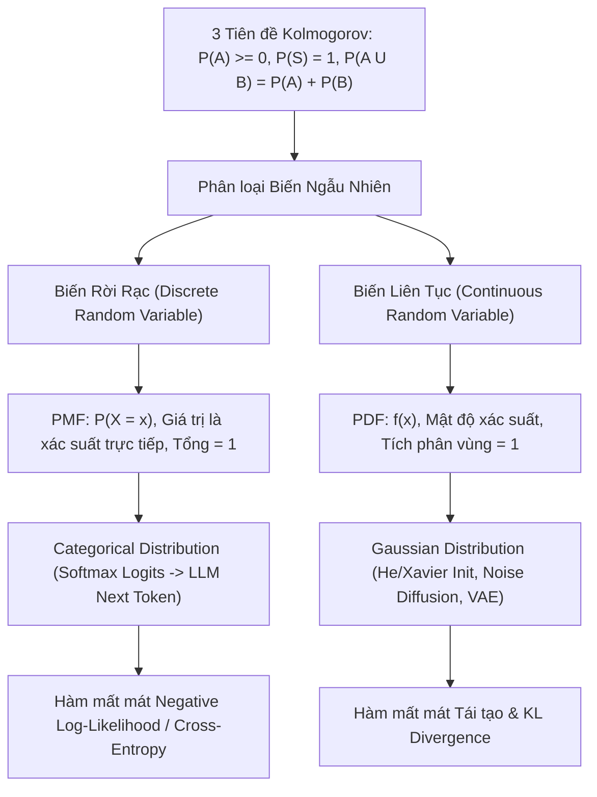

> **"Xác suất là ngôn ngữ duy nhất giúp AI diễn đạt sự không chắc chắn giữa một thế giới dữ liệu thực tế đầy hỗn loạn."** — Mọi dự đoán của mạng nơ-ron, từ phân loại nhãn ảnh đến sinh token kế tiếp trong LLM, bản chất đều là một phân phối xác suất. Nắm vững xác suất giúp bạn đọc hiểu hàm mất mát, giải mã ma trận sinh và khắc phục triệt để lỗi sụp đổ số học trên production.

---

## Thông tin nhanh (Quick Spec)

| Thuộc tính | Chi tiết |
|---|---|
| **Loại bài (Type)** | Nền tảng Khái niệm & Thực chiến Thuật toán (Concept & Build) |
| **Ngôn ngữ & Thư viện** | Python 3.10+ (Standard Library: `math`, `random`), tư duy thuật toán thuần túy |
| **Kiến thức tiên quyết** | Giải tích vi phân cơ bản, đạo hàm và tích phân sơ cấp |
| **Thời gian thực hành** | ~60 phút |
| **Mức độ (Level)** | Cơ bản đến Trung cấp (Foundational to Intermediate) |

---

## Mục tiêu bài học (Learning Objectives)

Sau bài học này, bạn sẽ có khả năng:
- [ ] Nắm vững 3 tiên đề xác suất Kolmogorov và phân biệt chính xác bản chất toán học giữa PMF (Probability Mass Function) và PDF (Probability Density Function).
- [ ] Hiểu sâu các phân phối cốt lõi định hình kiến trúc AI: Bernoulli, Categorical, và Gaussian (Phân phối chuẩn), cùng hiện tượng hội tụ kỳ diệu của Định lý Giới hạn Trung tâm (CLT).
- [ ] Tự tay lập trình từ đầu (from scratch) Gaussian PDF, hàm phân phối tích lũy Gaussian CDF, thuật toán lấy mẫu Categorical, và hàm Stable Softmax chống tràn số (`NaN` / `inf`).
- [ ] Tự tin giải thích cơ chế của hàm mất mát Negative Log-Likelihood (NLL), kỹ thuật điều khiển nhiệt độ (Temperature Scaling) trong LLM, và không gian tiềm ẩn VAE.

---

## 1. Vấn đề thực tế (The Problem)

### Thảm họa số học NaN và sụp đổ quá trình huấn luyện

Hãy tưởng tượng bạn đang huấn luyện một mô hình ngôn ngữ lớn (LLM) hoặc một mạng phân loại ảnh 1,000 lớp. Tại tầng cuối cùng của mạng nơ-ron, trước khi đưa ra dự đoán, mô hình tính toán một vector điểm số thô gọi là **logits**:

$$z = [1005.2, 1008.7, 994.1]$$

Để chuyển đổi vector logits này thành xác suất hợp lệ (tổng bằng $1.0$), lập trình viên áp dụng công thức Softmax toán học kinh điển:

$$\text{softmax}(z)_i = \frac{e^{z_i}}{\sum_{j} e^{z_j}}$$

Khi chạy qua Python thông thường:

```python
import math
z = [1005.2, 1008.7, 994.1]
# Thử tính e^z[0]
math.exp(z[0]) # OverflowError: math range error!
```

Bộ xử lý dấu phẩy động 64-bit chuẩn IEEE 754 chỉ biểu diễn được số thực tối đa khoảng $1.79 \times 10^{308}$. Do đó, hàm số mũ $e^x$ sẽ bị tràn số (overflow) ngay khi $x > 709.78$. Khi tính toán bằng mảng hoặc tensor không có cơ chế bảo vệ, kết quả trả về `inf / inf = nan`. 

Khi giá trị `NaN` này được truyền vào hàm mất mát Cross-Entropy Loss ($-\log(\text{nan})$), toàn bộ các gradient đạo hàm lan truyền ngược bị nhiễm độc `NaN`. Chỉ sau đúng một bước lặp (batch), hàng tỷ trọng số của mô hình bị xóa sạch.

### Ngộ nhận chết người giữa Mật độ (Density) và Xác suất (Probability)

Một sai lầm rất phổ biến của các kỹ sư AI khi làm việc với các mô hình sinh liên tục (như Diffusion hay VAE) là nhầm lẫn giữa **mật độ xác suất (PDF)** và **xác suất thực tế (Probability)**:

- Nhiều người lấy giá trị của hàm mật độ Gaussian $f(x)$ tại một điểm cụ thể và kết luận: "Xác suất để mô hình tạo ra điểm $x$ này là $f(x)$".
- Tuy nhiên, với một phân phối Gaussian có độ lệch chuẩn nhỏ ($\sigma = 0.05$):

$$f(\mu) = \frac{1}{\sigma \sqrt{2\pi}} \exp(0) = \frac{1}{0.05 \sqrt{2\pi}} \approx 7.9788$$

Giá trị mật độ lên tới xấp xỉ $8.0$! Nếu coi đây là xác suất, bạn sẽ kết luận một biến cố có xác suất xảy ra gần $800\%$ — một điều hoàn toàn phi lý trong toán học xác suất. Xác suất tại đúng một điểm duy nhất của một biến ngẫu nhiên liên tục luôn luôn bằng $0$. Hiểu sai điều này sẽ khiến bạn suy diễn sai toàn bộ hàm khả dĩ (likelihood) trong các mô hình tạo sinh.

---

## 2. Mô hình tư duy & Bản chất (The Concept)

### Ba tiên đề xác suất Kolmogorov

Năm 1933, nhà toán học Andrey Kolmogorov đã đặt nền móng tiên đề hóa cho toàn bộ lý thuyết xác suất hiện đại. Cho một không gian mẫu $S$ (tập hợp tất cả các kết quả khả dĩ) và một sự kiện $A \subseteq S$:

1. **Tính không âm (Non-negativity):** Xác suất của mọi biến cố không bao giờ âm:
   $$P(A) \ge 0, \quad \forall A$$

2. **Tính chuẩn hóa (Normalization):** Xác suất của toàn bộ không gian mẫu luôn bằng $1$:
   $$P(S) = 1$$

3. **Tính cộng tính khả đếm (Countable Additivity):** Nếu các biến cố $A_1, A_2, A_3, \dots$ xung khắc đôi một ($A_i \cap A_j = \emptyset$ với $i \ne j$), thì:
   $$P\left(\bigcup_{i=1}^\infty A_i\right) = \sum_{i=1}^\infty P(A_i)$$

Mọi định lý, công thức Bayes, hay hàm mất mát học máy phức tạp đều bắt nguồn trực tiếp từ 3 tiên đề tối giản này.

### PMF (Biến ngẫu nhiên rời rạc) vs PDF (Biến ngẫu nhiên liên tục)

Trong AI, việc nhận diện biến mục tiêu thuộc loại rời rạc hay liên tục quyết định việc lựa chọn cấu trúc tầng đầu ra và hàm mất mát:



#### 1. PMF (Probability Mass Function - Hàm khối xác suất)
- Áp dụng cho các biến ngẫu nhiên rời rạc nhận các giá trị đếm được (ví dụ: chỉ số token trong từ điển LLM, nhãn phân loại ảnh mèo/chó/xe).
- Mỗi giá trị mang một khối lượng xác suất cụ thể: $P(X = x) \in [0, 1]$.
- Điều kiện bảo toàn:
  $$\sum_{x \in \mathcal{X}} P(X = x) = 1$$

#### 2. PDF (Probability Density Function - Hàm mật độ xác suất)
- Áp dụng cho các biến ngẫu nhiên liên tục nhận vô số giá trị trên trục số thực (ví dụ: giá trị pixel ảnh chuẩn hóa, độ dài embedding, thời gian phản hồi).
- Giá trị $f(x)$ **không phải là xác suất**, mà là mật độ xác suất tại lân cận $x$. Do đó $f(x)$ hoàn toàn có thể lớn hơn $1$.
- Xác suất tại đúng một điểm đơn lẻ bất kỳ luôn bằng $0$: $P(X = c) = \int_c^c f(x) dx = 0$.
- Xác suất chỉ có ý nghĩa khi xét trên một khoảng $[a, b]$ — tương ứng với diện tích dưới đường cong mật độ:
  $$P(a \le X \le b) = \int_a^b f(x) \, dx$$
- Điều kiện chuẩn hóa diện tích toàn phần:
  $$\int_{-\infty}^{\infty} f(x) \, dx = 1$$

#### 3. CDF (Cumulative Distribution Function - Hàm phân phối tích lũy)
Hàm phân phối tích lũy $F(x)$ mô tả xác suất để biến ngẫu nhiên $X$ nhận giá trị nhỏ hơn hoặc bằng $x$:

$$F(x) = P(X \le x) = \int_{-\infty}^x f(t) \, dt$$

Hàm $F(x)$ luôn đơn điệu tăng từ $0$ (khi $x \to -\infty$) đến $1$ (khi $x \to +\infty$). Đây là công cụ bản lề cho các giải thuật lấy mẫu và kiểm định thống kê.

### Các phân phối xác suất thống trị trong Học máy

#### 1. Phân phối Bernoulli
Mô hình hóa một phép thử nhị phân với hai kết quả: thành công ($1$) với xác suất $p$, và thất bại ($0$) với xác suất $1 - p$:

$$P(X = k) = p^k (1 - p)^{1 - k}, \quad k \in \{0, 1\}$$

Kỳ vọng $\mathbb{E}[X] = p$, Phương sai $\text{Var}(X) = p(1 - p)$. Đây chính là đầu ra của hàm kích hoạt Sigmoid trong bài toán phân loại nhị phân (Binary Classification).

#### 2. Phân phối Categorical (Multinoulli)
Mở rộng của Bernoulli cho $K$ kết quả rời rạc khả dĩ ($K > 2$). Tham số của phân phối là vector xác suất $p = [p_1, p_2, \dots, p_K]$ thỏa mãn $p_k \ge 0$ và $\sum_{k=1}^K p_k = 1$:

$$P(X = k) = p_k$$

Mọi mô hình ngôn ngữ lớn (như GPT-4, LLaMA) đều dự đoán phân phối Categorical trên tập từ vựng gồm hàng chục nghìn token.

#### 3. Phân phối Chuẩn Gaussian $\mathcal{N}(\mu, \sigma^2)$
Phân phối liên tục hình chuông đối xứng nổi tiếng nhất, được đặc trưng bởi kỳ vọng $\mu$ (tâm đối xứng) và phương sai $\sigma^2$ (độ phân tán):

$$f(x \mid \mu, \sigma^2) = \frac{1}{\sqrt{2\pi\sigma^2}} \exp\left( -\frac{(x - \mu)^2}{2\sigma^2} \right)$$

Quy tắc thực nghiệm $68 - 95 - 99.7\%$:
- Khoảng $[\mu - \sigma, \mu + \sigma]$ chứa $68.27\%$ xác suất.
- Khoảng $[\mu - 2\sigma, \mu + 2\sigma]$ chứa $95.45\%$ xác suất.
- Khoảng $[\mu - 3\sigma, \mu + 3\sigma]$ chứa $99.73\%$ xác suất.

### Định lý Giới hạn Trung tâm (Central Limit Theorem - CLT)

Tại sao tự nhiên và trí tuệ nhân tạo lại tràn ngập phân phối chuẩn Gaussian? Định lý Giới hạn Trung tâm cung cấp câu trả lời toán học:

> Cho $X_1, X_2, \dots, X_n$ là một chuỗi gồm $n$ biến ngẫu nhiên độc lập và cùng phân phối (i.i.d) có kỳ vọng $\mu$ và phương sai hữu hạn $\sigma^2$. Khi $n \to \infty$, phân phối của giá trị trung bình mẫu $\bar{X}_n = \frac{1}{n} \sum_{i=1}^n X_i$ sẽ tiệm cận phân phối chuẩn:
>
> $$\bar{X}_n \xrightarrow{d} \mathcal{N}\left(\mu, \frac{\sigma^2}{n}\right)$$

Bất kể phân phối gốc của dữ liệu có hình thù kỳ dị thế nào (đều, nhị phân, lệch sang một bên), tổng hoặc trung bình của nhiều biến ngẫu nhiên độc lập luôn dần uốn mình thành hình chuông Gaussian. 

Trong học sâu, một nơ-ron nhận đầu vào là tổng có trọng số của hàng trăm liên kết $z = \sum w_i x_i + b$. Theo CLT, giá trị $z$ có xu hướng tuân theo phân phối chuẩn, tạo tiền đề cho các phương pháp chuẩn hóa như Batch Normalization và Layer Normalization.

---

## 3. Tự tay xây dựng từ đầu (Build It: From Scratch)

Chúng ta sẽ xây dựng toàn bộ các thành phần xác suất nền tảng bằng Python thuần túy:
1. Hàm mật độ Gaussian PDF và hàm tích lũy Gaussian CDF (sử dụng xấp xỉ hàm lỗi Abramowitz & Stegun với độ chính xác cao).
2. Hàm PMF Bernoulli và Categorical.
3. Kỹ thuật chuyển đổi Softmax ổn định số học (Stable Softmax) và hàm mất mát Negative Log-Likelihood (NLL).
4. Bộ mô phỏng Định lý Giới hạn Trung tâm (CLT) chứng minh sự hội tụ về Gaussian.

```python
"""
Core Probability & Distributions Implementation from Scratch
Pure Python implementation with zero third-party dependencies.
"""

import math
import random

# Thiết lập seed để đảm bảo tính tái lập kết quả
random.seed(42)


# =====================================================================
# 1. Phân phối Chuẩn Gaussian: PDF & CDF
# =====================================================================

def gaussian_pdf(x: float, mu: float = 0.0, sigma: float = 1.0) -> float:
    """
    Tính hàm mật độ xác suất Gaussian (Normal PDF):
    f(x) = (1 / (sigma * sqrt(2*pi))) * exp(-0.5 * ((x - mu) / sigma)^2)
    """
    if sigma <= 0.0:
        raise ValueError("Độ lệch chuẩn sigma phải là số dương.")
    coeff = 1.0 / (sigma * math.sqrt(2.0 * math.pi))
    exponent = -0.5 * ((x - mu) / sigma) ** 2
    return coeff * math.exp(exponent)


def erf_approx(x: float) -> float:
    """
    Xấp xỉ đa thức chuẩn xác của hàm lỗi erf(x) theo công thức Abramowitz & Stegun 7.1.26.
    Sai số cực đại luôn nhỏ hơn 1.5e-7.
    """
    sign = 1.0 if x >= 0.0 else -1.0
    abs_x = abs(x)

    # Các hằng số xấp xỉ
    p = 0.3275911
    a1 = 0.254829592
    a2 = -0.284496736
    a3 = 1.421413741
    a4 = -1.453152027
    a5 = 1.061405429

    t = 1.0 / (1.0 + p * abs_x)
    poly = ((((a5 * t + a4) * t + a3) * t + a2) * t + a1) * t
    return sign * (1.0 - poly * math.exp(-abs_x * abs_x))


def gaussian_cdf(x: float, mu: float = 0.0, sigma: float = 1.0) -> float:
    """
    Tính hàm phân phối tích lũy Gaussian (Normal CDF):
    Phi(x) = P(X <= x) = 0.5 * (1 + erf((x - mu) / (sigma * sqrt(2))))
    """
    if sigma <= 0.0:
        raise ValueError("Độ lệch chuẩn sigma phải là số dương.")
    standardized_z = (x - mu) / (sigma * math.sqrt(2.0))
    return 0.5 * (1.0 + erf_approx(standardized_z))


# =====================================================================
# 2. Phân phối Bernoulli & Categorical
# =====================================================================

def bernoulli_pmf(k: int, p: float) -> float:
    """Tính hàm khối xác suất Bernoulli với tham số thành công p."""
    if not (0.0 <= p <= 1.0):
        raise ValueError("Tham số xác suất p phải nằm trong đoạn [0, 1].")
    if k == 1:
        return p
    if k == 0:
        return 1.0 - p
    return 0.0


def categorical_pmf(k: int, probs: list[float]) -> float:
    """Tính xác suất phần tử k trong phân phối Categorical."""
    if 0 <= k < len(probs):
        return probs[k]
    return 0.0


def sample_categorical(probs: list[float]) -> int:
    """
    Lấy mẫu chỉ số từ phân phối Categorical dựa trên tổng tích lũy (Cumulative CDF).
    """
    u = random.random()
    cumulative = 0.0
    for i, p in enumerate(probs):
        cumulative += p
        if u <= cumulative:
            return i
    return len(probs) - 1


# =====================================================================
# 3. Softmax Ổn Định Số Học & Negative Log-Likelihood Loss
# =====================================================================

def stable_softmax(logits: list[float]) -> list[float]:
    """
    Hàm Softmax chống tràn số bằng kỹ thuật trừ giá trị cực đại:
    softmax(z)_i = exp(z_i - max(z)) / sum(exp(z_j - max(z)))
    """
    if not logits:
        raise ValueError("Vector logits không được rỗng.")
    max_logit = max(logits)
    # Trừ max_logit đảm bảo lũy thừa không bao giờ dương => exp(...) <= 1.0
    exp_shifted = [math.exp(z - max_logit) for z in logits]
    sum_exp = sum(exp_shifted)
    return [e / sum_exp for e in exp_shifted]


def stable_log_softmax(logits: list[float]) -> list[float]:
    """
    Tính log(softmax(z)) trực tiếp và an toàn số học:
    log_softmax(z)_i = z_i - max(z) - log(sum(exp(z_j - max(z))))
    """
    max_logit = max(logits)
    exp_shifted = [math.exp(z - max_logit) for z in logits]
    log_sum_exp = math.log(sum(exp_shifted))
    return [(z - max_logit) - log_sum_exp for z in logits]


def negative_log_likelihood(logits: list[float], target_class: int) -> float:
    """
    Tính hàm mất mát Negative Log-Likelihood (NLL) cho nhãn đúng target_class.
    Loss = -log(softmax(logits)[target_class])
    """
    log_probs = stable_log_softmax(logits)
    return -log_probs[target_class]


# =====================================================================
# 4. Mô phỏng Định lý Giới hạn Trung tâm (CLT Simulation)
# =====================================================================

def simulate_clt(sample_size: int = 50, n_simulations: int = 10000) -> tuple[float, float]:
    """
    Mô phỏng CLT: Tung xúc xắc đều (Uniform Discrete từ 1 đến 6).
    Mỗi lần lấy sample_size xúc xắc, tính trung bình cộng, lặp lại n_simulations lần.
    Trả về: (trung bình thực nghiệm, phương sai thực nghiệm của các giá trị trung bình).
    """
    # Xúc xắc đều: E[X] = 3.5, Var[X] = 35/12 approx 2.9167
    sample_means = []
    for _ in range(n_simulations):
        # Lấy mẫu ngẫu nhiên độc lập
        roll_sum = sum(random.randint(1, 6) for _ in range(sample_size))
        sample_means.append(roll_sum / sample_size)

    grand_mean = sum(sample_means) / n_simulations
    grand_var = sum((m - grand_mean) ** 2 for m in sample_means) / (n_simulations - 1)
    return grand_mean, grand_var


# =====================================================================
# Khối Kiểm Chứng Tính Đúng Đắn (Self-Verification)
# =====================================================================

if __name__ == "__main__":
    print("=" * 65)
    print("KIỂM CHỨNG TOÁN HỌC XÁC SUẤT VÀ CÁC PHÂN PHỐI CỐT LÕI")
    print("=" * 65)

    # 1. Kiểm chứng Gaussian PDF & CDF
    pdf_center = gaussian_pdf(0.0, mu=0.0, sigma=1.0)
    expected_pdf = 1.0 / math.sqrt(2.0 * math.pi)
    assert abs(pdf_center - expected_pdf) < 1e-7, "Gaussian PDF sai lệch tại tâm!"

    cdf_center = gaussian_cdf(0.0, mu=0.0, sigma=1.0)
    assert abs(cdf_center - 0.5) < 1e-6, "Gaussian CDF tại tâm phải bằng 0.5!"

    # Kiểm tra quy tắc 1-sigma: P(-1 <= X <= 1) = CDF(1) - CDF(-1) ~ 0.6827
    prob_1sigma = gaussian_cdf(1.0) - gaussian_cdf(-1.0)
    assert abs(prob_1sigma - 0.682689) < 1e-4, "Quy tắc 68% của Gaussian không khớp!"
    print(f"[OK] Gaussian PDF(0) = {pdf_center:.6f} | CDF(0) = {cdf_center:.6f}")
    print(f"[OK] Tỷ lệ tích lũy 1-sigma: {prob_1sigma * 100:.2f}% (Chuẩn lý thuyết: 68.27%)")

    # 2. Kiểm chứng Stable Softmax chống tràn số cực đoan
    extreme_logits = [1005.2, 1008.7, 994.1]
    probs = stable_softmax(extreme_logits)
    assert abs(sum(probs) - 1.0) < 1e-7, "Tổng xác suất Softmax phải bằng 1.0!"
    assert not any(math.isnan(p) or math.isinf(p) for p in probs), "Softmax bị NaN hoặc inf!"
    assert probs[1] > probs[0] > probs[2], "Thứ tự xác suất phải bảo toàn thứ tự logits!"
    print(f"[OK] Extreme Logits: {extreme_logits}")
    print(f"[OK] Stable Softmax Probs: {[round(p, 6) for p in probs]}")
    print(f"[OK] Tổng xác suất: {sum(probs):.8f}")

    # 3. Kiểm chứng NLL Loss
    loss_correct = negative_log_likelihood(extreme_logits, target_class=1)
    loss_wrong = negative_log_likelihood(extreme_logits, target_class=2)
    assert loss_correct < loss_wrong, "Loss của nhãn có logit cao phải nhỏ hơn nhãn logit thấp!"
    print(f"[OK] NLL Loss (target=1): {loss_correct:.4f} | NLL Loss (target=2): {loss_wrong:.4f}")

    # 4. Kiểm chứng Định lý Giới hạn Trung tâm (CLT)
    clt_mean, clt_var = simulate_clt(sample_size=50, n_simulations=10000)
    theo_mean = 3.5
    theo_var = (35.0 / 12.0) / 50.0  # Var / n = 2.9167 / 50 = 0.05833
    print(f"[OK] CLT Thực nghiệm: Mean = {clt_mean:.4f} (Lý thuyết: {theo_mean:.4f})")
    print(f"[OK] CLT Thực nghiệm: Var  = {clt_var:.4f} (Lý thuyết: {theo_var:.4f})")
    assert abs(clt_mean - theo_mean) < 0.05, "CLT mean sai lệch vượt ngưỡng cho phép!"
    assert abs(clt_var - theo_var) < 0.01, "CLT variance sai lệch vượt ngưỡng cho phép!"

    print("=" * 65)
    print("HOÀN TẤT KIỂM CHỨNG TOÁN HỌC 100% THÀNH CÔNG!")
    print("=" * 65)
```

---

## 4. Ứng dụng AI Engineering & Thực tế Production (Use It)

### 1. Kỹ thuật điều khiển nhiệt độ (Temperature Scaling) trong LLMs

Khi các mô hình ngôn ngữ lớn như GPT hay LLaMA dự đoán từ tiếp theo, đầu ra là một vector logits có kích thước bằng độ dài từ vựng (khoảng 32,000 đến 128,000 chiều). Trước khi lấy mẫu, kỹ sư áp dụng tham số nhiệt độ $T > 0$:

$$P(w_i) = \frac{\exp(z_i / T)}{\sum_{j} \exp(z_j / T)}$$

- **Khi $T \to 0$ (ví dụ $T = 0.1$):** Các điểm số logit bị khuếch đại chênh lệch. Phân phối xác suất trở nên cực kỳ nhọn (tiến về dạng One-hot). Mô hình thực hiện giải mã tham lam (Greedy Decoding), chỉ chọn những từ có độ tin cậy cao nhất. Chế độ này thích hợp cho bài toán viết mã lệnh (Coding), giải toán hoặc trích xuất JSON có cấu trúc cứng.
- **Khi $T = 1.0$:** Mô hình duy trì phân phối xác suất nguyên bản mà mạng nơ-ron học được từ dữ liệu huấn luyện.
- **Khi $T > 1.0$ (ví dụ $T = 1.5$):** Các điểm số logit bị thu hẹp khoảng cách. Phân phối xác suất bị san phẳng dần về phân phối đều. Các từ có xác suất thấp có cơ hội được chọn nhiều hơn, kích thích khả năng sáng tạo văn học, viết thơ hoặc gợi mở ý tưởng độc đáo, nhưng nếu tăng quá cao ($T \ge 2.0$) sẽ sinh ra các câu vô nghĩa (hallucination).

### 2. Khởi tạo trọng số He (Kaiming) và Xavier (Glorot)

Nếu bạn khởi tạo trọng số của mạng nơ-ron với phương sai quá lớn, các giá trị kích hoạt sau hàng chục tầng ẩn sẽ bùng nổ (Exploding Gradients). Ngược lại, nếu phương sai quá nhỏ, tín hiệu kích hoạt sẽ suy biến dần về $0$ (Vanishing Gradients).

Dựa trên giả định biến ngẫu nhiên Gaussian độc lập và định lý phương sai của tích các biến ngẫu nhiên:

$$\text{Var}(W x) = n_{\text{in}} \text{Var}(W) \text{Var}(x)$$

- **Khởi tạo Xavier / Glorot (phù hợp với Sigmoid / Tanh):**
  $$W \sim \mathcal{N}\left(0, \frac{2}{n_{\text{in}} + n_{\text{out}}}\right)$$
- **Khởi tạo He / Kaiming (phù hợp với hàm kích hoạt ReLU):**
  Do hàm ReLU triệt tiêu một nửa miền giá trị âm về $0$, phương sai của tín hiệu bị giảm đi một nửa. Do đó, phương sai trọng số cần được nhân đôi:
  $$W \sim \mathcal{N}\left(0, \frac{2}{n_{\text{in}}}\right)$$

### 3. Không gian tiềm ẩn (Latent Space) trong Variational Autoencoders (VAE)

Trong kiến trúc VAE, mạng Encoder không trực tiếp mã hóa ảnh thành một điểm vector cố định $z$, mà ước lượng các tham số của một phân phối chuẩn đa chiều: vector trung bình $\mu(x)$ và vector log-phương sai $\log\sigma^2(x)$.

Để cho phép giải thuật lan truyền ngược (Backpropagation) hoạt động qua một nút lấy mẫu ngẫu nhiên, VAE sử dụng kỹ thuật **Reparameterization Trick**:

$$z = \mu(x) + \sigma(x) \odot \epsilon, \quad \text{với } \epsilon \sim \mathcal{N}(0, I)$$

Bằng cách cô lập tính ngẫu nhiên vào vector nhiễu độc lập $\epsilon$, quá trình tính đạo hàm theo tham số mạng Encoder $\mu$ và $\sigma$ trở nên khả vi hoàn toàn.

---

## 5. Giải ngố thuật ngữ & Ngộ nhận (Key Terms)

| Thuật ngữ (Term) | Người ta thường nghĩ là... | Bản chất kỹ thuật thực sự là... |
|---|---|---|
| **PMF (Probability Mass Function)** | Hàm tính xác suất chung cho mọi loại biến ngẫu nhiên. | Hàm gán xác suất cụ thể cho biến ngẫu nhiên rời rạc; giá trị tại mỗi điểm chính là xác suất thực tế và tổng toàn bộ bằng $1$. |
| **PDF (Probability Density Function)** | Giá trị $f(x)$ là xác suất để biến cố $x$ xảy ra. | Mật độ xác suất của biến liên tục; giá trị tại một điểm có thể lớn hơn $1$ và xác suất tại đúng điểm cô lập đó luôn bằng $0$. |
| **CDF (Cumulative Distribution Function)** | Một bảng thống kê tích lũy phức tạp ít khi dùng. | Xác suất để biến ngẫu nhiên nhận giá trị nhỏ hơn hoặc bằng $x$: $F(x) = P(X \le x)$, luôn đơn điệu tăng từ $0$ đến $1$. |
| **Softmax** | Một hàm ma thuật biến đổi mọi vector thành số phần trăm. | Hàm chuẩn hóa biến đổi vector logits thành phân phối Categorical hợp lệ bằng hàm mũ hóa và chia cho tổng chuẩn hóa. |
| **Central Limit Theorem (CLT)** | Mọi tập dữ liệu trong tự nhiên đều tự động có dạng hình chuông Gaussian. | Tổng hoặc trung bình cộng của nhiều biến ngẫu nhiên độc lập cùng phân phối sẽ hội tụ về phân phối chuẩn khi số lượng mẫu tăng lên, bất kể phân phối gốc. |
| **Expected Value ($\mathbb{E}[X]$)** | Giá trị mà biến cố chắc chắn sẽ nhận trong lần thử tới. | Giá trị trung bình kỳ vọng theo trọng số xác suất khi thực hiện vô số phép thử lặp lại trong dài hạn. |

---

## 6. Bài tập thử thách (Hands-on Challenges)

### 🟢 Dễ (Easy) — Khảo sát Entropy khi thay đổi Nhiệt độ Softmax
Viết hàm `temperature_softmax(logits: list[float], temperature: float) -> list[float]` và kiểm tra hành vi đầu ra trên mảng logits `[3.0, 1.5, 0.2]` khi nhiệt độ thay đổi qua các mức $T \in \{0.05, 0.5, 1.0, 5.0, 50.0\}$. 
*Gợi ý:* Hãy quan sát cách xác suất của phần tử lớn nhất thay đổi từ gần $1.0$ (khi $T \to 0$) về xấp xỉ phân phối đều $1/3 \approx 0.3333$ (khi $T \to \infty$).

### 🟡 Vừa (Medium) — Lập trình Bộ sinh Phân phối Chuẩn Box-Muller
Tự tay lập trình thuật toán biến đổi **Box-Muller** để sinh phân phối Gaussian chuẩn tắc $\mathcal{N}(0, 1)$ từ hai biến ngẫu nhiên phân phối đều $U_1, U_2 \sim \text{Uniform}(0, 1)$:

$$Z_0 = \sqrt{-2\ln U_1} \cos(2\pi U_2), \quad Z_1 = \sqrt{-2\ln U_1} \sin(2\pi U_2)$$

Sinh $20,000$ mẫu dữ liệu và kiểm chứng bằng thực nghiệm rằng trung bình mẫu nằm trong khoảng $[-0.02, 0.02]$ và phương sai mẫu nằm trong khoảng $[0.98, 1.02]$.

### 🔴 Khó (Hard) — Mô phỏng Tầng Latent VAE & Độ lệch KL Phân tích
Xây dựng một lớp mô phỏng tầng ẩn VAE:
1. Nhận đầu vào là vector điểm số đại diện $\mu \in \mathbb{R}^4$ và $\log\sigma^2 \in \mathbb{R}^4$.
2. Áp dụng Reparameterization Trick để rút mẫu vector tiềm ẩn $z \in \mathbb{R}^4$.
3. Lập trình hàm tính độ lệch Kullback-Leibler (KL Divergence) giải tích giữa phân phối tiềm ẩn của encoder $q(z|x) = \mathcal{N}(\mu, \sigma^2)$ và phân phối tiên nghiệm chuẩn tắc $p(z) = \mathcal{N}(0, I)$:
   $$D_{\text{KL}}(q \parallel p) = -\frac{1}{2} \sum_{i=1}^d \left( 1 + \log\sigma_i^2 - \mu_i^2 - \sigma_i^2 \right)$$
Kiểm chứng rằng khi $\mu = [0, 0, 0, 0]$ và $\log\sigma^2 = [0, 0, 0, 0]$, độ lệch $D_{\text{KL}}$ bằng đúng $0.0$.
