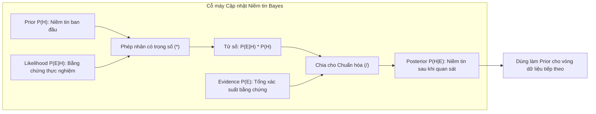

> **"Xác suất tiên nghiệm (Prior) là niềm tin ban đầu; Bằng chứng mới (Likelihood) là dữ liệu quan sát; Xác suất hậu nghiệm (Posterior) là niềm tin được cập nhật có căn cứ."** — Mọi hệ thống học máy thông minh đều vận hành như một cỗ máy Bayes: bắt đầu bằng niềm tin ban đầu (Prior), quan sát bằng chứng thực nghiệm (Likelihood) để liên tục cập nhật thành tri thức chuẩn xác hơn (Posterior).

---

## Thông tin nhanh (Quick Spec)

| Thuộc tính | Chi tiết |
|---|---|
| **Loại bài (Type)** | Thực chiến Suy luận & Nền tảng Thuật toán (Build & Concept) |
| **Ngôn ngữ & Thư viện** | Python 3.10+ (Standard Library: `math`, `random`, `collections`), zero dependency |
| **Kiến thức tiên quyết** | Xác suất cơ bản, xác suất có điều kiện, biến ngẫu nhiên rời rạc |
| **Thời gian thực hành** | ~60 phút |
| **Mức độ (Level)** | Trung cấp (Intermediate) |

---

## Mục tiêu bài học (Learning Objectives)

Sau bài học này, bạn sẽ có khả năng:
- [ ] Nắm vững 4 thành phần cấu tạo nên Định lý Bayes: Prior, Likelihood, Evidence, và Posterior; hiểu bản chất của quá trình cập nhật niềm tin tuần tự (Sequential Bayesian Updating).
- [ ] Tự tay giải mã nghịch lý tỷ lệ nền (Base Rate Fallacy) trong xét nghiệm y tế và hệ thống phát hiện gian lận tự động.
- [ ] Xây dựng hoàn chỉnh từ đầu (from scratch) bộ phân loại Naive Bayes cho văn bản, làm chủ kỹ thuật tính toán trong không gian Log (Log-Space) và làm mịn Laplace (Laplace Smoothing).
- [ ] Phân biệt bản chất toán học giữa MLE (Maximum Likelihood Estimation) và MAP (Maximum A Posteriori), chứng minh vì sao MAP với Gaussian Prior tương đương với kỹ thuật điều chuẩn $L_2$ Regularization (Weight Decay) trong mạng nơ-ron sâu.

---

## 1. Vấn đề thực tế (The Problem)

### Nghịch lý tỷ lệ nền (Base Rate Fallacy) trong hệ thống AI an ninh

Hãy xem xét bài toán phát hiện giao dịch gian lận thẻ tín dụng hoặc phát hiện mã độc trong hệ thống an ninh ngân hàng:
- Tỷ lệ giao dịch gian lận thực tế trong thế giới thực là rất hiếm: chỉ có $1$ trên $10,000$ giao dịch là gian lận thực sự ($P(\text{Gian lận}) = 0.0001$).
- Nhóm kỹ sư AI huấn luyện một mô hình học sâu đạt độ nhạy (Sensitivity / True Positive Rate) lên tới $99\%$: nếu giao dịch thực sự là gian lận, mô hình báo động đúng với xác suất $0.99$.
- Tỷ lệ dương tính giả (False Positive Rate) của mô hình chỉ là $1\%$: với giao dịch bình thường của người dùng hợp lệ, mô hình chỉ báo nhầm với xác suất $0.01$.

Một ngày nọ, còi báo động của mô hình hú vang, gắn nhãn một giao dịch chuyển tiền là "Gian lận". Đội ngũ vận hành vội vàng kết luận: "Mô hình có độ chính xác $99\%$, vậy giao dịch này có $99\%$ khả năng là kẻ lừa đảo! Hãy khóa tài khoản ngay lập tức!".

Nhưng toán học Bayes chỉ ra một sự thật chấn động: **Xác suất để giao dịch này thực sự là gian lận chưa tới $1\%$!**

Tại sao lại có nghịch lý kỳ quặc này? 
Vì cứ trong $10,000$ giao dịch:
- Có đúng $1$ giao dịch gian lận, và mô hình phát hiện ra nó ($1 \times 0.99 \approx 1$).
- Nhưng có tới $9,999$ giao dịch trong sạch, và tỷ lệ báo nhầm $1\%$ sẽ tạo ra:
  $$9,999 \times 0.01 \approx 100 \text{ cảnh báo giả!}$$

Tổng cộng có $101$ lần còi báo động kêu, nhưng chỉ có đúng $1$ lần là gian lận thật. Xác suất thực tế là $\frac{1}{101} \approx 0.99\%$. Nếu không hiểu định lý Bayes, hệ thống AI của bạn sẽ khóa nhầm tài khoản của $100$ khách hàng vô tội để bắt được $1$ kẻ gian lận, gây tê liệt trải nghiệm người dùng và phá hủy uy tín doanh nghiệp.

### Thảm họa xác suất bằng 0 và tràn số dưới (Underflow)

Khi xây dựng các mô hình phân loại văn bản hoặc lọc thư rác (Spam Filter) dựa trên xác suất:
1. **Thảm họa xác suất bằng 0 (Zero-Frequency Problem):** Giả sử từ "khuyến mãi" chưa từng xuất hiện trong tập huấn luyện của nhãn "Hợp lệ". Khi gặp một email công việc chứa từ này, mô hình tính xác suất $P(\text{"khuyến mãi"} \mid \text{Hợp lệ}) = 0$. Vì xác suất phân loại là tích của các từ $\prod P(w_i \mid \text{nhãn})$, một số $0$ duy nhất này sẽ triệt tiêu toàn bộ tích xác suất về $0$, xóa sạch toàn bộ bằng chứng quý giá của hàng trăm từ công việc khác trong email.
2. **Tràn số dưới dấu phẩy động (Floating-point Underflow):** Một đoạn văn bản chứa 200 từ. Khi nhân 200 số thực nhỏ hơn $1$ (ví dụ $10^{-4} \times 10^{-5} \times \dots$), kết quả nhanh chóng vượt quá giới hạn biểu diễn nhỏ nhất của số thực $64$-bit ($2.22 \times 10^{-308}$) và bị làm tròn về $0.0$, khiến mô hình không thể so sánh điểm số giữa các lớp.

---

## 2. Mô hình tư duy & Bản chất (The Concept)

### Dẫn xuất Định lý Bayes từ Xác suất đồng thời

Định lý Bayes bắt nguồn trực tiếp từ định nghĩa xác suất đồng thời đối xứng của hai sự kiện $A$ và $B$:

$$P(A \cap B) = P(A \mid B) P(B) = P(B \mid A) P(A)$$

Chia cả hai vế cho $P(B)$ (với điều kiện $P(B) > 0$), ta thu được công thức Định lý Bayes:

$$P(A \mid B) = \frac{P(B \mid A) P(A)}{P(B)}$$



### Bốn trụ cột của Định lý Bayes

Trong bối cảnh học máy và suy luận khoa học, ta đặt $H$ là giả thuyết (Hypothesis hoặc tham số mô hình $\theta$) và $E$ là bằng chứng (Evidence hoặc dữ liệu quan sát được $D$):

$$P(H \mid E) = \frac{P(E \mid H) P(H)}{P(E)}$$

1. **$P(H)$ (Prior Probability - Xác suất tiên nghiệm):**
   Mức độ tin tưởng ban đầu vào giả thuyết $H$ trước khi thu thập dữ liệu mới. Đây có thể là tỷ lệ bệnh nền trong dân số, hoặc kỳ vọng rằng trọng số mạng nơ-ron phải có giá trị nhỏ gần $0$.

2. **$P(E \mid H)$ (Likelihood - Độ hợp lý):**
   Xác suất quan sát thấy tập dữ liệu $E$ nếu giả thuyết $H$ là đúng. Hàm hợp lý đo lường mức độ tương thích giữa mô hình giả định và thực tế khách quan.

3. **$P(E)$ (Evidence / Marginal Likelihood - Bằng chứng / Khả dĩ biên):**
   Tổng xác suất xuất hiện dữ liệu $E$ dưới mọi giả thuyết khả dĩ. Đóng vai trò là hằng số chuẩn hóa để đảm bảo tổng xác suất hậu nghiệm bằng $1$:
   $$P(E) = \sum_{k} P(E \mid H_k) P(H_k)$$

4. **$P(H \mid E)$ (Posterior Probability - Xác suất hậu nghiệm):**
   Mức độ tin tưởng đã được cập nhật về giả thuyết $H$ sau khi dung nạp bằng chứng $E$. Đây là mục tiêu tối thượng của suy luận Bayes.

### Cập nhật niềm tin tuần tự (Sequential Bayesian Updating)

Điểm tinh hoa nhất của tư duy Bayes là tính lũy tiến:
> **"Posterior của ngày hôm nay sẽ trở thành Prior của ngày mai."**

Khi có một luồng dữ liệu liên tục đổ về (streaming data trong hệ thống gợi ý hoặc Reinforcement Learning), bạn không cần huấn luyện lại toàn bộ mô hình từ đầu. Bạn chỉ cần lấy phân phối Posterior vừa tính được làm Prior cho lô dữ liệu kế tiếp.

### Bộ phân loại Naive Bayes (Naive Bayes Classifier)

Giả sử ta cần phân loại một văn bản có vector đặc trưng $x = (x_1, x_2, \dots, x_n)$ vào một lớp $y \in \mathcal{Y}$. Theo định lý Bayes:

$$P(y \mid x) \propto P(y) P(x_1, x_2, \dots, x_n \mid y)$$

Để tính xác suất đồng thời $P(x_1, \dots, x_n \mid y)$ cho một từ điển 20,000 từ là bất khả thi vì đòi hỏi dữ liệu khổng lồ để ước lượng mọi tổ hợp từ đi cùng nhau. 

Naive Bayes đưa ra một giả định **"ngây thơ" (naive)** nhưng mang lại sức mạnh phi thường:
> *Tất cả các từ $x_i$ hoàn toàn độc lập có điều kiện với nhau khi đã biết trước nhãn $y$.*

$$P(x_1, x_2, \dots, x_n \mid y) = \prod_{i=1}^n P(x_i \mid y)$$

#### 1. Chuyển đổi sang không gian Log-Space (Chống Underflow)
Để ngăn chặn tràn số dưới khi nhân hàng trăm số thực nhỏ, ta lấy logarit tự nhiên ở cả hai vế, biến phép nhân thành phép cộng:

$$\log P(y \mid x) = \log P(y) + \sum_{i=1}^n \log P(x_i \mid y)$$

Lớp dự đoán tối ưu là lớp có tổng điểm log-posterior cao nhất:
$$\hat{y} = \arg\max_{y \in \mathcal{Y}} \left[ \log P(y) + \sum_{i=1}^n \log P(x_i \mid y) \right]$$

#### 2. Kỹ thuật làm mịn Laplace (Laplace Smoothing)
Để triệt tiêu lỗi xác suất bằng 0 khi gặp từ vựng mới, ta cộng thêm một lượng giả định $\alpha > 0$ (thường chọn $\alpha = 1.0$, gọi là Add-1 Smoothing) vào tử số và $\alpha |V|$ vào mẫu số (với $|V|$ là kích thước toàn bộ từ điển):

$$P(w_i \mid y) = \frac{\text{count}(w_i, y) + \alpha}{\sum_{w \in V} \text{count}(w, y) + \alpha |V|}$$

### Cầu nối sâu sắc: MLE, MAP và Điều chuẩn L2

Trong học máy tham số, ta muốn tìm bộ trọng số $\theta$ tốt nhất giải thích dữ liệu $D = \{x_1, \dots, x_N\}$:

1. **MLE (Maximum Likelihood Estimation - Cực đại hóa hợp lý):**
   Chỉ quan tâm đến dữ liệu quan sát, không có niềm tin tiên nghiệm (hoặc giả định Prior là phân phối đều phẳng):
   $$\hat{\theta}_{\text{MLE}} = \arg\max_\theta \sum_{i=1}^N \log P(x_i \mid \theta)$$

2. **MAP (Maximum A Posteriori - Cực đại hóa hậu nghiệm):**
   Kết hợp cả dữ liệu thực tế lẫn niềm tin tiên nghiệm vào tham số:
   $$\hat{\theta}_{\text{MAP}} = \arg\max_\theta \left[ \sum_{i=1}^N \log P(x_i \mid \theta) + \log P(\theta) \right]$$

Nếu ta áp đặt một **Gaussian Prior** lên trọng số: $\theta \sim \mathcal{N}(0, \sigma_0^2)$, thì:
$$\log P(\theta) = -\frac{1}{2\sigma_0^2} \|\theta\|_2^2 + \text{const}$$

Khi đó bài toán MAP trở thành:
$$\hat{\theta}_{\text{MAP}} = \arg\max_\theta \left[ \sum_{i=1}^N \log P(x_i \mid \theta) - \frac{\lambda}{2} \|\theta\|_2^2 \right]$$

Điều này chứng minh: **Tối ưu hóa MAP với giả thuyết trọng số phân phối chuẩn chính là kỹ thuật điều chuẩn $L_2$ Regularization (Weight Decay) được dùng hàng ngày trong PyTorch!**

---

## 3. Tự tay xây dựng từ đầu (Build It: From Scratch)

Dưới đây là mã nguồn Python thuần túy hoàn chỉnh:
1. Hàm giải bài toán nghịch lý tỷ lệ nền `bayes_updater`.
2. Lớp `NaiveBayesClassifier` từ scratch với từ điển động, tính toán trong Log-Space và Laplace Smoothing.
3. Bộ mô phỏng phân phối liên hợp Beta-Binomial cho bài toán A/B Testing và thuật toán Thompson Sampling.

```python
"""
Bayes' Theorem & Probabilistic Inference from Scratch
Pure Python implementation with zero third-party dependencies.
"""

import math
import random
from collections import defaultdict

random.seed(42)


# =====================================================================
# 1. Cập nhật Xác suất Bayes cho Tỷ lệ nền (Base Rate)
# =====================================================================

def bayes_updater(prior: float, sensitivity: float, false_positive_rate: float) -> float:
    """
    Tính xác suất hậu nghiệm P(H|E) khi có xét nghiệm/báo động dương tính:
    P(H|E) = (P(E|H) * P(H)) / (P(E|H)*P(H) + P(E|~H)*P(~H))
    """
    # Tử số: Xác suất có bệnh và dương tính thật
    numerator = sensitivity * prior
    # Mẫu số: Tổng xác suất dương tính (thật + giả)
    marginal_evidence = numerator + false_positive_rate * (1.0 - prior)
    if marginal_evidence == 0.0:
        return 0.0
    return numerator / marginal_evidence


# =====================================================================
# 2. Bộ phân loại Naive Bayes (Log-Space + Laplace Smoothing)
# =====================================================================

class NaiveBayesClassifier:
    """
    Bộ phân loại văn bản Naive Bayes đa lớp hoạt động hoàn toàn trong không gian Log.
    Hỗ trợ làm mịn Laplace (Laplace Add-alpha Smoothing).
    """

    def __init__(self, alpha: float = 1.0):
        self.alpha = alpha
        self.class_priors: dict[str, float] = {}
        self.word_counts: dict[str, dict[str, int]] = defaultdict(lambda: defaultdict(int))
        self.total_words_in_class: dict[str, int] = defaultdict(int)
        self.vocabulary: set[str] = set()

    def _tokenize(self, text: str) -> list[str]:
        """Tách từ đơn giản, chuyển về chữ thường và lọc ký tự đặc biệt."""
        clean_text = "".join(ch.lower() if ch.isalnum() or ch.isspace() else " " for ch in text)
        return [word for word in clean_text.split() if len(word) > 1]

    def fit(self, documents: list[str], labels: list[str]):
        """Huấn luyện mô hình từ danh sách văn bản và nhãn tương ứng."""
        total_docs = len(documents)
        if total_docs == 0:
            raise ValueError("Tập dữ liệu huấn luyện rỗng.")

        label_counts = defaultdict(int)
        for doc, label in zip(documents, labels):
            label_counts[label] += 1
            tokens = self._tokenize(doc)
            for token in tokens:
                self.vocabulary.add(token)
                self.word_counts[label][token] += 1
                self.total_words_in_class[label] += 1

        # Tính log prior P(y)
        for label, count in label_counts.items():
            self.class_priors[label] = math.log(count / total_docs)

    def predict_log_proba(self, text: str) -> dict[str, float]:
        """Tính điểm số log-posterior cho từng lớp khả dĩ."""
        tokens = self._tokenize(text)
        vocab_size = len(self.vocabulary)
        scores = {}

        for label, log_prior in self.class_priors.items():
            score = log_prior
            class_total_words = self.total_words_in_class[label]
            denominator = class_total_words + self.alpha * vocab_size

            for token in tokens:
                # Đếm số lần từ xuất hiện trong class (mặc định 0 nếu là từ mới)
                count = self.word_counts[label].get(token, 0)
                # Áp dụng Laplace smoothing
                prob_word_given_class = (count + self.alpha) / denominator
                score += math.log(prob_word_given_class)

            scores[label] = score
        return scores

    def predict(self, text: str) -> str:
        """Dự đoán nhãn có điểm log-posterior cao nhất."""
        scores = self.predict_log_proba(text)
        return max(scores, key=scores.get)


# =====================================================================
# 3. Phân phối liên hợp Beta-Binomial cho Bayesian A/B Testing
# =====================================================================

def beta_binomial_update(
    prior_alpha: float, prior_beta: float, successes: int, trials: int
) -> tuple[float, float]:
    """
    Cập nhật phân phối liên hợp Beta(alpha, beta) với dữ liệu nhị thức:
    alpha_post = alpha_prior + successes
    beta_post  = beta_prior + (trials - successes)
    """
    post_alpha = prior_alpha + successes
    post_beta = prior_beta + (trials - successes)
    return post_alpha, post_beta


def sample_beta(alpha: float, beta: float) -> float:
    """
    Lấy mẫu từ phân phối Beta(alpha, beta) thông qua phân phối Gamma:
    Nếu X ~ Gamma(alpha), Y ~ Gamma(beta) thì X / (X + Y) ~ Beta(alpha, beta)
    """
    # Sử dụng random.gammavariate của thư viện chuẩn Python
    x = random.gammavariate(alpha, 1.0)
    y = random.gammavariate(beta, 1.0)
    return x / (x + y)


def bayesian_ab_test_probability_b_beats_a(
    a_successes: int, a_trials: int,
    b_successes: int, b_trials: int,
    n_simulations: int = 20000
) -> float:
    """
    Mô phỏng Monte Carlo tính xác suất nhánh B có tỷ lệ chuyển đổi cao hơn nhánh A: P(theta_B > theta_A)
    Sử dụng Prior không thông tin Uniform: Beta(1, 1).
    """
    alpha_a, beta_a = beta_binomial_update(1.0, 1.0, a_successes, a_trials)
    alpha_b, beta_b = beta_binomial_update(1.0, 1.0, b_successes, b_trials)

    b_wins = 0
    for _ in range(n_simulations):
        theta_a = sample_beta(alpha_a, beta_a)
        theta_b = sample_beta(alpha_b, beta_b)
        if theta_b > theta_a:
            b_wins += 1

    return b_wins / n_simulations


# =====================================================================
# Khối Kiểm Chứng Tính Đúng Đắn (Self-Verification)
# =====================================================================

if __name__ == "__main__":
    print("=" * 65)
    print("KIỂM CHỨNG TOÁN HỌC ĐỊNH LÝ BAYES & SUY LUẬN XÁC SUẤT")
    print("=" * 65)

    # 1. Kiểm chứng bài toán nghịch lý tỷ lệ nền
    # Tỷ lệ bệnh hiếm 1/10,000, độ nhạy 99%, dương tính giả 1%
    post_prob = bayes_updater(prior=0.0001, sensitivity=0.99, false_positive_rate=0.01)
    # Lý thuyết: 0.000099 / (0.000099 + 0.009999) = 0.0098039 (khoảng 0.98%)
    assert abs(post_prob - 0.0098039) < 1e-5, "Tính toán tỷ lệ nền Bayes sai!"
    print(f"[OK] Nghịch lý tỷ lệ nền: Prior = 0.01% -> Báo động dương tính -> Posterior = {post_prob*100:.2f}%")

    # 2. Kiểm chứng Naive Bayes Classifier
    train_docs = [
        "Nhận tiền thưởng miễn phí nhận giải độc đắc hôm nay",
        "Trúng thưởng lớn nhận xe máy tiền mặt ngay lập tức",
        "Cơ hội trúng số tiền triệu không cần nạp thẻ",
        "Lịch họp rà soát kiến trúc hệ thống tuần tới",
        "Kế hoạch triển khai dự án hạ tầng đám mây",
        "Báo cáo tiến độ hoàn thành các tác vụ sprint",
    ]
    train_labels = ["spam", "spam", "spam", "work", "work", "work"]

    clf = NaiveBayesClassifier(alpha=1.0)
    clf.fit(train_docs, train_labels)

    # Thử nghiệm câu chứa từ vựng điển hình
    test_spam = "Nhận tiền trúng thưởng giải độc đắc"
    test_work = "Lịch họp dự án tuần tới"
    assert clf.predict(test_spam) == "spam", "Dự đoán spam thất bại!"
    assert clf.predict(test_work) == "work", "Dự đoán work thất bại!"

    # Thử nghiệm câu chứa từ hoàn toàn mới (OOV) để kiểm chứng Laplace Smoothing
    test_oov = "Một email kỳ lạ chứa từ hoàn toàn lạ lẫm nhưng có chữ tiền"
    pred_oov = clf.predict(test_oov)
    assert pred_oov in ["spam", "work"], "Lỗi dự đoán khi gặp từ OOV!"
    print(f"[OK] Naive Bayes dự đoán thành công: '{test_spam}' -> {clf.predict(test_spam)}")
    print(f"[OK] Naive Bayes dự đoán thành công: '{test_work}' -> {clf.predict(test_work)}")
    print(f"[OK] Xử lý từ mới (Laplace Smoothing) an toàn: '{test_oov}' -> {pred_oov}")

    # 3. Kiểm chứng Bayesian A/B Testing
    # Nhánh A: 100 click trên 1,000 lượt xem (10%)
    # Nhánh B: 130 click trên 1,000 lượt xem (13%)
    p_b_beats_a = bayesian_ab_test_probability_b_beats_a(
        a_successes=100, a_trials=1000,
        b_successes=130, b_trials=1000,
        n_simulations=10000
    )
    # Với chênh lệch 13% vs 10% trên 1000 mẫu, B hầu như chắc chắn vượt trội (> 98%)
    assert p_b_beats_a > 0.95, "Xác suất B vượt A phải rất cao!"
    print(f"[OK] Bayesian A/B Test: P(B > A) = {p_b_beats_a * 100:.2f}%")

    print("=" * 65)
    print("HOÀN TẤT KIỂM CHỨNG TOÁN HỌC 100% THÀNH CÔNG!")
    print("=" * 65)
```

---

## 4. Ứng dụng AI Engineering & Thực tế Production (Use It)

### 1. Bayesian Optimization trong tinh chỉnh siêu tham số (Hyperparameter Tuning)

Quá trình huấn luyện một mô hình ngôn ngữ lớn hoặc mạng thị giác thị giác máy tính tốn kém hàng chục nghìn GPU hours. Kỹ sư không thể sử dụng phương pháp duyệt lưới mù quáng (Grid Search) hay thử ngẫu nhiên (Random Search) để tìm kiếm Learning Rate, Batch Size hay Weight Decay tối ưu.

**Tối ưu hóa Bayes (Bayesian Optimization)** giải quyết bài toán này qua hai thành phần:
1. **Mô hình thay thế (Surrogate Model):** Thường sử dụng quá trình Gaussian (Gaussian Process - GP) để dựng lên phân phối xác suất tiên nghiệm và hậu nghiệm trên hàm mục tiêu mất mát chưa biết $f(\theta)$. Tại mỗi điểm tham số $\theta$, GP cung cấp cả giá trị dự đoán kỳ vọng $\mu(\theta)$ lẫn độ bất định $\sigma(\theta)$.
2. **Hàm thu thập (Acquisition Function):** Cân bằng giữa hai xu hướng:
   - *Khai thác (Exploitation):* Thử nghiệm xung quanh vùng tham số đang có loss thấp nhất (nơi $\mu(\theta)$ tối ưu).
   - *Thăm dò (Exploration):* Thử nghiệm ở những vùng không gian siêu tham số chưa từng được khám phá (nơi $\sigma(\theta)$ rất lớn).
   
Thuật toán Expected Improvement (EI) giúp hội tụ đến bộ siêu tham số tối ưu chỉ sau vài chục lần chạy thử nghiệm thay vì hàng nghìn lần như các phương pháp truyền thống.

### 2. Thuật toán Thompson Sampling trong Hệ thống Gợi ý (Recommender Systems)

Trong bài toán Multi-Armed Bandit (nhiều cánh tay robot đại diện cho các bài báo, sản phẩm hoặc banner quảng cáo), hệ thống đối mặt với nan đề:
- Nên tiếp tục hiển thị bài viết đang có tỷ lệ click cao nhất (Khai thác)?
- Hay nên hiển thị bài viết mới đăng chưa có lượt click nào để đo lường phản ứng người dùng (Thăm dò)?

Thuật toán **Thompson Sampling** giải quyết triệt để vấn đề này bằng suy luận Bayes:
1. Với mỗi sản phẩm $k$, ta duy trì một phân phối xác suất Beta đại diện cho tỷ lệ click: $\text{Beta}(\alpha_k, \beta_k)$, khởi đầu với $\alpha_k = 1, \beta_k = 1$.
2. Khi người dùng truy cập trang, hệ thống rút ngẫu nhiên một mẫu $\theta_k \sim \text{Beta}(\alpha_k, \beta_k)$ cho tất cả các sản phẩm.
3. Hiển thị sản phẩm có giá trị $\theta_k$ rút mẫu cao nhất.
4. Nếu người dùng click, cập nhật $\alpha_k \leftarrow \alpha_k + 1$. Nếu người dùng bỏ qua, cập nhật $\beta_k \leftarrow \beta_k + 1$.

Cơ chế này tự động thưởng cho các sản phẩm có tiềm năng cao đồng thời tự nhiên dành một tỷ lệ hiển thị hợp lý cho các sản phẩm mới do độ phân tán của phân phối Beta ban đầu rất rộng.

---

## 5. Giải ngố thuật ngữ & Ngộ nhận (Key Terms)

| Thuật ngữ (Term) | Người ta thường nghĩ là... | Bản chất kỹ thuật thực sự là... |
|---|---|---|
| **Prior Probability ($P(H)$)** | Một con số phỏng đoán chủ quan, vô căn cứ khoa học. | Phân phối xác suất hoặc niềm tin được lượng hóa từ dữ liệu lịch sử hoặc nguyên lý tự nhiên trước khi quan sát mẫu mới. |
| **Likelihood ($P(E \mid H)$)** | Đồng nghĩa hoàn toàn với xác suất xảy ra của giả thuyết $H$. | Hàm đo mức độ tương thích của dữ liệu đã quan sát $E$ dưới một giả thuyết tham số $H$ xác định. |
| **Posterior Probability ($P(H \mid E)$)** | Kết luận tuyệt đối không bao giờ thay đổi sau khi chạy mô hình. | Niềm tin đã được hiệu chỉnh sau khi kết hợp giữa niềm tin tiên nghiệm (Prior) và dữ liệu thực tế mới quan sát (Likelihood). |
| **Naive Bayes** | Một mô hình quá đơn sơ, cổ lỗ sĩ và không thể ứng dụng trong AI hiện đại. | Thuật toán phân loại cực nhanh ($O(N)$), hoạt động xuất sắc trên dữ liệu dạng text, tài liệu và là baseline không thể thiếu trước khi dùng Deep Learning. |
| **Laplace Smoothing** | Một mẹo vặt gian lận số liệu để làm mượt biểu đồ. | Kỹ thuật chuẩn tắc gán xác suất đều nhỏ nhằm ngăn chặn hiện tượng triệt tiêu tích xác suất về $0$ khi gặp từ vựng mới chưa từng xuất hiện. |
| **MAP (Maximum A Posteriori)** | Chỉ là một tên gọi khác màu mè hơn của MLE. | Phương pháp tối ưu hóa tham số kết hợp cả hàm hợp lý của dữ liệu và phân phối tiên nghiệm, tương đương trực tiếp với việc áp dụng Regularization. |

---

## 6. Bài tập thử thách (Hands-on Challenges)

### 🟢 Dễ (Easy) — Cập nhật Bayes Chuỗi 2 lần Xét nghiệm
Giả sử một người nhận kết quả dương tính trong xét nghiệm phát hiện bệnh hiếm (tỷ lệ bệnh $0.01\%$, độ nhạy $99\%$, dương tính giả $1\%$). Bác sĩ chỉ định người này làm tiếp một xét nghiệm thứ hai độc lập hoàn toàn với xét nghiệm đầu tiên. Nếu lần thứ hai này tiếp tục cho kết quả dương tính, hãy tính xác suất hậu nghiệm người đó thực sự mắc bệnh.
*Gợi ý:* Lấy xác suất hậu nghiệm của lần xét nghiệm thứ nhất ($\approx 0.98\%$) làm xác suất tiên nghiệm (Prior) cho lần xét nghiệm thứ hai.

### 🟡 Vừa (Medium) — Bộ phân loại Gaussian Naive Bayes cho Biến Liên tục
Mở rộng lớp `NaiveBayesClassifier` để phân loại các vector đặc trưng liên tục $x \in \mathbb{R}^d$. 
- Trong pha `fit`, với mỗi lớp $y$ và đặc trưng thứ $j$, tính giá trị trung bình $\mu_{yj}$ và phương sai $\sigma_{yj}^2$.
- Khi tính likelihood của một mẫu mới $x$, sử dụng hàm mật độ Gaussian:
  $$P(x_j \mid y) = \frac{1}{\sqrt{2\pi\sigma_{yj}^2}} \exp\left(-\frac{(x_j - \mu_{yj})^2}{2\sigma_{yj}^2}\right)$$
- Thử nghiệm trên tập dữ liệu hoa Iris hoặc các vector 2D tự sinh.

### 🔴 Khó (Hard) — Mô phỏng Đối đầu Thompson Sampling vs $\epsilon$-Greedy
Xây dựng một môi trường mô phỏng Multi-Armed Bandit gồm 4 cánh tay với tỷ lệ click-through rate (CTR) thực tế ẩn: $p = [0.04, 0.15, 0.08, 0.12]$.
1. Cài đặt chiến lược $\epsilon$-Greedy với $\epsilon = 0.1$.
2. Cài đặt chiến lược Bayesian Thompson Sampling dùng cặp phân phối liên hợp Beta-Binomial.
3. Cho cả hai thuật toán chạy $10,000$ lượt tương tác người dùng. Tính và so sánh **Độ hối tiếc tích lũy (Cumulative Regret)** giữa hai phương pháp:
   $$\text{Regret}(T) = \sum_{t=1}^T (p^* - p_{a_t})$$
   với $p^* = 0.15$ là tỷ lệ thành công của cánh tay tốt nhất. Chứng minh rằng Thompson Sampling đạt tốc độ hội tụ vượt trội và độ hối tiếc tăng chậm hơn đáng kể so với $\epsilon$-Greedy.
