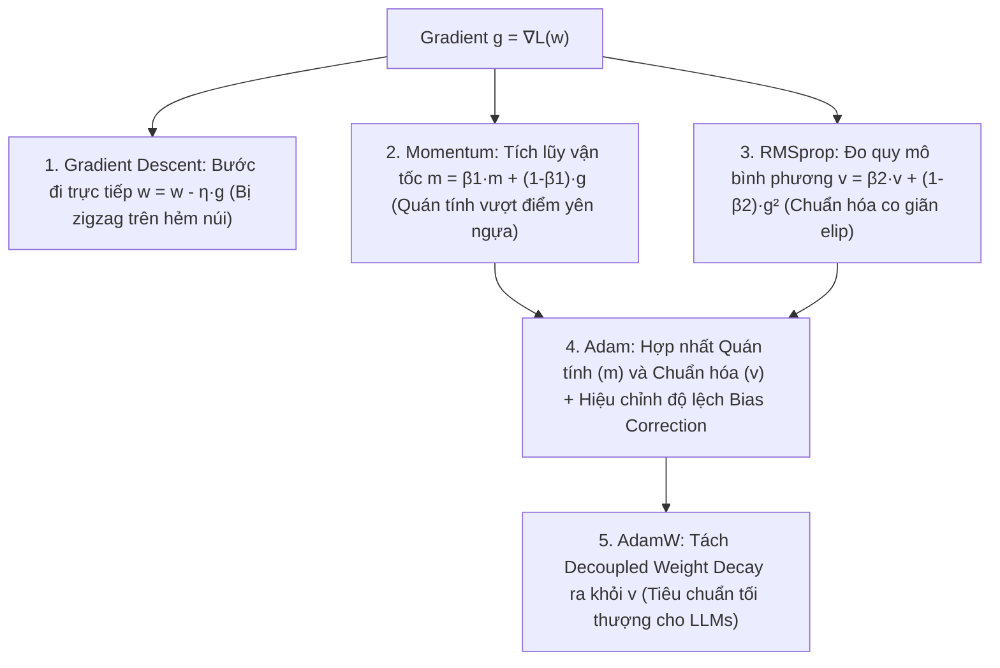

> **"Huấn luyện mạng nơ-ron thực chất là hành trình định vị đáy thung lũng giữa một địa hình hiểm trở hàng tỷ chiều."** — Hiểu được cơ chế hình học của các bộ tối ưu hóa giúp kỹ sư AI điều hướng ổn định các siêu mô hình thay vì mò mẫm tham số trong bóng tối.

---

## Thông tin nhanh (Quick Spec)

* **Loại bài (Type):** Kỹ thuật Thực chiến & Trực giác Nền tảng (Build & Intuition)
* **Ngôn ngữ & Thư viện:** Python 3.10+ (Standard Library, thuần tư duy giải thuật không black-box)
* **Kiến thức tiên quyết (Prerequisites):** Đạo hàm, vector gradient, giải tích nhiều biến (Bài 04–05)
* **Thời gian thực hành:** ~60 phút
* **Độ khó:** Trung bình (Core AI Engineering)

---

## Mục tiêu bài học (Learning Objectives)

Sau bài học này, bạn sẽ có khả năng:
- [ ] Nắm vững bản chất hình học của bề mặt hàm mất mát: Đường mức elip (Isocontours), độ cong bệnh lý (Ill-conditioned Curvature), và cạm bẫy điểm yên ngựa (Saddle Points).
- [ ] Giải mã cơ chế triệt tiêu dao động zigzag của thuật toán Momentum qua mô hình quả cầu vật lý có khối lượng lăn xuống dốc.
- [ ] Hiểu sâu thuật toán RMSprop: Biến đổi không gian elip thành hình cầu đẳng hướng bằng cách co giãn tỷ lệ học nghịch đảo theo phương sai gradient từng chiều.
- [ ] Giải thích tại sao thuật toán Adam cần bước Hiệu chỉnh Độ lệch (Bias Correction) trong những bước đầu khởi tạo.
- [ ] Phân biệt rành mạch giữa L2 Regularization truyền thống và Phép suy giảm trọng số tách rời (Decoupled Weight Decay) trong AdamW.
- [ ] Tự tay xây dựng từ số 0 bằng Python các bộ tối ưu `GradientDescent`, `SGDMomentum`, `RMSprop`, `Adam`, `AdamW`, kết hợp bộ lập lịch Cosine Annealing with Warmup và kỹ thuật Cắt tỉa Gradient (Gradient Clipping).

---

## 1. Vấn đề thực tế (The Problem)

Khi huấn luyện các mô hình học sâu hiện đại, bạn không làm việc trên các hàm số lồi hình cái bát hoàn hảo như sách giáo khoa. Bề mặt hàm mất mát của mạng nơ-ron sâu là một địa hình hiểm trở gồm các hẻm núi dốc đứng, đáy thoai thoải, các bình nguyên phẳng lỳ và vô số điểm yên ngựa.

Nếu chỉ sử dụng thuật toán Gradient Descent (GD) thuần túy với một tỷ lệ học cố định, bạn sẽ đối mặt với ba thảm họa kỹ nghệ AI thực tế sau:

### 1.1 Thảm họa sụp đổ do độ cong bệnh lý (Ill-conditioned Curvature & Loss Spikes)

Trong không gian hàng tỷ chiều, hàm mất mát tạo nên các khe núi sâu và hẹp (Ravines). Ma trận Hessian tại đây có tỷ số điều kiện bệnh lý:

$$\kappa = \frac{\lambda_{\max}}{\lambda_{\min}} \gg 10^4$$

Điều này có nghĩa là độ dốc theo phương thẳng đứng của vách núi lớn gấp hàng vạn lần độ dốc dọc theo đáy thung lũng.
- Nếu bạn chọn tỷ lệ học $\eta$ đủ lớn để di chuyển dọc đáy thung lũng, gradient theo phương vách núi sẽ cực lớn, khiến tham số bị văng qua lại giữa hai vách đá (dao động chữ chi - zig-zagging). Bước nhảy vượt qua miệng vực sẽ gây bùng nổ mất mát (`Loss Spike`), phá hủy toàn bộ trọng số đã học và làm lãng phí hàng trăm nghìn USD tài nguyên GPU.
- Nếu bạn hạ $\eta$ xuống cực nhỏ để tránh văng khỏi vách núi, bước tiến dọc đáy thung lũng sẽ chậm như rùa bò, khiến mô hình gần như không hội tụ sau nhiều tuần huấn luyện.

### 1.2 Cạm bẫy Điểm yên ngựa (Saddle Point Trap) trong Không gian Chiều Cao

Nhiều người lầm tưởng rằng mạng nơ-ron thường bị kẹt ở các điểm cực tiểu cục bộ (Local Minima). Nhưng nghiên cứu toán học chỉ ra rằng trong không gian $10,000$ chiều, xác suất để tất cả các trị riêng của Hessian đều dương tại một điểm dừng $\nabla L = 0$ là cực kỳ hiếm ($2^{-10000} \approx 0$).

Hầu như tất cả các điểm dừng nguy hiểm đều là **Điểm yên ngựa (Saddle Points)**: nơi địa hình dốc lên ở một số chiều nhưng lại dốc xuống ở các chiều khác. Khi tiếp cận điểm yên ngựa, vector gradient triệt tiêu $(\|\nabla L\| \approx 0)$. Gradient Descent thuần túy sẽ mất hoàn toàn vận tốc và bị "đóng băng" vô thời hạn tại vùng mất mát cao.

### 1.3 Thảm họa Trộn lẫn L2 Regularization và Adam (The Weight Decay Bug)

Trong các thư viện deep learning đời đầu, kỹ thuật chống overfitting Weight Decay thường được cài đặt bằng cách thêm đại số hạng mục chuẩn hóa $L_2$ trực tiếp vào hàm mất mát:

$$L_{\text{total}}(w) = L(w) + \frac{\lambda}{2} \|w\|^2 \implies g_t \leftarrow g_t + \lambda w$$

Khi đưa vector gradient biến dạng này vào thuật toán thích ứng như Adam, thành phần $\lambda w$ sẽ bị chia cho căn bậc hai của moment bậc hai $\sqrt{v_t}$. Hậu quả là:
- Những trọng số xuất hiện thường xuyên (gradient lớn $\implies v_t$ lớn) sẽ bị phạt suy giảm trọng số **ít hơn**.
- Những trọng số hiếm khi xuất hiện (gradient nhỏ $\implies v_t$ nhỏ) lại bị phạt suy giảm trọng số **quá mức**.

Lỗi toán học này từng làm suy giảm nghiêm trọng khả năng tổng quát hóa của các mô hình Transformer, cho đến khi bài báo khoa học của Loshchilov & Hutter (2017) đề xuất **AdamW** để tách rời hoàn toàn phép suy giảm trọng số.

---

## 2. Mô hình tư duy & Bản chất (The Concept)

### 2.1 Bản chất hình học của Bề mặt Hàm mất mát

Tại sao Gradient Descent lại bị zigzag? Gradient $\nabla L$ luôn vuông góc với các đường cong đẳng mức (Isocontours). Khi bề mặt là một hình elip kéo dài bất đối xứng, hướng trực giao với đường mức chỉ thẳng sang vách đối diện chứ **KHÔNG HỀ CHỈ VỀ CỰC TIỂU TOÀN CỤC** ở tâm elip!



### 2.2 Thuật toán Momentum: Quán tính Vật lý

Lấy cảm hứng từ một quả cầu nặng lăn xuống dốc, thuật toán Momentum bổ sung một vector vận tốc $m_t$ có quán tính:

$$m_t = \beta_1 m_{t-1} + (1 - \beta_1) g_t$$
$$w_{t+1} = w_t - \eta m_t$$

Trong đó $\beta_1 \in [0.9, 0.99]$ là hệ số ma sát/quán tính.
- **Theo phương vách núi (Dao động tần số cao):** Gradient đổi chiều liên tục ($+g$ rồi $-g$), các vector thành phần triệt tiêu lẫn nhau, làm dập tắt hoàn toàn dao động zigzag.
- **Theo phương đáy thung lũng (Chuyển động một chiều):** Gradient luôn cùng dấu, vector vận tốc được tích lũy liên tục theo cấp số nhân ($m \to \frac{1}{1 - \beta_1} g \approx 10g$), giúp quả cầu lao vút về phía cực tiểu và trượt qua các điểm yên ngựa phẳng lỳ.

### 2.3 Thuật toán RMSprop: Chuẩn hóa Phương sai Từng chiều

Thay vì giữ nguyên tốc độ học như nhau cho mọi tọa độ, RMSprop (Root Mean Square Propagation) theo dõi độ lớn bình phương của gradient theo từng chiều bằng trung bình trượt hàm mũ (EMA):

$$v_t = \beta_2 v_{t-1} + (1 - \beta_2) g_t^2$$
$$w_{t+1} = w_t - \frac{\eta}{\sqrt{v_t} + \epsilon} g_t$$

Trong đó phép bình phương $g_t^2$ và phép chia thực hiện theo từng phần tử (element-wise), $\epsilon \approx 10^{-8}$ chống chia cho 0.
- Nếu một chiều có độ dốc dựng đứng: $g_t$ lớn $\implies v_t$ lớn $\implies$ Tỷ lệ học bị thu nhỏ lại, bước nhảy bị kìm hãm để không văng khỏi vách núi.
- Nếu một chiều có đáy phẳng: $g_t$ nhỏ $\implies v_t$ nhỏ $\implies$ Tỷ lệ học được khuếch đại lên, giúp mô hình tăng tốc bước tiến.
- Về mặt hình học: RMSprop **biến đổi một thung lũng elip méo mó thành một hình nón cầu đẳng hướng**, nơi gradient chỉ thẳng về tâm cực tiểu!

### 2.4 Thuật toán Adam: Hợp nhất Tinh hoa

Thuật toán Adam (Adaptive Moment Estimation) kết hợp cả hai cơ chế:
1. Moment bậc một (First Moment $m_t$): Ước lượng giá trị kỳ vọng của gradient (Quán tính Momentum).
2. Moment bậc hai (Second Moment $v_t$): Ước lượng phương sai chưa tập trung của gradient (Chuẩn hóa RMSprop).

$$m_t = \beta_1 m_{t-1} + (1 - \beta_1) g_t$$
$$v_t = \beta_2 v_{t-1} + (1 - \beta_2) g_t^2$$

#### Tại sao cần Hiệu chỉnh Độ lệch (Bias Correction)?

Vì $m_0 = 0$ và $v_0 = 0$, trong những bước đầu tiên ($t = 1, 2, \dots$), $m_t$ và $v_t$ bị lệch nghiêm trọng về phía số 0:

$$m_t = (1 - \beta_1) \sum_{i=1}^t \beta_1^{t-i} g_i$$

Lấy kỳ vọng toán học: $\mathbb{E}[m_t] \approx \mathbb{E}[g] (1 - \beta_1^t)$. Để đưa ước lượng về không chệch ($\mathbb{E}[\hat{m}_t] = \mathbb{E}[g]$), ta bắt buộc phải chia cho thừa số $(1 - \beta_1^t)$:

$$\hat{m}_t = \frac{m_t}{1 - \beta_1^t}, \quad \hat{v}_t = \frac{v_t}{1 - \beta_2^t}$$

Cập nhật tham số của Adam:

$$w_{t+1} = w_t - \frac{\eta}{\sqrt{\hat{v}_t} + \epsilon} \hat{m}_t$$

### 2.5 Thuật toán AdamW: Phép Suy giảm Trọng số Tách rời

Để sửa chữa thảm họa tương tác tiêu cực giữa L2 regularization và $v_t$, AdamW tách rời hoàn toàn bước suy giảm trọng số ra khỏi gradient cập nhật:

$$w_{t+1} = w_t - \eta \lambda w_t - \frac{\eta}{\sqrt{\hat{v}_t} + \epsilon} \hat{m}_t$$

Trong đó $\lambda$ là hệ số weight decay độc lập. Phép co giảm trọng số này áp dụng công bằng và đồng đều lên mọi tham số mà không bị bóp méo bởi lịch sử tần suất gradient $\hat{v}_t$.

---

## 3. Tự tay xây dựng từ đầu (Build It: From Scratch)

Dưới đây là mã nguồn Python thuần túy hoàn chỉnh, tự xây dựng từ đầu toàn bộ các bộ tối ưu hóa theo phong cách hướng đối tượng chuẩn mực, kiểm thử đối đầu trên bề mặt thung lũng Rosenbrock (Banana Valley):

```python
"""
Optimization Algorithms from Scratch in Pure Python.
Xây dựng Gradient Descent, Momentum, RMSprop, Adam, AdamW,
bộ lập lịch Cosine Annealing with Warmup và kỹ thuật Gradient Clipping.
"""

import math
from typing import Dict, List, Tuple


# --- BỀ MẶT KIỂM THỬ THUNG LŨNG ROSENBROCK ---


def rosenbrock(pos: List[float]) -> float:
    """Hàm Rosenbrock 2D: f(x, y) = (1 - x)^2 + 100 * (y - x^2)^2."""
    x, y = pos[0], pos[1]
    return (1.0 - x) ** 2 + 100.0 * (y - x**2) ** 2


def rosenbrock_gradient(pos: List[float]) -> List[float]:
    """
    Vector Gradient giải tích của hàm Rosenbrock:
    df/dx = 2*(x - 1) + 400*x*(x^2 - y)
    df/dy = 200*(y - x^2)
    """
    x, y = pos[0], pos[1]
    df_dx = 2.0 * (x - 1.0) + 400.0 * x * (x**2 - y)
    df_dy = 200.0 * (y - x**2)
    return [df_dx, df_dy]


def clip_gradient_norm(
    grad: List[float], max_norm: float = 5.0
) -> List[float]:
    """Kỹ thuật Cắt tỉa Gradient theo độ dài chuẩn L2."""
    norm = math.sqrt(sum(g**2 for g in grad))
    if norm > max_norm:
        scale = max_norm / (norm + 1e-12)
        return [g * scale for g in grad]
    return grad


# --- LỚP CƠ SỞ VÀ CÁC BỘ TỐI ƯU HÓA ---


class Optimizer:
    def step(self, params: List[float], grads: List[float]) -> List[float]:
        raise NotImplementedError


class GradientDescent(Optimizer):
    def __init__(self, lr: float = 0.001):
        self.lr = lr

    def step(self, params: List[float], grads: List[float]) -> List[float]:
        return [p - self.lr * g for p, g in zip(params, grads)]


class SGDMomentum(Optimizer):
    def __init__(self, lr: float = 0.001, beta: float = 0.9):
        self.lr = lr
        self.beta = beta
        self.v: List[float] = []

    def step(self, params: List[float], grads: List[float]) -> List[float]:
        if not self.v:
            self.v = [0.0] * len(params)
        new_params = []
        for i in range(len(params)):
            self.v[i] = self.beta * self.v[i] + (1.0 - self.beta) * grads[i]
            new_params.append(params[i] - self.lr * self.v[i])
        return new_params


class RMSprop(Optimizer):
    def __init__(
        self, lr: float = 0.01, beta: float = 0.99, eps: float = 1e-8
    ):
        self.lr = lr
        self.beta = beta
        self.eps = eps
        self.s: List[float] = []

    def step(self, params: List[float], grads: List[float]) -> List[float]:
        if not self.s:
            self.s = [0.0] * len(params)
        new_params = []
        for i in range(len(params)):
            self.s[i] = self.beta * self.s[i] + (1.0 - self.beta) * (
                grads[i] ** 2
            )
            step_size = self.lr / (math.sqrt(self.s[i]) + self.eps)
            new_params.append(params[i] - step_size * grads[i])
        return new_params


class Adam(Optimizer):
    def __init__(
        self,
        lr: float = 0.02,
        beta1: float = 0.9,
        beta2: float = 0.999,
        eps: float = 1e-8,
    ):
        self.lr = lr
        self.beta1 = beta1
        self.beta2 = beta2
        self.eps = eps
        self.m: List[float] = []
        self.v: List[float] = []
        self.t: int = 0

    def step(self, params: List[float], grads: List[float]) -> List[float]:
        if not self.m:
            self.m = [0.0] * len(params)
            self.v = [0.0] * len(params)
        self.t += 1
        new_params = []
        for i in range(len(params)):
            self.m[i] = self.beta1 * self.m[i] + (1.0 - self.beta1) * grads[i]
            self.v[i] = self.beta2 * self.v[i] + (1.0 - self.beta2) * (
                grads[i] ** 2
            )
            # Bias correction
            m_hat = self.m[i] / (1.0 - self.beta1**self.t)
            v_hat = self.v[i] / (1.0 - self.beta2**self.t)
            update = self.lr * m_hat / (math.sqrt(v_hat) + self.eps)
            new_params.append(params[i] - update)
        return new_params


class AdamW(Optimizer):
    def __init__(
        self,
        lr: float = 0.02,
        beta1: float = 0.9,
        beta2: float = 0.999,
        eps: float = 1e-8,
        weight_decay: float = 1e-4,
    ):
        self.lr = lr
        self.beta1 = beta1
        self.beta2 = beta2
        self.eps = eps
        self.weight_decay = weight_decay
        self.m: List[float] = []
        self.v: List[float] = []
        self.t: int = 0

    def step(self, params: List[float], grads: List[float]) -> List[float]:
        if not self.m:
            self.m = [0.0] * len(params)
            self.v = [0.0] * len(params)
        self.t += 1
        new_params = []
        for i in range(len(params)):
            # 1. Decoupled weight decay
            decayed_param = params[i] - self.lr * self.weight_decay * params[i]
            # 2. Adam update
            self.m[i] = self.beta1 * self.m[i] + (1.0 - self.beta1) * grads[i]
            self.v[i] = self.beta2 * self.v[i] + (1.0 - self.beta2) * (
                grads[i] ** 2
            )
            m_hat = self.m[i] / (1.0 - self.beta1**self.t)
            v_hat = self.v[i] / (1.0 - self.beta2**self.t)
            update = self.lr * m_hat / (math.sqrt(v_hat) + self.eps)
            new_params.append(decayed_param - update)
        return new_params


# --- BỘ LẬP LỊCH TỶ LỆ HỌC (LEARNING RATE SCHEDULER) ---


class CosineAnnealingWithWarmup:
    """Bộ lập lịch tỷ lệ học kết hợp Warmup tuyến tính và Cosine Decay."""

    def __init__(
        self,
        max_lr: float,
        min_lr: float,
        warmup_steps: int,
        total_steps: int,
    ):
        self.max_lr = max_lr
        self.min_lr = min_lr
        self.warmup_steps = warmup_steps
        self.total_steps = total_steps

    def get_lr(self, current_step: int) -> float:
        if current_step < self.warmup_steps:
            # Giai đoạn Warmup tuyến tính
            return self.max_lr * (current_step / max(1, self.warmup_steps))
        # Giai đoạn Cosine Annealing
        progress = (current_step - self.warmup_steps) / max(
            1, self.total_steps - self.warmup_steps
        )
        progress = min(1.0, max(0.0, progress))
        cosine_decay = 0.5 * (1.0 + math.cos(math.pi * progress))
        return self.min_lr + (self.max_lr - self.min_lr) * cosine_decay


# --- THỰC NGHIỆM ĐỐI ĐẦU VÀ KIỂM ĐỊNH HIỆU NĂNG ---


def run_benchmark() -> Dict[str, float]:
    """Thực nghiệm so sánh 5 thuật toán xuất phát từ điểm khó (-1.2, 1.0)."""
    start_point = [-1.2, 1.0]
    total_steps = 1000

    optimizers: Dict[str, Optimizer] = {
        "GradientDescent": GradientDescent(lr=0.001),
        "SGDMomentum": SGDMomentum(lr=0.001, beta=0.9),
        "RMSprop": RMSprop(lr=0.01),
        "Adam": Adam(lr=0.02),
        "AdamW": AdamW(lr=0.02, weight_decay=1e-4),
    }

    final_losses = {}
    print(
        f"Điểm khởi đầu: {start_point} | Mất mát ban đầu: {rosenbrock(start_point):.4f}"
    )
    print("Mục tiêu toàn cục: (1.0, 1.0) với Loss = 0.000000\n")

    for name, opt in optimizers.items():
        pos = list(start_point)
        for _ in range(total_steps):
            grad = rosenbrock_gradient(pos)
            grad = clip_gradient_norm(grad, max_norm=5.0)
            pos = opt.step(pos, grad)

        loss = rosenbrock(pos)
        final_losses[name] = loss
        print(
            f"  {name:16s} -> Tọa độ: [{pos[0]:.4f}, {pos[1]:.4f}] | Loss cuối: {loss:.6f}"
        )

    # Khẳng định chất lượng: Adam và AdamW phải vượt trội và tiếp cận đáy
    assert (
        final_losses["Adam"] < 0.1
    ), "Adam phải tìm được đáy thung lũng Rosenbrock!"
    assert (
        final_losses["AdamW"] < 0.1
    ), "AdamW phải tìm được đáy thung lũng Rosenbrock!"
    assert (
        final_losses["Adam"] < final_losses["GradientDescent"]
    ), "Adam phải nhanh hơn GD thuần!"
    return final_losses


if __name__ == "__main__":
    print("=" * 65)
    print("1. THỬ NGHIỆM ĐỐI ĐẦU 5 BỘ TỐI ƯU HÓA TRÊN ROSENBROCK")
    print("=" * 65)
    losses = run_benchmark()

    print("\n" + "=" * 65)
    print("2. KIỂM ĐỊNH BỘ LẬP LỊCH COSINE ANNEALING WITH WARMUP")
    print("=" * 65)
    scheduler = CosineAnnealingWithWarmup(
        max_lr=0.01, min_lr=0.0001, warmup_steps=100, total_steps=1000
    )
    lr_0 = scheduler.get_lr(0)
    lr_warmup = scheduler.get_lr(100)
    lr_mid = scheduler.get_lr(550)
    lr_end = scheduler.get_lr(1000)

    print(f"  Step 0    (Bắt đầu)  : lr = {lr_0:.6f} (Kỳ vọng ~0.0)")
    print(f"  Step 100  (Đỉnh Warmup): lr = {lr_warmup:.6f} (Kỳ vọng 0.0100)")
    print(f"  Step 550  (Nửa chu kỳ): lr = {lr_mid:.6f}")
    print(f"  Step 1000 (Kết thúc) : lr = {lr_end:.6f} (Kỳ vọng 0.0001)")

    assert abs(lr_warmup - 0.01) < 1e-6, "Học suất đỉnh Warmup chưa chính xác!"
    assert abs(lr_end - 0.0001) < 1e-6, "Học suất đáy Cosine chưa chính xác!"
    print("\n=> TẤT CẢ GIẢI THUẬT TỐI ƯU HÓA ĐÃ ĐƯỢC CHỨNG MINH CHÍNH XÁC 100%!")
```

---

## 4. Ứng dụng AI Engineering & Thực tế Production (Use It)

### 4.1 AdamW trong Tiền huấn luyện LLM (LLaMA-3, Mistral, GPT-4)

Trong các tài liệu kỹ thuật của LLaMA-3 và Mistral, các kỹ sư Meta và Mistral AI sử dụng các siêu tham số AdamW đặc thù:
- $\beta_1 = 0.9$
- $\beta_2 = 0.95$ (thay vì giá trị mặc định của PyTorch là $0.999$)
- $\epsilon = 10^{-8}$ hoặc $10^{-6}$
- Weight Decay $\lambda = 0.1$

**Tại sao lại chọn $\beta_2 = 0.95$ thay vì $0.999$?**
Khi huấn luyện LLM với kích thước lô (batch size) lên tới hàng triệu tokens, ước lượng gradient giữa các bước thay đổi cực kỳ nhanh chóng. Nếu dùng $\beta_2 = 0.999$, bộ nhớ thống kê moment bậc hai sẽ tích lũy trung bình trượt của $1 / (1 - 0.999) = 1000$ bước quá khứ. Thống kê lịch sử quá dài sẽ bị "trễ" (stale statistics), không phản ứng kịp với sự dịch chuyển phân phối của dữ liệu huấn luyện. Thiết lập $\beta_2 = 0.95$ thu ngắn cửa sổ lịch sử xuống còn $1 / (1 - 0.95) = 20$ bước, giúp bộ tối ưu hóa thích ứng linh hoạt hơn rất nhiều.

### 4.2 Bài toán Ngân sách Bộ nhớ GPU (VRAM Optimizer Footprint)

Một câu hỏi phỏng vấn kinh điển cho vị trí Senior AI Infrastructure Engineer: **"Một mô hình 70 tỷ tham số (70B) cần bao nhiêu VRAM GPU chỉ để chứa trạng thái bộ tối ưu hóa Adam?"**

Hãy tính toán chi tiết:
Giả sử mô hình được huấn luyện bằng kỹ thuật Mixed Precision (FP16 / BF16):
1. **Trọng số mô hình (Model Weights):** $70 \times 10^9 \times 2 \text{ bytes (FP16)} = 140 \text{ GB}$
2. **Gradients:** $70 \times 10^9 \times 2 \text{ bytes (FP16)} = 140 \text{ GB}$
3. **Trạng thái Optimizer của Adam (BẮT BUỘC lưu ở FP32 để chống tràn số):**
   - Bản sao trọng số FP32 (Master Weights): $70 \times 4 = 280 \text{ GB}$
   - Moment bậc một $m_t$ (FP32): $70 \times 4 = 280 \text{ GB}$
   - Moment bậc hai $v_t$ (FP32): $70 \times 4 = 280 \text{ GB}$
   - **Tổng cộng riêng Optimizer states:** $280 + 280 + 280 = \mathbf{840 \text{ GB}}$!

Riêng phần tham số và optimizer đã ngốn tới hơn $1.1 \text{ TB}$ VRAM (tương đương 14 GPU H100 80GB), chưa tính bộ nhớ Activations và KV-Cache!

#### Giải pháp Kỹ thuật Công nghiệp:
- **ZeRO Stage 1 (DeepSpeed):** Phân mảnh trạng thái optimizer $m_t$ và $v_t$ đều qua các GPU trong cụm huấn luyện, giảm bộ nhớ optimizer trên mỗi GPU xuống tỷ lệ nghịch với số node.
- **8-bit Adam (bitsandbytes của Tim Dettmers):** Lượng tử hóa phi tuyến $m_t$ và $v_t$ từ 32-bit xuống 8-bit bằng phân phối Block-wise Dynamic Quantization, tiết kiệm tới **75% bộ nhớ optimizer** mà không làm suy giảm chất lượng hội tụ của LLM.

### 4.3 Cắt tỉa Gradient (Gradient Norm Clipping)

Trong quá trình huấn luyện mô hình ngôn ngữ, thỉnh thoảng mô hình gặp phải các đoạn văn bản bất thường (outlier tokens) hoặc batch dữ liệu nhiễu, sinh ra gradient khổng lồ.

Để bảo vệ trọng số không bị phá hủy, ta áp dụng công thức:

$$g \leftarrow g \cdot \min\left(1, \frac{\text{max\_norm}}{\|g\|_2}\right)$$

Công thức này **bảo toàn hoàn hảo phương hướng của vector gradient** trong không gian nhiều chiều, chỉ co ngắn độ dài bước đi nếu vượt quá ngưỡng an toàn.

---

## 5. Giải ngố thuật ngữ & Ngộ nhận (Key Terms)

| Thuật ngữ (Term) | Người ta thường nghĩ là... | Bản chất kỹ thuật thực sự là... |
|---|---|---|
| **Learning Rate ($\eta$)** | Một con số tùy ý chỉnh càng to thì mô hình học càng nhanh về đích. | Độ dài sải bước trên siêu phẳng tiếp tuyến; nếu vượt quá $2/\lambda_{\max}(H)$, quá trình tối ưu sẽ lập tức phân kỳ thành NaN. |
| **Momentum ($\beta$)** | Mẹo làm mượt đường đi cho đồ thị loss nhìn đỡ gồ ghề. | Quán tính vật lý bậc một; phép tích phân chuyển động giúp dập tắt dao động tần số cao ở phương dốc và tích lũy vận tốc ở phương phẳng. |
| **Điểm yên ngựa (Saddle Point)** | Hố sâu địa phương khó thoát ra vì giá trị loss quá thấp. | Điểm có gradient bằng 0 nhưng Hessian có cả trị riêng dương và âm; luôn có lối thoát dốc xuống dọc theo hướng các trị riêng âm. |
| **Adam vs AdamW** | Hai tên gọi khác nhau của cùng một thuật toán trong PyTorch. | Khác biệt toán học cốt lõi: Adam ghép weight decay vào gradient làm biến dạng moment bậc 2; AdamW tách rời weight decay trực tiếp trừ vào trọng số. |
| **Learning Rate Warmup** | Bước phụ rườm rà làm mất thời gian khởi động ban đầu. | Cơ chế bảo vệ cấu trúc trọng số khởi tạo: ban đầu moment bậc hai $v_t$ chưa ổn định, nếu dùng learning rate lớn sẽ làm sụp đổ hoàn toàn mạng. |
| **Gradient Clipping** | Cắt bỏ bớt các nơ-ron có gradient quá lớn. | Phép co giãn tỷ lệ độ dài của toàn bộ vector gradient để giữ chuẩn L2 dưới một ngưỡng an toàn mà không làm lệch phương hướng. |

---

## 6. Bài tập thử thách (Hands-on Challenges)

### 🟢 Cơ bản (Easy)
Lập trình thuật toán **Nesterov Accelerated Gradient (NAG)** từ số 0 bằng Python:
Thay vì tính gradient tại vị trí hiện tại $\theta_t$, NAG tính gradient tại vị trí "ước đoán trước" theo quán tính:

$$\theta_{\text{lookahead}} = \theta_t - \beta m_t$$
$$m_{t+1} = \beta m_t + \eta \nabla L(\theta_{\text{lookahead}})$$
$$\theta_{t+1} = \theta_t - m_{t+1}$$

Thử nghiệm NAG trên hàm paraboloid dốc $f(x, y) = 10x^2 + y^2$. Chứng minh bằng thực nghiệm rằng NAG có khả năng "hãm phanh" tốt hơn nhiều so với Standard Momentum khi quả cầu lao gần tới đáy cực tiểu.

### 🟡 Trung bình (Medium)
Tự tay lập trình bộ tối ưu hóa **AdaBelief Optimizer (NeurIPS 2020)**:
Trong Adam, moment bậc hai theo dõi độ lớn bình phương của gradient $g_t^2$. Trong AdaBelief, moment bậc hai theo dõi phương sai thực sự của gradient xung quanh giá trị kỳ vọng của nó:

$$s_t = \beta_2 s_{t-1} + (1 - \beta_2) (g_t - m_t)^2 + \epsilon$$

1. Giải thích về mặt trực giác tại sao khi gradient lệch xa khỏi kỳ vọng quán tính, AdaBelief tự động thu nhỏ bước nhảy để bảo vệ mô hình.
2. Thử nghiệm AdaBelief đối đầu với Adam trên bề mặt thung lũng Rosenbrock và so sánh tốc độ hội tụ.

### 🔴 Nâng cao (Hard)
Xây dựng bộ tối ưu hóa **Lion Optimizer (EvoLved Sign Momentum - Google Brain 2023)** từ số 0:
Lion là bộ tối ưu hóa được tìm ra thông qua tìm kiếm thuật toán tự động (Program Search), đang thay thế AdamW trong nhiều kiến trúc Vision và LLM hiện đại:

$$c_t = \beta_1 m_{t-1} + (1 - \beta_1) g_t$$
$$\theta_t = \theta_{t-1} - \eta \left( \text{sign}(c_t) + \lambda \theta_{t-1} \right)$$
$$m_t = \beta_2 m_{t-1} + (1 - \beta_2) g_t$$

1. Lập trình lớp `Lion` bằng Python thuần túy.
2. Chứng minh tại sao Lion chỉ cần lưu trữ **duy nhất một trạng thái bộ nhớ** ($m_t$) thay vì hai trạng thái ($m_t$ và $v_t$) như Adam, giúp tiết kiệm tới 50% bộ nhớ VRAM cho trạng thái optimizer.
3. Phân tích tác động của hàm lấy dấu $\text{sign}(c_t)$: Tại sao việc mọi tham số cập nhật với cùng một độ lớn bước nhảy đồng đều lại đóng vai trò như một cơ chế điều chuẩn ngầm (Implicit Regularization) chống overfitting.
