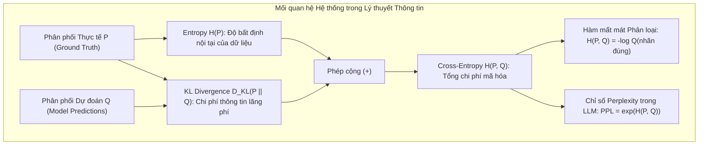

> **"Thông tin là sự giảm trừ độ bất định; Entropy đo mức độ bất ngờ trung bình; Cross-Entropy và KL Divergence là thước đo khoảng cách giữa kỳ vọng mô hình và thực tại dữ liệu."** — Claude Shannon năm 1948 giải quyết bài toán nén dữ liệu truyền thông, nhưng vô tình đặt nền móng toán học cho toàn bộ các hàm mất mát của trí tuệ nhân tạo hiện đại.

---

## Thông tin nhanh (Quick Spec)

| Thuộc tính | Chi tiết |
|---|---|
| **Loại bài (Type)** | Nền tảng Toán học & Thực chiến Giải tích (Concept & Build) |
| **Ngôn ngữ & Thư viện** | Python 3.10+ (Standard Library: `math`, `collections`), zero dependency |
| **Kiến thức tiên quyết** | Xác suất, phân phối xác suất, kỳ vọng toán học |
| **Thời gian thực hành** | ~60 phút |
| **Mức độ (Level)** | Trung cấp (Intermediate) |

---

## Mục tiêu bài học (Learning Objectives)

Sau bài học này, bạn sẽ có khả năng:
- [ ] Nắm vững trực giác cốt lõi của lý thuyết thông tin: Lượng tin tự thân (Self-Information / Surprise), Entropy Shannon, Cross-Entropy, KL Divergence (Độ phân kỳ Kullback-Leibler) và Mutual Information.
- [ ] Chứng minh toán học chặt chẽ đẳng thức vàng trong học máy: $H(P, Q) = H(P) + D_{\text{KL}}(P \parallel Q)$, giải thích vì sao cực tiểu hóa Cross-Entropy Loss tương đương với việc ép phân phối dự đoán $Q$ tiệm cận sự thật $P$.
- [ ] Tự tay lập trình từ đầu (from scratch) các hàm tính Entropy, Cross-Entropy, KL Divergence, Mutual Information, chỉ số Perplexity trong LLM, và kỹ thuật Label Smoothing.
- [ ] Giải mã các ứng dụng hiện đại trong AI Engineering: Cơ chế đạo hàm của `nn.CrossEntropyLoss`, căn chỉnh mô hình ngôn ngữ không cần mạng thưởng qua DPO (Direct Preference Optimization), và số hạng phạt KL trong VAE.

---

## 1. Vấn đề thực tế (The Problem)

### Cạm bẫy mô hình quá tự tin (Overconfidence & Logit Explosion)

Trong hầu hết các bài toán phân loại đa lớp (Classification), nhãn thực tế của dữ liệu được biểu diễn dưới dạng vector One-Hot cứng: ví dụ nhãn số 1 trong bài toán 3 lớp là $P = [1.0, 0.0, 0.0]$.

Khi tối ưu hóa mô hình bằng hàm mất mát Cross-Entropy Loss:

$$\mathcal{L}_{\text{CE}} = - \sum_{i=1}^K P_i \log Q_i = -\log Q_1$$

Để hàm mất mát $\mathcal{L}_{\text{CE}}$ đạt giá trị cực tiểu tuyệt đối bằng $0$, mô hình buộc phải đẩy xác suất dự đoán $Q_1$ lên đúng $1.0$. Vì xác suất $Q$ được sinh ra từ tầng Softmax:

$$Q_1 = \frac{e^{z_1}}{e^{z_1} + e^{z_2} + e^{z_3}}$$

Cách duy nhất để $Q_1 = 1.0$ là mô hình phải ép logit $z_1$ tiến tới $+\infty$ và đẩy các logit còn lại $z_2, z_3$ về $-\infty$.

Hậu quả trên production:
- Trọng số mạng nơ-ron bị thổi phồng cực đại, gây suy thoái độ ổn định số học.
- Mô hình trở nên **quá tự tin (overconfident)**: khi gặp một mẫu dữ liệu nhiễu hoặc mẫu đối kháng (adversarial attack), mô hình vẫn tự tin tuyên bố độ chắc chắn $99.99\%$ dù dự đoán hoàn toàn sai.
- Mô hình mất hoàn toàn khả năng cân chuẩn xác suất (calibration), không thể dùng làm bộ lọc tin cậy cho các hệ thống an toàn cao như y tế hay xe tự hành.

### Sự cố trôi chính sách (Policy Drift & Reward Hacking) trong Căn chỉnh LLM

Khi huấn luyện các mô hình ngôn ngữ lớn theo sở thích con người (RLHF hoặc DPO):
- Nếu bạn chỉ đơn thuần tối đa hóa điểm thưởng (Reward Model) mà không có ràng buộc thông tin, mô hình sẽ nhanh chóng phát hiện các "lỗ hổng" cú pháp (Reward Hacking): sinh ra các chuỗi từ khóa lặp lại vô nghĩa nhưng lại kích hoạt điểm thưởng cao chót vót.
- Mô hình bị **trôi chính sách (Policy Drift)**: văn phong biến dạng, suy thoái ngữ nghĩa và đánh mất năng lực tổng quát vốn có từ giai đoạn Pre-training.

Chính lý thuyết thông tin — cụ thể là số hạng phạt **KL Divergence** $D_{\text{KL}}(\pi_\theta \parallel \pi_{\text{ref}})$ giữa mô hình đang huấn luyện và mô hình nền tảng tham chiếu — là chiếc "dây cương" duy nhất giữ cho LLM không bị tha hóa trong quá trình căn chỉnh alignment.

### Nhầm lẫn tai hại giữa Bits và Nats khi đánh giá Perplexity

Một kỹ sư AI đọc bài báo công bố mô hình đạt Perplexity là $12.5$, được tính dựa trên logarit cơ số 2 (bits). Họ chạy script PyTorch của mình sử dụng hàm mất mát `nn.CrossEntropyLoss` mặc định (tính theo logarit tự nhiên $e$ - nats) và thu được $\text{PPL} = e^{2.5} \approx 12.18$. Kỹ sư vội vàng kết luận mô hình của mình vượt trội hơn bài báo, mà không nhận ra rằng $2.5$ nats thực chất tương đương với $2.5 / \ln(2) \approx 3.606$ bits, và Perplexity thực tế theo hệ cơ số 2 là $2^{3.606} \approx 12.18$ — sự so sánh hoàn toàn khập khiễng nếu không quy đổi chung hệ cơ số!

---

## 2. Mô hình tư duy & Bản chất (The Concept)



### 1. Lượng tin tự thân (Self-Information / Surprise)

Năm 1948, Claude Shannon đặt ra câu hỏi nền tảng: *Một thông điệp mang bao nhiêu thông tin?*

Trực giác của Shannon là: **Lượng thông tin tỷ lệ nghịch với xác suất xảy ra của sự kiện (Độ bất ngờ - Surprise).**
- Nếu ai đó nói: "Mặt trời mọc ở hướng Đông", biến cố này có xác suất $P \approx 1.0$. Bạn không nhận được thêm thông tin mới nào; lượng tin bằng $0$.
- Nếu ai đó nói: "Hôm nay tuyết rơi dày giữa sa mạc Sahara", đây là biến cố cực kỳ hiếm ($P \to 0$). Độ bất ngờ cực lớn; thông điệp mang lượng tin khổng lồ.

Công thức định lượng lượng tin của một biến cố $x$:

$$I(x) = -\log_b P(x) = \log_b \left(\frac{1}{P(x)}\right)$$

- Nếu chọn cơ số $b = 2$: đơn vị đo là **bit** (hoặc Shannon). $1$ bit tương ứng với lượng tin nhận được khi lật một đồng xu công bằng ($-\log_2(0.5) = 1$).
- Nếu chọn cơ số $b = e$: đơn vị đo là **nat** (sử dụng trong hầu hết các hàm mất mát học sâu).
- Mối liên hệ: $1\text{ nat} = \frac{1}{\ln(2)} \approx 1.4427\text{ bits}$.

### 2. Shannon Entropy — Độ bất định trung bình

Entropy của một phân phối xác suất rời rạc $P$ là kỳ vọng toán học của lượng tin trên toàn bộ các biến cố khả dĩ:

$$H(P) = \mathbb{E}_{x \sim P}[I(x)] = -\sum_{x \in \mathcal{X}} P(x) \log_b P(x)$$

Quy ước giải tích: Theo quy tắc L'Hôpital, $\lim_{p \to 0^+} p \log p = 0$. Do đó, các biến cố có xác suất $P(x) = 0$ đóng góp đúng $0$ vào Entropy.

Ý nghĩa vật lý và tính toán của Entropy:
- **Độ bất định (Uncertainty):** Entropy đo lường mức độ khó đoán của một hệ thống. Phân phối đều (Uniform) có độ bất định cao nhất $\implies$ Entropy cực đại. Phân phối suy biến (chắc chắn $100\%$ vào một kết quả) có Entropy bằng $0$.
- **Giới hạn nén dữ liệu (Shannon's Source Coding Theorem):** Entropy $H(P)$ chính là số bit trung bình tối thiểu trên lý thuyết cần thiết để mã hóa không tổn hao (lossless compression) một ký tự phát ra từ nguồn tin $P$.

### 3. Cross-Entropy — Chi phí mã hóa sai lệch

Giả sử dữ liệu thực tế phát sinh từ phân phối $P$, nhưng ta lại thiết kế một bộ mã hóa (hoặc một mô hình học máy) dựa trên phân phối dự đoán $Q$. 

**Cross-Entropy (Entropy chéo)** là số bit/nat trung bình cần thiết để truyền tải dữ liệu thực tế $P$ khi sử dụng mã hóa được tối ưu cho $Q$:

$$H(P, Q) = \mathbb{E}_{x \sim P}[-\log_b Q(x)] = -\sum_{x \in \mathcal{X}} P(x) \log_b Q(x)$$

### 4. KL Divergence (Độ phân kỳ Kullback-Leibler)

KL Divergence (còn gọi là Relative Entropy) đo lường **lượng thông tin bị lãng phí** (số bit/nat dư thừa) do ta dùng phân phối xấp xỉ $Q$ thay vì phân phối thực tế $P$:

$$D_{\text{KL}}(P \parallel Q) = \sum_{x \in \mathcal{X}} P(x) \log_b \left(\frac{P(x)}{Q(x)}\right)$$

#### Đẳng thức vàng trong Học máy:
Biến đổi đại số trực tiếp cho thấy:
$$\begin{aligned}
D_{\text{KL}}(P \parallel Q) &= \sum_{x} P(x) \log P(x) - \sum_{x} P(x) \log Q(x) \\
&= -H(P) + H(P, Q)
\end{aligned}$$

Suy ra đẳng thức nền tảng:
$$H(P, Q) = H(P) + D_{\text{KL}}(P \parallel Q)$$

**Ý nghĩa triết học sâu sắc đối với AI:**
Trong quá trình huấn luyện mạng nơ-ron, phân phối nhãn của tập dữ liệu huấn luyện $P$ là bất biến, do đó Entropy nội tại $H(P)$ là một hằng số cố định. 
Khi giải thuật Gradient Descent tối thiểu hóa hàm mất mát Cross-Entropy $H(P, Q)$, mô hình thực chất đang làm một việc duy nhất: **ép khoảng cách thông tin $D_{\text{KL}}(P \parallel Q)$ tiến sát về $0$!**

#### Các tính chất cốt tử của KL Divergence:
1. **Bất đẳng thức Gibbs:** $D_{\text{KL}}(P \parallel Q) \ge 0$ với mọi $P, Q$. Dấu bằng xảy ra khi và chỉ khi $P = Q$.
2. **Tính bất đối xứng (Asymmetry):** 
   $$D_{\text{KL}}(P \parallel Q) \ne D_{\text{KL}}(Q \parallel P)$$
   Vì không có tính đối xứng và không thỏa mãn bất đẳng thức tam giác, KL Divergence **không phải là một khoảng cách metric toán học chuẩn**, mà là một độ đo phân kỳ thông tin hướng (directed divergence).

### 5. Thông tin tương hỗ (Mutual Information - $I(X; Y)$)

Thông tin tương hỗ đo lường lượng thông tin mà một biến ngẫu nhiên chia sẻ với biến ngẫu nhiên kia — tức là độ bất định của $X$ giảm đi bao nhiêu khi ta biết trước giá trị của $Y$:

$$I(X; Y) = H(X) - H(X \mid Y) = H(Y) - H(Y \mid X) = H(X) + H(Y) - H(X, Y)$$

Biểu diễn qua KL Divergence:
$$I(X; Y) = D_{\text{KL}}(P(X, Y) \parallel P(X)P(Y))$$

Nếu $X$ và $Y$ độc lập thống kê hoàn toàn, $P(X, Y) = P(X)P(Y) \implies I(X; Y) = 0$. Khác với hệ số tương quan Pearson chỉ phát hiện quan hệ tuyến tính, Mutual Information phát hiện được mọi dạng phụ thuộc phi tuyến tính phức tạp.

### 6. Perplexity (PPL) — Thước đo năng lực LLM

Trong xử lý ngôn ngữ tự nhiên, Perplexity là thước đo tiêu chuẩn vàng để đánh giá mô hình ngôn ngữ:

$$\text{PPL} = b^{H(P, Q)} = \exp\left( -\frac{1}{N}\sum_{i=1}^N \log \pi_\theta(x_i \mid x_{<i}) \right)$$

**Trực giác kỹ thuật:**
Một mô hình ngôn ngữ có $\text{PPL} = 10$ nghĩa là tại mỗi bước sinh từ tiếp theo, mô hình đang phân vân giữa các khả năng với mức độ khó khăn tương đương với việc tung một xúc xắc đều 10 mặt. Mô hình càng thông minh, mức độ bất ngờ càng thấp, Perplexity càng nhỏ.

---

## 3. Tự tay xây dựng từ đầu (Build It: From Scratch)

Dưới đây là module tính toán lý thuyết thông tin hoàn chỉnh bằng Python thuần túy:
1. Tính lượng tin tự thân `information_content`.
2. Hàm tính `shannon_entropy` hỗ trợ cả bits ($b=2$) và nats ($b=e$).
3. Hàm tính `cross_entropy` và `kl_divergence` có kẹp epsilon tránh lỗi $\log(0)$.
4. Hàm tính thông tin tương hỗ `mutual_information` từ ma trận phân phối đồng thời.
5. Kỹ thuật điều hòa nhãn `label_smoothed_cross_entropy` chống overconfidence.
6. Chuyển đổi loss sang `perplexity_from_loss`.
7. Bộ kiểm chứng toán học độc lập xác nhận đẳng thức $H(P, Q) = H(P) + D_{\text{KL}}(P \parallel Q)$.

```python
"""
Information Theory for AI from Scratch
Pure Python implementation of Information Content, Entropy, Cross-Entropy,
KL Divergence, Mutual Information, Perplexity, and Label Smoothing.
"""

import math


# =====================================================================
# 1. Lượng tin tự thân & Shannon Entropy
# =====================================================================

def information_content(p: float, base: float = 2.0) -> float:
    """
    Tính lượng tin tự thân I(x) = -log_b(p(x)).
    Mặc định base=2 (bits), base=math.e (nats).
    """
    if p <= 0.0:
        return float("inf")
    if p >= 1.0:
        return 0.0
    return -math.log(p) / math.log(base)


def shannon_entropy(probs: list[float], base: float = 2.0) -> float:
    """
    Tính Shannon Entropy H(P) = -sum(p * log_b(p)).
    Tự động xử lý giới hạn 0 * log(0) = 0.
    """
    log_base = math.log(base)
    entropy_val = 0.0
    for p in probs:
        if p > 0.0:
            entropy_val += -p * (math.log(p) / log_base)
    return entropy_val


# =====================================================================
# 2. Cross-Entropy & KL Divergence
# =====================================================================

def cross_entropy(p: list[float], q: list[float], base: float = 2.0, eps: float = 1e-15) -> float:
    """
    Tính Cross-Entropy H(P, Q) = -sum(p * log_b(q)).
    Kẹp giá trị q bằng eps để tránh lỗi chia cho 0 hoặc log(0).
    """
    if len(p) != len(q):
        raise ValueError("Hai phân phối p và q phải có cùng kích thước.")
    log_base = math.log(base)
    total_loss = 0.0
    for pi, qi in zip(p, q):
        if pi > 0.0:
            clamped_qi = max(qi, eps)
            total_loss += -pi * (math.log(clamped_qi) / log_base)
    return total_loss


def kl_divergence(p: list[float], q: list[float], base: float = 2.0, eps: float = 1e-15) -> float:
    """
    Tính KL Divergence D_KL(P || Q) = sum(p * log_b(p / q)).
    """
    if len(p) != len(q):
        raise ValueError("Hai phân phối p và q phải có cùng kích thước.")
    log_base = math.log(base)
    kl_val = 0.0
    for pi, qi in zip(p, q):
        if pi > 0.0:
            clamped_qi = max(qi, eps)
            kl_val += pi * (math.log(pi / clamped_qi) / log_base)
    return kl_val


# =====================================================================
# 3. Thông tin tương hỗ (Mutual Information)
# =====================================================================

def mutual_information(joint_matrix: list[list[float]], base: float = 2.0) -> float:
    """
    Tính thông tin tương hỗ I(X; Y) từ ma trận phân phối đồng thời P(X, Y).
    I(X; Y) = sum_{x,y} P(x, y) * log_b( P(x, y) / (P(x) * P(y)) )
    """
    num_rows = len(joint_matrix)
    num_cols = len(joint_matrix[0])
    log_base = math.log(base)

    # Tính phân phối biên P(X) và P(Y)
    p_x = [sum(joint_matrix[i][j] for j in range(num_cols)) for i in range(num_rows)]
    p_y = [sum(joint_matrix[i][j] for i in range(num_rows)) for j in range(num_cols)]

    mi_val = 0.0
    for i in range(num_rows):
        for j in range(num_cols):
            p_xy = joint_matrix[i][j]
            if p_xy > 0.0:
                indep_prob = p_x[i] * p_y[j]
                mi_val += p_xy * (math.log(p_xy / indep_prob) / log_base)
    return mi_val


# =====================================================================
# 4. Kỹ thuật Label Smoothing & Perplexity
# =====================================================================

def label_smoothed_cross_entropy(
    logits: list[float], target_idx: int, eps_smooth: float = 0.1
) -> float:
    """
    Tính Cross-Entropy Loss kết hợp kỹ thuật điều chuẩn Label Smoothing:
    Phân phối đích: q(target) = 1 - eps + (eps / K), q(others) = eps / K
    """
    k = len(logits)
    max_z = max(logits)
    exp_shifted = [math.exp(z - max_z) for z in logits]
    sum_exp = sum(exp_shifted)
    log_probs = [(z - max_z) - math.log(sum_exp) for z in logits]

    loss = 0.0
    for i, lp in enumerate(log_probs):
        target_prob = (1.0 - eps_smooth) if i == target_idx else 0.0
        smoothed_prob = target_prob + (eps_smooth / k)
        loss += -smoothed_prob * lp
    return loss


def perplexity_from_loss(loss_value: float, is_nats: bool = True) -> float:
    """
    Chuyển đổi hàm mất mát bình quân trên tập test thành chỉ số Perplexity:
    Nếu loss tính bằng nats (ln): PPL = exp(loss)
    Nếu loss tính bằng bits (log2): PPL = 2^(loss)
    """
    if is_nats:
        return math.exp(loss_value)
    return 2.0 ** loss_value


# =====================================================================
# Khối Kiểm Chứng Tính Đúng Đắn (Self-Verification)
# =====================================================================

if __name__ == "__main__":
    print("=" * 65)
    print("KIỂM CHỨNG TOÁN HỌC LÝ THUYẾT THÔNG TIN TRONG AI")
    print("=" * 65)

    # 1. Kiểm chứng Entropy của đồng xu và xúc xắc
    # Đồng xu cân bằng 50/50: H = 1.0 bit
    h_fair_coin = shannon_entropy([0.5, 0.5], base=2.0)
    assert abs(h_fair_coin - 1.0) < 1e-7, "Entropy của đồng xu cân bằng phải bằng đúng 1 bit!"

    # Đồng xu lệch 99/1: H rất thấp (ít bất ngờ)
    h_biased_coin = shannon_entropy([0.99, 0.01], base=2.0)
    assert h_biased_coin < 0.1, "Entropy của đồng xu lệch phải rất nhỏ!"
    print(f"[OK] Fair Coin Entropy:   {h_fair_coin:.4f} bits")
    print(f"[OK] Biased Coin Entropy: {h_biased_coin:.4f} bits")

    # Xúc xắc 6 mặt đều: H = log2(6) = 2.58496 bits
    h_dice = shannon_entropy([1.0 / 6.0] * 6, base=2.0)
    assert abs(h_dice - math.log2(6.0)) < 1e-6, "Entropy xúc xắc đều không khớp lý thuyết!"
    print(f"[OK] 6-sided Dice Entropy: {h_dice:.4f} bits (Lý thuyết: {math.log2(6):.4f})")

    # 2. Kiểm chứng Đẳng thức vàng: H(P, Q) = H(P) + D_KL(P || Q)
    p_dist = [0.70, 0.20, 0.10]
    q_dist = [0.60, 0.25, 0.15]
    h_p = shannon_entropy(p_dist, base=2.0)
    h_pq = cross_entropy(p_dist, q_dist, base=2.0)
    kl_pq = kl_divergence(p_dist, q_dist, base=2.0)
    kl_qp = kl_divergence(q_dist, p_dist, base=2.0)

    print(f"\n--- Đẳng thức vàng trong Học máy ---")
    print(f"H(P) = {h_p:.6f} bits")
    print(f"D_KL(P || Q) = {kl_pq:.6f} bits")
    print(f"Cross-Entropy H(P, Q) = {h_pq:.6f} bits")
    print(f"H(P) + D_KL(P || Q)    = {h_p + kl_pq:.6f} bits")
    assert abs(h_pq - (h_p + kl_pq)) < 1e-12, "Đẳng thức H(P, Q) = H(P) + D_KL không bảo toàn!"

    # Kiểm chứng tính bất đối xứng của KL: D_KL(P || Q) != D_KL(Q || P)
    assert abs(kl_pq - kl_qp) > 1e-4, "KL Divergence không được đối xứng!"
    print(f"[OK] Tính bất đối xứng KL: D_KL(P||Q)={kl_pq:.6f} != D_KL(Q||P)={kl_qp:.6f}")

    # 3. Kiểm chứng Perplexity
    # Nếu mô hình phân vân đều giữa 10 lớp, loss là ln(10) nats
    theoretical_loss = math.log(10.0)  # nats
    ppl = perplexity_from_loss(theoretical_loss, is_nats=True)
    assert abs(ppl - 10.0) < 1e-6, "Perplexity của phân phối đều 10 lớp phải bằng 10.0!"
    print(f"\n[OK] Perplexity từ loss ln(10) nats: PPL = {ppl:.2f} (Đúng bằng 10 lựa chọn)")

    # 4. Kiểm chứng Label Smoothing chống Overconfidence
    sharp_logits = [10.0, 1.0, 0.5]  # Mô hình đang rất tự tin vào lớp 0
    ce_standard = label_smoothed_cross_entropy(sharp_logits, target_idx=0, eps_smooth=0.0)
    ce_smoothed = label_smoothed_cross_entropy(sharp_logits, target_idx=0, eps_smooth=0.1)
    # Label smoothing phân phối lại xác suất nên loss của nhãn đúng sẽ cao hơn mức 0 tuyệt đối
    assert ce_smoothed > ce_standard, "Label smoothing phải phạt việc quá tự tin!"
    print(f"[OK] Standard Cross-Entropy: {ce_standard:.6f}")
    print(f"[OK] Smoothed Cross-Entropy (eps=0.1): {ce_smoothed:.6f}")

    print("=" * 65)
    print("HOÀN TẤT KIỂM CHỨNG TOÁN HỌC 100% THÀNH CÔNG!")
    print("=" * 65)
```

---

## 4. Ứng dụng AI Engineering & Thực tế Production (Use It)

### 1. Đạo hàm của `torch.nn.CrossEntropyLoss`

Trong thư viện PyTorch, hàm mất mát phân loại tiêu chuẩn kết hợp tầng `LogSoftmax` và `NLLLoss`. Khi vector nhãn thực tế $y$ là dạng One-Hot (với nhãn đúng tại vị trí $c$):

$$\mathcal{L}_{\text{CE}} = -\log \left( \frac{e^{z_c}}{\sum_{j=1}^K e^{z_j}} \right) = -z_c + \log \sum_{j=1}^K e^{z_j}$$

Đạo hàm riêng của hàm mất mát theo từng logit $z_k$ có dạng đại số tuyệt đẹp:

$$\frac{\partial \mathcal{L}_{\text{CE}}}{\partial z_k} = \begin{cases}
\hat{y}_k - 1, & \text{nếu } k = c \\
\hat{y}_k - 0, & \text{nếu } k \ne c
\end{cases} \implies \frac{\partial \mathcal{L}_{\text{CE}}}{\partial z_k} = \hat{y}_k - y_k$$

Đạo hàm để cập nhật trọng số chính là **hiệu số trực tiếp giữa xác suất mô hình dự đoán $\hat{y}_k$ và xác suất thực tế $y_k$**. Nếu mô hình dự đoán xác suất đúng $90\%$ vào lớp mục tiêu, gradient chỉ còn $0.9 - 1.0 = -0.1$ (đẩy nhẹ logit lên). Nếu mô hình dự đoán sai bét ($10\%$), gradient là $0.1 - 1.0 = -0.9$ (đẩy mạnh logit lên). Tính chất tuyến tính này giúp giải thuật Gradient Descent không bao giờ bị nghẽn gradient như khi dùng hàm Mean Squared Error (MSE) cho phân loại.

### 2. Căn chỉnh Mô hình DPO (Direct Preference Optimization)

Trong kỹ thuật căn chỉnh LLM theo sở thích người dùng (RLHF truyền thống), người ta phải huấn luyện một mô hình phần thưởng riêng biệt (Reward Model) rồi dùng giải thuật tối ưu hóa chính sách PPO phức tạp với số hạng phạt KL:

$$\max_\pi \mathbb{E}_{(x, y)} [r(x, y)] - \beta D_{\text{KL}}(\pi_\theta(y \mid x) \parallel \pi_{\text{ref}}(y \mid x))$$

Năm 2023, nghiên cứu đột phá DPO (Rafailov et al.) đã sử dụng lý thuyết thông tin để chứng minh rằng: hàm thưởng tối ưu $r(x, y)$ có thể được biểu diễn giải tích hoàn toàn thông qua tỷ số log-probability của chính sách hiện tại $\pi_\theta$ và mô hình tham chiếu gốc $\pi_{\text{ref}}$:

$$r(x, y) = \beta \log \frac{\pi_\theta(y \mid x)}{\pi_{\text{ref}}(y \mid x)}$$

Thay biểu thức này vào mô hình xác suất lựa chọn Bradley-Terry cho cặp câu trả lời (câu thắng $y_w$ và câu thua $y_l$), hàm mất mát DPO được tối ưu hóa trực tiếp:

$$\mathcal{L}_{\text{DPO}}(\theta) = -\mathbb{E}_{(x, y_w, y_l)} \left[ \log \sigma \left( \beta \log \frac{\pi_\theta(y_w \mid x)}{\pi_{\text{ref}}(y_w \mid x)} - \beta \log \frac{\pi_\theta(y_l \mid x)}{\pi_{\text{ref}}(y_l \mid x)} \right) \right]$$

DPO giúp loại bỏ hoàn toàn nhu cầu huấn luyện mạng Reward Model độc lập và loại bỏ toàn bộ vòng lặp RL phức tạp, đưa việc căn chỉnh các mô hình như LLaMA-3 hay Mistral về một bài toán tối ưu Cross-Entropy nhị phân ổn định.

### 3. Số hạng phạt KL Divergence trong Variational Autoencoders (VAE)

Hàm mục tiêu Evidence Lower Bound (ELBO) trong mô hình sinh VAE bao gồm hai số hạng đối trọng:

$$\mathcal{L}_{\text{VAE}}(\theta, \phi) = -\mathbb{E}_{q_\phi(z \mid x)}[\log p_\theta(x \mid z)] + D_{\text{KL}}(q_\phi(z \mid x) \parallel \mathcal{N}(0, I))$$

- **Số hạng thứ nhất (Reconstruction Loss):** Ép mạng Decoder tái tạo lại bức ảnh đầu vào với độ nét cao nhất.
- **Số hạng thứ hai (KL Divergence Regularizer):** Ép phân phối tiềm ẩn của từng bức ảnh phải gần với phân phối chuẩn tắc $\mathcal{N}(0, I)$. Nếu không có số hạng phạt KL này, mạng Encoder sẽ mã hóa mỗi bức ảnh thành một cụm cô lập cách xa nhau trong không gian tiềm ẩn; khi lấy mẫu ngẫu nhiên từ không gian trống giữa các cụm, Decoder sẽ sinh ra những hình ảnh biến dạng quái dị.

---

## 5. Giải ngố thuật ngữ & Ngộ nhận (Key Terms)

| Thuật ngữ (Term) | Người ta thường nghĩ là... | Bản chất kỹ thuật thực sự là... |
|---|---|---|
| **Entropy** | Độ bừa bộn hoặc sự hỗn loạn vật lý của một căn phòng. | Số bit/nat trung bình tối thiểu trên lý thuyết cần thiết để mã hóa một biến cố phát sinh từ một nguồn tin mà không làm mất thông tin. |
| **Cross-Entropy** | Một công thức trừu tượng chỉ dùng để làm loss cho mạng nơ-ron. | Chi phí thông tin trung bình phải trả khi sử dụng phân phối xấp xỉ $Q$ để mã hóa dữ liệu phát sinh từ phân phối thực tế $P$. |
| **KL Divergence** | Khoảng cách hình học Euclid giữa hai phân phối xác suất. | Thước đo bất đối xứng lượng thông tin bị lãng phí do dùng $Q$ thay cho $P$; không phải khoảng cách metric vì $D_{\text{KL}}(P \parallel Q) \ne D_{\text{KL}}(Q \parallel P)$. |
| **Mutual Information** | Giống hệt hệ số tương quan tuyến tính Pearson. | Thước đo mức độ phụ thuộc thống kê tổng quát (cả tuyến tính lẫn phi tuyến) giữa hai biến ngẫu nhiên: $I(X; Y) = H(X) - H(X \mid Y)$. |
| **Perplexity (PPL)** | Tốc độ sinh token hoặc số từ mô hình tạo ra trong một giây. | Mức độ phân vân tương đương của mô hình tại mỗi bước sinh từ ($b^{\text{loss}}$); PPL càng thấp chứng tỏ mô hình càng ít bị bất ngờ. |
| **Label Smoothing** | Làm mờ nhãn dữ liệu khiến mô hình học dốt đi. | Kỹ thuật điều chuẩn entropy của nhãn huấn luyện, ngăn chặn việc ép logit ra vô cực, giúp mô hình cân bằng độ tự tin. |

---

## 6. Bài tập thử thách (Hands-on Challenges)

### 🟢 Dễ (Easy) — Chuyển đổi và Quy chuẩn Đơn vị Perplexity
Một mô hình ngôn ngữ lớn sau khi huấn luyện trên tập tin tức đạt điểm mất mát bình quân trên tập kiểm thử lần lượt là:
- Mô hình A: $1.85$ nats
- Mô hình B: $2.40$ bits
- Mô hình C: $2.10$ nats

Hãy viết một script ngắn bằng Python chuyển đổi tất cả các giá trị loss trên về cùng hệ nats và bits, sau đó tính chỉ số Perplexity tương ứng cho cả 3 mô hình. Xếp hạng mô hình có năng lực sinh ngôn ngữ tốt nhất.

### 🟡 Vừa (Medium) — Khảo sát Hiện tượng Mode Covering vs Mode Dropping
Xét phân phối thực tế $P(x)$ là một phân phối hỗn hợp hai đỉnh tách rời (Bimodal Gaussian): $P(x) = 0.5 \mathcal{N}(-3, 1) + 0.5 \mathcal{N}(3, 1)$. Ta muốn xấp xỉ $P(x)$ bằng một phân phối chuẩn đơn đỉnh $Q(x) = \mathcal{N}(\mu, \sigma^2)$.
- Lập trình hàm tính xấp xỉ rời rạc của $D_{\text{KL}}(P \parallel Q)$ (Forward KL) và $D_{\text{KL}}(Q \parallel P)$ (Reverse KL) trên đoạn $[-10, 10]$.
- Chứng minh bằng đồ thị hoặc in ra các giá trị tối ưu: Forward KL ép mô hình chọn $\mu = 0$ với $\sigma$ lớn để bao phủ cả hai đỉnh (Mode Covering / Mean Seeking). Ngược lại, Reverse KL ép mô hình phải chọn đổ dồn vào một trong hai đỉnh $\mu \approx -3$ hoặc $\mu \approx 3$ (Mode Dropping / Mode Seeking). Giải thích liên hệ với hiện tượng sụp đổ mode (Mode Collapse) trong GAN và VAE.

### 🔴 Khó (Hard) — Lập trình Căn chỉnh DPO Loss từ Scratch
Viết một hàm `dpo_loss(logits_policy_w, logits_policy_l, logits_ref_w, logits_ref_l, beta=0.1)` nhận vào mảng logits đại diện cho chuỗi token của phản hồi được ưa thích ($y_w$) và phản hồi bị từ chối ($y_l$) từ hai mô hình $\pi_\theta$ và $\pi_{\text{ref}}$.
1. Tính log-likelihood tích lũy của từng câu phản hồi dưới cả hai mô hình.
2. Tính toán hàm mất mát DPO qua biểu thức sigmoid: $-\log \sigma(\beta \cdot (\Delta_{\text{chosen}} - \Delta_{\text{rejected}}))$.
3. Viết kiểm chứng: Nếu mô hình hiện tại $\pi_\theta$ tăng xác suất cho câu được ưa thích $y_w$ và giảm xác suất cho câu bị chê $y_l$ so với $\pi_{\text{ref}}$, hàm mất mát phải giảm mạnh về gần $0$.
