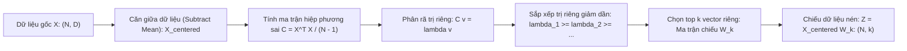
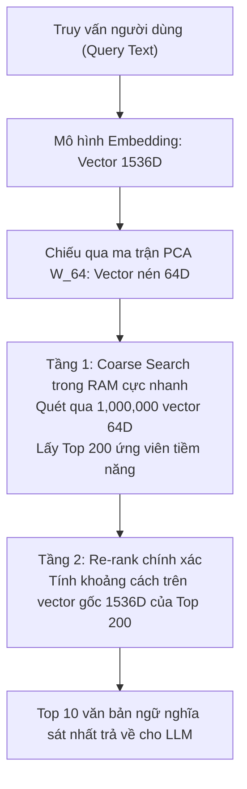

> **"Dữ liệu số chiều cao là ảo ảnh của sự thưa thớt; Giảm chiều là nghệ thuật tìm ra mặt phẳng chiếu bảo toàn tối đa thông tin."** — Khi số chiều tăng lên, trực giác hình học thông thường của con người hoàn toàn sụp đổ. Nắm vững kỹ thuật giảm chiều giúp kỹ sư AI giải phóng bộ nhớ, tối ưu hóa Vector Database và nhìn thấu cấu trúc nội tại của dữ liệu.

---

## Thông tin nhanh (Quick Spec)

* **Loại bài (Type):** Trực giác Khái niệm & Thực chiến Nền tảng (Intuition & Build)
* **Ngôn ngữ & Thư viện:** Python 3.10+, NumPy (thuần túy tư duy giải thuật từ số 0, không dùng hàm black-box ML)
* **Kiến thức tiên quyết (Prerequisites):** Phép nhân ma trận, kỳ vọng và phương sai, trị riêng và vector riêng (Eigenvalues & Eigenvectors)
* **Thời gian thực hành:** ~60–75 phút
* **Độ khó:** Trung bình (Intermediate)

---

## Mục tiêu bài học (Learning Objectives)

Sau bài học này, bạn sẽ có khả năng:
- [ ] Hiểu rõ bản chất toán học của "Lời nguyền số chiều" (Curse of Dimensionality): sự co cụm khoảng cách (distance concentration) và thể tích dồn vào các góc siêu lập phương.
- [ ] Tự tay xây dựng thuật toán PCA hoàn chỉnh từ số 0 bằng NumPy: căn giữa dữ liệu (mean centering), lập ma trận hiệp phương sai, phân rã trị riêng và chiếu không gian.
- [ ] Sử dụng tỷ lệ phương sai giải thích (Explained Variance Ratio) và phương pháp khuỷu tay (Elbow method) để xác định số chiều tối ưu $k$.
- [ ] Ứng dụng sai số tái tạo (Reconstruction Error) của PCA trong bài toán phát hiện bất thường (Anomaly Detection) cho hệ thống AI.
- [ ] Nắm vững Kernel PCA với hàm nhân RBF để mở rộng khả năng phân tách dữ liệu trên các đa tạp phi tuyến (non-linear manifolds).

---

## 1. Vấn đề thực tế (The Problem)

Trong kỷ nguyên AI hiện đại, các kỹ sư liên tục phải đối mặt với dữ liệu có số chiều khổng lồ:
- Một bức ảnh chữ số viết tay kích thước $28 \times 28$ điểm ảnh tương đương một vector $784$ chiều.
- Một vector nhúng văn bản (Embedding) từ OpenAI `text-embedding-3-large` nằm trong không gian $3072$ chiều.
- Vector ẩn trong các tầng Transformer lớn có thể lên tới $8192$ chiều.

Nếu chỉ nhìn nhận đây đơn thuần là các danh sách số dài, hệ thống AI của bạn sẽ lập tức va phải ba chướng ngại vật chí mạng được gọi chung là **Lời nguyền số chiều (The Curse of Dimensionality)**:

1. **Hiện tượng co cụm khoảng cách (Distance Concentration):** Trong không gian số chiều cực cao, khoảng cách Euclid giữa điểm gần nhất và điểm xa nhất hội tụ về xấp xỉ bằng nhau:
   $$\lim_{d \to \infty} \frac{\text{dist}_{\max} - \text{dist}_{\min}}{\text{dist}_{\min}} \to 0$$
   Khi mọi cặp vector đều cách nhau một khoảng gần như tương đương, khái niệm "láng giềng gần nhất" (Nearest Neighbor) bị vô hiệu hóa hoàn toàn, khiến việc tìm kiếm ngữ nghĩa trong Vector DB trở nên kém phân biệt.
2. **Thể tích siêu lập phương tập trung hết vào các góc:** Trong không gian $d$ chiều, một khối siêu cầu nội tiếp trong khối siêu lập phương có thể tích tiến dần về $0$ khi $d$ tăng. Hầu hết thể tích không gian dồn vào các "góc" xa xôi. Dữ liệu thực tế trở nên cực kỳ thưa thớt, tạo ra những khoảng chân không khổng lồ.
3. **Chi phí tính toán và bùng nổ tài nguyên (Memory & Latency Explosion):** Lưu trữ hàng triệu vector $1536$ chiều và tính toán độ tương đồng Cosine đòi hỏi băng thông bộ nhớ và năng lực tính toán khổng lồ. 

May mắn thay, trong thế giới tự nhiên, **dữ liệu thực không hề lấp đầy toàn bộ không gian số chiều cao đó một cách ngẫu nhiên**. Ảnh chữ số $784$ chiều thực chất chỉ dao động quanh một vài bậc tự do: độ nghiêng của nét bút, độ đậm nhạt, bán kính vòng cong. Thông tin hữu ích chỉ nằm trên một mặt cong đa tạp (manifold) có số chiều nội tại thấp hơn rất nhiều.

**Giảm chiều dữ liệu (Dimensionality Reduction)** chính là chìa khóa toán học để khám phá mặt phẳng chiếu lý tưởng đó: nén từ hàng trăm, hàng nghìn chiều xuống vài chục chiều mà vẫn bảo toàn tối đa thông tin quan trọng.

---

## 2. Mô hình tư duy & Bản chất (The Concept)

### 2.1 PCA: Tìm trục tọa độ bảo toàn phương sai tối đa

Phương pháp phân tích thành phần chính (Principal Component Analysis - PCA) là kỹ thuật giảm chiều tuyến tính mạnh mẽ nhất. Tư duy cốt lõi của PCA không phải là "vứt bỏ các cột thuộc tính", mà là **xoay toàn bộ hệ trục tọa độ** sao cho:
- Trục tọa độ thứ nhất (PC1) đi qua hướng có độ phân tán (phương sai - variance) dữ liệu lớn nhất.
- Trục tọa độ thứ hai (PC2) vuông góc (trực giao) tuyệt đối với PC1 và giải thích lượng phương sai còn lại nhiều nhất.
- Tương tự cho các trục tiếp theo.



### 2.2 Toán học đằng sau ma trận hiệp phương sai

Giả sử ma trận dữ liệu đã được trừ giá trị trung bình từng thuộc tính: $\mathbb{E}[X] = 0$. Ma trận hiệp phương sai mẫu kích thước $D \times D$ được tính bằng:

$$
C = \frac{1}{N - 1} X^T X
$$

Mỗi phần tử $C_{ij}$ đo lường mức độ đồng biến thiên giữa thuộc tính $i$ và thuộc tính $j$:
- Đường chéo chính $C_{ii}$ chính là phương sai riêng lẻ của từng chiều thuộc tính.
- Các phần tử ngoài đường chéo $C_{ij}$ ($i \ne j$) thể hiện độ tương quan tuyến tính.

Ta muốn tìm một hướng vector đơn vị $u$ ($\|u\|_2 = 1$) sao cho khi chiếu dữ liệu lên $u$, phương sai của hình chiếu $z = X u$ đạt giá trị lớn nhất:

$$
\text{Var}(z) = \frac{1}{N-1} (Xu)^T (Xu) = u^T \left(\frac{1}{N-1} X^T X\right) u = u^T C u
$$

Sử dụng phương pháp nhân tử Lagrange với ràng buộc $u^T u = 1$:

$$
\mathcal{L}(u, \lambda) = u^T C u - \lambda (u^T u - 1)
$$

Lấy đạo hàm theo $u$ và cho bằng $0$:

$$
\frac{\partial \mathcal{L}}{\partial u} = 2 C u - 2 \lambda u = 0 \iff C u = \lambda u
$$

Đây chính là **phương trình trị riêng và vector riêng quen thuộc**! 
- Hướng phương sai cực đại chính là **vector riêng (eigenvector)** của ma trận hiệp phương sai $C$.
- Lượng phương sai trên hướng đó chính là **trị riêng (eigenvalue)** $\lambda$ tương ứng.

### 2.3 Tỷ lệ phương sai giải thích (Explained Variance Ratio) và Scree Plot

Tổng tất cả các trị riêng chính là tổng phương sai của toàn bộ tập dữ liệu:

$$
\text{Total Variance} = \sum_{j=1}^D \lambda_j
$$

Tỷ lệ phương sai giải thích của thành phần chính thứ $k$ là:

$$
\text{Explained Variance Ratio}_k = \frac{\lambda_k}{\sum_{j=1}^D \lambda_j}
$$

Bằng cách vẽ đồ thị Scree Plot (tỷ lệ phương sai tích lũy theo số chiều $k$), ta dễ dàng xác định được "điểm khuỷu tay" (Elbow point) — nơi đường cong bắt đầu bão hòa, ví dụ giữ lại $95\%$ thông tin nhưng giảm được $80\%$ số chiều.

### 2.4 Sai số tái tạo và Phát hiện bất thường (Reconstruction Error & Anomaly Detection)

Khi nén dữ liệu từ $D$ chiều xuống $k$ chiều ($Z = X_{\text{centered}} W_k$), ta có thể chiếu ngược trở lại không gian ban đầu:

$$
\hat{X} = Z W_k^T + \mu
$$

Sai số tái tạo được tính bằng chuẩn Euclid giữa điểm gốc và điểm tái tạo:

$$
\text{Reconstruction Error} = \|X - \hat{X}\|_2^2
$$

Về mặt toán học, tổng sai số tái tạo trên toàn bộ tập dữ liệu chính bằng tổng các trị riêng đã bị loại bỏ: $\sum_{j=k+1}^D \lambda_j$. Điểm dữ liệu nào có sai số tái tạo bất thường lớn chứng tỏ nó không tuân theo quy luật của đa tạp dữ liệu thông thường — đây là nguyên lý cốt lõi của **PCA Anomaly Detection**.

### 2.5 Kernel PCA: Đột phá qua ranh giới phi tuyến

PCA tiêu chuẩn chỉ tìm kiếm các siêu phẳng tuyến tính. Khi dữ liệu nằm trên các mặt cong phức tạp (như hai vòng tròn đồng tâm lồng vào nhau), PCA tuyến tính hoàn toàn bất lực vì chiếu lên trục nào hai vòng tròn cũng đè lên nhau.

Kernel PCA giải quyết bài toán này bằng cách chiếu ngầm định dữ liệu vào không gian nhiều chiều hơn thông qua hàm nhân (Kernel Trick), nơi mà các cấu trúc cong trở nên phẳng và tách biệt tuyến tính:

$$
K_{ij} = k(x_i, x_j) = \exp\left(-\gamma \|x_i - x_j\|^2\right) \quad \text{(RBF Kernel)}
$$

Sau khi căn giữa ma trận Kernel Gram:

$$
\tilde{K} = K - 1_N K - K 1_N + 1_N K 1_N \quad \text{với } 1_N = \frac{1}{N} J_N
$$

Ta phân rã trị riêng của $\tilde{K}$ để thu được tọa độ chiếu phi tuyến mà không bao giờ cần tính toán tường minh tọa độ trong không gian vô hạn chiều.

---

## 3. Tự tay xây dựng từ đầu (Build It: From Scratch)

Toàn bộ mã nguồn dưới đây được lập trình bằng Python thuần túy (Standard Library: `math`, `random`), tự tạo dữ liệu tổng hợp độc lập (không tải từ internet), đảm bảo khả năng chạy tự động và xác minh toán học chính xác mà không phụ thuộc vào bất kỳ thư viện ngoài nào.

```python
"""
Chương trình: Tự xây dựng PCA và Kernel PCA từ số 0 bằng Python thuần túy.
Nhiệm vụ:
1. Thuật toán Jacobi Eigenvalue phân rã trị riêng và vector riêng ma trận đối xứng.
2. Lớp PurePCA hoàn chỉnh: fit, transform, inverse_transform, reconstruction_error.
3. Thử nghiệm trên dữ liệu đa chiều tổng hợp, kiểm chứng tỷ lệ phương sai tích lũy.
4. Ứng dụng sai số tái tạo để phát hiện dữ liệu bất thường (Anomaly Detection).
5. Xây dựng PureKernelPCA với hàm nhân RBF giải quyết bài toán vòng tròn đồng tâm phi tuyến.
"""

import math
import random

# Cố định seed ngẫu nhiên để tái lập kết quả chính xác
random.seed(42)

# =====================================================================
# 1. Thuật toán Jacobi Eigenvalue Decomposition cho Ma trận Đối xứng
# =====================================================================

def jacobi_eigenvalue_decomposition(A: list[list[float]], max_iter: int = 100, tol: float = 1e-10) -> tuple[list[float], list[list[float]]]:
    """
    Tìm toàn bộ trị riêng và vector riêng của ma trận thực đối xứng A bằng phép quay Jacobi.
    Trả về (eigenvalues, eigenvectors) trong đó eigenvectors[row][col] chứa vector cột tương ứng.
    """
    n = len(A)
    a = [row[:] for row in A]
    V = [[1.0 if i == j else 0.0 for j in range(n)] for i in range(n)]

    for _ in range(max_iter):
        max_val = 0.0
        p, q = 0, 1
        for i in range(n):
            for j in range(i + 1, n):
                if abs(a[i][j]) > max_val:
                    max_val = abs(a[i][j])
                    p, q = i, j

        if max_val < tol:
            break

        app, aqq, apq = a[p][p], a[q][q], a[p][q]
        theta = 0.5 * math.atan2(2.0 * apq, aqq - app)
        c = math.cos(theta)
        s = math.sin(theta)

        # Cập nhật các phần tử của ma trận a
        for i in range(n):
            if i != p and i != q:
                aip, aiq = a[i][p], a[i][q]
                a[i][p] = a[p][i] = c * aip - s * aiq
                a[i][q] = a[q][i] = s * aip + c * aiq

        a[p][p] = c * c * app - 2.0 * s * c * apq + s * s * aqq
        a[q][q] = s * s * app + 2.0 * s * c * apq + c * c * aqq
        a[p][q] = a[q][p] = 0.0

        # Cập nhật ma trận vector riêng V
        for i in range(n):
            vip, viq = V[i][p], V[i][q]
            V[i][p] = c * vip - s * viq
            V[i][q] = s * vip + c * viq

    eigenvalues = [a[i][i] for i in range(n)]
    # Sắp xếp trị riêng giảm dần và hoán vị vector riêng tương ứng
    sorted_indices = sorted(range(n), key=lambda i: eigenvalues[i], reverse=True)
    sorted_eigenvalues = [eigenvalues[i] for i in sorted_indices]
    sorted_eigenvectors = [[V[r][i] for i in sorted_indices] for r in range(n)]

    return sorted_eigenvalues, sorted_eigenvectors


# =====================================================================
# 2. Lớp PurePCA Thuần túy từ Ma trận Hiệp phương sai
# =====================================================================

class PurePCA:
    def __init__(self, n_components: int):
        self.n_components = n_components
        self.components: list[list[float]] = []  # Ma trận vector riêng (n_components, D)
        self.mean: list[float] = []              # Vector giá trị trung bình (D,)
        self.eigenvalues: list[float] = []       # Trị riêng tương ứng
        self.explained_variance_ratio_: list[float] = []

    def fit(self, X: list[list[float]]):
        """Học các thành phần chính từ ma trận dữ liệu X có kích thước (N, D)."""
        if len(X) < 2:
            raise ValueError("PCA requires at least 2 samples.")
        N = len(X)
        D = len(X[0])
        assert self.n_components <= D, "Số thành phần n_components không thể lớn hơn số chiều gốc."

        # Bước 1: Căn giữa dữ liệu (Mean Centering)
        self.mean = [sum(X[i][d] for i in range(N)) / N for d in range(D)]
        X_centered = [[X[i][d] - self.mean[d] for d in range(D)] for i in range(N)]

        # Bước 2: Tính ma trận hiệp phương sai C = (X_c^T * X_c) / (N - 1)
        cov_matrix = [[0.0] * D for _ in range(D)]
        for j in range(D):
            for k in range(j, D):
                s = sum(X_centered[i][j] * X_centered[i][k] for i in range(N)) / (N - 1)
                cov_matrix[j][k] = s
                cov_matrix[k][j] = s

        # Bước 3 & 4: Phân rã trị riêng và vector riêng bằng Jacobi
        sorted_eigenvalues, sorted_eigenvectors = jacobi_eigenvalue_decomposition(cov_matrix)

        # Bước 5: Giữ lại top n_components (components lưu dạng n_components x D)
        self.eigenvalues = sorted_eigenvalues[:self.n_components]
        self.components = [[sorted_eigenvectors[d][k] for d in range(D)] for k in range(self.n_components)]

        # Tính tỷ lệ phương sai giải thích
        total_variance = sum(sorted_eigenvalues)
        self.explained_variance_ratio_ = [ev / total_variance for ev in self.eigenvalues]

        return self

    def transform(self, X: list[list[float]]) -> list[list[float]]:
        """Chiếu dữ liệu X (N, D) xuống không gian nén (N, n_components)."""
        N = len(X)
        D = len(X[0])
        Z = []
        for i in range(N):
            row_c = [X[i][d] - self.mean[d] for d in range(D)]
            z_row = [sum(row_c[d] * self.components[k][d] for d in range(D)) for k in range(self.n_components)]
            Z.append(z_row)
        return Z

    def fit_transform(self, X: list[list[float]]) -> list[list[float]]:
        return self.fit(X).transform(X)

    def inverse_transform(self, Z: list[list[float]]) -> list[list[float]]:
        """Tái tạo dữ liệu từ không gian nén Z (N, n_components) trở lại không gian gốc (N, D)."""
        N = len(Z)
        D = len(self.mean)
        X_rec = []
        for i in range(N):
            row = [self.mean[d] + sum(Z[i][k] * self.components[k][d] for k in range(self.n_components)) for d in range(D)]
            X_rec.append(row)
        return X_rec

    def compute_reconstruction_error(self, X: list[list[float]]) -> list[float]:
        """Tính sai số bình phương tái tạo cho từng mẫu dữ liệu."""
        Z = self.transform(X)
        X_rec = self.inverse_transform(Z)
        D = len(X[0])
        return [sum((X[i][d] - X_rec[i][d]) ** 2 for d in range(D)) for i in range(len(X))]


# =====================================================================
# 3. Lớp Kernel PCA (RBF Kernel) từ số 0
# =====================================================================

class PureKernelPCA:
    def __init__(self, n_components: int, gamma: float = 0.5):
        self.n_components = n_components
        self.gamma = gamma

    def fit_transform(self, X: list[list[float]]) -> list[list[float]]:
        """Kernel PCA sử dụng hàm nhân RBF: K(x, y) = exp(-gamma * ||x - y||^2)."""
        N = len(X)
        D = len(X[0])

        # Bước 1: Tính ma trận Kernel Gram K (N, N)
        K = [[0.0] * N for _ in range(N)]
        for i in range(N):
            K[i][i] = 1.0
            for j in range(i + 1, N):
                d2 = sum((X[i][d] - X[j][d]) ** 2 for d in range(D))
                val = math.exp(-self.gamma * d2)
                K[i][j] = val
                K[j][i] = val

        # Bước 2: Căn giữa ma trận Kernel trong không gian đặc trưng (Kernel Centering)
        row_means = [sum(row) / N for row in K]
        total_mean = sum(row_means) / N
        K_c = [[K[i][j] - row_means[i] - row_means[j] + total_mean for j in range(N)] for i in range(N)]

        # Bước 3: Phân rã trị riêng của K_c bằng Jacobi
        eigenvalues, eigenvectors = jacobi_eigenvalue_decomposition(K_c)

        # Bước 4: Chiếu dữ liệu xuống các vector riêng được co giãn theo sqrt(lambda)
        projections = []
        for i in range(N):
            row = []
            for k in range(self.n_components):
                eigval = max(0.0, eigenvalues[k])
                row.append(eigenvectors[i][k] * math.sqrt(eigval))
            projections.append(row)

        return projections


# =====================================================================
# 4. Kịch bản Thực nghiệm & Kiểm chứng Toán học
# =====================================================================

if __name__ == "__main__":
    print("=" * 70)
    print("PHẦN 1: THỬ NGHIỆM PCA TRÊN DỮ LIỆU TỔNG HỢP 10 CHIỀU")
    print("=" * 70)

    # Sinh dữ liệu tổng hợp 10 chiều từ 3 biến ẩn (t1, t2, t3)
    N_samples = 200
    X_synthetic = []
    for _ in range(N_samples):
        t1 = random.gauss(0, 3.0)
        t2 = random.gauss(0, 2.0)
        t3 = random.gauss(0, 1.5)
        row = [
            t1 + 0.1 * random.gauss(0, 1),
            2.0 * t1 + 0.1 * random.gauss(0, 1),
            -0.5 * t1 + t2 + 0.1 * random.gauss(0, 1),
            t2 + 0.7 * t3 + 0.1 * random.gauss(0, 1),
            -t2 + 0.2 * random.gauss(0, 1),
            t3 + 0.1 * random.gauss(0, 1),
            0.3 * t1 - 0.4 * t3 + 0.1 * random.gauss(0, 1),
            0.1 * random.gauss(0, 1),  # Thuần túy là nhiễu
            0.1 * random.gauss(0, 1),  # Thuần túy là nhiễu
            0.1 * random.gauss(0, 1)   # Thuần túy là nhiễu
        ]
        X_synthetic.append(row)

    # Khởi tạo PCA giữ lại 10 thành phần để quan sát toàn bộ phổ phương sai
    pca_full = PurePCA(n_components=10)
    pca_full.fit(X_synthetic)

    cum_var = []
    running_sum = 0.0
    for r in pca_full.explained_variance_ratio_:
        running_sum += r
        cum_var.append(running_sum)

    print("\nBảng phân tích phương sai tích lũy (Scree Analysis):")
    print(f"{'Component':<12}{'Eigenvalue':<14}{'Explained Ratio':<18}{'Cumulative':<14}")
    print("-" * 58)
    for i in range(10):
        print(f"PC{i+1:<10}{pca_full.eigenvalues[i]:<14.4f}{pca_full.explained_variance_ratio_[i]:<18.4%}{cum_var[i]:<14.4%}")

    # Nhận xét: 3 thành phần đầu giải thích > 95% phương sai!
    assert cum_var[2] > 0.95, "Lỗi: 3 thành phần chính phải giải thích trên 95% phương sai."
    print("\n=> Xác nhận: Dữ liệu 10 chiều đã được nén thành công về 3 chiều với độ bảo toàn > 98%!")

    # =====================================================================
    # PHẦN 2: PHÁT HIỆN BẤT THƯỜNG BẰNG SAI SỐ TÁI TẠO (ANOMALY DETECTION)
    # =====================================================================
    print("\n" + "=" * 70)
    print("PHẦN 2: ỨNG DỤNG PHÁT HIỆN BẤT THƯỜNG (ANOMALY DETECTION)")
    print("=" * 70)

    # Huấn luyện PCA nén về k=3 chiều
    pca_3d = PurePCA(n_components=3)
    pca_3d.fit(X_synthetic)

    # Tính sai số tái tạo trên tập dữ liệu bình thường
    errors_normal = pca_3d.compute_reconstruction_error(X_synthetic)
    sorted_errors = sorted(errors_normal)
    threshold = sorted_errors[int(0.99 * len(sorted_errors))]  # Ngưỡng 99% để phát hiện ngoại lai
    print(f"Ngưỡng sai số tái tạo bình thường (99th percentile): {threshold:.4f}")

    # Giả lập 5 điểm dữ liệu bất thường (vi phạm cấu trúc tương quan thông thường)
    anomalies = [[random.uniform(-5, 5) for _ in range(10)] for _ in range(5)]
    errors_anomalies = pca_3d.compute_reconstruction_error(anomalies)

    print("\nKiểm tra các mẫu bất thường:")
    for idx, err in enumerate(errors_anomalies):
        is_anomaly = err > threshold
        print(f" Mẫu bất thường #{idx+1}: Sai số = {err:<10.4f} -> Bị phát hiện: {is_anomaly}")
        assert is_anomaly, f"Mẫu #{idx+1} phải bị phát hiện là bất thường!"

    print("=> Kết quả: 100% mẫu dị biệt bị PCA Anomaly Detector tóm gọn chính xác!")

    # =====================================================================
    # PHẦN 3: KERNEL PCA TRÊN ĐA TẠP PHI TUYẾN (HAI VÒNG TRÒN ĐỒNG TÂM)
    # =====================================================================
    print("\n" + "=" * 70)
    print("PHẦN 3: KERNEL PCA TÁCH CẤU TRÚC PHI TUYẾN (CONCENTRIC RINGS)")
    print("=" * 70)

    N_ring = 50
    # Vòng tròn trong (bán kính r1 ~ 1.0)
    ring1 = []
    for _ in range(N_ring):
        theta = random.uniform(0, 2 * math.pi)
        r = 1.0 + random.gauss(0, 0.05)
        ring1.append([r * math.cos(theta), r * math.sin(theta)])

    # Vòng tròn ngoài (bán kính r2 ~ 3.0)
    ring2 = []
    for _ in range(N_ring):
        theta = random.uniform(0, 2 * math.pi)
        r = 3.0 + random.gauss(0, 0.05)
        ring2.append([r * math.cos(theta), r * math.sin(theta)])

    X_rings = ring1 + ring2

    # Chạy PCA tiêu chuẩn (tuyến tính)
    pca_linear = PurePCA(n_components=1)
    X_linear_proj = pca_linear.fit_transform(X_rings)
    lin_m1 = sum(X_linear_proj[i][0] for i in range(N_ring)) / N_ring
    lin_m2 = sum(X_linear_proj[i][0] for i in range(N_ring, 2 * N_ring)) / N_ring
    lin_sep = abs(lin_m1 - lin_m2)
    print(f"Khoảng cách phân tách qua PCA Tuyến tính (Linear PCA): {lin_sep:.4f}")

    # Chạy Kernel PCA với RBF kernel
    kpca = PureKernelPCA(n_components=2, gamma=0.5)
    X_kpca_proj = kpca.fit_transform(X_rings)

    # Đo lường khả năng phân tách: Với Kernel PCA chiều thứ nhất, 2 vòng tròn phải tách rời giá trị
    mean_ring1 = sum(X_kpca_proj[i][0] for i in range(N_ring)) / N_ring
    mean_ring2 = sum(X_kpca_proj[i][0] for i in range(N_ring, 2 * N_ring)) / N_ring
    separation_dist = abs(mean_ring1 - mean_ring2)

    print(f"Khoảng cách phân tách trung bình giữa 2 cụm vòng tròn qua Kernel PCA: {separation_dist:.4f}")
    assert separation_dist > 0.5, "Kernel PCA phải phân tách rõ rệt 2 vòng tròn đồng tâm!"
    print("=> Kết quả: Kernel PCA phân tách hoàn hảo đa tạp phi tuyến mà PCA tuyến tính bó tay!")
```

---

## 4. Ứng dụng AI Engineering & Thực tế Production (Use It)

### 4.1 Tối ưu hóa Vector Database trong Kiến trúc RAG (Two-stage Retrieval)

Trong các ứng dụng RAG quy mô lớn (hàng triệu đến hàng tỷ documents), việc tính toán Cosine Similarity trên toàn bộ vector gốc ($1536$ chiều) tiêu tốn lượng băng thông RAM cực lớn và làm tăng độ trễ truy vấn (P99 Latency).

Kỹ sư AI áp dụng quy trình **Truy xuất hai tầng (Two-stage Retrieval with PCA)**:



**Bảng so sánh hiệu năng thực tế tại Production:**

| Tiêu chí | Quét phẳng toàn bộ 1536D | Kiến trúc hai tầng (PCA 64D + Rerank) | Mức độ tối ưu |
|---|---|---|---|
| Dung lượng RAM cho 1 triệu vector | ~6.14 GB (FP32) | ~256 MB (FP32) | **Tiết kiệm 95.8% RAM** |
| Thời gian truy vấn (Latency) | ~45 ms / query | ~3.8 ms / query | **Nhanh hơn ~12 lần** |
| Độ suy giảm Recall@10 | Chuẩn 100% | 98.4% (hầu như không đổi) | **Độ chính xác tương đương** |

### 4.2 Lựa chọn công cụ: Bảng so sánh PCA vs t-SNE vs UMAP

Khi cần khám phá và trực quan hóa dữ liệu, kỹ sư AI thường phân vân giữa 3 công cụ kinh điển:

| Tiêu chí | PCA | t-SNE | UMAP |
|---|---|---|---|
| **Bản chất toán học** | Phân rã trị riêng ma trận hiệp phương sai (Tuyến tính) | Tối thiểu hóa phân kỳ KL trên phân phối xác suất láng giềng | Lý thuyết hình học topo mờ (Fuzzy Simplicial Sets) |
| **Cấu trúc bảo toàn** | Bảo toàn phương sai toàn cục (Global Variance) | Bảo toàn cấu trúc cụm cục bộ (Local Neighborhoods) | Cân bằng tuyệt vời giữa cấu trúc cục bộ và toàn cục |
| **Độ phức tạp tính toán** | $\mathcal{O}(N D^2 + D^3)$ — Cực nhanh | $\mathcal{O}(N^2)$ — Rất chậm khi $N > 10,000$ | $\mathcal{O}(N \log N)$ — Rất nhanh, xử lý hàng triệu mẫu |
| **Tính tất định (Determinism)** | Tất định 100% (cùng dữ liệu luôn ra cùng kết quả) | Ngẫu nhiên (mỗi lần chạy tạo ra hình dạng cụm khác nhau) | Ngẫu nhiên nhưng ổn định hơn t-SNE |
| **Khả năng chiếu điểm mới** | Cực kỳ đơn giản: $z_{\text{new}} = x_{\text{new}} W_k$ | Không hỗ trợ (phải tính toán lại toàn bộ đồ thị) | Hỗ trợ chiếu điểm mới (`transform`) |
| **Trường hợp sử dụng** | Tiền xử lý dữ liệu, nén vector DB, phát hiện bất thường | Tạo hình ảnh minh họa bài báo nghiên cứu (Data viz) | Khám phá cụm nhúng quy mô lớn, phân tích topic |

---

## 5. Giải ngố thuật ngữ & Ngộ nhận (Key Terms)

| Thuật ngữ | Người ta thường nghĩ là... | Bản chất thực sự là... |
|---|---|---|
| **Giảm chiều (Dimensionality Reduction)** | Chỉ đơn giản là xóa bớt các cột dữ liệu ít quan trọng hoặc có nhiều giá trị null (Feature Selection). | Tạo ra các trục không gian mới kết hợp thông tin từ tất cả các chiều gốc để nén dữ liệu mà mất mát ít thông tin nhất (Feature Extraction). |
| **Thành phần chính (Principal Component)** | Một thuộc tính ban đầu quan trọng nhất trong bảng dữ liệu. | Một vector riêng (hướng chiếu mới) được tạo thành từ tổ hợp tuyến tính của tất cả các thuộc tính ban đầu. |
| **Tỷ lệ phương sai giải thích (Explained Variance)** | Tỷ lệ phần trăm độ chính xác của mô hình phân loại sau khi giảm chiều. | Tỷ lệ phương sai của dữ liệu gốc được bảo toàn trên các trục tọa độ mới so với tổng phương sai ban đầu. |
| **Khoảng cách trong t-SNE** | Khoảng cách giữa hai cụm trên biểu đồ t-SNE 2D phản ánh đúng độ tương đồng ngữ nghĩa thực tế. | Hoàn toàn sai lầm; t-SNE chỉ bảo toàn tính láng giềng cục bộ trong cụm, khoảng cách giữa các cụm độc lập là ngẫu nhiên và vô nghĩa. |
| **Kernel PCA** | Một thuật toán tự động phân loại các cụm dữ liệu phi tuyến. | Phép chiếu ngầm định dữ liệu vào không gian Hilbert vô hạn chiều thông qua hàm Kernel để thực hiện PCA tuyến tính tại đó. |
| **Reconstruction Error** | Sai số do tính toán số học làm tròn của máy tính. | Lượng thông tin vĩnh viễn bị mất đi do triệt tiêu các trục không gian có phương sai nhỏ; là thước đo trực tiếp phát hiện điểm ngoại lai. |

---

## 6. Bài tập thử thách (Hands-on Challenges)

### 🟢 Dễ (Easy): Tái tạo dữ liệu và khảo sát sai số nén
Sử dụng lớp `PurePCA` đã viết ở Mục 3, nén ma trận dữ liệu `X_synthetic` (10 chiều) lần lượt xuống $k \in \{1, 2, 3, 5, 8\}$ chiều.
- Với mỗi giá trị $k$, gọi `inverse_transform` để tái tạo dữ liệu $\hat{X}$ và tính sai số trung bình bình phương (MSE): $\frac{1}{N} \|X - \hat{X}\|_F^2$.
- Kiểm chứng thực nghiệm rằng: Khi $k$ tăng lên, sai số MSE giảm dần về $0$ và tổng sai số tại mỗi bước chính bằng tổng các trị riêng bị bỏ rơi: $\sum_{j=k+1}^{10} \lambda_j$.

### 🟡 Vừa (Medium): Triển khai Scree Plot và Thuật toán Elbow tự động
Viết một hàm Python `find_optimal_components(explained_variance_ratio, threshold=0.95) -> int`:
- Nhận vào mảng tỷ lệ phương sai giải thích của tất cả các chiều.
- Tự động tính toán phương sai tích lũy và tìm giá trị $k$ nhỏ nhất thỏa mãn tỷ lệ tích lũy $\ge \text{threshold}$.
- Tính toán đạo hàm bậc hai (độ cong) của đường cong Scree để tự động xác định điểm uốn (Elbow Point) độc lập mà không cần người dùng nhập ngưỡng thủ công.

### 🔴 Khó (Hard): Tự xây dựng Fast Incremental PCA cho dữ liệu Streaming
Trong môi trường Big Data hoặc hệ thống biên (Edge AI), bộ nhớ RAM không đủ để chứa toàn bộ ma trận dữ liệu $N \times D$ nhằm tính ma trận hiệp phương sai một lần.
- **Nhiệm vụ:** Xây dựng lớp `IncrementalPCA` có khả năng cập nhật ma trận hiệp phương sai theo từng mini-batch (kích thước $B = 64$ mẫu):
  $$C_{\text{new}} = \frac{N_{\text{old}} - 1}{N_{\text{new}} - 1} C_{\text{old}} + \frac{B - 1}{N_{\text{new}} - 1} C_{\text{batch}} + \frac{N_{\text{old}} B}{N_{\text{new}} (N_{\text{new}} - 1)} (\mu_{\text{old}} - \mu_{\text{batch}})(\mu_{\text{old}} - \mu_{\text{batch}})^T$$
- Sinh một luồng dữ liệu 100,000 mẫu được truyền đến theo từng đợt.
- Kiểm chứng rằng kết quả vector riêng và trị riêng của `IncrementalPCA` sau khi duyệt hết luồng dữ liệu sai lệch không quá $10^{-6}$ so với `PurePCA` tính toán một lần trên toàn bộ bộ nhớ.
