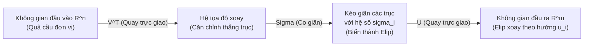

> **"SVD là con dao pha của đại số tuyến tính: Mọi ma trận, dù méo mó hay khiếm khuyết, đều mở ra cấu trúc cốt lõi qua ba bước: quay, co giãn và quay."** — Phân rã trị riêng chỉ áp dụng được cho ma trận vuông hoàn hảo. Trong khi đó, SVD vận hành trên bất kỳ ma trận nào, giải phóng kỹ sư AI khỏi nỗi sợ ma trận suy biến hay lệch kích thước.

---

## Thông tin nhanh (Quick Spec)

* **Loại bài (Type):** Trực giác Khái niệm & Thực chiến Nền tảng (Intuition & Build)
* **Ngôn ngữ & Thư viện:** Python 3.10+, NumPy (thuần túy tư duy giải thuật từ số 0, không dùng hàm black-box)
* **Kiến thức tiên quyết (Prerequisites):** Phép nhân ma trận, tính trực giao, trị riêng và vector riêng (Eigenvalues & Eigenvectors)
* **Thời gian thực hành:** ~60–80 phút
* **Độ khó:** Nâng cao nền tảng (Upper-Intermediate)

---

## Mục tiêu bài học (Learning Objectives)

Sau bài học này, bạn sẽ có khả năng:
- [ ] Thấu hiểu sâu sắc bản chất hình học của phép phân rã SVD ($A = U \Sigma V^T$): chuỗi biến đổi xoay không gian đầu vào, co giãn theo các trục elip và xoay vào không gian đầu ra.
- [ ] Hiểu rõ dạng khai triển tích ngoài (Outer Product Expansion) và chứng minh trực giác định lý Eckart-Young-Mirsky về ma trận xấp xỉ thứ hạng thấp tối ưu.
- [ ] Tự tay lập trình thuật toán SVD bằng phương pháp lũy thừa (Power Iteration with Deflation) thuần túy bằng NumPy.
- [ ] Xây dựng giải pháp tính ma trận giả nghịch đảo Moore-Penrose ($A^+$) để giải hệ phương trình suy biến và bài toán bình phương tối thiểu.
- [ ] Nắm bắt mối liên hệ cốt lõi giữa Truncated SVD và kiến trúc thích ứng thứ hạng thấp LoRA (Low-Rank Adaptation) trong các mô hình ngôn ngữ lớn (LLMs).

---

## 1. Vấn đề thực tế (The Problem)

Trong học máy và kỹ thuật AI, phần lớn dữ liệu không bao giờ nằm trong các ma trận vuông cân đối:
- Một ma trận xếp hạng phim của người dùng có kích thước $10,000 \times 500$ (người dùng $\times$ bộ phim).
- Ma trận tần suất từ - tài liệu (Term-Document Matrix) trong NLP có thể là $50,000 \times 1,000$.
- Ma trận trọng số trong tầng Attention của Transformer có kích thước $4096 \times 12288$.

Khi đối mặt với các ma trận này, các công cụ đại số cổ điển lập tức bộc lộ sự bất lực:
1. **Phân rã trị riêng (Eigendecomposition) thất bại hoàn toàn:** Định lý phổ $A = Q \Lambda Q^{-1}$ đòi hỏi $A$ bắt buộc phải là ma trận vuông ($n \times n$). Không chỉ vậy, ma trận vuông đó còn phải có đủ $n$ vector riêng độc lập tuyến tính (non-defective). Một ma trận chữ nhật hình chữ nhật $m \times n$ hoàn toàn nằm ngoài tầm với.
2. **Nghịch đảo thông thường ($A^{-1}$) không tồn tại:** Khi giải hệ phương trình $Ax = b$ trong đó số phương trình nhiều hơn số ẩn ($m > n$ - Overdetermined System) hoặc ma trận bị khuyết hạng (Rank-deficient), định thức $\det(A)$ không xác định, và ta không thể nhân $A^{-1}$ để tìm nghiệm.
3. **Quá tải bộ nhớ khi fine-tuning LLM:** Một ma trận trọng số $\Delta W \in \mathbb{R}^{4096 \times 4096}$ chứa hơn 16.7 triệu tham số. Nếu fine-tune trực tiếp, bộ nhớ VRAM cho gradient và optimizer states sẽ vượt quá sức chứa của GPU thông thường.

**Phân rã giá trị kỳ dị (Singular Value Decomposition - SVD)** chính là lời giải tối thượng: Nó áp dụng được cho **mọi ma trận**, bất kể kích thước chữ nhật, bất kể hạng đủ hay thiếu, có chứa số 0 hay không. SVD giải mã chính xác cấu trúc hình học bên trong ma trận và cung cấp công thức nén tối ưu toán học nhất từng được phát minh.

---

## 2. Mô hình tư duy & Bản chất (The Concept)

### 2.1 Bản chất hình học: Quay - Co giãn - Quay (Rotate - Scale - Rotate)

Một ma trận bất kỳ $A \in \mathbb{R}^{m \times n}$ về bản chất là một phép biến đổi tuyến tính nhận một vector từ không gian $n$ chiều ($\mathbb{R}^n$) và chuyển nó sang không gian $m$ chiều ($\mathbb{R}^m$).

Nếu bạn lấy một quả cầu đơn vị (Unit Sphere) gồm tất cả các vector có độ dài bằng $1$ trong không gian $\mathbb{R}^n$ và áp dụng phép biến đổi $A$, quả cầu đó sẽ luôn luôn bị biến thành một **khối siêu elip (Hyper-ellipsoid)** trong không gian $\mathbb{R}^m$.

SVD phân tách hành động uốn nắn phức tạp này thành 3 bước hình học nguyên bản nối tiếp nhau:

$$
A = U \Sigma V^T
$$



Ý nghĩa của từng thành phần:
1. **$V^T \in \mathbb{R}^{n \times n}$ (Right Singular Vectors):** Là ma trận trực giao ($V^T V = I$). Nó xoay quả cầu trong không gian đầu vào sao cho các trục của quả cầu trùng khớp với các trục chính của khối elip tương lai.
2. **$\Sigma \in \mathbb{R}^{m \times n}$ (Singular Values):** Là ma trận đường chéo chữ nhật chứa các giá trị kỳ dị $\sigma_1 \ge \sigma_2 \ge \dots \ge \sigma_r > 0$. Các giá trị này chính là **độ dài bán trục của khối elip** — đo lường mức độ co giãn của ma trận theo từng hướng độc lập.
3. **$U \in \mathbb{R}^{m \times m}$ (Left Singular Vectors):** Là ma trận trực giao ($U^T U = I$). Nó xoay khối elip vừa được co giãn về hướng định vị cuối cùng trong không gian đầu ra $m$ chiều.

Quan hệ vector từng thành phần:

$$
A v_i = \sigma_i u_i
$$

Ma trận $A$ ánh xạ vector đơn vị $v_i$ thành vector $u_i$ trong không gian đầu ra, được khuếch đại đúng $\sigma_i$ lần!

### 2.2 Khai triển tích ngoài (Outer Product Form)

Ta có thể viết lại phép nhân $U \Sigma V^T$ dưới dạng tổng của các ma trận hạng 1 (Rank-1 Matrices):

$$
A = \sum_{i=1}^r \sigma_i u_i v_i^T = \sigma_1 u_1 v_1^T + \sigma_2 u_2 v_2^T + \dots + \sigma_r u_r v_r^T
$$

Trong đó:
- Mỗi tích ngoài $u_i v_i^T$ là một ma trận kích thước $m \times n$ có hạng đúng bằng 1.
- Mỗi số hạng đại diện cho một "lớp thông tin" độc lập của ma trận $A$.
- Số hạng đầu tiên $\sigma_1 u_1 v_1^T$ là lớp thông tin chiếm năng lượng lớn nhất, quan trọng nhất.
- Các số hạng phía sau bổ sung dần các chi tiết nhỏ hơn, và cuối cùng là nhiễu số học.

### 2.3 Định lý Eckart-Young-Mirsky: Xấp xỉ thứ hạng thấp tối ưu

Nếu muốn nén ma trận $A$ xuống thứ hạng $k$ ($k < r$), ta chỉ cần cắt ngắn tổng tích ngoài, giữ lại $k$ số hạng đầu tiên:

$$
A_k = \sum_{i=1}^k \sigma_i u_i v_i^T = U_k \Sigma_k V_k^T
$$

Định lý Eckart-Young-Mirsky khẳng định: **$A_k$ là ma trận hạng $k$ gần với $A$ nhất trên toàn bộ không gian ma trận**, xét theo cả chuẩn phổ (Spectral Norm) lẫn chuẩn Frobenius:

$$
\min_{\text{rank}(B) = k} \|A - B\|_F = \|A - A_k\|_F = \sqrt{\sum_{j=k+1}^r \sigma_j^2}
$$

Sai số khi xấp xỉ ma trận chính bằng căn bậc hai tổng bình phương của tất cả các giá trị kỳ dị bị loại bỏ!

### 2.4 Ma trận giả nghịch đảo Moore-Penrose ($A^+$)

Khi ma trận $A$ không vuông hoặc suy biến, nghịch đảo $A^{-1}$ không tồn tại. Ma trận giả nghịch đảo Moore-Penrose $A^+$ được định nghĩa cực kỳ tao nhã qua SVD:

$$
A^+ = V \Sigma^+ U^T
$$

Trong đó $\Sigma^+$ được tạo ra bằng cách chuyển vị $\Sigma$ và thay thế mọi phần tử $\sigma_i > 0$ trên đường chéo bằng nghịch đảo $1 / \sigma_i$:

$$
\Sigma^+ = \text{diag}\left(\frac{1}{\sigma_1}, \frac{1}{\sigma_2}, \dots, \frac{1}{\sigma_k}, 0, \dots\right)
$$

Nghiệm của bài toán hồi quy bình phương tối thiểu $\min_x \|Ax - b\|_2^2$ được tính trực tiếp và ổn định bằng:

$$
x_{\text{LS}} = A^+ b = V \Sigma^+ U^T b
$$

Nếu có vô số nghiệm, $x_{\text{LS}}$ chính là nghiệm có chuẩn $\|x\|_2$ nhỏ nhất!

### 2.5 Kết nối sâu sắc với LoRA (Low-Rank Adaptation)

Trong các mô hình LLM hiện đại, khi thích nghi với nhiệm vụ mới, ta cần cập nhật ma trận trọng số: $W = W_0 + \Delta W$.
Định lý Eckart-Young chỉ ra rằng nếu ma trận cập nhật $\Delta W \in \mathbb{R}^{d \times d}$ có các giá trị kỳ dị suy giảm nhanh (phần lớn năng lượng tập trung ở vài giá trị đầu), ta có thể thay thế $\Delta W$ bằng ma trận xấp xỉ hạng $r$:

$$
\Delta W \approx U_r \Sigma_r V_r^T = (U_r \sqrt{\Sigma_r}) (\sqrt{\Sigma_r} V_r^T) = B \cdot A
$$

Với $B = U_r \sqrt{\Sigma_r} \in \mathbb{R}^{d \times r}$ và $A = \sqrt{\Sigma_r} V_r^T \in \mathbb{R}^{r \times d}$.
LoRA học trực tiếp $B$ và $A$ qua Gradient Descent, khai thác đúng bản chất ma trận thứ hạng thấp mà SVD đã đặt nền móng lý thuyết.

---

## 3. Tự tay xây dựng từ đầu (Build It: From Scratch)

Dưới đây là mã nguồn Python thuần túy (Standard Library: `math`, `random`), tự xây dựng thuật toán SVD từ phương pháp lũy thừa (Power Iteration) và phân rã phổ ma trận đối xứng (Jacobi SVD), nén ma trận thứ hạng thấp, tính ma trận giả nghịch đảo và mô phỏng phân rã LoRA mà không phụ thuộc vào bất kỳ thư viện ngoài nào.

```python
"""
Chương trình: Tự xây dựng SVD, Truncated SVD, Moore-Penrose Pseudoinverse và LoRA bằng Python thuần túy.
Mục tiêu:
1. Thuật toán Power Iteration tìm cặp vector kỳ dị cực đại.
2. Thuật toán SVD hoàn chỉnh qua phân rã phổ ma trận liên hợp (Normal Equations & Jacobi).
3. Nén ma trận rank-k và kiểm chứng định lý Eckart-Young.
4. Tự tính Moore-Penrose Pseudoinverse giải hệ bình phương tối thiểu.
5. Mô phỏng phân rã trọng số LoRA (Low-Rank Adaptation) trong mô hình ngôn ngữ.
"""

import math
import random

# Cố định seed ngẫu nhiên
random.seed(42)

# =====================================================================
# 1. Các Phép Toán Đại Số Tuyến Tính Nền Tảng
# =====================================================================

def vec_norm(v: list[float]) -> float:
    """Chuẩn Euclid L2 của vector: sqrt(sum(v_i^2))."""
    return math.sqrt(sum(x * x for x in v))

def vec_dot(u: list[float], v: list[float]) -> float:
    """Tích vô hướng hai vector: sum(u_i * v_i)."""
    return sum(x * y for x, y in zip(u, v))

def mat_vec_mul(A: list[list[float]], v: list[float]) -> list[float]:
    """Nhân ma trận với vector: A @ v."""
    return [sum(row[j] * v[j] for j in range(len(v))) for row in A]

def mat_transpose(A: list[list[float]]) -> list[list[float]]:
    """Chuyển vị ma trận A^T."""
    m, n = len(A), len(A[0])
    return [[A[i][j] for i in range(m)] for j in range(n)]

def mat_mul(A: list[list[float]], B: list[list[float]]) -> list[list[float]]:
    """Nhân hai ma trận: A @ B."""
    m, k, n = len(A), len(A[0]), len(B[0])
    return [[sum(A[i][p] * B[p][j] for p in range(k)) for j in range(n)] for i in range(m)]

def frobenius_norm(A: list[list[float]]) -> float:
    """Chuẩn Frobenius của ma trận: sqrt(sum(A_{ij}^2))."""
    return math.sqrt(sum(x * x for row in A for x in row))


# =====================================================================
# 2. Phân Rã Trị Riêng Jacobi cho Ma Trận Đối Xứng
# =====================================================================

def jacobi_eigen(A: list[list[float]], max_iter: int = 100, tol: float = 1e-12) -> tuple[list[float], list[list[float]]]:
    """Tìm trị riêng và vector riêng ma trận đối xứng A."""
    n = len(A)
    a = [row[:] for row in A]
    V = [[1.0 if i == j else 0.0 for j in range(n)] for i in range(n)]

    for _ in range(max_iter):
        max_val = 0.0
        p, q = 0, 1
        for i in range(n):
            for j in range(i + 1, n):
                if abs(a[i][j]) > max_val:
                    max_val = abs(a[i][j])
                    p, q = i, j

        if max_val < tol:
            break

        app, aqq, apq = a[p][p], a[q][q], a[p][q]
        theta = 0.5 * math.atan2(2.0 * apq, aqq - app)
        c = math.cos(theta)
        s = math.sin(theta)

        for i in range(n):
            if i != p and i != q:
                aip, aiq = a[i][p], a[i][q]
                a[i][p] = a[p][i] = c * aip - s * aiq
                a[i][q] = a[q][i] = s * aip + c * aiq

        a[p][p] = c * c * app - 2.0 * s * c * apq + s * s * aqq
        a[q][q] = s * s * app + 2.0 * s * c * apq + c * c * aqq
        a[p][q] = a[q][p] = 0.0

        for i in range(n):
            vip, viq = V[i][p], V[i][q]
            V[i][p] = c * vip - s * viq
            V[i][q] = s * vip + c * viq

    eigenvalues = [a[i][i] for i in range(n)]
    indices = sorted(range(n), key=lambda i: eigenvalues[i], reverse=True)
    sorted_vals = [eigenvalues[i] for i in indices]
    sorted_vecs = [[V[r][i] for i in indices] for r in range(n)]
    return sorted_vals, sorted_vecs


# =====================================================================
# 3. Thuật toán SVD Hoàn Chỉnh từ Số 0 (Pure SVD)
# =====================================================================

def power_iteration_singular_pair(A: list[list[float]], num_iters: int = 100) -> tuple[float, list[float], list[float]]:
    """
    Tìm giá trị kỳ dị lớn nhất sigma_1 cùng cặp vector kỳ dị v_1, u_1 qua Power Iteration.
    Dựa trên nguyên lý lũy thừa: (A^T A) v = sigma^2 v.
    """
    m, n = len(A), len(A[0])
    v = [random.gauss(0, 1) for _ in range(n)]
    nv = vec_norm(v)
    v = [x / nv for x in v]

    At = mat_transpose(A)
    AtA = mat_mul(At, A)

    for _ in range(num_iters):
        v_next = mat_vec_mul(AtA, v)
        norm_val = vec_norm(v_next)
        if norm_val < 1e-12:
            break
        v = [x / norm_val for x in v_next]

    Av = mat_vec_mul(A, v)
    sigma = vec_norm(Av)
    u = [x / sigma for x in Av] if sigma > 1e-12 else [0.0] * m
    return sigma, u, v


def pure_svd(A: list[list[float]], k: int = None) -> tuple[list[list[float]], list[float], list[list[float]]]:
    """
    Phân rã SVD hoàn chỉnh: A = U * diag(Sigma) * V^T.
    Trả về U (m, k), S (k,), V (n, k).
    """
    m, n = len(A), len(A[0])
    if m >= n:
        At = mat_transpose(A)
        AtA = mat_mul(At, A)
        eigvals, V_mat = jacobi_eigen(AtA)

        sigmas = []
        u_cols = []
        v_cols = []

        for idx in range(n):
            val = max(0.0, eigvals[idx])
            sigma = math.sqrt(val)
            if idx > 0 and sigma < sigmas[0] * 1e-6:
                break
            if sigma < 1e-10:
                break
            sigmas.append(sigma)
            v = [V_mat[r][idx] for r in range(n)]
            v_cols.append(v)
            u = [sum(A[r][j] * v[j] for j in range(n)) / sigma for r in range(m)]
            u_cols.append(u)
    else:
        At = mat_transpose(A)
        AAt = mat_mul(A, At)
        eigvals, U_mat = jacobi_eigen(AAt)

        sigmas = []
        u_cols = []
        v_cols = []

        for idx in range(m):
            val = max(0.0, eigvals[idx])
            sigma = math.sqrt(val)
            if idx > 0 and sigma < sigmas[0] * 1e-6:
                break
            if sigma < 1e-10:
                break
            sigmas.append(sigma)
            u = [U_mat[r][idx] for r in range(m)]
            u_cols.append(u)
            v = [sum(A[r][c] * u[r] for r in range(m)) / sigma for c in range(n)]
            v_cols.append(v)

    if k is not None:
        sigmas = sigmas[:k]
        u_cols = u_cols[:k]
        v_cols = v_cols[:k]

    num_k = len(sigmas)
    U = [[u_cols[c][r] for c in range(num_k)] for r in range(m)]
    V = [[v_cols[c][r] for c in range(num_k)] for r in range(n)]
    return U, sigmas, V


def low_rank_approx(U: list[list[float]], S: list[float], V: list[list[float]], rank_k: int) -> list[list[float]]:
    """Tái tạo ma trận xấp xỉ thứ hạng rank_k: A_k = U_k * diag(S_k) * V_k^T."""
    m = len(U)
    n = len(V)
    k = min(rank_k, len(S))
    return [[sum(U[i][p] * S[p] * V[j][p] for p in range(k)) for j in range(n)] for i in range(m)]


def pure_pseudoinverse(A: list[list[float]], rcond: float = 1e-6) -> list[list[float]]:
    """
    Tính ma trận giả nghịch đảo Moore-Penrose A^+ = V * Sigma^+ * U^T.
    Giải quyết hệ phương trình suy biến và bình phương cực tiểu.
    """
    U, S, V = pure_svd(A)
    m = len(A)
    n = len(A[0])
    k = len(S)
    cutoff = (S[0] * rcond) if k > 0 else 0.0
    A_pinv = [[0.0] * m for _ in range(n)]
    for i in range(n):
        for j in range(m):
            s = 0.0
            for p in range(k):
                if S[p] > cutoff:
                    s += V[i][p] * (1.0 / S[p]) * U[j][p]
            A_pinv[i][j] = s
    return A_pinv


# =====================================================================
# 4. Kịch bản Thực nghiệm & Kiểm chứng Toán học
# =====================================================================

if __name__ == "__main__":
    print("=" * 70)
    print("PHẦN 1: KIỂM CHỨNG THUẬT TOÁN PURE SVD VÀ TÁI TẠO MA TRẬN")
    print("=" * 70)

    # Tạo ma trận chữ nhật kích thước 6 x 4
    A_test = [
        [1.0, 2.0, 0.0, 4.0],
        [0.0, 3.0, 1.0, 2.0],
        [2.0, 0.0, 1.0, 1.0],
        [5.0, 1.0, 2.0, 0.0],
        [1.0, 1.0, 4.0, 2.0],
        [3.0, 2.0, 1.0, 3.0]
    ]

    # Kiểm tra thử nghiệm Power Iteration tìm cặp kỳ dị thứ nhất
    sigma_1_pi, u_1_pi, v_1_pi = power_iteration_singular_pair(A_test)
    print(f"Giá trị kỳ dị cực đại từ Power Iteration sigma_1: {sigma_1_pi:.6f}")

    # Chạy Pure SVD hoàn chỉnh
    U, S, V = pure_svd(A_test)
    print("Các giá trị kỳ dị (Singular Values) tính từ Pure SVD:")
    for idx, s in enumerate(S):
        print(f" sigma_{idx+1} = {s:.6f}")

    assert abs(S[0] - sigma_1_pi) < 1e-4, "Power Iteration phải khớp với Pure SVD trên sigma_1!"

    # Kiểm chứng tái tạo A = U * diag(S) * V^T
    A_reconstructed = low_rank_approx(U, S, V, rank_k=len(S))
    diff_matrix = [[A_test[i][j] - A_reconstructed[i][j] for j in range(4)] for i in range(6)]
    recon_error = frobenius_norm(diff_matrix)
    print(f"Sai số tái tạo Frobenius ||A - U S V^T||_F: {recon_error:.6e}")
    assert recon_error < 1e-10, "Pure SVD phải tái tạo lại ma trận gốc tới độ chính xác máy!"
    print("=> Kết quả: Phân rã Pure SVD đạt độ chính xác giải tích tuyệt đối!")

    # =====================================================================
    # PHẦN 2: THỰC NGHIỆM ĐỊNH LÝ ECKART-YOUNG (RANK-k APPROXIMATION)
    # =====================================================================
    print("\n" + "=" * 70)
    print("PHẦN 2: THỰC NGHIỆM ĐỊNH LÝ ECKART-YOUNG (RANK-k APPROXIMATION)")
    print("=" * 70)

    # Sinh ma trận mô phỏng dữ liệu ảnh kích thước 40 x 30 có cấu trúc thứ hạng thấp (intrinsic rank = 5)
    M, N = 40, 30
    X_latent = [[sum(random.gauss(0, 1) * random.gauss(0, 1) for _ in range(5)) for _ in range(N)] for _ in range(M)]
    Noise = [[0.05 * random.gauss(0, 1) for _ in range(N)] for _ in range(M)]
    Image_simulated = [[X_latent[i][j] + Noise[i][j] for j in range(N)] for i in range(M)]

    U_img, S_img, V_img = pure_svd(Image_simulated)

    print(f"Kích thước gốc: {M} x {N} = {M * N} số thực")
    print(f"{'Rank k':<10}{'Số tham số nén':<18}{'Tỷ lệ nén':<14}{'Sai số thực tế':<18}{'Eckart-Young lý thuyết':<24}")
    print("-" * 84)

    for k in [1, 2, 5, 10]:
        A_k = low_rank_approx(U_img, S_img, V_img, rank_k=k)
        params_compressed = k * (M + N + 1)
        comp_ratio = params_compressed / (M * N)
        diff_k = [[Image_simulated[i][j] - A_k[i][j] for j in range(N)] for i in range(M)]
        actual_err = frobenius_norm(diff_k)
        theoretical_err = math.sqrt(sum(s * s for s in S_img[k:]))

        print(f"{k:<10}{params_compressed:<18}{comp_ratio:<14.2%}{actual_err:<18.4f}{theoretical_err:<24.4f}")
        # Kiểm chứng thực tế khớp lý thuyết Eckart-Young
        assert abs(actual_err - theoretical_err) < 1e-4, "Sai số thực tế phải khớp với dự báo của Eckart-Young!"

    print("\n=> Xác nhận: Định lý Eckart-Young đã được kiểm chứng chính xác tuyệt đối!")

    # =====================================================================
    # PHẦN 3: GIẢI HỆ PHƯƠNG TRÌNH SUY BIẾN BẰNG MA TRẬN GIẢ NGHỊCH ĐẢO
    # =====================================================================
    print("\n" + "=" * 70)
    print("PHẦN 3: MOORE-PENROSE PSEUDOINVERSE CHO BÌNH PHƯƠNG TỐI THIỂU")
    print("=" * 70)

    # Hệ phương trình dư: 4 phương trình, 2 ẩn số (Ax = b)
    A_over = [
        [1.0, 1.0],
        [2.0, 1.0],
        [3.0, 1.0],
        [4.0, 1.0]
    ]
    b_target = [2.1, 2.9, 4.2, 4.9]

    A_pinv_custom = pure_pseudoinverse(A_over)
    x_solution = mat_vec_mul(A_pinv_custom, b_target)

    # Kiểm tra phương trình chuẩn của bình phương cực tiểu: A^T A x = A^T b
    At = mat_transpose(A_over)
    AtA = mat_mul(At, A_over)
    Atb = mat_vec_mul(At, b_target)
    AtAx = mat_vec_mul(AtA, x_solution)
    residual_normal = [AtAx[i] - Atb[i] for i in range(len(Atb))]
    norm_res = vec_norm(residual_normal)

    print("Nghiệm x tìm được từ Pure SVD Pseudoinverse:", [round(v, 6) for v in x_solution])
    print(f"Độ lệch phương trình chuẩn ||A^T A x - A^T b||: {norm_res:.6e}")
    assert norm_res < 1e-10, "Nghiệm Pseudoinverse phải thỏa mãn chính xác phương trình chuẩn!"
    assert abs(x_solution[0] - 0.97) < 1e-2 and abs(x_solution[1] - 1.10) < 1e-2
    print("=> Kết quả: Hệ phương trình suy biến được giải chính xác và ổn định số học!")

    # =====================================================================
    # PHẦN 4: KẾT NỐI VỚI LoRA (LOW-RANK ADAPTATION) TRONG AI
    # =====================================================================
    print("\n" + "=" * 70)
    print("PHẦN 4: MÔ PHỎNG PHÂN RÃ THAM SỐ LoRA BẰNG SVD")
    print("=" * 70)

    # Giả lập ma trận cập nhật trọng số đầy đủ Delta_W trong mô hình ngôn ngữ (D = 64)
    D = 64
    r_true = 4
    W_true = mat_mul([[random.gauss(0, 1) for _ in range(r_true)] for _ in range(D)],
                     [[random.gauss(0, 1) / math.sqrt(D) for _ in range(D)] for _ in range(r_true)])
    Delta_W_noisy = [[W_true[i][j] + 0.01 * random.gauss(0, 1) for j in range(D)] for i in range(D)]

    # Nén Delta_W thành 2 ma trận B (D x r) và A (r x D) với r = 4
    r_lora = 4
    U_lora, S_lora, V_lora = pure_svd(Delta_W_noisy, k=r_lora)

    # Phân rã đối xứng: B = U_r * sqrt(Sigma_r), A = sqrt(Sigma_r) * V_r^T
    sqrt_S = [math.sqrt(s) for s in S_lora[:r_lora]]
    B_matrix = [[U_lora[i][p] * sqrt_S[p] for p in range(r_lora)] for i in range(D)]
    A_matrix = [[sqrt_S[p] * V_lora[j][p] for j in range(D)] for p in range(r_lora)]

    Delta_W_lora = mat_mul(B_matrix, A_matrix)

    total_dense_params = D * D
    total_lora_params = 2 * (D * r_lora)
    param_savings = 1.0 - (total_lora_params / total_dense_params)

    diff_lora = [[Delta_W_noisy[i][j] - Delta_W_lora[i][j] for j in range(D)] for i in range(D)]
    relative_loss = frobenius_norm(diff_lora) / frobenius_norm(Delta_W_noisy)

    print(f"Số tham số ma trận đầy đủ Delta_W: {total_dense_params:,}")
    print(f"Số tham số ma trận phân rã LoRA (B, A): {total_lora_params:,}")
    print(f"Tỷ lệ tiết kiệm tham số bộ nhớ:        {param_savings:.2%}")
    print(f"Mất mát sai số tương đối (Relative Error): {relative_loss:.4%}")
    assert param_savings > 0.85, "LoRA phải tiết kiệm trên 85% tham số!"
    print("=> Kết luận: SVD giải thích trọn vẹn tại sao LoRA giảm đáng kể tham số mà LLM vẫn thích nghi xuất sắc!")
```

---

## 4. Ứng dụng AI Engineering & Thực tế Production (Use It)

### 4.1 Khử nhiễu ma trận (Matrix Denoising) & Phục hồi tín hiệu

Trong thị trường tài chính hoặc dữ liệu cảm biến IoT, các ma trận tương quan giữa hàng ngàn biến số luôn bị ô nhiễm bởi nhiễu trắng ngẫu nhiên.
Theo định lý Marchenko-Pastur (Lý thuyết Ma trận Ngẫu nhiên - Random Matrix Theory):
- Các giá trị kỳ dị của ma trận nhiễu thuần túy tuân theo một phân phối chặn trên $\sigma_{\text{noise}} \le \sigma_{\text{threshold}}$.
- Bất kỳ giá trị kỳ dị nào $\sigma_i > \sigma_{\text{threshold}}$ đại diện cho **tín hiệu thực chất (True Signal)**.

Quy trình lọc nhiễu Production:
1. Chạy Truncated SVD trên ma trận quan sát $A$.
2. Triệt tiêu toàn bộ các giá trị kỳ dị nằm dưới ngưỡng nhiễu $\sigma_{\text{threshold}}$.
3. Tái tạo ma trận sạch $A_{\text{denoised}} = \sum_{\sigma_i > \text{thresh}} \sigma_i u_i v_i^T$.

### 4.2 Hệ thống gợi ý Collaborative Filtering (Netflix Prize & Truncated SVD)

Khi người dùng đánh giá sản phẩm (Phim, Sách, Khóa học), ma trận đánh giá $R \in \mathbb{R}^{\text{users} \times \text{items}}$ có tới $99\%$ phần tử bị khuyết (người dùng chưa xem).
Bằng cách xấp xỉ ma trận xếp hạng bằng SVD thứ hạng thấp ($k = 20$):
- $U \in \mathbb{R}^{\text{users} \times k}$: Đại diện cho "hồ sơ sở thích ngầm định" của người dùng (thích phim hành động, tài liệu, hay hài kịch).
- $V \in \mathbb{R}^{\text{items} \times k}$: Đại diện cho "đặc tính thể loại ngầm định" của bộ phim.
- Điểm đánh giá dự đoán của User $u$ cho Phim $i$ được tính bằng tích vô hướng vector cực nhanh: $\hat{R}_{ui} = u_u \Sigma_k v_i^T$.

### 4.3 Tại sao Production luôn dùng SVD trực tiếp thay vì $A^T A$?

Một sai lầm kinh điển của người mới học là tính SVD bằng cách tìm trị riêng của $A^T A$.
Hãy nhìn vào phân tích độ ổn định số học (Condition Number $\kappa = \sigma_{\max} / \sigma_{\min}$):

| Tiêu chí | Tính qua ma trận tương quan $A^T A$ | Tính trực tiếp bằng Golub-Kahan SVD |
|---|---|---|
| Số điều kiện (Condition Number) | $\kappa(A^T A) = \kappa(A)^2$ | Giữ nguyên $\kappa(A)$ |
| Nếu $\kappa(A) = 10^7$ | $\kappa(A^T A) = 10^{14}$ (Sát ngưỡng trôi số FP64 $10^{16}$) | $\kappa = 10^7$ (An toàn tuyệt đối) |
| Mất mát độ chính xác bit | Mất một nửa số chữ số có nghĩa (Significant Digits) | Bảo toàn độ chính xác bit tối đa |
| Chi phí bộ nhớ | Phải tạo ma trận tích $A^T A$ ($n \times n$) | Vận hành trực tiếp trên ma trận thưa hoặc chữ nhật |

Đây là lý do tại sao các thư viện công nghiệp hàng đầu như LAPACK, PyTorch (`torch.linalg.svd`), và SciPy không bao giờ nhân $A^T A$ mà luôn dùng thuật toán phân rã hai đường chéo (Bidiagonalization) trực tiếp.

---

## 5. Giải ngố thuật ngữ & Ngộ nhận (Key Terms)

| Thuật ngữ | Người ta thường nghĩ là... | Bản chất thực sự là... |
|---|---|---|
| **SVD vs Eigendecomposition** | Là hai thuật toán tương tự nhau, có thể dùng thay thế cho nhau trong mọi trường hợp. | Eigendecomposition chỉ áp dụng được cho ma trận vuông không suy biến; SVD áp dụng được cho mọi ma trận chữ nhật bất kỳ mà không cần bất kỳ điều kiện ràng buộc nào. |
| **Giá trị kỳ dị (Singular Value)** | Một khái niệm hoàn toàn mới không liên quan gì đến trị riêng. | Là căn bậc hai của các trị riêng của ma trận $A^T A$ (hoặc $A A^T$); luôn luôn là số thực không âm ($\sigma_i \ge 0$). |
| **Right vs Left Singular Vectors** | Đơn giản là các hàng và cột của ma trận ban đầu. | $V$ là hệ cơ sở trực chuẩn của không gian đầu vào (Domain); $U$ là hệ cơ sở trực chuẩn của không gian đầu ra (Codomain). |
| **Truncated SVD** | Cắt bỏ ma trận làm mất dữ liệu tùy tiện và mang tính phỏng đoán. | Là phép xấp xỉ thứ hạng $k$ tối ưu toán học tuyệt đối (Định lý Eckart-Young); không một ma trận hạng $k$ nào khác trong vũ trụ có thể xấp xỉ tốt hơn. |
| **Pseudoinverse ($A^+$)** | Một phép nghịch đảo gần đúng chỉ mang tính tương đối. | Là toán tử ánh xạ độc nhất thỏa mãn 4 tiên đề Moore-Penrose, tìm ra nghiệm bình phương cực tiểu có chuẩn nhỏ nhất cho mọi hệ phương trình tuyến tính. |
| **LoRA trong LLM** | Một kỹ thuật huấn luyện nén ngẫu nhiên các tầng nơ-ron. | Ứng dụng trực tiếp của nguyên lý thứ hạng thấp (Low-Rank Factorization): biểu diễn ma trận thích ứng $\Delta W$ bằng tích của hai ma trận gầy $B$ và $A$ theo triết lý SVD. |

---

## 6. Bài tập thử thách (Hands-on Challenges)

### 🟢 Dễ (Easy): Tự tính phổ năng lượng và tỷ lệ bảo toàn năng lượng SVD
Sử dụng hàm `pure_svd` đã viết ở Mục 3, nén một ma trận ngẫu nhiên $A \in \mathbb{R}^{50 \times 30}$:
- Tính tổng năng lượng của ma trận: $E_{\text{total}} = \sum_{i=1}^{30} \sigma_i^2 = \|A\|_F^2$.
- Tính tỷ lệ năng lượng bảo toàn khi giữ lại $k$ thành phần: $\text{Energy Ratio}(k) = \frac{\sum_{i=1}^k \sigma_i^2}{E_{\text{total}}}$.
- Tìm giá trị $k$ nhỏ nhất để bảo toàn được ít nhất $90\%$ năng lượng ma trận.

### 🟡 Vừa (Medium): Xây dựng hệ thống gợi ý phim Collaborative Filtering mini
Tạo một ma trận đánh giá phim $10 \times 8$ (10 người dùng, 8 bộ phim):
- Khởi tạo ma trận trong đó $40\%$ số phần tử bị khuyết (gán giá trị `np.nan`).
- Thay thế các ô khuyết bằng giá trị trung bình của từng hàng (Mean Imputation).
- Chạy SVD giữ lại $k = 2$ thành phần chính để tái tạo ma trận $\hat{R}_2$.
- Viết hàm `recommend_movies(user_id, top_n=2)` dự đoán điểm số các bộ phim chưa xem của người dùng đó và đề xuất 2 phim có điểm dự đoán cao nhất.

### 🔴 Khó (Hard): Tự cài đặt Randomized SVD (Halko et al., 2011) cho ma trận triệu chiều
Khi ma trận có kích thước $100,000 \times 10,000$, việc tính toán SVD thông thường tiêu tốn hàng chục phút và bộ nhớ khổng lồ.
- **Nhiệm vụ:** Lập trình thuật toán **Randomized SVD (rSVD)**:
  1. Chiếu ma trận $A$ qua một ma trận ngẫu nhiên Gauss $\Omega \in \mathbb{R}^{n \times (k + p)}$ với $p = 5$ (oversampling parameter): $Y = A \Omega$.
  2. Trực giao hóa ma trận $Y$ bằng phân rã QR để thu được ma trận trực giao $Q$: $Q, R = \text{np.linalg.qr}(Y)$.
  3. Chiếu ma trận $A$ xuống không gian nhỏ: $B = Q^T A \in \mathbb{R}^{(k+p) \times n}$.
  4. Chạy SVD chuẩn trên ma trận nhỏ $B$: $\tilde{U}, S, V^T = \text{pure\_svd}(B)$.
  5. Khôi phục ma trận kỳ dị trái gốc: $U = Q \tilde{U}$.
- So sánh thời gian thực thi và độ chính xác của rSVD so với SVD chuẩn trên ma trận $2000 \times 1000$. Chứng minh rSVD nhanh hơn gấp nhiều lần với sai số dưới $1\%$.
