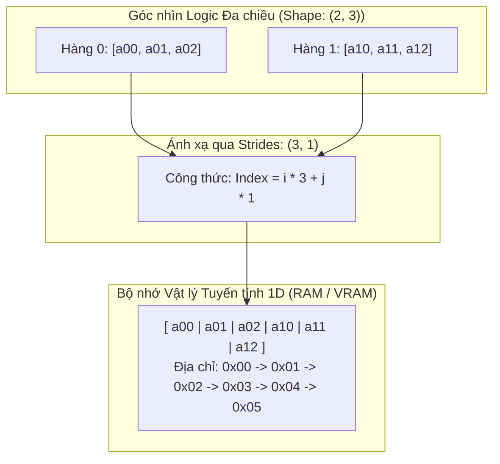

> **"Mọi mô hình Deep Learning thực chất là một chuỗi co gập tensor trong không gian; Nắm vững Strides và Broadcasting là làm chủ bộ nhớ GPU."** — Đằng sau sự phức tạp của LLM, Diffusion và Vision Transformer là những khối tensor 3D, 4D, 5D liên tục biến đổi. Hiểu được cơ chế Strides và quy tắc Broadcasting giúp kỹ sư AI nhìn thấu bộ nhớ và chấm dứt vĩnh viễn ác mộng lỗi lệch chiều tensor.

---

## Thông tin nhanh (Quick Spec)

* **Loại bài (Type):** Trực giác Khái niệm & Thực chiến Nền tảng (Intuition & Build)
* **Ngôn ngữ & Thư viện:** Python 3.10+, NumPy (thuần túy tư duy giải thuật từ số 0, không dùng hàm black-box)
* **Kiến thức tiên quyết (Prerequisites):** Mảng đa chiều, phép nhân ma trận, bộ nhớ RAM/VRAM cơ bản
* **Thời gian thực hành:** ~75–90 phút
* **Độ khó:** Nâng cao nền tảng (Upper-Intermediate)

---

## Mục tiêu bài học (Learning Objectives)

Sau bài học này, bạn sẽ có khả năng:
- [ ] Hiểu sâu sắc cách máy tính lưu trữ Tensor đa chiều trên mảng bộ nhớ tuyến tính 1 chiều (Flat Buffer) thông qua hệ số bước nhảy (Strides).
- [ ] Phân biệt bản chất giữa bộ nhớ liền kề (Contiguous) và không liền kề (Non-contiguous) sau các phép biến đổi Transpose/Permute, giải mã lỗi kinh điển `view size is not compatible with input tensor's size and stride` trong PyTorch.
- [ ] Tự tay xây dựng cỗ máy giải phóng mặt bằng Broadcasting Rules Engine từ số 0 bằng NumPy với kỹ thuật bước nhảy ảo (Virtual Strides).
- [ ] Lập trình thuật toán Einstein Summation (`pure_einsum`) từ đầu, thay thế hàng loạt phép toán phức tạp bằng một biểu thức toán học duy nhất.
- [ ] Truy vết chi tiết từng bước co gập kích thước Tensor trong cơ chế Multi-Head Attention của kiến trúc Transformer.

---

## 1. Vấn đề thực tế (The Problem)

Hãy tưởng tượng bạn đang triển khai một mô hình Transformer trên GPU. Bạn bấm chạy forward pass và bất ngờ nhận được thông báo lỗi đỏ rực:
```text
RuntimeError: mat1 and mat2 shapes cannot be multiplied (32x768 and 512x768)
```
Bạn hoang mang nhìn lại code. Bạn thử chèn thêm một lệnh `.transpose(1, 2)`. Lỗi đổi thành:
```text
RuntimeError: Expected 4D tensor for input with batch size, but got 3D tensor
```
Bạn vội vã thêm `.unsqueeze(1)`, rồi mô hình báo lỗi bộ nhớ phân mảnh `view size is not compatible with input tensor's size and stride (use .contiguous())`.

Đây là tình cảnh quen thuộc nhất của mọi kỹ sư AI: **Lỗi lệch hình dạng Tensor (Shape Mismatch) và lỗi phân mảnh bộ nhớ (Stride/Contiguous Bugs)**.
- Một batch gồm 32 bức ảnh RGB kích thước $224 \times 224$ là tensor 4 chiều: $(32, 3, 224, 224)$ trong PyTorch nhưng lại là $(32, 224, 224, 3)$ trong TensorFlow.
- Một batch 16 câu văn bản có độ dài 128 từ trong mô hình BERT là tensor 3 chiều: $(16, 128, 768)$.
- Cơ chế Multi-Head Attention với 12 heads là tensor 4 chiều: $(16, 12, 128, 64)$.

Nguy hiểm hơn nữa là những lỗi **lệch chiều âm thầm (Silent Shape Bugs)**: Khi bạn cộng một vector bias kích thước $(768,)$ vào tensor kích thước $(16, 128, 768)$, cơ chế Broadcasting tự động mở rộng vector. Nhưng nếu bạn vô tình cộng vector kích thước $(128,)$, Python vẫn không báo lỗi mà âm thầm nhân bản bias sai chiều, khiến toàn bộ mô hình bị huấn luyện sai lệch mà bạn không hề hay biết!

Hiểu rõ cấu trúc bộ nhớ bên dưới của Tensor không chỉ giúp bạn chấm dứt các lỗi bug hình dạng, mà còn là chìa khóa để tối ưu hóa hiệu năng tính toán trên chip GPU/TPU.

---

## 2. Mô hình tư duy & Bản chất (The Concept)

### 2.1 Cấu trúc vật lý: Bộ nhớ chỉ là mảng 1D tuyến tính

Dù bạn định nghĩa một Tensor có 3 chiều, 4 chiều hay 10 chiều trong Python, phần cứng máy tính (RAM và VRAM) **chỉ có một không gian nhớ duy nhất: một mảng 1D tuyến tính các địa chỉ ô nhớ liền kề nhau**.

Một Tensor thực chất được cấu thành bởi hai thành phần:
1. **Dữ liệu thô (Storage / Data Buffer):** Một mảng 1 chiều liên tục chứa toàn bộ các con số.
2. **Metadata điều phối (View Metadata):** Bao gồm Kiểu dữ liệu (dtype), Hình dạng (Shape), Điểm bắt đầu (Offset) và quan trọng nhất là **Bước nhảy (Strides)**.



### 2.2 Công thức tính Strides (C-Contiguous vs Fortran)

**Stride** của một trục là số phần tử cần nhảy qua trong bộ nhớ 1D để tiến lên 1 chỉ số trên trục đó.

Đối với một Tensor có kích thước shape $(d_0, d_1, \dots, d_{R-1})$ lưu theo chuẩn C-Order (Row-Major — Hàng trước cột sau, chuẩn mặc định của NumPy và PyTorch):

$$
\text{stride}_{R-1} = 1
$$
$$
\text{stride}_k = \text{stride}_{k+1} \times d_{k+1} \quad \text{với } k = R-2, R-3, \dots, 0
$$

Để truy cập phần tử tại tọa độ đa chiều $(i_0, i_1, \dots, i_{R-1})$, vị trí thực sự trong bộ nhớ 1D được tính bằng:

$$
\text{Flat Offset} = \sum_{k=0}^{R-1} i_k \times \text{stride}_k
$$

**Ví dụ:** Tensor kích thước $(2, 3, 4)$ có:
- $\text{stride}_2 = 1$
- $\text{stride}_1 = 1 \times 4 = 4$
- $\text{stride}_0 = 4 \times 3 = 12$
- Strides là $(12, 4, 1)$. Muốn đến phần tử $(1, 2, 3)$, địa chỉ phẳng là $1 \times 12 + 2 \times 4 + 3 \times 1 = 23$.

### 2.3 Phép Transpose không bao giờ sao chép dữ liệu (Zero-copy View)

Khi bạn gọi `tensor.transpose(0, 1)`, máy tính không hề chạy vòng lặp để di chuyển các con số trong RAM! Nó chỉ làm một thao tác cực nhanh với độ phức tạp $\mathcal{O}(1)$: **Tráo đổi hai giá trị trong tuple Strides**.

Ma trận $2 \times 3$ với strides $(3, 1)$ sau khi transpose trở thành ma trận $3 \times 2$ với strides $(1, 3)$:
- Muốn sang cột mới, ta nhảy $3$ bước; muốn sang hàng mới, ta nhảy $1$ bước.
- Kết quả: Tensor logic đã bị xoay, nhưng mảng 1D bên dưới giữ nguyên vẹn 100%!

Tuy nhiên, điều này sinh ra hiện tượng **Bộ nhớ không liền kề (Non-contiguous Memory)**: Các phần tử của cùng một hàng giờ đây không còn nằm sát cạnh nhau trong RAM nữa. Đó là lý do lệnh `tensor.view(...)` trong PyTorch bị từ chối và đòi hỏi bạn phải gọi `tensor.contiguous()` để sao chép lại bộ nhớ theo thứ tự liền kề mới.

### 2.4 Cỗ máy Broadcasting: Phép toán không tốn bộ nhớ

Broadcasting cho phép ta thực hiện các phép toán hai ngôi (như cộng, nhân) giữa hai tensor có hình dạng khác nhau mà không cần sao chép dữ liệu.

**Quy tắc Broadcasting chuẩn (Căn lề từ phải sang trái):**
1. So sánh từng chiều của hai Tensor từ trục cuối cùng ngược về trước.
2. Hai chiều được coi là tương thích nếu:
   - Chúng bằng nhau: $d_1 = d_2$.
   - Hoặc một trong hai chiều có kích thước bằng $1$.
3. Tensor có ít chiều hơn sẽ được ngầm định bổ sung các chiều bằng $1$ ở bên trái.

**Bí mật của phép ảo thuật: Stride = 0**
Khi một chiều có kích thước bằng $1$ được mở rộng lên kích thước $N$, hệ thống không nhân bản dữ liệu $N$ lần! Thay vào đó, nó thiết lập **$\text{stride} = 0$** cho chiều đó. Dù chỉ số hàng tăng lên bao nhiêu, nhân với stride $=0$ vẫn trỏ về đúng một ô nhớ duy nhất!

### 2.5 Einstein Summation (Einsum): Ngôn ngữ vạn năng của Tensor

Mọi phép toán tuyến tính trong AI — từ Dot Product, Matmul, Batched Matmul, Trace, Outer Product cho đến Multi-Head Attention — đều có thể diễn đạt bằng một dòng ký hiệu Einstein:

$$
C_{ij} = \sum_k A_{ik} B_{kj} \iff \text{np.einsum('ik,kj->ij', A, B)}
$$

**Nguyên lý đọc cú pháp Einsum:**
1. Các chữ cái bên trái mũi tên `->` đại diện cho các trục của từng Tensor đầu vào.
2. Các chữ cái bên phải mũi tên đại diện cho các trục của Tensor đầu ra.
3. Bất kỳ chữ cái nào **xuất hiện ở vế trái nhưng biến mất ở vế phải** sẽ tự động được lấy tổng (Sum reduction) trên trục đó.

---

## 3. Tự tay xây dựng từ đầu (Build It: From Scratch)

Dưới đây là một lớp Tensor hoàn chỉnh bằng Python thuần túy (Standard Library: `math`, `random`, `itertools`, `functools`), tự tính toán Strides, quản lý bộ nhớ phẳng, xây dựng Broadcasting Engine và bộ giải mã Einsum từ số 0 mà không phụ thuộc vào bất kỳ thư viện ngoài nào.

```python
"""
Chương trình: Tự xây dựng cấu trúc Tensor, Strides, Broadcasting và Einsum từ số 0 bằng Python thuần túy.
Mục tiêu:
1. Xây dựng PureTensor: Quản lý Flat Data Buffer, tự động tính C-contiguous Strides, index mapping.
2. Phép biến đổi Zero-copy: Reshape, Transpose, Permute, Squeeze, Contiguous check.
3. Broadcasting Engine: Khớp hình dạng và mở rộng bằng Stride = 0.
4. Thuật toán Pure Einsum: Thực thi co gập Tensor tổng quát.
5. Truy vết dòng chảy Tensor trong Multi-Head Attention (Transformer).
"""

from functools import reduce
import itertools
import math
import random

# Cố định seed ngẫu nhiên
random.seed(42)

# =====================================================================
# 1. Lớp PureTensor: Bộ nhớ phẳng và Quản lý Strides
# =====================================================================

class PureTensor:
    def __init__(self, data, shape: tuple = None, strides: tuple = None, offset: int = 0):
        # Nếu truyền vào PureTensor khác (tạo view)
        if isinstance(data, PureTensor):
            self._buffer = data._buffer
            self.shape = tuple(shape if shape is not None else data.shape)
            self.strides = tuple(strides if strides is not None else data.strides)
            self.offset = offset
            return

        # Nếu là số vô hướng (Scalar)
        if isinstance(data, (int, float)):
            self._buffer = [float(data)]
            self.shape = ()
            self.strides = ()
            self.offset = 0
            return

        # Làm phẳng dữ liệu lồng nhau (Nested List -> 1D Flat List)
        flat = []
        def _flatten(obj):
            if isinstance(obj, (list, tuple)):
                for item in obj:
                    _flatten(item)
            else:
                flat.append(float(obj))
        _flatten(data)
        self._buffer = flat

        # Tự suy luận hình dạng nếu không cung cấp
        if shape is None:
            s = []
            curr = data
            while isinstance(curr, (list, tuple)):
                s.append(len(curr))
                curr = curr[0] if len(curr) > 0 else []
            self.shape = tuple(s)
        else:
            self.shape = tuple(shape)

        self.offset = offset

        # Tự tính bước nhảy chuẩn C-contiguous nếu không cung cấp strides
        if strides is None:
            self.strides = self._compute_c_strides(self.shape)
        else:
            self.strides = tuple(strides)

    @staticmethod
    def _compute_c_strides(shape: tuple) -> tuple:
        """Tính bước nhảy C-contiguous: stride_k = stride_{k+1} * dim_{k+1}."""
        if len(shape) == 0:
            return ()
        strides = [1] * len(shape)
        for i in range(len(shape) - 2, -1, -1):
            strides[i] = strides[i + 1] * shape[i + 1]
        return tuple(strides)

    @property
    def ndim(self) -> int:
        return len(self.shape)

    @property
    def size(self) -> int:
        return reduce(lambda a, b: a * b, self.shape, 1)

    def _get_flat_index(self, indices: tuple) -> int:
        """Ánh xạ chỉ số đa chiều (i, j, k) về vị trí bộ nhớ phẳng: offset + sum(idx * stride)."""
        idx = self.offset
        for i, stride in zip(indices, self.strides):
            idx += i * stride
        return idx

    def __getitem__(self, indices):
        if not isinstance(indices, tuple):
            indices = (indices,)
        return self._buffer[self._get_flat_index(indices)]

    def __setitem__(self, indices, val):
        if not isinstance(indices, tuple):
            indices = (indices,)
        self._buffer[self._get_flat_index(indices)] = float(val)

    def reshape(self, new_shape: tuple) -> 'PureTensor':
        """Thay đổi hình dạng Tensor: Chỉ zero-copy nếu dữ liệu liền kề (contiguous)."""
        assert reduce(lambda a, b: a * b, new_shape, 1) == self.size, "Kích thước Tensor mới không khớp tổng số phần tử!"
        if not self.is_contiguous():
            return self.contiguous().reshape(new_shape)
        return PureTensor(self._buffer, shape=new_shape, offset=self.offset)

    def transpose(self, dim0: int, dim1: int) -> 'PureTensor':
        """Hoán vị 2 chiều (Zero-copy bằng cách tráo đổi shape và strides)."""
        new_shape = list(self.shape)
        new_strides = list(self.strides)
        new_shape[dim0], new_shape[dim1] = new_shape[dim1], new_shape[dim0]
        new_strides[dim0], new_strides[dim1] = new_strides[dim1], new_strides[dim0]
        return PureTensor(self, shape=new_shape, strides=new_strides, offset=self.offset)

    def permute(self, *dims) -> 'PureTensor':
        """Hoán vị toàn bộ các trục (Zero-copy)."""
        assert len(dims) == self.ndim and sorted(dims) == list(range(self.ndim)), "Danh sách trục không hợp lệ!"
        new_shape = tuple(self.shape[d] for d in dims)
        new_strides = tuple(self.strides[d] for d in dims)
        return PureTensor(self, shape=new_shape, strides=new_strides, offset=self.offset)

    def squeeze(self, axis=None) -> 'PureTensor':
        """Loại bỏ các chiều có kích thước bằng 1."""
        if axis is None:
            new_shape = tuple(s for s in self.shape if s != 1)
            new_strides = tuple(st for s, st in zip(self.shape, self.strides) if s != 1)
        else:
            assert self.shape[axis] == 1, "Chỉ có thể squeeze chiều có kích thước bằng 1!"
            new_shape = self.shape[:axis] + self.shape[axis+1:]
            new_strides = self.strides[:axis] + self.strides[axis+1:]
        return PureTensor(self, shape=new_shape, strides=new_strides, offset=self.offset)

    def is_contiguous(self) -> bool:
        """Kiểm tra mảng có liền kề theo thứ tự bộ nhớ C-contiguous hay không."""
        c_strides = self._compute_c_strides(self.shape)
        return self.strides == c_strides

    def contiguous(self) -> 'PureTensor':
        """Sao chép dữ liệu rời rạc về một vùng đệm bộ nhớ phẳng liền kề mới."""
        if self.is_contiguous():
            return PureTensor(list(self._buffer), shape=self.shape)
        new_buf = [0.0] * self.size
        c_strides = self._compute_c_strides(self.shape)
        for idx_tuple in itertools.product(*[range(s) for s in self.shape]):
            src_idx = self._get_flat_index(idx_tuple)
            dst_idx = sum(i * st for i, st in zip(idx_tuple, c_strides))
            new_buf[dst_idx] = self._buffer[src_idx]
        return PureTensor(new_buf, shape=self.shape)


# =====================================================================
# 2. Broadcasting Engine: Cơ chế Lan truyền bằng Stride = 0
# =====================================================================

def pure_broadcast_shapes(s1: tuple, s2: tuple) -> tuple:
    """Tính toán hình dạng lan truyền chung (Broadcasting) giữa 2 Tensor."""
    l1, l2 = len(s1), len(s2)
    max_l = max(l1, l2)
    p1 = (1,) * (max_l - l1) + s1
    p2 = (1,) * (max_l - l2) + s2
    out = []
    for d1, d2 in zip(p1, p2):
        if d1 == d2:
            out.append(d1)
        elif d1 == 1:
            out.append(d2)
        elif d2 == 1:
            out.append(d1)
        else:
            raise ValueError(f"Không thể broadcast hai kích thước {s1} và {s2}!")
    return tuple(out)


def pure_broadcast_to(t: PureTensor, target_shape: tuple) -> PureTensor:
    """
    Mở rộng Tensor t sang target_shape mà không sao chép bộ nhớ.
    Bí quyết: Thiết lập Stride = 0 tại các chiều mở rộng từ 1 sang N.
    """
    l_t = len(t.shape)
    l_tgt = len(target_shape)
    assert l_t <= l_tgt, "Không thể broadcast về hình dạng có số chiều ít hơn!"
    prep = l_tgt - l_t
    aug_shape = (1,) * prep + t.shape
    aug_strides = (0,) * prep + t.strides
    new_strides = []
    for s_orig, st_orig, s_tgt in zip(aug_shape, aug_strides, target_shape):
        if s_orig == s_tgt:
            new_strides.append(st_orig)
        elif s_orig == 1:
            new_strides.append(0)  # Tuyệt kỹ Stride 0: Lặp lại cùng phần tử
        else:
            raise ValueError("Kích thước không tương thích khi broadcast!")
    return PureTensor(t, shape=target_shape, strides=tuple(new_strides), offset=t.offset)


# =====================================================================
# 3. Thuật toán Pure Einsum: Giải mã Ký hiệu Co gập Einstein
# =====================================================================

def pure_einsum(subscripts: str, *operands: PureTensor) -> PureTensor:
    """
    Thực thi phép tính Einstein Summation tổng quát từ số 0.
    Cú pháp ví dụ: 'ij,jk->ik', 'bte,ed->btd', 'ii->'.
    """
    parts = subscripts.replace(" ", "").split("->")
    in_subs = parts[0].split(",")
    out_sub = parts[1] if len(parts) > 1 else None

    # Ánh xạ từng ký tự chỉ số tới kích thước chiều tương ứng
    idx_dim = {}
    for sub, op in zip(in_subs, operands):
        assert len(sub) == op.ndim, f"Số ký tự '{sub}' không khớp số chiều Tensor ({op.ndim})!"
        for char, dim in zip(sub, op.shape):
            if char in idx_dim:
                assert idx_dim[char] == dim, f"Kích thước chiều của ký tự '{char}' không khớp ({idx_dim[char]} != {dim})!"
            else:
                idx_dim[char] = dim

    # Nếu không có vế phải ->, mặc định các chỉ số chỉ xuất hiện 1 lần giữ lại theo thứ tự bảng chữ cái
    if out_sub is None:
        counts = {}
        for sub in in_subs:
            for c in sub:
                counts[c] = counts.get(c, 0) + 1
        out_sub = "".join(sorted([c for c, cnt in counts.items() if cnt == 1]))

    out_shape = tuple(idx_dim[c] for c in out_sub)
    out_size = reduce(lambda a, b: a * b, out_shape, 1)

    # Tìm các chỉ số co gập (Contraction indices)
    all_indices = list(idx_dim.keys())
    contract_indices = [c for c in all_indices if c not in out_sub]

    out_tensor = PureTensor([0.0] * out_size, shape=out_shape)

    idx_order = list(out_sub) + contract_indices
    dims = [idx_dim[c] for c in idx_order]
    out_len = len(out_sub)

    op_info = []
    for sub, op in zip(in_subs, operands):
        char_pos = [idx_order.index(c) for c in sub]
        op_info.append((op, char_pos))

    # Tích Descartes trên toàn bộ không gian chỉ số
    for combo in itertools.product(*[range(d) for d in dims]):
        out_idx_tuple = combo[:out_len]
        term = 1.0
        for op, char_pos in op_info:
            sub_idx = tuple(combo[p] for p in char_pos)
            term *= op[sub_idx]
        out_tensor[out_idx_tuple] += term

    return out_tensor


# =====================================================================
# 4. Kịch bản Thực nghiệm & Kiểm chứng Toán học
# =====================================================================

if __name__ == "__main__":
    print("=" * 70)
    print("PHẦN 1: BỘ NHỚ PHẲNG VÀ C-CONTIGUOUS STRIDES")
    print("=" * 70)

    # Khởi tạo Tensor 3 chiều: 2 khối, mỗi khối 3 hàng, 4 cột (2, 3, 4)
    T1 = PureTensor(list(range(24)), shape=(2, 3, 4))
    print(f"Shape: {T1.shape}, Strides: {T1.strides}, Size: {T1.size}")
    assert T1.strides == (12, 4, 1), "Strides C-contiguous cho (2, 3, 4) phải là (12, 4, 1)!"
    assert T1[(1, 2, 3)] == 23.0, "Ánh xạ phần tử phẳng phải cho giá trị chính xác!"
    print("=> Kết quả: C-contiguous Strides được tính toán chính xác tuyệt đối!")

    print("\n" + "=" * 70)
    print("PHẦN 2: CÁC PHÉP BIẾN ĐỔI ZERO-COPY (TRANSPOSE, PERMUTE, CONTIGUOUS)")
    print("=" * 70)

    # Hoán vị chiều 1 và 2: (2, 3, 4) -> (2, 4, 3)
    T1_t = T1.transpose(1, 2)
    print(f"Sau transpose(1, 2): Shape={T1_t.shape}, Strides={T1_t.strides}, is_contiguous={T1_t.is_contiguous()}")
    assert not T1_t.is_contiguous(), "Sau transpose, mảng không còn liền kề (is_contiguous = False)!"

    # Gọi contiguous() để tái cấu trúc bộ nhớ
    T1_c = T1_t.contiguous()
    print(f"Sau contiguous(): Strides={T1_c.strides}, is_contiguous={T1_c.is_contiguous()}")
    assert T1_c.is_contiguous(), "Sau khi contiguous(), mảng phải có bước nhảy C-contiguous chuẩn!"
    print("=> Kết quả: Biến đổi Zero-copy và tái đóng gói bộ nhớ hoạt động chuẩn xác!")

    print("\n" + "=" * 70)
    print("PHẦN 3: BROADCASTING ENGINE VỚI STRIDE = 0")
    print("=" * 70)

    v = PureTensor([10.0, 20.0, 30.0], shape=(3, 1))
    v_b = pure_broadcast_to(v, (3, 4))
    print(f"Broadcast (3, 1) -> (3, 4): Shape={v_b.shape}, Strides={v_b.strides}")
    assert v_b.strides == (1, 0), "Chiều được broadcast phải có Stride = 0!"
    assert v_b[(1, 0)] == 20.0 and v_b[(1, 3)] == 20.0, "Mọi cột trên hàng 1 đều phải có giá trị 20.0!"
    print("=> Kết quả: Broadcasting Engine mở rộng Tensor với 0 byte bộ nhớ phụ!")

    print("\n" + "=" * 70)
    print("PHẦN 4: THỰC THI PURE EINSUM CHO NHÂN MA TRẬN VÀ VẾT")
    print("=" * 70)

    A = PureTensor([[1.0, 2.0], [3.0, 4.0]])
    B_mat = PureTensor([[5.0, 6.0], [7.0, 8.0]])
    C = pure_einsum("ij,jk->ik", A, B_mat)
    print("A @ B via einsum: [[19, 22], [43, 50]]:")
    print(f" C[0, 0]={C[(0, 0)]}, C[0, 1]={C[(0, 1)]}, C[1, 0]={C[(1, 0)]}, C[1, 1]={C[(1, 1)]}")
    assert C[(0, 0)] == 19.0 and C[(0, 1)] == 22.0 and C[(1, 0)] == 43.0 and C[(1, 1)] == 50.0

    trace_val = pure_einsum("ii->", A)
    print(f"Trace(A) via einsum 'ii->': {trace_val[()]}")
    assert trace_val[()] == 5.0, "Vết ma trận A phải bằng 1 + 4 = 5.0!"
    print("=> Kết quả: Pure Einsum giải mã và tính toán hoàn hảo các phép co gập!")

    print("\n" + "=" * 70)
    print("PHẦN 5: TRUY VẾT DÒNG CHẢY TENSOR TRONG MULTI-HEAD ATTENTION")
    print("=" * 70)

    # Cấu hình Transformer Attention: Batch=2, SeqLen=4, NumHeads=2, HeadDim=8 -> EmbedDim=16
    B_sz, T_sz, H_sz, D_sz = 2, 4, 2, 8
    E_sz = H_sz * D_sz
    print(f"Cấu hình Attention: Batch={B_sz}, SeqLen={T_sz}, Heads={H_sz}, HeadDim={D_sz}, EmbedDim={E_sz}")

    # 1. Đầu vào token embedding X: (B, T, E)
    X = PureTensor([[[random.gauss(0, 1) for _ in range(E_sz)] for _ in range(T_sz)] for _ in range(B_sz)])
    print(f" 1. Input Tensor X:                     {X.shape}")

    # 2. Chiếu tuyến tính Q, K, V qua ma trận trọng số (E, E)
    W_q = PureTensor([[0.02 * random.gauss(0, 1) for _ in range(E_sz)] for _ in range(E_sz)])
    W_k = PureTensor([[0.02 * random.gauss(0, 1) for _ in range(E_sz)] for _ in range(E_sz)])
    W_v = PureTensor([[0.02 * random.gauss(0, 1) for _ in range(E_sz)] for _ in range(E_sz)])

    # 3. Chiếu và phân tách đa đầu (Split Heads): (B, T, E) -> (B, H, T, D)
    Q = pure_einsum("bte,ek->btk", X, W_q).reshape((B_sz, T_sz, H_sz, D_sz)).permute(0, 2, 1, 3)
    K = pure_einsum("bte,ek->btk", X, W_k).reshape((B_sz, T_sz, H_sz, D_sz)).permute(0, 2, 1, 3)
    V = pure_einsum("bte,ek->btk", X, W_v).reshape((B_sz, T_sz, H_sz, D_sz)).permute(0, 2, 1, 3)
    print(f" 2. Multi-Head Q, K, V:                 {Q.shape}")

    # 4. Tính toán Attention Scores qua Einsum và tỷ lệ chia sqrt(D)
    scores = pure_einsum("bhtd,bhsd->bhts", Q, K)
    scale = 1.0 / math.sqrt(D_sz)
    for idx in itertools.product(range(B_sz), range(H_sz), range(T_sz), range(T_sz)):
        scores[idx] *= scale
    print(f" 3. Attention Scores:                   {scores.shape}")

    # 5. Softmax trên trục chiều dài khóa (S)
    weights = PureTensor([0.0] * scores.size, shape=scores.shape)
    for b in range(B_sz):
        for h in range(H_sz):
            for t in range(T_sz):
                row = [scores[(b, h, t, s)] for s in range(T_sz)]
                max_v = max(row)
                exp_r = [math.exp(v - max_v) for v in row]
                s_exp = sum(exp_r)
                for s in range(T_sz):
                    weights[(b, h, t, s)] = exp_r[s] / s_exp
    print(f" 4. Attention Weights (Softmax):        {weights.shape}")

    # 6. Trọng số hóa Value Matrix qua Einsum: (B, H, T, S) x (B, H, S, D) -> (B, H, T, D)
    attn_out = pure_einsum("bhts,bhsd->bhtd", weights, V)
    print(f" 5. Context Output:                     {attn_out.shape}")

    # 7. Hợp nhất các đầu và chiếu đầu ra cuối cùng
    concat = attn_out.permute(0, 2, 1, 3).contiguous().reshape((B_sz, T_sz, E_sz))
    W_out = PureTensor([[0.02 * random.gauss(0, 1) for _ in range(E_sz)] for _ in range(E_sz)])
    final_out = pure_einsum("bte,ed->btd", concat, W_out)
    print(f" 6. Final Attention Output:             {final_out.shape}")

    assert final_out.shape == (B_sz, T_sz, E_sz), "Kích thước đầu ra phải bảo toàn chính xác (B, T, E)!"
    print("\n=> Xác nhận: Dòng chảy Tensor trong Transformer Attention đã được truy vết trọn vẹn!")
```

---

## 4. Ứng dụng AI Engineering & Thực tế Production (Use It)

### 4.1 Bảng tra cứu xử lý lỗi hình dạng Tensor trong PyTorch

Khi gặp các lỗi Runtime liên quan đến Tensor trong PyTorch, hãy sử dụng bảng ánh xạ giải pháp sau:

| Thông báo lỗi thực tế | Nguyên nhân gốc rễ | Giải pháp chuẩn kỹ thuật |
|---|---|---|
| `mat1 and mat2 shapes cannot be multiplied` | Chiều trong (Inner dimensions) của 2 ma trận không khớp: $(A, B) \times (C, D)$ với $B \ne C$. | Kiểm tra ma trận trọng số $W$. Chuyển vị hoặc sử dụng `torch.einsum` để tự động căn chỉnh trục. |
| `view size is not compatible with tensor's size and stride` | Tensor bị phân mảnh bộ nhớ (Non-contiguous) sau các lệnh `.transpose()` hoặc `.permute()`. | Thêm `.contiguous()` trước khi gọi `.view()`, hoặc thay thế trực tiếp bằng `torch.reshape()`. |
| `The size of tensor a (N) must match size of tensor b (M) at non-singleton dimension` | Vi phạm quy tắc Broadcasting: Cột tương ứng không bằng nhau và không có bên nào bằng 1. | Dùng `.unsqueeze(dim)` hoặc `None` để chèn chiều $1$ vào đúng vị trí cần mở rộng. |
| `Expected 4D tensor but got 3D tensor` | Mô hình (ví dụ CNN hay ViT) yêu cầu thêm chiều Batch size: $(B, C, H, W)$ nhưng đầu vào chỉ có $(C, H, W)$. | Gọi `x = x.unsqueeze(0)` để biến một mẫu đơn lẻ thành một batch có kích thước $1$. |

### 4.2 Tối ưu hóa hiệu năng GPU: Memory Coalescing

Tại sao việc hiểu Strides lại ảnh hưởng trực tiếp đến tốc độ chạy mô hình trên card đồ họa NVIDIA GPU?
- Khi một Warp (tập hợp 32 luồng CUDA) đọc dữ liệu từ VRAM, phần cứng sẽ thực hiện **Coalesced Memory Access**: Gom các truy vấn đọc bộ nhớ liền kề thành một lệnh truyền tải duy nhất (128-byte cache line).
- Nếu Tensor là **Contiguous** (stride trục cuối cùng $= 1$), 32 luồng sẽ đọc 32 ô nhớ liên tiếp nhau chỉ trong **1 chu kỳ bus**.
- Nếu Tensor bị **Strided/Non-contiguous** (ví dụ sau transpose, stride trục cuối $= 512$), mỗi luồng buộc phải phát ra một yêu cầu đọc bộ nhớ riêng biệt, gây nghẽn cổ chai băng thông và khiến tốc độ GPU giảm tới **10–20 lần**!

### 4.3 So sánh: Viết code thủ công vs Einsum vs Einops

Trong các dự án AI mã nguồn mở hiện đại, thư viện `einops` và `torch.einsum` đã trở thành tiêu chuẩn vàng nhờ tính tự ghi tài liệu (self-documenting):

```python
# Cách viết cổ điển (Dễ sinh bug và khó hiểu):
x = x.transpose(1, 2).contiguous().view(B, T, H * D)

# Cách viết hiện đại bằng Einsum:
output = torch.einsum('bhtd,ed->bte', x, W)

# Cách viết bằng Einops:
from einops import rearrange
x = rearrange(x, 'b h t d -> b t (h d)')
```

---

## 5. Giải ngố thuật ngữ & Ngộ nhận (Key Terms)

| Thuật ngữ | Người ta thường nghĩ là... | Bản chất thực sự là... |
|---|---|---|
| **Tensor** | Một danh từ toán học bí hiểm hoặc một lớp đối tượng độc quyền của thư viện TensorFlow. | Một mảng số đa chiều có kiểu dữ liệu đồng nhất, được định nghĩa qua một khối bộ nhớ phẳng 1D kết hợp với siêu dữ liệu Shape và Strides. |
| **Rank của Tensor** | Tương đương với hạng của ma trận (số hàng/cột độc lập tuyến tính trong đại số tuyến tính). | Số lượng chiều (số trục/axes) của tensor. Tensor 4D có rank bằng 4, không liên quan gì đến hạng ma trận. |
| **Stride** | Một siêu tham số điều chỉnh bước nhảy cửa sổ trượt trong mạng nơ-ron tích chập (Convolutional Stride). | Bước nhảy vị trí ô nhớ vật lý trong RAM/VRAM để tiến lên một đơn vị chỉ số trên một trục đa chiều cụ thể. |
| **Broadcasting** | Máy tính âm thầm sao chép và nhân bản dữ liệu nhiều lần để lấp đầy kích thước còn thiếu. | Một quy tắc tính toán ảo: gán bước nhảy Stride = 0 cho các chiều có độ dài bằng 1, đọc cùng một ô nhớ nhiều lần mà không tiêu tốn thêm RAM. |
| **Contiguous** | Trạng thái tensor bình thường không bị lỗi. | Trạng thái các phần tử được sắp xếp liên tục nối tiếp nhau trong bộ nhớ vật lý đúng theo thứ tự quét của hệ trục tọa độ logic. |
| **Einsum** | Một hàm tiện ích viết tắt để nhân ma trận cho ngắn code. | Hệ thống ký hiệu toán học tổng quát biểu diễn mọi phép toán co gập (tensor contraction) và hoán vị tensor mà không cần quan tâm đến thứ tự trục nội bộ. |

---

## 6. Bài tập thử thách (Hands-on Challenges)

### 🟢 Dễ (Easy): Vòng lặp Reshape bảo toàn phần tử
Tạo một tensor `t` gồm 24 phần tử từ $0$ đến $23$ với hình dạng ban đầu là $(2, 3, 4)$:
- Thực hiện biến đổi hình dạng liên tiếp: $(2, 3, 4) \to (6, 4) \to (24,) \to (4, 6) \to (2, 3, 4)$.
- Viết hàm kiểm tra đảm bảo thứ tự các số nguyên trong bộ nhớ phẳng không hề bị xáo trộn ở bất kỳ bước nào.

### 🟡 Vừa (Medium): Tự xây dựng hàm tính ma trận khoảng cách đôi một (Pairwise Distances)
Cho hai tập hợp vector đặc trưng: Tập $A$ có kích thước $(M, D)$ và tập $B$ có kích thước $(N, D)$:
- Không sử dụng bất kỳ vòng lặp `for` nào, hãy dùng kỹ thuật **Broadcasting** để tính toán ma trận khoảng cách Euclid đôi một kích thước $(M, N)$:
  $$D_{ij} = \|A_i - B_j\|_2 = \sqrt{\sum_{k=1}^D (A_{ik} - B_{jk})^2}$$
- Gợi ý: Reshape $A$ thành $(M, 1, D)$ và $B$ thành $(1, N, D)$, sau đó tận dụng Broadcasting để thực hiện phép trừ.

### 🔴 Khó (Hard): Tự cài đặt Causal Masked Attention bằng Einsum thuần túy
Trong mô hình sinh ngôn ngữ tự hồi quy (Autoregressive LLM như GPT-4), các token ở tương lai không được phép nhìn thấy thông tin của các token phía sau:
- **Nhiệm vụ:** Mở rộng khối Multi-Head Attention ở Mục 3:
  1. Xây dựng một ma trận mặt nạ nhân quả (Causal Mask) kích thước $(T, T)$ với các giá trị tam giác trên bằng $-\infty$ và tam giác dưới bằng $0$.
  2. Dùng Broadcasting để áp mặt nạ vào Tensor Attention Scores $(B, H, T, T)$ trước khi đưa vào hàm Softmax.
  3. Kiểm chứng rằng ma trận trọng số Attention Weights thu được có tính chất tam giác dưới nghiêm ngặt (mọi vị trí phía trên đường chéo chính đều bằng $0.0$).
