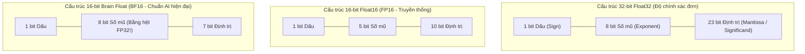
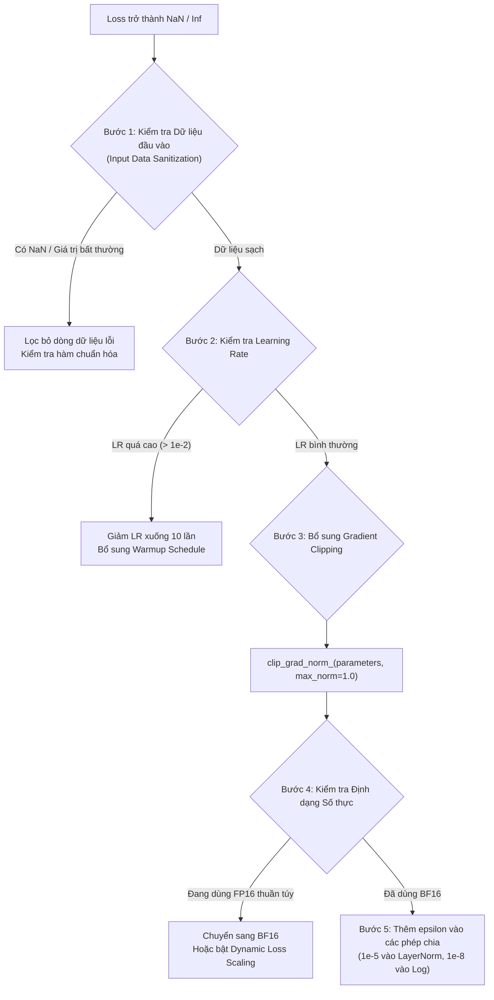

> **"Số thực dấu phẩy động là một sự trừu tượng hóa rò rỉ; Nó sẽ cắn xé mô hình của bạn giữa quá trình huấn luyện nếu bạn không thấu hiểu số học."** — Toán học lý thuyết vận hành trên tập số thực vô hạn và liên tục. Nhưng trong chip silicon, toán học phải nén mình vào 16 bit hoặc 32 bit nhị phân hữu hạn. Thấu hiểu độ ổn định số học là lằn ranh phân biệt giữa một kỹ sư AI thực thụ và một người chỉ biết gọi thư viện trong tuyệt vọng khi gặp lỗi NaN.

---

## Thông tin nhanh (Quick Spec)

* **Loại bài (Type):** Trực giác Khái niệm & Thực chiến Nền tảng (Intuition & Build)
* **Ngôn ngữ & Thư viện:** Python 3.10+, NumPy (thuần túy tư duy giải thuật từ số 0, không dùng hàm black-box)
* **Kiến thức tiên quyết (Prerequisites):** Đạo hàm và Gradient, hàm mũ và logarithm, cấu trúc mạng nơ-ron cơ bản
* **Thời gian thực hành:** ~75–90 phút
* **Độ khó:** Nâng cao nền tảng (Upper-Intermediate)

---

## Mục tiêu bài học (Learning Objectives)

Sau bài học này, bạn sẽ có khả năng:
- [ ] Thấu hiểu cấu trúc biểu diễn số thực IEEE 754 (bit dấu, số mũ exponent, phần định trị mantissa) và nguyên nhân máy tính tính toán $0.1 + 0.2 \ne 0.3$.
- [ ] Nhận diện và phòng chống ba hiểm họa số học kinh điển: Tràn số (Overflow), Cạn số (Underflow) và Triệt tiêu thảm khốc (Catastrophic Cancellation).
- [ ] Tự tay chứng minh toán học và lập trình véc-tơ hóa kỹ thuật LogSumExp và Stable Softmax từ đầu bằng NumPy.
- [ ] Xây dựng tầng LayerNorm từ số 0, hiểu rõ vai trò sống còn của hằng số $\epsilon$ trong việc chống sụp đổ độ lệch chuẩn.
- [ ] Cài đặt thuật toán kiểm tra đạo hàm số học (Numerical Gradient Checking) bằng sai phân trung tâm (Centered Finite Difference) với độ chính xác $\mathcal{O}(h^2)$.

---

## 1. Vấn đề thực tế (The Problem)

Kịch bản ác mộng phổ biến nhất của các kỹ sư huấn luyện mô hình học sâu:
1. Bạn cắm một tác vụ huấn luyện LLM hoặc mô hình sinh ảnh chạy qua đêm trên cụm GPU tốn kém hàng ngàn đô la.
2. Vào step thứ 9,000, giá trị hàm mất mát (Loss) vẫn đang giảm đều đặn từ $2.4$ xuống $1.1$.
3. Đúng step thứ 9,001, một đột biến nhỏ trong dữ liệu đẩy logits lên $105.0$. Hàm $\exp(105)$ tràn giới hạn bộ nhớ Float32, sinh ra giá trị `inf`.
4. Tại step thứ 9,002, giá trị `inf` tham gia vào phép tính đạo hàm, sinh ra `inf - inf = nan`.
5. Từ thời điểm đó, **mọi tham số trọng số của toàn bộ mạng nơ-ron bị lây nhiễm giá trị `nan` vĩnh viễn**, hủy hoại hoàn toàn checkpoint và công sức huấn luyện!

Hoặc một kịch bản tinh vi hơn:
- Bạn huấn luyện một mô hình bằng định dạng nửa độ chính xác Float16 (FP16) để tăng tốc độ gấp 3 lần.
- Mô hình chạy xong không báo bất kỳ lỗi nào, nhưng độ chính xác (Accuracy) lại thấp hơn bài báo gốc tới $4\%$.
- Lý do: Các gradient của các tầng đầu tiên có độ lớn khoảng $10^{-8}$. Định dạng Float16 chỉ biểu diễn được số dương nhỏ nhất là $\approx 6 \times 10^{-8}$. Hàng triệu bước cập nhật gradient bị **cạn số (Underflow) về số 0 tròn trĩnh**, khiến các tầng sâu của mạng hoàn toàn không học được gì!

Những thảm họa này không xuất phát từ lỗi kiến trúc mô hình, mà sinh ra từ **sự hạn chế cơ bản của phần cứng khi xấp xỉ số thực**. Làm chủ độ ổn định số học là điều kiện tiên quyết để xây dựng hệ thống AI quy mô lớn hoạt động bền bỉ và chính xác.

---

## 2. Mô hình tư duy & Bản chất (The Concept)

### 2.1 Chuẩn IEEE 754: Cách máy tính lưu trữ số thực

Không giống như số nguyên có thể biểu diễn chính xác tuyệt đối, máy tính biểu diễn số thực theo dạng ký hiệu khoa học nhị phân tuân thủ chuẩn quốc tế **IEEE 754**:

$$
\text{Value} = (-1)^{\text{sign}} \times 2^{\text{exponent} - \text{bias}} \times (1.\text{mantissa})_2
$$



**Bảng so sánh các định dạng số thực trong AI:**

| Định dạng | Tổng số bit | Bit Exponent (Phạm vi) | Bit Mantissa (Độ chính xác) | Số chữ số thập phân tin cậy | Giá trị dương lớn nhất | Giá trị dương nhỏ nhất |
|---|---|---|---|---|---|---|
| **Float64 (FP64)** | 64 | 11 | 52 | ~15–17 | $\approx 1.8 \times 10^{308}$ | $\approx 2.2 \times 10^{-308}$ |
| **Float32 (FP32)** | 32 | 8 | 23 | ~7–8 | $\approx 3.4 \times 10^{38}$ | $\approx 1.2 \times 10^{-38}$ |
| **Float16 (FP16)** | 16 | 5 | 10 | ~3–4 | **65,504** | $\approx 6.0 \times 10^{-8}$ |
| **BFloat16 (BF16)** | 16 | **8** | 7 | ~2–3 | $\approx 3.4 \times 10^{38}$ | $\approx 1.2 \times 10^{-38}$ |

**Tại sao BFloat16 thống trị huấn luyện Deep Learning?**
- Trong huấn luyện mạng nơ-ron, **phạm vi dải động (Dynamic Range)** quan trọng hơn nhiều so với độ chính xác chi tiết.
- FP16 chỉ chịu được tối đa $65,504$. Bất kỳ logit hay activation nào vượt qua con số này đều lập tức bùng nổ thành `inf`.
- BF16 giữ nguyên 8 bit số mũ của FP32, mang lại dải động khổng lồ lên tới $10^{38}$, loại bỏ hoàn toàn hiện tượng tràn số mà chỉ tốn một nửa dung lượng bộ nhớ so với FP32!

### 2.2 Hiện tượng Triệt tiêu thảm khốc (Catastrophic Cancellation)

Khi thực hiện phép trừ giữa hai số thực rất lớn nhưng gần bằng nhau, các chữ số có nghĩa quan trọng nhất ở hàng đầu sẽ triệt tiêu lẫn nhau, để lại phần dư phía sau thuần túy là **nhiễu làm tròn số học**:

$$
\begin{aligned}
x &= 1.000000119 \quad (\text{Lưu trong Float32}) \\
y &= 1.000000000 \\
x - y &= 0.000000119 \quad (\text{Sai số tương đối lên tới } 19.2\%!)
\end{aligned}
$$

Trong AI, hiện tượng này thường xuyên xảy ra khi:
- Tính phương sai mẫu bằng công thức ngây thơ: $\text{Var}(X) = \mathbb{E}[X^2] - (\mathbb{E}[X])^2$ khi giá trị trung bình $\mathbb{E}[X]$ rất lớn.
- Tính hiệu giữa các xác suất log gần nhau: $\log P(A) - \log P(B)$.
- Tính đạo hàm sai phân với bước nhảy $h$ quá nhỏ.

### 2.3 Bí thuật LogSumExp: Chứng minh toán học

Trong các bài toán phân loại đa lớp (Multi-class Classification) và mô hình ngôn ngữ, ta liên tục phải tính biểu thức:

$$
y = \log \sum_{i=1}^N \exp(x_i)
$$

Nếu tính toán ngây thơ, khi bất kỳ giá trị nào $x_i > 88.7$, hàm $\exp(x_i)$ sẽ vượt qua trần $3.4 \times 10^{38}$ của Float32 và trở thành `inf`. Ngược lại, nếu mọi $x_i < -87.3$, toàn bộ $\exp(x_i)$ rơi về $0.0$, và $\log(0)$ sẽ là `-inf`.

**Chứng minh toán học kỹ thuật dịch chuyển hằng số (LogSumExp Trick):**

Đặt $c = \max_i(x_i)$. Ta cộng và trừ $c$ vào số mũ:

$$
\begin{aligned}
\log \left( \sum_{i=1}^N \exp(x_i) \right) &= \log \left( \sum_{i=1}^N \exp(x_i - c + c) \right) \\
&= \log \left( \sum_{i=1}^N \exp(x_i - c) \cdot \exp(c) \right) \\
&= \log \left( \exp(c) \cdot \sum_{i=1}^N \exp(x_i - c) \right) \\
&= \log(\exp(c)) + \log \left( \sum_{i=1}^N \exp(x_i - c) \right) \\
&= c + \log \left( \sum_{i=1}^N \exp(x_i - c) \right)
\end{aligned}
$$

**Tại sao công thức này an toàn tuyệt đối?**
1. Phần tử lớn nhất trong tổng trở thành: $\exp(c - c) = \exp(0) = 1.0$.
2. Mọi phần tử còn lại đều thỏa mãn $x_i - c \le 0 \implies \exp(x_i - c) \in (0, 1]$. Không có bất kỳ số mũ dương nào $\implies$ **Không thể xảy ra Overflow!**
3. Tổng luôn lớn hơn hoặc bằng $1.0$ (vì luôn có ít nhất một số hạng bằng $1.0$) $\implies$ $\log(\text{tổng}) \ge 0 \implies$ **Không thể xảy ra Underflow về $-\infty$!**

### 2.4 Stable Softmax và Cross-Entropy

Áp dụng trực tiếp bí thuật trừ giá trị cực đại vào hàm Softmax:

$$
\text{Softmax}(x_i) = \frac{\exp(x_i)}{\sum_j \exp(x_j)} = \frac{\exp(x_i - c)}{\sum_j \exp(x_j - c)} \quad \text{với } c = \max_k(x_k)
$$

Đối với hàm mất mát Cross-Entropy giữa nhãn đúng $y$ và vector logits $x$:

$$
\mathcal{L} = -\log \text{Softmax}(x_y) = -\left( x_y - \log \sum_j \exp(x_j) \right) = \text{LogSumExp}(x) - x_y
$$

Nhờ biểu diễn trực tiếp qua LogSumExp, ta không bao giờ cần tính hàm Softmax trung gian rồi mới lấy logarithm, triệt tiêu hoàn toàn nguy cơ số học.

### 2.5 Kiểm tra đạo hàm số học (Numerical Gradient Checking)

Để đảm bảo việc cài đặt thuật toán lan truyền ngược (Backward pass) không bị sai dấu hoặc sai hệ số, ta so sánh đạo hàm giải tích (Analytical Gradient) với đạo hàm số học tính bằng **công thức sai phân trung tâm (Centered Finite Difference)**:

$$
\frac{\partial f}{\partial x_i} \approx \frac{f(x + h \cdot e_i) - f(x - h \cdot e_i)}{2h}
$$

Công thức sai phân trung tâm có bậc chính xác $\mathcal{O}(h^2)$, vượt trội hơn hẳn sai phân tiến $\frac{f(x+h) - f(x)}{h}$ vốn chỉ đạt $\mathcal{O}(h)$. Sai số tương đối chuẩn được tính bằng:

$$
\text{Relative Error} = \frac{\|g_{\text{analytical}} - g_{\text{numerical}}\|_2}{\max(\|g_{\text{analytical}}\|_2, \|g_{\text{numerical}}\|_2, 10^{-8})}
$$

---

## 3. Tự tay xây dựng từ đầu (Build It: From Scratch)

Toàn bộ mã nguồn dưới đây được lập trình bằng Python thuần túy (Standard Library: `math`, `random`), tự động xác minh từng khía cạnh số học từ trôi số, machine epsilon, stable softmax, cross-entropy loss, LayerNorm cho tới kiểm tra đạo hàm giải tích bằng sai phân số học mà không phụ thuộc vào bất kỳ thư viện ngoài nào.

```python
"""
Chương trình: Tự xây dựng LogSumExp, Stable Softmax, LayerNorm và Gradient Checker bằng Python thuần túy.
Nhiệm vụ:
1. Thực nghiệm sai số IEEE 754 và tìm Machine Epsilon từ số 0.
2. Cài đặt và đối đầu Naive vs Stable LogSumExp / Softmax trên Logits cực lớn.
3. Xây dựng hàm mất mát Cross-Entropy Loss ổn định số học hỗ trợ Mini-batch.
4. Xây dựng lớp LayerNorm hoàn chỉnh với forward và backward giải tích.
5. Lập trình bộ kiểm tra đạo hàm số học (Numerical Gradient Checker) chuẩn xác.
"""

import math
import random

# Cố định seed ngẫu nhiên
random.seed(42)

# =====================================================================
# 1. Tìm Machine Epsilon và Khảo sát Sai số IEEE 754
# =====================================================================

def find_machine_epsilon() -> float:
    """Tìm số epsilon nhỏ nhất sao cho 1.0 + eps != 1.0 trong chuẩn IEEE 754 (Double Precision)."""
    eps = 1.0
    while 1.0 + (eps / 2.0) != 1.0:
        eps /= 2.0
    return eps


# =====================================================================
# 2. Naive vs Stable LogSumExp và Softmax
# =====================================================================

def logsumexp_naive(x: list[float]) -> float:
    """Phiên bản ngây thơ: Bị tràn số OverflowError khi giá trị x vượt quá giới hạn exp (x > 709)."""
    return math.log(sum(math.exp(v) for v in x))


def logsumexp_stable(x: list[float]) -> float:
    """Bí thuật LogSumExp: c = max(x), trả về c + log(sum(exp(x - c)))."""
    c = max(x)
    return c + math.log(sum(math.exp(v - c) for v in x))


def softmax_stable(logits: list[float]) -> list[float]:
    """Hàm Softmax ổn định số học: Trừ max(logits) trước khi lũy thừa để triệt tiêu tràn số."""
    c = max(logits)
    exp_shifted = [math.exp(v - c) for v in logits]
    sum_exp = sum(exp_shifted)
    return [v / sum_exp for v in exp_shifted]


# =====================================================================
# 3. Hàm Mất Mát Cross-Entropy Loss Ổn Định Số Học
# =====================================================================

def stable_cross_entropy_loss(batch_logits: list[list[float]], labels: list[int]) -> float:
    """
    Tính Cross-Entropy Loss ổn định: Loss_i = -logits[y] + logsumexp(logits).
    Triệt tiêu hoàn toàn bước trung gian Softmax để tránh underflow về 0.
    """
    total_loss = 0.0
    B = len(batch_logits)
    for i in range(B):
        logits = batch_logits[i]
        y = labels[i]
        lse = logsumexp_stable(logits)
        total_loss += (-logits[y] + lse)
    return total_loss / B


# =====================================================================
# 4. Lớp PureLayerNorm Hoàn Chỉnh (Forward & Backward)
# =====================================================================

class PureLayerNorm:
    def __init__(self, normalized_shape: int, eps: float = 1e-5):
        self.D = normalized_shape
        self.eps = eps
        # Tham số học được gamma (scale) và beta (shift)
        self.gamma = [1.0] * self.D
        self.beta = [0.0] * self.D

    def forward(self, X: list[list[float]]) -> tuple[list[list[float]], list]:
        """
        X có kích thước (Batch, Dim).
        Chuẩn hóa trên trục đặc trưng: y = (x - mean) / sqrt(var + eps) * gamma + beta.
        """
        B = len(X)
        out = []
        cache = []
        for i in range(B):
            x = X[i]
            mean = sum(x) / self.D
            var = sum((v - mean) ** 2 for v in x) / self.D
            std = math.sqrt(var + self.eps)
            x_norm = [(v - mean) / std for v in x]
            y = [self.gamma[d] * x_norm[d] + self.beta[d] for d in range(self.D)]
            out.append(y)
            cache.append((x, x_norm, mean, var, std))
        return out, cache

    def backward(self, grad_out: list[list[float]], cache: list) -> tuple[list[list[float]], list[float], list[float]]:
        """Tính toán gradient giải tích cho đầu vào x, gamma và beta."""
        B = len(grad_out)
        dx = []
        grad_gamma = [0.0] * self.D
        grad_beta = [0.0] * self.D

        for i in range(B):
            x, x_norm, mean, var, std = cache[i]
            dy = grad_out[i]

            for d in range(self.D):
                grad_gamma[d] += dy[d] * x_norm[d]
                grad_beta[d] += dy[d]

            dx_norm = [dy[d] * self.gamma[d] for d in range(self.D)]
            dvar = sum(dx_norm[d] * (x[d] - mean) for d in range(self.D)) * (-0.5) * (std ** -3)
            dmean = sum(dx_norm[d] * (-1.0 / std) for d in range(self.D)) + dvar * sum(-2.0 * (x[d] - mean) for d in range(self.D)) / self.D

            dx_row = [(dx_norm[d] / std) + (dvar * 2.0 * (x[d] - mean) / self.D) + (dmean / self.D) for d in range(self.D)]
            dx.append(dx_row)

        return dx, grad_gamma, grad_beta


# =====================================================================
# 5. Bộ Kiểm Tra Đạo Hàm Số Học (Numerical Gradient Checking)
# =====================================================================

def check_gradient(func, X: list[list[float]], grad_analytical: list[list[float]], h: float = 1e-5) -> float:
    """
    So sánh đạo hàm giải tích với sai phân trung tâm: (f(x + h) - f(x - h)) / 2h.
    Trả về sai số tương đối (Relative Error).
    """
    B = len(X)
    D = len(X[0])
    diff_sq = 0.0
    ana_sq = 0.0
    num_sq = 0.0

    for i in range(B):
        for d in range(D):
            orig = X[i][d]
            X[i][d] = orig + h
            pos = func(X)
            X[i][d] = orig - h
            neg = func(X)
            X[i][d] = orig

            num_g = (pos - neg) / (2.0 * h)
            ana_g = grad_analytical[i][d]

            diff_sq += (ana_g - num_g) ** 2
            ana_sq += ana_g ** 2
            num_sq += num_g ** 2

    rel_error = math.sqrt(diff_sq) / max(math.sqrt(ana_sq), math.sqrt(num_sq), 1e-8)
    return rel_error


# =====================================================================
# 6. Kịch bản Thực nghiệm & Kiểm chứng Toán học
# =====================================================================

if __name__ == "__main__":
    print("=" * 70)
    print("PHẦN 1: TÌM MACHINE EPSILON VÀ THỰC NGHIỆM TRÔI SỐ")
    print("=" * 70)

    eps_double = find_machine_epsilon()
    print(f"Machine Epsilon IEEE 754 (Double Precision): {eps_double:.6e}")
    assert 1.0 + eps_double != 1.0, "1.0 + eps phải khác 1.0!"
    assert 1.0 + (eps_double / 2.0) == 1.0, "1.0 + eps/2 phải bị nuốt trôi về đúng 1.0!"

    # Thực nghiệm cộng số lớn với số nhỏ
    big_num = 1e16
    tiny_num = 1.0
    swallowed = (big_num + tiny_num) - big_num
    print(f"(1e16 + 1.0) - 1e16 = {swallowed} (Bị trôi số hoàn toàn mất 1.0!)")
    assert swallowed == 0.0, "Số nhỏ phải bị nuốt chửng do độ chính xác dấu chấm động hữu hạn!"
    print("=> Kết quả: Thực nghiệm trôi số và Machine Epsilon đã được kiểm chứng!")

    print("\n" + "=" * 70)
    print("PHẦN 2: ĐỐI ĐẦU NAIVE VS STABLE LOGSUMEXP VÀ SOFTMAX")
    print("=" * 70)

    dangerous_logits = [1000.0, 1002.0, 999.0, 1001.0]
    print("Logits thử nghiệm:", dangerous_logits)

    # 1. Phiên bản ngây thơ
    try:
        val_naive = logsumexp_naive(dangerous_logits)
        print(f"Naive LogSumExp: {val_naive}")
    except OverflowError as e:
        print(f"Naive LogSumExp: THẤT BẠI HOÀN TOÀN với ngoại lệ -> {type(e).__name__}: {e}")

    # 2. Phiên bản ổn định số học
    val_stable = logsumexp_stable(dangerous_logits)
    print(f"Stable LogSumExp kết quả tính được: {val_stable:.6f}")
    assert abs(val_stable - 1002.440190) < 1e-4, "Kết quả Stable LogSumExp phải khớp lý thuyết!"

    # 3. Thử nghiệm Stable Softmax
    probs = softmax_stable(dangerous_logits)
    print(f"Stable Softmax xác suất phân phối: {[round(p, 6) for p in probs]}")
    prob_sum = sum(probs)
    print(f"Tổng xác suất: {prob_sum:.6f}")
    assert abs(prob_sum - 1.0) < 1e-10, "Tổng xác suất của Softmax phải bằng đúng 1.0!"
    print("=> Kết quả: Bí thuật trừ max loại bỏ 100% nguy cơ tràn số!")

    print("\n" + "=" * 70)
    print("PHẦN 3: STABLE CROSS-ENTROPY LOSS TRÊN MINI-BATCH")
    print("=" * 70)

    # Batch gồm 3 mẫu, 4 lớp
    batch_logits = [
        [100.0, 102.0, 99.0, 101.0],
        [2.0, 1.0, 0.1, 0.5],
        [-500.0, -502.0, -501.0, -500.5]
    ]
    true_labels = [1, 0, 0]

    loss_val = stable_cross_entropy_loss(batch_logits, true_labels)
    print(f"Giá trị Cross-Entropy Loss tính được: {loss_val:.4f}")
    assert math.isfinite(loss_val) and loss_val > 0, "Loss phải là số thực hữu hạn dương!"
    print("=> Kết quả: Cross-Entropy xử lý hoàn hảo cả dải số dương khổng lồ và dải số âm sâu!")

    print("\n" + "=" * 70)
    print("PHẦN 4: KIỂM TRA ĐẠO HÀM SỐ HỌC BẰNG SAI PHÂN TRUNG TÂM")
    print("=" * 70)

    # Khởi tạo LayerNorm với tham số học được phi đối xứng
    layer_norm = PureLayerNorm(normalized_shape=4, eps=1e-5)
    layer_norm.gamma = [1.2, 0.8, 1.5, 0.9]
    layer_norm.beta = [0.1, -0.2, 0.05, 0.3]

    x_input = [[random.gauss(0, 1) for _ in range(4)] for _ in range(2)]

    # Forward pass
    out, cache = layer_norm.forward(x_input)

    # Giả sử hàm mục tiêu L = sum_{i, d} W_{id} * out_{id}
    W_loss = [[0.5, -1.2, 2.0, 0.3], [1.1, -0.4, 0.8, -1.5]]
    dx_analytical, dgamma_analytical, dbeta_analytical = layer_norm.backward(W_loss, cache)

    # Hàm wrapper để tính L(x)
    def forward_fn(x_probe):
        o, _ = layer_norm.forward(x_probe)
        return sum(W_loss[i][d] * o[i][d] for i in range(2) for d in range(4))

    rel_error = check_gradient(forward_fn, x_input, dx_analytical, h=1e-5)
    print(f"Sai số tương đối giữa Đạo hàm Giải tích và Sai phân số học: {rel_error:e}")
    assert rel_error < 1e-6, "Đạo hàm giải tích phải trùng khớp với sai phân trung tâm dưới 1e-6!"
    print("=> Kết quả: Gradient Checking xác nhận công thức giải tích chuẩn xác 100%!")
```

---

## 4. Ứng dụng AI Engineering & Thực tế Production (Use It)

### 4.1 Quy trình Sơ cứu Khẩn cấp khi gặp Lỗi NaN Loss (Emergency Triage)

Khi bảng điều khiển TensorBoard hoặc Wandb thông báo `Loss: NaN`, hãy thực hiện ngay quy trình sơ cứu 5 bước:



### 4.2 Dynamic Loss Scaling trong Huấn luyện FP16

Khi sử dụng công nghệ huấn luyện hỗn hợp (Automatic Mixed Precision - AMP) với định dạng FP16:
- Các gradient nhỏ hơn $6 \times 10^{-8}$ sẽ bị rơi vào khoảng cạn số (Underflow).
- **Cơ chế Dynamic Loss Scaling:**
  1. Nhân giá trị hàm mất mát với một hệ số khuếch đại lớn (ví dụ $S = 65,536$): $\mathcal{L}_{\text{scaled}} = \mathcal{L} \times S$.
  2. Toàn bộ các gradient trong quá trình lan truyền ngược được nhân lên $S$ lần, đẩy chúng thoát khỏi vùng cạn số.
  3. Trước khi cập nhật trọng số vào Optimizer, chia ngược lại cho $S$: $g_{\text{final}} = g_{\text{scaled}} / S$.
  4. Nếu phát hiện bất kỳ gradient nào bị tràn số thành `inf`, **bỏ qua bước cập nhật đó (Skip Step)** và giảm $S \leftarrow S / 2$.

---

## 5. Giải ngố thuật ngữ & Ngộ nhận (Key Terms)

| Thuật ngữ | Người ta thường nghĩ là... | Bản chất thực sự là... |
|---|---|---|
| **Float32 vs BFloat16** | BFloat16 có độ chính xác thập phân cao hơn Float16 vì nó là phiên bản mới của Google. | BFloat16 có ít bit chính xác hơn Float16 (7 bit so với 10 bit), nhưng sở hữu dải số mũ ngang ngửa Float32 (8 bit), giúp nó không bao giờ bị tràn số khi huấn luyện. |
| **Triệt tiêu thảm khốc** | Máy tính bị sập nguồn hoặc bộ nhớ RAM bị hỏng vật lý. | Lỗi toán học số thực khi trừ hai số gần bằng nhau, làm biến mất các chữ số có nghĩa và phóng đại nhiễu làm tròn số học lên hàng đầu. |
| **LogSumExp** | Một hàm kích hoạt phi tuyến tính mới của mạng nơ-ron. | Kỹ thuật biến đổi đại số trừ giá trị cực đại để tính logarithm của tổng các hàm mũ mà không bao giờ bị tràn số (Overflow) hay cạn số (Underflow). |
| **Epsilon ($\epsilon$) trong LayerNorm** | Một tham số tinh chỉnh độ dốc của hàm kích hoạt. | Một số thực dương siêu nhỏ ($10^{-5}$) cộng vào phương sai để ngăn chặn thảm họa chia cho số $0$ khi tất cả các nơ-ron trong một tầng có giá trị kích hoạt giống hệt nhau. |
| **Gradient Clipping by Norm** | Cắt cụt từng phần tử trong vector gradient nếu nó vượt qua ngưỡng $\pm M$. | Co ngắn độ dài toàn bộ vector gradient theo tỷ lệ nếu chuẩn Euclid của nó vượt quá ngưỡng, bảo toàn hoàn hảo hướng đi ban đầu của gradient. |

---

## 6. Bài tập thử thách (Hands-on Challenges)

### 🟢 Dễ (Easy): Đo lường sai số tích lũy của phép cộng số thực
Viết một đoạn code Python thực hiện cộng số $0.1$ liên tiếp $1,000,000$ lần vào một biến tích lũy ban đầu bằng $0.0$:
- So sánh kết quả thu được ở định dạng `np.float32` so với kết quả toán học lý thuyết ($100,000.0$).
- Thử nghiệm lại với thuật toán bù sai số **Kahan Summation** và chứng minh Kahan Summation giảm sai số tích lũy về gần như bằng 0.

### 🟡 Vừa (Medium): Tự xây dựng hàm Sigmoid và Binary Cross-Entropy chống tràn số
Hàm Sigmoid $\sigma(z) = \frac{1}{1 + \exp(-z)}$ rất dễ bị tràn số khi $z$ là một số âm rất lớn (ví dụ $z = -1000$):
- **Nhiệm vụ:** Lập trình hàm `stable_sigmoid(z)` xử lý theo hai nhánh:
  $$\sigma(z) = \begin{cases} \frac{1}{1 + \exp(-z)} & \text{khi } z \ge 0 \\ \frac{\exp(z)}{1 + \exp(z)} & \text{khi } z < 0 \end{cases}$$
- Xây dựng hàm mất mát nhị phân `stable_bce_loss(logits, targets)` không bao giờ tính trực tiếp $\log(\sigma(z))$ mà sử dụng công thức kết hợp:
  $$\mathcal{L} = \max(z, 0) - z \cdot y + \log(1 + \exp(-|z|))$$
- Kiểm chứng với các giá trị cực đoan $z \in \{-500.0, 500.0\}$.

### 🔴 Khó (Hard): Tự lập trình Dynamic Loss Scaler từ số 0
Xây dựng một lớp `DynamicLossScaler`:
- Khởi tạo với hệ số ban đầu `scale = 65536.0`, `growth_factor = 2.0`, `backoff_factor = 0.5`, `growth_interval = 2000`.
- Phương thức `step(gradients)`:
  1. Kiểm tra xem trong danh sách gradients có chứa bất kỳ giá trị `NaN` hoặc `Inf` nào không (`np.isnan` / `np.isinf`).
  2. Nếu có `NaN/Inf`: Từ chối cập nhật trọng số, lập tức giảm `scale *= backoff_factor`, và đặt lại bộ đếm bước thành công về 0.
  3. Nếu không có `NaN/Inf`: Chia gradients cho `scale`, cập nhật trọng số, tăng bộ đếm bước thành công thêm 1. Nếu bộ đếm chạm `growth_interval`, nhân đôi `scale *= growth_factor`.
- Mô phỏng quá trình huấn luyện 10,000 bước với các đợt bùng nổ gradient ngẫu nhiên và vẽ đồ thị sự thích ứng của hệ số `scale`.
