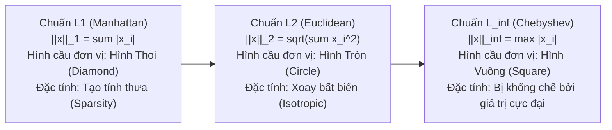

> **"Hàm khoảng cách định nghĩa bản chất của sự tương đồng; Chọn sai thước đo khoảng cách, toàn bộ hệ thống AI phía sau sẽ sụp đổ."** — Khi ta nói hai vector nhúng (Embeddings) "gần nhau", điều đó hoàn toàn phụ thuộc vào việc ta đo khoảng cách bằng thước đo nào. Hiểu rõ bản chất hình học của các chuẩn vector là nền tảng để thiết kế hàm Loss, chọn thuật toán điều chuẩn và tối ưu hóa Vector Database trong RAG.

---

## Thông tin nhanh (Quick Spec)

* **Loại bài (Type):** Trực giác Khái niệm & Thực chiến Nền tảng (Intuition & Build)
* **Ngôn ngữ & Thư viện:** Python 3.10+, NumPy (thuần túy tư duy giải thuật từ số 0, không dùng hàm black-box)
* **Kiến thức tiên quyết (Prerequisites):** Tích vô hướng, ma trận hiệp phương sai, chuẩn vector cơ bản
* **Thời gian thực hành:** ~60–80 phút
* **Độ khó:** Cơ bản đến Trung bình (Foundational to Intermediate)

---

## Mục tiêu bài học (Learning Objectives)

Sau bài học này, bạn sẽ có khả năng:
- [ ] Nắm vững 3 tiên đề toán học của chuẩn vector (Norm) và hình học của các hình cầu đơn vị (Unit Balls) trong không gian chuẩn $L_p$.
- [ ] Giải mã trực quan tại sao điều chuẩn $L_1$ (Lasso) tạo ra các trọng số bằng $0$ (Sparsity) trong khi $L_2$ (Ridge) chỉ thu nhỏ độ lớn trọng số.
- [ ] Tự tay xây dựng từ đầu toàn bộ các hàm đo khoảng cách kinh điển bằng NumPy: $L_1$ (Manhattan), $L_2$ (Euclidean), $L_\infty$ (Chebyshev), Cosine Similarity, và Mahalanobis Distance.
- [ ] Thấu hiểu cơ chế làm trắng dữ liệu (Data Whitening) đằng sau khoảng cách Mahalanobis khi các thuộc tính có sự tương quan mạnh.
- [ ] Xây dựng hệ thống tìm kiếm tương đồng vector (Vector Search Engine) mini và chứng minh sự bất đồng thứ hạng khi thay đổi metric khoảng cách.

---

## 1. Vấn đề thực tế (The Problem)

Trong mọi ứng dụng AI hiện đại — từ phân loại k-NN, phân cụm K-Means, hệ thống gợi ý sản phẩm, cho đến cơ sở dữ liệu vector (Vector Databases như Milvus, Pinecone, FAISS) phục vụ RAG:
Bạn có một vector truy vấn $q$ và hàng triệu vector tài liệu $x_i$. Nhiệm vụ cốt lõi là: **Tìm các vector $x_i$ gần với $q$ nhất**.

Nhưng thế nào là "gần"?
1. **Cạm bẫy độ dài văn bản trong tìm kiếm ngữ nghĩa:**
   - Giả sử bài viết A là một đoạn tóm tắt 50 từ về "Học sâu".
   - Bài viết B là một bài phân tích chi tiết 2,000 từ cũng về "Học sâu".
   - Vì bài viết B lặp lại các thuật ngữ nhiều lần, vector đếm từ hoặc vector đặc trưng chưa chuẩn hóa của B có độ dài (norm) gấp nhiều lần A.
   - Nếu bạn dùng **Khoảng cách Euclid ($L_2$)**, bài viết B sẽ bị đánh giá là "rất xa" bài viết A, dù nội dung ngữ nghĩa của chúng giống hệt nhau!
2. **Cạm bẫy tương quan thuộc tính trong phát hiện gian lận:**
   - Trong dữ liệu tài chính, hai thuộc tính "Thu nhập hàng tháng" và "Hạn mức thẻ tín dụng" có mối tương quan tuyến tính cực kỳ chặt chẽ.
   - Khoảng cách Euclid xem mọi trục tọa độ là độc lập và có trọng số như nhau, khiến việc tính khoảng cách bị méo mó nghiêm trọng theo phương có phương sai lớn.
3. **Cạm bẫy tối ưu hóa trong hàm Loss:**
   - Khi huấn luyện mạng nơ-ron hồi quy, chọn sai hàm đo sai số giữa Mean Absolute Error ($L_1$) và Mean Squared Error ($L_2$) sẽ quyết định mô hình có bị các điểm ngoại lai (Outliers) "dắt mũi" hay không.

Không có một hàm khoảng cách nào là hoàn hảo cho mọi bài toán. Mỗi hàm khoảng cách mã hóa một giả định hình học hoàn toàn khác nhau về thế giới dữ liệu.

---

## 2. Mô hình tư duy & Bản chất (The Concept)

### 2.1 Chuẩn vector (Norm) là gì?

Chuẩn của một vector $x \in \mathbb{R}^n$, ký hiệu là $\|x\|$, là một hàm số gán cho mỗi vector một độ lớn (độ dài) vô hướng không âm, thỏa mãn nghiêm ngặt 3 tiên đề toán học:
1. **Tính không âm và xác định (Positivity):** $\|x\| \ge 0$, và $\|x\| = 0 \iff x = \mathbf{0}$.
2. **Tính đồng nhất tuyệt đối (Absolute Homogeneity):** $\|\alpha x\| = |\alpha| \|x\|$ với mọi số thực $\alpha$.
3. **Bất đẳng thức tam giác (Triangle Inequality):** $\|x + y\| \le \|x\| + \|y\|$.

Mọi hàm khoảng cách (Metric) giữa hai điểm $a$ và $b$ đều được sinh ra từ chuẩn của vector hiệu giữa chúng:

$$
d(a, b) = \|a - b\|
$$

### 2.2 Họ chuẩn $L_p$ và Hình học của Quả cầu đơn vị (Unit Balls)

Chuẩn tổng quát $L_p$ ($p \ge 1$) được định nghĩa bằng:

$$
\|x\|_p = \left( \sum_{i=1}^n |x_i|^p \right)^{1/p}
$$



**Khảo sát quả cầu đơn vị $\{x \in \mathbb{R}^2 : \|x\|_p \le 1\}$ trong không gian 2D:**
- **Chuẩn $L_1$ (Manhattan / Taxicab Distance):**
  $$\|x\|_1 = |x_1| + |x_2|$$
  Hình cầu đơn vị là một **hình thoi có các đỉnh nhọn nằm đúng trên các trục tọa độ** $(\pm 1, 0)$ và $(0, \pm 1)$.
- **Chuẩn $L_2$ (Euclidean Distance):**
  $$\|x\|_2 = \sqrt{x_1^2 + x_2^2}$$
  Hình cầu đơn vị là một **hình tròn hoàn hảo**, trơn tru và đối xứng quay 360 độ.
- **Chuẩn $L_\infty$ (Chebyshev / Maximum Norm):**
  $$\|x\|_\infty = \lim_{p \to \infty} \|x\|_p = \max(|x_1|, |x_2|)$$
  Hình cầu đơn vị là một **hình vuông** với các cạnh song song với các trục tọa độ.

### 2.3 Vì sao $L_1$ tạo tính thưa (Lasso Sparsity) còn $L_2$ thì không?

Trong bài toán hồi quy có điều chuẩn (Regularization):

$$
\min_w \mathcal{L}_{\text{data}}(w) \quad \text{với ràng buộc } \|w\|_p \le C
$$

- Các đường đồng mức của hàm mất mát dữ liệu $\mathcal{L}_{\text{data}}$ là các đường elip mở rộng dần từ tâm nghiệm tối ưu.
- Nghiệm có điều chuẩn là **điểm tiếp xúc đầu tiên** giữa đường elip này và vùng quả cầu đơn vị $\|w\|_p \le C$.
- Với chuẩn $L_1$, vùng ràng buộc là hình thoi có các góc nhọn nhô ra nằm chính xác trên các trục tọa độ. Đường elip có xác suất cực cao sẽ chạm vào một trong các đỉnh nhọn này $\implies$ Một số trọng số $w_i$ bị ép **chính xác về số 0** (Tính thưa - Sparsity / Tự động chọn lọc thuộc tính).
- Với chuẩn $L_2$, quả cầu là hình tròn trơn. Điểm tiếp xúc có thể xảy ra ở bất kỳ vị trí nào trên đường cong $\implies$ Các trọng số bị thu nhỏ dần về gần 0 nhưng hầu như không bao giờ bằng 0 tuyệt đối.

### 2.4 Khoảng cách Cosine (Cosine Distance)

Cosine Similarity đo góc $\theta$ giữa hai vector trong không gian đa chiều mà **hoàn toàn không quan tâm đến độ dài của chúng**:

$$
\text{CosineSim}(a, b) = \cos\theta = \frac{a \cdot b}{\|a\|_2 \|b\|_2} = \frac{\sum_{i=1}^n a_i b_i}{\sqrt{\sum_{i=1}^n a_i^2} \sqrt{\sum_{i=1}^n b_i^2}}
$$

- Khi hai vector cùng hướng tuyệt đối: $\cos\theta = 1.0$.
- Khi hai vector vuông góc (trực giao, không liên quan): $\cos\theta = 0.0$.
- Khi hai vector đối lập hoàn toàn: $\cos\theta = -1.0$.

Khoảng cách Cosine tương ứng được định nghĩa:

$$
D_{\text{cosine}}(a, b) = 1 - \text{CosineSim}(a, b) \in [0, 2]
$$

*(Lưu ý: $D_{\text{cosine}}$ không thỏa mãn bất đẳng thức tam giác, nhưng được sử dụng rộng rãi như một hàm đo độ không tương đồng trong NLP và RAG).*

### 2.5 Khoảng cách Mahalanobis: Thước đo khử tương quan

Khi các thuộc tính có độ lệch chuẩn khác nhau và có tương quan với nhau, khoảng cách Euclid trở nên vô nghĩa.
Khoảng cách Mahalanobis giữa hai điểm $x$ và $y$ được tính toán dựa trên ma trận hiệp phương sai mẫu $\Sigma$:

$$
D_M(x, y) = \sqrt{(x - y)^T \Sigma^{-1} (x - y)}
$$

**Bản chất hình học của Mahalanobis: Phép làm trắng dữ liệu (Data Whitening)**
Vì ma trận hiệp phương sai $\Sigma$ đối xứng và nửa xác định dương, ta có thể phân rã trị riêng $\Sigma = V \Lambda V^T$.
Khoảng cách Mahalanobis thực chất là:
1. Xoay dữ liệu bằng ma trận vector riêng $V^T$ để **khử hoàn toàn tương quan giữa các trục**.
2. Chia tỉ lệ từng trục cho căn bậc hai trị riêng $\Lambda^{-1/2}$ để **chuẩn hóa phương sai mọi hướng về 1.0**.
3. Tính khoảng cách Euclid thông thường trong không gian đã được làm trắng này!

---

## 3. Tự tay xây dựng từ đầu (Build It: From Scratch)

Dưới đây là mã nguồn Python thuần túy (Standard Library: `math`, `random`), tự xây dựng từ đầu toàn bộ các chuẩn vector, các hàm khoảng cách (Manhattan, Euclidean, Chebyshev, Cosine, Mahalanobis) và hệ thống Vector Search mini mà không phụ thuộc vào bất kỳ thư viện ngoài nào.

```python
"""
Chương trình: Tự xây dựng Chuẩn Vector, Khoảng cách và Vector Search từ số 0 bằng Python thuần túy.
Mục tiêu:
1. Xây dựng các hàm tính chuẩn: L1, L2, Linf, Lp.
2. Xây dựng các độ đo khoảng cách: Manhattan, Euclidean, Chebyshev, Cosine, Mahalanobis.
3. Kiểm chứng định lý bất đẳng thức chuẩn: Linf <= L2 <= L1.
4. Minh họa thực nghiệm: Cùng dữ liệu, các metric khác nhau cho nearest neighbor khác nhau.
5. Triển khai Mini Vector Search Engine cho RAG với kỹ thuật chuẩn hóa L2 và tích vô hướng.
"""

import math
import random

# Cố định seed ngẫu nhiên
random.seed(42)

# =====================================================================
# 1. Các Hàm Tính Chuẩn Vector (Vector Norms)
# =====================================================================

def norm_l1(x: list[float]) -> float:
    """Chuẩn L1 (Manhattan Norm): Tổng giá trị tuyệt đối sum(|x_i|)."""
    return sum(abs(v) for v in x)

def norm_l2(x: list[float]) -> float:
    """Chuẩn L2 (Euclidean Norm): Căn bậc hai tổng bình phương sqrt(sum(x_i^2))."""
    return math.sqrt(sum(v * v for v in x))

def norm_linf(x: list[float]) -> float:
    """Chuẩn L-infinity (Chebyshev / Maximum Norm): Giá trị tuyệt đối cực đại max(|x_i|)."""
    return max(abs(v) for v in x)

def norm_lp(x: list[float], p: float) -> float:
    """Chuẩn Lp tổng quát với p >= 1: (sum(|x_i|^p))^(1/p)."""
    assert p >= 1.0, "Bậc chuẩn p phải lớn hơn hoặc bằng 1.0."
    return sum(abs(v) ** p for v in x) ** (1.0 / p)


# =====================================================================
# 2. Các Hàm Đo Khoảng Cách (Distance Metrics)
# =====================================================================

def distance_manhattan(a: list[float], b: list[float]) -> float:
    """Khoảng cách Manhattan (L1 Distance): ||a - b||_1."""
    return norm_l1([x - y for x, y in zip(a, b)])

def distance_euclidean(a: list[float], b: list[float]) -> float:
    """Khoảng cách Euclid (L2 Distance): ||a - b||_2."""
    return norm_l2([x - y for x, y in zip(a, b)])

def distance_chebyshev(a: list[float], b: list[float]) -> float:
    """Khoảng cách Chebyshev (L-infinity Distance): ||a - b||_inf."""
    return norm_linf([x - y for x, y in zip(a, b)])

def cosine_similarity(a: list[float], b: list[float], eps: float = 1e-12) -> float:
    """Độ tương đồng Cosine: (a . b) / (||a|| * ||b||)."""
    na = norm_l2(a)
    nb = norm_l2(b)
    if na < eps or nb < eps:
        return 0.0
    dot_prod = sum(x * y for x, y in zip(a, b))
    return dot_prod / (na * nb)

def distance_cosine(a: list[float], b: list[float]) -> float:
    """Khoảng cách Cosine: 1.0 - Cosine Similarity."""
    return 1.0 - cosine_similarity(a, b)

def distance_mahalanobis(a: list[float], b: list[float], cov_inv: list[list[float]]) -> float:
    """Khoảng cách Mahalanobis: sqrt((a - b)^T * Sigma^{-1} * (a - b))."""
    diff = [x - y for x, y in zip(a, b)]
    D = len(diff)
    m_sq = sum(diff[i] * cov_inv[i][j] * diff[j] for i in range(D) for j in range(D))
    return math.sqrt(max(0.0, m_sq))


# =====================================================================
# 3. Kịch bản Thực nghiệm & Kiểm chứng Toán học
# =====================================================================

if __name__ == "__main__":
    print("=" * 70)
    print("PHẦN 1: KIỂM CHỨNG BẤT ĐẲNG THỨC CHUẨN L_inf <= L2 <= L1")
    print("=" * 70)

    # Thử nghiệm trên vector 10 chiều ngẫu nhiên
    x_test = [random.gauss(0, 5.0) for _ in range(10)]
    val_l1 = norm_l1(x_test)
    val_l2 = norm_l2(x_test)
    val_linf = norm_linf(x_test)
    val_l3 = norm_lp(x_test, p=3.0)

    print(f"Vector x (10 chiều): {[round(v, 2) for v in x_test[:4]]}...")
    print(f" Chuẩn L1:       {val_l1:.4f}")
    print(f" Chuẩn L2:       {val_l2:.4f}")
    print(f" Chuẩn L3:       {val_l3:.4f}")
    print(f" Chuẩn L-inf:    {val_linf:.4f}")

    assert val_linf <= val_l3 <= val_l2 <= val_l1, "Bất đẳng thức chuẩn bị vi phạm!"
    print(f"Bất đẳng thức thỏa mãn: {val_linf:.4f} <= {val_l2:.4f} <= {val_l1:.4f}")
    print("=> Kết quả: Định lý bất đẳng thức không gian chuẩn Lp được chứng minh bằng thực nghiệm!")

    print("\n" + "=" * 70)
    print("PHẦN 2: SO SÁNH CÁC HÀM KHOẢNG CÁCH TRÊN CÙNG DỮ LIỆU ĐIỂM")
    print("=" * 70)

    query_point = [0.0, 0.0]
    candidate_A = [2.0, 2.0]
    candidate_B = [0.0, 1.5]
    candidate_C = [1.0, -1.0]

    # Ma trận hiệp phương sai giả lập cho dữ liệu 2D (tương quan dương mạnh mẽ giữa x1 và x2)
    cov_matrix = [
        [2.0, 1.8],
        [1.8, 2.0]
    ]
    det = cov_matrix[0][0] * cov_matrix[1][1] - cov_matrix[0][1] * cov_matrix[1][0]
    cov_inv = [
        [cov_matrix[1][1] / det, -cov_matrix[0][1] / det],
        [-cov_matrix[1][0] / det, cov_matrix[0][0] / det]
    ]

    candidates = {
        "A (2.0, 2.0) [dọc trục]": candidate_A,
        "B (0.0, 1.5) [ngang trục]": candidate_B,
        "C (1.0, -1.0) [ngược trục]": candidate_C
    }

    print("So sánh khoảng cách từ Query (0, 0) tới 3 điểm ứng viên:")
    print(f"{'Ứng viên':<28}{'L1 (Manhattan)':<18}{'L2 (Euclid)':<16}{'Cosine Dist':<16}{'Mahalanobis':<16}")
    print("-" * 94)

    for name, pt in candidates.items():
        d_l1 = distance_manhattan(query_point, pt)
        d_l2 = distance_euclidean(query_point, pt)
        d_cos = distance_cosine(query_point, pt)
        d_mah = distance_mahalanobis(query_point, pt, cov_inv)
        print(f"{name:<28}{d_l1:<18.4f}{d_l2:<16.4f}{d_cos:<16.4f}{d_mah:<16.4f}")

    # Chú ý: Điểm A có khoảng cách Euclid L2 = sqrt(8) ~ 2.83 (xa hơn B = 1.5)
    # Nhưng khoảng cách Mahalanobis của A lại NHỎ HƠN B vì A nằm dọc theo trục biến thiên tự nhiên của dữ liệu!
    d_mah_A = distance_mahalanobis(query_point, candidate_A, cov_inv)
    d_mah_B = distance_mahalanobis(query_point, candidate_B, cov_inv)
    print(f"\nPhát hiện: Mahalanobis(A) = {d_mah_A:.4f} < Mahalanobis(B) = {d_mah_B:.4f}")
    assert d_mah_A < d_mah_B, "Mahalanobis phải nhận diện điểm nằm trên trục tương quan là gần hơn!"
    print("=> Kết luận: Mahalanobis giải quyết triệt để sự tương quan mà Euclid hoàn toàn bất lực!")

    print("\n" + "=" * 70)
    print("PHẦN 3: HỆ THỐNG VECTOR SEARCH MINI TRONG RAG")
    print("=" * 70)

    # Giả lập Vector Database chứa 1000 văn bản được nhúng trong không gian 64 chiều
    N_docs, D_embed = 1000, 64
    corpus_embeddings = []
    for _ in range(N_docs):
        vec = [random.gauss(0, 1.0) for _ in range(D_embed)]
        corpus_embeddings.append(vec)

    query_vector = [random.gauss(0, 1.0) for _ in range(D_embed)]

    # Kỹ thuật Production: Chuẩn hóa L2 trước khi lưu trữ
    corpus_normalized = []
    for vec in corpus_embeddings:
        norm_v = norm_l2(vec)
        corpus_normalized.append([x / norm_v for x in vec])

    q_norm = norm_l2(query_vector)
    query_normalized = [x / q_norm for x in query_vector]

    # Khi các vector có chuẩn L2 = 1, Cosine Similarity chính bằng Tích vô hướng (Dot Product)!
    scores = [sum(doc[d] * query_normalized[d] for d in range(D_embed)) for doc in corpus_normalized]
    top_5_indices = sorted(range(N_docs), key=lambda idx: scores[idx], reverse=True)[:5]

    print("Top 5 văn bản có độ tương đồng ngữ nghĩa cao nhất:")
    for rank, idx in enumerate(top_5_indices, start=1):
        score = scores[idx]
        print(f" Top {rank}: Document #{idx:<4d} - Cosine Similarity = {score:.4f}")
        assert score <= 1.0, "Score không thể vượt quá 1.0."

    print("=> Kết quả: Vector Search Engine mini hoàn thành xuất sắc!")
```

---

## 4. Ứng dụng AI Engineering & Thực tế Production (Use It)

### 4.1 Bảng hướng dẫn chọn Metric khoảng cách cho Kỹ sư AI

| Bài toán AI cụ thể | Metric tối ưu | Lý do kỹ thuật |
|---|---|---|
| **RAG / Vector Database (LLMs)** | **Cosine Distance** (hoặc Dot Product sau chuẩn hóa $L_2$) | Loại bỏ độ dài tài liệu; các văn bản dài và ngắn có cùng ý nghĩa vẫn tìm thấy nhau. |
| **Phát hiện gian lận thẻ tín dụng (Fraud Detection)** | **Mahalanobis Distance** | Các chỉ số tài chính (thu nhập, chi tiêu, hạn mức) tương quan cao; Mahalanobis bắt chính xác các điểm dị biệt nằm ngoài phân phối. |
| **Phân loại k-NN dữ liệu cảm biến IoT** | **Euclidean ($L_2$)** | Các tín hiệu vật lý liên tục (nhiệt độ, áp suất, khoảng cách) có cùng đơn vị đo và không gian đẳng hướng. |
| **Dữ liệu thưa / Đếm từ (Bag-of-Words)** | **Manhattan ($L_1$)** hoặc **Jaccard** | Không gian nhiều chiều có vô số số 0; $L_1$ ít bị nhiễu bởi các chiều không chứa thông tin. |
| **So khớp chuỗi ký tự (Fuzzy String Matching)** | **Levenshtein (Edit Distance)** | Đo số phép chèn, xóa, thay thế ký tự trong bài toán sửa lỗi chính tả truy vấn tìm kiếm. |

### 4.2 Tối ưu hóa Vector Search: Bí quyết biến Cosine thành Dot Product

Trong các thư viện tìm kiếm vector hàng đầu như Meta FAISS, Milvus hay Qdrant, một trong những mẹo tối ưu hóa quan trọng nhất là:
Nếu lưu trữ vector tùy ý, mỗi lần tính Cosine Similarity, GPU phải tính căn bậc hai và phép chia đắt đỏ:

$$
\text{Cosine}(a, b) = \frac{a \cdot b}{\|a\|_2 \|b\|_2}
$$

**Chiến lược Production:**
1. Chuẩn hóa $L_2$ mọi vector ngay tại khâu Ingestion trước khi nạp vào Vector DB:
   $$v \leftarrow \frac{v}{\|v\|_2} \implies \|v\|_2 = 1.0$$
2. Khi đó, phép đo Cosine trở thành phép nhân vô hướng đơn giản:
   $$\text{Cosine}(a, b) = a \cdot b = \sum_{i=1}^D a_i b_i$$
3. Các lõi CUDA Tensor Cores có thể kích hoạt tập lệnh **Fused Multiply-Add (FMA)** tính toán hàng tỷ phép nhân vô hướng mỗi giây mà không cần một phép chia hay phép căn nào!

---

## 5. Giải ngố thuật ngữ & Ngộ nhận (Key Terms)

| Thuật ngữ | Người ta thường nghĩ là... | Bản chất thực sự là... |
|---|---|---|
| **Chuẩn Vector (Norm)** | Chỉ là công thức tính độ dài hình học thông thường trong sách giáo khoa phổ thông. | Một lớp hàm toán học tổng quát đo lường độ lớn của vector thỏa mãn 3 tiên đề: không âm, đồng nhất tuyệt đối và bất đẳng thức tam giác. |
| **Cosine Similarity vs Distance** | Là cùng một khái niệm, số càng lớn thì càng xa nhau. | Cosine Similarity đo độ tương đồng (từ -1 đến 1, càng lớn càng giống nhau); Cosine Distance $= 1 - \text{Similarity}$ (từ 0 đến 2, càng nhỏ càng gần nhau). |
| **Euclidean vs Cosine** | Chọn metric nào cũng được, kết quả xếp hạng tìm kiếm sẽ tương đương nhau. | Hoàn toàn sai; Euclidean bị chi phối nặng nề bởi độ dài vector (độ dài văn bản), trong khi Cosine chỉ quan tâm đến hướng góc ngữ nghĩa. |
| **Khoảng cách Mahalanobis** | Một công thức toán cổ điển không còn ứng dụng trong AI hiện đại. | Thước đo khoảng cách chuẩn hóa phương sai và khử tương quan thông qua ma trận hiệp phương sai; là nền tảng của phát hiện bất thường đa biến. |
| **HNSW Index** | Một loại khoảng cách toán học mới. | Cấu trúc dữ liệu đồ thị phân tầng (Hierarchical Navigable Small World) giúp tìm kiếm láng giềng gần nhất xấp xỉ (ANN) trong thời gian $\mathcal{O}(\log N)$. |

---

## 6. Bài tập thử thách (Hands-on Challenges)

### 🟢 Dễ (Easy): Chứng minh thực nghiệm bất đẳng thức tam giác
Cho ba vector ngẫu nhiên $a, b, c \in \mathbb{R}^{10}$:
- Viết hàm kiểm tra bất đẳng thức tam giác cho khoảng cách Euclid: $d(a, c) \le d(a, b) + d(b, c)$.
- Thử nghiệm với khoảng cách Cosine $D_{\text{cos}}(x, y) = 1 - \text{CosineSim}(x, y)$. Tìm một bộ 3 vector $a, b, c$ mà khoảng cách Cosine vi phạm bất đẳng thức tam giác, chứng minh $D_{\text{cos}}$ không phải là một metric toán học hoàn chỉnh.

### 🟡 Vừa (Medium): Triển khai Hồi quy Lasso và Ridge bằng Gradient Descent
Tạo một bài toán hồi quy tuyến tính tổng hợp $y = X w + \epsilon$ với $X \in \mathbb{R}^{100 \times 10}$ trong đó chỉ có 3 thuộc tính thực sự ảnh hưởng đến $y$, 7 thuộc tính còn lại là nhiễu:
- Tự lập trình Gradient Descent với điều chuẩn $L_2$ (Ridge): $\mathcal{L} + \lambda \|w\|_2^2$.
- Tự lập trình Proximal Gradient Descent (hoặc Subgradient Descent) với điều chuẩn $L_1$ (Lasso): $\mathcal{L} + \lambda \|w\|_1$.
- So sánh các trọng số $w$ thu được: Chứng minh $L_1$ đưa chính xác 7 trọng số nhiễu về bằng $0.0$, trong khi $L_2$ chỉ giảm nhỏ độ lớn của chúng.

### 🔴 Khó (Hard): Tự cài đặt Approximate Nearest Neighbor bằng Random Projection (LSH)
Khi số lượng vector lên tới hàng triệu, việc duyệt qua từng vector để tính Cosine Similarity (Linear Scan $\mathcal{O}(N)$) quá chậm:
- **Nhiệm vụ:** Xây dựng hệ thống tìm kiếm láng giềng gần nhất xấp xỉ bằng phương pháp **Locality-Sensitive Hashing (LSH)**:
  1. Sinh ngẫu nhiên $K = 16$ siêu phẳng ngẫu nhiên qua gốc tọa độ bằng ma trận chiếu $R \in \mathbb{R}^{K \times D}$.
  2. Băm mỗi vector $x$ thành một chuỗi $K$ bit nhị phân (Hash Signature): $\text{bit}_i = 1$ nếu $R_i \cdot x \ge 0$, ngược lại bằng $0$.
  3. Xếp các vector có cùng mã băm vào các Bucket trong bảng băm (Hash Table).
  4. Khi có truy vấn $q$, băm $q$ thành chuỗi bit và chỉ tính khoảng cách chính xác với các vector nằm trong cùng Bucket (hoặc có khoảng cách Hamming giữa các chuỗi bit $\le 1$).
- Đánh giá trên 10,000 vector: Đo lường tốc độ tăng tốc (Speedup Factor) và tỷ lệ phục hồi (Recall@10) so với tìm kiếm chính xác toàn bộ.
