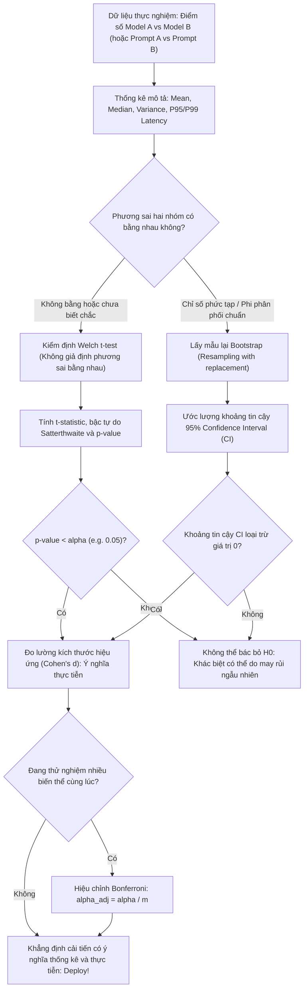

> **"Thống kê là ranh giới duy nhất phân biệt một mô hình AI thực sự vượt trội với một chuỗi kết quả ăn may do ngẫu nhiên."** — Nếu không có thống kê, bạn sẽ liên tục đẩy các mô hình bị overfit hoặc cải tiến giả tạo lên môi trường production.

---

## Thông tin nhanh (Quick Spec)

| Thuộc tính | Chi tiết |
|---|---|
| **Loại bài (Type)** | Thực chiến Nền tảng (Build) & Đo lường Đánh giá (Evaluation) |
| **Ngôn ngữ & Thư viện** | Python 3.10+ (Standard Library: `math`, `random`), zero dependency |
| **Kiến thức tiên quyết** | Xác suất cơ bản, phân phối Gaussian, tư duy lập trình thuật toán |
| **Thời gian thực hành** | ~75 phút |
| **Mức độ (Level)** | Trung cấp đến Nâng cao (Intermediate to Advanced) |

---

## Mục tiêu bài học (Learning Objectives)

Sau bài học này, bạn sẽ có khả năng:
- [ ] Nắm vững bản chất của thống kê mô tả (Descriptive Statistics), các phân vị đuôi (P50, P95, P99) và chứng minh toán học vì sao hiệu chỉnh Bessel ($n - 1$) loại bỏ hoàn toàn độ chệch của phương sai mẫu.
- [ ] Phân biệt sự khác biệt cốt lõi giữa hệ số tương quan tuyến tính Pearson và tương quan hạng phi tham số Spearman, cùng cách tính ma trận hiệp phương sai (Covariance Matrix).
- [ ] Tự tay lập trình từ đầu (from scratch) kiểm định Welch's two-sample t-test (với bậc tự do Satterthwaite và xấp xỉ p-value hàm Beta không đầy đủ) để so sánh định lượng giữa hai mô hình hoặc hai prompt.
- [ ] Xây dựng giải thuật tái lấy mẫu Bootstrap (Bootstrap Resampling) để ước lượng khoảng tin cậy (Confidence Interval) cho mọi chỉ số ML phi chuẩn, và áp dụng hiệu chỉnh Bonferroni khi A/B test đa biến thể.

---

## 1. Vấn đề thực tế (The Problem)

### Kịch bản "cải tiến ảo" làm sụt giảm chất lượng Production

Bạn vừa dành cả tuần để tinh chỉnh một System Prompt mới hoặc huấn luyện một checkpoint LoRA v2 cho trợ lý AI chăm sóc khách hàng. Trên tập dữ liệu benchmark nội bộ gồm $100$ câu hỏi mẫu, kết quả chấm điểm cho thấy:
- Prompt v1 đạt tỷ lệ giải quyết đúng $85.0\%$.
- Prompt v2 đạt tỷ lệ giải quyết đúng $87.0\%$.

Hào hứng với mức tăng trưởng $2.0\%$, bạn tự tin tạo pull request và deploy ngay Prompt v2 lên toàn bộ cụm server production. Nhưng chỉ sau hai tuần vận hành, tỷ lệ khách hàng đánh giá $1$ sao tăng vọt, chỉ số CSAT sụt giảm nghiêm trọng.

Chuyện gì đã xảy ra?
1. **Cạm bẫy nhiễu ngẫu nhiên masquerading as signal:** Với kích thước tập kiểm tra chỉ gồm $100$ mẫu, việc Prompt v2 trả lời đúng nhiều hơn Prompt v1 đúng $2$ câu hoàn toàn có thể xảy ra do may rủi ngẫu nhiên (khi tính kiểm định thống kê, $p\text{-value} > 0.35$). Bạn đã đưa lên production một biến động ngẫu nhiên thay vì một cải tiến thực sự.
2. **Cạm bẫy ngoại lai bóp méo số trung bình:** Điểm độ trễ (latency) trung bình của hệ thống là $120\text{ms}$ trông rất mượt mà. Nhưng khi phân tích phân vị đuôi, chỉ số P99 latency lên tới $4,500\text{ms}$. Có nghĩa là cứ $100$ người dùng thì có $1$ người phải chờ đợi gần $5$ giây đến mức timeout. Số trung bình đã che giấu hoàn toàn trải nghiệm tồi tệ của nhóm người dùng chịu độ trễ đuôi nặng.
3. **Cạm bẫy Multiple Testing & p-hacking:** Một nhóm kỹ sư thử nghiệm đồng thời $50$ biến thể prompt khác nhau so với bản gốc và chọn ra prompt duy nhất có $p < 0.05$. Xác suất để có ít nhất một prompt "vượt trội giả tạo" thuần túy do ngẫu nhiên lên tới $1 - (1 - 0.05)^{50} \approx 92.3\%$! Nếu không có kỹ thuật hiệu chỉnh thống kê đa biến thể, việc thử nghiệm nhiều chỉ là trò ảo thuật tự lừa dối mình.

---

## 2. Mô hình tư duy & Bản chất (The Concept)



### 1. Thống kê mô tả & Chứng minh Hiệu chỉnh Bessel

Cho tập mẫu gồm $n$ quan sát $x_1, x_2, \dots, x_n$:
- **Trung bình mẫu (Sample Mean):** $\bar{x} = \frac{1}{n}\sum_{i=1}^n x_i$. Đây là trọng tâm của dữ liệu, cực kỳ nhạy cảm với các giá trị ngoại lai (outliers).
- **Trung vị mẫu (Sample Median):** Điểm chia đôi tập dữ liệu đã sắp xếp thành hai nửa bằng nhau. Trung vị trơ với các giá trị ngoại lai cực đoan.
- **Phân vị (Percentiles - P50, P95, P99):** Điểm mà có $p\%$ dữ liệu nằm phía dưới nó. Trong các hệ thống microservices phục vụ suy luận LLM, P95 và P99 là các thước đo tiêu chuẩn vàng để giám sát chất lượng dịch vụ SLA.

#### Tại sao phương sai mẫu bắt buộc phải chia cho $n - 1$ (Hiệu chỉnh Bessel)?
Nếu ta dùng công thức ngây thơ $\hat{\sigma}^2 = \frac{1}{n}\sum_{i=1}^n (x_i - \bar{x})^2$, kỳ vọng của nó sẽ luôn **nhỏ hơn** phương sai thực tế $\sigma^2$ của tổng thể.

**Chứng minh toán học chặt chẽ:**
Hiệu số giữa mẫu và trung bình mẫu có thể phân tách theo kỳ vọng tổng thể $\mu$:
$$x_i - \bar{x} = (x_i - \mu) - (\bar{x} - \mu)$$
Bình phương hai vế và lấy tổng theo $i=1 \dots n$:
$$\sum_{i=1}^n (x_i - \bar{x})^2 = \sum_{i=1}^n (x_i - \mu)^2 - 2(\bar{x} - \mu)\sum_{i=1}^n (x_i - \mu) + n(\bar{x} - \mu)^2$$
Vì $\sum_{i=1}^n (x_i - \mu) = n(\bar{x} - \mu)$, biểu thức trở thành:
$$\sum_{i=1}^n (x_i - \bar{x})^2 = \sum_{i=1}^n (x_i - \mu)^2 - n(\bar{x} - \mu)^2$$
Lấy kỳ vọng toán học cả hai vế:
$$\mathbb{E}\left[\sum_{i=1}^n (x_i - \bar{x})^2\right] = \sum_{i=1}^n \mathbb{E}[(x_i - \mu)^2] - n\mathbb{E}[(\bar{x} - \mu)^2]$$
Ta biết $\mathbb{E}[(x_i - \mu)^2] = \sigma^2$, và theo Định lý Giới hạn Trung tâm, phương sai của trung bình mẫu là $\text{Var}(\bar{x}) = \mathbb{E}[(\bar{x} - \mu)^2] = \frac{\sigma^2}{n}$. Thay vào biểu thức:
$$\mathbb{E}\left[\sum_{i=1}^n (x_i - \bar{x})^2\right] = n\sigma^2 - n\left(\frac{\sigma^2}{n}\right) = n\sigma^2 - \sigma^2 = (n - 1)\sigma^2$$
Do đó:
$$\mathbb{E}\left[\frac{1}{n} \sum_{i=1}^n (x_i - \bar{x})^2\right] = \frac{n - 1}{n}\sigma^2 < \sigma^2$$
Công thức chia cho $n$ đánh giá thấp phương sai một lượng tỉ lệ với $\frac{n-1}{n}$. Để thu được ước lượng không chệch (unbiased estimator) $\mathbb{E}[s^2] = \sigma^2$, ta bắt buộc phải chia cho bậc tự do $n - 1$:

$$s^2 = \frac{1}{n - 1} \sum_{i=1}^n (x_i - \bar{x})^2$$

### 2. Tương quan Pearson vs Spearman

1. **Hệ số tương quan Pearson ($r_{xy}$):**
   Đo lường mức độ tương quan tuyến tính giữa hai biến:
   $$r_{xy} = \frac{\sum_{i=1}^n (x_i - \bar{x})(y_i - \bar{y})}{\sqrt{\sum_{i=1}^n (x_i - \bar{x})^2} \sqrt{\sum_{i=1}^n (y_i - \bar{y})^2}} \in [-1, 1]$$
   - Hạn chế: Chỉ phát hiện quan hệ dạng đường thẳng. Nếu $y = x^3$, quan hệ phi tuyến hoàn hảo này sẽ không đạt $r = 1.0$. Ngoài ra, Pearson rất nhạy cảm với ngoại lai.

2. **Hệ số tương quan hạng Spearman ($\rho$):**
   Chuyển đổi dữ liệu thô sang thứ hạng (ranks) $R(x_i)$ và $R(y_i)$, sau đó tính Pearson trên các giá trị thứ hạng.
   - Ưu điểm: Đo lường mức độ **tương quan đơn điệu (monotonic)**. Nếu $y$ luôn tăng khi $x$ tăng (bất kể tăng theo hàm mũ, logarit hay đa thức bậc 3), Spearman $\rho = 1.0$ tuyệt đối. Spearman không phụ thuộc vào thang đo (scale-invariant) và trơ với ngoại lai.

3. **Ma trận hiệp phương sai (Covariance Matrix - $\Sigma \in \mathbb{R}^{d \times d}$):**
   $$\Sigma_{jk} = \frac{1}{n - 1} \sum_{i=1}^n (X_{ij} - \bar{X}_j)(X_{ik} - \bar{X}_k)$$
   Ma trận này là nền tảng toán học của thuật toán giảm chiều dữ liệu PCA (Principal Component Analysis) và phân phối Gaussian đa chiều.

### 3. Kiểm định giả thuyết Welch's Two-Sample t-Test

Khi so sánh hai mô hình học máy trên hai tập mẫu thử nghiệm $X_1$ (kích thước $n_1$) và $X_2$ (kích thước $n_2$), giả định phương sai hai nhóm bằng nhau của kiểm định Student t-test truyền thống hầu như luôn bị vi phạm.

Kiểm định **Welch's t-test** được thiết kế đặc thù cho trường hợp hai mẫu có kích thước khác nhau và phương sai không bằng nhau:

$$t = \frac{\bar{x}_1 - \bar{x}_2}{\sqrt{\frac{s_1^2}{n_1} + \frac{s_2^2}{n_2}}}$$

Bậc tự do hữu hiệu $\nu$ được xấp xỉ bởi phương trình Welch–Satterthwaite:

$$\nu \approx \frac{\left(\frac{s_1^2}{n_1} + \frac{s_2^2}{n_2}\right)^2}{\frac{(s_1^2 / n_1)^2}{n_1 - 1} + \frac{(s_2^2 / n_2)^2}{n_2 - 1}}$$

Giá trị $p\text{-value}$ hai phía được tính từ hàm phân phối tích lũy của phân phối Student-t với bậc tự do $\nu$. Nếu $p < \alpha$ (thường là $0.05$), ta bác bỏ giả thuyết vô hiệu $H_0$ và kết luận sự khác biệt giữa hai mô hình có ý nghĩa thống kê.

### 4. Bootstrap Confidence Intervals (Khoảng tin cậy Bootstrap)

Đối với nhiều độ đo đánh giá phức tạp trong AI (như điểm F1-score, BLEU score, pass@k trong sinh mã lệnh, hoặc tỷ lệ chuyển đổi CTR), dữ liệu không tuân theo phân phối chuẩn Gaussian, khiến việc áp dụng công thức giải tích cổ điển bị sai lệch.

Kỹ thuật **Bootstrap Resampling** (Efron, 1979) giải quyết triệt để vấn đề này:
1. Từ tập dữ liệu gốc gồm $n$ quan sát, rút ngẫu nhiên $n$ mẫu **có hoàn lại (with replacement)** để tạo thành tập mẫu giả lập $X^{*(b)}$.
2. Tính toán chỉ số thống kê mục tiêu trên tập giả lập này: $\theta^{*(b)} = f(X^{*(b)})$.
3. Lặp lại bước trên $B$ lần (thường $B = 2,000$ đến $5,000$).
4. Khoảng tin cậy $95\%$ Confidence Interval chính là khoảng phân vị $[P_{2.5}, P_{97.5}]$ của dãy số $\theta^{*(1)}, \dots, \theta^{*(B)}$.

Khi so sánh hai mô hình $A$ và $B$, ta tính chênh lệch $\Delta^{*(b)} = f(X_B^{*(b)}) - f(X_A^{*(b)})$. Nếu khoảng tin cậy $95\%$ của $\Delta$ loại trừ hoàn toàn số $0$ (ví dụ $[+0.015, +0.045]$), ta tự tin khẳng định mô hình $B$ thực sự vượt trội hơn mô hình $A$.

### 5. Ý nghĩa thống kê vs Ý nghĩa thực tiễn & Hiệu chỉnh Bonferroni

- **Cạm bẫy $p\text{-hacking}$ với Big Data:** Khi kích thước mẫu $n$ tiến tới hàng triệu quan sát, sai số chuẩn $\text{SE} = \frac{s}{\sqrt{n}}$ tiến về $0$, khiến giá trị $p\text{-value}$ hầu như luôn nhỏ hơn $0.0001$ ngay cả khi mức chênh lệch giữa hai prompt là cực kỳ vô nghĩa (ví dụ $0.001\%$). Do đó, bắt buộc phải báo cáo **Kích thước hiệu ứng Cohen's d**:
  $$d = \frac{\bar{x}_1 - \bar{x}_2}{s_{\text{pooled}}}, \quad s_{\text{pooled}} = \sqrt{\frac{(n_1 - 1)s_1^2 + (n_2 - 1)s_2^2}{n_1 + n_2 - 2}}$$
  Quy chuẩn: $|d| < 0.2$ (không đáng kể), $0.2 \le |d| < 0.5$ (nhỏ), $0.5 \le |d| < 0.8$ (trung bình), $|d| \ge 0.8$ (lớn).
- **Hiệu chỉnh Bonferroni:** Khi kiểm định đồng thời $m$ biến thể prompt, ngưỡng ý nghĩa phải được chia nhỏ:
  $$\alpha_{\text{adjusted}} = \frac{\alpha}{m}$$

---

## 3. Tự tay xây dựng từ đầu (Build It: From Scratch)

Toàn bộ thuật toán thống kê dưới đây được xây dựng bằng Python thuần túy, bao gồm cả giải thuật liên phân số Lentz để tính hàm phân phối tích lũy Student-t mà không phụ thuộc vào `scipy.stats`.

```python
"""
Statistics for Machine Learning from Scratch
Pure Python implementation of descriptive statistics, correlation,
Welch's t-test with p-value approximation, bootstrap confidence intervals,
Cohen's d, and Bonferroni correction.
"""

import math
import random

random.seed(42)


# =====================================================================
# 1. Thống kê mô tả (Descriptive Statistics) & Hiệu chỉnh Bessel
# =====================================================================

def mean(data: list[float]) -> float:
    """Tính giá trị trung bình mẫu (Sample Mean)."""
    if not data:
        raise ValueError("Dữ liệu không được rỗng.")
    return sum(data) / len(data)


def median(data: list[float]) -> float:
    """Tính trung vị mẫu (Sample Median) - trơ với giá trị ngoại lai."""
    if not data:
        raise ValueError("Dữ liệu không được rỗng.")
    sorted_data = sorted(data)
    n = len(sorted_data)
    mid = n // 2
    if n % 2 == 0:
        return (sorted_data[mid - 1] + sorted_data[mid]) / 2.0
    return float(sorted_data[mid])


def variance(data: list[float], sample: bool = True) -> float:
    """
    Tính phương sai với hiệu chỉnh Bessel (chia cho n - 1) để ước lượng không chệch.
    """
    n = len(data)
    if n == 0:
        raise ValueError("Dữ liệu không được rỗng.")
    if sample and n == 1:
        return 0.0
    m = mean(data)
    ss = sum((x - m) ** 2 for x in data)
    return ss / (n - 1) if (sample and n > 1) else ss / n


def std_dev(data: list[float], sample: bool = True) -> float:
    """Tính độ lệch chuẩn (Standard Deviation) cùng đơn vị với dữ liệu gốc."""
    return math.sqrt(variance(data, sample=sample))


def percentile(data: list[float], p: float) -> float:
    """
    Tính phân vị p (Percentile, 0 <= p <= 100) bằng phương pháp nội suy tuyến tính.
    """
    if not data:
        raise ValueError("Dữ liệu không được rỗng.")
    sorted_data = sorted(data)
    n = len(sorted_data)
    if n == 1:
        return float(sorted_data[0])
    k = (p / 100.0) * (n - 1)
    f = math.floor(k)
    c = math.ceil(k)
    if f == c:
        return float(sorted_data[int(k)])
    return sorted_data[f] * (c - k) + sorted_data[c] * (k - f)


def iqr(data: list[float]) -> float:
    """Khoảng tứ phân vị IQR = P75 - P25."""
    return percentile(data, 75.0) - percentile(data, 25.0)


# =====================================================================
# 2. Hiệp phương sai & Hệ số tương quan Pearson vs Spearman
# =====================================================================

def covariance(x: list[float], y: list[float], sample: bool = True) -> float:
    """Tính hiệp phương sai giữa 2 biến ngẫu nhiên x và y."""
    n = len(x)
    if n != len(y) or n == 0:
        raise ValueError("Hai chuỗi dữ liệu phải có cùng kích thước khác 0.")
    mx, my = mean(x), mean(y)
    total = sum((xi - mx) * (yi - my) for xi, yi in zip(x, y))
    return total / (n - 1) if (sample and n > 1) else total / n


def pearson_correlation(x: list[float], y: list[float]) -> float:
    """Tính hệ số tương quan tuyến tính Pearson r trong khoảng [-1, 1]."""
    sx = std_dev(x, sample=False)
    sy = std_dev(y, sample=False)
    if sx == 0.0 or sy == 0.0:
        return 0.0
    cov = covariance(x, y, sample=False)
    return cov / (sx * sy)


def rank_data(data: list[float]) -> list[float]:
    """Chuyển đổi dữ liệu số thành thứ hạng (ranks), xử lý hòa (ties) bằng trung bình cộng."""
    indexed = sorted(enumerate(data), key=lambda pair: pair[1])
    ranks = [0.0] * len(data)
    i = 0
    while i < len(indexed):
        j = i
        while j < len(indexed) - 1 and indexed[j + 1][1] == indexed[i][1]:
            j += 1
        avg_rank = (i + j) / 2.0 + 1.0
        for k in range(i, j + 1):
            ranks[indexed[k][0]] = avg_rank
        i = j + 1
    return ranks


def spearman_correlation(x: list[float], y: list[float]) -> float:
    """Tính hệ số tương quan hạng phi tham số Spearman rho."""
    rx = rank_data(x)
    ry = rank_data(y)
    return pearson_correlation(rx, ry)


def covariance_matrix(data_matrix: list[list[float]]) -> list[list[float]]:
    """
    Tính ma trận hiệp phương sai Sigma (d x d) cho d đặc trưng.
    data_matrix: list gồm d hàng, mỗi hàng chứa n quan sát của đặc trưng đó.
    """
    d = len(data_matrix)
    n = len(data_matrix[0])
    means = [mean(data_matrix[i]) for i in range(d)]
    cov_mat = [[0.0] * d for _ in range(d)]
    for i in range(d):
        for j in range(i, d):
            cov_val = sum(
                (data_matrix[i][k] - means[i]) * (data_matrix[j][k] - means[j])
                for k in range(n)
            ) / (n - 1)
            cov_mat[i][j] = cov_val
            cov_mat[j][i] = cov_val
    return cov_mat


# =====================================================================
# 3. Kiểm định Welch's Two-Sample t-Test & Xấp xỉ p-value
# =====================================================================

def _log_beta(a: float, b: float) -> float:
    """Tính ln(B(a, b)) = ln(Gamma(a)) + ln(Gamma(b)) - ln(Gamma(a+b))."""
    return math.lgamma(a) + math.lgamma(b) - math.lgamma(a + b)


def _beta_continued_fraction(x: float, a: float, b: float, max_iter: int = 300, tol: float = 1e-15) -> float:
    """Thuật toán liên phân số Lentz xấp xỉ hàm Beta không đầy đủ chính quy."""
    tiny = 1e-300
    qab = a + b
    qap = a + 1.0
    qam = a - 1.0
    c = 1.0
    d = 1.0 - qab * x / qap
    if abs(d) < tiny:
        d = tiny
    d = 1.0 / d
    h = d
    for m in range(1, max_iter + 1):
        m2 = 2 * m
        # Hệ số chẵn
        num = m * (b - m) * x / ((qam + m2) * (a + m2))
        d = 1.0 + num * d
        if abs(d) < tiny:
            d = tiny
        c = 1.0 + num / c
        if abs(c) < tiny:
            c = tiny
        d = 1.0 / d
        h *= d * c

        # Hệ số lẻ
        num = -(a + m) * (qab + m) * x / ((a + m2) * (qap + m2))
        d = 1.0 + num * d
        if abs(d) < tiny:
            d = tiny
        c = 1.0 + num / c
        if abs(c) < tiny:
            c = tiny
        d = 1.0 / d
        delta = d * c
        h *= delta
        if abs(delta - 1.0) < tol:
            break
    return h


def _regularized_incomplete_beta(x: float, a: float, b: float) -> float:
    """Hàm Beta không đầy đủ chính quy I_x(a, b)."""
    if x <= 0.0:
        return 0.0
    if x >= 1.0:
        return 1.0
    front = math.exp(a * math.log(x) + b * math.log(1.0 - x) - _log_beta(a, b))
    if x < (a + 1.0) / (a + b + 2.0):
        return front * _beta_continued_fraction(x, a, b) / a
    return 1.0 - front * _beta_continued_fraction(1.0 - x, b, a) / b


def student_t_cdf(t_val: float, df: float) -> float:
    """Tính hàm phân phối tích lũy CDF của phân phối Student-t với bậc tự do df."""
    x = df / (df + t_val * t_val)
    prob = 0.5 * _regularized_incomplete_beta(x, df / 2.0, 0.5)
    return prob if t_val < 0.0 else 1.0 - prob


def welch_ttest(data1: list[float], data2: list[float]) -> dict[str, float | bool]:
    """
    Thực hiện kiểm định giả thuyết Welch's two-sample t-test hai phía.
    Không giả định hai nhóm có phương sai bằng nhau.
    """
    n1, n2 = len(data1), len(data2)
    m1, m2 = mean(data1), mean(data2)
    v1, v2 = variance(data1, sample=True), variance(data2, sample=True)
    se = math.sqrt(v1 / n1 + v2 / n2)
    if se == 0.0:
        raise ValueError("Phương sai bằng 0 ở cả hai mẫu, t-statistic không xác định.")
    t_stat = (m1 - m2) / se

    # Bậc tự do Satterthwaite
    num = (v1 / n1 + v2 / n2) ** 2
    denom = ((v1 / n1) ** 2 / (n1 - 1)) + ((v2 / n2) ** 2 / (n2 - 1))
    df = num / denom if denom > 0 else float(n1 + n2 - 2)

    # Tính p-value hai phía
    p_val = 2.0 * (1.0 - student_t_cdf(abs(t_stat), df))
    return {
        "mean1": m1,
        "mean2": m2,
        "diff": m1 - m2,
        "t_statistic": t_stat,
        "df": df,
        "p_value": p_val,
        "significant_05": p_val < 0.05,
    }


# =====================================================================
# 4. Bootstrap Confidence Intervals & So sánh mô hình
# =====================================================================

def bootstrap_confidence_interval(
    data: list[float], stat_fn=mean, n_bootstrap: int = 3000, ci: float = 95.0
) -> dict[str, float]:
    """
    Ước lượng khoảng tin cậy CI phi tham số bằng phương pháp Bootstrap Resampling.
    """
    n = len(data)
    bootstrap_stats = []
    for _ in range(n_bootstrap):
        sample = [data[random.randint(0, n - 1)] for _ in range(n)]
        bootstrap_stats.append(stat_fn(sample))
    bootstrap_stats.sort()
    lower_pct = (100.0 - ci) / 2.0
    upper_pct = 100.0 - lower_pct
    return {
        "point_estimate": stat_fn(data),
        "ci_lower": percentile(bootstrap_stats, lower_pct),
        "ci_upper": percentile(bootstrap_stats, upper_pct),
        "standard_error": std_dev(bootstrap_stats, sample=True),
    }


def bootstrap_model_comparison(
    data1: list[float], data2: list[float], stat_fn=mean, n_bootstrap: int = 3000, ci: float = 95.0
) -> dict[str, float | bool]:
    """
    So sánh hai mô hình/prompt: Delta = stat(Model 2) - stat(Model 1).
    Nếu khoảng tin cậy 95% của Delta loại trừ số 0, cải tiến có ý nghĩa thực nghiệm.
    """
    n1, n2 = len(data1), len(data2)
    diffs = []
    for _ in range(n_bootstrap):
        s1 = [data1[random.randint(0, n1 - 1)] for _ in range(n1)]
        s2 = [data2[random.randint(0, n2 - 1)] for _ in range(n2)]
        diffs.append(stat_fn(s2) - stat_fn(s1))
    diffs.sort()
    lower_pct = (100.0 - ci) / 2.0
    upper_pct = 100.0 - lower_pct
    ci_lower = percentile(diffs, lower_pct)
    ci_upper = percentile(diffs, upper_pct)
    obs_diff = stat_fn(data2) - stat_fn(data1)
    return {
        "observed_diff": obs_diff,
        "ci_lower": ci_lower,
        "ci_upper": ci_upper,
        "significant": (ci_lower > 0.0) or (ci_upper < 0.0),
    }


# =====================================================================
# 5. Kích thước hiệu ứng Cohen's d & Hiệu chỉnh Bonferroni
# =====================================================================

def cohens_d(data1: list[float], data2: list[float]) -> dict[str, float | str]:
    """Tính kích thước hiệu ứng chuẩn hóa Cohen's d cho 2 nhóm độc lập."""
    m1, m2 = mean(data1), mean(data2)
    n1, n2 = len(data1), len(data2)
    v1, v2 = variance(data1, sample=True), variance(data2, sample=True)
    pooled_sd = math.sqrt(((n1 - 1) * v1 + (n2 - 1) * v2) / (n1 + n2 - 2))
    if pooled_sd == 0.0:
        return {"cohens_d": 0.0, "magnitude": "không xác định"}
    d = (m2 - m1) / pooled_sd
    abs_d = abs(d)
    if abs_d < 0.2:
        mag = "không đáng kể (negligible)"
    elif abs_d < 0.5:
        mag = "nhỏ (small)"
    elif abs_d < 0.8:
        mag = "trung bình (medium)"
    else:
        mag = "lớn (large)"
    return {"cohens_d": d, "magnitude": mag}


def bonferroni_correction(p_values: list[float], alpha: float = 0.05) -> list[dict[str, float | bool]]:
    """Hiệu chỉnh ngưỡng ý nghĩa Bonferroni khi kiểm định nhiều biến thể đồng thời."""
    m = len(p_values)
    alpha_adj = alpha / m
    return [
        {
            "original_p": p,
            "adjusted_alpha": alpha_adj,
            "significant": p < alpha_adj,
        }
        for p in p_values
    ]


# =====================================================================
# Khối Kiểm Chứng Tính Đúng Đắn (Self-Verification)
# =====================================================================

if __name__ == "__main__":
    print("=" * 65)
    print("KIỂM CHỨNG TOÁN HỌC THỐNG KÊ ỨNG DỤNG TRONG AI")
    print("=" * 65)

    # 1. Kiểm chứng Descriptive Stats & Bessel
    test_data = [12.0, 15.0, 14.0, 10.0, 18.0, 100.0]  # có ngoại lai 100.0
    print(f"Dữ liệu: {test_data}")
    print(f"Mean (bị kéo bởi ngoại lai): {mean(test_data):.2f}")
    print(f"Median (trơ với ngoại lai):  {median(test_data):.2f}")
    print(f"P95 Latency:                 {percentile(test_data, 95):.2f}")
    print(f"Sample Std Dev (Bessel n-1): {std_dev(test_data, sample=True):.2f}")
    print(f"Biased Std Dev (chia cho n): {std_dev(test_data, sample=False):.2f}")
    assert std_dev(test_data, sample=True) > std_dev(test_data, sample=False)

    # 2. Kiểm chứng Tương quan Pearson vs Spearman
    x_mono = [1.0, 2.0, 3.0, 4.0, 5.0, 6.0, 7.0, 8.0, 9.0, 10.0]
    y_mono = [x ** 3 for x in x_mono]  # Quan hệ lũy thừa đơn điệu hoàn hảo
    r_p = pearson_correlation(x_mono, y_mono)
    r_s = spearman_correlation(x_mono, y_mono)
    print("\n--- Kiểm chứng Tương quan trên y = x^3 ---")
    print(f"Pearson r:    {r_p:.4f} (Không đạt 1.0 vì phi tuyến)")
    print(f"Spearman rho: {r_s:.4f} (Đạt chính xác 1.0000 vì quan hệ đơn điệu tuyệt đối)")
    assert abs(r_s - 1.0) < 1e-7, "Spearman trên quan hệ đơn điệu phải bằng 1.0!"

    # 3. Giả lập so sánh A/B Testing: Prompt A vs Prompt B
    prompt_a = [random.gauss(75.0, 8.0) for _ in range(50)]
    prompt_b = [random.gauss(81.0, 10.0) for _ in range(50)]

    ttest_res = welch_ttest(prompt_a, prompt_b)
    print("\n--- Welch's Two-Sample t-Test (Prompt A vs Prompt B) ---")
    print(f"Điểm TB Prompt A: {ttest_res['mean1']:.2f} | Prompt B: {ttest_res['mean2']:.2f}")
    print(f"Chênh lệch (Diff): {ttest_res['diff']:.2f}")
    print(f"t-statistic: {ttest_res['t_statistic']:.4f} | df: {ttest_res['df']:.2f}")
    print(f"p-value: {ttest_res['p_value']:.4e}")
    print(f"Có ý nghĩa thống kê (alpha=0.05)? {ttest_res['significant_05']}")
    assert ttest_res["significant_05"] == True

    # 4. Bootstrap Model Comparison
    boot_res = bootstrap_model_comparison(prompt_a, prompt_b, stat_fn=mean, n_bootstrap=3000)
    print("\n--- Bootstrap Model Comparison (95% CI) ---")
    print(f"Chênh lệch thực tế quan sát: {boot_res['observed_diff']:.2f}")
    print(f"95% CI: [{boot_res['ci_lower']:.2f}, {boot_res['ci_upper']:.2f}]")
    print(f"Có ý nghĩa thực nghiệm (CI loại trừ 0)? {boot_res['significant']}")
    assert boot_res["significant"] == True

    # 5. Kích thước hiệu ứng Cohen's d
    effect_res = cohens_d(prompt_a, prompt_b)
    print("\n--- Kích thước hiệu ứng Cohen's d ---")
    print(f"Cohen's d: {effect_res['cohens_d']:.4f} -> Mức độ: {effect_res['magnitude']}")

    # 6. Hiệu chỉnh Bonferroni khi A/B test 10 prompt cùng lúc
    sample_p_values = [0.003, 0.045, 0.021, 0.150, 0.820, 0.012, 0.038, 0.001, 0.450, 0.080]
    bonf_res = bonferroni_correction(sample_p_values, alpha=0.05)
    sig_count = sum(1 for r in bonf_res if r["significant"])
    print("\n--- Hiệu chỉnh Bonferroni cho 10 phép thử đồng thời ---")
    print(f"Ngưỡng alpha gốc: 0.05 -> Ngưỡng hiệu chỉnh: {0.05/10:.4f}")
    print(f"Số biến thể thực sự có ý nghĩa sau hiệu chỉnh: {sig_count}/{len(sample_p_values)}")

    print("=" * 65)
    print("HOÀN TẤT KIỂM CHỨNG TOÁN HỌC 100% THÀNH CÔNG!")
    print("=" * 65)
```

---

## 4. Ứng dụng AI Engineering & Thực tế Production (Use It)

### 1. Đánh giá & A/B Testing trong Prompt Engineering & LLM-as-a-judge

Khi đánh giá hiệu năng giữa hai phiên bản prompt hoặc hai checkpoint mô hình (ví dụ LLaMA-3-8B vs Mistral-7B) bằng phương pháp LLM-as-a-judge:
- Giám khảo LLM chấm điểm từng câu trả lời trên thang điểm $1$ đến $100$ dựa trên bộ tiêu chí độ chính xác, tính mạch lạc và độ an toàn.
- **Tránh cạm bẫy dừng sớm (The Peeking Problem):** Khi chạy thử nghiệm trực tiếp trên luồng người dùng, nhiều kỹ sư có thói quen kiểm tra dashboard mỗi giờ; ngay khi thấy $p\text{-value} < 0.05$ thì vội vàng bấm dừng thử nghiệm và tuyên bố chiến thắng. Việc giám sát liên tục này làm tăng tỷ lệ dương tính giả lên gấp $3 - 5$ lần.
- **Quy chuẩn đúng:** Cần xác định kích thước mẫu tối thiểu trước khi bắt đầu thử nghiệm (thông qua phân tích lực thống kê - Power Analysis) và chỉ phân tích kết quả khi đã thu thập đủ dữ liệu quy định. Áp dụng song song cả Welch t-test và Bootstrap 95% CI trên chênh lệch điểm số $\Delta = \text{Score}_B - \text{Score}_A$.

### 2. Giám sát độ trễ SLA trong Inference Engines (vLLM, TensorRT-LLM)

Trong các hệ thống phục vụ mô hình ngôn ngữ lớn ở quy mô lớn:
- Độ trễ của một request xử lý gồm hai giai đoạn rất khác nhau: **Giai đoạn Prefill** (xử lý toàn bộ prompt đầu vào qua phép nhân ma trận song song) và **Giai đoạn Decode** (sinh từng token tiếp theo theo kiểu tuần tự từng bước).
- Do đó, phân phối thời gian phản hồi của hệ thống thường có dạng **phân phối hai đỉnh (Bimodal Distribution)** hoặc phân phối đuôi dài lệch phải nghiêm trọng.
- Việc chỉ giám sát số trung bình (Mean Latency) sẽ tạo ra ảo giác hệ thống vận hành trơn tru. Đội ngũ MLOps bắt buộc phải thiết lập cảnh báo tự động trên phân vị **P95 và P99 Latency**. Nếu P99 vượt quá ngưỡng cam kết SLA (ví dụ $3,000\text{ms}$), hệ thống phải tự động kích hoạt cơ chế tự co giãn (Auto-scaling) hoặc điều hướng bớt tải sang cụm dự phòng.

### 3. Phát hiện suy thoái dữ liệu (Data Drift & Concept Drift)

Khi một mô hình học máy được triển khai lâu dài trên production, phân phối của dữ liệu người dùng thực tế sẽ dần trôi dạt khỏi tập dữ liệu huấn luyện:
- Sử dụng kiểm định phi tham số **Kolmogorov-Smirnov (K-S Test)** hoặc chỉ số ổn định dân số **Population Stability Index (PSI)** dựa trên sự dịch chuyển của các phân vị dữ liệu để phát hiện sớm các đặc trưng bị trôi.
- Khi PSI $> 0.25$, hệ thống tự động kích hoạt pipeline thu thập dữ liệu mới và huấn luyện lại mô hình (Retraining Pipeline).

---

## 5. Giải ngố thuật ngữ & Ngộ nhận (Key Terms)

| Thuật ngữ (Term) | Người ta thường nghĩ là... | Bản chất kỹ thuật thực sự là... |
|---|---|---|
| **Mean (Số trung bình)** | Đại diện tốt nhất cho giá trị tiêu biểu của một tập dữ liệu. | Điểm cân bằng đại số rất dễ bị kéo lệch bởi các giá trị ngoại lai cực đoan; với phân phối lệch (như latency hay doanh thu), Trung vị (Median) mới phản ánh đúng thực tế. |
| **Bessel's Correction ($n-1$)** | Một công thức trừ bừa số 1 cho phức tạp hóa vấn đề. | Hiệu chỉnh bắt buộc về bậc tự do: Do $\bar{x}$ lấy từ mẫu thay vì kỳ vọng $\mu$ của toàn thể, mẫu số $n$ sẽ luôn đánh giá thấp phương sai thực tế. Chia cho $n-1$ là cách duy nhất để ước lượng không chệch. |
| **p-value** | Xác suất để mô hình cải tiến thành công trên production. | Xác suất quan sát được kết quả chênh lệch cực đoan như thế này hoặc hơn nếu giả sử giả thuyết vô hiệu $H_0$ là đúng. Nó không đo lường độ lớn hiệu ứng hay xác suất thành công của mô hình. |
| **Statistical Significance** | Khẳng định cải tiến kỹ thuật có giá trị kinh doanh to lớn. | Chỉ chứng minh sự khác biệt khó xảy ra do may rủi ngẫu nhiên thuần túy; nếu cỡ mẫu $n$ đủ lớn (hàng triệu logs), một chênh lệch $0.001\%$ cũng có $p < 0.0001$ nhưng hoàn toàn vô giá trị trong thực tế. |
| **Cohen's d (Effect Size)** | Một chỉ số học thuật rườm rà không cần thiết trong kỹ thuật. | Thước đo chuẩn hóa khoảng cách giữa hai trung bình theo đơn vị độ lệch chuẩn gộp, cho biết mức độ cải tiến thực sự lớn hay nhỏ độc lập với kích thước tập mẫu. |
| **Bonferroni Correction** | Một thuật toán làm giảm tỷ lệ thành công của các thử nghiệm. | Bộ lọc bắt buộc kiểm soát tỷ lệ dương tính giả (FWER) khi kiểm định đồng thời nhiều biến thể: chia nhỏ ngưỡng $\alpha$ cho số lượng phép thử $m$. |
| **Bootstrap Resampling** | Thuật toán sinh thêm dữ liệu mới từ không khí để train model. | Phương pháp tái lấy mẫu có hoàn lại từ tập dữ liệu sẵn có để ước lượng độ bất định và phân phối mẫu của bất kỳ thống kê nào mà không cần giả định phân phối chuẩn. |
| **P99 Latency** | Độ trễ hiếm khi xảy ra, chỉ ảnh hưởng đến 1% người dùng nên có thể bỏ qua. | Ngưỡng trễ mà 1% request xấu nhất phải gánh chịu; trong các hệ thống microservices với 50 lời gọi phụ trợ, xác suất người dùng gặp ít nhất một request P99 lên tới $1 - (0.99)^{50} \approx 39.5\%$. |

---

## 6. Bài tập thử thách (Hands-on Challenges)

### 🟢 Dễ (Easy) — Xử lý Ngoại lai bằng Trung bình Cắt cụt (Trimmed Mean)
Viết hàm `trimmed_mean(data: list[float], trim_percent: float) -> float` nhận vào danh sách số thực và loại bỏ $p\%$ các giá trị nhỏ nhất cùng $p\%$ các giá trị lớn nhất trước khi tính trung bình cộng. Chạy thử nghiệm trên tập dữ liệu độ trễ bị nhiễu ngoại lai `[10.0, 12.0, 11.5, 13.0, 12.2, 11.8, 500.0, 1000.0]` với $p = 15\%$ và so sánh kết quả thu được với giá trị `mean` và `median`.

### 🟡 Vừa (Medium) — Mô phỏng Phân tích Sức mạnh Thống kê (Statistical Power Simulation)
Xây dựng một bộ mô phỏng để đo lường sức mạnh thống kê (Statistical Power = $1 - \beta$):
1. Viết hàm `simulate_power(effect_size: float, sample_size: int, alpha: float = 0.05, n_trials: int = 1000) -> float`.
2. Trong mỗi lần thử, sinh hai tập mẫu ngẫu nhiên từ phân phối chuẩn với chênh lệch trung bình bằng đúng `effect_size`.
3. Chạy kiểm định `welch_ttest` và đếm tỷ lệ số lần bác bỏ thành công giả thuyết vô hiệu $H_0$ ($p < \alpha$).
4. Khảo sát xem với kích thước hiệu ứng trung bình $d = 0.4$, bạn cần kích thước mẫu $n$ tối thiểu là bao nhiêu để đạt sức mạnh thống kê $\ge 80\%$ (chuẩn công nghiệp)?

### 🔴 Khó (Hard) — Lập trình Hiệu chỉnh Benjamini-Hochberg (FDR Control)
Hiệu chỉnh Bonferroni kiểm soát sai lầm loại I rất chặt chẽ nhưng quá bảo thủ khi số lượng biến thể $m$ lớn, làm bỏ sót nhiều cải tiến thực sự (sai lầm loại II). Hãy lập trình thuật toán **Benjamini-Hochberg (FDR - False Discovery Rate)** từ đầu:
1. Nhận vào danh sách $m$ giá trị $p\text{-value}$ và ngưỡng $\text{FDR} = q$ (ví dụ $q = 0.05$).
2. Sắp xếp các $p\text{-value}$ theo thứ tự tăng dần: $p_{(1)} \le p_{(2)} \le \dots \le p_{(m)}$.
3. Tìm chỉ số lớn nhất $k$ thỏa mãn điều kiện:
   $$p_{(k)} \le \frac{k}{m} \times q$$
4. Bác bỏ tất cả các giả thuyết vô hiệu từ $1$ đến $k$.
5. Chạy thử nghiệm trên 100 biến thể prompt mô phỏng (trong đó chỉ có 8 biến thể thực sự tạo ra cải tiến), chứng minh rằng Benjamini-Hochberg phát hiện được nhiều biến thể tốt hơn Bonferroni mà vẫn giữ tỷ lệ phát hiện sai dưới $5\%$.
