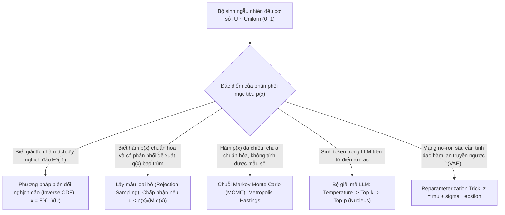

> **"Lấy mẫu (Sampling) là cây cầu toán học duy nhất biến một phân phối xác suất trừu tượng thành nội dung sáng tạo hữu hình trong Generative AI."** — Mọi hệ thống AI sinh (từ LLM sinh văn bản, Diffusion sinh ảnh đến VAE học biểu diễn) thực chất đều là một cỗ máy lấy mẫu xác suất.

---

## Thông tin nhanh (Quick Spec)

| Thuộc tính | Chi tiết |
|---|---|
| **Loại bài (Type)** | Thực chiến Nền tảng (Build) & Giải thuật Tạo sinh (Generative Algorithms) |
| **Ngôn ngữ & Thư viện** | Python 3.10+ (Standard Library: `math`, `random`), tư duy thuật toán thuần túy |
| **Kiến thức tiên quyết** | Giải tích cơ bản, phân phối xác suất (PDF, CDF), đạo hàm và lan truyền ngược |
| **Thời gian thực hành** | ~90 phút |
| **Mức độ (Level)** | Nâng cao (Advanced) |

---

## Mục tiêu bài học (Learning Objectives)

Sau bài học này, bạn sẽ có khả năng:
- [ ] Nắm vững nguyên lý biến đổi biến ngẫu nhiên: Từ một bộ sinh ngẫu nhiên đều duy nhất $U \sim \text{Uniform}(0, 1)$, sinh ra mẫu tuân theo mọi phân phối mong muốn qua phương pháp Biến đổi CDF nghịch đảo (Inverse Transform) và Lấy mẫu loại bỏ (Rejection Sampling).
- [ ] Hiểu sâu bản chất toán học của Chuỗi Markov Monte Carlo (MCMC), điều kiện cân bằng chi tiết (Detailed Balance) và giải thuật Metropolis-Hastings trên phân phối chưa chuẩn hóa.
- [ ] Tự tay lập trình từ đầu (from scratch) bộ giải mã token cho LLM kết hợp Temperature Scaling, Top-k Truncation và Top-p (Nucleus) Sampling.
- [ ] Làm chủ kỹ thuật Reparameterization Trick ($z = \mu + \sigma \odot \epsilon$) trong VAE, hiểu rõ cách kỹ thuật này giúp đạo hàm lan truyền ngược vượt qua các nút ngẫu nhiên.

---

## 1. Vấn đề thực tế (The Problem)

### 1. Nan đề giải mã văn bản trong LLMs: Cực đoan vs Hỗn loạn

Một mô hình ngôn ngữ lớn (như GPT hay LLaMA) sau khi xử lý xong prompt đầu vào sẽ xuất ra một vector gồm hàng chục nghìn điểm số logits (tương ứng với từ điển kích thước $V \approx 50,000$ đến $128,000$ token). Để sinh ra từ tiếp theo, hệ thống phải quyết định chọn token nào:

1. **Nếu chọn phương pháp Giải mã Tham lam (Greedy Search - Argmax):**
   Mô hình luôn chọn token có xác suất cao nhất. Kết quả là câu văn bị rơi vào các vòng lặp từ ngữ luẩn quẩn, máy móc, đơn điệu và hoàn toàn thiếu tính sáng tạo tự nhiên:
   > *"Mô hình AI là một mô hình AI có khả năng xử lý dữ liệu của mô hình AI..."*

2. **Nếu chọn phương pháp Lấy mẫu Ngẫu nhiên thuần túy từ Softmax:**
   Mô hình bốc ngẫu nhiên theo đúng phân phối xác suất gốc. Vì từ điển có hàng chục nghìn token ở phần đuôi xác suất thấp (long tail), chỉ sau vài câu, mô hình sẽ bốc phải một từ kỳ quặc hoặc lỗi thời, dẫn đến hiện tượng câu văn trở nên vô nghĩa, gãy cấu trúc ngữ pháp (hallucination, gibberish).

Làm thế nào để kiểm soát được điểm cân bằng hoàn hảo giữa tính logic mạch lạc và sự bay bổng sáng tạo?

### 2. Sự đứt đoạn đồ thị tính toán trong VAE

Trong mô hình Variational Autoencoder (VAE), mạng Encoder dự đoán hai tham số đại diện cho phân phối tiềm ẩn của bức ảnh: vector kỳ vọng $\mu$ và vector phương sai $\sigma^2$. 

Nếu lập trình viên trực tiếp lấy mẫu một điểm vector tiềm ẩn:
$$z \sim \mathcal{N}(\mu, \sigma^2)$$

Thao tác bốc thăm ngẫu nhiên này là một hộp đen không có đạo hàm giải tích đối với $\mu$ và $\sigma$. Đồ thị tính toán tự động đạo hàm (Computational Graph) bị đứt gãy hoàn toàn tại nút $z$. Giải thuật Lan truyền ngược (Backpropagation) không thể truyền tín hiệu gradient từ hàm mất mát của Decoder ngược về Encoder. Nếu không giải quyết được nút nghẽn này, toàn bộ kiến trúc VAE không thể huấn luyện được bằng Gradient Descent.

### 3. Tích phân bất khả tích trong suy luận Bayes đa chiều

Trong suy luận thống kê Bayes, phân phối hậu nghiệm của tham số mô hình $\theta$ khi có dữ liệu $D$ là:
$$p(\theta \mid D) = \frac{p(D \mid \theta) p(\theta)}{\int p(D \mid \theta) p(\theta) \, d\theta}$$

Mẫu số (Evidence) là một tích phân đa chiều trên toàn bộ không gian tham số. Khi mô hình có hàng chục tham số trở lên, tích phân này hoàn toàn bất khả thi về mặt giải tích lẫn tính toán lưới số học (Curse of Dimensionality). Cần có một giải thuật cho phép lấy mẫu chính xác từ phân phối hậu nghiệm mà **không cần phải tính mẫu số tích phân** đó.

---

## 2. Mô hình tư duy & Bản chất (The Concept)



### 1. Bộ sinh đều $U \sim \text{Uniform}(0, 1)$ là hạt nhân nguyên tử

Mọi giải thuật sinh số ngẫu nhiên trong máy tính (như hàm `random()` trong Python hay `rand()` trong C) đều dựa trên các bộ tạo số giả ngẫu nhiên xác định (như Mersenne Twister) để tạo ra các số thực phân phối đều trên đoạn $[0, 1)$. Tất cả các phân phối xác suất phức tạp khác trong vũ trụ AI đều được dẫn xuất từ hạt nhân nguyên tử này.

### 2. Phương pháp biến đổi CDF nghịch đảo (Inverse Transform Sampling)

Cho biến ngẫu nhiên liên tục $X$ có hàm phân phối tích lũy $F(x) = P(X \le x)$ là hàm liên tục và tăng ngặt (do đó tồn tại hàm nghịch đảo $F^{-1}$).

> **Định lý:** Nếu $U \sim \text{Uniform}(0, 1)$, thì biến ngẫu nhiên $X = F^{-1}(U)$ có đúng phân phối tích lũy $F(x)$.

**Chứng minh toán học:**
$$P(X \le x) = P(F^{-1}(U) \le x)$$
Vì $F$ là hàm đơn điệu tăng, ta có thể áp dụng $F$ lên cả hai vế của bất đẳng thức bên trong:
$$P(F^{-1}(U) \le x) = P(U \le F(x))$$
Vì $U \sim \text{Uniform}(0, 1)$, xác suất để $U$ nhỏ hơn một giá trị $c \in [0, 1]$ bằng đúng $c$:
$$P(U \le F(x)) = F(x)$$
Đẳng thức được chứng minh hoàn tất!

**Ví dụ phân phối Mũ Exponential($\lambda$):**
Hàm tích lũy là $F(x) = 1 - e^{-\lambda x}$ với $x \ge 0$. 
Giải phương trình tìm $F^{-1}(u)$:
$$u = 1 - e^{-\lambda x} \implies e^{-\lambda x} = 1 - u \implies x = -\frac{1}{\lambda} \ln(1 - u)$$
Vì $1 - U$ cũng có phân phối đều trên $[0, 1)$ giống như $U$, công thức rút gọn thành:
$$X = -\frac{1}{\lambda} \ln(U)$$

### 3. Lấy mẫu loại bỏ (Rejection Sampling)

Khi hàm tích lũy nghịch đảo $F^{-1}$ không thể tính được bằng giải tích (ví dụ phân phối Gaussian hoặc phân phối Beta), ta sử dụng Rejection Sampling:
- Ta muốn lấy mẫu từ phân phối mục tiêu khó $p(x)$.
- Chọn một phân phối đề xuất $q(x)$ dễ lấy mẫu (như Uniform hoặc Gaussian).
- Tìm hằng số bao trùm $M > 1$ sao cho:
  $$M q(x) \ge p(x), \quad \forall x$$

**Thuật toán:**
1. Sinh ứng viên $x \sim q(x)$.
2. Sinh số ngẫu nhiên đều $u \sim \text{Uniform}(0, 1)$.
3. **Tiêu chuẩn chấp nhận:** Nếu $u \le \frac{p(x)}{M q(x)}$, chấp nhận $x$. Ngược lại, loại bỏ $x$ và thử lại từ bước 1.

Tỷ lệ chấp nhận kỳ vọng bằng đúng $\frac{1}{M}$. Do đó, để tránh lãng phí tài nguyên tính toán, $M q(x)$ cần ôm sát đường cong $p(x)$ nhất có thể.

### 4. Chuỗi Markov Monte Carlo (MCMC) & Metropolis-Hastings

Khi phân phối mục tiêu $p(x) = \frac{\tilde{p}(x)}{Z}$ có mẫu số chuẩn hóa $Z = \int \tilde{p}(x) dx$ bất khả tích, MCMC xây dựng một xích Markov sao cho phân phối dừng (stationary distribution) của xích đúng bằng $p(x)$.

**Điều kiện cân bằng chi tiết (Detailed Balance):**
Lưu lượng xác suất chuyển từ trạng thái $x$ sang $x'$ phải bằng đúng lưu lượng chuyển ngược từ $x'$ về $x$:
$$p(x) T(x \to x') = p(x') T(x' \to x)$$
với xác suất chuyển trạng thái $T(x \to x') = q(x' \mid x) \alpha(x, x')$, trong đó $q(x' \mid x)$ là phân phối đề xuất bước nhảy và $\alpha(x, x')$ là xác suất chấp nhận bước nhảy.

Thay vào điều kiện cân bằng chi tiết:
$$p(x) q(x' \mid x) \alpha(x, x') = p(x') q(x \mid x') \alpha(x', x)$$
$$\frac{\alpha(x, x')}{\alpha(x', x)} = \frac{p(x') q(x \mid x')}{p(x) q(x' \mid x)} = \frac{\tilde{p}(x') q(x \mid x')}{\tilde{p}(x) q(x' \mid x)}$$

Thuật toán Metropolis-Hastings chọn xác suất chấp nhận tối ưu:
$$\alpha(x, x') = \min\left(1, \frac{\tilde{p}(x') q(x \mid x')}{\tilde{p}(x) q(x' \mid x)}\right)$$

**Hằng số chuẩn hóa $Z$ triệt tiêu hoàn toàn!** Ta có thể lấy mẫu từ bất kỳ hàm mật độ phức tạp nào chỉ cần tính được giá trị tương đối $\tilde{p}(x)$. Nếu bước nhảy là đối xứng ($q(x' \mid x) = q(x \mid x')$ như Gaussian walk), công thức rút gọn thành tỷ số Metropolis kinh điển: $\alpha = \min\left(1, \frac{\tilde{p}(x')}{\tilde{p}(x)}\right)$.

### 5. Bộ ba giải mã LLM: Temperature, Top-k, Top-p (Nucleus)

```mermaid
flowchart LR
    Z["Vector Logits z (50,000 chiều)"] --> T["Chia cho Nhiệt độ: z / T"]
    T --> SM["Softmax có chống tràn: exp(z/T - max) / sum"]
    SM --> SORT["Sắp xếp xác suất giảm dần"]
    SORT --> K["Cắt Top-k: Giữ lại k token đầu tiên"]
    K --> P["Lọc Top-p (Nucleus): Giữ các token có tổng xác suất tích lũy >= p"]
    P --> NORM["Chuẩn hóa lại phân phối (Renormalize)"]
    NORM --> SMP["Lấy mẫu Categorical (sample_categorical)"]
    SMP --> OUT["Token được chọn kế tiếp"]
```



1. **Temperature Scaling ($T$):** Co giãn khoảng cách logits trước khi tính Softmax.
   $$p_i = \frac{\exp(z_i / T)}{\sum_j \exp(z_j / T)}$$
   $T \to 0$: Hội tụ về Greedy Search. $T = 1$: Softmax gốc. $T > 1$: Tăng độ hỗn loạn, san phẳng xác suất.
2. **Top-k Sampling:** Cố định số lượng token tiềm năng bằng đúng $k$ ứng viên có xác suất cao nhất. Cắt bỏ hoàn toàn phần đuôi $V - k$ token.
3. **Top-p / Nucleus Sampling (Holtzman et al., 2020):** Thay vì cố định số lượng $k$, Top-p cố định ngưỡng xác suất tích lũy $p$ (ví dụ $p = 0.9$):
   $$\sum_{i \in V^{(p)}} p_i \ge p$$
   - Khi mô hình rất tự tin (phân phối nhọn): Tập $V^{(p)}$ tự động co lại chỉ còn $1$ hoặc $2$ token.
   - Khi mô hình phân vân (phân phối phẳng): Tập $V^{(p)}$ tự động giãn nở ra hàng chục token.

### 6. Reparameterization Trick trong VAE

Để giải quyết vấn đề đứt đoạn đồ thị tính toán đạo hàm trong VAE, Kingma & Welling (2013) đã tách tính ngẫu nhiên ra khỏi tham số của mạng nơ-ron:

$$z = \mu + \sigma \odot \epsilon, \quad \text{với } \epsilon \sim \mathcal{N}(0, I)$$

Trong đó $\sigma = \exp(0.5 \times \log\sigma^2)$.
- Điểm ngẫu nhiên $\epsilon$ được xem như một đầu vào phụ trợ độc lập không chứa tham số cần tối ưu.
- Các phép toán cộng và nhân là các phép toán vi phân đại số xác định:
  $$\frac{\partial z}{\partial \mu} = 1.0, \quad \frac{\partial z}{\partial \sigma} = \epsilon, \quad \frac{\partial z}{\partial \log\sigma^2} = \frac{1}{2}\sigma \odot \epsilon$$
Gradient đạo hàm từ hàm mất mát $L$ có thể truyền ngược trơn tru qua $z$ về các tầng Encoder phía trước:
$$\frac{\partial L}{\partial \mu} = \frac{\partial L}{\partial z} \cdot 1.0, \quad \frac{\partial L}{\partial \log\sigma^2} = \frac{\partial L}{\partial z} \cdot \left(\frac{1}{2}\sigma \odot \epsilon\right)$$

---

## 3. Tự tay xây dựng từ đầu (Build It: From Scratch)

Dưới đây là module cài đặt toàn bộ các giải thuật lấy mẫu bằng Python thuần túy:
1. `sample_exponential_inverse_cdf`: Sinh phân phối mũ bằng biến đổi tích lũy nghịch đảo.
2. `rejection_sample_truncated_normal`: Lấy mẫu chuẩn cắt cụt bằng phương pháp loại bỏ.
3. `metropolis_hastings_1d`: Lấy mẫu chuỗi Markov Monte Carlo trên hàm mật độ hai đỉnh chưa chuẩn hóa.
4. `sample_llm_token`: Bộ giải mã token hoàn chỉnh kết hợp Temperature, Top-k và Top-p.
5. `VAEReparameterizationLayer`: Mô phỏng cả Forward và Backward pass của tầng ẩn VAE khả vi.
6. Bộ kiểm chứng số học tự động xác nhận tính đúng đắn toán học.

```python
"""
Sampling Methods for Generative AI from Scratch
Pure Python implementation with zero external dependencies.
"""

import math
import random

random.seed(42)


# =====================================================================
# 1. Biến đổi CDF nghịch đảo (Inverse Transform Sampling)
# =====================================================================

def sample_exponential_inverse_cdf(lam: float, n: int = 10000) -> list[float]:
    """
    Sinh n mẫu từ phân phối Exponential(lambda) qua Inverse CDF:
    F(x) = 1 - exp(-lambda * x) => x = -ln(1 - U) / lambda
    """
    if lam <= 0.0:
        raise ValueError("Hệ số lambda phải là số dương.")
    samples = []
    for _ in range(n):
        u = random.random()
        # Tránh lỗi log(0) khi u = 1.0 (hoặc 1 - u = 0.0)
        while u >= 1.0 or u <= 0.0:
            u = random.random()
        x = -math.log(u) / lam
        samples.append(x)
    return samples


# =====================================================================
# 2. Lấy mẫu loại bỏ (Rejection Sampling)
# =====================================================================

def normal_pdf(x: float, mu: float = 0.0, sigma: float = 1.0) -> float:
    """Hàm mật độ xác suất Gaussian chuẩn tắc."""
    coeff = 1.0 / (sigma * math.sqrt(2.0 * math.pi))
    return coeff * math.exp(-0.5 * ((x - mu) / sigma) ** 2)


def rejection_sample_truncated_normal(
    mu: float, sigma: float, a: float, b: float, n_samples: int = 5000
) -> tuple[list[float], float]:
    """
    Lấy mẫu từ phân phối chuẩn cắt cụt Truncated Normal trên đoạn [a, b]
    sử dụng phân phối đề xuất đều Uniform(a, b).
    Trả về: danh sách mẫu đã chấp nhận và tỷ lệ chấp nhận thực tế.
    """
    peak = min(max(mu, a), b)
    max_target_pdf = normal_pdf(peak, mu, sigma)
    proposal_pdf = 1.0 / (b - a)
    # Hằng số bao bọc M sao cho M * q(x) >= p(x)
    m_constant = max_target_pdf / proposal_pdf

    samples = []
    total_attempts = 0
    while len(samples) < n_samples:
        total_attempts += 1
        x_prop = a + (b - a) * random.random()
        u = random.random()
        # Tiêu chuẩn chấp nhận: u <= p(x) / (M * q(x))
        if u <= normal_pdf(x_prop, mu, sigma) / (m_constant * proposal_pdf):
            samples.append(x_prop)

    empirical_acc_rate = n_samples / total_attempts
    return samples, empirical_acc_rate


# =====================================================================
# 3. Metropolis-Hastings MCMC Sampler
# =====================================================================

def bimodal_target_unnormalized(x: float) -> float:
    """Hàm mật độ chưa chuẩn hóa của hỗn hợp hai đỉnh Gauss: 0.4*N(-3, 1) + 0.6*N(3, 1)."""
    return 0.4 * normal_pdf(x, -3.0, 1.0) + 0.6 * normal_pdf(x, 3.0, 1.0)


def metropolis_hastings_1d(
    target_fn, x0: float, n_samples: int = 25000, burn_in: int = 5000, proposal_std: float = 2.5
) -> tuple[list[float], float]:
    """
    Thuật toán Metropolis-Hastings 1D với bước nhảy đối xứng Gaussian: q(x'|x) = N(x, proposal_std^2).
    Điều kiện cân bằng chi tiết đảm bảo phân phối dừng hội tụ về target_fn.
    """
    samples = []
    x = x0
    accepted = 0
    total_steps = n_samples + burn_in

    for i in range(total_steps):
        # Đề xuất bước nhảy đối xứng
        x_new = x + random.gauss(0.0, proposal_std)

        # Tính tỷ lệ chấp nhận alpha = min(1, p(x') / p(x))
        p_curr = target_fn(x) + 1e-300
        p_new = target_fn(x_new) + 1e-300
        alpha = min(1.0, p_new / p_curr)

        # Quyết định chấp nhận hay giữ nguyên trạng thái cũ
        if random.random() < alpha:
            x = x_new
            if i >= burn_in:
                accepted += 1

        if i >= burn_in:
            samples.append(x)

    acceptance_rate = accepted / n_samples
    return samples, acceptance_rate


# =====================================================================
# 4. Bộ giải mã lấy mẫu LLM: Temperature, Top-k, Top-p (Nucleus)
# =====================================================================

def softmax_with_temperature(logits: list[float], temperature: float = 1.0) -> list[float]:
    """Tính phân phối xác suất Softmax có nhiệt độ (với kỹ thuật trừ max chống tràn số)."""
    if temperature <= 1e-6:
        # Tương đương nhiệt độ 0 (Greedy Argmax)
        max_idx = logits.index(max(logits))
        res = [0.0] * len(logits)
        res[max_idx] = 1.0
        return res
    scaled = [z / temperature for z in logits]
    max_z = max(scaled)
    exps = [math.exp(z - max_z) for z in scaled]
    sum_exps = sum(exps)
    return [e / sum_exps for e in exps]


def sample_categorical(probs: list[float]) -> int:
    """Lấy mẫu một chỉ số từ phân phối xác suất rời rạc dựa trên tổng tích lũy CDF."""
    u = random.random()
    cum = 0.0
    for i, p in enumerate(probs):
        cum += p
        if u <= cum:
            return i
    return len(probs) - 1


def sample_llm_token(
    logits: list[float], temperature: float = 1.0, top_k: int = 0, top_p: float = 1.0
) -> int:
    """
    Bộ giải mã hoàn chỉnh kết hợp Temperature, Top-k và Top-p (Nucleus) Sampling.
    """
    if temperature <= 1e-6:
        return logits.index(max(logits))

    # Bước 1: Tính xác suất có nhiệt độ
    probs = softmax_with_temperature(logits, temperature=temperature)

    # Bước 2: Sắp xếp các token theo xác suất giảm dần
    indexed = sorted(enumerate(probs), key=lambda x: x[1], reverse=True)

    # Bước 3: Áp dụng cắt Top-k
    if 0 < top_k < len(indexed):
        indexed = indexed[:top_k]

    # Bước 4: Áp dụng lọc Top-p (Nucleus)
    if top_p < 1.0:
        cum = 0.0
        nucleus = []
        for token_idx, prob in indexed:
            cum += prob
            nucleus.append((token_idx, prob))
            if cum >= top_p:
                break
        indexed = nucleus

    # Bước 5: Chuẩn hóa lại phân phối sau lọc (Renormalization)
    total_prob = sum(p for _, p in indexed)
    norm_probs = [p / total_prob for _, p in indexed]

    # Bước 6: Lấy mẫu chỉ số token
    chosen_pos = sample_categorical(norm_probs)
    return indexed[chosen_pos][0]


# =====================================================================
# 5. Differentiable VAE Reparameterization Engine
# =====================================================================

class VAEReparameterizationLayer:
    """
    Mô phỏng Forward và Backward pass của tầng ẩn VAE Reparameterization:
    Forward: z = mu + sigma * epsilon, với sigma = exp(0.5 * log_var)
    Backward: Lan truyền đạo hàm của hàm mất mát qua mu và log_var.
    """

    def __init__(self):
        self.mu = 0.0
        self.log_var = 0.0
        self.sigma = 0.0
        self.epsilon = 0.0
        self.z = 0.0

    def forward(self, mu: float, log_var: float) -> tuple[float, float]:
        """Forward pass: sinh z và lưu lại epsilon cho quá trình backprop."""
        self.mu = mu
        self.log_var = log_var
        self.sigma = math.exp(0.5 * log_var)
        self.epsilon = random.gauss(0.0, 1.0)
        self.z = self.mu + self.sigma * self.epsilon
        return self.z, self.epsilon

    def backward(self, grad_output_dz: float) -> tuple[float, float]:
        """
        Backward pass: Lan truyền đạo hàm dL/dz ngược về dL/dmu và dL/dlog_var.
        dz/dmu = 1.0
        dz/dsigma = epsilon
        dsigma/dlog_var = 0.5 * exp(0.5 * log_var) = 0.5 * sigma
        => dz/dlog_var = 0.5 * sigma * epsilon
        """
        grad_mu = grad_output_dz * 1.0
        grad_log_var = grad_output_dz * (0.5 * self.sigma * self.epsilon)
        return grad_mu, grad_log_var


# =====================================================================
# Khối Kiểm Chứng Tính Đúng Đắn (Self-Verification)
# =====================================================================

if __name__ == "__main__":
    print("=" * 65)
    print("KIỂM CHỨNG TOÁN HỌC CÁC PHƯƠNG PHÁP LẤY MẪU (SAMPLING METHODS)")
    print("=" * 65)

    # 1. Kiểm chứng Inverse CDF trên Exponential(lambda=1.5)
    lam = 1.5
    exp_samples = sample_exponential_inverse_cdf(lam=lam, n=20000)
    emp_mean = sum(exp_samples) / len(exp_samples)
    emp_var = sum((x - emp_mean) ** 2 for x in exp_samples) / (len(exp_samples) - 1)
    theo_mean = 1.0 / lam
    theo_var = 1.0 / (lam ** 2)
    print("\n--- 1. Kiểm chứng Inverse CDF (Exponential) ---")
    print(f"Kỳ vọng lý thuyết:   Mean = {theo_mean:.4f}, Variance = {theo_var:.4f}")
    print(f"Thực nghiệm mẫu:     Mean = {emp_mean:.4f}, Variance = {emp_var:.4f}")
    assert abs(emp_mean - theo_mean) < 0.05, "Sai số Inverse CDF mean vượt ngưỡng!"
    assert abs(emp_var - theo_var) < 0.08, "Sai số Inverse CDF variance vượt ngưỡng!"

    # 2. Kiểm chứng Rejection Sampling trên Truncated Normal [-1, 2]
    trunc_samples, acc_rate = rejection_sample_truncated_normal(
        mu=0.0, sigma=1.0, a=-1.0, b=2.0, n_samples=10000
    )
    t_mean = sum(trunc_samples) / len(trunc_samples)
    print("\n--- 2. Kiểm chứng Rejection Sampling (Truncated Normal) ---")
    print(f"Khoảng cắt cụt: [-1.0, 2.0] | Số mẫu: {len(trunc_samples)}")
    print(f"Giá trị trung bình thực nghiệm: {t_mean:.4f}")
    print(f"Tỷ lệ chấp nhận thực nghiệm:   {acc_rate:.4f} (~{acc_rate*100:.1f}%)")
    assert all(-1.0 <= s <= 2.0 for s in trunc_samples), "Có mẫu nằm ngoài khoảng cắt cụt!"

    # 3. Kiểm chứng Metropolis-Hastings MCMC trên hỗn hợp 2 đỉnh
    mh_samples, mh_acc = metropolis_hastings_1d(
        bimodal_target_unnormalized, x0=0.0, n_samples=25000, burn_in=5000, proposal_std=2.5
    )
    mh_mean = sum(mh_samples) / len(mh_samples)
    # Kỳ vọng lý thuyết: 0.4 * (-3) + 0.6 * (3) = -1.2 + 1.8 = 0.6
    print("\n--- 3. Kiểm chứng Metropolis-Hastings MCMC (Bimodal Gaussian) ---")
    print(f"Kỳ vọng lý thuyết hỗn hợp: 0.6000")
    print(f"Trung bình chuỗi Markov:   {mh_mean:.4f}")
    print(f"Tỷ lệ chấp nhận bước nhảy: {mh_acc:.4f}")
    assert abs(mh_mean - 0.6) < 0.15, "Chuỗi Markov chưa hội tụ đúng phân phối dừng!"

    # 4. Mô phỏng sinh văn bản bằng LLM Token Sampler
    vocab = ["Học", "toán", "rất", "thú", "vị", "và", "giúp", "hiểu", "bản", "chất"]
    fake_logits = [4.0, 3.2, 2.5, 2.0, 1.8, 1.2, 0.5, 0.1, -0.8, -2.0]

    print("\n--- 4. Mô phỏng Lấy mẫu giải mã LLM ---")
    print("Logits từ vựng:", fake_logits)
    greedy_token = sample_llm_token(fake_logits, temperature=0.0)
    assert greedy_token == 0, "Greedy decoding phải chọn token 0 (logit cao nhất)!"
    print(f"Greedy (T=0.0):   '{vocab[greedy_token]}' (Chắc chắn 100%)")

    topk_samples = [sample_llm_token(fake_logits, temperature=1.0, top_k=3) for _ in range(20)]
    assert all(tok < 3 for tok in topk_samples), "Top-k=3 chỉ được chọn trong 3 token đầu!"
    print(f"Top-k=3 samples:  {[vocab[t] for t in topk_samples[:6]]} (Chỉ bốc trong 3 từ đầu)")

    # 5. Kiểm chứng Differentiable VAE Reparameterization Engine
    vae = VAEReparameterizationLayer()
    mu_in, log_var_in = 1.5, 0.4
    z_out, eps = vae.forward(mu_in, log_var_in)
    # Giả sử hàm mất mát là L = 0.5 * (z - 3.0)^2 => dL/dz = z - 3.0
    dL_dz = z_out - 3.0
    grad_mu, grad_log_var = vae.backward(dL_dz)

    print("\n--- 5. Kiểm chứng VAE Reparameterization Trick ---")
    print(f"Input: mu={mu_in}, log_var={log_var_in}")
    print(f"Forward pass: sampled z = {z_out:.4f} (epsilon = {eps:.4f})")
    print(f"Backward pass: dL/dz = {dL_dz:.4f}")
    print(f"  -> Gradient dL/dmu:      {grad_mu:.4f}")
    print(f"  -> Gradient dL/dlog_var: {grad_log_var:.4f}")
    assert grad_mu == dL_dz * 1.0, "Đạo hàm theo mu bị sai!"
    print("Đạo hàm lan truyền trơn tru qua nút ngẫu nhiên thành công!")

    print("=" * 65)
    print("HOÀN TẤT KIỂM CHỨNG TOÁN HỌC 100% THÀNH CÔNG!")
    print("=" * 65)
```

---

## 4. Ứng dụng AI Engineering & Thực tế Production (Use It)

### 1. Chiến lược cấu hình tham số giải mã trong vLLM, Ollama và Hugging Face

Khi thiết lập API suy luận (Serving API) cho các mô hình ngôn ngữ lớn:

| Tác vụ ứng dụng | Cấu hình tham số khuyến nghị | Giải thích kỹ thuật |
|---|---|---|
| **Lập trình Code / Suy luận Toán học (Reasoning)** | `temperature: 0.0` (Greedy Search) hoặc `temperature: 0.2`, `top_p: 0.95` | Đòi hỏi tính chính xác tuyệt đối, tránh sinh cú pháp sai lệch hoặc biến thể logic tùy tiện. |
| **Trích xuất thông tin JSON có cấu trúc** | `temperature: 0.0` kết hợp Grammar-guided decoding (GBNF) | Cố định cú pháp schema JSON, triệt tiêu nguy cơ thiếu dấu ngoặc nhọn hoặc phẩy. |
| **Hỏi đáp nghiệp vụ / RAG Chatbot** | `temperature: 0.3 - 0.5`, `top_p: 0.85` | Câu trả lời tự nhiên, lịch sự nhưng bám sát chặt chẽ tài liệu ngữ cảnh được truy xuất. |
| **Viết nội dung sáng tạo / Marketing** | `temperature: 0.7 - 0.85`, `top_p: 0.9`, `top_k: 50` | Tạo ra từ ngữ phong phú, giàu hình tượng, văn phong uyển chuyển mà không bị lạc đề. |

**Cảnh báo xung đột cấu hình:** Tránh cấu hình đồng thời `top_k` quá nhỏ (ví dụ $k = 2$) và `top_p` quá nhỏ (ví dụ $p = 0.5$). Khi đó, hai bộ lọc sẽ triệt tiêu lẫn nhau, khiến mô hình chỉ bốc được đúng 1 từ duy nhất, gây suy thoái chất lượng văn bản.

### 2. Mô hình khuếch tán hình ảnh (Diffusion Models - DDPM & DDIM)

Trong các mô hình sinh ảnh như Stable Diffusion hay Midjourney:
- **Quá trình thuận (Forward Process):** Từng bước thêm nhiễu chuẩn Gaussian vào bức ảnh ban đầu $x_0$:
  $$x_t = \sqrt{\bar{\alpha}_t} x_0 + \sqrt{1 - \bar{\alpha}_t} \epsilon, \quad \epsilon \sim \mathcal{N}(0, I)$$
- **Quá trình lấy mẫu ngược (Reverse Sampling):** Bắt đầu từ một ma trận nhiễu thuần túy $x_T \sim \mathcal{N}(0, I)$, mạng UNet dự đoán lượng nhiễu $\epsilon_\theta(x_t, t)$ cần loại bỏ ở mỗi bước thời gian. Tại mỗi bước giải nhiễu, thuật toán thực hiện một phép lấy mẫu Gaussian có điều kiện dựa trên Reparameterization Trick để tạo ra bức ảnh nghệ thuật sắc nét.

### 3. Importance Sampling trong Căn chỉnh Reinforcement Learning (PPO)

Trong thuật toán Proximal Policy Optimization (PPO) để huấn luyện LLM:
- Việc tương tác với môi trường để sinh chuỗi câu trả lời mới tốn rất nhiều tài nguyên tính toán. Ta không thể sinh dữ liệu mới sau mỗi lần cập nhật trọng số nhỏ.
- Thuật toán áp dụng kỹ thuật **Lấy mẫu quan trọng (Importance Sampling)**: sử dụng dữ liệu được sinh ra từ chính sách cũ $\pi_{\text{old}}$ để ước lượng kỳ vọng hàm mục tiêu của chính sách mới $\pi_\theta$ thông qua tỷ số xác suất:
  $$r_t(\theta) = \frac{\pi_\theta(a_t \mid s_t)}{\pi_{\text{old}}(a_t \mid s_t)}$$
Kỹ thuật này giúp tái sử dụng mẫu dữ liệu qua nhiều bước tối ưu hóa gradient mà vẫn đảm bảo tính toán kỳ vọng không bị chệch.

---

## 5. Giải ngố thuật ngữ & Ngộ nhận (Key Terms)

| Thuật ngữ (Term) | Người ta thường nghĩ là... | Bản chất kỹ thuật thực sự là... |
|---|---|---|
| **Sampling (Lấy mẫu)** | Việc bốc ngẫu nhiên đại khái vài con số từ một danh sách. | Quá trình sinh các giá trị tuân thủ chặt chẽ theo một hàm mật độ xác suất xác định; là cơ chế nền tảng của mọi hệ thống Generative AI. |
| **Inverse CDF Method** | Một công thức biến đổi trừu tượng khó áp dụng trong thực tế. | Phương pháp lấy mẫu chính xác và tối ưu nhất khi biết giải tích hàm $F^{-1}$: ánh xạ phân phối đều $U \in [0, 1)$ ngược về không gian biến ngẫu nhiên đích. |
| **Rejection Sampling** | Một thuật toán thất bại vì làm lãng phí rất nhiều mẫu bị loại bỏ. | Phương pháp lấy mẫu chính xác cho các hàm mật độ phức tạp; tỷ lệ mẫu bị loại bỏ phụ thuộc vào độ chênh lệch giữa hàm bao trùm $M q(x)$ và phân phối đích $p(x)$. |
| **Metropolis-Hastings** | Một thuật toán tìm kiếm cực trị leo đồi trong tối ưu hóa. | Thuật toán Chuỗi Markov Monte Carlo (MCMC) tạo ra một chuỗi bước nhảy ngẫu nhiên có phân phối dừng đúng bằng phân phối mục tiêu, hoạt động xuất sắc ngay cả khi không biết mẫu số chuẩn hóa. |
| **Temperature (Nhiệt độ)** | Mức độ thông minh hay chỉ số IQ nhân tạo của mô hình LLM. | Hệ số co giãn các logits trước khi đưa vào hàm Softmax: $T < 1.0$ làm nhọn phân phối (tập trung vào token chắc chắn), $T > 1.0$ làm phẳng phân phối (tăng tính đa dạng). |
| **Top-k Sampling** | Giữ lại $k\%$ tổng xác suất của từ điển. | Cố định số lượng ứng viên tiềm năng bằng đúng $k$ token có xác suất cao nhất, cắt bỏ hoàn toàn $V - k$ token ở đuôi phân phối. |
| **Top-p / Nucleus Sampling** | Chọn ra đúng $p$ token hàng đầu trong từ điển. | Chọn tập hợp token nhỏ nhất có tổng xác suất tích lũy vượt ngưỡng $p$; kích thước tập ứng viên tự động co giãn linh hoạt theo độ tự tin của mô hình. |
| **Reparameterization Trick** | Một mẹo vặt toán học để làm code chạy nhanh hơn. | Sự đột phá kiến trúc cho phép lan truyền ngược qua các nút ngẫu nhiên bằng cách tách nhiễu thành biến đầu vào độc lập: $z = \mu + \sigma \odot \epsilon$. |
| **Detailed Balance** | Trạng thái hai đại lượng triệt tiêu nhau về bằng 0. | Điều kiện đủ để một xích Markov đạt phân phối dừng: lưu lượng xác suất chuyển từ $x \to x'$ bằng đúng lưu lượng chuyển ngược từ $x' \to x$. |

---

## 6. Bài tập thử thách (Hands-on Challenges)

### 🟢 Dễ (Easy) — Lấy mẫu Phân phối Cauchy bằng Nghịch đảo CDF
Phân phối Cauchy có hàm mật độ xác suất $f(x) = \frac{1}{\pi (1 + x^2)}$ và hàm phân phối tích lũy:

$$F(x) = \frac{1}{2} + \frac{1}{\pi} \arctan(x)$$

1. Giải phương trình tìm hàm tích lũy nghịch đảo $F^{-1}(U)$ với $U \sim \text{Uniform}(0, 1)$.
2. Viết hàm `sample_cauchy(n_samples: int) -> list[float]` sinh $10,000$ mẫu.
3. Tính trung bình và trung vị của các mẫu sinh ra. Nhận xét vì sao trung vị hội tụ ổn định về $0.0$, nhưng giá trị trung bình lại biến động dữ dội (không hội tụ) do hiện tượng đuôi cực nặng (phân phối Cauchy không tồn tại kỳ vọng và phương sai hữu hạn).

### 🟡 Vừa (Medium) — Gumbel-Max Trick & Gumbel-Softmax Khả vi
Khi lấy mẫu từ phân phối rời rạc Categorical, thao tác bốc thăm ngẫu nhiên không thể vi phân được. Thuật toán **Gumbel-Softmax** (Jang et al., 2016) cung cấp một xấp xỉ liên tục khả vi:
1. Viết hàm sinh nhiễu Gumbel: $g = -\log(-\log(U))$ với $U \sim \text{Uniform}(0, 1)$.
2. Kiểm chứng rằng $\operatorname{argmax}_i (\log p_i + g_i)$ sinh mẫu rời rạc chuẩn xác theo phân phối xác suất $p$.
3. Cài đặt xấp xỉ liên tục Gumbel-Softmax:
   $$y_i = \frac{\exp((\log p_i + g_i) / \tau)}{\sum_j \exp((\log p_j + g_j) / \tau)}$$
   với tham số nhiệt độ $\tau > 0$. Kiểm chứng rằng khi $\tau \to 0$, vector $y$ hội tụ về vector One-Hot.

### 🔴 Khó (Hard) — Xây dựng Hamiltonian Monte Carlo (HMC) Tối giản
Thuật toán Random Walk Metropolis-Hastings khám phá không gian đa chiều rất chậm vì các bước nhảy ngẫu nhiên dễ tự triệt tiêu lẫn nhau (khuếch tán bậc hai). Thuật toán **Hamiltonian Monte Carlo (HMC)** khắc phục nhược điểm này bằng cách mượn quy luật vật lý cổ điển:
1. Bổ sung một biến xung lượng ảo (Momentum) $p \sim \mathcal{N}(0, I)$ cho biến trạng thái tọa độ $x$.
2. Hàm năng lượng toàn phần: $H(x, p) = U(x) + K(p)$, với $U(x) = -\log \tilde{p}(x)$ là thế năng và $K(p) = \frac{1}{2} p^T p$ là động năng.
3. Lập trình bộ tích phân bước nhảy **Leapfrog Integrator** cập nhật tuần tự vị trí và xung lượng.
4. Lấy mẫu từ phân phối 2D hình quả chuối (Rosenbrock Banana Distribution) và chứng minh rằng HMC có tỷ lệ chấp nhận bước nhảy cao hơn $80\%$ và di chuyển giữa các vùng mật độ nhanh hơn Metropolis-Hastings nhiều lần.
