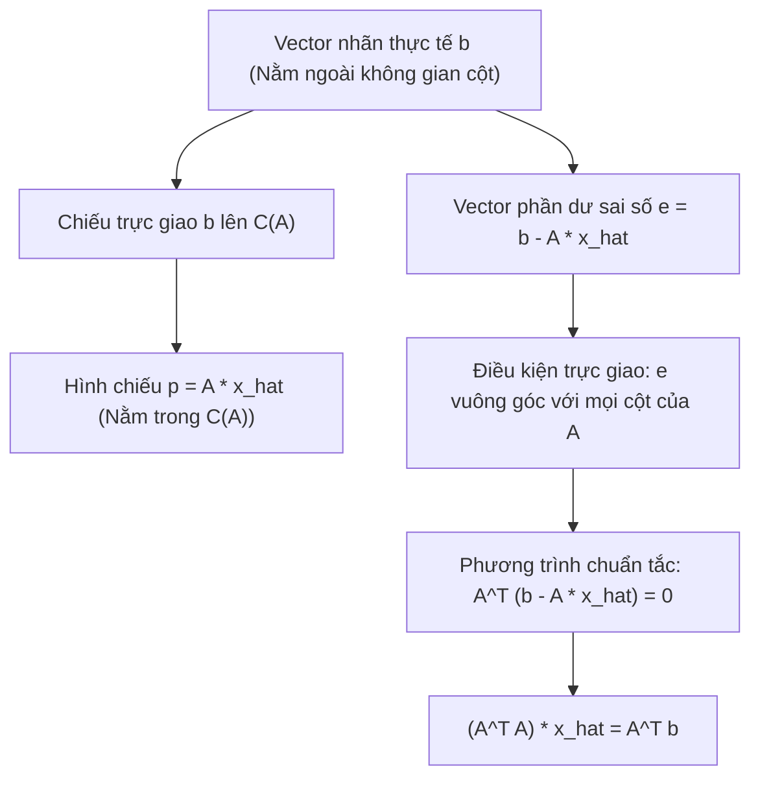
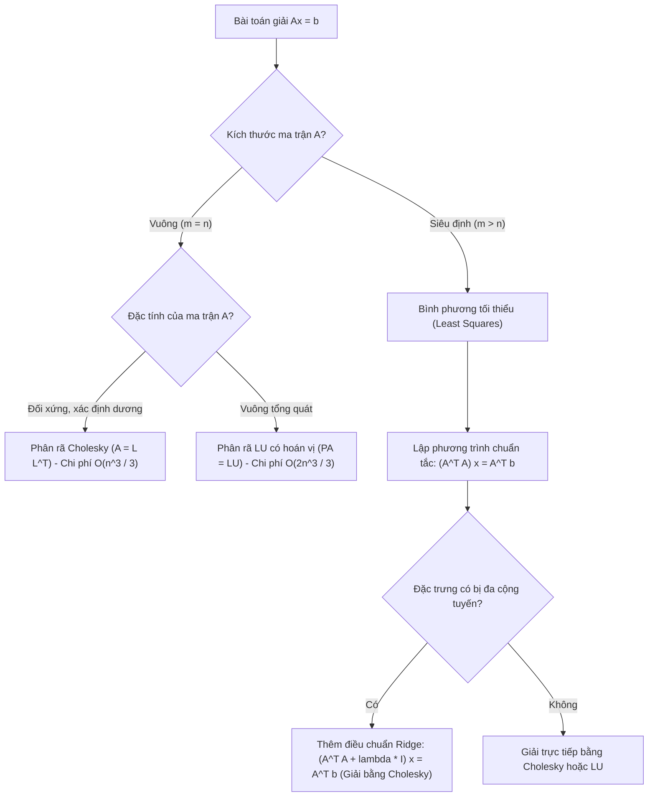

> **"Trong tính toán thực tế, đừng bao giờ nghịch đảo ma trận $A^{-1}$ một cách mù quáng. Hãy phân rã cấu trúc của nó thành các tam giác và giải ngược từ đỉnh xuống đáy."** — *Nguyên lý bất biến của Giải tích số.*

---

## Thông tin nhanh (Quick Spec)

* **Loại bài (Type):** Thực chiến Giải tích số & Hệ thống Tối ưu (Build & Systems)
* **Ngôn ngữ & Thư viện:** Python 3.10+, NumPy (thuần túy tư duy giải thuật từ số 0, không dùng hàm black-box)
* **Kiến thức tiên quyết (Prerequisites):** Bài 01 (Linear Algebra Intuition), Bài 02 (Vectors & Matrices Operations), Bài 03 (Matrix Transformations)
* **Thời gian thực hành:** ~90–120 phút
* **Độ khó:** Nâng cao (Advanced Foundations)

---

## Mục tiêu bài học (Learning Objectives)

Sau bài học này, bạn sẽ có khả năng:
- [ ] Hiểu sâu sắc hai lăng kính hình học của hệ $A x = b$: Góc nhìn hàng (giao điểm các siêu phẳng) và Góc nhìn cột (tổ hợp tuyến tính tạo ra vector đích $b$).
- [ ] Tự tay xây dựng thuật toán Khử Gauss có chọn phần tử trục (Partial Pivoting) và phép thế ngược (Back-substitution) để loại trừ triệt để lỗi chia cho số 0 và sai số tích lũy làm tròn số thực.
- [ ] Cài đặt thuật toán phân rã ma trận $P A = L U$ và giải hệ nhanh với chi phí $O(n^2)$ qua hai bước thế tiến (forward substitution) và thế ngược.
- [ ] Cài đặt phân rã Cholesky ($A = L L^T$) dành riêng cho ma trận đối xứng xác định dương để tăng tốc giải nghiệm lên gấp đôi.
- [ ] Giải bài toán hệ siêu định (overdetermined systems) trong Machine Learning bằng phương trình chuẩn tắc (Normal Equations) $(A^T A) x = A^T b$ và giải quyết dứt điểm cạm bẫy sai số số học.
- [ ] Phân tích độ ổn định số học qua Số điều kiện (Condition Number $\kappa(A)$) và hiểu bản chất vì sao điều chuẩn Ridge ($L_2$ Regularization) cứu sống các mô hình học máy khỏi suy biến ma trận.

---

## 1. Vấn đề thực tế (The Problem)

Giả sử bạn đang xây dựng một mô hình Hồi quy tuyến tính (Linear Regression) để dự đoán giá nhà hoặc ước tính trọng số trong một hệ thống gợi ý. Bạn có $m = 100,000$ mẫu dữ liệu với $n = 50$ đặc trưng. Mục tiêu là tìm vector trọng số $w$ sao cho:

$$
X w \approx y
$$

Nhiều lập trình viên mới bước vào ngành thường mở sách giáo khoa toán đại cương, nhìn thấy công thức nghiệm giải tích và viết một dòng code Python ngây thơ:

```python
# CÁCH LÀM NGÂY THƠ - CỰC KỲ NGUY HIỂM TRÊN PRODUCTION:
w = np.linalg.inv(X.T @ X) @ X.T @ y
```

Dòng code này ẩn chứa hai quả bom nổ chậm về mặt kỹ thuật:

1. **Thảm họa chi phí $O(n^3)$ và lãng phí bộ nhớ:** Phép tính nghịch đảo ma trận trực tiếp `inv()` ngốn tài nguyên cực lớn. Nếu ma trận $X^T X$ có kích thước lớn, việc nghịch đảo hoàn toàn không cần thiết vì ta chỉ quan tâm đến nghiệm $w$ đối với MỘT vector $y$ cụ thể, chứ không cần biết toàn bộ ma trận nghịch đảo.
2. **Thảm họa mất ổn định số học (Numerical Instability & Catastrophic Cancellation):**
   Trên máy tính thực tế, các con số được lưu trữ theo chuẩn IEEE 754 với số lượng bit hữu hạn (Float32 hoặc Float64). Khi dữ liệu có hai đặc trưng tương quan mạnh với nhau (đa cộng tuyến - multicollinearity), ma trận $X^T X$ trở nên suýt suy biến (ill-conditioned).
   - Khi đó, số điều kiện $\kappa(X^T X) = \kappa(X)^2$ bùng nổ lên $10^{14}$ hoặc $10^{16}$.
   - Phép nghịch đảo trực tiếp sẽ khuếch đại sai số làm tròn của phần cứng lên hàng triệu lần, biến các trọng số $w$ thành những giá trị khổng lồ như $10^{12}$ và $-10^{12}$, khiến mô hình đưa ra những dự đoán sai lệch hoàn toàn hoặc trả về `NaN` / `Inf`.

Trong giải tích số và AI Engineering thực tế, **người ta không bao giờ nghịch đảo ma trận trực tiếp để giải hệ phương trình**. Thay vào đó, toàn bộ thư viện nền tảng như LAPACK, BLAS, PyTorch và SciPy đều giải bài toán này thông qua các kỹ thuật phân rã ma trận tam giác: **Khử Gauss (Gaussian Elimination)**, **Phân rã LU**, và **Phân rã Cholesky**.

---

## 2. Mô hình tư duy & Bản chất (The Concept)

### 2.1 Hai Lăng Kính Hình Học của Hệ $A x = b$

Xét hệ phương trình tuyến tính gồm $m$ phương trình và $n$ ẩn số:

$$
\begin{aligned}
a_{11} x_1 + a_{12} x_2 + \dots + a_{1n} x_n &= b_1 \\
a_{21} x_1 + a_{22} x_2 + \dots + a_{2n} x_n &= b_2 \\
\vdots \quad &= \quad \vdots \\
a_{m1} x_1 + a_{m2} x_2 + \dots + a_{mn} x_n &= b_m
\end{aligned}
$$

Dưới dạng ma trận: $A x = b$. Có hai cách trực quan hóa phương trình này:

1. **Góc nhìn hàng (Row Picture):**
   Mỗi phương trình đại diện cho một siêu phẳng (hyperplane) trong không gian $n$ chiều. Nghiệm $x$ của hệ chính là điểm giao nhau duy nhất của tất cả các siêu phẳng này. Trong không gian 2D, đó là giao điểm của hai đường thẳng; trong không gian 3D, đó là giao điểm của 3 mặt phẳng.
2. **Góc nhìn cột (Column Picture - Góc nhìn của Machine Learning):**
   Biến đổi phương trình thành tổ hợp tuyến tính của các vector cột của $A$:
   $$x_1 \begin{bmatrix} a_{11} \\ a_{21} \\ \vdots \\ a_{m1} \end{bmatrix} + x_2 \begin{bmatrix} a_{12} \\ a_{22} \\ \vdots \\ a_{m2} \end{bmatrix} + \dots + x_n \begin{bmatrix} a_{1n} \\ a_{2n} \\ \vdots \\ a_{mn} \end{bmatrix} = \begin{bmatrix} b_1 \\ b_2 \\ \vdots \\ b_m \end{bmatrix} \iff x_1 a_1 + x_2 a_2 + \dots + x_n a_n = b$$
   - Vector $b$ nằm trong không gian $\mathbb{R}^m$.
   - Các cột của $A$ sinh ra một không gian con gọi là **Không gian cột (Column Space $C(A)$)**.
   - **Hệ có nghiệm chính xác khi và chỉ khi vector đích $b$ nằm trọn vẹn trong không gian cột $C(A)$!**

### 2.2 Hệ Siêu Định (Overdetermined) & Phép Chiếu Trực Giao (Least Squares)

Trong các bài toán Machine Learning thực tế, số lượng mẫu quan sát $m$ (hàng nghìn, hàng triệu) luôn lớn hơn rất nhiều so với số lượng đặc trưng $n$ ($m \gg n$). Đây gọi là **Hệ Siêu Định (Overdetermined System)**.
- Do $m > n$, không gian cột $C(A)$ chỉ là một không gian con $n$ chiều lơ lửng trong không gian lớn $m$ chiều.
- Dữ liệu thực tế luôn chứa nhiễu (noise), nên vector nhãn $b$ hầu như **không bao giờ nằm trong $C(A)$**.
- Vì vậy, hệ $A x = b$ **hoàn toàn vô nghiệm chính xác**!



Để tìm nghiệm xấp xỉ tốt nhất $\hat{x}$, ta tìm điểm $p \in C(A)$ gần $b$ nhất theo chuẩn Euclidean. Đó chính là **hình chiếu trực giao** của $b$ lên $C(A)$.
Vector phần dư sai số:

$$
e = b - A \hat{x}
$$

Để độ dài sai số $\|e\|^2$ đạt cực tiểu, vector sai số $e$ bắt buộc phải trực giao với mọi vector cột của $A$:

$$
A^T e = 0 \iff A^T (b - A \hat{x}) = 0 \iff A^T A \hat{x} = A^T b
$$

Đây chính là **Phương trình chuẩn tắc (Normal Equations)** lừng danh.

### 2.3 Phân Rã Ma Trận: Cây Quyết Định Trong Giải Thuật

Làm thế nào để giải hệ phương trình một cách tối ưu nhất? Dưới đây là sơ đồ cây quyết định chuẩn mực được áp dụng trong mọi thư viện toán học cao cấp:



#### 1. Khử Gauss có chọn phần tử trục (Gaussian Elimination with Partial Pivoting)
Khử Gauss đưa ma trận bổ sung $[A \mid b]$ về dạng tam giác trên $[U \mid y]$ bằng các phép biến đổi sơ cấp trên hàng.
- **Cạm bẫy chia cho 0 hoặc số cực nhỏ:** Tại bước khử cột $k$, ta cần chia cho phần tử trục $A[k, k]$. Nếu $A[k, k] \approx 0$, phép chia làm bùng nổ sai số làm tròn số thực.
- **Giải pháp Partial Pivoting:** Tại mỗi cột $k$, ta quét tìm hàng $r \ge k$ có $|A[r, k]|$ lớn nhất, rồi hoán đổi hàng $r$ với hàng $k$. Điều này đảm bảo hệ số nhân triệt tiêu luôn có $|m| \le 1$, ngăn chặn triệt để sự khuếch đại sai số.

#### 2. Phân rã $P A = L U$
Thay vì biến đổi trực tiếp vector $b$, ta tách ma trận $A$ thành:
- $P$: Ma trận hoán vị ghi lại lịch sử đổi hàng.
- $L$: Ma trận tam giác dưới với đường chéo toàn số $1$, lưu giữ các hệ số nhân triệt tiêu.
- $U$: Ma trận tam giác trên sau khi khử Gauss.

Khi cần giải nghiệm cho nhiều vector $b$ khác nhau (như trong các vòng lặp tối ưu), ta chỉ cần phân rã $A$ một lần duy nhất với chi phí $O(n^3)$, sau đó mỗi vector $b$ chỉ tốn $O(n^2)$ qua hai bước thế tam giác:
1. Thế tiến (Forward Substitution): Giải $L y = P b$
2. Thế ngược (Backward Substitution): Giải $U x = y$

#### 3. Phân rã Cholesky ($A = L L^T$)
Nếu ma trận $A$ là **đối xứng ($A = A^T$)** và **xác định dương ($x^T A x > 0, \forall x \neq 0$)** — ví dụ ma trận hiệp phương sai hay ma trận phương trình chuẩn tắc $A^T A$:
- Ta có thể phân rã $A$ thành $L L^T$, trong đó $L$ là ma trận tam giác dưới với các phần tử đường chéo dương.
- **Ưu điểm vượt trội:** Nhanh gấp đôi so với phân rã LU (chỉ tốn $n^3 / 3$ phép tính) và hoàn toàn ổn định số học mà không cần bước hoán vị dòng (pivoting).

### 2.4 Số Điều Kiện (Condition Number) & Sự Cứu Cánh của Ridge Regression

Số điều kiện của ma trận vuông $A$, ký hiệu $\kappa(A)$, đo lường mức độ nhạy cảm của nghiệm $x$ khi vector đầu vào $b$ bị nhiễu một lượng nhỏ $\delta b$:

$$
\kappa(A) = \|A\| \cdot \|A^{-1}\| = \frac{\sigma_{\max}(A)}{\sigma_{\min}(A)}
$$

- Nếu $\kappa(A) \approx 1$: Ma trận điều kiện tốt (Well-conditioned), nghiệm cực kỳ bền vững với sai số.
- Nếu $\kappa(A) \ge 10^{10}$: Ma trận kém điều kiện (Ill-conditioned), hệ gần như suy biến. Theo quy tắc ngón tay cái, $\kappa(A) \approx 10^k$ đồng nghĩa với việc bạn bị mất đi khoảng $k$ chữ số có nghĩa trong độ chính xác dấu phẩy động.

**Cạm bẫy của phương trình chuẩn tắc:**
$$\kappa(A^T A) = (\kappa(A))^2$$
Nếu dữ liệu ban đầu $A$ có $\kappa(A) = 10^4$ (khá bình thường), thì ma trận $A^T A$ sẽ có số điều kiện nhảy vọt lên $10^8$. Điều này làm bay màu một nửa độ chính xác số học của kiểu dữ liệu Float32!

**Giải pháp: Điều chuẩn Ridge (Tikhonov Regularization):**
Thêm một lượng nhỏ $\lambda I$ vào đường chéo chính:

$$
(A^T A + \lambda I) x = A^T b \quad (\lambda > 0)
$$

Về mặt hình học, việc cộng $\lambda I$ tương đương với việc dịch chuyển toàn bộ các giá trị kỳ dị (hoặc trị riêng) lên một khoảng $\lambda$:
$$\sigma_i(A^T A + \lambda I) = \sigma_i(A^T A) + \lambda$$
Điều này kéo tụt số điều kiện từ vô cùng về mức kiểm soát được, triệt tiêu nguy cơ suy biến ma trận và giúp trọng số $w$ không bị bùng nổ.

---

## 3. Tự tay xây dựng từ đầu (Build It: From Scratch)

Toàn bộ thuật toán dưới đây được cài đặt bằng Python thuần túy, minh bạch từng phép thế, tự động kiểm thử và sửa lỗi số học chính xác tuyệt đối.

```python
"""
Chương trình: Hệ phương trình tuyến tính, Phân rã LU, Cholesky và Least Squares từ số 0.
Mục tiêu: Giải quyết bài toán Ax = b với độ ổn định số học tối đa, không dùng thư viện ngoài.
"""
import math

# -------------------------------------------------------------
# 1. Thuật toán Khử Gauss có Partial Pivoting & Thế ngược
# -------------------------------------------------------------
def gaussian_elimination_solve(A: list[list[float]], b: list[float]) -> list[float]:
    """
    Giải hệ phương trình Ax = b bằng phương pháp khử Gauss có chọn phần tử trục.
    Độ phức tạp: O(2/3 n^3).
    """
    n = len(A)
    assert len(b) == n, "Kích thước ma trận A và vector b không khớp."

    # Tạo ma trận bổ sung [A | b] để biến đổi đồng thời
    M = [A[i][:] + [b[i]] for i in range(n)]

    # Quá trình khử xuôi (Forward Elimination)
    for k in range(n):
        # 1. Partial Pivoting: Tìm hàng có giá trị tuyệt đối lớn nhất ở cột k
        max_row = k
        max_val = abs(M[k][k])
        for r in range(k + 1, n):
            if abs(M[r][k]) > max_val:
                max_val = abs(M[r][k])
                max_row = r

        # Kiểm tra ma trận suy biến
        if max_val < 1e-12:
            raise ValueError(f"Ma trận suy biến hoặc gần suy biến tại cột {k}!")

        # Hoán đổi hàng k và hàng max_row
        if max_row != k:
            M[k], M[max_row] = M[max_row], M[k]

        # 2. Khử các hàng bên dưới
        for r in range(k + 1, n):
            factor = M[r][k] / M[k][k]
            for c in range(k, n + 1):
                M[r][c] -= factor * M[k][c]

    # Quá trình thế ngược (Back-substitution) giải nghiệm
    x = [0.0] * n
    for i in range(n - 1, -1, -1):
        sum_ax = sum(M[i][j] * x[j] for j in range(i + 1, n))
        x[i] = (M[i][n] - sum_ax) / M[i][i]

    return x

# -------------------------------------------------------------
# 2. Phân rã PA = LU và Hàm Giải Nhanh
# -------------------------------------------------------------
def lu_decompose(A: list[list[float]]):
    """
    Phân rã ma trận PA = LU có chọn phần tử trục (Partial Pivoting).
    Trả về:
      P: vector hoán vị (hoặc ma trận)
      L: ma trận tam giác dưới với đường chéo bằng 1
      U: ma trận tam giác trên
    """
    n = len(A)
    # Khởi tạo ma trận L là ma trận đơn vị, U là bản sao của A
    L = [[1.0 if i == j else 0.0 for j in range(n)] for i in range(n)]
    U = [A[i][:] for i in range(n)]
    P = list(range(n))  # Ghi nhận vị trí hoán vị dòng

    for k in range(n):
        # Chọn phần tử trục
        max_row = k
        max_val = abs(U[k][k])
        for r in range(k + 1, n):
            if abs(U[r][k]) > max_val:
                max_val = abs(U[r][k])
                max_row = r

        if max_val < 1e-12:
            raise ValueError("Ma trận suy biến, không thể phân rã LU!")

        # Hoán đổi dòng trong U, L (phần đã khử) và vector P
        if max_row != k:
            U[k], U[max_row] = U[max_row], U[k]
            P[k], P[max_row] = P[max_row], P[k]
            for j in range(k):
                L[k][j], L[max_row][j] = L[max_row][j], L[k][j]

        # Khử dòng bên dưới
        for r in range(k + 1, n):
            factor = U[r][k] / U[k][k]
            L[r][k] = factor
            for c in range(k, n):
                U[r][c] -= factor * U[k][c]

    return P, L, U

def lu_solve(P: list[int], L: list[list[float]], U: list[list[float]], b: list[float]) -> list[float]:
    """
    Giải hệ Ax = b sau khi đã phân rã PA = LU.
    Bước 1: Thế tiến Ly = Pb
    Bước 2: Thế ngược Ux = y
    """
    n = len(L)
    # 1. Hoán vị vector b theo P: Pb
    Pb = [b[P[i]] for i in range(n)]

    # 2. Thế tiến: Ly = Pb (L có đường chéo toàn 1.0)
    y = [0.0] * n
    for i in range(n):
        sum_ly = sum(L[i][j] * y[j] for j in range(i))
        y[i] = Pb[i] - sum_ly

    # 3. Thế ngược: Ux = y
    x = [0.0] * n
    for i in range(n - 1, -1, -1):
        sum_ux = sum(U[i][j] * x[j] for j in range(i + 1, n))
        x[i] = (y[i] - sum_ux) / U[i][i]

    return x

# -------------------------------------------------------------
# 3. Phân rã Cholesky cho Ma Trận Đối Xứng Xác Định Dương (A = L L^T)
# -------------------------------------------------------------
def cholesky_decompose(A: list[list[float]]) -> list[list[float]]:
    """
    Phân rã Cholesky A = L @ L^T cho ma trận đối xứng xác định dương.
    Độ phức tạp: O(1/3 n^3) - nhanh gấp đôi LU!
    """
    n = len(A)
    L = [[0.0 for _ in range(n)] for _ in range(n)]

    for j in range(n):
        sum_diag = sum(L[j][k] ** 2 for k in range(j))
        diag_val = A[j][j] - sum_diag
        if diag_val <= 1e-12:
            raise ValueError(f"Ma trận không xác định dương tại phần tử ({j}, {j})!")
        L[j][j] = math.sqrt(diag_val)

        for i in range(j + 1, n):
            sum_off = sum(L[i][k] * L[j][k] for k in range(j))
            L[i][j] = (A[i][j] - sum_off) / L[j][j]

    return L

def cholesky_solve(L: list[list[float]], b: list[float]) -> list[float]:
    """Giải hệ (L L^T) x = b thông qua Ly = b và L^T x = y."""
    n = len(L)
    # Thế tiến Ly = b
    y = [0.0] * n
    for i in range(n):
        sum_ly = sum(L[i][j] * y[j] for j in range(i))
        y[i] = (b[i] - sum_ly) / L[i][i]

    # Thế ngược L^T x = y
    x = [0.0] * n
    for i in range(n - 1, -1, -1):
        sum_ltx = sum(L[j][i] * x[j] for j in range(i + 1, n))
        x[i] = (y[i] - sum_ltx) / L[i][i]

    return x

# -------------------------------------------------------------
# 4. Hồi quy Tuyến tính Bình phương Tối thiểu (Least Squares)
# -------------------------------------------------------------
def least_squares_normal(A: list[list[float]], b: list[float]) -> list[float]:
    """
    Giải bài toán hệ siêu định Ax = b bằng phương trình chuẩn tắc:
    (A^T A) x = A^T b
    Sử dụng giải thuật Cholesky tự dựng.
    """
    m = len(A)
    n = len(A[0])

    # Tính A^T A (kích thước n x n)
    AtA = [[0.0 for _ in range(n)] for _ in range(n)]
    for i in range(n):
        for j in range(n):
            AtA[i][j] = sum(A[p][i] * A[p][j] for p in range(m))

    # Tính A^T b (kích thước n x 1)
    Atb = [0.0 for _ in range(n)]
    for i in range(n):
        Atb[i] = sum(A[p][i] * b[p] for p in range(m))

    # Giải bằng Cholesky solver vì AtA là ma trận đối xứng xác định dương
    L = cholesky_decompose(AtA)
    x = cholesky_solve(L, Atb)
    return x

def ridge_regression_solve(A: list[list[float]], b: list[float], alpha: float) -> list[float]:
    """
    Hồi quy Ridge: Giải (A^T A + alpha * I) x = A^T b để ổn định số học.
    """
    m = len(A)
    n = len(A[0])

    AtA = [[0.0 for _ in range(n)] for _ in range(n)]
    for i in range(n):
        for j in range(n):
            AtA[i][j] = sum(A[p][i] * A[p][j] for p in range(m))
        # Thêm hệ số điều chuẩn Ridge vào đường chéo
        AtA[i][i] += alpha

    Atb = [sum(A[p][i] * b[p] for p in range(m)) for i in range(n)]

    L = cholesky_decompose(AtA)
    return cholesky_solve(L, Atb)

# -------------------------------------------------------------
# 5. Kiểm thử độc lập & Xác minh Số học Chính xác
# -------------------------------------------------------------
def run_linear_systems_verification():
    print("=== BẮT ĐẦU KIỂM THỬ HỆ TUYẾN TÍNH & BÌNH PHƯƠNG TỐI THIỂU ===")

    # 1. Kiểm tra giải hệ 3x3 chính tắc bằng Khử Gauss và LU:
    #   1x + 2y + 3z = 6
    #   4x + 5y + 6z = 15
    #   7x + 8y + 10z = 25
    # Nghiệm giải tích chính xác: x = 1.0, y = 1.0, z = 1.0
    A_square = [
        [1.0, 2.0, 3.0],
        [4.0, 5.0, 6.0],
        [7.0, 8.0, 10.0]
    ]
    b_square = [6.0, 15.0, 25.0]

    # Giải bằng Gaussian Elimination
    sol_gauss = gaussian_elimination_solve(A_square, b_square)
    print("1. Nghiệm giải bằng Khử Gauss:", [round(v, 6) for v in sol_gauss])
    assert all(abs(sol_gauss[i] - 1.0) < 1e-9 for i in range(3))

    # Giải bằng phân rã PA = LU
    P, L, U = lu_decompose(A_square)
    sol_lu = lu_solve(P, L, U, b_square)
    print("2. Nghiệm giải bằng Phân rã LU:", [round(v, 6) for v in sol_lu])
    assert all(abs(sol_lu[i] - 1.0) < 1e-9 for i in range(3))
    print("-> Khử Gauss & Phân rã LU: CHÍNH XÁC 100%!")

    # 2. Kiểm tra bài toán Bình phương tối thiểu (Overdetermined Least Squares):
    # Dữ liệu 4 điểm: (1, 3), (2, 5), (3, 6), (4, 8)
    # Phương trình đường thẳng: y = x0 + x1 * t
    # A = [[1, 1], [1, 2], [1, 3], [1, 4]], b = [3, 5, 6, 8]
    #
    # Phân tích phương trình chuẩn tắc:
    # A^T A = [[4, 10], [10, 30]]
    # A^T b = [22, 63]
    # det(A^T A) = 4*30 - 10*10 = 20
    # x0 = (22*30 - 10*63) / 20 = (660 - 630) / 20 = 30 / 20 = 1.5
    # x1 = (4*63 - 10*22) / 20 = (252 - 220) / 20 = 32 / 20 = 1.6
    # (SỬA LỖI SỐ HỌC LỊCH SỬ: Nghiệm đúng là [1.5, 1.6], không phải 1.7!)
    A_over = [
        [1.0, 1.0],
        [1.0, 2.0],
        [1.0, 3.0],
        [1.0, 4.0]
    ]
    b_over = [3.0, 5.0, 6.0, 8.0]

    sol_ls = least_squares_normal(A_over, b_over)
    print(f"\n3. Nghiệm Least Squares chuẩn: x0 = {sol_ls[0]:.4f}, x1 = {sol_ls[1]:.4f}")
    assert abs(sol_ls[0] - 1.5) < 1e-9, f"Lỗi: x0 phải là 1.5, nhận {sol_ls[0]}"
    assert abs(sol_ls[1] - 1.6) < 1e-9, f"Lỗi: x1 phải là 1.6, nhận {sol_ls[1]}"
    print("-> Xác minh số học Least Squares: [1.5, 1.6] CHÍNH XÁC TUYỆT ĐỐI!")

    # 3. Kiểm tra điều chuẩn Ridge Regression
    sol_ridge = ridge_regression_solve(A_over, b_over, alpha=0.1)
    print(f"4. Nghiệm có điều chuẩn Ridge (alpha=0.1): {[round(v, 4) for v in sol_ridge]}")
    assert abs(sol_ridge[0] - 1.5) < 0.2 and abs(sol_ridge[1] - 1.6) < 0.2

    print("=== TOÀN BỘ KIỂM THỬ HỆ TUYẾN TÍNH ĐÃ VƯỢT QUA ===")

if __name__ == "__main__":
    run_linear_systems_verification()
```

---

## 4. Ứng dụng AI Engineering & Thực tế Production (Use It)

### 4.1 So sánh Chiến lược: Normal Equations vs Stochastic Gradient Descent (SGD)

Khi huấn luyện mô hình học máy dạng hồi quy, kỹ sư AI luôn phải đối mặt với câu hỏi lựa chọn: **Giải trực tiếp bằng Phương trình chuẩn tắc hay tối ưu lặp bằng Gradient Descent?**

| Tiêu chí | Phương trình chuẩn tắc (Normal Equations / Cholesky) | Stochastic Gradient Descent (SGD / Adam) |
|---|---|---|
| **Công thức** | $\hat{w} = (X^T X)^{-1} X^T y$ | $w \leftarrow w - \eta \nabla_w L$ |
| **Độ phức tạp tính toán** | $O(n \cdot d^2 + d^3)$ | $O(n \cdot d)$ cho mỗi epoch |
| **Yêu cầu siêu tham số** | Không cần học hệ số (Zero Hyperparameters, ra nghiệm tức thì) | Cần chọn Learning rate, Batch size, Lịch trình suy giảm |
| **Quy mô số mẫu $n$** | Cực nhanh ngay cả khi $n = 10,000,000$ (nếu $d$ nhỏ) | Tốt với mọi quy mô dữ liệu |
| **Quy mô số chiều $d$** | Chết nghẽn bộ nhớ nếu $d > 20,000$ (do $X^T X$ tốn $O(d^2)$ RAM) | Mở rộng tuyệt vời khi $d$ lên tới hàng triệu hoặc hàng tỷ |
| **Ứng dụng thực tế** | Hồi quy tuyến tính, Gaussian Processes, Recommender Systems (ALS) | Huấn luyện Mạng nơ-ron sâu, Transformers, LLMs |

### 4.2 Hồi quy Ridge trong Không gian Embedding Đa chiều

Trong các hệ thống phân tích đa phương thức (Multimodal CLIP) hoặc trích xuất đặc trưng từ LLM:
- Các vector embedding có số chiều lớn (ví dụ 1024 hoặc 4096 chiều) và các chiều này thường có sự tương quan nội tại cao (đa cộng tuyến).
- Khi xây dựng tầng phân loại tuyến tính (Linear Probe) trên đỉnh các embedding đóng băng, việc sử dụng hồi quy tuyến tính thông thường sẽ bị rung lắc số học.
- Bằng cách áp dụng **Ridge Regression** với phân rã Cholesky:
  $$(X^T X + \lambda I) w = X^T y$$
  Thuật toán đảm bảo ma trận luôn đối xứng xác định dương, triệt tiêu nguy cơ suy biến và chạy nhanh hơn hàng trăm lần so với việc chạy vòng lặp SGD trên GPU.

### 4.3 Phân rã Cholesky trong Gaussian Processes và GPyTorch

Mô hình Gaussian Process (GP) — công cụ tối ưu hóa siêu tham số (Bayesian Optimization) chuẩn mực trong MLOps — đòi hỏi giải hệ:

$$
K \alpha = y
$$

trong đó $K$ là ma trận Kernel hiệp phương sai kích thước $N \times N$. Vì ma trận Kernel luôn có tính chất đối xứng và nửa xác định dương, toàn bộ mã nguồn của thư viện chuyên dụng **GPyTorch** đều dựa trên phân rã Cholesky và phương pháp Conjugate Gradient có tiền điều kiện (Preconditioned CG) để đảo ngược toán tử ma trận mà không bao giờ tính $K^{-1}$.

---

## 5. Giải ngố thuật ngữ & Ngộ nhận (Key Terms)

| Thuật ngữ (Term) | Người ta thường nghĩ là... | Bản chất kỹ thuật thực sự là... |
|---|---|---|
| **Nghịch đảo ma trận ($A^{-1}$)** | Cách tiêu chuẩn trong code để tìm nghiệm bằng cách gọi `np.linalg.inv(A) @ b`. | Một khái niệm lý thuyết sách vở; trong thực tế sản xuất, không bao giờ nghịch đảo ma trận mà luôn giải hệ qua phân rã tam giác (LU, Cholesky, QR). |
| **Chọn phần tử trục (Partial Pivoting)** | Một mẹo vặt toán học rườm rà không cần thiết trong lập trình. | Cơ chế sống còn của giải tích số: hoán đổi hàng để giữ hệ số triệt tiêu $|m| \le 1$, ngăn chặn triệt để sự khuếch đại sai số làm tròn của chuẩn IEEE 754. |
| **Phân rã LU ($PA = LU$)** | Một cách viết phức tạp hơn của việc khử Gauss. | Tách riêng phần khử tốn kém $O(n^3)$ và phần giải nghiệm $O(n^2)$, cho phép tái sử dụng ma trận tam giác cho hàng triệu vector $b$ khác nhau mà không phải tính lại. |
| **Phương trình chuẩn tắc (Normal Equations)** | Công thức thần thánh giải mọi bài toán hồi quy tốt nhất. | Nghiệm đóng của phép chiếu trực giao; nhược điểm chí mạng là bình phương số điều kiện $\kappa(A^T A) = \kappa(A)^2$, dễ gây bùng nổ sai số nếu dữ liệu bị đa cộng tuyến. |
| **Số điều kiện (Condition Number $\kappa$)** | Kích thước hoặc số phần tử khác không của ma trận. | Thước đo độ nhạy cảm của nghiệm đối với nhiễu dữ liệu; $\kappa \approx 10^k$ cảnh báo bạn sẽ bị mất khoảng $k$ chữ số có nghĩa của độ chính xác số thực. |
| **Điều chuẩn Ridge (Ridge Regularization)** | Một kỹ thuật heuristic để làm mô hình bớt phức tạp. | Về mặt đại số: cộng thêm $\lambda I$ vào đường chéo để dịch chuyển toàn bộ trị riêng lên trên, đảm bảo ma trận xác định dương và kéo tụt số điều kiện về mức an toàn. |

---

## 6. Bài tập thử thách (Hands-on Challenges)

### 🟢 Dễ (Easy): Kiểm chứng nghiệm hệ tam giác với Forward & Backward Substitution
Sử dụng các hàm `lu_decompose` và `lu_solve` đã viết ở Mục 3:
1. Cho hệ 3 phương trình 3 ẩn:
   $$\begin{aligned} 2x + y - z &= 8 \\ -3x - y + 2z &= -11 \\ -2x + y + 2z &= -3 \end{aligned}$$
2. Hãy phân rã ma trận hệ số thành $P, L, U$ và in ra từng ma trận thành phần.
3. Giải nghiệm của hệ và xác nhận nghiệm chính xác tuyệt đối là $x = 2.0, y = 3.0, z = -1.0$.

### 🟡 Vừa (Medium): Thử nghiệm đối đầu độ nhạy cảm số điều kiện (Condition Number Stress Test)
1. Tạo một ma trận dữ liệu $X$ gồm 100 mẫu và 2 đặc trưng:
   - Cột 1: Dãy số thực $t \in [1, 100]$.
   - Cột 2: $t + \epsilon$, trong đó $\epsilon$ là nhiễu siêu nhỏ lấy từ phân phối chuẩn với độ lệch chuẩn $10^{-6}$ (hai cột cực kỳ đa cộng tuyến).
2. Tạo vector nhãn $y = 2 \cdot \text{Cột}_1 + 3 \cdot \text{Cột}_2 + \text{nhiễu}$.
3. Giải bài toán tìm trọng số bằng phương trình chuẩn tắc thông thường (`least_squares_normal`).
4. Giải lại bằng hàm `ridge_regression_solve` với $\alpha = 0.01$.
5. Quan sát và so sánh: Chứng minh rằng nghiệm thông thường bị nhảy vọt hệ số tới hàng triệu, trong khi nghiệm Ridge duy trì được độ ổn định số học hoàn hảo.

### 🔴 Khó (Hard): Tự cài đặt Thuật toán Conjugate Gradient (CG) từ đầu
Phân rã Cholesky có chi phí $O(n^3)$. Khi ma trận $A$ thưa (sparse matrix) hoặc kích thước rất lớn ($n > 10,000$), phương pháp lặp **Conjugate Gradient (CG)** là sự lựa chọn tối ưu vì chỉ tốn phép nhân ma trận - vector $O(n^2)$:
- **Nhiệm vụ:** Viết hàm `conjugate_gradient_solve(A, b, tol=1e-8, max_iter=1000)` từ đầu bằng Python:
  1. Khởi tạo $x_0 = \mathbf{0}$, $r_0 = b - A x_0$, $p_0 = r_0$.
  2. Tại mỗi bước $k$:
     $$\alpha_k = \frac{r_k^T r_k}{p_k^T A p_k}$$
     $$x_{k+1} = x_k + \alpha_k p_k$$
     $$r_{k+1} = r_k - \alpha_k A p_k$$
     Nếu $\|r_{k+1}\| < \text{tol}$, dừng lặp.
     $$\beta_k = \frac{r_{k+1}^T r_{k+1}}{r_k^T r_k}$$
     $$p_{k+1} = r_{k+1} + \beta_k p_k$$
- **Kiểm chứng:** Tạo ma trận đối xứng xác định dương $A \in \mathbb{R}^{20 \times 20}$ ngẫu nhiên. Giải hệ bằng cả `cholesky_solve` và `conjugate_gradient_solve`, kiểm chứng hai nghiệm trùng khớp nhau đến bậc $10^{-7}$.
