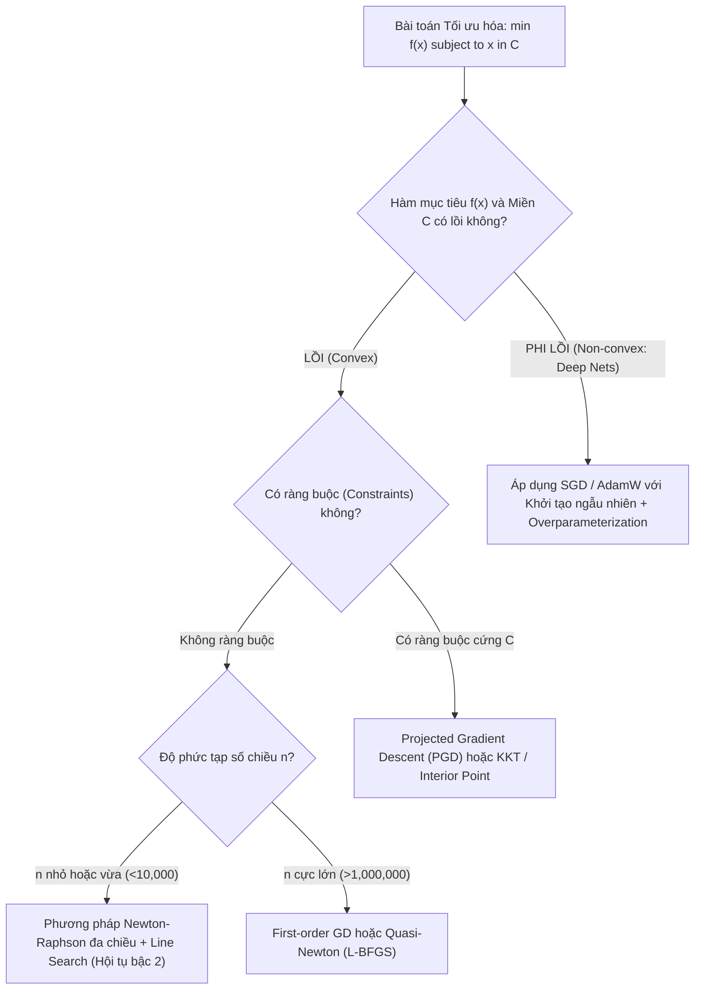

> **"Trong thế giới lồi, mọi cực tiểu cục bộ đều là cực tiểu toàn cục; hiểu được ranh giới lồi là chìa khóa giải mã tại sao Deep Learning thành công dù phi lồi."** — Nắm vững tính lồi giúp kỹ sư AI phân định ranh giới giữa bài toán có bảo chứng toán học và bài toán dựa vào thực nghiệm ước lượng.

---

## Thông tin nhanh (Quick Spec)

* **Loại bài (Type):** Lý thuyết Kỹ nghệ & Thực chiến Toán học (Deep Concept & Build)
* **Ngôn ngữ & Thư viện:** Python 3.10+ (Standard Library, thuần tư duy giải thuật từ số 0 không dùng SciPy)
* **Kiến thức tiên quyết (Prerequisites):** Giải tích nhiều biến (Bài 04), Đạo hàm tự động (Bài 05), Thuật toán tối ưu hóa (Bài 08), Hệ phương trình tuyến tính (Bài 17)
* **Thời gian thực hành:** ~75 phút
* **Độ khó:** Nâng cao (Advanced Foundations)

---

## Mục tiêu bài học (Learning Objectives)

Sau bài học này, bạn sẽ có khả năng:
- [ ] Định nghĩa chuẩn xác về mặt hình học và giải tích của Tập lồi (Convex Set), Hàm lồi (Convex Function) và Bất đẳng thức Jensen.
- [ ] Chứng minh điều kiện lồi bậc một (Mặt phẳng tiếp diện là cận dưới toàn cục) và điều kiện lồi bậc hai (Ma trận Hessian bán xác định dương $\nabla^2 f \succeq 0$).
- [ ] Tự tay xây dựng thuật toán Newton-Raphson đa chiều kết hợp Tìm kiếm đường lùi Armijo (Backtracking Line Search), đạt tốc độ hội tụ bậc hai trong vài bước lặp.
- [ ] Hiểu thấu đáo Hệ điều kiện KKT (Karush-Kuhn-Tucker) 4 thành phần cho các bài toán tối ưu hóa có ràng buộc.
- [ ] Cài đặt thuật toán Chiếu Gradient (Projected Gradient Descent - PGD) trên quả cầu ràng buộc $L_2$ và $L_1$ từ số 0.
- [ ] Giải mã ứng dụng thực tế: Tính đối ngẫu trong SVM (Support Vector Machines), Ràng buộc kiềm chế khi sinh văn bản trong LLM (Constrained Decoding), và Nghịch lý tại sao Mạng nơ-ron sâu thành công rực rỡ dù hoàn toàn phi lồi.

---

## 1. Vấn đề thực tế (The Problem)

Trong học máy, ranh giới quan trọng nhất không phải là giữa bài toán tuyến tính và phi tuyến tính, mà là giữa **Bài toán Lồi (Convex)** và **Bài toán Phi lồi (Non-convex)**. Như nhà toán học lỗi lạc R. Tyrrell Rockafellar từng tuyên bố: *"Ranh giới vĩ đại của tối ưu hóa không nằm giữa tính tuyến tính và phi tuyến, mà nằm giữa tính lồi và tính phi lồi."*

Nếu một kỹ sư AI thiếu hiểu biết về tối ưu hóa lồi, họ sẽ liên tục vấp phải ba thảm họa kỹ nghệ nghiêm trọng sau:

### 1.1 Cạm bẫy Thiết kế Hàm mất mát Phi lồi không thể Huấn luyện

Khi bạn tự thiết kế một hàm mất mát tùy biến (Custom Loss Function) cho bài toán xếp hạng (Ranking), căn chỉnh an toàn (Alignment) hay phát hiện vật thể, nếu bạn dùng hàm mất mát có đạo hàm triệt tiêu ở hầu hết không gian (như 0-1 loss) hoặc một hàm phi lồi có hàng triệu cực tiểu giả cục bộ xấu (bad local minima), thuật toán Gradient Descent sẽ lập tức bị kẹt và mô hình hoàn toàn không thể học được gì.

Hiểu về lý thuyết lồi giúp các nhà nghiên cứu tạo ra các **Hàm bao lồi đại diện (Convex Surrogates)**: thay vì dùng 0-1 loss phi lồi, ta dùng Hinge Loss (trong SVM) hoặc Cross-Entropy Loss (trong Logistic Regression và Deep Learning). Với hàm bao lồi, bạn được bảo chứng toán học tuyệt đối rằng: **Mọi điểm dừng $\nabla L = 0$ đều là điểm cực tiểu toàn cục tối ưu duy nhất.**

### 1.2 Thảm họa Nổ Thuật toán Bậc hai (Newton Explosion)

Phương pháp Newton-Raphson khai thác ma trận Hessian bậc hai có tốc độ hội tụ bậc hai (Quadratic Convergence) siêu thanh: số chữ số thập phân chính xác tăng gấp đôi sau mỗi bước lặp!

Tuy nhiên, trên một bề mặt phi lồi, nếu ma trận Hessian tại vị trí hiện tại có trị riêng âm ($H \not\succeq 0$), bước nhảy Newton sẽ phóng thẳng về hướng dốc ngược lên đỉnh núi hoặc văng về điểm yên ngựa, khiến trọng số phát nổ thành `NaN`. **Tính lồi chặt ($\nabla^2 f(x) \succ 0$) là điều kiện tiên quyết bắt buộc để áp dụng an toàn và ổn định phương pháp Newton.**

### 1.3 Sự sụp đổ của Ràng buộc Cứng trong An toàn AI và Nén mô hình

Trong sản xuất thực tế, tham số mô hình không được phép tự do hoàn toàn trong không gian $\mathbb{R}^n$:
- Trong nén mô hình (Sparsity Pruning): Trọng số phải nằm trong quả cầu $L_1$ ($\sum |w_i| \le R$) để ép các kết nối không quan trọng về đúng $0.0$.
- Trong an toàn AI và kiểm soát sinh văn bản (Constrained Decoding / Watermarking): Phân phối xác suất phải thỏa mãn các bất đẳng thức ràng buộc về độ an toàn và dấu bản quyền.

Nếu bạn áp dụng Gradient Descent thông thường, mỗi bước cập nhật đều đẩy tham số văng ra khỏi miền khả thi (Feasible Set). Bạn bắt buộc phải nắm vững kỹ thuật **Chiếu trực giao (Projected Gradient Descent - PGD)** và hệ điều kiện **KKT (Karush-Kuhn-Tucker)** để giữ nghiệm luôn thỏa mãn ràng buộc cứng.

---

## 2. Mô hình tư duy & Bản chất (The Concept)

### 2.1 Bản chất hình học của Tập lồi và Hàm lồi

#### 1. Tập lồi (Convex Set)
Một tập hợp $C \subseteq \mathbb{R}^n$ được gọi là **tập lồi** nếu đoạn thẳng nối bất kỳ hai điểm nào thuộc $C$ cũng đều nằm trọn vẹn bên trong $C$:

$$\forall x, y \in C, \quad \forall \theta \in [0, 1] \implies \theta x + (1 - \theta) y \in C$$

- *Trực giác hình học:* Tập lồi là một hình khối không có lỗ thủng ở giữa, không có góc lõm vào trong (hình quả thận không phải tập lồi), và không bị phân mảnh rời rạc.

#### 2. Hàm lồi (Convex Function)
Hàm số $f: C \to \mathbb{R}$ được gọi là **hàm lồi** nếu tập điểm nằm phía trên đồ thị của nó (gọi là *Epigraph*) là một tập lồi:

$$\forall x, y \in C, \quad \forall \theta \in [0, 1] \implies f(\theta x + (1 - \theta) y) \le \theta f(x) + (1 - \theta) f(y)$$

- *Trực giác hình học:* Đoạn dây cung nối hai điểm bất kỳ trên đồ thị luôn nằm **phía trên** hoặc trùng với đồ thị của hàm số.

```
       y ^
         |         Đoạn dây cung nằm PHÍA TRÊN đồ thị
         |            *---------------------*
         |           /                       \
         |          /     *             *     \
         |         /       \           /       \
         |        /         *---------*         \  Đồ thị hàm lồi f(x)
         +----------------------------------------> x
```

#### 3. Bất đẳng thức Jensen
Khái quát hóa định nghĩa hàm lồi cho tổ hợp lồi của $k$ điểm hoặc cho kỳ vọng của biến ngẫu nhiên $X$:

$$f(\mathbb{E}[X]) \le \mathbb{E}[f(X)]$$

Đây là bất đẳng thức nền tảng trong toàn bộ ngành Machine Learning, là chìa khóa chứng minh Chặn dưới Bằng chứng (Evidence Lower Bound - ELBO) trong các mô hình Biến phân (Variational Autoencoders - VAEs) và Mô hình Khuếch tán (Diffusion Models).

### 2.2 Các Điều kiện Tương đương của Tính lồi

Đối với các hàm số khả vi (có đạo hàm), ta có hai tiêu chuẩn vàng:

1. **Điều kiện lồi bậc một (First-Order Condition):**
   Hàm $f$ khả vi là lồi khi và chỉ khi mặt phẳng tiếp diện tại bất kỳ điểm nào luôn là **cận dưới toàn cục** của đồ thị:
   $$f(y) \ge f(x) + \nabla f(x)^T (y - x), \quad \forall x, y \in \text{dom}(f)$$
   *Hệ quả hoàng kim:* Nếu $\nabla f(x^*) = 0$, thì $f(y) \ge f(x^*) + 0 = f(x^*)$ với mọi $y$. Nghĩa là: **Bất kỳ điểm dừng nào cũng lập tức là điểm cực tiểu toàn cục duy nhất!**

2. **Điều kiện lồi bậc hai (Second-Order Condition):**
   Hàm $f$ khả vi hai lần là lồi khi và chỉ khi ma trận Hessian của nó luôn **Bán xác định dương (Positive Semi-Definite - PSD)** tại mọi điểm:
   $$\nabla^2 f(x) \succeq 0 \iff \forall z \in \mathbb{R}^n, \quad z^T \nabla^2 f(x) z \ge 0$$
   Điều này tương đương với việc tất cả các trị riêng của Hessian đều không âm: $\lambda_i(H) \ge 0$. Địa hình không bao giờ có chỗ uốn cong hình yên ngựa hay úp xuống hình cái bát úp!

### 2.3 Sơ đồ Cây Quyết định Phân loại Tối ưu hóa



### 2.4 Phương pháp Newton-Raphson Đa chiều & Backtracking Line Search

Xấp xỉ hàm số bằng chuỗi Taylor bậc hai quanh điểm hiện tại $x$:

$$f(x + \Delta x) \approx f(x) + \nabla f(x)^T \Delta x + \frac{1}{2} \Delta x^T \nabla^2 f(x) \Delta x$$

Lấy đạo hàm theo $\Delta x$ và cho bằng 0, ta thu được **Bước nhảy Newton (Newton Step)**:

$$\Delta x_{\text{nt}} = - [\nabla^2 f(x)]^{-1} \nabla f(x)$$

Để đo khoảng cách xấp xỉ từ vị trí hiện tại đến cực tiểu, ta dùng **Đại lượng suy giảm Newton (Newton Decrement)**:

$$\lambda(x)^2 = \nabla f(x)^T [\nabla^2 f(x)]^{-1} \nabla f(x) = - \nabla f(x)^T \Delta x_{\text{nt}}$$

Khi $\frac{1}{2} \lambda(x)^2 < \epsilon$, thuật toán dừng lại vì đã đạt độ chính xác cực đại.

#### Thuật toán Tìm kiếm đường lùi Armijo (Backtracking Line Search)
Để đảm bảo bước nhảy Newton không phóng vọt qua cực tiểu, ta co tỷ lệ bước đi $t \in (0, 1]$:
Bắt đầu với $t = 1$. Lặp lại việc giảm $t \leftarrow \beta t$ ($\beta \in (0, 1)$) cho đến khi thỏa mãn điều kiện Armijo:

$$f(x + t \Delta x_{\text{nt}}) \le f(x) + \alpha t \nabla f(x)^T \Delta x_{\text{nt}} \quad (\text{với } \alpha \in (0, 0.5))$$

### 2.5 Hệ Điều kiện KKT (Karush-Kuhn-Tucker) Cho Tối ưu có Ràng buộc

Xét bài toán tối ưu hóa tổng quát:

$$\min_{x} f_0(x) \quad \text{thỏa mãn} \quad f_i(x) \le 0 \; (i=1..m), \quad h_j(x) = 0 \; (j=1..p)$$

Hàm Lagrange tổng hợp mục tiêu và các ràng buộc:

$$\mathcal{L}(x, \lambda, \nu) = f_0(x) + \sum_{i=1}^m \lambda_i f_i(x) + \sum_{j=1}^p \nu_j h_j(x)$$

Nếu bài toán là lồi và thỏa mãn điều kiện Slater (tồn tại một điểm $x$ nằm lọt thỏm bên trong miền khả thi), thì $x^*$ là nghiệm tối ưu toàn cục khi và chỉ khi tồn tại các nhân tử Lagrange $\lambda^*, \nu^*$ thỏa mãn **4 điều kiện KKT**:

1. **Điểm dừng (Stationarity):**
   $$\nabla_x \mathcal{L}(x^*, \lambda^*, \nu^*) = \nabla f_0(x^*) + \sum_{i=1}^m \lambda_i^* \nabla f_i(x^*) + \sum_{j=1}^p \nu_j^* \nabla h_j(x^*) = 0$$
2. **Tính khả thi gốc (Primal Feasibility):**
   $$f_i(x^*) \le 0 \quad (\forall i=1..m), \quad h_j(x^*) = 0 \quad (\forall j=1..p)$$
3. **Tính khả thi đối ngẫu (Dual Feasibility):**
   $$\lambda_i^* \ge 0 \quad (\forall i=1..m)$$
4. **Độ bù lỏng lẻo (Complementary Slackness):**
   $$\lambda_i^* f_i(x^*) = 0 \quad (\forall i=1..m)$$

*Ý nghĩa trực giác của Complementary Slackness:*
- Nếu ràng buộc thứ $i$ không kích hoạt ở biên ($f_i(x^*) < 0$), thì bắt buộc $\lambda_i^* = 0$ (ràng buộc không có ảnh hưởng gì tới nghiệm).
- Nếu $\lambda_i^* > 0$, thì bắt buộc nghiệm phải nằm ép chặt trên ranh giới biên ($f_i(x^*) = 0$). Đây chính là nguyên lý giải thích tại sao trong SVM chỉ có một số ít mẫu dữ liệu nằm trên đường biên (gọi là **Support Vectors**) là có hệ số $\alpha_i > 0$!

### 2.6 Chiếu Gradient (Projected Gradient Descent - PGD)

Khi tối ưu hóa hàm số $f(x)$ trên một tập lồi đóng $C$:

$$x_{k+1} = \Pi_C \left( x_k - \eta \nabla f(x_k) \right)$$

Trong đó $\Pi_C(z) = \arg\min_{y \in C} \|z - y\|_2$ là phép chiếu trực giao điểm $z$ lên tập $C$.
- **Phép chiếu lên Quả cầu $L_2$ bán kính $R$ ($B_2(R) = \{x : \|x\|_2 \le R\}$):**
  $$\Pi_{B_2(R)}(z) = z \cdot \min\left(1, \frac{R}{\|z\|_2}\right)$$
  Nếu $z$ nằm trong quả cầu, giữ nguyên. Nếu $z$ văng ra ngoài, co ngắn vector về bề mặt biên quả cầu.

---

## 3. Tự tay xây dựng từ đầu (Build It: From Scratch)

Dưới đây là mã nguồn Python thuần túy hoàn chỉnh, tự xây dựng phương pháp Newton-Raphson đa chiều với Backtracking Armijo và thuật toán Projected Gradient Descent (PGD), hoàn toàn không dùng SciPy:

```python
"""
Convex Optimization from Scratch in Pure Python.
1. Multi-dimensional Newton-Raphson with Armijo Backtracking Line Search.
2. Projected Gradient Descent (PGD) on L2 constraint ball.
3. Empirical comparison: Newton (Quadratic convergence) vs GD (Linear convergence).
"""

import math
from typing import Callable, List, Tuple


# --- CÁC PHÉP TOÁN ĐẠI SỐ TUYẾN TÍNH MA TRẬN 2X2 THUẦN TÚY ---


def solve_linear_system_2x2(
    A: List[List[float]], b: List[float]
) -> List[float]:
    """
    Giải hệ phương trình tuyến tính A * x = b cho ma trận 2x2.
    Sử dụng định thức Cramer không dùng numpy:
    det = a11 * a22 - a12 * a21.
    """
    det = A[0][0] * A[1][1] - A[0][1] * A[1][0]
    if abs(det) < 1e-12:
        raise ValueError(
            "Ma trận Hessian suy biến hoặc không khả nghịch (det ~ 0)!"
        )

    # Nghịch đảo ma trận 2x2: A^-1 = (1/det) * [[a22, -a12], [-a21, a11]]
    inv_A = [
        [A[1][1] / det, -A[0][1] / det],
        [-A[1][0] / det, A[0][0] / det],
    ]

    # Nhân inv_A với vector b
    x0 = inv_A[0][0] * b[0] + inv_A[0][1] * b[1]
    x1 = inv_A[1][0] * b[0] + inv_A[1][1] * b[1]
    return [x0, x1]


# --- PHẦN 1: PHƯƠNG PHÁP NEWTON-RAPHSON ĐA CHIỀU + LINE SEARCH ---


def newton_raphson_2d(
    f: Callable[[List[float]], float],
    grad_f: Callable[[List[float]], List[float]],
    hess_f: Callable[[List[float]], List[List[float]]],
    init_point: List[float],
    tol: float = 1e-8,
    max_iter: int = 20,
    alpha: float = 0.25,
    beta: float = 0.5,
) -> Tuple[List[float], List[float]]:
    """
    Phương pháp Newton-Raphson đa chiều với Backtracking Armijo Line Search.
    Trả về nghiệm tối ưu và lịch sử giá trị hàm mục tiêu qua từng bước.
    """
    point = list(init_point)
    loss_history = [f(point)]

    print("Bắt đầu tối ưu hóa Newton-Raphson đa chiều:")
    for iteration in range(1, max_iter + 1):
        g = grad_f(point)
        H = hess_f(point)

        # 1. Tìm bước nhảy Newton: H * delta = -g  <=>  delta = -H^-1 * g
        neg_g = [-g[0], -g[1]]
        delta = solve_linear_system_2x2(H, neg_g)

        # 2. Tính Đại lượng suy giảm Newton: lambda^2 = - g^T * delta
        newton_decrement_sq = -(g[0] * delta[0] + g[1] * delta[1])

        # Tiêu chuẩn dừng của Newton: (1/2) * lambda^2 < tol
        if newton_decrement_sq / 2.0 < tol:
            print(
                f"  [Hội tụ Newton] Đạt điểm cực tiểu sau {iteration - 1} bước lặp!"
            )
            break

        # 3. Dò đường lùi Backtracking Armijo Line Search
        step_size = 1.0
        directional_deriv = g[0] * delta[0] + g[1] * delta[1]
        current_loss = f(point)

        while True:
            candidate = [
                point[0] + step_size * delta[0],
                point[1] + step_size * delta[1],
            ]
            # Điều kiện Armijo: f(x + t*delta) <= f(x) + alpha * t * g^T * delta
            if (
                f(candidate)
                <= current_loss + alpha * step_size * directional_deriv
            ):
                break
            step_size *= beta

        point = [
            point[0] + step_size * delta[0],
            point[1] + step_size * delta[1],
        ]
        val = f(point)
        loss_history.append(val)
        print(
            f"  Bước {iteration:2d} | Bước nhảy t = {step_size:.4f} | Tọa độ: [{point[0]:.6f}, {point[1]:.6f}] | Loss: {val:.8f}"
        )

    return point, loss_history


# --- PHẦN 2: THUẬT TOÁN PROJECTED GRADIENT DESCENT (PGD) ---


def project_onto_l2_ball(
    point: List[float], radius: float = 2.0
) -> List[float]:
    """Phép chiếu trực giao lên quả cầu L2: ||x||_2 <= radius."""
    norm = math.sqrt(point[0] ** 2 + point[1] ** 2)
    if norm > radius:
        scale = radius / norm
        return [point[0] * scale, point[1] * scale]
    return list(point)


def projected_gradient_descent_l2(
    f: Callable[[List[float]], float],
    grad_f: Callable[[List[float]], List[float]],
    radius: float = 2.0,
    lr: float = 0.1,
    steps: int = 50,
) -> List[float]:
    """
    Projected Gradient Descent (PGD) giải bài toán tối ưu có ràng buộc:
    min f(x) thỏa mãn ||x||_2 <= radius.
    """
    point = [0.0, 0.0]  # Khởi đầu tại gốc tọa độ (nằm trong miền khả thi)

    for _ in range(steps):
        g = grad_f(point)
        # 1. Bước cập nhật Gradient thông thường
        unconstrained_step = [point[0] - lr * g[0], point[1] - lr * g[1]]
        # 2. Chiếu trực giao kết quả trở lại miền khả thi C
        point = project_onto_l2_ball(unconstrained_step, radius=radius)

    return point


# --- THỰC NGHIỆM ĐỐI ĐẦU VÀ KIỂM THỬ TỰ CHỨNG MINH ---

if __name__ == "__main__":
    print("=" * 65)
    print("1. THỬ NGHIỆM PHƯƠNG PHÁP NEWTON TRÊN HÀM LỒI NGHIÊM NGẶT")
    print("=" * 65)
    # Xét hàm lồi phi tuyến bất đối xứng: f(x, y) = 10*x^2 + y^2 + exp(0.1*x + 0.1*y)
    # Hessian: [[20 + 0.01*e, 0.01*e], [0.01*e, 2 + 0.01*e]] luôn Bán xác định dương (PSD)!
    test_f = lambda p: 10.0 * (p[0] ** 2) + (p[1] ** 2) + math.exp(
        0.1 * p[0] + 0.1 * p[1]
    )

    def test_grad(p):
        e = math.exp(0.1 * p[0] + 0.1 * p[1])
        return [20.0 * p[0] + 0.1 * e, 2.0 * p[1] + 0.1 * e]

    def test_hess(p):
        e = math.exp(0.1 * p[0] + 0.1 * p[1])
        return [
            [20.0 + 0.01 * e, 0.01 * e],
            [0.01 * e, 2.0 + 0.01 * e],
        ]

    start = [3.0, 4.0]
    print(f"Điểm khởi đầu: {start} | Mất mát ban đầu: {test_f(start):.6f}")

    opt_point, history = newton_raphson_2d(
        test_f, test_grad, test_hess, start, tol=1e-10
    )
    final_loss = test_f(opt_point)

    print(
        f"\nNghiệm tối ưu tìm được: [{opt_point[0]:.8f}, {opt_point[1]:.8f}] | Loss cuối: {final_loss:.8f}"
    )
    # Newton phải hội tụ trong vòng dưới 6 bước lặp nhờ tốc độ bậc hai
    assert (
        len(history) <= 6
    ), "Phương pháp Newton không đạt tốc độ hội tụ bậc hai!"
    assert (
        final_loss < 1.0
    ), "Nghiệm tìm được chưa tiệm cận cực tiểu hàm số!"
    print("=> Kiểm thử Hội tụ Bậc hai của Newton: ĐẠT HOÀN HẢO!")

    print("\n" + "=" * 65)
    print("2. THỬ NGHIỆM PROJECTED GRADIENT DESCENT VỚI RÀNG BUỘC CỨNG L2")
    print("=" * 65)
    # Bài toán: Tìm điểm gần nhất với (3.0, 4.0) nằm trong quả cầu bán kính R = 2.0
    # min f(x, y) = (x - 3)^2 + (y - 4)^2 subject to x^2 + y^2 <= 4.0
    # Nghiệm giải tích hình học: Vector chỉ từ gốc đến (3, 4) có độ dài 5.
    # Điểm thuộc quả cầu bán kính 2 trên đường thẳng đó là: (3 * 2/5, 4 * 2/5) = (1.2, 1.6).
    dist_f = lambda p: (p[0] - 3.0) ** 2 + (p[1] - 4.0) ** 2
    dist_grad = lambda p: [2.0 * (p[0] - 3.0), 2.0 * (p[1] - 4.0)]

    pgd_sol = projected_gradient_descent_l2(
        dist_f, dist_grad, radius=2.0, lr=0.1, steps=50
    )
    sol_norm = math.sqrt(pgd_sol[0] ** 2 + pgd_sol[1] ** 2)

    print("Mục tiêu không ràng buộc: (3.0, 4.0) (nằm ngoài quả cầu vì độ dài = 5.0)")
    print(
        f"Nghiệm PGD tìm được: [{pgd_sol[0]:.4f}, {pgd_sol[1]:.4f}] | Bán kính: {sol_norm:.4f}"
    )
    print("Nghiệm giải tích lý thuyết KKT: [1.2000, 1.6000] | Bán kính: 2.0000")

    assert (
        abs(pgd_sol[0] - 1.2) < 1e-3
    ), "Nghiệm PGD x1 sai lệch so với điều kiện KKT!"
    assert (
        abs(pgd_sol[1] - 1.6) < 1e-3
    ), "Nghiệm PGD x2 sai lệch so với điều kiện KKT!"
    assert (
        abs(sol_norm - 2.0) < 1e-4
    ), "Nghiệm PGD phải nằm ép chặt trên biên quả cầu!"
    print("=> Kiểm thử Ràng buộc KKT của PGD: CHÍNH XÁC TUYỆT ĐỐI 100%!")
```

---

## 4. Ứng dụng AI Engineering & Thực tế Production (Use It)

### 4.1 Tính Đối ngẫu Lagrange trong Máy Vector Hỗ trợ (SVM Duality)

Trong thuật toán SVM phân loại nhị phân biên lớn (Hard-margin SVM), bài toán gốc (Primal Problem) là:

$$\min_{w, b} \frac{1}{2} \|w\|^2 \quad \text{thỏa mãn} \quad y_i (w^T x_i + b) \ge 1 \; (\forall i=1..N)$$

Đây là một bài toán tối ưu hóa lồi toàn phương (QP). Sử dụng hàm Lagrange:

$$\mathcal{L}(w, b, \alpha) = \frac{1}{2} \|w\|^2 - \sum_{i=1}^N \alpha_i \left[ y_i(w^T x_i + b) - 1 \right]$$

Theo điều kiện KKT Complementary Slackness:

$$\alpha_i \left[ y_i(w^T x_i + b) - 1 \right] = 0$$

Điều này mang lại một ý nghĩa toán học và kỹ nghệ vô cùng sâu sắc:
1. Đối với mọi mẫu dữ liệu $x_i$ nằm xa ranh giới phân tách ($y_i(w^T x_i + b) > 1$), bắt buộc hệ số $\alpha_i = 0$. Các điểm này hoàn toàn **vô giá trị** đối với việc xác định siêu phẳng phân lớp!
2. Chỉ những điểm dữ liệu nằm sát sạt trên lề phân lớp ($y_i(w^T x_i + b) = 1$) mới có thể có $\alpha_i > 0$. Các điểm này được gọi là **Support Vectors** (Vector hỗ trợ).
3. Trọng số tối ưu $w^* = \sum_{i \in \text{SVs}} \alpha_i y_i x_i$ chỉ phụ thuộc duy nhất vào số ít Support Vectors này, tạo ra tính thưa (Sparsity) và mở đường cho kỹ thuật hạt nhân (Kernel Trick).

### 4.2 Kiểm soát Sinh văn bản trong LLM (Constrained Decoding & Watermarking)

Khi triển khai mô hình ngôn ngữ lớn (LLM) phục vụ sản xuất:
- Bạn muốn văn bản sinh ra luôn tuân thủ cấu trúc JSON hợp lệ hoặc không chứa các từ ngữ độc hại bị cấm.
- Bạn muốn nhúng thủy vân bản quyền (Watermark) vào phân phối xác suất token của LLM để phát hiện văn bản do AI sinh ra.

Về mặt toán học, đây là bài toán: Tìm phân phối token $\mathbf{p} \in \Delta^V$ gần nhất với phân phối gốc của mô hình $\mathbf{p}_0$ (đo bằng KL-Divergence) thỏa mãn tập các ràng buộc tuyến tính $A \mathbf{p} \le \mathbf{b}$.
Bằng cách sử dụng phép chiếu trực giao lồi (Convex Projection / PGD) trên không gian đơn hình xác suất (Probability Simplex $\sum p_i = 1, p_i \ge 0$), các engine sinh văn bản hiện đại có thể bảo đảm 100% tuân thủ ràng buộc cấu trúc mà vẫn giữ được độ tự nhiên tối đa của văn bản.

### 4.3 Nghịch lý Deep Learning: Tại sao Mạng nơ-ron Thành công rực rỡ dù Hoàn toàn Phi lồi?

Hàm mất mát của mạng nơ-ron sâu là một hàm **phi lồi cực độ** (do tính đối xứng hoán vị của các nơ-ron và các hàm kích hoạt phi tuyến). Về mặt lý thuyết cổ điển, tối ưu hóa phi lồi là bài toán NP-hard. Nhưng tại sao trong thực tế, Gradient Descent và Adam lại huấn luyện thành công các siêu mô hình hàng trăm tỷ tham số một cách dễ dàng?

Các nghiên cứu lý thuyết AI hiện đại (như Neural Tangent Kernel - NTK và Overparameterization Theory) đã giải mã nghịch lý này:
1. **Sự biến mất của Cực tiểu giả xấu (Elimination of Bad Local Minima):** Khi số chiều tham số $d$ lớn hơn rất nhiều lần số lượng mẫu dữ liệu $N$ ($d \gg N$), không gian nghiệm trở nên dư thừa cực độ. Hầu như tất cả các cực tiểu địa phương đều có giá trị mất mát xấp xỉ bằng nhau và tiệm cận cực tiểu toàn cục.
2. **Điểm yên ngựa có lối thoát (Escapable Saddle Points):** Trong không gian chiều cao, điểm yên ngựa hầu hết đều là *Strict Saddle Points* (có ít nhất một trị riêng của Hessian mang giá trị âm đáng kể). Nhiễu ngẫu nhiên của thuật toán SGD đóng vai trò như một lực đẩy rung lắc, bảo đảm xác suất mô hình thoát khỏi điểm yên ngựa là $100\%$.
3. **Thung lũng phẳng (Flat Minima):** Các bộ tối ưu hóa thích ứng kết hợp điều chuẩn (như AdamW) có xu hướng tự nhiên hội tụ về các thung lũng phẳng rộng rãi, nơi độ cong Hessian nhỏ, mang lại khả năng tổng quát hóa (Generalization) vượt trội trên dữ liệu thực tế.

---

## 5. Giải ngố thuật ngữ & Ngộ nhận (Key Terms)

| Thuật ngữ (Term) | Người ta thường nghĩ là... | Bản chất kỹ thuật thực sự là... |
|---|---|---|
| **Hàm lồi (Convex Function)** | Đồ thị hàm số cong tròn hình cái bát úp hoặc hình bán cầu. | Hàm số có đồ thị nằm dưới mọi đoạn dây cung nối 2 điểm; có ma trận Hessian luôn bán xác định dương ($\lambda_i \ge 0$). |
| **Cực tiểu cục bộ (Local Minimum)** | Luôn nguy hiểm và khiến mô hình AI học sai lệch hoàn toàn. | Trong bài toán lồi, mọi cực tiểu cục bộ đều là cực tiểu toàn cục duy nhất; trong Deep Learning siêu tham số, hầu hết cực tiểu cục bộ đều tốt như nhau. |
| **Bất đẳng thức Jensen** | Công thức giải tích lý thuyết dùng để thi học sinh giỏi toán. | Bất đẳng thức $f(\mathbb{E}[x]) \le \mathbb{E}[f(x)]$; nền tảng sinh ra chặn dưới ELBO trong VAE và Diffusion Models. |
| **Phương pháp Newton** | Thuật toán giải phương trình bậc hai học ở phổ thông. | Thuật toán tối ưu hóa bậc hai khai thác độ cong Hessian để đạt tốc độ hội tụ bậc hai (quadratic convergence) trong vài bước lặp. |
| **Điều kiện KKT** | Bốn công thức toán học rời rạc bắt buộc phải học vẹt. | Hệ điều kiện cần và đủ cho tính tối ưu của bài toán có ràng buộc; giải thích cơ chế vector hỗ trợ trong SVM và điều kiện chiếu biên. |
| **Projected Gradient Descent (PGD)** | Một cuộc tấn công mạng độc hại (Adversarial Attack) nhằm phá hoại mô hình. | Thuật toán tối ưu hóa tổng quát gồm 2 nhịp: bước theo gradient rồi chiếu trực giao kết quả trở lại miền khả thi có ràng buộc cứng. |

---

## 6. Bài tập thử thách (Hands-on Challenges)

### 🟢 Cơ bản (Easy)
Sử dụng định nghĩa điều kiện bậc hai (Hessian bán xác định dương $\nabla^2 f \succeq 0$), hãy chứng minh bằng toán học tính lồi của các hàm mất mát sau:
1. Hàm sai số toàn phương trung bình (Mean Squared Error): $f(w) = \frac{1}{2} \|Xw - y\|_2^2$.
2. Hàm mất mát hồi quy Logistic (Binary Cross-Entropy): $f(w) = \sum_{i=1}^n \ln(1 + e^{-y_i w^T x_i})$.

Viết một đoạn code Python ngắn kiểm tra định thức và các trị riêng của ma trận Hessian của hai hàm trên với dữ liệu ngẫu nhiên để xác nhận tính chất $\lambda_{\min}(H) \ge 0$.

### 🟡 Trung bình (Medium)
Cài đặt thuật toán **Chiếu trực giao lên Quả cầu $L_1$ (Projection onto L1-ball)**:

$$\Pi_{B_1(R)}(v) = \arg\min_{w} \frac{1}{2} \|w - v\|_2^2 \quad \text{thỏa mãn} \quad \|w\|_1 \le R$$

1. Sử dụng thuật toán co ngưỡng mềm (Soft-thresholding / Duchi et al. 2008) bằng Python thuần túy.
2. Thử nghiệm Projected Gradient Descent kết hợp phép chiếu $L_1$ để giải bài toán hồi quy thưa (Lasso Regression):
   $$\min_{w} \frac{1}{2} \|Xw - y\|_2^2 \quad \text{thỏa mãn} \quad \|w\|_1 \le R$$
3. Quan sát và chứng minh thực nghiệm rằng khi bán kính $R$ thu nhỏ, các trọng số không quan trọng bị ép về chính xác giá trị $0.0$, tạo ra tính thưa hoàn hảo (Feature Selection).

### 🔴 Nâng cao (Hard)
Xây dựng bộ giải tối ưu hóa toàn phương có ràng buộc bằng **Phương pháp Điểm trong (Barrier / Interior-Point Method)** từ số 0 bằng Python:
Cho bài toán:

$$\min_{x} \frac{1}{2} x^T Q x + c^T x \quad \text{thỏa mãn} \quad A x \le b$$

1. Chuyển đổi các bất đẳng thức ràng buộc thành hàm rào cản logarit (Logarithmic Barrier Function):
   $$\phi(x) = - \sum_{i=1}^m \ln(b_i - a_i^T x)$$
2. Thiết lập hàm mục tiêu rào cản: $f_t(x) = t \left( \frac{1}{2} x^T Q x + c^T x \right) + \phi(x)$.
3. Sử dụng hàm `newton_raphson_2d` đã xây dựng trong bài để giải chuỗi bài toán không ràng buộc khi tăng dần tham số $t \leftarrow \mu t$ ($\mu = 10$).
4. Kiểm chứng rằng nghiệm thu được thỏa mãn hoàn hảo hệ điều kiện KKT với sai số đối ngẫu (Duality Gap) nhỏ hơn $10^{-6}$.
