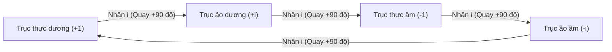
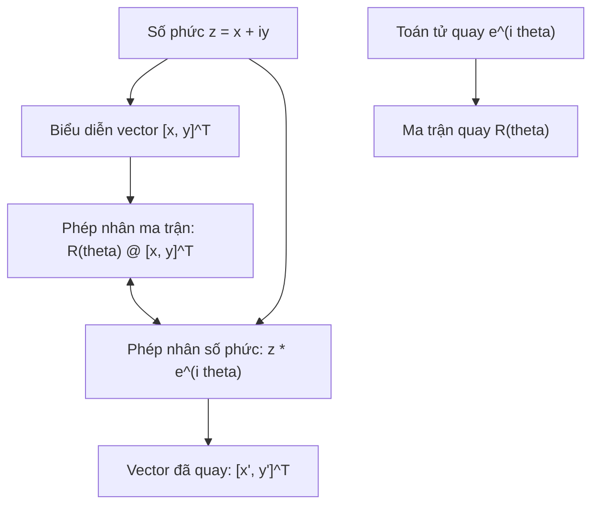

> **"Số ảo không hề 'ảo'; nó là toán tử quay 90 độ trong mặt phẳng 2D, chìa khóa giải mã RoPE trong các mô hình ngôn ngữ lớn hiện đại."** — Hiểu được bản chất hình học của số phức giúp kỹ sư AI xóa tan cảm giác "hộp đen" khi tiếp cận Rotary Position Embedding và biến đổi Fourier trong xử lý chuỗi và tín hiệu.

---

## Thông tin nhanh (Quick Spec)

* **Loại bài (Type):** Trực giác Khái niệm & Thực chiến Nền tảng (Intuition & Build)
* **Ngôn ngữ & Thư viện:** Python 3.10+ (sử dụng thư viện chuẩn `math`, `random` và đối chiếu cú pháp NumPy)
* **Kiến thức tiên quyết (Prerequisites):** Tọa độ Cartesian 2D, phép nhân ma trận, cơ chế Self-Attention cơ bản
* **Thời gian thực hành:** ~50–60 phút
* **Độ khó:** Trung bình (Foundational to Intermediate)

---

## Mục tiêu bài học (Learning Objectives)

Sau bài học này, bạn sẽ có khả năng:
- [ ] Thấu hiểu bản chất hình học của đơn vị ảo $i$: không phải là con số "không có thật", mà là toán tử quay $90^\circ$ trên mặt phẳng 2D.
- [ ] Thành thạo các phép toán số phức (cộng, nhân, liên hợp, dạng cực) và chứng minh công thức Euler $e^{i\theta} = \cos\theta + i\sin\theta$ qua chuỗi Taylor.
- [ ] Thiết lập mối tương đương toán học chặt chẽ giữa phép nhân số phức và ma trận quay $2 \times 2$.
- [ ] Tự tay xây dựng thuật toán **Rotary Position Embedding (RoPE)** từ đầu bằng Python thuần túy, chứng minh tính chất bất biến khoảng cách tương đối $q_m^T k_n = g(q, k, m - n)$ làm nên sức mạnh của các mô hình LLaMA, Mistral, Qwen và DeepSeek.

---

## 1. Vấn đề thực tế (The Problem)

Khi đọc các bài báo kinh điển về xử lý tín hiệu, mạng Transformer hay mô hình ngôn ngữ lớn thế hệ mới, bạn bắt gặp số phức ở khắp mọi nơi:
- Trong bài báo gốc của Transformer (*Attention Is All You Need*), các hàm $\sin$ và $\cos$ ở nhiều tần số thực chất là phần thực và phần ảo của các hàm số phức dạng sóng $e^{i \omega t}$.
- Trong các mô hình ngôn ngữ hiện đại (LLaMA-2/3, Mistral, Qwen, DeepSeek), cơ chế mã hóa vị trí tuyệt đối ban đầu bị thay thế hoàn toàn bởi **RoPE (Rotary Position Embedding)** — một kỹ thuật xoay các cặp vector trong không gian phức.
- Trong các kiến trúc AI xử lý âm thanh, sóng não EEG, ảnh y tế MRI hoặc mạng nơ-ron FNet, biến đổi Fourier rời rạc (DFT/FFT) vận hành hoàn toàn trên trường số phức $\mathbb{C}$.

Nếu chỉ xem số phức như một định nghĩa trừu tượng ở trường phổ thông với $i = \sqrt{-1}$ kèm theo quy tắc tính tay rời rạc, bạn sẽ gặp phải ba rào cản nghiêm trọng trong AI Engineering:

1. **Cạm bẫy mã hóa vị trí tuyệt đối:** Các phương pháp nhúng vị trí cộng thêm (Absolute Positional Embedding) như trong BERT hay GPT-2 chỉ đơn giản cộng một vector vị trí $p_m$ vào vector từ $x_m$. Khi văn bản dài ra (dài hơn chiều dài huấn luyện), mô hình hoàn toàn mất phương hướng vì không thể suy luận ngoại suy (extrapolation) khoảng cách tương đối giữa hai từ cách nhau $k$ vị trí.
2. **Ảo giác về "tính ảo" của toán học:** Việc cho rằng đơn vị $i$ chỉ là một trò chơi ký hiệu khiến nhiều kỹ sư không nhận ra rằng phép nhân hai số phức bản chất là một phép biến đổi hình học gồm **xoay góc** và **co giãn độ lớn**. Thiếu trực giác này, các công thức giải tích Fourier và RoPE trở nên cực kỳ khó hiểu.
3. **Bế tắc khi mở rộng ngữ cảnh (Context Window Extension):** Khi cần mở rộng cửa sổ ngữ cảnh của LLM từ 4k lên 32k hay 128k token, nếu không hiểu tần số quay phức $\theta_k = 10000^{-2k/d}$, bạn sẽ không thể áp dụng các kỹ thuật tiên tiến như RoPE Interpolation, NTK-aware Scaling hay YaRN.

---

## 2. Mô hình tư duy & Bản chất (The Concept)

### 2.1 Đơn vị ảo $i$ là toán tử quay 90 độ

Hãy bắt đầu từ trục số thực 1 chiều ($\mathbb{R}$):
- Khi bạn lấy một số thực $x$ nhân với $1$, bạn giữ nguyên vị trí của nó.
- Khi bạn nhân $x$ với $-1$, bạn lật ngược hướng của vector qua gốc tọa độ: một phép quay $180^\circ$ trên trục số.
- Nhân tiếp với $-1$ một lần nữa: bạn quay thêm $180^\circ$, hoàn thành một vòng $360^\circ$ và trở về giá trị ban đầu ($(-1) \times (-1) = 1$).

Bây giờ, câu hỏi đặt ra là: **Phép toán nào khi thực hiện 2 lần liên tiếp sẽ tương đương với việc nhân với $-1$ (quay $180^\circ$)?**

$$
x \times x = -1 \iff x^2 = -1
$$

Trên đường thẳng 1 chiều, không có vị trí nào thỏa mãn. Nhưng nếu ta mở rộng sang mặt phẳng 2 chiều, câu trả lời cực kỳ trực quan: **quay một góc $90^\circ$ ngược chiều kim đồng hồ**!
- Lần 1: Quay từ trục thực sang trục vuông góc ($+90^\circ$).
- Lần 2: Quay tiếp $+90^\circ$ để chạm tới $-1$ trên trục thực.



Đơn vị ảo $i$ không hề bí ẩn hay "ảo tưởng". Về mặt hình học, $i$ đơn giản là **toán tử quay vuông góc $90^\circ$ trên mặt phẳng 2D**.

### 2.2 Mặt phẳng phức và các dạng biểu diễn

Một số phức $z$ được xác định bởi hai thành phần thực:
$$
z = a + b i \quad (a, b \in \mathbb{R})
$$

Trong đó:
- $a = \text{Re}(z)$ là phần thực (tọa độ trên trục hoành).
- $b = \text{Im}(z)$ là phần ảo (tọa độ trên trục tung).

Mỗi số phức tương ứng với một điểm $(a, b)$ trên mặt phẳng phức (mặt phẳng Argand), hoặc một vector 2 chiều xuất phát từ gốc tọa độ.

**Các đại lượng hình học đặc trưng:**
1. **Độ lớn (Modulus / Magnitude):**
   $$|z| = r = \sqrt{a^2 + b^2}$$
2. **Góc pha (Argument / Phase):**
   $$\theta = \arg(z) = \text{atan2}(b, a)$$
3. **Số phức liên hợp (Complex Conjugate):**
   $$\bar{z} = a - b i$$
   Về mặt hình học, liên hợp là phép lấy đối xứng qua trục thực. Tích $z \bar{z}$ luôn là một số thực không âm:
   $$z \bar{z} = (a + bi)(a - bi) = a^2 - (bi)^2 = a^2 + b^2 = |z|^2$$

### 2.3 Công thức Euler: Cầu nối giữa hàm mũ và lượng giác

Công thức Euler là một trong những phương trình đẹp nhất và hữu dụng nhất của toán học ứng dụng:

$$
e^{i\theta} = \cos\theta + i\sin\theta
$$

**Chứng minh trực quan qua chuỗi Taylor:**
Khai triển chuỗi Taylor của $e^x, \cos x, \sin x$ quanh điểm 0:

$$
e^x = 1 + x + \frac{x^2}{2!} + \frac{x^3}{3!} + \frac{x^4}{4!} + \frac{x^5}{5!} + \dots
$$

Thay thế $x = i\theta$, lưu ý rằng $i^2 = -1, i^3 = -i, i^4 = 1, i^5 = i$:

$$
e^{i\theta} = 1 + i\theta - \frac{\theta^2}{2!} - i\frac{\theta^3}{3!} + \frac{\theta^4}{4!} + i\frac{\theta^5}{5!} - \dots
$$

Gom các số hạng phần thực và phần ảo tách biệt:

$$
e^{i\theta} = \left( 1 - \frac{\theta^2}{2!} + \frac{\theta^4}{4!} - \dots \right) + i \left( \theta - \frac{\theta^3}{3!} + \frac{\theta^5}{5!} - \dots \right)
$$

Vế thực thứ nhất chính là chuỗi Taylor của $\cos\theta$, vế ảo thứ hai chính là chuỗi Taylor của $\sin\theta$. Ta thu được đẳng thức Euler hoàn hảo:

$$
e^{i\theta} = \cos\theta + i\sin\theta
$$

Khi $\theta = \pi$, ta có đẳng thức kinh điển: $e^{i\pi} + 1 = 0$.

### 2.4 Dạng cực và ý nghĩa hình học của phép nhân số phức

Nhờ công thức Euler, mọi số phức $z = a + bi$ đều có thể viết dưới dạng cực (Polar Form):

$$
z = r e^{i\theta} \quad \text{với } r = |z|, \ \theta = \arg(z)
$$

Bây giờ, hãy xem điều gì xảy ra khi ta nhân hai số phức $z_1 = r_1 e^{i\theta_1}$ và $z_2 = r_2 e^{i\theta_2}$:

$$
z_1 z_2 = (r_1 e^{i\theta_1})(r_2 e^{i\theta_2}) = (r_1 r_2) e^{i(\theta_1 + \theta_2)}
$$

> **Quy tắc hình học cốt lõi:** Khi nhân hai số phức:
> - **Độ lớn nhân với nhau:** $r_{\text{mới}} = r_1 r_2$.
> - **Góc pha cộng với nhau:** $\theta_{\text{mới}} = \theta_1 + \theta_2$.

Đặc biệt, nếu ta nhân một số phức bất kỳ với một số phức có độ lớn bằng 1 ($|w| = 1 \implies w = e^{i\theta}$):
$$
z \cdot e^{i\theta} = (r e^{i\phi}) e^{i\theta} = r e^{i(\phi + \theta)}
$$
Độ lớn $r$ hoàn toàn được bảo toàn, chỉ có góc định hướng bị xoay thêm một góc $\theta$. **Nhân với $e^{i\theta}$ chính là phép quay thuần túy (Isometry Rotation) trên mặt phẳng 2D!**

### 2.5 Tương đương với Ma trận quay 2D

Xét phép nhân giữa số phức $z = x + iy$ và toán tử quay $R_\theta = e^{i\theta} = \cos\theta + i\sin\theta$:

$$
z' = z \cdot e^{i\theta} = (x + iy)(\cos\theta + i\sin\theta) = (x\cos\theta - y\sin\theta) + i(x\sin\theta + y\cos\theta)
$$

Hãy viết lại kết quả này dưới dạng đại số tuyến tính với vector cột $\begin{pmatrix} x \\ y \end{pmatrix}$:

$$
\begin{pmatrix} x' \\ y' \end{pmatrix} = \begin{pmatrix} \cos\theta & -\sin\theta \\ \sin\theta & \cos\theta \end{pmatrix} \begin{pmatrix} x \\ y \end{pmatrix}
$$

Ma trận quay $2 \times 2$ chính là hình chiếu ma trận của phép nhân số phức $e^{i\theta}$. Trường số phức $\mathbb{C}$ cung cấp một biểu diễn đại số cực kỳ súc tích cho các phép quay phẳng.



### 2.6 Cơ chế Rotary Position Embedding (RoPE) trong LLM

Trong kiến trúc Transformer kinh điển, cơ chế Self-Attention tính tích vô hướng giữa Query $q$ và Key $k$:

$$
\text{Attention}(Q, K, V) = \text{Softmax}\left(\frac{Q K^T}{\sqrt{d_k}}\right) V
$$

Ta muốn tích vô hướng giữa vector Query tại vị trí $m$ ($q_m$) và vector Key tại vị trí $n$ ($k_n$) chỉ phụ thuộc vào **khoảng cách tương đối** giữa chúng ($m - n$), tức là:

$$
\langle \tilde{q}_m, \tilde{k}_n \rangle = g(q, k, m - n)
$$

Su et al. (2021) đã phát minh ra **RoPE** dựa trên ý tưởng đột phá:
1. Chia vector nhúng $d$ chiều thành $d/2$ cặp chiều 2D độc lập: $(x_0, x_1), (x_2, x_3), \dots, (x_{d-2}, x_{d-1})$.
2. Xem mỗi cặp $(x_{2j}, x_{2j+1})$ như một số phức $z_j = x_{2j} + i x_{2j+1}$.
3. Mỗi cặp chiều $j$ được gán một tần số góc riêng:
   $$\theta_j = 10000^{-2j/d} \quad (j = 0, 1, \dots, d/2 - 1)$$
4. Tại vị trí token $m$, xoay cặp số phức $z_j$ một góc tương ứng $m \theta_j$:
   $$\tilde{z}_j^{(m)} = z_j \cdot e^{i m \theta_j}$$

**Tại sao tính chất khoảng cách tương đối được bảo toàn?**
Khi tính tích vô hướng thực giữa hai vector nhúng phức sau khi quay, tích vô hướng trong không gian Euclid tương ứng với phần thực của tích phức với liên hợp:

$$
\langle \tilde{q}_m, \tilde{k}_n \rangle = \sum_{j=0}^{d/2-1} \text{Re}\left( \tilde{q}_j^{(m)} \cdot \overline{\tilde{k}_j^{(n)}} \right)
$$

Thay $\tilde{q}_j^{(m)} = q_j e^{i m \theta_j}$ và $\tilde{k}_j^{(n)} = k_j e^{i n \theta_j}$:

$$
\tilde{q}_j^{(m)} \cdot \overline{\tilde{k}_j^{(n)}} = \left( q_j e^{i m \theta_j} \right) \cdot \left( \bar{k}_j e^{-i n \theta_j} \right) = q_j \bar{k}_j e^{i (m - n) \theta_j}
$$

Lấy phần thực:

$$
\text{Re}\left( q_j \bar{k}_j e^{i (m - n) \theta_j} \right) = g_j(q, k, m - n)
$$

Vị trí tuyệt đối $m$ và $n$ đã triệt tiêu hoàn toàn, chỉ còn lại hiệu số vị trí tương đối $m - n$! Đây là một kết quả toán học đẹp mắt và có hiệu năng vượt trội trong việc tổng quát hóa độ dài chuỗi văn bản.

---

## 3. Tự tay xây dựng từ đầu (Build It: From Scratch)

Dưới đây là module mã nguồn Python độc lập hoàn toàn, tự xây dựng lớp biểu diễn số phức, phép quay lượng giác và thuật toán RoPE hoàn chỉnh với các kiểm chứng toán học nghiêm ngặt.

```python
"""
Chương trình: Số phức & Rotary Position Embedding (RoPE) từ số 0 bằng Python thuần.
Mục tiêu:
1. Xây dựng lớp ComplexNumber hỗ trợ đầy đủ số học phức và dạng cực Euler.
2. Cài đặt thuật toán RoPE xoay các cặp chiều 2D theo tần số mũ.
3. Kiểm chứng thực nghiệm tính chất bất biến khoảng cách tương đối trong Attention.
"""
import math
import random
from typing import List, Tuple

# =====================================================================
# BƯỚC 1: XÂY DỰNG LỚP SỐ PHỨC TỰ TAY TỪ SỐ 0
# =====================================================================

class ComplexNumber:
    """Lớp số phức z = a + bi với đầy đủ phép toán hình học."""
    __slots__ = ("real", "imag")

    def __init__(self, real: float, imag: float = 0.0):
        self.real = float(real)
        self.imag = float(imag)

    def __repr__(self) -> str:
        sign = "+" if self.imag >= 0 else "-"
        return f"{self.real:.4f} {sign} {abs(self.imag):.4f}i"

    def __add__(self, other: "ComplexNumber") -> "ComplexNumber":
        return ComplexNumber(self.real + other.real, self.imag + other.imag)

    def __sub__(self, other: "ComplexNumber") -> "ComplexNumber":
        return ComplexNumber(self.real - other.real, self.imag - other.imag)

    def __mul__(self, other: "ComplexNumber") -> "ComplexNumber":
        # (a + bi)(c + di) = (ac - bd) + i(ad + bc)
        return ComplexNumber(
            self.real * other.real - self.imag * other.imag,
            self.real * other.imag + self.imag * other.real
        )

    def conjugate(self) -> "ComplexNumber":
        """Số phức liên hợp z* = a - bi."""
        return ComplexNumber(self.real, -self.imag)

    @property
    def magnitude(self) -> float:
        """Độ lớn hình học r = sqrt(a^2 + b^2)."""
        return math.sqrt(self.real**2 + self.imag**2)

    @property
    def phase(self) -> float:
        """Góc pha theta = atan2(b, a) theo radian."""
        return math.atan2(self.imag, self.real)

    @staticmethod
    def from_polar(r: float, theta: float) -> "ComplexNumber":
        """Khởi tạo số phức từ dạng cực Euler: r * e^(i*theta)."""
        return ComplexNumber(r * math.cos(theta), r * math.sin(theta))


# =====================================================================
# BƯỚC 2: CÀI ĐẶT THUẬT TOÁN ROTARY POSITION EMBEDDING (RoPE)
# =====================================================================

def compute_rope_frequencies(dim: int, base: float = 10000.0) -> List[float]:
    """
    Tính các tần số cơ sở theta_j cho từng cặp chiều 2D:
    theta_j = base^(-2j / dim) với j = 0, 1, ..., dim/2 - 1.
    """
    assert dim % 2 == 0, "Kích thước embedding phải là số chẵn!"
    half_dim = dim // 2
    frequencies: List[float] = []
    for j in range(half_dim):
        freq = 1.0 / (base ** ((2 * j) / dim))
        frequencies.append(freq)
    return frequencies


def apply_rope_to_vector(
    vector: List[float],
    position: int,
    frequencies: List[float]
) -> List[float]:
    """
    Áp dụng phép quay RoPE lên một vector d chiều tại vị trí position m.
    Mỗi cặp (x[2j], x[2j+1]) được quay một góc m * theta_j.
    """
    dim = len(vector)
    rotated = [0.0] * dim

    for j in range(dim // 2):
        theta = position * frequencies[j]
        cos_theta = math.cos(theta)
        sin_theta = math.sin(theta)

        x0 = vector[2 * j]
        x1 = vector[2 * j + 1]

        # Phép quay phẳng 2D tương đương nhân với e^(i * theta)
        rotated[2 * j] = x0 * cos_theta - x1 * sin_theta
        rotated[2 * j + 1] = x0 * sin_theta + x1 * cos_theta

    return rotated


def dot_product(v1: List[float], v2: List[float]) -> float:
    """Tính tích vô hướng Euclid chuẩn giữa hai vector."""
    assert len(v1) == len(v2), "Hai vector phải cùng kích thước!"
    return sum(a * b for a, b in zip(v1, v2))


# =====================================================================
# BƯỚC 3: KIỂM CHỨNG TOÁN HỌC & ĐỘ BẢO TOÀN TÍNH CHẤT RELATIVE DISTANCE
# =====================================================================

def verify_complex_rotation() -> None:
    print("--- 1. Kiểm chứng Đơn vị ảo i như Toán tử quay 90 độ ---")
    z0 = ComplexNumber(3.0, 0.0)  # Điểm (3, 0) trên trục thực
    i_rot = ComplexNumber(0.0, 1.0)  # Đơn vị ảo i

    z90 = z0 * i_rot
    z180 = z90 * i_rot
    z270 = z180 * i_rot
    z360 = z270 * i_rot

    print(f"Ban đầu:        z0   = {z0}")
    print(f"Quay lần 1 (i): z90  = {z90}")
    print(f"Quay lần 2 (i): z180 = {z180}")
    print(f"Quay lần 3 (i): z270 = {z270}")
    print(f"Quay lần 4 (i): z360 = {z360}")

    assert abs(z180.real - (-3.0)) < 1e-9 and abs(z180.imag) < 1e-9, "i * i phải bằng -1!"
    assert abs(z360.real - 3.0) < 1e-9 and abs(z360.imag) < 1e-9, "i^4 phải đưa về điểm ban đầu!"
    print("=> Xác thực thành công: i thực hiện chính xác phép quay 90 độ!\n")


def verify_rope_relative_invariance() -> None:
    print("--- 2. Kiểm chứng Tính chất Vị trí tương đối của RoPE ---")
    random.seed(42)
    embedding_dim = 64
    freqs = compute_rope_frequencies(dim=embedding_dim, base=10000.0)

    # Khởi tạo ngẫu nhiên vector Query và Key
    query = [random.gauss(0.0, 1.0) for _ in range(embedding_dim)]
    key = [random.gauss(0.0, 1.0) for _ in range(embedding_dim)]

    # Thử nghiệm với hai vị trí m và n
    pos_m = 12
    pos_n = 5
    rel_distance = pos_m - pos_n  # Khoảng cách tương đối là 7

    # Nhúng RoPE tại vị trí ban đầu
    q_m = apply_rope_to_vector(query, pos_m, freqs)
    k_n = apply_rope_to_vector(key, pos_n, freqs)
    dot_initial = dot_product(q_m, k_n)

    # Tịnh tiến cả hai vị trí đi một khoảng offset delta tùy ý
    offset = 45
    q_m_shifted = apply_rope_to_vector(query, pos_m + offset, freqs)
    k_n_shifted = apply_rope_to_vector(key, pos_n + offset, freqs)
    dot_shifted = dot_product(q_m_shifted, k_n_shifted)

    diff = abs(dot_initial - dot_shifted)
    print(f"Vị trí ban đầu: m = {pos_m}, n = {pos_n} (m - n = {rel_distance})")
    print(f"  Tích vô hướng ban đầu <q_m, k_n>:     {dot_initial:.12f}")
    print(f"Tịnh tiến thêm delta = {offset}: m' = {pos_m + offset}, n' = {pos_n + offset} (m' - n' = {rel_distance})")
    print(f"  Tích vô hướng sau tịnh tiến <q_m', k_n'>: {dot_shifted:.12f}")
    print(f"  Chênh lệch tuyệt đối:                  {diff:.2e}")

    assert diff < 1e-10, "Lỗi: RoPE không bảo toàn tích vô hướng khoảng cách tương đối!"
    print("=> Xác thực thành công: Tích vô hướng RoPE chỉ phụ thuộc duy nhất vào (m - n)!")


if __name__ == "__main__":
    verify_complex_rotation()
    verify_rope_relative_invariance()
```

---

## 4. Ứng dụng AI Engineering & Thực tế Production (Use It)

### 4.1 RoPE trong các Kiến trúc LLM Hiện đại

Các mô hình ngôn ngữ mã nguồn mở hàng đầu hiện nay như **Meta LLaMA 3**, **Mistral 7B**, **Qwen 2.5** và **DeepSeek-V3** đều sử dụng RoPE làm cơ chế nhúng vị trí mặc định.

Trong PyTorch sản xuất, để đạt thông lượng tối đa, RoPE không được tính qua số phức lồng ghép mà được vectorized trực tiếp bằng cách nhân tensor với ma trận $\cos$ và $\sin$ cache sẵn:

```python
# Cài đặt vectorized RoPE tiêu chuẩn trong PyTorch (Tương tự LLaMA codebase)
import torch

def rotate_half(x: torch.Tensor) -> torch.Tensor:
    """Chia tensor x thành 2 nửa và xoay: [-x2, x1]."""
    x1 = x[..., : x.shape[-1] // 2]
    x2 = x[..., x.shape[-1] // 2 :]
    return torch.cat((-x2, x1), dim=-1)

def apply_rotary_pos_emb_torch(q: torch.Tensor, k: torch.Tensor, cos: torch.Tensor, sin: torch.Tensor):
    """
    Áp dụng RoPE dạng vectorized song song cực nhanh trên GPU:
    q_rot = (q * cos) + (rotate_half(q) * sin)
    """
    q_embed = (q * cos) + (rotate_half(q) * sin)
    k_embed = (k * cos) + (rotate_half(k) * sin)
    return q_embed, k_embed
```

### 4.2 Kỹ thuật Mở rộng Cửa sổ Ngữ cảnh (Context Window Scaling)

Khi triển khai mô hình được huấn luyện trên 4k token (như LLaMA 1) sang hỗ trợ 32k hoặc 128k token, nếu chỉ đơn giản mở rộng vị trí $m$, góc quay $m \theta$ ở các chiều tần số cao sẽ vượt ra khỏi phạm vi mô hình từng quan sát, làm sụp đổ phân phối Attention.

Các giải pháp cứu cánh đều khai thác cấu trúc tần số số phức:
1. **Linear RoPE Interpolation:** Co tỷ lệ vị trí $m' = m / s$ (với $s = L_{\text{new}} / L_{\text{old}}$). Ưu điểm là đơn giản, nhưng làm mất độ phân giải ở các từ liền kề.
2. **NTK-aware Scaled RoPE:** Dựa trên lý thuyết Neural Tangent Kernel, thay vì co vị trí, ta biến đổi tần số cơ sở:
   $$\text{base}' = \text{base} \cdot s^{d / (d - 2)}$$
   Kỹ thuật này giữ nguyên khả năng phân biệt cực đại ở khoảng cách gần (tần số cao) trong khi nén góc quay ở khoảng cách xa (tần số thấp).

### 4.3 So sánh các Cơ chế Mã hóa Vị trí trong AI

| Tiêu chí | Absolute Positional Encoding (GPT-2, BERT) | Sinusoidal Fixed Encoding (Transformer 2017) | Rotary Position Embedding - RoPE (LLaMA, Qwen) |
|---|---|---|---|
| **Cơ chế tính** | Học ma trận embedding $W_{\text{pos}} \in \mathbb{R}^{L \times d}$ | Cộng vector sóng điều hòa $\sin / \cos$ vào input | Nhân xoay từng cặp chiều 2D trực tiếp trong Query và Key |
| **Bản chất toán học** | Cộng tịnh tiến ($x + p_m$) | Cộng tịnh tiến ($x + p_m$) | Phép quay đẳng cự trực giao ($R_m x$) |
| **Khoảng cách tương đối** | Không có đảm bảo toán học | Có thể suy biến gián tiếp qua tích vô hướng | Bảo toàn chính xác tuyệt đối: $\langle q_m, k_n \rangle = g(m - n)$ |
| **Khả năng ngoại suy (Length Extrapolation)** | Rất kém, sụp đổ khi $L > L_{\text{train}}$ | Trung bình | Xuất sắc khi kết hợp NTK-aware Scaling |
| **Chi phí bộ nhớ** | Tốn tham số lưu bảng embedding | Không tốn tham số | Không tốn tham số, cache bảng tần số cực nhẹ |

---

## 5. Giải ngố thuật ngữ & Ngộ nhận (Key Terms)

| Thuật ngữ (Term) | Người ta thường nghĩ là... | Bản chất kỹ thuật thực sự là... |
|---|---|---|
| **Số ảo ($i$)** | Một con số "không có thật", chỉ do toán học tưởng tượng ra để giải phương trình vô nghiệm. | Toán tử hình học quay vector một góc $90^\circ$ trên mặt phẳng tọa độ 2 chiều. |
| **Công thức Euler** | Một công thức biến đổi đại số phức tạp để giải tích phân trong sách giáo khoa. | Cầu nối biểu diễn đường tròn đơn vị và phép quay liên tục: $e^{i\theta} = \cos\theta + i\sin\theta$. |
| **Dạng cực (Polar Form)** | Cách viết khác rườm rà hơn của tọa độ $(x, y)$. | Tách biệt hoàn toàn hai đại lượng vật lý: **Độ lớn** (năng lượng/chuẩn) và **Góc pha** (chu kỳ/định hướng). |
| **Số phức liên hợp** | Chỉ đơn giản là đổi dấu trước phần ảo từ cộng sang trừ. | Phép phản xạ đối xứng qua trục thực, là công cụ then chốt để tính chuẩn bình phương ($z \bar{z} = |z|^2$). |
| **RoPE** | Một lớp mạng nơ-ron phức tạp cần học tham số để nhớ vị trí từ. | Thuật toán quay xác định không tham số (parameter-free), chia không gian thành các cặp 2D xoay theo tần số mũ. |
| **Tần số cơ sở (Base)** | Một hằng số ngẫu nhiên được chọn tùy ý trong code (10000). | Tham số điều tiết bước sóng dài nhất của chuỗi; tăng base giúp mở rộng cửa sổ ngữ cảnh mà không làm nhiễu pha. |

---

## 6. Bài tập thử thách (Hands-on Challenges)

### 🟢 Dễ (Easy): Kiểm chứng Tính bảo toàn chuẩn (Isometry) của phép nhân phức
Viết hàm `verify_isometry(z, theta)` nhận vào một số phức $z = x + iy$ bất kỳ và một góc quay $\theta$.
1. Tính độ lớn ban đầu $|z|$.
2. Nhân $z$ với toán tử quay Euler $e^{i\theta}$ để thu được $z' = z \cdot (\cos\theta + i\sin\theta)$.
3. Tính độ lớn sau khi quay $|z'|$.
4. Kiểm tra điều kiện $\|z'| - |z|| < 10^{-12}$ trên 100 góc ngẫu nhiên từ $0$ đến $2\pi$ để chứng minh phép nhân với $e^{i\theta}$ là phép biến đổi đẳng cự (không làm co giãn khoảng cách).

### 🟡 Vừa (Medium): Mô phỏng hàm suy giảm Attention theo khoảng cách trong RoPE
Sử dụng thuật toán RoPE đã xây dựng ở Mục 3:
1. Sinh ngẫu nhiên một cặp vector $q, k \in \mathbb{R}^{128}$ theo phân phối chuẩn tắc $\mathcal{N}(0, 1)$.
2. Cố định vị trí của Query tại $m = 0$. Cho vị trí của Key $n$ chạy từ $0$ đến $512$ ($m - n$ từ $0$ đến $-512$).
3. Tính giá trị tích vô hướng $\langle \text{RoPE}(q, 0), \text{RoPE}(k, n) \rangle$ tại mỗi bước khoảng cách.
4. Vẽ đồ thị hoặc tính giá trị trung bình qua 100 lần thử: bạn sẽ quan sát thấy tích vô hướng có xu hướng dao động tắt dần khi khoảng cách $|m - n|$ tăng lên. Giải thích tại sao hiện tượng này giúp Attention tập trung tự nhiên vào ngữ cảnh lân cận (Local Context Bias).

### 🔴 Khó (Hard): Tự cài đặt NTK-aware RoPE Scaling để mở rộng Context Window gấp 4 lần
Khi tăng context length từ $L = 2048$ lên $L_{\text{ext}} = 8192$ (hệ số scale $s = 4$):
1. Tính lại tần số cơ sở mới theo công thức NTK-aware:
   $$\text{base}_{\text{new}} = \text{base} \cdot s^{\frac{d}{d - 2}} = 10000 \cdot 4^{\frac{128}{126}} \approx 41179.8$$
2. Tính lại các tần số góc $\theta'_j = \text{base}_{\text{new}}^{-2j/d}$.
3. Đo lường pha lớn nhất và nhỏ nhất ở $m = 8192$. So sánh trực tiếp với phương pháp Linear Interpolation ($m' = m / 4$) và chỉ ra tại sao NTK-aware duy trì được tần số cao ở các chiều đầu tiên tốt hơn.
