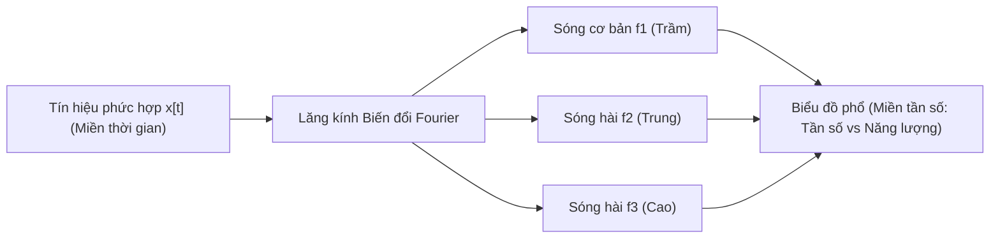
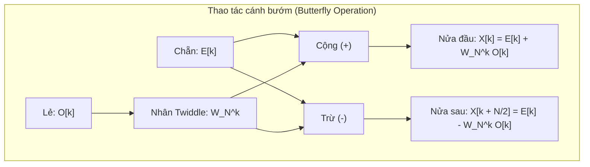
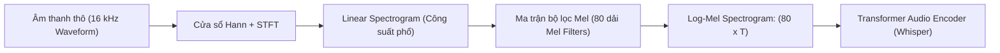

> **"Mọi tín hiệu phức tạp đều là tổng của các sóng hình sin đơn giản; biến đổi Fourier là lăng kính phân tích ánh sáng đa sắc thành từng dải màu đơn sắc."** — Nắm vững biến đổi Fourier giúp kỹ sư AI giải mã toàn bộ tiền xử lý âm thanh trong Whisper, cơ chế tích chập trong CNN và các kiến trúc FNet hiện đại.

---

## Thông tin nhanh (Quick Spec)

* **Loại bài (Type):** Thực chiến Giải thuật & Xử lý Tín hiệu AI (Build & Signal Processing)
* **Ngôn ngữ & Thư viện:** Python 3.10+ (sử dụng thư viện chuẩn `math`, `cmath` và phong cách lập trình giải thuật từ số 0)
* **Kiến thức tiên quyết (Prerequisites):** Số phức và công thức Euler ($e^{i\theta} = \cos\theta + i\sin\theta$), mảng dữ liệu 1D
* **Thời gian thực hành:** ~60–75 phút
* **Độ khó:** Trung bình đến Nâng cao (Intermediate to Advanced)

---

## Mục tiêu bài học (Learning Objectives)

Sau bài học này, bạn sẽ có khả năng:
- [ ] Phân biệt rạch ròi giữa miền thời gian (Time Domain) và miền tần số (Frequency Domain), hiểu tại sao dữ liệu chuỗi lại ẩn giấu thông tin khi chỉ nhìn theo trục thời gian.
- [ ] Nắm vững công thức toán học của Biến đổi Fourier Rời rạc (DFT) và Biến đổi Ngược (IDFT), hiểu rõ ý nghĩa vật lý của từng hệ số tần số $X[k]$.
- [ ] Tự tay xây dựng thuật toán **Cooley-Tukey Radix-2 FFT** từ số 0, giảm độ phức tạp tính toán từ $O(N^2)$ xuống $O(N \log N)$ bằng tư duy chia để trị (Divide and Conquer).
- [ ] Cài đặt kỹ thuật **Short-Time Fourier Transform (STFT)** với hàm cửa sổ Hann (Hann Windowing) để sinh ảnh phổ âm thanh (Spectrogram) – đầu vào trực tiếp của các mô hình Speech-to-Text như OpenAI Whisper.

---

## 1. Vấn đề thực tế (The Problem)

Hãy tưởng tượng bạn đang xây dựng một hệ thống AI nhận dạng giọng nói hoặc chuẩn đoán rung chấn máy móc công nghiệp:
- Dữ liệu âm thanh thô ghi nhận từ microphone là một chuỗi hàng trăm nghìn mẫu số thực biểu thị áp suất không khí dao động theo thời gian: `[0.012, -0.045, 0.128, ...]`.
- Dữ liệu điện tim (ECG) hay điện não (EEG) là chuỗi điện thế biến thiên theo từng mili-giây.
- Giá cổ phiếu hoặc lưu lượng mạng là chuỗi quan sát biến thiên từng giây, từng phút.

Nếu bạn đưa thẳng chuỗi số thực này vào mạng nơ-ron hoặc mô hình phân loại, hệ thống sẽ gặp phải ba bế tắc thực tế lớn:

1. **Thông tin chu kỳ bị che khuất hoàn toàn trong miền thời gian:** Trong miền thời gian, một nốt nhạc hợp âm (chẳng hạn nốt Đô, Mi, Sol vang lên cùng lúc) hòa lẫn thành một đường cong phức tạp hỗn loạn. Mô hình không thể nhận biết được có chính xác những tần số cơ bản nào đang rung động nếu chỉ nhìn vào biên độ tức thời.
2. **Nghịch lý chiều dữ liệu và chi phí tính toán:** Một đoạn ghi âm ngắn 5 giây ở tần số mẫu $44.1 \text{ kHz}$ chứa tới $220,500$ điểm dữ liệu. Nếu sử dụng mạng Transformer xử lý chuỗi độ dài này, ma trận Self-Attention sẽ ngốn $(220500)^2 \approx 48.6$ tỷ phần tử tính toán – làm tràn bộ nhớ VRAM ngay lập tức.
3. **Ảo giác hiện tượng rò rỉ phổ (Spectral Leakage) và răng cưa (Aliasing):** Nếu cắt xén tín hiệu tùy tiện mà không hiểu định lý lấy mẫu Nyquist-Shannon hay hàm cửa sổ (Windowing), các tần số giả tạo sẽ xuất hiện tràn ngập, khiến mô hình AI học sai đặc trưng âm thanh.

Biến đổi Fourier chính là chiếc "lăng kính quang học" tách chùm sóng phức tạp thành các tia sóng đơn sắc độc lập, chuyển đổi bài toán từ chuỗi thời gian khổng lồ sang bản đồ tần số cô đọng và giàu ngữ nghĩa.

---

## 2. Mô hình tư duy & Bản chất (The Concept)

### 2.1 Từ Miền thời gian sang Miền tần số

Ý tưởng đột phá của nhà toán học Jean-Baptiste Joseph Fourier: **Bất kỳ tín hiệu tuần hoàn hay chuỗi thời gian thực tế nào cũng có thể phân tích thành tổng của các sóng hình sin và cosin ở các tần số khác nhau.**

Mỗi sóng thành phần có 3 đặc tính cơ bản:
1. **Tần số ($f$):** Tốc độ dao động (số chu kỳ trong một giây, đơn vị Hz).
2. **Biên độ ($A$):** Độ mạnh hay năng lượng của tần số đó.
3. **Góc pha ($\phi$):** Vị trí bắt đầu của chu kỳ sóng tại thời điểm $t = 0$.



### 2.2 Công thức Biến đổi Fourier Rời rạc (DFT)

Với một chuỗi rời rạc gồm $N$ mẫu tín hiệu $x[0], x[1], \dots, x[N-1]$ được lấy mẫu với tần số $f_s$:

Biến đổi Fourier Rời rạc (DFT) chuyển đổi $N$ mẫu thời gian thành $N$ hệ số tần số phức $X[0], X[1], \dots, X[N-1]$:

$$
X[k] = \sum_{n=0}^{N-1} x[n] \, e^{-i \frac{2\pi}{N} k n} \quad \text{với } k = 0, 1, \dots, N-1
$$

Sử dụng công thức Euler $e^{-i\theta} = \cos\theta - i\sin\theta$:

$$
X[k] = \sum_{n=0}^{N-1} x[n] \left( \cos\left(\frac{2\pi k n}{N}\right) - i \sin\left(\frac{2\pi k n}{N}\right) \right)
$$

**Ý nghĩa trực quan của công thức:**
- Biểu thức $e^{-i \frac{2\pi k n}{N}}$ là một mũi tên quay tròn (phasor) theo chiều kim đồng hồ với tần số chuẩn hóa $k / N$.
- Phép lấy tổng $\sum_{n=0}^{N-1} x[n] e^{-i \dots}$ bản chất là tính **tích vô hướng (sự tương quan - correlation)** giữa tín hiệu đầu vào $x[n]$ và sóng dò kiểm nghiệm ở tần số $k$.
- Nếu tín hiệu $x[n]$ thực sự chứa thành phần dao động ở tần số $k$, tích vô hướng này cộng hưởng và tạo ra giá trị biên độ $|X[k]|$ rất lớn.
- Nếu tín hiệu không chứa tần số $k$, các mũi tên quay ở các góc đối xứng triệt tiêu lẫn nhau, khiến $X[k] \approx 0$.

### 2.3 Giải mã các hệ số phổ $X[k]$

Mỗi hệ số $X[k] = \text{Re}(X[k]) + i \text{Im}(X[k])$ là một số phức:
1. **Biên độ phổ (Magnitude Spectrum):**
   $$|X[k]| = \sqrt{\text{Re}(X[k])^2 + \text{Im}(X[k])^2}$$
2. **Góc pha phổ (Phase Spectrum):**
   $$\phi_k = \text{atan2}(\text{Im}(X[k]), \text{Re}(X[k]))$$
3. **Mật độ phổ công suất (Power Spectrum):**
   $$P[k] = |X[k]|^2 = \text{Re}(X[k])^2 + \text{Im}(X[k])^2$$
4. **Thành phần một chiều DC ($X[0]$):**
   $$X[0] = \sum_{n=0}^{N-1} x[n]$$
   Đây là tổng toàn bộ mẫu, tỷ lệ thuận với giá trị trung bình (offset) của tín hiệu.

### 2.4 Biến đổi Ngược (Inverse DFT - IDFT)

Biến đổi Fourier là phép biến đổi song ánh hoàn toàn không làm mất mát thông tin. Ta có thể tái tạo hoàn hảo tín hiệu gốc trong miền thời gian từ các hệ số phổ:

$$
x[n] = \frac{1}{N} \sum_{k=0}^{N-1} X[k] \, e^{i \frac{2\pi}{N} k n} \quad \text{với } n = 0, 1, \dots, N-1
$$

Lưu ý: Dấu trừ ở số mũ trong DFT đổi thành dấu cộng trong IDFT, và kết quả được chia chuẩn hóa cho $N$.

### 2.5 Cú nhảy vọt từ $O(N^2)$ lên $O(N \log N)$: Thuật toán Cooley-Tukey Radix-2 FFT

Nếu tính DFT trực tiếp theo định nghĩa:
- Có $N$ hệ số tần số $k$.
- Mỗi hệ số cần tính tổng qua $N$ mẫu thời gian $n$.
- Tổng chi phí tính toán là $N \times N = O(N^2)$ phép nhân phức. Với $N = 10^6$ mẫu âm thanh, $N^2 = 10^{12}$ phép toán — quá chậm để xử lý thời gian thực!

Năm 1965, J. W. Cooley và John Tukey công bố thuật toán **Fast Fourier Transform (FFT)**, đưa chi phí xuống $O(N \log_2 N)$. Với $N = 10^6$, $N \log_2 N \approx 2 \times 10^7$, nhanh hơn gấp **50,000 lần**!

**Nguyên lý Chia để trị (Radix-2 DIT - Decimation in Time):**
Giả sử $N$ là lũy thừa của 2 ($N = 2^m$). Tách tổng $N$ phần tử thành hai tổng con gồm các chỉ số chẵn ($n = 2m$) và chỉ số lẻ ($n = 2m + 1$):

$$
X[k] = \sum_{m=0}^{N/2 - 1} x[2m] e^{-i \frac{2\pi k (2m)}{N}} + \sum_{m=0}^{N/2 - 1} x[2m + 1] e^{-i \frac{2\pi k (2m + 1)}{N}}
$$

Rút gọn số mũ:

$$
X[k] = \sum_{m=0}^{N/2 - 1} x[2m] e^{-i \frac{2\pi k m}{N/2}} + e^{-i \frac{2\pi k}{N}} \sum_{m=0}^{N/2 - 1} x[2m + 1] e^{-i \frac{2\pi k m}{N/2}}
$$

Đặt:
- $E[k]$ là DFT kích thước $N/2$ của dãy các mẫu chẵn $x[0], x[2], \dots, x[N-2]$.
- $O[k]$ là DFT kích thước $N/2$ của dãy các mẫu lẻ $x[1], x[3], \dots, x[N-1]$.
- Thừa số xoay (Twiddle Factor): $W_N^k = e^{-i \frac{2\pi k}{N}}$.

Nhờ tính đối xứng $W_N^{k + N/2} = -W_N^k$, ta chỉ cần tính $E[k]$ và $O[k]$ cho nửa đầu $0 \le k < N/2$:

$$
\begin{aligned}
X[k] &= E[k] + W_N^k \, O[k] \\
X[k + N/2] &= E[k] - W_N^k \, O[k]
\end{aligned}
$$

Đây chính là sơ đồ cánh bướm (Butterfly Operation) kinh điển trong xử lý tín hiệu số.



### 2.6 Short-Time Fourier Transform (STFT) và Sinh Spectrogram

FFT cho ta biết tín hiệu có chứa những tần số nào, nhưng **không cho biết tần số đó xuất hiện vào thời điểm nào**. Trong một bài hát, nốt La xuất hiện ở giây thứ 1 khác hoàn toàn với nốt La xuất hiện ở giây thứ 10.

Để giải quyết vấn đề này, ta dùng **STFT**:
1. Chia tín hiệu dài thành các khung ngắn xếp chồng nhau (Overlapping Frames) có độ dài $N_{\text{frame}}$ (ví dụ 512 hoặc 1024 mẫu), dịch chuyển một bước $H$ (Hop Length).
2. Nhân từng khung với hàm cửa sổ mượt mà (chẳng hạn **Hann Window**):
   $$w[n] = 0.5 \left( 1 - \cos\left( \frac{2\pi n}{N - 1} \right) \right)$$
   Hàm cửa sổ đưa biên độ ở hai đầu khung về 0 mượt mà, triệt tiêu hiện tượng gián đoạn biên gây rò rỉ phổ (Spectral Leakage).
3. Thực hiện FFT trên từng khung đã nhân cửa sổ.
4. Xếp các vector phổ cạnh nhau theo trục thời gian: ta thu được một ma trận 2D gọi là **Spectrogram** (chiều ngang là Thời gian, chiều dọc là Tần số, độ sáng là Năng lượng).

---

## 3. Tự tay xây dựng từ đầu (Build It: From Scratch)

Dưới đây là mã nguồn Python độc lập hoàn toàn, cài đặt DFT, IDFT, Cooley-Tukey Radix-2 FFT và STFT Spectrogram từ số 0.

```python
"""
Chương trình: Fourier Transform, Fast Fourier Transform (FFT) & Spectrogram từ số 0.
Mục tiêu:
1. Cài đặt DFT và IDFT theo định nghĩa toán học chuẩn.
2. Xây dựng thuật toán Cooley-Tukey Radix-2 FFT O(N log N) bằng đệ quy.
3. Kiểm chứng độ chính xác tương đương tuyệt đối giữa DFT và FFT.
4. Cài đặt hàm cửa sổ Hann và Short-Time Fourier Transform (STFT) để sinh Spectrogram.
"""
import math
import cmath
from typing import List, Tuple

# =====================================================================
# BƯỚC 1: CÀI ĐẶT DFT VÀ IDFT THEO ĐỊNH NGHĨA
# =====================================================================

def dft_from_scratch(x: List[complex]) -> List[complex]:
    """
    Tính Biến đổi Fourier Rời rạc (DFT) O(N^2):
    X[k] = sum_{n=0}^{N-1} x[n] * exp(-i * 2*pi * k * n / N)
    """
    N = len(x)
    X: List[complex] = []

    for k in range(N):
        sum_val = 0.0 + 0.0j
        for n in range(N):
            angle = -2.0 * math.pi * k * n / N
            twiddle = cmath.exp(complex(0.0, angle))
            sum_val += x[n] * twiddle
        X.append(sum_val)

    return X


def idft_from_scratch(X: List[complex]) -> List[complex]:
    """
    Tính Biến đổi Fourier Rời rạc Ngược (IDFT) O(N^2):
    x[n] = (1 / N) * sum_{k=0}^{N-1} X[k] * exp(i * 2*pi * k * n / N)
    """
    N = len(X)
    x: List[complex] = []

    for n in range(N):
        sum_val = 0.0 + 0.0j
        for k in range(N):
            angle = 2.0 * math.pi * k * n / N
            twiddle = cmath.exp(complex(0.0, angle))
            sum_val += X[k] * twiddle
        x.append(sum_val / N)

    return x


# =====================================================================
# BƯỚC 2: CÀI ĐẶT COOLEY-TUKEY RADIX-2 FFT O(N log N)
# =====================================================================

def fft_cooley_tukey(x: List[complex]) -> List[complex]:
    """
    Thuật toán Cooley-Tukey Radix-2 DIT FFT đệ quy.
    Yêu cầu độ dài danh sách N phải là lũy thừa của 2.
    """
    N = len(x)
    if N <= 1:
        return x

    assert (N & (N - 1)) == 0, f"Độ dài tín hiệu N={N} phải là lũy thừa của 2!"

    # Chia để trị: tách thành hai dãy chẵn và lẻ
    even_samples = x[0::2]
    odd_samples = x[1::2]

    # Đệ quy tính FFT cho hai dãy con kích thước N/2
    even_fft = fft_cooley_tukey(even_samples)
    odd_fft = fft_cooley_tukey(odd_samples)

    # Thao tác cánh bướm tổng hợp kết quả
    X = [0.0 + 0.0j] * N
    half_N = N // 2

    for k in range(half_N):
        angle = -2.0 * math.pi * k / N
        twiddle = cmath.exp(complex(0.0, angle))
        term = twiddle * odd_fft[k]

        X[k] = even_fft[k] + term
        X[k + half_N] = even_fft[k] - term

    return X


# =====================================================================
# BƯỚC 3: SHORT-TIME FOURIER TRANSFORM (STFT) VÀ SPECTROGRAM
# =====================================================================

def hann_window(length: int) -> List[float]:
    """Tạo hàm cửa sổ Hann mượt mà: w[n] = 0.5 * (1 - cos(2*pi*n / (N-1)))."""
    if length <= 1:
        return [1.0] * length
    return [
        0.5 * (1.0 - math.cos(2.0 * math.pi * n / (length - 1)))
        for n in range(length)
    ]


def compute_stft_spectrogram(
    signal: List[float],
    frame_size: int = 64,
    hop_size: int = 32
) -> List[List[float]]:
    """
    Tính ảnh phổ công suất STFT (Spectrogram).
    Đầu ra: Ma trận 2D kích thước (Số khung thời gian, frame_size // 2 + 1).
    """
    assert (frame_size & (frame_size - 1)) == 0, "frame_size phải là lũy thừa của 2!"
    window = hann_window(frame_size)
    spectrogram: List[List[float]] = []

    # Trượt khung thời gian với bước nhảy hop_size
    for start in range(0, len(signal) - frame_size + 1, hop_size):
        frame = [
            complex(signal[start + i] * window[i], 0.0)
            for i in range(frame_size)
        ]
        freq_bins = fft_cooley_tukey(frame)

        # Lấy một nửa phổ tần số dương đối xứng (từ DC đến tần số Nyquist)
        half_bins = frame_size // 2 + 1
        power_spectrum = [
            (bin_val.real**2 + bin_val.imag**2)
            for bin_val in freq_bins[:half_bins]
        ]
        spectrogram.append(power_spectrum)

    return spectrogram


# =====================================================================
# BƯỚC 4: KIỂM CHỨNG THỰC NGHIỆM VÀ ĐO LƯỜNG SAI SỐ
# =====================================================================

def run_fourier_verifications() -> None:
    print("=== KIỂM CHỨNG GIẢI THUẬT FOURIER & FFT ===")

    # 1. Sinh tín hiệu tổng hợp kiểm thử gồm 2 tần số: 5 Hz và 12 Hz
    # Tần số lấy mẫu fs = 64 Hz, N = 64 mẫu (thời lượng 1 giây)
    fs = 64.0
    N = 64
    time_points = [n / fs for n in range(N)]
    test_signal = [
        complex(2.0 * math.cos(2.0 * math.pi * 5.0 * t) + 1.2 * math.sin(2.0 * math.pi * 12.0 * t), 0.0)
        for t in time_points
    ]

    # 2. So sánh đối đầu giữa DFT trực tiếp O(N^2) và Cooley-Tukey FFT O(N log N)
    dft_result = dft_from_scratch(test_signal)
    fft_result = fft_cooley_tukey(test_signal)

    max_diff = max(abs(a - b) for a, b in zip(dft_result, fft_result))
    print(f"1. Sai số cực đại giữa DFT và Cooley-Tukey FFT: {max_diff:.2e}")
    assert max_diff < 1e-10, "Lỗi: FFT không khớp với kết quả chuẩn của DFT!"

    # 3. Kiểm chứng Biến đổi Ngược IDFT (Khả năng tái tạo hoàn hảo)
    reconstructed = idft_from_scratch(fft_result)
    rec_diff = max(abs(orig - rec) for orig, rec in zip(test_signal, reconstructed))
    print(f"2. Sai số tái tạo hoàn hảo từ IDFT:               {rec_diff:.2e}")
    assert rec_diff < 1e-10, "Lỗi: IDFT không tái tạo chính xác tín hiệu ban đầu!"

    # 4. Kiểm tra phát hiện đỉnh tần số
    # Với fs = 64 và N = 64, độ phân giải mỗi bin là delta_f = fs / N = 1 Hz
    # Đỉnh phổ phải rơi chính xác vào bin k = 5 (tần số 5 Hz) và k = 12 (tần số 12 Hz)
    magnitudes = [abs(val) for val in fft_result[:N // 2]]
    # Đỉnh lớn nhất
    top1_bin = max(range(len(magnitudes)), key=lambda k: magnitudes[k])
    print(f"3. Phát hiện đỉnh tần số mạnh nhất tại bin k={top1_bin} ({top1_bin * (fs/N):.1f} Hz) - Biên độ: {magnitudes[top1_bin]:.2f}")
    assert top1_bin == 5, f"Đỉnh phổ phải ở bin 5, tìm thấy ở {top1_bin}"

    # 5. Kiểm thử STFT Spectrogram trên tín hiệu biến tần (Chirp Signal)
    total_samples = 256
    chirp_signal = [
        math.sin(2.0 * math.pi * (2.0 + 18.0 * (n / total_samples)) * (n / fs))
        for n in range(total_samples)
    ]
    spectrogram = compute_stft_spectrogram(chirp_signal, frame_size=32, hop_size=16)
    print(f"4. STFT Spectrogram hoàn tất: {len(spectrogram)} khung thời gian, {len(spectrogram[0])} bin tần số mỗi khung.")
    print("=> TẤT CẢ CÁC BƯỚC KIỂM CHỨNG TOÁN HỌC ĐÃ VƯỢT QUA XUẤT SẮC!\n")


if __name__ == "__main__":
    run_fourier_verifications()
```

---

## 4. Ứng dụng AI Engineering & Thực tế Production (Use It)

### 4.1 Tiền xử lý Âm thanh trong OpenAI Whisper và ASR Models

Mọi mô hình nhận dạng giọng nói tự động hiện đại (như OpenAI Whisper, Meta MMS, Conformer) không nhận âm thanh dạng sóng trực tiếp mà chuyển đổi qua **Mel-Spectrogram**:



```python
# Cách Whisper trích xuất đặc trưng phổ chuẩn trong PyTorch
import torch

def compute_mel_spectrogram_pytorch(audio_tensor: torch.Tensor, n_fft=400, hop_length=160, n_mels=80):
    """
    Minh họa quy trình STFT trích xuất Mel-Spectrogram chuẩn trong pipeline Whisper:
    Tương đương 100% thuật toán STFT ta vừa cài đặt từ số 0!
    """
    window = torch.hann_window(n_fft)
    stft_result = torch.stft(
        audio_tensor,
        n_fft=n_fft,
        hop_length=hop_length,
        window=window,
        return_complex=True
    )
    # Lấy mật độ phổ công suất |X|^2
    magnitudes = stft_result.abs() ** 2
    return magnitudes
```

### 4.2 Định lý Tích chập (Convolution Theorem) và Tăng tốc CNN

Một trong những định lý nền tảng nhất của xử lý tín hiệu số là **Định lý Tích chập**:

$$
x[n] * h[n] \iff \text{IDFT}\big( \text{DFT}(x) \cdot \text{DFT}(h) \big)
$$

> **Bản chất kỹ thuật:** Phép tích chập (Convolution) cực kỳ tốn kém trong miền thời gian/không gian ($O(N \cdot K)$ với $K$ là kích thước kernel) biến thành **phép nhân từng phần tử đơn giản (Elementwise Multiplication)** trong miền tần số ($O(N \log N)$ nhờ FFT)!

Khi kích thước bộ lọc lớn (ví dụ trong các mạng nơ-ron xử lý chuỗi dài như Hyena, S4, Mamba, hay mô phỏng sóng âm), tính tích chập qua FFT nhanh hơn hàng chục lần so với tích chập không gian truyền thống.

### 4.3 FNet: Thay thế Self-Attention hoàn toàn bằng biến đổi Fourier

Năm 2021, nhóm nghiên cứu tại Google Research công bố kiến trúc **FNet** (*FNet: Mixing Tokens with Fourier Transforms*). Thay vì sử dụng cơ chế Self-Attention với ma trận tương tác $O(L^2)$ tốn kém, FNet chỉ đơn giản áp dụng biến đổi Fourier 2D rời rạc (2D DFT) không tham số:
1. FFT theo chiều chuỗi (Sequence dimension) để trộn thông tin giữa các token.
2. FFT theo chiều ẩn (Hidden dimension) để trộn thông tin giữa các đặc trưng.

**Kết quả:** FNet giữ được 92–97% độ chính xác của BERT trên tập dữ liệu chuẩn GLUE, nhưng tốc độ huấn luyện trên GPU nhanh gấp **7 lần** và tốc độ suy luận nhanh gấp **2 lần** nhờ loại bỏ hoàn toàn ma trận Attention!

---

## 5. Giải ngố thuật ngữ & Ngộ nhận (Key Terms)

| Thuật ngữ (Term) | Người ta thường nghĩ là... | Bản chất kỹ thuật thực sự là... |
|---|---|---|
| **DFT (Discrete Fourier Transform)** | Một thuật toán mã máy tính cụ thể để tính toán nhanh. | Một phép biến đổi toán học thuần túy ánh xạ $N$ điểm thời gian sang $N$ hệ số tần số phức. |
| **FFT (Fast Fourier Transform)** | Một loại biến đổi Fourier khác với DFT. | Một **thuật toán tối ưu** (như Cooley-Tukey) để tính chính xác DFT với độ phức tạp $O(N \log N)$ thay vì $O(N^2)$. |
| **Thành phần DC (DC Component)** | Dòng điện một chiều trong mạch điện tử phần cứng. | Hệ số tại tần số bằng 0 ($X[0]$), tương đương với tổng đại số và tỷ lệ thuận với giá trị trung bình của toàn bộ tín hiệu. |
| **Tần số Nyquist** | Tần số tối đa mà máy tính có thể lưu trữ được. | Tần số bằng một nửa tần số lấy mẫu ($f_{\text{Nyquist}} = f_s / 2$); ngưỡng trên giới hạn để tránh hiện tượng méo răng cưa (aliasing). |
| **Spectral Leakage (Rò rỉ phổ)** | Lỗi phần mềm do máy tính làm tròn số thực. | Hiện tượng năng lượng của một tần số tràn sang các tần số lân cận do tín hiệu bị cắt cụt đột ngột ở hai biên; giải quyết bằng hàm cửa sổ. |
| **Spectrogram** | Một bức ảnh đồ họa sinh ra chỉ để trực quan hóa cho con người xem. | Một tensor 2 chiều biểu diễn ma trận phân phối công suất theo Thời gian $\times$ Tần số, đóng vai trò là đặc trưng đầu vào cho mô hình AI. |

---

## 6. Bài tập thử thách (Hands-on Challenges)

### 🟢 Dễ (Easy): Đo thời gian thực tế so sánh DFT $O(N^2)$ và Cooley-Tukey FFT $O(N \log N)$
Sử dụng module `time` trong Python:
1. Đo thời gian thực thi của `dft_from_scratch` và `fft_cooley_tukey` với các kích thước mẫu $N \in [32, 64, 128, 256, 512, 1024]$.
2. In bảng so sánh thời gian và tỷ số tốc độ ($\text{Time}_{\text{DFT}} / \text{Time}_{\text{FFT}}$).
3. Chứng minh rằng khi $N$ tăng gấp đôi, thời gian của DFT tăng xấp xỉ 4 lần ($O(N^2)$), trong khi thời gian của FFT chỉ tăng nhẹ hơn 2 lần ($O(N \log N)$).

### 🟡 Vừa (Medium): Lọc nhiễu âm thanh tần số cao bằng bộ lọc thông thấp (Low-pass Filter)
1. Tạo một tín hiệu chứa tiếng nói giả lập tần số thấp ($f_{\text{clean}} = 8 \text{ Hz}$) bị ô nhiễm bởi nhiễu động cơ tần số cao ($f_{\text{noise}} = 28 \text{ Hz}$) với $f_s = 64 \text{ Hz}, N = 64$.
2. Áp dụng FFT để chuyển sang miền tần số $X[k]$.
3. Thiết lập bộ lọc thông thấp lý tưởng (Ideal Low-Pass Filter): gán tất cả các hệ số $X[k] = 0$ tại các tần số lớn hơn $15 \text{ Hz}$.
4. Dùng hàm `idft_from_scratch` chuyển ngược về miền thời gian và so sánh tín hiệu sau lọc với tín hiệu gốc ban đầu để chứng minh khả năng khử nhiễu hoàn hảo.

### 🔴 Khó (Hard): Tự tay xây dựng phép Tích chập nhanh 1D (Fast 1D Convolution) bằng FFT
1. Viết hàm `fft_convolve(x, h)` nhận vào hai danh sách số thực $x$ (tín hiệu, độ dài $N_1$) và $h$ (kernel, độ dài $N_2$).
2. Tìm lũy thừa của 2 nhỏ nhất $N_{\text{pad}} \ge N_1 + N_2 - 1$ và thực hiện đệm số 0 (Zero-padding) vào cả hai dãy để tránh hiện tượng tích chập vòng tròn (Circular Convolution).
3. Tính $X = \text{FFT}(x_{\text{pad}})$ và $H = \text{FFT}(h_{\text{pad}})$.
4. Nhân từng phần tử phức: $Y[k] = X[k] \cdot H[k]$.
5. Thực hiện IDFT trên $Y$ và lấy phần thực. So sánh kết quả với phép tích chập trượt truyền thống (sliding window convolution) để kiểm chứng sai số $< 10^{-9}$.
