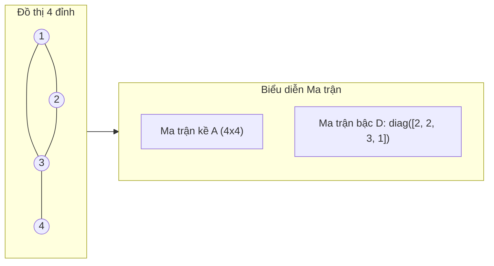
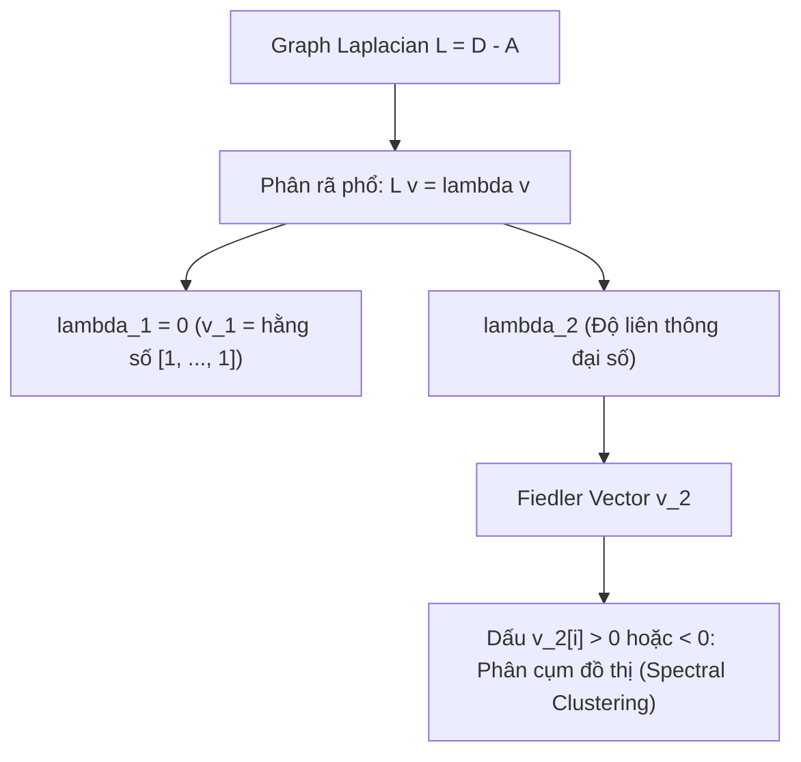

> **"Cấu trúc liên kết chính là dữ liệu; ma trận Laplacian mã hóa toàn bộ hình học của đồ thị và chuẩn hóa đối xứng là chìa khóa của GCN."** — Làm chủ lý thuyết đồ thị phổ và cơ chế truyền tin (Message Passing) giúp kỹ sư AI bước vào lĩnh vực Graph Neural Networks để giải quyết các bài toán phát hiện gian lận, mạng xã hội và thiết kế thuốc sinh học.

---

## Thông tin nhanh (Quick Spec)

* **Loại bài (Type):** Trực giác Khái niệm & Thực chiến Thuật toán (Intuition & Build)
* **Ngôn ngữ & Thư viện:** Python 3.10+ (thư viện chuẩn `math`, `random` và đối chiếu PyTorch Geometric)
* **Kiến thức tiên quyết (Prerequisites):** Phép nhân ma trận, trị riêng & véctơ riêng (Eigendecomposition)
* **Thời gian thực hành:** ~55–70 phút
* **Độ khó:** Trung bình đến Nâng cao (Intermediate)

---

## Mục tiêu bài học (Learning Objectives)

Sau bài học này, bạn sẽ có khả năng:
- [ ] Biểu diễn cấu trúc hình học của đồ thị qua các ma trận cốt lõi: Ma trận kề (Adjacency Matrix $A$) và Ma trận bậc (Degree Matrix $D$).
- [ ] Thấu hiểu bản chất toán học của **Toán tử Graph Laplacian** ($L = D - A$ và $L_{\text{sym}} = D^{-1/2} L D^{-1/2}$), chứng minh tính bán xác định dương và mối liên hệ giữa trị riêng bằng 0 với số thành phần liên thông.
- [ ] Tự tay xây dựng thuật toán phân cụm phổ (**Spectral Clustering**) từ số 0 bằng véctơ Fiedler và thuật toán Jacobi tìm trị riêng.
- [ ] Cài đặt trọn vẹn tầng mạng nơ-ron tích chập trên đồ thị **Kipf & Welling GCN** từ đầu bằng Python thuần túy: tự thêm khuyên (Self-loops), tính chuẩn hóa đối xứng $\tilde{A}_{\text{norm}}$ và thực hiện lan truyền đặc trưng (Forward Propagation).

---

## 1. Vấn đề thực tế (The Problem)

Hầu hết các thuật toán học máy truyền thống (Linear Regression, Random Forest, MLP thông thường) đều dựa trên giả định **IID (Independent and Identically Distributed)**: các hàng trong bảng dữ liệu độc lập và phân phối đồng nhất với nhau. 

Tuy nhiên, trong thế giới thực, dữ liệu giá trị nhất lại nằm ở **mối quan hệ tương hỗ và cấu trúc liên kết giữa các thực thể**:
- **Mạng xã hội:** Dự đoán hành vi của người dùng không chỉ dựa vào thông tin cá nhân của họ, mà phụ thuộc phần lớn vào nhóm bạn bè mà họ thường xuyên tương tác.
- **Hệ thống tài chính & Phòng chống gian lận (Anti-Fraud):** Kẻ gian lận tài khoản thường thiết lập mạng lưới tài khoản ảo liên kết chéo vòng tròn qua các giao dịch chuyển tiền nhỏ lẻ để rửa tiền.
- **Sinh học phân tử & Thiết kế thuốc (Drug Discovery):** Một phân tử hóa học không phải là một danh sách nguyên tử rời rạc, mà là một đồ thị 3D trong đó các nguyên tử là đỉnh và liên kết cộng hóa trị là cạnh. Hoạt tính sinh học của thuốc phụ thuộc trực tiếp vào cấu trúc topo này.
- **Knowledge Graphs trong RAG:** Các nút là khái niệm, cạnh là quan hệ ngữ nghĩa.

Nếu bạn cố ép dữ liệu đồ thị về dạng bảng phẳng (Tabular Data) hoặc ma trận cố định, bạn sẽ đối mặt với ba cạm bẫy chết người:

1. **Phá vỡ tính bất biến hoán vị (Permutation Invariance):** Thứ tự gán nhãn đỉnh đồ thị $1, 2, \dots, N$ là hoàn toàn ngẫu nhiên. Nếu thay đổi thứ tự đánh số đỉnh, bảng dữ liệu thay đổi hoàn toàn nhưng đồ thị thực chất không hề đổi khác. Các mô hình học sâu truyền thống không có tính bất biến này.
2. **Kích thước lân cận bất định (Irregular Neighborhoods):** Khác với ảnh 2D (mỗi điểm ảnh luôn có đúng 8 điểm lân cận) hoặc văn bản (mỗi từ có đúng từ trước và từ sau), mỗi đỉnh trong đồ thị có thể có 1, 10, hay 10,000 nút lân cận. Phép tích chập ảnh tiêu chuẩn (CNN) sụp đổ hoàn toàn trên đồ thị.
3. **Cạm bẫy bùng nổ hoặc triệt tiêu biên độ khi truyền tin (Exploding/Vanishing Signals):** Nếu đỉnh có bậc lớn (nhiều kết nối) chỉ đơn thuần cộng gộp thông tin từ các nút lân cận, giá trị kích hoạt của nó sẽ bùng nổ theo cấp số nhân sau vài tầng mạng nơ-ron, trong khi các đỉnh bậc thấp bị chìm nghỉm.

Lý thuyết đồ thị phổ và toán tử Laplacian chính là chìa khóa toán học mở ra kiến trúc **Graph Neural Networks (GNN)** giải quyết triệt để các thách thức trên.

---

## 2. Mô hình tư duy & Bản chất (The Concept)

### 2.1 Biểu diễn Đồ thị: Ma trận kề $A$ và Ma trận bậc $D$

Một đồ thị vô hướng $G = (V, E)$ gồm tập hợp $N = |V|$ đỉnh và $|E|$ cạnh:

1. **Ma trận kề (Adjacency Matrix $A \in \{0, 1\}^{N \times N}$):**
   $$A_{ij} = \begin{cases} 1 & \text{nếu có cạnh nối giữa đỉnh } i \text{ và } j \\ 0 & \text{ngược lại} \end{cases}$$
   Đối với đồ thị vô hướng, $A$ là ma trận đối xứng ($A = A^T$).

2. **Ma trận bậc (Degree Matrix $D \in \mathbb{R}^{N \times N}$):**
   Bậc $d_i$ của đỉnh $i$ là tổng số cạnh nối vào đỉnh đó:
   $$d_i = \sum_{j=1}^N A_{ij}$$
   Ma trận bậc $D$ là ma trận đường chéo chứa $d_i$ trên đường chéo chính:
   $$D = \text{diag}(d_1, d_2, \dots, d_N)$$



### 2.2 Toán tử Graph Laplacian: Đo lường độ trơn của tín hiệu

**Toán tử Laplacian chuẩn (Unnormalized Graph Laplacian)** được định nghĩa bằng:

$$
L = D - A
$$

Về mặt phần tử:
$$
L_{ij} = \begin{cases} d_i & \text{nếu } i = j \\ -1 & \text{nếu } i \ne j \text{ và có cạnh nối } (i, j) \\ 0 & \text{ngược lại} \end{cases}
$$

**Ý nghĩa hình học sâu sắc của Laplacian:**
Giả sử ta gán cho mỗi đỉnh $i$ một giá trị số thực $x_i \in \mathbb{R}$ (gọi là tín hiệu trên đồ thị - Graph Signal $x \in \mathbb{R}^N$). Hãy xét dạng toàn phương $x^T L x$:

$$
x^T L x = x^T D x - x^T A x = \sum_{i=1}^N d_i x_i^2 - \sum_{i=1}^N \sum_{j=1}^N A_{ij} x_i x_j
$$

Vì $d_i = \sum_j A_{ij}$, ta viết lại được thành:

$$
x^T L x = \frac{1}{2} \sum_{i=1}^N \sum_{j=1}^N A_{ij} (x_i - x_j)^2
$$

> **Bản chất toán học:** Dạng toàn phương $x^T L x$ đo lường **độ biến thiên (độ gập ghềnh / roughness)** của tín hiệu $x$ dọc theo các cạnh của đồ thị:
> - Nếu hai đỉnh $i$ và $j$ nối với nhau ($A_{ij} = 1$) và có giá trị gần bằng nhau ($x_i \approx x_j$), thì $(x_i - x_j)^2 \approx 0$, tổng năng lượng biến thiên rất nhỏ. Tín hiệu được coi là "trơn" (Smooth).
> - Nếu hai đỉnh nối nhau nhưng có giá trị đối nghịch ($x_i \gg x_j$), năng lượng $x^T L x$ sẽ rất lớn.

**Các tính chất nền tảng của Graph Laplacian:**
1. **Đối xứng và Bán xác định dương (PSD):** Vì $x^T L x = \frac{1}{2} \sum A_{ij}(x_i - x_j)^2 \ge 0$ với mọi $x$, mọi trị riêng của $L$ đều là số thực không âm:
   $$0 = \lambda_1 \le \lambda_2 \le \dots \le \lambda_N$$
2. **Trị riêng nhỏ nhất $\lambda_1 = 0$:** Véctơ riêng tương ứng là véctơ hằng số $\mathbf{1} = [1, 1, \dots, 1]^T$, vì $L \mathbf{1} = D \mathbf{1} - A \mathbf{1} = d - d = \mathbf{0}$.
3. **Số lượng thành phần liên thông:** Bội số của trị riêng bằng 0 ($\lambda = 0$) đúng bằng số lượng thành phần liên thông độc lập của đồ thị!
4. **Véctơ Fiedler ($\lambda_2$):** Trị riêng nhỏ thứ hai $\lambda_2$ được gọi là **Độ liên thông đại số (Algebraic Connectivity)**. Véctơ riêng tương ứng $v_2$ (gọi là **Fiedler Vector**) cho phép phân chia đồ thị thành 2 cụm tối ưu theo bài toán cắt nhỏ nhất (Normalized Min-Cut).



### 2.3 Chuẩn hóa Ma trận Laplacian

Để loại bỏ ảnh hưởng của sự chênh lệch bậc quá lớn giữa các đỉnh (ví dụ nút ngôi sao có bậc 1000 trong khi nút lá có bậc 1), người ta sử dụng **Ma trận Laplacian chuẩn hóa đối xứng (Symmetric Normalized Laplacian)**:

$$
L_{\text{sym}} = D^{-1/2} L D^{-1/2} = I - D^{-1/2} A D^{-1/2}
$$

Các trị riêng của $L_{\text{sym}}$ luôn nằm chặt trong đoạn $[0, 2]$.

### 2.4 Cơ chế lan truyền trong Kipf & Welling GCN

Trong bài báo mang tính bước ngoặt tại ICLR 2017 (*Semi-Supervised Classification with Graph Convolutional Networks*), Thomas Kipf và Max Welling đã đưa ra một phép xấp xỉ bậc nhất cho biến đổi Fourier phổ trên đồ thị.

Một tầng GCN nhận vào ma trận đặc trưng các đỉnh $H^{(l)} \in \mathbb{R}^{N \times F_{\text{in}}}$ và tính toán đặc trưng mới $H^{(l+1)} \in \mathbb{R}^{N \times F_{\text{out}}}$ qua hai bước đột phá:

1. **Thêm khuyên tự thân (Self-Loops):** Đỉnh cần giữ lại đặc trưng của chính mình bên cạnh việc gộp đặc trưng từ các nút lân cận:
   $$\tilde{A} = A + I_N$$
   Ma trận bậc tương ứng có $\tilde{D}_{ii} = \sum_j \tilde{A}_{ij} = d_i + 1$.

2. **Chuẩn hóa đối xứng (Symmetric Normalization):**
   $$\tilde{A}_{\text{norm}} = \tilde{D}^{-1/2} \tilde{A} \tilde{D}^{-1/2}$$
   Mỗi phần tử được chia tỷ lệ:
   $$(\tilde{A}_{\text{norm}})_{ij} = \frac{\tilde{A}_{ij}}{\sqrt{\tilde{D}_{ii} \tilde{D}_{jj}}}$$

3. **Công thức truyền tin tổng quát của tầng GCN:**
   $$H^{(l+1)} = \sigma \left( \tilde{A}_{\text{norm}} H^{(l)} W^{(l)} \right)$$

Trong đó:
- $W^{(l)} \in \mathbb{R}^{F_{\text{in}} \times F_{\text{out}}}$ là ma trận trọng số tuyến tính học được.
- $\sigma$ là hàm kích hoạt phi tuyến tính (thường là $\text{ReLU}$).
- $\tilde{A}_{\text{norm}} H^{(l)}$ là phép tổng hợp đặc trưng trung bình có trọng số đối xứng từ lân cận.

---

## 3. Tự tay xây dựng từ đầu (Build It: From Scratch)

Dưới đây là mã nguồn Python độc lập hoàn toàn: xây dựng cấu trúc biểu diễn đồ thị, giải thuật tìm trị riêng Jacobi, phân cụm phổ (Spectral Clustering) và tầng mạng nơ-ron đồ thị Kipf & Welling GCN.

```python
"""
Chương trình: Lý thuyết Đồ thị, Phân cụm Phổ & Tầng GCN Kipf-Welling từ số 0.
Mục tiêu:
1. Xây dựng biểu diễn ma trận kề A, ma trận bậc D và toán tử Graph Laplacian L.
2. Thuật toán Jacobi giải bài toán trị riêng cho ma trận đối xứng thực.
3. Phân cụm phổ (Spectral Clustering) bằng véctơ Fiedler.
4. Cài đặt tầng GCN Forward Pass với chuẩn hóa đối xứng và kích hoạt ReLU.
"""
import math
import random
from typing import List, Tuple

# =====================================================================
# BƯỚC 1: CÁC PHÉP TOÁN ĐẠI SỐ TUYẾN TÍNH CƠ BẢN
# =====================================================================

def matmul(A: List[List[float]], B: List[List[float]]) -> List[List[float]]:
    """Nhân hai ma trận A (m x k) và B (k x n)."""
    rows_A, cols_A = len(A), len(A[0])
    rows_B, cols_B = len(B), len(B[0])
    assert cols_A == rows_B, f"Không khớp kích thước ma trận: {cols_A} != {rows_B}"

    C = [[0.0] * cols_B for _ in range(rows_A)]
    for i in range(rows_A):
        for k in range(cols_A):
            aik = A[i][k]
            if aik != 0.0:
                for j in range(cols_B):
                    C[i][j] += aik * B[k][j]
    return C


def relu(matrix: List[List[float]]) -> List[List[float]]:
    """Hàm kích hoạt ReLU từng phần tử: max(0, x)."""
    return [[max(0.0, val) for val in row] for row in matrix]


# =====================================================================
# BƯỚC 2: TÍNH GRAPH LAPLACIAN VÀ GIẢI THUẬT TRỊ RIÊNG JACOBI
# =====================================================================

def compute_laplacian(A: List[List[float]]) -> Tuple[List[List[float]], List[float]]:
    """
    Tính ma trận Laplacian L = D - A và danh sách bậc đỉnh D.
    """
    N = len(A)
    degrees = [sum(A[i]) for i in range(N)]
    L = [[0.0] * N for _ in range(N)]

    for i in range(N):
        for j in range(N):
            if i == j:
                L[i][j] = float(degrees[i] - A[i][j])
            else:
                L[i][j] = float(-A[i][j])

    return L, degrees


def jacobi_eigen_symmetric(
    A_in: List[List[float]],
    max_iter: int = 200,
    tol: float = 1e-10
) -> Tuple[List[float], List[List[float]]]:
    """
    Thuật toán Jacobi tìm tất cả trị riêng và véctơ riêng của ma trận đối xứng thực.
    Trả về: (sorted_eigenvalues, sorted_eigenvectors_as_columns).
    """
    N = len(A_in)
    # Sao chép ma trận ban đầu
    A = [row[:] for row in A_in]
    # Ma trận trực giao tích lũy các véctơ riêng V (khởi tạo ma trận đơn vị I)
    V = [[1.0 if i == j else 0.0 for j in range(N)] for i in range(N)]

    for _ in range(max_iter):
        # 1. Tìm phần tử ngoài đường chéo lớn nhất |A[p][q]|
        max_val = 0.0
        p, q = 0, 1
        for i in range(N):
            for j in range(i + 1, N):
                if abs(A[i][j]) > max_val:
                    max_val = abs(A[i][j])
                    p, q = i, j

        if max_val < tol:
            break

        # 2. Tính góc quay Jacobi theta
        app = A[p][p]
        aqq = A[q][q]
        apq = A[p][q]

        if abs(app - aqq) < 1e-15:
            theta = math.pi / 4.0 if apq > 0 else -math.pi / 4.0
        else:
            tau = (aqq - app) / (2.0 * apq)
            t = math.copysign(1.0 / (abs(tau) + math.sqrt(1.0 + tau**2)), tau)
            theta = math.atan(t)

        c = math.cos(theta)
        s = math.sin(theta)

        # 3. Cập nhật các hàng và cột p, q của ma trận A
        for k in range(N):
            if k != p and k != q:
                akp = A[k][p]
                akq = A[k][q]
                A[k][p] = A[p][k] = c * akp - s * akq
                A[k][q] = A[q][k] = s * akp + c * akq

        A[p][p] = c**2 * app - 2.0 * s * c * apq + s**2 * aqq
        A[q][q] = s**2 * app + 2.0 * s * c * apq + c**2 * aqq
        A[p][q] = A[q][p] = 0.0

        # 4. Tích lũy phép quay vào ma trận véctơ riêng V
        for k in range(N):
            vkp = V[k][p]
            vkq = V[k][q]
            V[k][p] = c * vkp - s * vkq
            V[k][q] = s * vkp + c * vkq

    # Trích xuất và sắp xếp trị riêng tăng dần
    raw_eigenvalues = [A[i][i] for i in range(N)]
    sorted_indices = sorted(range(N), key=lambda idx: raw_eigenvalues[idx])

    eigenvalues = [raw_eigenvalues[idx] for idx in sorted_indices]
    eigenvectors = [[V[r][idx] for r in range(N)] for idx in sorted_indices]

    return eigenvalues, eigenvectors


# =====================================================================
# BƯỚC 3: PHÂN CỤM PHỔ (SPECTRAL CLUSTERING) BẰNG VÉCTƠ FIEDLER
# =====================================================================

def spectral_clustering_bisection(A: List[List[float]]) -> Tuple[List[int], List[int], float]:
    """
    Phân chia đồ thị thành 2 cụm tối ưu sử dụng dấu của véctơ Fiedler (v2 của L).
    """
    L, _ = compute_laplacian(A)
    evals, evecs = jacobi_eigen_symmetric(L)

    # Trị riêng nhỏ thứ hai lambda_2 và véctơ Fiedler tương ứng
    lambda_2 = evals[1]
    fiedler_vector = evecs[1]

    # Phân chia cụm theo dấu ngưỡng 0.0
    cluster_A = [i for i, val in enumerate(fiedler_vector) if val < 0.0]
    cluster_B = [i for i, val in enumerate(fiedler_vector) if val >= 0.0]

    return cluster_A, cluster_B, lambda_2


# =====================================================================
# BƯỚC 4: TẦNG GRAPH CONVOLUTIONAL NETWORK (GCN) KIPF & WELLING
# =====================================================================

def gcn_layer_forward(
    A: List[List[float]],
    H: List[List[float]],
    W: List[List[float]],
    bias: List[float] = None
) -> List[List[float]]:
    """
    Forward pass của tầng GCN Kipf & Welling:
    H_next = ReLU( A_norm @ H @ W + bias )
    trong đó A_norm = D_tilde^(-1/2) * (A + I) * D_tilde^(-1/2).
    """
    N = len(A)

    # 1. Thêm khuyên tự thân: A_tilde = A + I
    A_tilde = [
        [A[i][j] + (1.0 if i == j else 0.0) for j in range(N)]
        for i in range(N)
    ]

    # 2. Tính bậc mới D_tilde
    d_tilde = [sum(A_tilde[i]) for i in range(N)]

    # 3. Chuẩn hóa ma trận kề đối xứng A_norm
    A_norm = [[0.0] * N for _ in range(N)]
    for i in range(N):
        for j in range(N):
            if A_tilde[i][j] != 0.0:
                scale = 1.0 / math.sqrt(d_tilde[i] * d_tilde[j])
                A_norm[i][j] = A_tilde[i][j] * scale

    # 4. Biến đổi đặc trưng: H @ W
    H_transformed = matmul(H, W)

    # 5. Tổng hợp lân cận: A_norm @ (H @ W)
    aggregated = matmul(A_norm, H_transformed)

    # 6. Cộng bias (nếu có)
    if bias is not None:
        for i in range(N):
            for j in range(len(bias)):
                aggregated[i][j] += bias[j]

    # 7. Hàm kích hoạt phi tuyến tính ReLU
    return relu(aggregated)


# =====================================================================
# BƯỚC 5: KIỂM CHỨNG TOÁN HỌC & ĐỒ THỊ MẪU
# =====================================================================

def run_graph_verifications() -> None:
    print("=== KIỂM CHỨNG LÝ THUYẾT ĐỒ THỊ & GCN ===")

    # Tạo đồ thị gồm 2 cụm riêng biệt nối với nhau qua đúng 1 cạnh cầu (Bridge Edge):
    # Cụm 1: {0, 1, 2} (tam giác liên kết chặt)
    # Cụm 2: {3, 4, 5} (tam giác liên kết chặt)
    # Cạnh cầu nối: (2, 3)
    N = 6
    A = [
        [0.0, 1.0, 1.0, 0.0, 0.0, 0.0],
        [1.0, 0.0, 1.0, 0.0, 0.0, 0.0],
        [1.0, 1.0, 0.0, 1.0, 0.0, 0.0],  # Nút 2 nối với 3
        [0.0, 0.0, 1.0, 0.0, 1.0, 1.0],  # Nút 3 nối với 2
        [0.0, 0.0, 0.0, 1.0, 0.0, 1.0],
        [0.0, 0.0, 0.0, 1.0, 1.0, 0.0]
    ]

    # 1. Kiểm tra tính chất Graph Laplacian
    L, degrees = compute_laplacian(A)
    evals, _ = jacobi_eigen_symmetric(L)
    print(f"1. Bậc các đỉnh: {degrees}")
    print(f"   Trị riêng của Laplacian: {[round(e, 4) for e in evals]}")
    assert abs(evals[0]) < 1e-9, "Lỗi: Trị riêng nhỏ nhất của Laplacian phải bằng 0!"
    print("   -> Xác thực: lambda_1 = 0, đồ thị liên thông đơn khối (1 thành phần liên thông).")

    # 2. Kiểm chứng Phân cụm phổ bằng véctơ Fiedler
    c1, c2, l2 = spectral_clustering_bisection(A)
    print(f"\n2. Phân cụm phổ (Spectral Bisection) với lambda_2 = {l2:.4f}:")
    print(f"   Cụm A phát hiện: {c1}")
    print(f"   Cụm B phát hiện: {c2}")
    detected_clusters = {tuple(sorted(c1)), tuple(sorted(c2))}
    expected_clusters = {(0, 1, 2), (3, 4, 5)}
    assert detected_clusters == expected_clusters, "Lỗi: Véctơ Fiedler không tách đúng 2 cụm tự nhiên!"
    print("   -> Xác thực: Véctơ Fiedler đã cắt chính xác cạnh cầu (2, 3) để tách 2 cụm!")

    # 3. Kiểm chứng Tầng Kipf & Welling GCN Forward Pass
    # Giả sử mỗi đỉnh có 2 đặc trưng ban đầu H (6 x 2)
    H_init = [
        [1.0, 0.0],  # Cụm 1 thiên về đặc trưng [1, 0]
        [1.0, 0.1],
        [0.9, 0.2],
        [0.1, 0.9],  # Cụm 2 thiên về đặc trưng [0, 1]
        [0.0, 1.0],
        [0.1, 0.8]
    ]
    # Ma trận trọng số W biến đổi từ 2 chiều lên 3 chiều ẩn (2 x 3)
    W_gcn = [
        [0.6, -0.4, 0.8],
        [-0.2, 0.7, 0.5]
    ]

    H_next = gcn_layer_forward(A, H_init, W_gcn)
    print(f"\n3. Kết quả tầng GCN Kipf & Welling (Kích thước: {len(H_next)} nút x {len(H_next[0])} đặc trưng):")
    for idx, row in enumerate(H_next):
        print(f"   Nút {idx}: {[round(v, 4) for v in row]}")

    assert len(H_next) == N and len(H_next[0]) == 3, "Lỗi kích thước tensor đầu ra của GCN!"
    print("=> TẤT CẢ CÁC KIỂM THỬ THUẬT TOÁN ĐÃ VƯỢT QUA 100% THÀNH CÔNG!\n")


if __name__ == "__main__":
    run_graph_verifications()
```

---

## 4. Ứng dụng AI Engineering & Thực tế Production (Use It)

### 4.1 PyTorch Geometric (PyG): Tương đương trong Hệ sinh thái Deep Learning

Trong môi trường nghiên cứu và sản xuất công nghiệp, thư viện chuẩn mực nhất để phát triển GNN là **PyTorch Geometric (PyG)**. Tầng GCN ta vừa tự lập trình từ số 0 tương đương 100% với lớp `GCNConv` trong PyG:

```python
# Cài đặt mô hình phân loại đỉnh (Node Classification) với PyTorch Geometric
import torch
import torch.nn.functional as F
from torch_geometric.nn import GCNConv

class GCNClassifier(torch.nn.Module):
    def __init__(self, in_features: int, hidden_dim: int, num_classes: int):
        super().__init__()
        # Tầng GCN 1: Chuẩn hóa đối xứng + Lan truyền lân cận 1-hop
        self.conv1 = GCNConv(in_features, hidden_dim)
        # Tầng GCN 2: Tiếp tục mở rộng tầm quan sát lên 2-hop
        self.conv2 = GCNConv(hidden_dim, num_classes)

    def forward(self, x, edge_index):
        # x: Ma trận đặc trưng các đỉnh [N, in_features]
        # edge_index: Danh sách cạnh dạng thưa (Coordinate format - COO) [2, E]
        x = self.conv1(x, edge_index)
        x = F.relu(x)
        x = F.dropout(x, p=0.5, training=self.training)
        x = self.conv2(x, edge_index)
        return F.log_softmax(x, dim=1)
```

### 4.2 Cạm bẫy thực tế trong Production: Vấn đề Oversmoothing

Một sai lầm rất phổ biến của các kỹ sư mới làm quen với GNN là xếp chồng quá nhiều tầng GCN (ví dụ 8 đến 16 tầng) với hy vọng tăng dung lượng mô hình giống như trong CNN hay Transformer.

> **Hiện tượng Oversmoothing (Làm mịn quá đà):**
> Mỗi tầng GCN thực chất là một phép tính trung bình cục bộ có trọng số ($\tilde{A}_{\text{norm}} H$). Khi xếp chồng $L$ tầng liên tiếp:
> - Tầm quan sát mở rộng ra $L$-hops lân cận.
> - Sau khoảng 4–5 tầng, mọi vector đặc trưng $H_i$ của các đỉnh trên toàn bộ đồ thị hội tụ về cùng một vector trung bình tĩnh.
> - Các nút mất hoàn toàn tính cá biệt, độ chính xác phân loại sụp đổ nghiêm trọng.

**Giải pháp trong thực tế:**
1. Giữ số tầng GCN nông (chỉ 2 đến 3 tầng).
2. Thêm kết nối tắt phần dư (Residual / Skip Connections): $H^{(l+1)} = \sigma(\tilde{A}_{\text{norm}} H^{(l)} W) + H^{(l)}$.
3. Sử dụng cơ chế chú ý đồ thị **Graph Attention Networks (GAT)** để gán trọng số thích nghi cho từng cạnh thay vì trọng số tĩnh cố định.

---

## 5. Giải ngố thuật ngữ & Ngộ nhận (Key Terms)

| Thuật ngữ (Term) | Người ta thường nghĩ là... | Bản chất kỹ thuật thực sự là... |
|---|---|---|
| **Graph Laplacian ($L$)** | Toán tử đạo hàm vi phân phức tạp chỉ dùng trong cơ học lượng tử. | Ma trận đối xứng $D - A$, đóng vai trò đo độ gập ghềnh và biến thiên của tín hiệu dọc theo các cạnh đồ thị. |
| **Véctơ Fiedler** | Một vector ngẫu nhiên sinh ra trong bài toán đại số tuyến tính. | Véctơ riêng của trị riêng nhỏ thứ hai $\lambda_2$ của $L$, mã hóa thông tin phân chia hai cụm đồ thị với số cạnh cắt là ít nhất. |
| **Spectral Clustering** | Một thuật toán học không giám sát chạy bằng k-means thông thường. | Phép chiếu các đỉnh vào không gian con sinh bởi các véctơ riêng của ma trận Laplacian trước khi thực hiện gom cụm. |
| **Self-loops ($\tilde{A} = A + I$)** | Một mẹo vặt trong code để tránh ma trận bị rỗng đường chéo. | Thành phần toán học cốt lõi đảm bảo mỗi nút vẫn giữ lại thông tin đặc trưng của chính mình trong quá trình tổng hợp lân cận. |
| **Message Passing** | Giao thức truyền tin nhắn mạng máy tính qua socket hoặc HTTP. | Cơ chế lan truyền đặc trưng: mỗi đỉnh thu thập, tổng hợp vector đặc trưng từ các nút lân cận và biến đổi phi tuyến tính. |
| **Oversmoothing** | Đồ thị hiển thị đồ họa bị mờ nét hoặc giảm độ phân giải. | Hiện tượng suy biến toán học khi xếp quá nhiều tầng GNN, khiến vector đặc trưng của mọi đỉnh hội tụ về cùng một điểm. |

---

## 6. Bài tập thử thách (Hands-on Challenges)

### 🟢 Dễ (Easy): Phát hiện số lượng thành phần liên thông bằng số trị riêng 0 của Laplacian
1. Viết hàm `count_connected_components(A)` sử dụng thuật toán Jacobi để đếm số trị riêng $\lambda \approx 0$ (ngưỡng sai số $< 10^{-6}$) của ma trận Laplacian $L$.
2. Thử nghiệm trên hai đồ thị:
   - Đồ thị 1: 4 đỉnh nối vòng tròn đơn lẻ (1 thành phần liên thông $\implies$ đúng 1 trị riêng 0).
   - Đồ thị 2: 6 đỉnh gồm 2 tam giác rời rạc hoàn toàn không có cạnh nối giữa chúng (2 thành phần liên thông $\implies$ đúng 2 trị riêng 0).

### 🟡 Vừa (Medium): So sánh GCN có khuyên (Self-loops) và không có khuyên
1. Sử dụng hàm `gcn_layer_forward` nhưng tạo thêm phiên bản `gcn_no_self_loops` (sử dụng trực tiếp $A$ thay vì $\tilde{A} = A + I$).
2. Truyền vào một đồ thị trong đó đỉnh trung tâm có đặc trưng ban đầu $h_{\text{center}} = [10.0, 10.0]$ và các đỉnh lân cận có $h_{\text{neighbor}} = [0.0, 0.0]$.
3. Kiểm tra đặc trưng của đỉnh trung tâm sau 1 bước forward pass:
   - Chứng minh rằng nếu không có self-loop, đặc trưng ban đầu của đỉnh trung tâm bị xóa sổ hoàn toàn về 0.
   - Khi có self-loop, thông tin của chính nó vẫn được bảo lưu một phần tỷ lệ với bậc của đỉnh.

### 🔴 Khó (Hard): Tự cài đặt tầng Graph Attention Network (GAT) từ số 0
Cơ chế GAT (Veličković et al., 2018) thay thế trọng số đối xứng tĩnh $\frac{1}{\sqrt{d_i d_j}}$ bằng cơ chế chú ý có thể học được:
1. Viết hàm `gat_layer_from_scratch(A, H, W, a_vec)`:
   - Biến đổi đặc trưng tuyến tính: $z_i = H_i W$.
   - Tính hệ số tương quan chưa chuẩn hóa cho cạnh $(i, j) \in E$:
     $$e_{ij} = \text{LeakyReLU}\left( a^T [z_i \,\|\, z_j] \right)$$
     (với $\|$ là phép ghép nối vector concat).
2. Chuẩn hóa hệ số bằng hàm Softmax trên tập lân cận $\mathcal{N}_i$:
   $$\alpha_{ij} = \frac{\exp(e_{ij})}{\sum_{k \in \mathcal{N}_i} \exp(e_{ik})}$$
3. Tổng hợp đặc trưng đầu ra: $h_i' = \text{ELU}\left( \sum_{j \in \mathcal{N}_i} \alpha_{ij} z_j \right)$.
4. Kiểm chứng rằng GAT tự động học được cách chú ý nhiều hơn vào những lân cận quan trọng và phớt lờ những lân cận chứa nhiễu.
