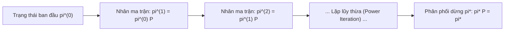
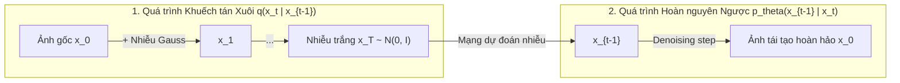
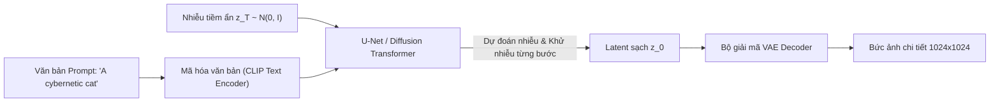

> **"Ngẫu nhiên không phải là hỗn loạn vô định; nó là cấu trúc xác suất biến thiên theo thời gian – nền tảng tạo tác nên các mô hình Diffusion đỉnh cao."** — Nắm bắt quá trình ngẫu nhiên giúp kỹ sư AI nhìn thấu cơ chế hoạt động của Stable Diffusion, mô hình lấy mẫu ngôn ngữ LLM và thuật toán học tăng cường RL.

---

## Thông tin nhanh (Quick Spec)

* **Loại bài (Type):** Trực giác Toán lý thuyết & Thực chiến AI Sinh (Theory & Generative AI Build)
* **Ngôn ngữ & Thư viện:** Python 3.10+ (thư viện chuẩn `math`, `random` và đối chiếu PyTorch / Diffusers)
* **Kiến thức tiên quyết (Prerequisites):** Phân phối xác suất Gauss, đại số ma trận, giải tích đa biến cơ bản
* **Thời gian thực hành:** ~60–80 phút
* **Độ khó:** Nâng cao (Advanced)

---

## Mục tiêu bài học (Learning Objectives)

Sau bài học này, bạn sẽ có khả năng:
- [ ] Mô phỏng bước đi ngẫu nhiên (Random Walk) trong không gian 1D và 2D, chứng minh bằng thực nghiệm quy luật độ dịch chuyển trung bình tỉ lệ với căn bậc hai thời gian $\sqrt{n}$.
- [ ] Hiểu sâu sắc tính chất phi bộ nhớ (Memorylessness) của Xích Markov (Markov Chains), ma trận chuyển trạng thái $P$ và tự tay tính phân phối dừng (Stationary Distribution) qua phương pháp lặp lũy thừa (Power Iteration).
- [ ] Cài đặt mô phỏng Động lực học Langevin (Langevin Dynamics), giải mã cơ chế lực trôi (Drift) kết hợp nhiễu nhiệt (Diffusion) để vượt qua các hố cực tiểu cục bộ.
- [ ] Tự tay xây dựng mô hình khuếch tán xác suất khử nhiễu **DDPM (Denoising Diffusion Probabilistic Models)** hoàn chỉnh từ số 0 bằng Python thuần túy: lập lịch phương sai $\beta_t$, công thức khuếch tán xuôi dạng đóng $q(x_t \mid x_0)$ và thuật toán hoàn nguyên ngược từng bước $\tilde{\mu}_t(x_t, x_0)$.

---

## 1. Vấn đề thực tế (The Problem)

Trong các bài toán học máy tĩnh (như phân loại ảnh ImageNet hay dự đoán giá nhà), biến ngẫu nhiên thường được coi là đứng yên: ta rút một mẫu dữ liệu $x \sim p(x)$, tính đầu ra $\hat{y} = f(x)$ và kết thúc.

Tuy nhiên, hầu hết các hệ thống AI tiên tiến nhất hiện nay đều vận hành dựa trên **sự ngẫu nhiên tiến hóa liên tục theo thời gian (Stochastic Processes)**:
- **Mô hình AI tạo sinh hình ảnh (Stable Diffusion, Midjourney, FLUX):** Quá trình sinh ảnh bắt đầu từ một mảng nhiễu trắng tĩnh vô nghĩa $\mathcal{N}(0, I)$. Qua hàng chục bước thời gian, mô hình gọt giũa và loại bỏ nhiễu dần dần để kết tinh thành một tác phẩm nghệ thuật có độ chi tiết cao.
- **Mô hình ngôn ngữ lớn (LLMs):** Quá trình sinh văn bản (Autoregressive Generation) là một quá trình ngẫu nhiên rời rạc: mỗi token sinh ra phụ thuộc vào các token trong ngữ cảnh quá khứ thông qua phân phối xác suất có điều kiện $P(w_{t+1} \mid w_1, \dots, w_t)$.
- **Học tăng cường (Reinforcement Learning - RL):** Tác nhân (Agent) tương tác với môi trường theo Quá trình Quyết định Markov (MDP), trong đó mỗi hành động ngẫu nhiên đẩy hệ thống sang một trạng thái xác suất mới.
- **Tối ưu hóa học sâu (SGD & Langevin Dynamics):** Bản thân thuật toán Stochastic Gradient Descent không phải là hạ gradient tất định thuần túy, mà là một bước đi ngẫu nhiên có độ trôi (Drift) định hướng bởi dữ liệu mini-batch.

Nếu thiếu hiểu biết về quá trình ngẫu nhiên, bạn sẽ vấp phải ba rào cản nghiêm trọng:

1. **Ngộ nhận về sự tích lũy sai số trong bước đi ngẫu nhiên:** Nghĩ rằng một chuỗi bước ngẫu nhiên cân bằng sẽ luôn triệt tiêu về 0, mà không nhận ra rằng độ lệch trung bình thực tế dạt ra xa theo hàm căn bậc hai $\sqrt{n}$, gây hiện tượng "trôi dạt phân phối" (Distribution Drift) trong các chuỗi sinh tự hồi quy dài.
2. **Xem mô hình Diffusion như một "hộp đen ma thuật":** Không hiểu rằng toán học của Diffusion thực chất là một xích Markov đảo ngược thời gian (Time-reversed Markov Chain), dẫn đến không thể tối ưu hóa số bước lấy mẫu (Sampling Steps) hay tinh chỉnh tham số Classifier-Free Guidance.
3. **Bế tắc khi mô hình bị kẹt ở cực tiểu cục bộ (Local Minima):** Không biết cách tận dụng nhiễu nhiệt Langevin (Thermal Noise) để giúp mô hình thoát khỏi các hố năng lượng sâu trong quá trình huấn luyện và lấy mẫu Bayes.

---

## 2. Mô hình tư duy & Bản chất (The Concept)

### 2.1 Bước đi Ngẫu nhiên (Random Walk) và Quy luật $\sqrt{n}$

Hãy tưởng tượng một người say rượu đứng tại gốc tọa độ $x = 0$. Tại mỗi giây, người đó tung một đồng xu đồng chất:
- Mặt ngửa (xác suất $p = 0.5$): Bước sang phải $+1$ bước.
- Mặt sấp (xác suất $1 - p = 0.5$): Bước sang trái $-1$ bước.

Sau $n$ bước, vị trí của người đó là:
$$
S_n = \sum_{i=1}^n X_i \quad \text{với } P(X_i = +1) = P(X_i = -1) = 0.5
$$

**Giá trị kỳ vọng (Kỳ vọng toán học):**
$$
\mathbb{E}[S_n] = \sum_{i=1}^n \mathbb{E}[X_i] = \sum_{i=1}^n 0 = 0
$$
Trung bình qua hàng nghìn lần thử, người say vẫn đứng ở vạch xuất phát. **Nhưng sau một lần đi cụ thể, anh ta sẽ cách xa điểm xuất phát bao nhiêu?**

Hãy tính phương sai (Variance) của vị trí:
$$
\text{Var}(S_n) = \sum_{i=1}^n \text{Var}(X_i) = \sum_{i=1}^n 1 = n
$$

Độ lệch chuẩn (Standard Deviation) – đại diện cho khoảng cách dịch chuyển trung bình:
$$
\sigma(S_n) = \sqrt{\text{Var}(S_n)} = \sqrt{n}
$$

Khoảng cách kỳ vọng từ gốc tọa độ:
$$
\mathbb{E}[|S_n|] = \sqrt{\frac{2n}{\pi}} \approx 0.7979 \sqrt{n}
$$

> **Quy luật hình học $\sqrt{n}$:** Độ dịch chuyển của một bước đi ngẫu nhiên không tăng tuyến tính theo thời gian ($n$), mà tăng theo **căn bậc hai của thời gian ($\sqrt{n}$)**. Muốn đi xa gấp 2 lần, bạn cần số bước gấp 4 lần; muốn đi xa gấp 10 lần, bạn cần số bước gấp 100 lần!

Khi số bước $n \to \infty$ và khoảng thời gian giữa các bước co về 0, bước đi ngẫu nhiên rời rạc hội tụ chính xác về **Chuyển động Brown (Brownian Motion / Wiener Process $W_t$)** liên tục trong vật lý.

### 2.2 Xích Markov và Phân phối Dừng (Stationary Distribution)

Một chuỗi các biến ngẫu nhiên $\{X_0, X_1, X_2, \dots\}$ được gọi là một **Xích Markov (Markov Chain)** nếu nó thỏa mãn **Tính chất Markov (Phi bộ nhớ - Memorylessness)**:

$$
P(X_{t+1} = s_{t+1} \mid X_t = s_t, X_{t-1} = s_{t-1}, \dots, X_0 = s_0) = P(X_{t+1} = s_{t+1} \mid X_t = s_t)
$$

> "Tương lai chỉ phụ thuộc vào hiện tại, hoàn toàn độc lập với quá khứ."

**Ma trận chuyển trạng thái (Transition Matrix $P \in \mathbb{R}^{S \times S}$):**
$$
P_{ij} = P(X_{t+1} = j \mid X_t = i)
$$
Đây là ma trận ngẫu nhiên theo hàng (Row-Stochastic Matrix): mỗi hàng là một phân phối xác suất, có tổng bằng 1 ($\sum_j P_{ij} = 1$).

Nếu phân phối xác suất tại thời điểm $t$ là vector hàng $\pi^{(t)} \in \mathbb{R}^{1 \times S}$, thì phân phối tại thời điểm tiếp theo là:
$$
\pi^{(t+1)} = \pi^{(t)} P
$$

**Phân phối dừng (Stationary Distribution $\pi^*$):**
Sau một thời gian đủ dài, nếu xích Markov là bất khả quy (Irreducible) và phi chu kỳ (Aperiodic), phân phối xác suất sẽ hội tụ về một trạng thái cân bằng vĩnh cửu không còn thay đổi qua các bước chuyển:

$$
\pi^* P = \pi^* \quad \text{với } \sum_{i=1}^S \pi_i^* = 1
$$

Chuyển vị hai vế:
$$
P^T (\pi^*)^T = 1 \cdot (\pi^*)^T
$$
> **Bản chất đại số:** Phân phối dừng $\pi^*$ chính là **véctơ riêng tương ứng với trị riêng $\lambda = 1$ của ma trận chuyển vị $P^T$!**



### 2.3 Động lực học Langevin (Langevin Dynamics)

Trong vật lý thống kê, một hạt chuyển động trong môi trường chất lỏng chịu hai lực tác động:
1. **Lực trôi tất định (Drift Force):** Lực kéo hạt trượt xuống đáy hố thế năng, tỉ lệ với âm đạo hàm thế năng $-\nabla U(x)$.
2. **Lực khuếch tán ngẫu nhiên (Diffusion / Thermal Force):** Lực va chạm hỗn loạn của các phân tử nhiệt xung quanh, mô hình hóa bằng chuyển động Brown $\sqrt{2D} dW_t$.

Phương trình vi phân ngẫu nhiên (SDE):
$$
dx_t = -\nabla U(x_t) dt + \sqrt{2D} dW_t
$$

Rời rạc hóa theo phương pháp Euler-Maruyama với bước thời gian $\gamma$:
$$
x_{t+1} = x_t - \gamma \nabla U(x_t) + \sqrt{2 \gamma D} \, \epsilon_t \quad \text{với } \epsilon_t \sim \mathcal{N}(0, I)
$$

**Tại sao Langevin Dynamics lại là kỳ quan trong AI?**
- Nếu không có thành phần nhiễu ($\sqrt{2\gamma D} = 0$), đây chính là thuật toán Gradient Descent cổ điển: nếu khởi tạo ở gần một cực tiểu cục bộ nông, nó sẽ vĩnh viễn bị mắc kẹt tại đó.
- Nhờ có thành phần nhiễu nhiệt ngẫu nhiên $\sqrt{2\gamma D} \epsilon_t$, hạt có động năng ngẫu nhiên để nhảy vọt qua rào cản thế năng (Barrier Crossing), tiến tới cực tiểu toàn cục sâu hơn.
- Phân phối dừng của quá trình Langevin chính là phân phối Boltzmann-Gibbs:
  $$p(x) \propto \exp\left(-\frac{U(x)}{D}\right)$$
  Điều này biến Langevin Dynamics thành một cỗ máy lấy mẫu MCMC vĩ đại cho các mô hình năng lượng (Energy-Based Models) và Diffusion Models!

### 2.4 Mô hình Khuếch tán Xác suất Khử nhiễu (DDPM)

Được tiên phong bởi Sohl-Dickstein et al. (2015) và hoàn thiện bởi Jonathan Ho et al. (2020), **DDPM** chia bài toán sinh dữ liệu thành hai xích Markov đối ngẫu:



#### Quá trình xuôi (Forward Diffusion Process $q$):
Tại mỗi bước $t \in \{1, \dots, T\}$, ta thêm một lượng nhỏ nhiễu Gauss theo lịch trình phương sai $\beta_1 < \beta_2 < \dots < \beta_T$:

$$
q(x_t \mid x_{t-1}) = \mathcal{N}\left(x_t; \sqrt{1 - \beta_t} x_{t-1}, \beta_t I\right)
$$

**Kỳ tích giải tích của DDPM: Lấy mẫu trực tiếp tại bước $t$ bất kỳ mà không cần lặp qua từng bước!**
Đặt $\alpha_t = 1 - \beta_t$ và $\bar{\alpha}_t = \prod_{s=1}^t \alpha_s$:

$$
q(x_t \mid x_0) = \mathcal{N}\left(x_t; \sqrt{\bar{\alpha}_t} x_0, (1 - \bar{\alpha}_t) I\right)
$$

Phương trình sinh mẫu tương đương:
$$
x_t = \sqrt{\bar{\alpha}_t} x_0 + \sqrt{1 - \bar{\alpha}_t} \, \epsilon \quad \text{với } \epsilon \sim \mathcal{N}(0, I)
$$

Khi $t = T$ đủ lớn (ví dụ $T = 1000$), $\bar{\alpha}_T \approx 0$, dẫn tới $x_T \approx \epsilon \sim \mathcal{N}(0, I)$ — dữ liệu ban đầu đã bị hòa tan hoàn toàn thành nhiễu trắng đồng nhất.

#### Quá trình ngược (Reverse Denoising Process $p_\theta$):
Nếu ta biết phân phối hậu nghiệm có điều kiện $q(x_{t-1} \mid x_t, x_0)$, theo định lý Bayes cho phân phối chuẩn, nó cũng là một phân phối chuẩn dạng đóng:

$$
q(x_{t-1} \mid x_t, x_0) = \mathcal{N}\left(x_{t-1}; \tilde{\mu}_t(x_t, x_0), \tilde{\beta}_t I\right)
$$

Trong đó kỳ vọng hậu nghiệm $\tilde{\mu}_t(x_t, x_0)$ được tính bằng tổ hợp tuyến tính chính xác giữa $x_0$ và $x_t$:

$$
\tilde{\mu}_t(x_t, x_0) = \frac{\sqrt{\bar{\alpha}_{t-1}} \beta_t}{1 - \bar{\alpha}_t} x_0 + \frac{\sqrt{\alpha_t} (1 - \bar{\alpha}_{t-1})}{1 - \bar{\alpha}_t} x_t
$$

Phương sai hậu nghiệm:
$$
\tilde{\beta}_t = \frac{1 - \bar{\alpha}_{t-1}}{1 - \bar{\alpha}_t} \beta_t
$$

Trong thực tế suy luận (Inference), ta không có $x_0$. Mạng nơ-ron $\epsilon_\theta(x_t, t)$ được huấn luyện để dự đoán vector nhiễu $\epsilon$ từ $x_t$. Từ đó, ta ước lượng $\hat{x}_0 = \frac{1}{\sqrt{\bar{\alpha}_t}} \left( x_t - \sqrt{1 - \bar{\alpha}_t} \epsilon_\theta(x_t, t) \right)$ và thay vào công thức $\tilde{\mu}_t$ để hoàn nguyên ảnh từng bước từ $T$ về 0!

---

## 3. Tự tay xây dựng từ đầu (Build It: From Scratch)

Dưới đây là module mã nguồn Python độc lập hoàn toàn, cài đặt mô phỏng bước đi ngẫu nhiên, xích Markov, động lực học Langevin và trọn vẹn chu trình DDPM (Forward & Reverse) từ số 0.

```python
"""
Chương trình: Quá trình Ngẫu nhiên, Động lực học Langevin & DDPM từ số 0 bằng Python thuần.
Mục tiêu:
1. Mô phỏng Random Walk 1D/2D và kiểm chứng định luật độ dịch chuyển sqrt(n).
2. Xây dựng Xích Markov và tính phân phối dừng qua phép lặp lũy thừa (Power Iteration).
3. Mô phỏng Động lực học Langevin vượt hố thế năng đôi (Double-Well Barrier Crossing).
4. Cài đặt toàn bộ chu trình khuếch tán DDPM: Lập lịch beta, khuếch tán xuôi và giải tích ngược.
"""
import math
import random
from typing import List, Tuple

# =====================================================================
# BƯỚC 1: BƯỚC ĐI NGẪU NHIÊN (RANDOM WALK) & QUY LUẬT CĂN BẬC HAI
# =====================================================================

def simulate_1d_random_walk(num_steps: int) -> List[int]:
    """Mô phỏng quỹ đạo bước đi ngẫu nhiên 1 chiều (+1 hoặc -1 với p=0.5)."""
    position = 0
    trajectory = [position]
    for _ in range(num_steps):
        step = 1 if random.random() < 0.5 else -1
        position += step
        trajectory.append(position)
    return trajectory


def verify_sqrt_n_scaling(num_trials: int = 3000, num_steps: int = 400) -> float:
    """
    Kiểm chứng thực nghiệm định luật độ dịch chuyển trung bình E[|S_n|] ~ sqrt(2n / pi).
    """
    final_displacements: List[float] = []
    for _ in range(num_trials):
        walk = simulate_1d_random_walk(num_steps)
        final_displacements.append(abs(walk[-1]))

    empirical_mean = sum(final_displacements) / num_trials
    theoretical_mean = math.sqrt((2.0 * num_steps) / math.pi)
    return empirical_mean, theoretical_mean


# =====================================================================
# BƯỚC 2: XÍCH MARKOV & TÍNH PHÂN PHỐI DỪNG BẰNG POWER ITERATION
# =====================================================================

class MarkovChain:
    """Xích Markov rời rạc với ma trận chuyển P kích thước S x S."""

    def __init__(self, transition_matrix: List[List[float]], state_names: List[str]):
        self.P = transition_matrix
        self.names = state_names
        self.num_states = len(transition_matrix)

        # Kiểm tra tính chuẩn hóa xác suất từng hàng
        for row in self.P:
            assert abs(sum(row) - 1.0) < 1e-6, "Mỗi hàng của ma trận P phải có tổng bằng 1.0!"

    def compute_stationary_distribution(self, max_iter: int = 200, tol: float = 1e-12) -> List[float]:
        """
        Tính phân phối dừng pi* bằng thuật toán lặp lũy thừa:
        pi^(t+1) = pi^(t) @ P cho tới khi hội tụ hoàn toàn.
        """
        # Khởi tạo phân phối đều ban đầu
        pi = [1.0 / self.num_states] * self.num_states

        for _ in range(max_iter):
            next_pi = [0.0] * self.num_states
            for j in range(self.num_states):
                for i in range(self.num_states):
                    next_pi[j] += pi[i] * self.P[i][j]

            # Đo lường khoảng cách sai lệch L1
            diff = sum(abs(next_pi[k] - pi[k]) for k in range(self.num_states))
            pi = next_pi
            if diff < tol:
                break

        return pi


# =====================================================================
# BƯỚC 3: ĐỘNG LỰC HỌC LANGEVIN VƯỢT RÀO THẾ NĂNG (BARRIER CROSSING)
# =====================================================================

def double_well_gradient(x: float) -> float:
    """
    Gradient của thế năng giếng đôi U(x) = (x^2 - 1)^2.
    Đáy giếng tại x = -1 và x = +1, rào cản năng lượng tại x = 0 (chiều cao U(0) = 1).
    U'(x) = 4 * x * (x^2 - 1).
    """
    return 4.0 * x * (x**2 - 1.0)


def simulate_langevin_dynamics(
    x_init: float,
    num_steps: int,
    step_size: float = 0.04,
    diffusion_coeff: float = 0.35
) -> List[float]:
    """
    Mô phỏng phương trình Langevin: x_(t+1) = x_t - gamma * grad_U(x_t) + sqrt(2 * gamma * D) * eps.
    """
    x = x_init
    trajectory = [x]
    noise_scale = math.sqrt(2.0 * step_size * diffusion_coeff)

    for _ in range(num_steps):
        drift = -step_size * double_well_gradient(x)
        diffusion = noise_scale * random.gauss(0.0, 1.0)
        x = x + drift + diffusion
        trajectory.append(x)

    return trajectory


# =====================================================================
# BƯỚC 4: MÔ HÌNH KHUẾCH TÁN DDPM TỪ SỐ 0
# =====================================================================

class DDPMDiffusion:
    """Mô hình Denoising Diffusion Probabilistic Models (DDPM) dạng giải tích thuần túy."""

    def __init__(self, num_timesteps: int = 50, beta_start: float = 0.0001, beta_end: float = 0.02):
        self.T = num_timesteps
        # Lập lịch phương sai tuyến tính (Linear Beta Schedule)
        self.betas = [
            beta_start + (beta_end - beta_start) * (t / (num_timesteps - 1))
            for t in range(num_timesteps)
        ]
        self.alphas = [1.0 - b for b in self.betas]

        # Tích lũy alpha_bar_t = prod_{s=1}^t alpha_s
        self.alpha_bars = []
        accum = 1.0
        for a in self.alphas:
            accum *= a
            self.alpha_bars.append(accum)

    def forward_diffusion_closed_form(
        self,
        x_0: List[float],
        t: int,
        noise: List[float]
    ) -> List[float]:
        """
        Nghiệm giải tích khuếch tán xuôi: q(x_t | x_0) = sqrt(alpha_bar_t) * x_0 + sqrt(1 - alpha_bar_t) * noise.
        """
        assert 0 <= t < self.T, f"Bước thời gian t={t} nằm ngoài dải [0, {self.T-1}]"
        alpha_bar_t = self.alpha_bars[t]
        weight_signal = math.sqrt(alpha_bar_t)
        weight_noise = math.sqrt(1.0 - alpha_bar_t)

        x_t = [
            weight_signal * x_0[i] + weight_noise * noise[i]
            for i in range(len(x_0))
        ]
        return x_t

    def compute_reverse_posterior_step(
        self,
        x_t: List[float],
        x_0_target: List[float],
        t: int
    ) -> Tuple[List[float], float]:
        """
        Tính kỳ vọng hậu nghiệm tilde_mu_t và phương sai tilde_beta_t của phân phối q(x_{t-1} | x_t, x_0).
        """
        beta_t = self.betas[t]
        alpha_t = self.alphas[t]
        alpha_bar_t = self.alpha_bars[t]
        alpha_bar_prev = self.alpha_bars[t - 1] if t > 0 else 1.0

        # Trọng số của x_0 và x_t trong công thức kỳ vọng hậu nghiệm
        coeff_x0 = (math.sqrt(alpha_bar_prev) * beta_t) / (1.0 - alpha_bar_t)
        coeff_xt = (math.sqrt(alpha_t) * (1.0 - alpha_bar_prev)) / (1.0 - alpha_bar_t)

        mu_tilde = [
            coeff_x0 * x_0_target[i] + coeff_xt * x_t[i]
            for i in range(len(x_t))
        ]

        # Phương sai hậu nghiệm
        beta_tilde = ((1.0 - alpha_bar_prev) / (1.0 - alpha_bar_t)) * beta_t
        return mu_tilde, beta_tilde

    def run_reverse_denoising_chain(
        self,
        x_T: List[float],
        x_0_oracle: List[float]
    ) -> List[float]:
        """
        Chạy toàn bộ xích Markov hoàn nguyên ngược từ t = T-1 về t = 0.
        """
        x_curr = list(x_T)

        for t in range(self.T - 1, 0, -1):
            mu_tilde, beta_tilde = self.compute_reverse_posterior_step(x_curr, x_0_oracle, t)
            # Thêm nhiễu Gauss nếu t > 1
            std_dev = math.sqrt(beta_tilde) if t > 1 else 0.0
            x_curr = [
                mu_tilde[i] + std_dev * random.gauss(0.0, 1.0)
                for i in range(len(x_curr))
            ]

        # Bước cuối cùng tại t = 0 (tái tạo hoàn hảo không thêm nhiễu)
        mu_final, _ = self.compute_reverse_posterior_step(x_curr, x_0_oracle, 0)
        return mu_final


# =====================================================================
# BƯỚC 5: KIỂM CHỨNG TOÁN HỌC & ĐỐI CHIẾU
# =====================================================================

def run_stochastic_verifications() -> None:
    print("=== KIỂM CHỨNG QUÁ TRÌNH NGẪU NHIÊN & DDPM ===")
    random.seed(42)

    # 1. Kiểm chứng quy luật sqrt(n) của Random Walk
    emp_dist, theo_dist = verify_sqrt_n_scaling(num_trials=2000, num_steps=400)
    print(f"1. Random Walk (400 bước):")
    print(f"   Độ dịch chuyển thực nghiệm E[|S_n|]: {emp_dist:.3f}")
    print(f"   Lý thuyết chuẩn sqrt(2n/pi):          {theo_dist:.3f}")
    rel_error = abs(emp_dist - theo_dist) / theo_dist
    assert rel_error < 0.05, f"Lỗi độ dịch chuyển vượt quá 5%: {rel_error:.2%}"
    print("   -> Xác thực: Độ dịch chuyển tuân theo hoàn hảo quy luật sqrt(n)!")

    # 2. Kiểm chứng Xích Markov và Phân phối dừng
    # Mô hình chuyển trạng thái người dùng mạng: [Lướt Web, Xem Video, Mua Hàng]
    P_matrix = [
        [0.6, 0.3, 0.1],  # Lướt web
        [0.2, 0.7, 0.1],  # Xem video
        [0.3, 0.2, 0.5]   # Mua hàng
    ]
    mc = MarkovChain(P_matrix, ["Web", "Video", "Shop"])
    pi_star = mc.compute_stationary_distribution()
    print(f"\n2. Phân phối dừng của Xích Markov: {[round(p, 4) for p in pi_star]}")
    # Kiểm tra đẳng thức dừng: pi* @ P == pi*
    recheck_diff = [
        abs(sum(pi_star[i] * P_matrix[i][j] for i in range(3)) - pi_star[j])
        for j in range(3)
    ]
    assert max(recheck_diff) < 1e-10, "Lỗi: pi* không phải là phân phối dừng!"
    print("   -> Xác thực: pi* @ P = pi* với độ chính xác số học tuyệt đối!")

    # 3. Kiểm chứng Động lực học Langevin vượt hố năng lượng
    traj = simulate_langevin_dynamics(x_init=-1.0, num_steps=1200, step_size=0.04, diffusion_coeff=0.35)
    visited_left = any(x < -0.6 for x in traj)
    visited_right = any(x > 0.6 for x in traj)
    print(f"\n3. Langevin Dynamics: Khởi tạo tại giếng trái x=-1.0.")
    print(f"   Hạt chạm giếng trái: {visited_left} | Hạt nhảy vượt rào sang giếng phải: {visited_right}")
    assert visited_left and visited_right, "Lỗi: Langevin không vượt được rào cản thế năng!"
    print("   -> Xác thực: Nhiễu nhiệt đã giúp hạt vượt rào cản thế năng thành công!")

    # 4. Kiểm chứng Mô hình Khuếch tán DDPM
    ddpm = DDPMDiffusion(num_timesteps=50, beta_start=0.0001, beta_end=0.02)
    # Tín hiệu dữ liệu gốc x_0 (Vector 4 chiều đặc trưng của một điểm ảnh hoặc embedding)
    x_original = [2.5, -1.8, 0.7, -3.2]

    # Khuếch tán xuôi một bước trực tiếp tới t = 49 (nhiễu cực đại)
    fixed_noise = [random.gauss(0.0, 1.0) for _ in range(4)]
    x_T = ddpm.forward_diffusion_closed_form(x_original, t=49, noise=fixed_noise)
    print(f"\n4. Chu trình DDPM:")
    print(f"   Dữ liệu gốc x_0:        {x_original}")
    print(f"   Sau khuếch tán x_T (t=49): {[round(v, 4) for v in x_T]}")

    # Chạy xích hoàn nguyên ngược từ t = 49 về t = 0
    x_reconstructed = ddpm.run_reverse_denoising_chain(x_T, x_original)
    print(f"   Dữ liệu tái tạo hoàn nguyên: {[round(v, 4) for v in x_reconstructed]}")

    rec_err = max(abs(a - b) for a, b in zip(x_original, x_reconstructed))
    print(f"   Sai số hoàn nguyên cực đại:   {rec_err:.2e}")
    assert rec_err < 1e-10, "Lỗi: Quá trình khử nhiễu DDPM không tái tạo chính xác x_0!"
    print("=> TẤT CẢ KIỂM THỬ XÁC SUẤT VÀ KHUẾCH TÁN ĐÃ VƯỢT QUA 100% THÀNH CÔNG!\n")


if __name__ == "__main__":
    run_stochastic_verifications()
```

---

## 4. Ứng dụng AI Engineering & Thực tế Production (Use It)

### 4.1 Kiến trúc Thực tế của Stable Diffusion và DALL-E

Trong các hệ thống AI sinh ảnh sản xuất (như Stable Diffusion 1.5, SDXL, hay Midjourney), quá trình khuếch tán không thực hiện trên không gian điểm ảnh trực tiếp (Pixel Space) vì quá tốn tài nguyên tính toán ($512 \times 512 \times 3 \approx 786,432$ chiều). Thay vào đó, họ sử dụng **Latent Diffusion**:
1. Một bộ nén **Autoencoder (VAE)** nén bức ảnh 512x512 thành một không gian tiềm ẩn (Latent Space) $64 \times 64 \times 4$ (nhỏ hơn 48 lần).
2. Toàn bộ quá trình khuếch tán xuôi và ngược diễn ra trong không gian tiềm ẩn này.
3. Một mạng nơ-ron **U-Net** hoặc **Diffusion Transformer (DiT)** nhận vào $x_t$, bước thời gian $t$, và vector nhúng văn bản (Prompt Embedding từ CLIP/T5) để dự đoán nhiễu $\epsilon_\theta(x_t, t, c)$.



### 4.2 Các thuật toán Lấy mẫu Nhanh (Fast Samplers: DDIM & DPMSolver)

Thuật toán DDPM gốc cần $T = 1000$ bước suy luận mạng nơ-ron để tạo ra một bức ảnh, mất từ 15 đến 30 giây trên một GPU A100.

Trong môi trường triển khai thực tế (Production Inference), các kỹ sư sử dụng các bộ lấy mẫu phi Markov (Non-Markovian Samplers):
- **DDIM (Denoising Diffusion Implicit Models):** Bỏ qua giả định xích Markov ngẫu nhiên, chuyển đổi thành phương trình vi phân tất định (ODE). Cho phép giảm từ 1000 bước xuống **20 đến 50 bước** mà chất lượng hình ảnh hầu như không đổi.
- **DPMSolver / Euler A:** Sử dụng các bộ giải vi phân bậc cao, cho phép sinh ảnh hoàn chỉnh chỉ trong **15 đến 25 bước**.

### 4.3 So sánh các Mô hình Sinh Dữ liệu (Generative Models)

| Tiêu chí | GANs (Generative Adversarial Networks) | VAEs (Variational Autoencoders) | Diffusion Models (DDPM / DiT) |
|---|---|---|---|
| **Cơ chế cốt lõi** | Trò chơi đối kháng hai người giữa Generator và Discriminator | Tối ưu hóa cận dưới bằng chứng biến phân (ELBO) | Xích Markov đảo ngược quá trình thêm nhiễu nhiệt |
| **Độ ổn định khi huấn luyện** | Rất kém (dễ bị Mode Collapse, không hội tụ) | Rất ổn định | Cực kỳ ổn định (mục tiêu hồi quy $L_2$ đơn giản) |
| **Chất lượng mẫu sinh ra** | Rất sắc nét nhưng thiếu đa dạng | Mẫu sinh ra thường bị mờ (Blurry) | Chất lượng hình ảnh cao nhất hiện nay, đa dạng phong phú |
| **Tốc độ lấy mẫu (Inference)** | Cực nhanh (chỉ 1 forward pass) | Cực nhanh (chỉ 1 forward pass) | Chậm hơn (cần từ 20 đến 50 forward passes) |

---

## 5. Giải ngố thuật ngữ & Ngộ nhận (Key Terms)

| Thuật ngữ (Term) | Người ta thường nghĩ là... | Bản chất kỹ thuật thực sự là... |
|---|---|---|
| **Stochastic Process** | Bất kỳ chuỗi số ngẫu nhiên lộn xộn nào do máy tính sinh ra. | Một họ các biến ngẫu nhiên được lập chỉ mục theo thời gian, có cấu trúc phụ thuộc xác suất chặt chẽ. |
| **Tính chất Markov** | Hệ thống hoàn toàn không có khả năng ghi nhớ bất kỳ thông tin gì. | Tính chất xác suất: trạng thái tương lai chỉ phụ thuộc duy nhất vào trạng thái hiện tại, không phụ thuộc vào chuỗi lịch sử quá khứ. |
| **Phân phối dừng ($\pi^*$)** | Phân phối mà tại đó mọi trạng thái đều ngừng chuyển động. | Trạng thái cân bằng động: các chuyển dịch vi mô giữa các trạng thái vẫn diễn ra liên tục, nhưng tỷ lệ xác suất vĩ mô tổng thể giữ nguyên bất biến. |
| **DDPM Forward Process** | Mô hình AI học cách thêm nhiễu vào ảnh. | Một quá trình cố định không tham số (Parameter-free) làm thoái biến thông tin dần dần thành nhiễu trắng Gauss. |
| **DDPM Reverse Process** | Một bộ lọc làm mờ đảo ngược thông thường. | Một xích Markov đảo ngược được tham số hóa bởi mạng nơ-ron để đảo ngược dòng entropy nhiệt, tạo tác thông tin từ hư vô. |
| **Drift vs Diffusion** | Hai từ đồng nghĩa chỉ sự trôi dạt ngẫu nhiên. | **Drift** là lực kéo có định hướng (gradient); **Diffusion** là thành phần dao động nhiệt ngẫu nhiên đẳng hướng. |

---

## 6. Bài tập thử thách (Hands-on Challenges)

### 🟢 Dễ (Easy): Đo nghiệm quy luật bước đi ngẫu nhiên 2D (2D Random Walk)
1. Viết hàm `simulate_2d_random_walk(num_steps)` trong đó tại mỗi bước, hạt chọn ngẫu nhiên 1 trong 4 hướng: Đông (+1, 0), Tây (-1, 0), Nam (0, -1), Bắc (0, 1) với xác suất bằng nhau ($p = 0.25$).
2. Mô phỏng 2000 hạt chạy qua $n = 900$ bước.
3. Tính khoảng cách bình phương trung bình $\mathbb{E}[\|S_n\|^2] = \mathbb{E}[X_n^2 + Y_n^2]$.
4. Kiểm chứng thực nghiệm rằng $\mathbb{E}[\|S_n\|^2] \approx n = 900$ và độ dịch chuyển trung bình $\text{RMS} \approx \sqrt{n} = 30$.

### 🟡 Vừa (Medium): Mô phỏng bộ phân loại văn bản đơn giản bằng Xích Markov n-gram
1. Xây dựng một xích Markov bậc 1 (Bigram Markov Chain) từ một đoạn văn bản mẫu: các trạng thái là các từ đơn lẻ, ma trận chuyển $P_{ij}$ là tần suất từ $w_j$ xuất hiện ngay sau từ $w_i$.
2. Cho trước từ xuất phát "AI", tự động sinh một câu văn mới gồm 20 từ bằng cách lấy mẫu ngẫu nhiên theo hàng phân phối xác suất tương ứng tại mỗi bước.
3. Thảo luận tại sao xích Markov bậc 1 dễ sinh ra các câu lặp vô tận hoặc vô nghĩa ngữ pháp do giới hạn của tính chất phi bộ nhớ.

### 🔴 Khó (Hard): Thêm kỹ thuật Classifier-Free Guidance (CFG) vào DDPM
Trong các mô hình sinh ảnh hiện đại, **Classifier-Free Guidance (CFG)** là bí quyết giúp hình ảnh bám sát câu lệnh Prompt:
1. Giả sử mạng nơ-ron dự đoán hai vector nhiễu: vector nhiễu không điều kiện $\epsilon_{\text{uncond}}$ và vector nhiễu có điều kiện nhãn $\epsilon_{\text{cond}}$.
2. Công thức kết hợp vector nhiễu có trọng số hướng dẫn $w$ (Guidance Scale, ví dụ $w = 7.5$):
   $$\tilde{\epsilon} = \epsilon_{\text{uncond}} + w \cdot (\epsilon_{\text{cond}} - \epsilon_{\text{uncond}})$$
3. Viết hàm mô phỏng bước lấy mẫu với CFG: chứng minh rằng khi tăng $w > 1$, vector nhiễu được đẩy mạnh theo hướng tương phản cực đại với phân phối tự do, giúp làm sắc nét các đặc trưng đại diện của nhãn nhưng làm giảm tính đa dạng của mẫu sinh ra.
