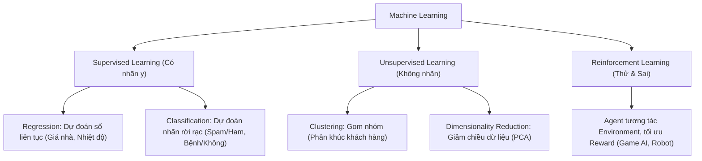

> **[Motto]**: Lập trình truyền thống viết luật để xử lý dữ liệu; Machine Learning dùng dữ liệu để tự sinh ra luật.

---

## Thông tin nhanh (Quick Spec)

* **Loại bài (Type):** Khái niệm & Thực chiến (Concept + Build)
* **Ngôn ngữ & Công cụ:** Python 3.12, NumPy
* **Kiến thức tiên quyết (Prerequisites):** Phase 1 (Đại số tuyến tính cơ bản, Xác suất)
* **Thời gian thực hành:** ~30 phút

---

## Mục tiêu bài học (Learning Objectives)

Sau bài học này, bạn sẽ có khả năng:
- [ ] Phân biệt rạch ròi giữa **Supervised**, **Unsupervised**, và **Reinforcement Learning** dựa trên cấu trúc dữ liệu đầu vào.
- [ ] Nhận diện khi nào một bài toán thực tế **nên** dùng ML và khi nào **nên** dùng luật cứng (deterministic rules).
- [ ] Hiểu cấu trúc cốt lõi của mọi hệ thống ML: **Model + Loss Function + Optimizer**.
- [ ] Tự tay code bộ phân loại **Nearest Centroid Classifier** thuần Python + NumPy và đánh giá độ chính xác so với Random Baseline.

---

## 1. Vấn đề thực tế (The Problem)

> *Tại sao chúng ta phải quan tâm đến Machine Learning? Nếu không có nó, hệ thống sẽ gặp bế tắc gì?*

Giả sử bạn được giao xây dựng hệ thống lọc Email Spam cho một sàn thương mại điện tử.

**Cách tiếp cận truyền thống (Rule-based):**
Bạn ngồi xuống và viết hàng trăm điều kiện `if-else`:
- Nếu tiêu đề chứa `"TRÚNG THƯỞNG"`, `"MIỄN PHÍ 100%"` $\rightarrow$ Spam.
- Nếu có hơn 3 dấu chấm than `!!!` $\rightarrow$ Spam.
- Nếu tên miền gửi không nằm trong whitelist $\rightarrow$ Spam.

Hệ thống chạy ổn được... 2 tuần. Sau đó, kẻ xấu đổi chữ thành `"TRÚNG THƯỞNG"` $\rightarrow$ `"TRÚNG THƯ0NG"`, chèn ký tự ẩn, hoặc gửi từ domain mới mua. Bộ luật của bạn sụp đổ. Bạn lại vá thêm `if-else`, tạo ra một mớ hỗn độn hàng nghìn dòng code xung đột lẫn nhau (spaghetti rules) không thể bảo trì.

**Cách tiếp cận Machine Learning:**
Thay vì tự viết luật, bạn thu thập 100.000 email đã được gắn nhãn (`Spam` / `Not Spam`), biến mỗi email thành một vector đặc trưng (số lượng từ nhạy cảm, độ dài, tỷ lệ chữ hoa, tần suất link...), và đưa cho thuật toán. Máy tính tự tìm ra ranh giới phân tách tối ưu. Khi spammer đổi chiến thuật, bạn chỉ cần cập nhật dữ liệu mới và **retrain** mô hình thay vì viết lại code.

---

## 2. Mô hình tư duy & Bản chất (The Concept)

> *Bản chất của Machine Learning không phải là "phép màu AI", mà là bài toán tìm kiếm một hàm số $f_\theta(x)$ sao cho đầu ra $\hat{y}$ gần với thực tế $y$ nhất.*

### Ba nhánh lớn của Machine Learning



### Vòng lặp cốt lõi của mọi thuật toán ML

Dù là Linear Regression đơn giản hay LLM hàng trăm tỷ tham số, tất cả đều xoay quanh 3 thành phần:

1. **Model ($f_\theta(x)$):** Hàm toán học nhận đầu vào $x$ (features) và trả về dự đoán $\hat{y}$, phụ thuộc vào bộ tham số $\theta$ (weights).
2. **Loss Function ($L(y, \hat{y})$):** Thước đo độ "tệ" của mô hình. Dự đoán càng lệch so với thực tế $y$, Loss càng lớn.
3. **Optimizer:** Thuật toán điều chỉnh $\theta$ để giảm giá trị của $L(y, \hat{y})$ xuống mức thấp nhất.

Với bài toán **Classification** (phân loại) và **Regression** (hồi quy), hàm Loss phổ biến nhất được định nghĩa như sau:

$$L_{\text{MSE}} = \frac{1}{N} \sum_{i=1}^{N} (y_i - \hat{y}_i)^2 \quad \text{(Regression)}$$

$$L_{\text{BCE}} = -\frac{1}{N} \sum_{i=1}^{N} \left[ y_i \log(\hat{y}_i) + (1 - y_i) \log(1 - \hat{y}_i) \right] \quad \text{(Binary Classification)}$$

---

## 3. Tự tay xây dựng từ đầu (Build It: From Scratch)

Để thấy rõ ML hoạt động không cần ma thuật nào, chúng ta sẽ xây dựng **Nearest Centroid Classifier** thuần Python 3.12 + NumPy.

**Ý tưởng:**
- Trong lúc **Train (`fit`)**: Với mỗi lớp (class), tính vector trung bình (centroid $\mu_c$) của tất cả các điểm dữ liệu thuộc lớp đó.
- Trong lúc **Predict (`predict`)**: Với một điểm dữ liệu mới $x$, tính khoảng cách Euclidean $\|x - \mu_c\|_2$ tới từng centroid và gán nhãn của centroid gần nhất.

### Bước 1: Tạo dữ liệu giả lập & Chia tập Train/Test

```python
import numpy as np
from typing import Tuple


def generate_synthetic_data(
    n_samples: int = 200, seed: int = 42
) -> Tuple[np.ndarray, np.ndarray]:
    """Tạo dữ liệu 2D gồm 2 lớp phân tách tương đối rõ."""
    rng = np.random.default_rng(seed)
    half = n_samples // 2

    # Lớp 0: tập trung quanh (2.0, 2.0)
    x0 = rng.normal(loc=[2.0, 2.0], scale=1.0, size=(half, 2))
    y0 = np.zeros(half, dtype=int)

    # Lớp 1: tập trung quanh (5.0, 5.0)
    x1 = rng.normal(loc=[5.0, 5.0], scale=1.0, size=(half, 2))
    y1 = np.ones(half, dtype=int)

    X = np.vstack([x0, x1])
    y = np.concatenate([y0, y1])

    # Xáo trộn dữ liệu
    indices = rng.permutation(n_samples)
    return X[indices], y[indices]


def train_test_split(
    X: np.ndarray, y: np.ndarray, test_ratio: float = 0.2
) -> Tuple[np.ndarray, np.ndarray, np.ndarray, np.ndarray]:
    split_idx = int(len(X) * (1 - test_ratio))
    return X[:split_idx], X[split_idx:], y[:split_idx], y[split_idx:]
```

### Bước 2: Xây dựng Nearest Centroid Classifier

```python
class NearestCentroidClassifier:
    """Bộ phân loại dựa trên khoảng cách tới tâm cụm (Centroid) của từng lớp."""

    def __init__(self) -> None:
        self.classes_: np.ndarray = np.array([])
        self.centroids_: np.ndarray = np.array([])

    def fit(self, X: np.ndarray, y: np.ndarray) -> "NearestCentroidClassifier":
        self.classes_ = np.unique(y)
        centroids = []
        for cls in self.classes_:
            # Tính trung bình cộng theo từng feature cho các mẫu thuộc lớp cls
            cls_centroid = X[y == cls].mean(axis=0)
            centroids.append(cls_centroid)
        self.centroids_ = np.vstack(centroids)
        return self

    def predict(self, X: np.ndarray) -> np.ndarray:
        if self.centroids_.size == 0:
            raise RuntimeError("Mô hình chưa được train. Hãy gọi fit() trước.")

        # Tính khoảng cách Euclidean từ mỗi điểm trong X tới từng centroid
        # X: (N, D), centroids_: (C, D) -> distances: (N, C)
        diff = X[:, np.newaxis, :] - self.centroids_[np.newaxis, :, :]
        distances = np.linalg.norm(diff, axis=2)

        nearest_indices = np.argmin(distances, axis=1)
        return self.classes_[nearest_indices]


def accuracy_score(y_true: np.ndarray, y_pred: np.ndarray) -> float:
    return float(np.mean(y_true == y_pred))
```

### Bước 3: Chạy thử và so sánh với Random Baseline

```python
if __name__ == "__main__":
    X, y = generate_synthetic_data(n_samples=300, seed=42)
    X_train, X_test, y_train, y_test = train_test_split(X, y, test_ratio=0.2)

    # 1. Random Baseline (đoán ngẫu nhiên)
    rng = np.random.default_rng(42)
    random_preds = rng.integers(0, 2, size=len(y_test))
    random_acc = accuracy_score(y_test, random_preds)

    # 2. Nearest Centroid Classifier
    model = NearestCentroidClassifier().fit(X_train, y_train)
    model_preds = model.predict(X_test)
    model_acc = accuracy_score(y_test, model_preds)

    print(f"Random Baseline Accuracy : {random_acc:.2%}")
    print(f"Nearest Centroid Accuracy: {model_acc:.2%}")
    print(f"Learned Centroids:\n{model.centroids_}")
```

---

## 4. Ứng dụng thực tế & So sánh Framework (Use It)

Trong môi trường Production, việc chọn đúng công cụ và biết **khi nào KHÔNG dùng ML** quan trọng hơn việc biết nhiều thuật toán:

* **Rule-based vs Machine Learning:**
  - *Dùng Rule-based khi:* Luật nghiệp vụ rõ ràng, ít thay đổi, yêu cầu giải thích 100% (ví dụ: tính thuế VAT, kiểm tra định dạng email, giới hạn hạn mức giao dịch).
  - *Dùng ML khi:* Quy luật phức tạp hoặc thay đổi liên tục theo thời gian (phát hiện gian lận thẻ tín dụng, gợi ý sản phẩm, nhận diện hình ảnh/ngôn ngữ).
* **Baseline First (Luật bất thành văn):**
  - Trước khi triển khai XGBoost hay Neural Network, luôn xây dựng một baseline đơn giản (như Logistic Regression, Nearest Centroid, hoặc thậm chí Heuristic rule). Nếu mô hình phức tạp chỉ cải thiện 0.5% accuracy nhưng tăng latency gấp 100 lần, hãy giữ lại baseline.
* **Trong hệ sinh thái thực tế:** `scikit-learn` cung cấp sẵn `NearestCentroid`, `DummyClassifier` (làm baseline), và `train_test_split` với API `.fit()` / `.predict()` đồng nhất — chính là thiết kế chuẩn mà chúng ta vừa tự viết lại ở trên.

---

## 5. Đóng gói & Tái sử dụng (Ship It)

**Checklist quyết định "Có nên dùng Machine Learning không?" (Go / No-Go):**
- [ ] **Quy luật đủ phức tạp:** Bài toán không thể giải gọn bằng vài chục dòng `if-else` ổn định hoặc quy luật thay đổi liên tục theo hành vi người dùng.
- [ ] **Dữ liệu sẵn sàng:** Đã có đủ dữ liệu lịch sử sạch, đại diện cho dữ liệu thực tế lúc vận hành và có cơ chế thu thập nhãn (label) rõ ràng.
- [ ] **Chấp nhận sai số xác suất:** Nghiệp vụ cho phép tỷ lệ lỗi nhất định (ví dụ 95% chính xác) và đã thiết kế phương án dự phòng (fallback / human-in-the-loop) khi mô hình đoán sai.
- [ ] **Baseline trước, phức tạp sau:** Đã có chỉ số đo lường (Business Metric + ML Metric) và một Baseline đơn giản (`DummyClassifier`, Heuristic, hoặc `NearestCentroid`) để làm mốc so sánh.

**Cheatsheet chọn nhánh ML & Baseline khởi điểm:**

| Dữ liệu & Mục tiêu | Nhánh ML | Baseline nên thử đầu tiên |
|---|---|---|
| Có nhãn số liên tục (giá, doanh thu) | Supervised — Regression | Mean/Median Baseline $\rightarrow$ Linear/Ridge Regression |
| Có nhãn rời rạc (Spam/Ham, loại lỗi) | Supervised — Classification | Majority Class / Nearest Centroid $\rightarrow$ Logistic Regression |
| Không có nhãn, cần gom nhóm | Unsupervised — Clustering | K-Means (sau khi chuẩn hóa đặc trưng) |
| Chuỗi hành động tối ưu thưởng dài hạn | Reinforcement Learning | Heuristic Policy $\rightarrow$ Q-Learning / PPO |

---

## 6. Giải ngố thuật ngữ (Key Terms & Misconceptions)

| Thuật ngữ (Term) | Người ta thường nghĩ là... | Bản chất kỹ thuật thực sự là... |
|---|---|---|
| **Training (Huấn luyện)** | Máy tính "đọc hiểu" dữ liệu như con người. | Quá trình chạy vòng lặp tối ưu hóa để tìm bộ tham số $\theta$ làm cực tiểu hóa hàm Loss. |
| **Features (Đặc trưng)** | Các cột có sẵn trong file CSV/Database. | Các đại lượng số học đại diện cho thông tin đầu vào, thường phải qua biến đổi (Feature Engineering) mới dùng được. |
| **Overfitting (Học vẹt)** | Mô hình học quá kỹ nên thông minh hơn. | Mô hình ghi nhớ cả nhiễu (noise) của tập Train, dẫn đến điểm cao trên Train nhưng sụp đổ trên dữ liệu mới (Test). |
| **Baseline** | Một mô hình tạm bợ, không quan trọng. | Thước đo tối thiểu bắt buộc phải có để chứng minh mô hình phức tạp hơn thực sự mang lại giá trị. |

---

## 7. Bài tập thử thách (Hands-on Challenges)

1. 🟢 **Cơ bản (Easy):** Thay đổi khoảng cách giữa 2 cụm dữ liệu trong `generate_synthetic_data` (ví dụ: đưa tâm cụm lớp 1 về `[2.5, 2.5]` và tăng `scale=1.5`). Quan sát sự sụt giảm Accuracy của `NearestCentroidClassifier`.
2. 🟡 **Trung bình (Medium):** Mở rộng `NearestCentroidClassifier` để hỗ trợ khoảng cách **Manhattan (L1)** thông qua tham số `metric: str = "euclidean" | "manhattan"` trong `__init__`.
3. 🔴 **Nâng cao (Hard):** Viết thêm hàm `k_fold_cross_validation(X, y, k=5)` thuần NumPy để đánh giá độ ổn định của `NearestCentroidClassifier` trên 5 tập chia khác nhau và in ra `mean ± std` của Accuracy.

---

## 8. Tài liệu đọc thêm (Further Reading)

- [Rules of Machine Learning: Best Practices for ML Engineering (Google)](https://developers.google.com/machine-learning/guides/rules-of-ml) — *43 nguyên tắc thực chiến của Martin Zinkevich khi đưa ML vào sản phẩm, nổi bật với Rule #1: Đừng sợ ra mắt sản phẩm không dùng ML.*
- [Scikit-learn Choosing the Right Estimator](https://scikit-learn.org/stable/machine_learning_map.html) — *Sơ đồ quyết định trực quan giúp chọn nhanh mô hình baseline theo loại bài toán và kích thước dữ liệu.*
- [Designing Machine Learning Systems (Chip Huyen)](https://www.oreilly.com/library/view/designing-machine-learning/9781098107956/) — *Phân tích rạch ròi khi nào bài toán doanh nghiệp thực sự cần ML và cách thiết kế vòng lặp dữ liệu bền vững.*
