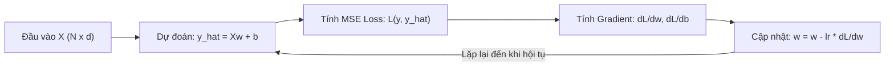

> **[Motto]**: Linear Regression là bài toán "Hello World" của ML, nhưng vòng lặp Model - Loss - Gradient Descent của nó nằm trong mọi mạng Neural hiện đại.

---

## Thông tin nhanh (Quick Spec)

* **Loại bài (Type):** Thực chiến (Build)
* **Ngôn ngữ & Công cụ:** Python 3.12, NumPy
* **Kiến thức tiên quyết (Prerequisites):** Phase 1 (Đại số tuyến tính, Giải tích), Bài 01
* **Thời gian thực hành:** ~45 phút

---

## Mục tiêu bài học (Learning Objectives)

Sau bài học này, bạn sẽ có khả năng:
- [ ] Thiết lập công thức dự đoán $\hat{y} = Xw + b$ và hàm mất mát Mean Squared Error (MSE).
- [ ] Tự tay tính đạo hàm (Gradient) và cài đặt thuật toán **Gradient Descent** thuần NumPy.
- [ ] So sánh độ phức tạp tính toán giữa **Gradient Descent** và **Normal Equation** để chọn đúng phương pháp trong thực tế.
- [ ] Áp dụng **Feature Standardization** và **Ridge Regression (L2)** để chống Overfitting.

---

## 1. Vấn đề thực tế (The Problem)

> *Tại sao cần Linear Regression khi ta có thể vẽ đại một đường thẳng bằng mắt?*

Bạn có dữ liệu lịch sử về diện tích ($m^2$), số phòng ngủ, khoảng cách tới trung tâm và giá bán của 10.000 căn nhà. Khi một căn nhà mới xuất hiện, bạn cần một công thức định giá tự động với sai số thấp nhất.

Với 1 biến (diện tích), bạn có thể vẽ đồ thị 2D và ước lượng bằng mắt. Nhưng với 50 đặc trưng (features), không gian 50 chiều là bất khả thi để nhìn bằng mắt thường. Hơn nữa, bạn cần một cơ chế định lượng rõ ràng: thế nào là đường thẳng "tốt nhất"?

Linear Regression giải quyết bài toán này bằng cách định nghĩa một thước đo sai số (MSE) và tự động tìm bộ trọng số $w$ sao cho sai số đó nhỏ nhất.

---

## 2. Mô hình tư duy & Bản chất (The Concept)

### Cơ chế hoạt động



### Toán học cốt lõi (KaTeX)

Với $N$ mẫu dữ liệu, hàm dự đoán và hàm mất mát MSE (chia $2N$ để khi đạo hàm triệt tiêu số 2) là:

$$\hat{y} = Xw + b$$

$$J(w, b) = \frac{1}{2N} \sum_{i=1}^{N} (\hat{y}_i - y_i)^2 = \frac{1}{2N} \|Xw + b - y\|_2^2$$

Đạo hàm theo trọng số $w$ và hệ số chệch $b$:

$$\nabla_w J = \frac{1}{N} X^T (\hat{y} - y), \qquad \frac{\partial J}{\partial b} = \frac{1}{N} \sum_{i=1}^{N} (\hat{y}_i - y_i)$$

Nếu thêm **L2 Regularization (Ridge)** với hệ số $\lambda$ để phạt các trọng số quá lớn (chống overfitting):

$$J_{\text{ridge}}(w) = \frac{1}{2N} \|Xw + b - y\|_2^2 + \frac{\lambda}{2} \|w\|_2^2 \implies \nabla_w J_{\text{ridge}} = \frac{1}{N} X^T (\hat{y} - y) + \lambda w$$

**Nghiệm đóng (Normal Equation):** Thay vì lặp, ta giải trực tiếp $\nabla_w J = 0$ (gộp $b$ vào $X$ bằng cột số 1):

$$w^* = (X^T X + \lambda I)^{-1} X^T y$$

---

## 3. Tự tay xây dựng từ đầu (Build It: From Scratch)

Chúng ta sẽ cài đặt `LinearRegressionGD` (hỗ trợ L2 Regularization) và `StandardScaler` thuần Python 3.12 + NumPy.

### Bước 1: Chuẩn hóa dữ liệu (StandardScaler)

```python
import numpy as np
from typing import Optional


class StandardScaler:
    """Chuẩn hóa dữ liệu về mean = 0, std = 1 (Z-score normalization)."""

    def __init__(self) -> None:
        self.mean_: Optional[np.ndarray] = None
        self.std_: Optional[np.ndarray] = None

    def fit(self, X: np.ndarray) -> "StandardScaler":
        self.mean_ = X.mean(axis=0)
        self.std_ = np.where(X.std(axis=0) == 0, 1.0, X.std(axis=0))
        return self

    def transform(self, X: np.ndarray) -> np.ndarray:
        if self.mean_ is None or self.std_ is None:
            raise RuntimeError("Scaler chưa được fit.")
        return (X - self.mean_) / self.std_

    def fit_transform(self, X: np.ndarray) -> np.ndarray:
        return self.fit(X).transform(X)
```

### Bước 2: Cài đặt Linear & Ridge Regression bằng Gradient Descent

```python
class LinearRegressionGD:
    """Linear / Ridge Regression huấn luyện bằng Batch Gradient Descent."""

    def __init__(
        self,
        learning_rate: float = 0.05,
        n_iters: int = 1000,
        l2_lambda: float = 0.0,
    ) -> None:
        self.lr = learning_rate
        self.n_iters = n_iters
        self.l2_lambda = l2_lambda
        self.weights: Optional[np.ndarray] = None
        self.bias: float = 0.0
        self.loss_history: list[float] = []

    def fit(self, X: np.ndarray, y: np.ndarray) -> "LinearRegressionGD":
        n_samples, n_features = X.shape
        self.weights = np.zeros(n_features, dtype=np.float64)
        self.bias = 0.0
        self.loss_history = []

        for _ in range(self.n_iters):
            y_pred = X @ self.weights + self.bias
            error = y_pred - y

            # Tính MSE + L2 penalty
            mse = np.mean(error ** 2) / 2.0
            reg = (self.l2_lambda / 2.0) * float(np.sum(self.weights ** 2))
            self.loss_history.append(float(mse + reg))

            # Tính Gradient
            dw = (X.T @ error) / n_samples + self.l2_lambda * self.weights
            db = float(np.mean(error))

            # Cập nhật tham số
            self.weights -= self.lr * dw
            self.bias -= self.lr * db

        return self

    def predict(self, X: np.ndarray) -> np.ndarray:
        if self.weights is None:
            raise RuntimeError("Mô hình chưa được train.")
        return X @ self.weights + self.bias
```

### Bước 3: Kiểm chứng với dữ liệu giả lập & So sánh với Normal Equation

```python
def normal_equation(X: np.ndarray, y: np.ndarray, l2_lambda: float = 0.0) -> np.ndarray:
    """Giải nghiệm đóng w* = (X^T X + lambda*I)^-1 X^T y (cột đầu là bias)."""
    X_b = np.c_[np.ones((X.shape[0], 1)), X]
    reg_matrix = l2_lambda * np.eye(X_b.shape[1])
    reg_matrix[0, 0] = 0.0  # Không phạt hệ số bias
    return np.linalg.solve(X_b.T @ X_b + reg_matrix, X_b.T @ y)


if __name__ == "__main__":
    rng = np.random.default_rng(42)
    X_raw = rng.uniform(0, 100, size=(200, 2))
    # Công thức thật: y = 3.5*x1 - 2.0*x2 + 10 + noise
    y = 3.5 * X_raw[:, 0] - 2.0 * X_raw[:, 1] + 10.0 + rng.normal(0, 2.0, size=200)

    scaler = StandardScaler()
    X_scaled = scaler.fit_transform(X_raw)

    model = LinearRegressionGD(learning_rate=0.1, n_iters=500, l2_lambda=0.01)
    model.fit(X_scaled, y)
    preds = model.predict(X_scaled)
    rmse = float(np.sqrt(np.mean((preds - y) ** 2)))

    w_exact = normal_equation(X_scaled, y, l2_lambda=0.01)

    print(f"GD RMSE          : {rmse:.4f}")
    print(f"GD Loss (start)  : {model.loss_history[0]:.2f} -> (end): {model.loss_history[-1]:.4f}")
    print(f"GD Weights       : bias={model.bias:.4f}, w={model.weights}")
    print(f"Normal Eq Weights: bias={w_exact[0]:.4f}, w={w_exact[1:]}")
```

---

## 4. Ứng dụng thực tế & So sánh Framework (Use It)

| Tiêu chí | Normal Equation (`np.linalg.solve`) | Gradient Descent (`SGD` / `Adam`) |
|---|---|---|
| **Độ phức tạp** | $O(d^3)$ do nghịch đảo ma trận | $O(k \cdot N \cdot d)$ ($k$ là số vòng lặp) |
| **Khi nào nên dùng** | Số features $d < 10.000$ | $d$ rất lớn hoặc dữ liệu không vừa RAM (dùng Mini-batch) |
| **Chuẩn hóa dữ liệu** | Không bắt buộc | **Bắt buộc** (nếu không dễ bị `NaN` hoặc hội tụ cực chậm) |

**Production Tips:**
- Không bao giờ dùng `np.linalg.inv(X.T @ X)` trực tiếp vì dễ gặp lỗi ma trận suy biến (singular matrix) và kém ổn định số học. Hãy dùng `np.linalg.solve` hoặc thêm một lượng nhỏ L2 (`l2_lambda=1e-6`).
- Trong `scikit-learn`, `LinearRegression` dùng SVD (biến thể ổn định của Normal Equation), còn `SGDRegressor` dùng Stochastic Gradient Descent cho dữ liệu lớn.

---

## 5. Đóng gói & Tái sử dụng (Ship It)

**Checklist chuẩn hóa & kiểm soát chất lượng cho Linear / Ridge Regression:**
- [ ] **Chống Data Leakage:** Luôn gọi `scaler.fit_transform(X_train)` rồi dùng đúng `mean_`, `std_` đó để `scaler.transform(X_test)` và dữ liệu Production.
- [ ] **Xử lý đa cộng tuyến (Multicollinearity):** Khi các đặc trưng tương quan cao hoặc $d$ tiệm cận $N$, luôn bật L2 Regularization (`Ridge`) thay vì dùng OLS thuần để tránh trọng số phình to bất ổn.
- [ ] **Kiểm tra phần dư (Residuals):** Vẽ biểu đồ $(y - \hat{y})$ theo $\hat{y}$; nếu thấy dạng hình cong hoặc phễu mở rộng, cần bổ sung đặc trưng phi tuyến ($x^2$, $\log(x)$) hoặc xử lý Outlier.
- [ ] **Giám sát đường cong Loss:** Khi dùng Gradient Descent, luôn kiểm tra `loss_history` giảm đơn điệu trước khi tin vào trọng số đầu ra.

**Bảng chẩn đoán nhanh khi chạy Gradient Descent:**

| Triệu chứng quan sát | Nguyên nhân phổ biến | Cách xử lý ngay |
|---|---|---|
| Loss tăng vọt hoặc ra `NaN` | `learning_rate` quá lớn hoặc chưa chuẩn hóa feature | Giảm `lr` đi 10 lần và chạy `StandardScaler` trước `fit()` |
| Loss giảm cực chậm, chưa chạm đáy | `learning_rate` quá nhỏ hoặc thang đo các cột lệch nhau lớn | Chuẩn hóa dữ liệu, tăng dần `lr` theo thang log (`1e-3` $\rightarrow$ `1e-1`) |
| Train MSE thấp nhưng Test MSE rất cao | Overfitting (quá nhiều feature bậc cao hoặc nhiễu) | Tăng hệ số `l2_lambda` (Ridge) hoặc thu thập thêm mẫu huấn luyện |

---

## 6. Giải ngố thuật ngữ (Key Terms & Misconceptions)

| Thuật ngữ (Term) | Người ta thường nghĩ là... | Bản chất kỹ thuật thực sự là... |
|---|---|---|
| **Linear (Tuyến tính)** | Mô hình chỉ vẽ được đường thẳng. | Tuyến tính **theo tham số $w$**. Bạn hoàn toàn có thể đưa $x^2, \sin(x)$ vào làm feature để khớp đường cong! |
| **Learning Rate ($\alpha$)** | Càng lớn thì học càng nhanh. | Quá lớn sẽ làm bước nhảy vượt qua đáy thung lũng, khiến Loss tăng vọt lên vô cực (`NaN`). |
| **R-squared ($R^2$)** | Phần trăm dự đoán đúng. | Tỷ lệ phương sai của $y$ mà mô hình giải thích được so với việc chỉ đoán giá trị trung bình $\bar{y}$. |

---

## 7. Bài tập thử thách (Hands-on Challenges)

1. 🟢 **Cơ bản (Easy):** Thử bỏ qua bước `StandardScaler` và chạy `LinearRegressionGD` trực tiếp trên `X_raw` với `learning_rate=0.1`. Quan sát hiện tượng bùng nổ Gradient (`NaN`) và giải thích nguyên nhân.
2. 🟡 **Trung bình (Medium):** Thêm **Early Stopping** vào hàm `fit`: nếu độ giảm của `loss_history` giữa 2 vòng lặp liên tiếp nhỏ hơn `tol = 1e-6`, dừng vòng lặp sớm để tiết kiệm tài nguyên.
3. 🔴 **Nâng cao (Hard):** Nâng cấp `LinearRegressionGD` thành **Mini-batch Gradient Descent** với tham số `batch_size: int = 32`, xáo trộn dữ liệu sau mỗi epoch.

---

## 8. Tài liệu đọc thêm (Further Reading)

- [Scikit-learn Linear Models Documentation](https://scikit-learn.org/stable/modules/linear_model.html) — *So sánh chi tiết OLS, Ridge, Lasso, ElasticNet và hướng dẫn chọn bộ giải (SVD, Cholesky, SAG/SAGA) theo quy mô dữ liệu.*
- [CS229 Lecture Notes: Supervised Learning (Stanford)](https://cs229.stanford.edu/main_notes.pdf) — *Trình bày mạch lạc mối liên hệ giữa MSE, đạo hàm ma trận, Normal Equation và góc nhìn xác suất Maximum Likelihood Estimation.*
- [An Overview of Gradient Descent Optimization Algorithms (Sebastian Ruder)](https://www.ruder.io/optimizing-gradient-descent/) — *Tổng quan nền tảng từ Batch GD, Mini-batch SGD đến Momentum và Adam.*
