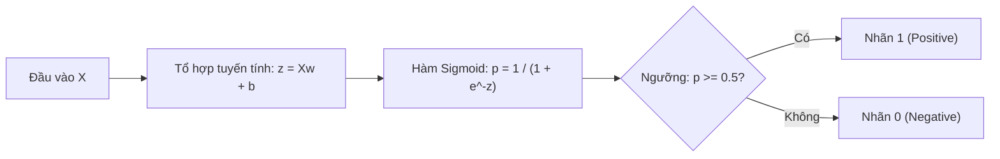

> **[Motto]**: Logistic Regression không phải là hồi quy — nó là bộ phân loại tuyến tính trả về xác suất có hiệu chuẩn.

---

## Thông tin nhanh (Quick Spec)

* **Loại bài (Type):** Thực chiến (Build)
* **Ngôn ngữ & Công cụ:** Python 3.12, NumPy
* **Kiến thức tiên quyết (Prerequisites):** Bài 02 (Linear Regression & Gradient Descent)
* **Thời gian thực hành:** ~45 phút

---

## Mục tiêu bài học (Learning Objectives)

Sau bài học này, bạn sẽ có khả năng:
- [ ] Hiểu cơ chế hàm **Sigmoid** và lý do dùng **Binary Cross-Entropy (Log Loss)** thay vì MSE.
- [ ] Tự tay cài đặt `LogisticRegression` thuần Python + NumPy (bao gồm xử lý ổn định số học `np.clip` tránh `log(0)`).
- [ ] Tính toán và diễn giải **Confusion Matrix**, **Precision**, **Recall**, và **F1-Score**.
- [ ] Điều chỉnh ngưỡng quyết định (**Decision Threshold**) theo bài toán thực tế.

---

## 1. Vấn đề thực tế (The Problem)

> *Tại sao không dùng Linear Regression cho bài toán phân loại Có/Không?*

Bạn cần dự đoán một giao dịch thẻ tín dụng là **Gian lận (1)** hay **Hợp lệ (0)**. Nếu dùng Linear Regression, mô hình có thể trả về `1.8` hoặc `-0.4`. Những con số này không phải xác suất. Tệ hơn, một điểm dữ liệu ngoại lai (outlier) nằm rất xa sẽ kéo đường hồi quy lệch đi, làm sai lệch hoàn toàn ranh giới phân loại.

Bạn cần một mô hình:
1. Đầu ra luôn nằm chặt trong khoảng $(0, 1)$ để đọc được dưới dạng xác suất.
2. Ít bị nhiễu bởi các điểm nằm rất xa ranh giới.

---

## 2. Mô hình tư duy & Bản chất (The Concept)



### Toán học cốt lõi (KaTeX)

**1. Hàm Sigmoid:**
$$\sigma(z) = \frac{1}{1 + e^{-z}}$$

**2. Hàm mất mát Binary Cross-Entropy (Log Loss):**
Nếu dùng MSE với Sigmoid, hàm Loss sẽ không lồi (non-convex), khiến Gradient Descent dễ kẹt. Log Loss giải quyết triệt để vấn đề này:

$$J(w, b) = -\frac{1}{N} \sum_{i=1}^{N} \left[ y_i \log(\hat{p}_i) + (1 - y_i) \log(1 - \hat{p}_i) \right]$$

Điều kỳ diệu của đạo hàm Log Loss kết hợp Sigmoid là công thức Gradient giống hệt Linear Regression:

$$\nabla_w J = \frac{1}{N} X^T (\hat{p} - y), \qquad \frac{\partial J}{\partial b} = \frac{1}{N} \sum_{i=1}^{N} (\hat{p}_i - y_i)$$

---

## 3. Tự tay xây dựng từ đầu (Build It: From Scratch)

### Bước 1: Cài đặt Logistic Regression với ổn định số học

```python
import numpy as np
from typing import Optional, Dict


class LogisticRegression:
    """Bộ phân loại nhị phân dùng Sigmoid và Binary Cross-Entropy."""

    def __init__(self, learning_rate: float = 0.1, n_iters: int = 1000) -> None:
        self.lr = learning_rate
        self.n_iters = n_iters
        self.weights: Optional[np.ndarray] = None
        self.bias: float = 0.0
        self.loss_history: list[float] = []

    @staticmethod
    def _sigmoid(z: np.ndarray) -> np.ndarray:
        # Clip z để tránh tràn số (overflow) khi tính exp(-z)
        z_clipped = np.clip(z, -500.0, 500.0)
        return 1.0 / (1.0 + np.exp(-z_clipped))

    def fit(self, X: np.ndarray, y: np.ndarray) -> "LogisticRegression":
        n_samples, n_features = X.shape
        self.weights = np.zeros(n_features, dtype=np.float64)
        self.bias = 0.0
        self.loss_history = []
        eps = 1e-15

        for _ in range(self.n_iters):
            z = X @ self.weights + self.bias
            p = self._sigmoid(z)

            # Clip xác suất để tránh log(0) -> NaN
            p_clipped = np.clip(p, eps, 1.0 - eps)
            loss = -np.mean(y * np.log(p_clipped) + (1 - y) * np.log(1 - p_clipped))
            self.loss_history.append(float(loss))

            error = p - y
            dw = (X.T @ error) / n_samples
            db = float(np.mean(error))

            self.weights -= self.lr * dw
            self.bias -= self.lr * db

        return self

    def predict_proba(self, X: np.ndarray) -> np.ndarray:
        if self.weights is None:
            raise RuntimeError("Mô hình chưa được train.")
        return self._sigmoid(X @ self.weights + self.bias)

    def predict(self, X: np.ndarray, threshold: float = 0.5) -> np.ndarray:
        return (self.predict_proba(X) >= threshold).astype(int)
```

### Bước 2: Cài đặt Metrics đánh giá (Precision, Recall, F1)

```python
def classification_metrics(y_true: np.ndarray, y_pred: np.ndarray) -> Dict[str, float]:
    tp = int(np.sum((y_true == 1) & (y_pred == 1)))
    fp = int(np.sum((y_true == 0) & (y_pred == 1)))
    fn = int(np.sum((y_true == 1) & (y_pred == 0)))
    tn = int(np.sum((y_true == 0) & (y_pred == 0)))

    accuracy = (tp + tn) / len(y_true)
    precision = tp / (tp + fp) if (tp + fp) > 0 else 0.0
    recall = tp / (tp + fn) if (tp + fn) > 0 else 0.0
    f1 = (2 * precision * recall / (precision + recall)) if (precision + recall) > 0 else 0.0

    return {
        "accuracy": accuracy,
        "precision": precision,
        "recall": recall,
        "f1": f1,
    }


if __name__ == "__main__":
    rng = np.random.default_rng(7)
    X0 = rng.normal([1.5, 1.5], 0.9, size=(100, 2))
    X1 = rng.normal([4.0, 4.0], 0.9, size=(100, 2))
    X = np.vstack([X0, X1])
    y = np.array([0] * 100 + [1] * 100)

    model = LogisticRegression(learning_rate=0.1, n_iters=1000).fit(X, y)
    preds = model.predict(X, threshold=0.5)
    metrics = classification_metrics(y, preds)

    print(f"Loss: {model.loss_history[0]:.4f} -> {model.loss_history[-1]:.4f}")
    print("Metrics:", {k: round(v, 4) for k, v in metrics.items()})
```

---

## 4. Ứng dụng thực tế & So sánh Framework (Use It)

* **Đừng mặc định `threshold = 0.5`:**
  - *Bài toán Y tế / Gian lận:* Bỏ sót ca bệnh (False Negative) rất nguy hiểm $\rightarrow$ Hạ ngưỡng xuống `0.2 - 0.3` để tăng **Recall**.
  - *Bài toán Lọc Spam:* Chặn nhầm email quan trọng (False Positive) gây phiền toái $\rightarrow$ Tăng ngưỡng lên `0.8 - 0.9` để tăng **Precision**.
* **Production:** `scikit-learn` dùng `LogisticRegression(solver='lbfgs')` mặc định — hội tụ nhanh hơn nhiều so với Batch Gradient Descent thuần và tự động áp dụng L2 Regularization (`C=1.0`).

---

## 5. Đóng gói & Tái sử dụng (Ship It)

**Checklist đánh giá & vận hành Logistic Regression trên Production:**
- [ ] **Chuẩn hóa đặc trưng:** Luôn chạy `StandardScaler` trước khi huấn luyện để tránh bão hòa Sigmoid (gradient tiến về 0) và để độ lớn của trọng số $w_j$ có thể so sánh trực tiếp với nhau.
- [ ] **Kiểm tra lệch lớp (Imbalanced Data):** Nếu lớp dương tính (Positive) chiếm dưới 10%, không báo cáo Accuracy đơn lẻ; hãy theo dõi **Precision, Recall, F1 và PR-AUC**, đồng thời thử `class_weight="balanced"`.
- [ ] **Tách biệt Scoring và Decision Threshold:** Lưu mô hình trả về xác suất `predict_proba()` và đưa `threshold` ra file cấu hình (config) để dễ dàng điều chỉnh theo chi phí nghiệp vụ mà không cần retrain.
- [ ] **Bật Regularization mặc định:** Giữ L2 Regularization (`C` hữu hạn) để tránh trọng số phân kỳ ra vô cực khi dữ liệu phân tách tuyến tính hoàn hảo.

**Cheatsheet chọn Metric & điều chỉnh ngưỡng quyết định (`threshold`):**

| Kịch bản thực tế | Lỗi gây thiệt hại lớn hơn | Metric ưu tiên | Hướng chỉnh `threshold` |
|---|---|---|---|
| Chẩn đoán bệnh / Phát hiện gian lận | Bỏ sót ca thật (False Negative) | **Recall** (và $F_2$-Score) | Hạ thấp (`0.2` – `0.35`) |
| Lọc Email Spam / Khóa tài khoản tự động | Chặn nhầm người thật (False Positive) | **Precision** | Nâng cao (`0.75` – `0.90`) |
| Cân bằng chi phí giữa 2 loại lỗi | Cả FP và FN đều quan trọng | **F1-Score / PR-AUC** | Quét trên tập Validation để tối ưu F1 |

---

## 6. Giải ngố thuật ngữ (Key Terms & Misconceptions)

| Thuật ngữ (Term) | Người ta thường nghĩ là... | Bản chất kỹ thuật thực sự là... |
|---|---|---|
| **Accuracy** | Chỉ số tốt nhất để đánh giá phân loại. | Vô dụng khi dữ liệu lệch (ví dụ 99% không gian lận: đoán tất cả là 0 vẫn đạt 99% Accuracy). |
| **Logits** | Xác suất đầu ra của mô hình. | Giá trị thô $z = Xw + b$ **trước khi** đi qua hàm Sigmoid/Softmax, có miền giá trị $(-\infty, +\infty)$. |
| **Decision Threshold** | Luôn cố định ở mức `0.5` do thuật toán quyết định. | Tham số nghiệp vụ áp lên xác suất đầu ra $\hat{p}$; thay đổi ngưỡng làm thay đổi trực tiếp sự đánh đổi giữa Precision và Recall. |
| **Logistic Regression** | Một thuật toán hồi quy dùng để dự đoán số liên tục. | Là mô hình **phân loại tuyến tính**; từ "Regression" xuất phát từ việc hồi quy trên **Log-Odds** $\log\frac{p}{1-p} = Xw + b$. |

---

## 7. Bài tập thử thách (Hands-on Challenges)

1. 🟢 **Cơ bản (Easy):** Thử nghiệm thay đổi `threshold` thành `0.2`, `0.5`, `0.8` trên dữ liệu mẫu và quan sát sự đánh đổi (trade-off) giữa Precision và Recall.
2. 🟡 **Trung bình (Medium):** Thêm L2 Regularization (`l2_lambda`) vào `LogisticRegression` (chú ý không phạt `bias`).
3. 🔴 **Nâng cao (Hard):** Mở rộng thành **Softmax Regression** (Multinomial Logistic Regression) để phân loại 3 lớp (`y in {0, 1, 2}`) bằng One-Hot Encoding và Cross-Entropy đa lớp.

---

## 8. Tài liệu đọc thêm (Further Reading)

- [Scikit-learn Logistic Regression Documentation](https://scikit-learn.org/stable/modules/linear_model.html#logistic-regression) — *Bảng so sánh các solver (`lbfgs`, `liblinear`, `saga`) và khuyến nghị chọn bộ giải cho dữ liệu lớn hoặc dữ liệu thưa.*
- [Scikit-learn Classification Metrics Guide](https://scikit-learn.org/stable/modules/model_evaluation.html#classification-metrics) — *Phân tích sâu về Confusion Matrix, ROC-AUC vs PR-AUC và cách hiệu chuẩn xác suất (Probability Calibration).*
- [The Elements of Statistical Learning (Hastie, Tibshirani, Friedman)](https://hastie.su.domains/ElemStatLearn/) — *Chương 4 giải thích cặn kẽ nền tảng thống kê của Logistic Regression, Log-Odds và phương pháp Newton-Raphson.*
