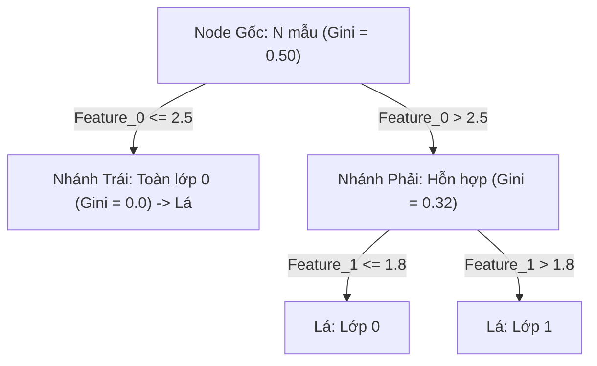

> **[Motto]**: Một cây quyết định rất dễ học vẹt (Overfit); một khu rừng gồm nhiều cây độc lập sẽ triệt tiêu sai số đó.

---

## Thông tin nhanh (Quick Spec)

* **Loại bài (Type):** Thực chiến (Build)
* **Ngôn ngữ & Công cụ:** Python 3.12, NumPy, `collections`
* **Kiến thức tiên quyết (Prerequisites):** Phase 1 (Xác suất, Lý thuyết thông tin)
* **Thời gian thực hành:** ~60 phút

---

## Mục tiêu bài học (Learning Objectives)

Sau bài học này, bạn sẽ có khả năng:
- [ ] Tính toán **Gini Impurity** và **Information Gain** để chọn điểm chia nhánh tối ưu.
- [ ] Tự tay cài đặt **Decision Tree Classifier** đệ quy với các tham số cắt tỉa (`max_depth`, `min_samples_split`).
- [ ] Xây dựng **Random Forest Classifier** bằng kỹ thuật Bootstrap Aggregation (Bagging) và Feature Randomization.

---

## 1. Vấn đề thực tế (The Problem)

> *Tại sao trên dữ liệu dạng bảng (Tabular Data), các mô hình Tree-based thường đánh bại Deep Learning?*

Dữ liệu doanh nghiệp thực tế (giao dịch ngân hàng, hồ sơ khách hàng, log hệ thống) hầu hết ở dạng bảng: có cột số (tuổi, thu nhập), có cột phân loại, dữ liệu bị thiếu, và quan hệ phi tuyến tính phức tạp.

Mạng Neural cần chuẩn hóa kỹ lưỡng, nhiều dữ liệu và khó giải thích. Ngược lại, **Decision Tree** không cần chuẩn hóa scale, xử lý tự nhiên các ranh giới phi tuyến và giải thích được từng quyết định theo dạng `if-else`. Tuy nhiên, một cây đơn lẻ lại quá nhạy cảm với nhiễu. Giải pháp thực chiến là **Random Forest**.

---

## 2. Mô hình tư duy & Bản chất (The Concept)



### Toán học cốt lõi (KaTeX)

**Gini Impurity** đo độ "lẫn lộn" của một tập dữ liệu có $C$ lớp ($p_c$ là tỷ lệ mẫu thuộc lớp $c$):

$$\text{Gini}(D) = 1 - \sum_{c=1}^{C} p_c^2$$

- Tập tinh khiết hoàn toàn (100% cùng 1 lớp): $\text{Gini} = 0$.
- Tập hỗn loạn nhất (50/50 với 2 lớp): $\text{Gini} = 0.5$.

Khi chia tập $D$ thành $D_{\text{left}}$ và $D_{\text{right}}$, ta chọn cặp `(feature, threshold)` tối đa hóa **Gini Gain**:

$$\text{Gain} = \text{Gini}(D) - \left( \frac{|D_{\text{left}}|}{|D|} \text{Gini}(D_{\text{left}}) + \frac{|D_{\text{right}}|}{|D|} \text{Gini}(D_{\text{right}}) \right)$$

---

## 3. Tự tay xây dựng từ đầu (Build It: From Scratch)

### Bước 1: Cấu trúc Node và DecisionTreeClassifier

```python
import numpy as np
from collections import Counter
from typing import Optional, Tuple


class Node:
    def __init__(
        self,
        feature: Optional[int] = None,
        threshold: Optional[float] = None,
        left: Optional["Node"] = None,
        right: Optional["Node"] = None,
        value: Optional[int] = None,
    ) -> None:
        self.feature = feature
        self.threshold = threshold
        self.left = left
        self.right = right
        self.value = value  # Chỉ có ở Leaf Node

    def is_leaf(self) -> bool:
        return self.value is not None


class DecisionTreeClassifier:
    """Cây quyết định phân loại dùng Gini Impurity."""

    def __init__(
        self,
        max_depth: int = 10,
        min_samples_split: int = 2,
        max_features: Optional[int] = None,
        seed: int = 42,
    ) -> None:
        self.max_depth = max_depth
        self.min_samples_split = min_samples_split
        self.max_features = max_features
        self.rng = np.random.default_rng(seed)
        self.root: Optional[Node] = None

    @staticmethod
    def _gini(y: np.ndarray) -> float:
        if len(y) == 0:
            return 0.0
        _, counts = np.unique(y, return_counts=True)
        probs = counts / len(y)
        return float(1.0 - np.sum(probs ** 2))

    def _best_split(
        self, X: np.ndarray, y: np.ndarray, feat_idxs: np.ndarray
    ) -> Tuple[Optional[int], Optional[float]]:
        best_gain = -1.0
        split_idx, split_thresh = None, None
        parent_gini = self._gini(y)
        n = len(y)

        for feat_idx in feat_idxs:
            thresholds = np.unique(X[:, feat_idx])
            for thr in thresholds:
                left_mask = X[:, feat_idx] <= thr
                right_mask = ~left_mask
                if not np.any(left_mask) or not np.any(right_mask):
                    continue

                n_l, n_r = np.sum(left_mask), np.sum(right_mask)
                child_gini = (n_l / n) * self._gini(y[left_mask]) + (
                    n_r / n
                ) * self._gini(y[right_mask])
                gain = parent_gini - child_gini

                if gain > best_gain:
                    best_gain = gain
                    split_idx = int(feat_idx)
                    split_thresh = float(thr)

        return split_idx, split_thresh

    def _build_tree(self, X: np.ndarray, y: np.ndarray, depth: int = 0) -> Node:
        n_samples, n_features = X.shape
        n_labels = len(np.unique(y))

        # Điều kiện dừng (Pre-pruning)
        if depth >= self.max_depth or n_labels == 1 or n_samples < self.min_samples_split:
            most_common = Counter(y.tolist()).most_common(1)[0][0]
            return Node(value=int(most_common))

        n_select = self.max_features or n_features
        feat_idxs = self.rng.choice(n_features, size=min(n_select, n_features), replace=False)

        best_feat, best_thresh = self._best_split(X, y, feat_idxs)
        if best_feat is None or best_thresh is None:
            most_common = Counter(y.tolist()).most_common(1)[0][0]
            return Node(value=int(most_common))

        left_mask = X[:, best_feat] <= best_thresh
        left_child = self._build_tree(X[left_mask], y[left_mask], depth + 1)
        right_child = self._build_tree(X[~left_mask], y[~left_mask], depth + 1)
        return Node(best_feat, best_thresh, left_child, right_child)

    def fit(self, X: np.ndarray, y: np.ndarray) -> "DecisionTreeClassifier":
        self.root = self._build_tree(X, y)
        return self

    def _traverse(self, x: np.ndarray, node: Node) -> int:
        if node.is_leaf():
            assert node.value is not None
            return node.value
        assert node.feature is not None and node.threshold is not None
        if x[node.feature] <= node.threshold:
            assert node.left is not None
            return self._traverse(x, node.left)
        assert node.right is not None
        return self._traverse(x, node.right)

    def predict(self, X: np.ndarray) -> np.ndarray:
        if self.root is None:
            raise RuntimeError("Cây chưa được train.")
        return np.array([self._traverse(x, self.root) for x in X])
```

### Bước 2: Nâng cấp thành RandomForestClassifier

```python
class RandomForestClassifier:
    """Tập hợp nhiều Decision Tree qua Bagging và Feature Subsampling."""

    def __init__(
        self, n_trees: int = 10, max_depth: int = 8, min_samples_split: int = 2, seed: int = 42
    ) -> None:
        self.n_trees = n_trees
        self.max_depth = max_depth
        self.min_samples_split = min_samples_split
        self.rng = np.random.default_rng(seed)
        self.trees: list[DecisionTreeClassifier] = []

    def fit(self, X: np.ndarray, y: np.ndarray) -> "RandomForestClassifier":
        self.trees = []
        n_samples, n_features = X.shape
        max_feats = max(1, int(np.sqrt(n_features)))

        for i in range(self.n_trees):
            # Bootstrap sampling (lấy mẫu có hoàn lại)
            idxs = self.rng.choice(n_samples, size=n_samples, replace=True)
            tree = DecisionTreeClassifier(
                max_depth=self.max_depth,
                min_samples_split=self.min_samples_split,
                max_features=max_feats,
                seed=int(self.rng.integers(0, 100_000)),
            )
            tree.fit(X[idxs], y[idxs])
            self.trees.append(tree)
        return self

    def predict(self, X: np.ndarray) -> np.ndarray:
        # Thu thập dự đoán từ tất cả các cây: shape (n_trees, n_samples)
        tree_preds = np.array([tree.predict(X) for tree in self.trees])
        # Majority voting cho từng mẫu
        final_preds = [
            Counter(tree_preds[:, i].tolist()).most_common(1)[0][0]
            for i in range(X.shape[0])
        ]
        return np.array(final_preds)


if __name__ == "__main__":
    rng = np.random.default_rng(42)
    X = rng.normal(0, 1, size=(150, 4))
    y = ((X[:, 0] * X[:, 1]) > 0).astype(int)  # Bài toán XOR phi tuyến

    rf = RandomForestClassifier(n_trees=15, max_depth=6).fit(X[:120], y[:120])
    preds = rf.predict(X[120:])
    acc = float(np.mean(preds == y[120:]))
    print(f"Random Forest Test Accuracy (XOR): {acc:.2%}")
```

---

## 4. Ứng dụng thực tế & So sánh Framework (Use It)

* **Random Forest vs Gradient Boosting (XGBoost / LightGBM):**
  - *Random Forest:* Huấn luyện các cây **song song**, cực kỳ dễ tune tham số, ít bị overfit.
  - *XGBoost / LightGBM:* Huấn luyện **tuần tự** (cây sau sửa lỗi cây trước), thường đạt độ chính xác cao hơn trên các cuộc thi và hệ thống Production lớn, nhưng cần tune `learning_rate` và `max_depth` cẩn thận.

---

## 5. Đóng gói & Tái sử dụng (Ship It)

**Checklist chống Overfitting & tối ưu Random Forest cho Production:**
- [ ] **Giới hạn độ phức tạp cây (Pre-pruning):** Luôn kiểm soát `max_depth` (thường từ `5` đến `15`) và `min_samples_leaf` (ví dụ `5` – `20`) thay vì để cây phát triển tự do tới khi mỗi lá chỉ chứa 1 mẫu.
- [ ] **Giữ Feature Subsampling:** Với Random Forest, giữ `max_features="sqrt"` (phân loại) hoặc `max_features=0.33` (hồi quy) để đảm bảo các cây thực sự khác biệt nhau.
- [ ] **Tận dụng OOB Score:** Bật `oob_score=True` khi dùng `scikit-learn` để ước lượng độ chính xác tổng quát miễn phí từ ~37% mẫu không được bốc vào từng tập Bootstrap.
- [ ] **Kiểm soát bộ nhớ khi Serving:** Một rừng 500 cây không giới hạn độ sâu có thể nặng hàng trăm MB RAM và tăng latency; luôn benchmark kích thước file model trước khi deploy.

**Cheatsheet chọn tiêu chí chia nhánh: Gini vs Entropy:**

| Tiêu chí | Công thức | Tốc độ tính toán | Khi nào nên chọn |
|---|---|---|---|
| **Gini Impurity** | $1 - \sum_{c} p_c^2$ | Nhanh hơn (không cần tính `log`) | **Mặc định** cho hầu hết bài toán thực tế (CART / `scikit-learn`) |
| **Entropy** | $-\sum_{c} p_c \log_2(p_c)$ | Chậm hơn nhẹ do phép `log` | Khi cần cây cân bằng hơn một chút trên tập nhiều lớp; thực tế cho kết quả giống Gini ~98% trường hợp |

---

## 6. Giải ngố thuật ngữ (Key Terms & Misconceptions)

| Thuật ngữ (Term) | Người ta thường nghĩ là... | Bản chất kỹ thuật thực sự là... |
|---|---|---|
| **Bagging** | Gom hết dữ liệu vào một túi. | **B**ootstrap **Agg**regat**ing**: lấy mẫu ngẫu nhiên có hoàn lại để tạo nhiều tập dữ liệu con khác nhau cho từng cây. |
| **Feature Importance (MDI)** | Thước đo chính xác nhất mức độ quan trọng của biến. | Thiên vị (biased) các biến liên tục hoặc có nhiều giá trị duy nhất; nên dùng **Permutation Importance** hoặc **SHAP** để kiểm chứng. |
| **Ngoại suy (Extrapolation)** | Cây quyết định dự đoán tốt cả xu hướng vượt ngoài vùng dữ liệu cũ. | Cây chỉ trả về giá trị trung bình/đa số tại các lá đã thấy, nên **không thể ngoại suy** vượt khỏi biên min–max của tập Train (rất nguy hiểm với bài toán chuỗi thời gian có xu hướng tăng). |

---

## 7. Bài tập thử thách (Hands-on Challenges)

1. 🟢 **Cơ bản (Easy):** Thay `RandomForestClassifier` bằng 1 cây `DecisionTreeClassifier(max_depth=15)` trên bài toán XOR ở trên và so sánh độ chính xác trên tập Test.
2. 🟡 **Trung bình (Medium):** Cài đặt hàm tính **Entropy** $-\sum p_c \log_2(p_c)$ thay cho Gini Impurity và cho phép chọn `criterion="gini" | "entropy"`.
3. 🔴 **Nâng cao (Hard):** Viết hàm `permutation_importance(model, X_test, y_test)` thuần NumPy: xáo trộn ngẫu nhiên từng cột của `X_test` và đo mức độ sụt giảm Accuracy để xếp hạng độ quan trọng của các features.

---

## 8. Tài liệu đọc thêm (Further Reading)

- [Random Forests — Leo Breiman (2001)](https://link.springer.com/article/10.1023/A:1010933404324) — *Bài báo gốc định nghĩa Random Forest và chứng minh vì sao việc giảm tương quan giữa các cây quyết định lại chặn được Overfitting.*
- [Scikit-learn Ensemble Methods Documentation](https://scikit-learn.org/stable/modules/ensemble.html#forests-of-randomized-trees) — *Hướng dẫn thực chiến về `RandomForestClassifier`, `ExtraTreesClassifier`, `oob_score` và tối ưu đa luồng `n_jobs`.*
- [Why Do Tree-Based Models Still Outperform Deep Learning on Tabular Data? (Grinsztajn et al., NeurIPS 2022)](https://arxiv.org/abs/2207.08815) — *Nghiên cứu thực nghiệm lý giải vì sao các mô hình cây vẫn vượt trội trên dữ liệu dạng bảng có đặc trưng không mượt và nhiều biến nhiễu.*
