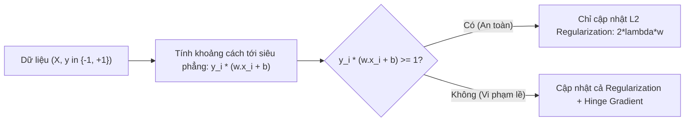

> **[Motto]**: Đừng chỉ tìm một đường thẳng phân tách hai lớp — hãy tìm con đường rộng nhất ở giữa chúng.

---

## Thông tin nhanh (Quick Spec)

* **Loại bài (Type):** Thực chiến (Build)
* **Ngôn ngữ & Công cụ:** Python 3.12, NumPy
* **Kiến thức tiên quyết (Prerequisites):** Phase 1 (Tối ưu lồi, Chuẩn vector), Bài 03
* **Thời gian thực hành:** ~45 phút

---

## Mục tiêu bài học (Learning Objectives)

Sau bài học này, bạn sẽ có khả năng:
- [ ] Hiểu nguyên lý **Maximum Margin** và vai trò của **Support Vectors**.
- [ ] Tự tay cài đặt **Linear SVM** thuần Python + NumPy bằng **Hinge Loss** và Sub-gradient Descent.
- [ ] Giải thích sự đánh đổi của tham số `C` và ý nghĩa của **Kernel Trick** (RBF, Polynomial) cho dữ liệu phi tuyến.

---

## 1. Vấn đề thực tế (The Problem)

> *Có vô số đường thẳng phân tách được hai lớp dữ liệu. Đường nào an toàn nhất khi gặp dữ liệu mới?*

Logistic Regression tìm một đường thẳng sao cho xác suất khớp với dữ liệu huấn luyện. Nhưng nếu một điểm dữ liệu mới nằm sát ranh giới bị nhiễu nhẹ, đường thẳng sát mép sẽ phân loại sai ngay lập tức.

**SVM** tiếp cận khác: nó tìm siêu phẳng tạo ra **khoảng trống (Margin) rộng nhất** giữa hai lớp. Chỉ những điểm nằm sát lề nhất (gọi là **Support Vectors**) mới quyết định vị trí của đường phân tách; các điểm ở xa hoàn toàn không ảnh hưởng.

---

## 2. Mô hình tư duy & Bản chất (The Concept)



### Toán học cốt lõi (KaTeX)

Với nhãn $y_i \in \{-1, +1\}$, hàm mất mát **Soft-Margin SVM (Primal Form)** là:

$$J(w, b) = \lambda \|w\|_2^2 + \frac{1}{N} \sum_{i=1}^{N} \max\left(0,\; 1 - y_i (w^T x_i + b)\right)$$

Trong đó $\max(0, 1 - y_i(w^T x_i + b))$ là **Hinge Loss**:
- Nếu điểm $x_i$ nằm đúng phía và ngoài lề an toàn ($y_i(w^T x_i + b) \ge 1$): Loss $= 0$.
- Ngược lại: Loss tăng tuyến tính theo mức độ vi phạm.

**Xử lý dữ liệu phi tuyến bằng RBF Kernel (Gaussian Kernel):**
Khi hai lớp lồng vào nhau (ví dụ hai vòng tròn đồng tâm), không một đường thẳng nào phân tách nổi. Thay vì tự tay tạo hàng nghìn đặc trưng bậc cao, **Kernel Trick** tính trực tiếp độ tương đồng giữa cặp điểm $(x_i, x_j)$ trong không gian ẩn:

$$K_{\text{RBF}}(x_i, x_j) = \exp\left(-\gamma \|x_i - x_j\|_2^2\right)$$

Theo định lý biểu diễn (**Representer Theorem**), hàm quyết định phi tuyến có dạng $f(x) = \sum_{j=1}^{N} \alpha_j K(x, x_j) + b$, với hàm mất mát tương ứng:

$$J(\alpha, b) = \lambda \alpha^T K \alpha + \frac{1}{N} \sum_{i=1}^{N} \max\left(0,\; 1 - y_i \left((K\alpha)_i + b\right)\right)$$

---

## 3. Tự tay xây dựng từ đầu (Build It: From Scratch)

### Bước 1: Cài đặt Linear SVM (Hinge Loss & Sub-gradient Descent)

```python
import numpy as np
from typing import Optional, Tuple


class LinearSVM:
    """Linear SVM sử dụng Hinge Loss và Sub-gradient Descent."""

    def __init__(
        self, learning_rate: float = 0.001, lambda_param: float = 0.01, n_iters: int = 1000
    ) -> None:
        self.lr = learning_rate
        self.lambda_param = lambda_param
        self.n_iters = n_iters
        self.w: Optional[np.ndarray] = None
        self.b: float = 0.0

    def fit(self, X: np.ndarray, y: np.ndarray) -> "LinearSVM":
        # Chuyển nhãn về {-1, +1}
        y_ = np.where(y <= 0, -1, 1)
        _, n_features = X.shape
        self.w = np.zeros(n_features, dtype=np.float64)
        self.b = 0.0

        for _ in range(self.n_iters):
            for idx, x_i in enumerate(X):
                condition = y_[idx] * (np.dot(x_i, self.w) + self.b) >= 1
                if condition:
                    # Chỉ cập nhật từ thành phần Regularization
                    self.w -= self.lr * (2 * self.lambda_param * self.w)
                else:
                    # Vi phạm margin: cập nhật cả Regularization và Hinge Loss
                    self.w -= self.lr * (2 * self.lambda_param * self.w - y_[idx] * x_i)
                    self.b -= self.lr * (-y_[idx])
        return self

    def decision_function(self, X: np.ndarray) -> np.ndarray:
        if self.w is None:
            raise RuntimeError("Mô hình chưa được train.")
        return X @ self.w + self.b

    def predict(self, X: np.ndarray) -> np.ndarray:
        # Trả về nhãn {0, 1}
        return np.where(self.decision_function(X) >= 0, 1, 0)
```

### Bước 2: Cài đặt RBF Kernel Matrix & So sánh Linear vs Phi tuyến

Khi gặp dữ liệu phân bố dạng vòng tròn đồng tâm (non-linearly separable), `LinearSVM` sẽ thất bại vì chỉ vẽ được siêu phẳng tuyến tính. Dưới đây ta cài đặt `rbf_kernel` thuần NumPy và `KernelSVM` để so sánh trực tiếp trên cùng bộ dữ liệu:

```python
def rbf_kernel(X1: np.ndarray, X2: np.ndarray, gamma: float = 0.5) -> np.ndarray:
    """Tính ma trận RBF Kernel K[i, j] = exp(-gamma * ||X1[i] - X2[j]||^2)."""
    sq_norm_1 = np.sum(X1 ** 2, axis=1, keepdims=True)
    sq_norm_2 = np.sum(X2 ** 2, axis=1, keepdims=True).T
    sq_dists = np.maximum(sq_norm_1 + sq_norm_2 - 2.0 * (X1 @ X2.T), 0.0)
    return np.exp(-gamma * sq_dists)


class KernelSVM:
    """Kernel SVM (RBF) tối ưu trực tiếp trên không gian Kernel bằng Sub-gradient Descent."""

    def __init__(
        self,
        gamma: float = 0.5,
        lambda_param: float = 0.005,
        learning_rate: float = 0.1,
        n_iters: int = 800,
    ) -> None:
        self.gamma = gamma
        self.lambda_param = lambda_param
        self.lr = learning_rate
        self.n_iters = n_iters
        self.X_train: Optional[np.ndarray] = None
        self.alpha: Optional[np.ndarray] = None
        self.b: float = 0.0

    def fit(self, X: np.ndarray, y: np.ndarray) -> "KernelSVM":
        y_ = np.where(y <= 0, -1.0, 1.0)
        n_samples = X.shape[0]
        self.X_train = X.copy()
        K = rbf_kernel(X, X, gamma=self.gamma)

        self.alpha = np.zeros(n_samples, dtype=np.float64)
        self.b = 0.0

        for _ in range(self.n_iters):
            margins = y_ * (K @ self.alpha + self.b)
            violated = (margins < 1.0).astype(np.float64)

            # Sub-gradient của lambda * alpha^T K alpha + (1/N) * sum(hinge_loss)
            grad_alpha = (
                2.0 * self.lambda_param * (K @ self.alpha)
                - (K.T @ (y_ * violated)) / n_samples
            )
            grad_b = -float(np.mean(y_ * violated))

            self.alpha -= self.lr * grad_alpha
            self.b -= self.lr * grad_b
        return self

    def decision_function(self, X: np.ndarray) -> np.ndarray:
        if self.X_train is None or self.alpha is None:
            raise RuntimeError("Mô hình chưa được train.")
        K_test = rbf_kernel(X, self.X_train, gamma=self.gamma)
        return K_test @ self.alpha + self.b

    def predict(self, X: np.ndarray) -> np.ndarray:
        return np.where(self.decision_function(X) >= 0.0, 1, 0)


def make_concentric_circles(
    n_samples: int = 200, seed: int = 42
) -> Tuple[np.ndarray, np.ndarray]:
    """Tạo dữ liệu 2 vòng tròn đồng tâm không thể phân tách tuyến tính."""
    rng = np.random.default_rng(seed)
    half = n_samples // 2
    angles = rng.uniform(0.0, 2.0 * np.pi, size=n_samples)

    r_inner = rng.normal(loc=1.0, scale=0.15, size=half)
    r_outer = rng.normal(loc=2.8, scale=0.20, size=half)
    radii = np.concatenate([r_inner, r_outer])

    X = np.column_stack([radii * np.cos(angles), radii * np.sin(angles)])
    y = np.array([0] * half + [1] * half)
    perm = rng.permutation(n_samples)
    return X[perm], y[perm]


if __name__ == "__main__":
    # 1. Dữ liệu phân tách tuyến tính
    rng = np.random.default_rng(42)
    X_lin = np.vstack([
        rng.normal([1.0, 1.0], 0.6, size=(80, 2)),
        rng.normal([4.0, 4.0], 0.6, size=(80, 2)),
    ])
    y_lin = np.array([0] * 80 + [1] * 80)

    lin_svm = LinearSVM(learning_rate=0.005, lambda_param=0.01, n_iters=500).fit(X_lin, y_lin)
    print(f"[Linear Data] Linear SVM Accuracy : {np.mean(lin_svm.predict(X_lin) == y_lin):.2%}")

    # 2. Dữ liệu phi tuyến (2 vòng tròn đồng tâm)
    X_circ, y_circ = make_concentric_circles(n_samples=200, seed=42)
    X_tr, X_te = X_circ[:160], X_circ[160:]
    y_tr, y_te = y_circ[:160], y_circ[160:]

    lin_on_circ = LinearSVM(learning_rate=0.005, lambda_param=0.01, n_iters=500).fit(X_tr, y_tr)
    rbf_on_circ = KernelSVM(gamma=0.5, lambda_param=0.002, learning_rate=0.2, n_iters=800).fit(X_tr, y_tr)

    print(f"[Circles Test] Linear SVM Accuracy: {np.mean(lin_on_circ.predict(X_te) == y_te):.2%}")
    print(f"[Circles Test] RBF Kernel Accuracy: {np.mean(rbf_on_circ.predict(X_te) == y_te):.2%}")
```

---

## 4. Ứng dụng thực tế & So sánh Framework (Use It)

| Tiêu chí | Linear SVM (`LinearSVC`) | Kernel SVM (`SVC(kernel="rbf")`) | Logistic Regression |
|---|---|---|---|
| **Ranh giới quyết định** | Tuyến tính (siêu phẳng) | Phi tuyến mềm dẻo | Tuyến tính (siêu phẳng) |
| **Độ phức tạp huấn luyện** | $O(N \cdot d)$ — rất nhanh | $O(N^2 \cdot d)$ đến $O(N^3)$ — chậm khi $N$ lớn | $O(N \cdot d)$ — rất nhanh |
| **Đầu ra xác suất** | Không tự nhiên (cần Platt Scaling) | Không tự nhiên (cần `probability=True`, tốn gấp ~5 lần thời gian) | **Có sẵn & hiệu chuẩn tốt** |
| **Quy mô dữ liệu phù hợp** | Tốt với $N$ lớn và dữ liệu thưa ($d$ cao như TF-IDF) | Phù hợp dữ liệu nhỏ–vừa ($N < 50.000$) | Tốt ở mọi quy mô, dễ làm baseline chuẩn |

**Sự đánh đổi khi tinh chỉnh `C` và `gamma`:**
* **Tham số `C` (nghịch đảo của $\lambda$):**
  - `C` **lớn**: phạt rất nặng mọi điểm vi phạm lề $\rightarrow$ mô hình cố ép phân loại đúng 100% tập Train, lề hẹp, dễ **Overfit**.
  - `C` **nhỏ**: chấp nhận một số điểm nằm trong lề để đổi lấy ranh giới rộng và mượt hơn $\rightarrow$ nếu quá nhỏ sẽ **Underfit**.
* **Tham số `gamma` (trong RBF Kernel):**
  - `gamma` **lớn**: bán kính ảnh hưởng của mỗi Support Vector rất nhỏ $\rightarrow$ tạo ra các "hòn đảo" bao quanh từng điểm dữ liệu, dễ **Overfit** nghiêm trọng.
  - `gamma` **nhỏ**: vùng ảnh hưởng rất rộng $\rightarrow$ ranh giới gần như phẳng (tiệm cận Linear SVM), dễ **Underfit** trên dữ liệu phức tạp.
* **Bắt buộc chuẩn hóa:** SVM dựa trực tiếp trên khoảng cách hình học và tích vô hướng, nên **luôn luôn** đặt `StandardScaler` trước `SVC`/`LinearSVC`.

---

## 5. Đóng gói & Tái sử dụng (Ship It)

**Checklist tinh chỉnh `C`, `gamma` & triển khai SVM vào Production:**
- [ ] **Đóng gói chung với Scaler:** Luôn ghép `StandardScaler` và SVM vào cùng một Pipeline (fit trên Train, transform trên Test) để tránh rò rỉ dữ liệu và lệch thang đo.
- [ ] **Grid Search theo thang log:** Quét `C` trong `[0.1, 1, 10, 100]` và `gamma` trong `["scale", 0.001, 0.01, 0.1, 1]` bằng Cross-Validation thay vì dò tuyến tính.
- [ ] **Kiểm tra ngân sách Latency & RAM:** `KernelSVM` phải lưu toàn bộ **Support Vectors** để tính khoảng cách lúc predict; nếu số Support Vectors lớn hoặc $N > 50.000$, hãy chuyển sang `LinearSVC`, `SGDClassifier(loss="hinge")` hoặc xấp xỉ kernel (`RBFSampler`).
- [ ] **Cân nhắc nhu cầu xác suất:** Nếu bài toán cần xác suất hiệu chuẩn (ví dụ tính rủi ro tín dụng, CTR), ưu tiên `LogisticRegression` hoặc bọc `CalibratedClassifierCV` thay vì tin vào `decision_function`.

**Ma trận chẩn đoán nhanh khi tune `(C, gamma)`:**

| Tình trạng trên Train / Validation | Chẩn đoán | Hướng điều chỉnh ngay |
|---|---|---|
| Train ~100%, Validation thấp | Overfitting (ranh giới quá gắt / ôm nhiễu) | **Giảm `C`** và/hoặc **giảm `gamma`** |
| Cả Train và Validation đều thấp | Underfitting (ranh giới quá cứng / phẳng) | **Tăng `C`** và/hoặc **tăng `gamma`** (hoặc đổi từ Linear sang RBF) |
| Train rất chậm, tốn nhiều RAM | $N$ quá lớn cho Kernel ma trận $N \times N$ | Chuyển sang `LinearSVC` hoặc trích xuất đặc trưng với `Nystroem` / `RBFSampler` |

---

## 6. Giải ngố thuật ngữ (Key Terms & Misconceptions)

| Thuật ngữ (Term) | Người ta thường nghĩ là... | Bản chất kỹ thuật thực sự là... |
|---|---|---|
| **Kernel Trick** | Biến đổi dữ liệu sang không gian nhiều chiều rồi tính toán. | Tính trực tiếp tích vô hướng $K(x_i, x_j)$ ở không gian mới mà **không cần** tốn bộ nhớ tạo ra vector nhiều chiều đó. |
| **Tham số C** | Tốc độ học (Learning Rate). | Hệ số phạt lỗi phân loại ($C \propto 1/\lambda$). `C` lớn = phạt nặng lỗi, lề hẹp; `C` nhỏ = ưu tiên lề rộng, chấp nhận vài điểm sai. |
| **Support Vectors** | Toàn bộ tập dữ liệu huấn luyện. | Chỉ tập con nhỏ các điểm nằm sát hoặc vi phạm lề quyết định; xóa các điểm còn lại không làm thay đổi siêu phẳng SVM. |
| **Tham số Gamma ($\gamma$)** | Số chiều của không gian Kernel. | Hệ số kiểm soát độ rộng hàm chuông Gaussian trong RBF Kernel: $\gamma$ càng lớn, tầm ảnh hưởng của mỗi điểm càng hẹp. |

---

## 7. Bài tập thử thách (Hands-on Challenges)

1. 🟢 **Cơ bản (Easy):** Thay đổi `lambda_param` từ `0.001` lên `0.5` trong `LinearSVM` và quan sát sự thay đổi độ lớn của vector trọng số `||w||_2` (lề rộng ra hay hẹp lại?).
2. 🟡 **Trung bình (Medium):** Vector hóa vòng lặp `for idx, x_i in enumerate(X)` trong `LinearSVM.fit()` bằng phép nhân ma trận NumPy để tăng tốc độ huấn luyện lên gấp nhiều lần.
3. 🔴 **Nâng cao (Hard):** Viết thêm hàm **Polynomial Kernel** $K(x_i, x_j) = (\gamma x_i^T x_j + r)^d$ cho `KernelSVM`, sau đó tự viết vòng lặp Grid Search trên `(lambda_param, gamma)` với tập Train/Validation để tìm bộ tham số đạt Accuracy cao nhất trên `make_concentric_circles`.

---

## 8. Tài liệu đọc thêm (Further Reading)

- [Scikit-learn Support Vector Machines Guide](https://scikit-learn.org/stable/modules/svm.html) — *Tài liệu chính thức phân tích chi tiết `SVC`, `LinearSVC`, độ phức tạp tính toán và kinh nghiệm thực tế khi chọn kernel.*
- [A Practical Guide to Support Vector Classification (Hsu, Chang, Lin — LIBSVM)](https://www.csie.ntu.edu.tw/~cjlin/papers/guide/guide.pdf) — *Cẩm nang kinh điển từ nhóm tác giả thư viện LIBSVM về quy trình chuẩn hóa dữ liệu và grid-search log-scale cho `(C, gamma)`.*
- [Support-Vector Networks (Cortes & Vapnik, 1995)](https://link.springer.com/article/10.1007/BF00994018) — *Bài báo gốc giới thiệu Soft-Margin SVM và nền tảng lý thuyết Maximum Margin.*
