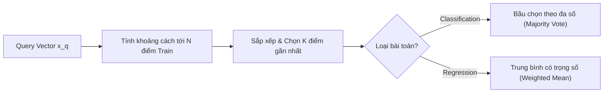

# K-Nearest Neighbors (KNN) & Các Độ Đo Khoảng Cách

> **Motto**: *"Nói cho tôi biết 5 người bạn thân nhất của bạn là ai, tôi sẽ nói cho bạn biết bạn là ai — nhưng đừng quên chuẩn hóa thước đo trước khi so sánh."*

---

## Thông tin nhanh (Quick Spec)

* **Loại bài (Type):** Thực chiến (Build) & Khái niệm (Concept)
* **Ngôn ngữ & Công cụ:** Python 3.12, NumPy
* **Kiến thức tiên quyết (Prerequisites):** Đại số tuyến tính cơ bản (Vector, Norm), bài 01-03 Phase 02
* **Thời gian thực hành:** ~45 phút

---

## Mục tiêu bài học (Learning Objectives)

Sau bài học này, bạn sẽ có khả năng:
- [ ] Giải thích được cơ chế *Lazy Learning* (Non-parametric) của KNN và đánh đổi về độ trễ khi inference.
- [ ] Phân biệt và chọn đúng độ đo khoảng cách: Euclidean ($L_2$), Manhattan ($L_1$), và Cosine Similarity.
- [ ] Tự tay xây dựng bộ phân loại & hồi quy KNN thuần **Python 3.12 + NumPy** sử dụng Vectorization (không dùng vòng lặp lồng nhau).
- [ ] Nhận diện và xử lý các cạm bẫy production: Feature Scaling, Curse of Dimensionality, và tìm kiếm xấp xỉ (ANN/FAISS).

---

## 1. Vấn đề thực tế (The Problem)

Giả sử bạn xây dựng hệ thống gợi ý phim hoặc phát hiện gian lận giao dịch. Dữ liệu của bạn có dạng phi tuyến tính phức tạp (các cụm người dùng đan xen nhau), nơi các mô hình tuyến tính như Logistic Regression bó tay.

Bạn nghĩ đến giải pháp trực giác nhất: **Khi có một điểm dữ liệu mới, hãy tìm $K$ điểm giống nó nhất trong lịch sử và lấy số đông (hoặc trung bình).**

Nhưng khi đưa vào thực tế, giải pháp ngây thơ (naive approach) sụp đổ ngay lập tức vì 3 lý do:
1. **Lệch đơn vị đo (Scale Mismatch):** Đặc trưng `tuổi` nằm trong khoảng $[18, 70]$, còn `thu_nhập` nằm trong $[5.000.000, 100.000.000]$. Khoảng cách Euclidean sẽ bị `thu_nhập` nuốt chửng hoàn toàn, biến `tuổi` thành vô nghĩa.
2. **Lời nguyền chiều cao (Curse of Dimensionality):** Khi số chiều $d$ tăng lên hàng trăm hoặc hàng nghìn (ví dụ embedding văn bản), tỷ lệ giữa khoảng cách gần nhất và xa nhất tiến dần về $1$. Mọi điểm đều "xa như nhau", KNN mất khả năng phân biệt.
3. **Thắt cổ chai lúc Inference:** Nếu tập train có 1 triệu mẫu, mỗi lần dự đoán 1 mẫu mới phải tính 1 triệu khoảng cách — độ phức tạp $O(N \cdot d)$, không thể đáp ứng SLA dưới 50ms trên production.

---

## 2. Mô hình tư duy & Bản chất (The Concept)

KNN thuộc nhóm **Instance-based (hay Lazy) Learning**: nó không học một hàm số $f(x; \theta)$ để nén tri thức vào trọng số $\theta$, mà **lưu trữ toàn bộ tập huấn luyện** trong bộ nhớ.



### Các độ đo khoảng cách cốt lõi

1. **Euclidean Distance ($L_2$ Norm):** Khoảng cách đường chim bay trong không gian Euclid. Nhạy cảm với ngoại lai (outliers) và sự chênh lệch scale.
$$d_{L_2}(x, y) = \sqrt{\sum_{i=1}^{d} (x_i - y_i)^2} = \|x - y\|_2$$

2. **Manhattan Distance ($L_1$ Norm):** Khoảng cách đi theo lưới ô vuông (như đi bộ trong thành phố). Bền vững hơn với outliers và thường tốt hơn $L_2$ ở không gian nhiều chiều.
$$d_{L_1}(x, y) = \sum_{i=1}^{d} |x_i - y_i| = \|x - y\|_1$$

3. **Cosine Distance:** Đo góc giữa hai vector, bỏ qua độ dài (magnitude). Đây là tiêu chuẩn vàng cho dữ liệu thưa (sparse) hoặc Text/Image Embeddings.
$$\text{Cosine Similarity}(x, y) = \frac{x \cdot y}{\|x\|_2 \|y\|_2}, \quad d_{\text{cos}}(x, y) = 1 - \text{Cosine Similarity}(x, y)$$

---

## 3. Tự tay xây dựng từ đầu (Build It: From Scratch)

Chúng ta sẽ xây dựng `KNNClassifier` thuần **Python 3.12 + NumPy**, sử dụng **Broadcasting** để tính ma trận khoảng cách giữa tập test và tập train trong một phép toán duy nhất, tránh vòng lặp Python chậm chạp.

### Bước 1: Định nghĩa các hàm khoảng cách Vectorized

```python
from __future__ import annotations
from collections import Counter
from typing import Literal
import numpy as np

MetricType = Literal["euclidean", "manhattan", "cosine"]


def compute_distances(
    X_train: np.ndarray, X_query: np.ndarray, metric: MetricType = "euclidean"
) -> np.ndarray:
    """
    Tính ma trận khoảng cách shape (n_query, n_train) bằng NumPy vectorization.
    """
    if metric == "euclidean":
        # Dùng khai triển: ||a - b||^2 = ||a||^2 + ||b||^2 - 2 a.b
        q_sq = np.sum(X_query ** 2, axis=1, keepdims=True)
        t_sq = np.sum(X_train ** 2, axis=1, keepdims=True).T
        sq_dists = np.maximum(q_sq + t_sq - 2.0 * (X_query @ X_train.T), 0.0)
        return np.sqrt(sq_dists)

    if metric == "manhattan":
        # Broadcasting: (n_query, 1, d) - (1, n_train, d)
        return np.sum(np.abs(X_query[:, None, :] - X_train[None, :, :]), axis=2)

    if metric == "cosine":
        q_norm = np.linalg.norm(X_query, axis=1, keepdims=True) + 1e-12
        t_norm = np.linalg.norm(X_train, axis=1, keepdims=True) + 1e-12
        similarity = (X_query / q_norm) @ (X_train / t_norm).T
        return 1.0 - np.clip(similarity, -1.0, 1.0)

    raise ValueError(f"Unsupported metric: {metric}")
```

### Bước 2: Xây dựng lớp `KNNClassifier`

```python
class KNNClassifier:
    def __init__(self, k: int = 5, metric: MetricType = "euclidean") -> None:
        if k <= 0:
            raise ValueError("k must be a positive integer.")
        self.k = k
        self.metric = metric
        self.X_train: np.ndarray | None = None
        self.y_train: np.ndarray | None = None

    def fit(self, X: np.ndarray, y: np.ndarray) -> KNNClassifier:
        self.X_train = np.asarray(X, dtype=np.float64)
        self.y_train = np.asarray(y)
        if self.X_train.ndim != 2:
            raise ValueError("X must be a 2D array of shape (n_samples, n_features).")
        if self.k > len(self.X_train):
            raise ValueError("k cannot exceed the number of training samples.")
        return self

    def predict(self, X: np.ndarray) -> np.ndarray:
        if self.X_train is None or self.y_train is None:
            raise RuntimeError("Model must be fitted before calling predict.")

        X_query = np.asarray(X, dtype=np.float64)
        dists = compute_distances(self.X_train, X_query, metric=self.metric)

        # np.argpartition nhanh hơn np.argsort (O(N) thay vì O(N log N))
        k_indices = np.argpartition(dists, kth=self.k - 1, axis=1)[:, : self.k]
        k_labels = self.y_train[k_indices]

        predictions = [Counter(row).most_common(1)[0][0] for row in k_labels]
        return np.array(predictions)
```

### Bước 3: Chạy thử nghiệm và kiểm chứng tác động của Feature Scaling

```python
if __name__ == "__main__":
    rng = np.random.default_rng(42)

    # Tạo dữ liệu giả lập có chênh lệch scale lớn
    X_c0 = np.column_stack([rng.normal(25, 3, 50), rng.normal(10_000_000, 1_000_000, 50)])
    X_c1 = np.column_stack([rng.normal(55, 3, 50), rng.normal(10_500_000, 1_000_000, 50)])
    X_train = np.vstack([X_c0, X_c1])
    y_train = np.array([0] * 50 + [1] * 50)

    X_test = np.array([[24, 10_400_000], [56, 10_100_000]])
    y_test = np.array([0, 1])

    # 1. Chưa chuẩn hóa
    knn_raw = KNNClassifier(k=5, metric="euclidean").fit(X_train, y_train)
    acc_raw = np.mean(knn_raw.predict(X_test) == y_test)

    # 2. Đã chuẩn hóa Z-score
    mean, std = X_train.mean(axis=0), X_train.std(axis=0) + 1e-8
    knn_scaled = KNNClassifier(k=5, metric="euclidean").fit((X_train - mean) / std, y_train)
    acc_scaled = np.mean(knn_scaled.predict((X_test - mean) / std) == y_test)

    print(f"Accuracy (Raw):    {acc_raw:.2f}")
    print(f"Accuracy (Scaled): {acc_scaled:.2f}")
```

---

## 4. Ứng dụng thực tế & So sánh Framework (Use It)

Trong môi trường Production, không ai dùng Brute-force KNN cho tập dữ liệu lớn:

* **`scikit-learn` (`KNeighborsClassifier`):** Tự động chọn giữa `kd_tree`, `ball_tree` (hiệu quả khi $d < 20$) và `brute` (khi dữ liệu thưa hoặc $d$ lớn).
* **Vector Databases (FAISS, Milvus, Qdrant, pgvector):** Khi làm việc với hàng triệu vector embedding (RAG, Image Search), người ta dùng **Approximate Nearest Neighbors (ANN)** như **HNSW** (Hierarchical Navigable Small World) hoặc **IVF-PQ** để đạt độ trễ vài millisecond với độ chính xác 98-99%.

---

## 5. Đóng gói & Tái sử dụng (Ship It)

**Checklist trước khi đưa KNN vào Production:**
- [ ] Đã áp dụng `StandardScaler` hoặc `MinMaxScaler` (fit trên tập train, transform trên tập test) chưa?
- [ ] Giá trị $K$ có phải số lẻ (cho bài toán nhị phân) để tránh hòa phiếu (tie) không?
- [ ] Nếu số chiều $d > 50$, đã thử giảm chiều (PCA) hoặc chuyển sang Cosine/Manhattan chưa?
- [ ] Nếu $N > 100.000$, đã cân nhắc chuyển sang FAISS/HNSW thay vì exact KNN chưa?

---

## 6. Giải ngố thuật ngữ (Key Terms & Misconceptions)

| Thuật ngữ (Term) | Người ta thường nghĩ là... | Bản chất kỹ thuật thực sự là... |
|---|---|---|
| **Lazy Learning** | Thuật toán chạy chậm và kém hiệu quả. | Không học tham số lúc train ($O(1)$), dồn toàn bộ tính toán sang lúc predict ($O(N \cdot d)$). |
| **K = 1** | Cho độ chính xác cao nhất vì khớp sát dữ liệu nhất. | Gây Overfitting nặng, ranh giới quyết định bị nhiễu (nhạy cảm với từng điểm outlier). |
| **Cosine Similarity** | Một loại khoảng cách chuẩn như Euclidean. | Là độ đo góc (tương đồng), không thỏa mãn bất đẳng thức tam giác; phải lấy `1 - sim` để làm khoảng cách. |

---

## 7. Bài tập thử thách (Hands-on Challenges)

1. 🟢 **Cơ bản (Easy):** Sửa `KNNClassifier` thành `KNNRegressor` trả về giá trị trung bình của $K$ láng giềng gần nhất.
2. 🟡 **Trung bình (Medium):** Thêm tùy chọn `weights="distance"` (lấy trọng số nghịch đảo khoảng cách $w_i = \frac{1}{d_i + \epsilon}$) để các điểm gần hơn có tiếng nói lớn hơn trong việc bầu chọn.
3. 🔴 **Nâng cao (Hard):** Viết hàm `cross_validate_k(X, y, k_list)` bằng NumPy để tự động tìm $K$ tối ưu theo 5-fold cross-validation mà không dùng `scikit-learn`.

---

## 8. Tài liệu đọc thêm (Further Reading)

- [Scikit-learn Nearest Neighbors Documentation](https://scikit-learn.org/stable/modules/neighbors.html) — *Phân tích chi tiết KD-Tree và Ball-Tree.*
- [FAISS: A Library for Efficient Similarity Search](https://github.com/facebookresearch/faiss) — *Cách Meta giải quyết bài toán KNN ở quy mô tỷ vector.*
