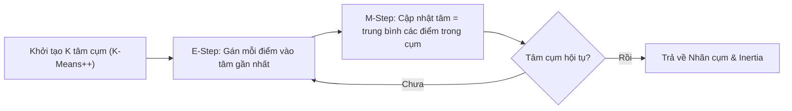

# Unsupervised Learning: K-Means Clustering & PCA

> **Motto**: *"Khi không có nhãn (label) để bám víu, dữ liệu tự lên tiếng thông qua khoảng cách và phương sai."*

---

## Thông tin nhanh (Quick Spec)

* **Loại bài (Type):** Thực chiến (Build) & Khái niệm (Concept)
* **Ngôn ngữ & Công cụ:** Python 3.12, NumPy
* **Kiến thức tiên quyết (Prerequisites):** Đại số tuyến tính (Eigenvalues/SVD), KNN & Distances (Bài 06)
* **Thời gian thực hành:** ~50 phút

---

## Mục tiêu bài học (Learning Objectives)

Sau bài học này, bạn sẽ có khả năng:
- [ ] Phân biệt hai nhánh lớn của Unsupervised Learning: **Clustering (Phân cụm)** và **Dimensionality Reduction (Giảm chiều)**.
- [ ] Tự tay xây dựng **K-Means** với khởi tạo thông minh **K-Means++** bằng Python 3.12 + NumPy.
- [ ] Tự tay xây dựng **PCA** sử dụng `np.linalg.svd` để nén dữ liệu và tính tỷ lệ phương sai giữ lại (Explained Variance Ratio).
- [ ] Chọn đúng số cụm $K$ (Elbow Method / Silhouette) và số chiều $k$ trong thực tế.

---

## 1. Vấn đề thực tế (The Problem)

Trong thực tế doanh nghiệp, **90% dữ liệu không có nhãn**. Bạn có 5 triệu log hành vi người dùng (số lần click, thời gian ở lại trang, giá trị giỏ hàng...) nhưng không có cột `is_vip` hay `churn`.

Bạn đối mặt với 2 bài toán kinh điển:
1. **Phân khúc khách hàng (Segmentation):** Làm sao tự động chia 5 triệu người dùng thành các nhóm có hành vi tương đồng để đội Marketing chạy chiến dịch riêng?
2. **Nén dữ liệu & Khử nhiễu (Compression):** Dữ liệu có 500 cột đặc trưng (features), nhiều cột tương quan chặt chẽ với nhau gây chậm mô hình và overfitting. Làm sao nén xuống 20 cột mà vẫn giữ lại 95% thông tin?

---

## 2. Mô hình tư duy & Bản chất (The Concept)

### A. K-Means Clustering (Phân cụm)

K-Means hoạt động theo chu trình lặp 2 bước (một dạng của thuật toán **Expectation-Maximization**):



Hàm mục tiêu của K-Means là tối thiểu hóa **Inertia** (Within-Cluster Sum of Squares - WCSS):
$$J = \sum_{j=1}^{K} \sum_{x_i \in C_j} \|x_i - \mu_j\|_2^2$$

### B. Principal Component Analysis - PCA (Giảm chiều)

PCA tìm một hệ trục tọa độ mới trực giao sao cho trục đầu tiên (PC1) hướng theo chiều có **phương sai (variance) lớn nhất** của dữ liệu. Bằng cách giữ lại $k$ trục đầu tiên, ta nén dữ liệu từ $\mathbb{R}^d \rightarrow \mathbb{R}^k$ với sai số tái tạo nhỏ nhất.

---

## 3. Tự tay xây dựng từ đầu (Build It: From Scratch)

### Bước 1: Xây dựng `KMeans` với khởi tạo `K-Means++`

Khởi tạo ngẫu nhiên thuần túy dễ khiến các tâm cụm rơi vào cùng một vùng. **K-Means++** chọn tâm tiếp theo với xác suất tỷ lệ thuận với bình phương khoảng cách tới tâm gần nhất đã chọn ($D(x)^2$).

```python
from __future__ import annotations
import numpy as np


class KMeans:
    def __init__(self, n_clusters: int = 3, max_iter: int = 300, tol: float = 1e-4, seed: int = 42) -> None:
        self.n_clusters = n_clusters
        self.max_iter = max_iter
        self.tol = tol
        self.rng = np.random.default_rng(seed)
        self.centroids: np.ndarray | None = None
        self.inertia_: float = 0.0

    def _init_centroids_plus_plus(self, X: np.ndarray) -> np.ndarray:
        n_samples = X.shape[0]
        centroids = [X[self.rng.integers(n_samples)]]

        for _ in range(1, self.n_clusters):
            # Tính khoảng cách bình phương nhỏ nhất từ mỗi điểm tới các tâm đã chọn
            dists_sq = np.min(
                np.sum((X[:, None, :] - np.array(centroids)[None, :, :]) ** 2, axis=2),
                axis=1,
            )
            total_dist = float(np.sum(dists_sq))
            if total_dist == 0.0:
                next_idx = int(self.rng.integers(n_samples))
            else:
                probs = dists_sq / total_dist
                next_idx = int(self.rng.choice(n_samples, p=probs))
            centroids.append(X[next_idx])

        return np.array(centroids)

    def fit(self, X: np.ndarray) -> KMeans:
        X = np.asarray(X, dtype=np.float64)
        if self.n_clusters <= 0 or self.n_clusters > len(X):
            raise ValueError("n_clusters must be in [1, n_samples].")
        self.centroids = self._init_centroids_plus_plus(X)

        for _ in range(self.max_iter):
            # E-Step: Gán cụm
            dists = np.sum((X[:, None, :] - self.centroids[None, :, :]) ** 2, axis=2)
            labels = np.argmin(dists, axis=1)

            # M-Step: Cập nhật tâm cụm
            new_centroids = np.array([
                X[labels == k].mean(axis=0) if np.any(labels == k) else self.centroids[k]
                for k in range(self.n_clusters)
            ])

            shift = np.linalg.norm(new_centroids - self.centroids)
            self.centroids = new_centroids
            if shift < self.tol:
                break

        final_dists = np.sum((X[:, None, :] - self.centroids[None, :, :]) ** 2, axis=2)
        self.inertia_ = float(np.sum(np.min(final_dists, axis=1)))
        return self

    def predict(self, X: np.ndarray) -> np.ndarray:
        if self.centroids is None:
            raise RuntimeError("Model must be fitted before predict.")
        X = np.asarray(X, dtype=np.float64)
        dists = np.sum((X[:, None, :] - self.centroids[None, :, :]) ** 2, axis=2)
        return np.argmin(dists, axis=1)
```

### Bước 2: Xây dựng `PCA` bằng SVD

Dùng **SVD (Singular Value Decomposition)** ổn định số học hơn so với việc tự tính ma trận hiệp phương sai $X^T X$ và `eig`.

```python
class PCA:
    def __init__(self, n_components: int) -> None:
        self.n_components = n_components
        self.mean_: np.ndarray | None = None
        self.components_: np.ndarray | None = None
        self.explained_variance_ratio_: np.ndarray | None = None

    def fit(self, X: np.ndarray) -> PCA:
        X = np.asarray(X, dtype=np.float64)
        if X.shape[0] < 2:
            raise ValueError("PCA requires at least 2 samples.")
        if self.n_components <= 0 or self.n_components > min(X.shape):
            raise ValueError("n_components must be in [1, min(n_samples, n_features)].")
        self.mean_ = X.mean(axis=0)
        X_centered = X - self.mean_

        # SVD: X_centered = U * S * V^T
        _, S, Vt = np.linalg.svd(X_centered, full_matrices=False)

        self.components_ = Vt[: self.n_components]
        explained_variance = (S ** 2) / (X.shape[0] - 1)
        total_var = float(np.sum(explained_variance))
        if total_var > 0.0:
            self.explained_variance_ratio_ = explained_variance[: self.n_components] / total_var
        else:
            self.explained_variance_ratio_ = np.zeros(self.n_components, dtype=np.float64)
        return self

    def transform(self, X: np.ndarray) -> np.ndarray:
        if self.mean_ is None or self.components_ is None:
            raise RuntimeError("PCA must be fitted before transform.")
        X_centered = np.asarray(X, dtype=np.float64) - self.mean_
        return X_centered @ self.components_.T
```

### Bước 3: Chạy thử nghiệm

```python
if __name__ == "__main__":
    rng = np.random.default_rng(7)
    X_blobs = np.vstack([
        rng.normal([0, 0], 0.5, (40, 2)),
        rng.normal([5, 5], 0.5, (40, 2)),
        rng.normal([0, 5], 0.5, (40, 2)),
    ])

    km = KMeans(n_clusters=3).fit(X_blobs)
    print("KMeans Inertia:", round(km.inertia_, 2))

    # Thử PCA nén 5 chiều -> 2 chiều
    X_high = rng.normal(0, 1, (100, 5))
    X_high[:, 1] = X_high[:, 0] * 2.5 + rng.normal(0, 0.1, 100)  # Tạo tương quan mạnh
    pca = PCA(n_components=2).fit(X_high)
    X_reduced = pca.transform(X_high)
    print("PCA shape:", X_reduced.shape)
    print("Explained variance ratio:", np.round(pca.explained_variance_ratio_, 3))
```

---

## 4. Ứng dụng thực tế & So sánh Framework (Use It)

* **K-Means trong Production (`scikit-learn` / `MiniBatchKMeans`):** Khi dữ liệu có hàng triệu dòng, `MiniBatchKMeans` cập nhật tâm cụm theo từng batch nhỏ (giống SGD), giảm thời gian chạy từ hàng giờ xuống vài giây.
* **Hạn chế của K-Means:** Giả định các cụm có hình cầu (spherical) và kích thước tương đương. Nếu dữ liệu có hình dạng phức tạp (hình lưỡi liềm, mật độ khác nhau), hãy dùng **DBSCAN** hoặc **HDBSCAN**.
* **PCA vs t-SNE / UMAP:** PCA là phép biến đổi tuyến tính, giữ cấu trúc toàn cục và chạy cực nhanh (dùng để nén feature trước khi train). t-SNE và UMAP là phi tuyến, chỉ nên dùng để **trực quan hóa (visualization)** ở 2D/3D.

---

## 5. Đóng gói & Tái sử dụng (Ship It)

**Checklist triển khai K-Means & PCA:**
- [ ] Luôn chuẩn hóa dữ liệu (`StandardScaler`) trước khi chạy K-Means và PCA.
- [ ] Với PCA: chọn `n_components` sao cho tổng `explained_variance_ratio_` đạt $\ge 90\% - 95\%$.
- [ ] Với K-Means: vẽ đồ thị **Elbow Method** (Inertia theo $K$) hoặc tính **Silhouette Score** để chọn $K$ hợp lý.

---

## 6. Giải ngố thuật ngữ (Key Terms & Misconceptions)

| Thuật ngữ (Term) | Người ta thường nghĩ là... | Bản chất kỹ thuật thực sự là... |
|---|---|---|
| **Inertia** | Độ chính xác của phân cụm. | Tổng bình phương khoảng cách tới tâm; luôn giảm khi $K$ tăng (bằng 0 khi $K = N$). |
| **PCA** | Chọn ra $k$ cột quan trọng nhất từ dữ liệu gốc. | Tạo ra $k$ **cột mới** là tổ hợp tuyến tính của tất cả các cột gốc (mất khả năng giải thích trực tiếp). |
| **Unsupervised** | Không cần con người can thiệp gì cả. | Vẫn cần con người chọn $K$, chọn độ đo, và gán ý nghĩa nghiệp vụ cho từng cụm sau khi chạy. |

---

## 7. Bài tập thử thách (Hands-on Challenges)

1. 🟢 **Cơ bản (Easy):** Chạy `KMeans` với $K \in [1, 6]$ trên `X_blobs` và in ra `inertia_` để quan sát "điểm khuỷu tay" (Elbow) tại $K=3$.
2. 🟡 **Trung bình (Medium):** Thêm phương thức `inverse_transform(X_reduced)` vào lớp `PCA` để khôi phục dữ liệu về không gian gốc và tính Reconstruction Error (MSE).
3. 🔴 **Nâng cao (Hard):** Tự viết hàm tính **Silhouette Score** thuần NumPy để đánh giá chất lượng phân cụm mà không cần nhãn thật.

---

## 8. Tài liệu đọc thêm (Further Reading)

- [Scikit-learn Clustering Guide](https://scikit-learn.org/stable/modules/clustering.html) — *Bảng so sánh trực quan K-Means, DBSCAN, GMM trên nhiều dạng dữ liệu.*
- [A Tutorial on Principal Component Analysis (Jonathon Shlens)](https://arxiv.org/abs/1404.1100) — *Tài liệu kinh điển giải thích PCA qua lăng kính SVD.*
