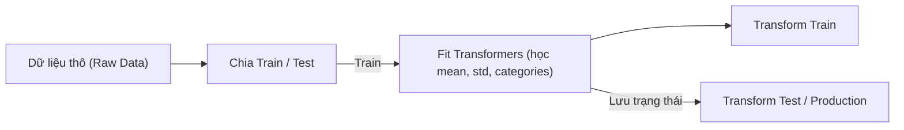

# Feature Engineering: Nghệ Thuật Biến Dữ Liệu Thô Thành Tín Hiệu

> **Motto**: *"Rác đầu vào thì rác đầu ra (Garbage In, Garbage Out). Một mô hình đơn giản trên tập feature tốt luôn thắng một mô hình phức tạp trên tập feature tệ."*

---

## Thông tin nhanh (Quick Spec)

* **Loại bài (Type):** Thực chiến (Build) & Tư duy hệ thống
* **Ngôn ngữ & Công cụ:** Python 3.12, NumPy
* **Kiến thức tiên quyết (Prerequisites):** Python cơ bản, NumPy, bài 01-07 Phase 02
* **Thời gian thực hành:** ~45 phút

---

## Mục tiêu bài học (Learning Objectives)

Sau bài học này, bạn sẽ có khả năng:
- [ ] Áp dụng đúng kỹ thuật **Feature Scaling** (StandardScaler, MinMaxScaler, Log Transform) cho từng loại phân phối dữ liệu.
- [ ] Xử lý **Missing Values** (Imputation + Missing Indicator) và **Categorical Variables** (One-Hot Encoding).
- [ ] Mã hóa **Cyclical Features** (giờ trong ngày, ngày trong tuần) bằng hàm lượng giác $\sin / \cos$.
- [ ] Xây dựng các Transformer theo chuẩn `fit` / `transform` thuần **Python 3.12 + NumPy** để chống **Data Leakage** tuyệt đối.

---

## 1. Vấn đề thực tế (The Problem)

Bạn nhận được một bảng dữ liệu giao dịch thương mại điện tử gồm: `tuổi` (có giá trị `NaN`), `thu_nhập` (lệch phải cực mạnh, từ 5 triệu đến 5 tỷ), `thành_phố` (`"HN"`, `"HCM"`, `"DN"`), và `giờ_mua_hàng` (`0` đến `23`).

Nếu ném thẳng vào mô hình:
1. Giá trị `NaN` làm sập toàn bộ phép tính ma trận.
2. `thu_nhập` bị lệch (skewed) khiến Gradient Descent dao động dữ dội.
3. Nếu mã hóa `giờ_mua_hàng` thành số nguyên `0..23`, mô hình sẽ hiểu `23:00` và `00:00` cách nhau xa nhất (23 đơn vị), dù thực tế chúng chỉ cách nhau 1 giờ!
4. **Cạm bẫy chí mạng:** Bạn tính `mean` và `std` trên toàn bộ dataset trước khi chia Train/Test — vô tình làm rò rỉ thông tin tương lai (Data Leakage) vào tập Train.

---

## 2. Mô hình tư duy & Bản chất (The Concept)

Quy trình Feature Engineering chuẩn Production luôn tách biệt pha `fit` (học tham số từ Train) và `transform` (áp dụng lên Train/Val/Test):



### Mã hóa biến chu kỳ (Cyclical Encoding)
Để `23h` và `00h` nằm sát nhau trên một vòng tròn đơn vị (chu kỳ $T = 24$):
$$x_{\sin} = \sin\left(\frac{2\pi \cdot t}{T}\right), \quad x_{\cos} = \cos\left(\frac{2\pi \cdot t}{T}\right)$$

---

## 3. Tự tay xây dựng từ đầu (Build It: From Scratch)

Chúng ta sẽ xây dựng các Transformer chuẩn `fit()` / `transform()` thuần **Python 3.12 + NumPy**.

### Bước 1: `StandardScaler` và `MedianImputer` (chống Outliers & NaN)

```python
from __future__ import annotations
import numpy as np


class StandardScaler:
    def __init__(self) -> None:
        self.mean_: np.ndarray | None = None
        self.std_: np.ndarray | None = None

    def fit(self, X: np.ndarray) -> StandardScaler:
        X = np.asarray(X, dtype=np.float64)
        self.mean_ = np.nanmean(X, axis=0)
        std = np.nanstd(X, axis=0)
        self.std_ = np.where(std == 0.0, 1.0, std)  # Tránh chia cho 0 trên cột hằng số
        return self

    def transform(self, X: np.ndarray) -> np.ndarray:
        if self.mean_ is None or self.std_ is None:
            raise RuntimeError("Scaler must be fitted before transform.")
        return (np.asarray(X, dtype=np.float64) - self.mean_) / self.std_


class MedianImputer:
    """Điền giá trị thiếu bằng Median và thêm cột cờ báo hiệu (Missing Indicator)."""

    def __init__(self, add_indicator: bool = True) -> None:
        self.add_indicator = add_indicator
        self.medians_: np.ndarray | None = None

    def fit(self, X: np.ndarray) -> MedianImputer:
        X = np.asarray(X, dtype=np.float64)
        medians = np.nanmedian(X, axis=0)
        self.medians_ = np.where(np.isnan(medians), 0.0, medians)
        return self

    def transform(self, X: np.ndarray) -> np.ndarray:
        if self.medians_ is None:
            raise RuntimeError("Imputer must be fitted before transform.")
        X_out = np.asarray(X, dtype=np.float64).copy()
        nan_mask = np.isnan(X_out)

        for col in range(X_out.shape[1]):
            X_out[nan_mask[:, col], col] = self.medians_[col]

        if self.add_indicator:
            return np.hstack([X_out, nan_mask.astype(np.float64)])
        return X_out
```

### Bước 2: `OneHotEncoder` và `CyclicalEncoder`

```python
class OneHotEncoder:
    def __init__(self) -> None:
        self.categories_: list[str] = []
        self.cat_to_idx_: dict[str, int] = {}

    def fit(self, col: np.ndarray) -> OneHotEncoder:
        self.categories_ = sorted(set(str(v) for v in col))
        self.cat_to_idx_ = {cat: i for i, cat in enumerate(self.categories_)}
        return self

    def transform(self, col: np.ndarray) -> np.ndarray:
        if not self.categories_:
            raise RuntimeError("OneHotEncoder must be fitted before transform.")
        encoded = np.zeros((len(col), len(self.categories_)), dtype=np.float64)
        for row_idx, val in enumerate(col):
            idx = self.cat_to_idx_.get(str(val))
            if idx is not None:
                encoded[row_idx, idx] = 1.0  # Unknown category -> all zeros
        return encoded


def encode_cyclical(values: np.ndarray, period: float) -> np.ndarray:
    """Biến đổi đặc trưng tuần hoàn (giờ, tháng) thành 2 cột (sin, cos)."""
    if period <= 0:
        raise ValueError("period must be a positive number.")
    angles = 2.0 * np.pi * np.asarray(values, dtype=np.float64) / period
    return np.column_stack([np.sin(angles), np.cos(angles)])
```

### Bước 3: Chạy thử nghiệm Pipeline nhỏ

```python
if __name__ == "__main__":
    # Dữ liệu Train: [tuổi, thu_nhập]
    X_train = np.array([[25.0, 15.0], [np.nan, 120.0], [40.0, 45.0]])
    X_test = np.array([[np.nan, 30.0]])

    imputer = MedianImputer(add_indicator=True).fit(X_train)
    scaler = StandardScaler().fit(imputer.transform(X_train))

    X_train_clean = scaler.transform(imputer.transform(X_train))
    X_test_clean = scaler.transform(imputer.transform(X_test))

    print("X_train_clean shape:", X_train_clean.shape)
    print("X_test_clean:\n", np.round(X_test_clean, 3))

    # Kiểm tra Cyclical Encoding cho 23h và 0h
    hours = np.array([23, 0, 12])
    print("Cyclical hours (sin, cos):\n", np.round(encode_cyclical(hours, period=24.0), 3))

    # Kiểm tra OneHotEncoder với unseen category
    ohe = OneHotEncoder().fit(np.array(["HN", "HCM", "DN"]))
    print("One-Hot (HN, CT):\n", ohe.transform(np.array(["HN", "CT"])))
```

---

## 4. Ứng dụng thực tế & So sánh Framework (Use It)

* **Tree-based Models (XGBoost, LightGBM, Random Forest) vs Linear/Neural Models:**
  - Mô hình cây **không nhạy cảm** với Feature Scaling (không cần `StandardScaler`), nhưng rất nhạy với các đặc trưng tương tác (ratios, differences).
  - Mô hình tuyến tính, SVM, KNN, Neural Networks **bắt buộc** phải Scale dữ liệu.
* **High-Cardinality Categoricals:** Nếu cột `user_id` hoặc `zip_code` có 10.000 giá trị khác nhau, One-Hot Encoding sẽ làm nổ số chiều. Trong thực tế, hãy dùng **Target Encoding** (có smoothing) hoặc **Entity Embeddings**.

---

## 5. Đóng gói & Tái sử dụng (Ship It)

**Checklist Feature Engineering không lỗi:**
- [ ] Đã chia Train/Val/Test *trước* khi thực hiện bất kỳ phép tính thống kê nào chưa?
- [ ] Có cột nào bị lệch phân phối mạnh (skewed) cần dùng `np.log1p(x)` không?
- [ ] Đã xử lý trường hợp xuất hiện category lạ (Unseen Category) ở tập Test/Production chưa?
- [ ] Các biến thời gian (giờ, thứ, tháng) đã được mã hóa `sin/cos` chưa?

---

## 6. Giải ngố thuật ngữ (Key Terms & Misconceptions)

| Thuật ngữ (Term) | Người ta thường nghĩ là... | Bản chất kỹ thuật thực sự là... |
|---|---|---|
| **Normalization vs Standardization** | Hai từ đồng nghĩa, dùng cái nào cũng được. | Normalization đưa về $[0, 1]$ (nhạy với outlier); Standardization đưa về $\mu=0, \sigma=1$. |
| **Missing Data** | Cứ xóa bỏ dòng có `NaN` hoặc điền `0`. | Việc dữ liệu bị thiếu thường tự nó mang thông tin (ví dụ: người không khai thu nhập). Nên giữ `Missing Indicator`. |
| **Data Leakage** | Chỉ xảy ra khi để lộ nhãn `y_test` vào tập train. | Xảy ra ngay cả khi bạn dùng `X_test` để tính `mean`/`std` lúc scale dữ liệu. |

---

## 7. Bài tập thử thách (Hands-on Challenges)

1. 🟢 **Cơ bản (Easy):** Viết lớp `MinMaxScaler` đưa dữ liệu về đoạn $[0, 1]$ thuần NumPy theo chuẩn `fit`/`transform`.
2. 🟡 **Trung bình (Medium):** Viết hàm `log_transform_skewed(X, threshold=1.0)` tự động tính độ lệch (skewness) của từng cột và áp dụng `np.log1p` cho các cột vượt ngưỡng.
3. 🔴 **Nâng cao (Hard):** Tự xây dựng `TargetEncoder` (mã hóa biến phân loại bằng trung bình của nhãn `y` kèm hệ số làm mượt $m$-estimate smoothing) và dùng K-Fold để tránh overfitting trên tập Train.

---

## 8. Tài liệu đọc thêm (Further Reading)

- [Feature Engineering for Machine Learning (Alice Zheng)](https://www.oreilly.com/library/view/feature-engineering-for/9781491953235/) — *Cuốn sách gối đầu giường về kỹ thuật xử lý đặc trưng.*
- [Scikit-learn Preprocessing Guide](https://scikit-learn.org/stable/modules/preprocessing.html) — *Tham khảo các bộ Transformer chuẩn công nghiệp.*
