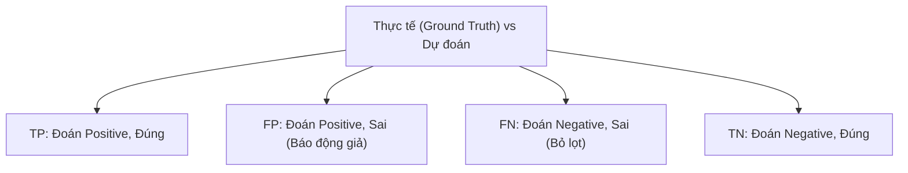

# Model Evaluation: Đánh Giá Mô Hình Đúng Cách (Ngoài Accuracy)

> **Motto**: *"Đo lường sai thước đo thì tối ưu hóa càng giỏi càng đi sai hướng. Accuracy là cái bẫy ngọt ngào nhất trong Machine Learning."*

---

## Thông tin nhanh (Quick Spec)

* **Loại bài (Type):** Thực chiến (Build) & Khái niệm (Concept)
* **Ngôn ngữ & Công cụ:** Python 3.12, NumPy
* **Kiến thức tiên quyết (Prerequisites):** Logistic Regression (Bài 03), xác suất cơ bản
* **Thời gian thực hành:** ~50 phút

---

## Mục tiêu bài học (Learning Objectives)

Sau bài học này, bạn sẽ có khả năng:
- [ ] Giải thích vì sao Accuracy thất bại thảm hại trên dữ liệu mất cân bằng (Fraud Detection, Medical Diagnosis).
- [ ] Tự tay xây dựng **Confusion Matrix**, **Precision**, **Recall**, **F1-Score**, và **ROC-AUC** thuần **Python 3.12 + NumPy**.
- [ ] Tự tay xây dựng **Stratified K-Fold Cross-Validation** để đánh giá mô hình không bị thiên lệch.
- [ ] Chọn đúng thước đo (Metric) khớp với bài toán kinh doanh thực tế.

---

## 1. Vấn đề thực tế (The Problem)

Bạn xây dựng mô hình phát hiện giao dịch gian lận ngân hàng. Trong 100.000 giao dịch, chỉ có **100 giao dịch gian lận (0.1%)**.

Một lập trình viên viết mô hình "ngây thơ": `def predict(x): return 0` (luôn đoán không gian lận). Mô hình này đạt **Accuracy = 99.9%**! Nhưng trên thực tế, nó bỏ lọt **100% kẻ gian**, gây thiệt hại hàng tỷ đồng.

Ngược lại, nếu bạn đặt ngưỡng báo động quá thấp để bắt hết kẻ gian, hệ thống sẽ khóa nhầm thẻ của hàng nghìn khách hàng bình thường (False Positive cao), khiến bộ phận CSKH quá tải. Bạn cần những thước đo phản ánh đúng sự đánh đổi này.

---

## 2. Mô hình tư duy & Bản chất (The Concept)

Mọi thước đo phân loại nhị phân đều xuất phát từ **Confusion Matrix** (Ma trận nhầm lẫn):



### Các công thức cốt lõi

1. **Precision (Độ chuẩn xác):** Trong những ca mô hình báo động là Positive, có bao nhiêu % là đúng thật? (Quan trọng khi *Báo động giả* rất đắt đỏ, ví dụ: lọc Spam, khóa tài khoản).
$$\text{Precision} = \frac{TP}{TP + FP}$$

2. **Recall (Độ phủ / Sensitivity):** Trong tất cả các ca Positive thực tế, mô hình bắt được bao nhiêu %? (Quan trọng khi *Bỏ lọt* gây hậu quả nghiêm trọng, ví dụ: chẩn đoán ung thư, phát hiện gian lận).
$$\text{Recall} = \frac{TP}{TP + FN}$$

3. **F1-Score:** Trung bình điều hòa (Harmonic Mean) của Precision và Recall.
$$F_1 = 2 \cdot \frac{\text{Precision} \cdot \text{Recall}}{\text{Precision} + \text{Recall}}$$

4. **ROC-AUC:** Diện tích dưới đường cong ROC (vẽ TPR = Recall theo FPR = $\frac{FP}{FP + TN}$ khi thay đổi ngưỡng từ $1 \rightarrow 0$). Ý nghĩa xác suất: *Xác suất mô hình chấm điểm một mẫu Positive cao hơn một mẫu Negative ngẫu nhiên.*

---

## 3. Tự tay xây dựng từ đầu (Build It: From Scratch)

### Bước 1: Confusion Matrix, Precision, Recall, F1

```python
from __future__ import annotations
import numpy as np


def classification_metrics(y_true: np.ndarray, y_pred: np.ndarray) -> dict[str, float | int]:
    y_true = np.asarray(y_true, dtype=int)
    y_pred = np.asarray(y_pred, dtype=int)

    tp = int(np.sum((y_true == 1) & (y_pred == 1)))
    fp = int(np.sum((y_true == 0) & (y_pred == 1)))
    fn = int(np.sum((y_true == 1) & (y_pred == 0)))
    tn = int(np.sum((y_true == 0) & (y_pred == 0)))

    accuracy = (tp + tn) / max(len(y_true), 1)
    precision = tp / (tp + fp) if (tp + fp) > 0 else 0.0
    recall = tp / (tp + fn) if (tp + fn) > 0 else 0.0
    f1 = (2 * precision * recall / (precision + recall)) if (precision + recall) > 0 else 0.0

    return {
        "accuracy": accuracy,
        "precision": precision,
        "recall": recall,
        "f1": f1,
        "tp": tp, "fp": fp, "fn": fn, "tn": tn,
    }
```

### Bước 2: Tính ROC-AUC bằng quy tắc hình thang (Trapezoidal Rule)

```python
def roc_auc_score(y_true: np.ndarray, y_scores: np.ndarray) -> float:
    """Tính ROC-AUC bằng cách sắp xếp điểm xác suất giảm dần, gộp ngưỡng trùng và tích phân hình thang."""
    y_true = np.asarray(y_true, dtype=int)
    y_scores = np.asarray(y_scores, dtype=np.float64)

    desc_idx = np.argsort(-y_scores, kind="mergesort")
    y_sorted = y_true[desc_idx]
    scores_sorted = y_scores[desc_idx]

    n_pos = np.sum(y_true == 1)
    n_neg = np.sum(y_true == 0)
    if n_pos == 0 or n_neg == 0:
        raise ValueError("ROC-AUC requires both positive and negative samples.")

    # Chỉ giữ điểm cuối của mỗi nhóm score bằng nhau để xử lý chính xác trường hợp hòa điểm (ties)
    distinct_idx = np.r_[np.where(np.diff(scores_sorted))[0], len(y_sorted) - 1]
    tps = np.cumsum(y_sorted == 1)[distinct_idx]
    fps = np.cumsum(y_sorted == 0)[distinct_idx]

    tpr = np.concatenate([[0.0], tps / n_pos])
    fpr = np.concatenate([[0.0], fps / n_neg])

    # Tương thích cả NumPy 2.0+ (np.trapezoid) và NumPy 1.x (np.trapz)
    trapz_fn = getattr(np, "trapezoid", None) or getattr(np, "trapz")
    return float(trapz_fn(tpr, fpr))
```

### Bước 3: Stratified K-Fold Cross-Validation

```python
def stratified_kfold_indices(
    y: np.ndarray, n_splits: int = 5, seed: int = 42
) -> list[tuple[np.ndarray, np.ndarray]]:
    """Chia index thành K fold sao cho mỗi fold giữ nguyên tỷ lệ nhãn của tập gốc."""
    if n_splits < 2:
        raise ValueError("n_splits must be at least 2.")
    rng = np.random.default_rng(seed)
    y = np.asarray(y)
    folds: list[list[int]] = [[] for _ in range(n_splits)]

    for cls in np.unique(y):
        cls_indices = np.where(y == cls)[0]
        rng.shuffle(cls_indices)
        for i, idx in enumerate(cls_indices):
            folds[i % n_splits].append(int(idx))

    splits = []
    all_indices = np.arange(len(y))
    for val_list in folds:
        val_idx = np.array(val_list, dtype=int)
        train_idx = np.setdiff1d(all_indices, val_idx)
        splits.append((train_idx, val_idx))
    return splits


if __name__ == "__main__":
    y_true = np.array([0, 0, 0, 0, 0, 0, 0, 1, 1, 1])
    y_scores = np.array([0.1, 0.2, 0.15, 0.4, 0.3, 0.6, 0.25, 0.7, 0.85, 0.55])
    y_pred = (y_scores >= 0.5).astype(int)

    print("Metrics:", classification_metrics(y_true, y_pred))
    print("ROC-AUC:", round(roc_auc_score(y_true, y_scores), 4))
    splits = stratified_kfold_indices(y_true, n_splits=3)
    print("Fold 0 val labels:", y_true[splits[0][1]])
```

---

## 4. Ứng dụng thực tế & So sánh Framework (Use It)

* **Regression Metrics:** Với bài toán hồi quy, dùng **RMSE** (phạt nặng sai số lớn), **MAE** (bền vững với outliers), hoặc **MAPE** (dễ giải thích cho sếp theo %).
* **Imbalanced Data Extreme (<1% Positive):** **ROC-AUC** có thể vẫn cao giả tạo vì $TN$ quá lớn làm $FPR$ nhỏ. Lúc này hãy dùng **PR-AUC (Precision-Recall AUC)**.
* **Time-Series Data:** Tuyệt đối **KHÔNG** dùng K-Fold ngẫu nhiên vì sẽ làm rò rỉ dữ liệu tương lai vào quá khứ. Phải dùng **TimeSeriesSplit** (Expanding Window hoặc Sliding Window).

---

## 5. Đóng gói & Tái sử dụng (Ship It)

**Checklist chọn Metric chuẩn:**
- [ ] Bài toán cân bằng (50/50) -> Accuracy hoặc ROC-AUC.
- [ ] Bài toán mất cân bằng, sợ *bỏ lọt* (Ung thư, Fraud) -> Recall + PR-AUC.
- [ ] Bài toán mất cân bằng, sợ *báo động giả* (Spam, Gợi ý) -> Precision + F1.
- [ ] Đã tách riêng một tập **Hold-out Test Set** không bao giờ chạm vào trong lúc tune hyperparameter chưa?

---

## 6. Giải ngố thuật ngữ (Key Terms & Misconceptions)

| Thuật ngữ (Term) | Người ta thường nghĩ là... | Bản chất kỹ thuật thực sự là... |
|---|---|---|
| **Threshold 0.5** | Ngưỡng mặc định luôn tốt nhất cho mọi mô hình. | Chỉ hợp lý khi 2 lớp cân bằng và chi phí sai lầm ngang nhau; thực tế phải tune threshold theo bài toán. |
| **Cross-Validation** | Dùng để huấn luyện mô hình tốt hơn. | Dùng để **ước lượng hiệu năng** của mô hình ổn định hơn; sau khi chọn xong, ta train lại trên toàn bộ tập Train. |
| **F1-Score** | Trung bình cộng của Precision và Recall. | Trung bình **điều hòa** (Harmonic Mean): chỉ cao khi *cả hai* cùng cao. |

---

## 7. Bài tập thử thách (Hands-on Challenges)

1. 🟢 **Cơ bản (Easy):** Viết hàm tính **MAE**, **MSE**, và **RMSE** thuần NumPy cho bài toán Regression.
2. 🟡 **Trung bình (Medium):** Viết hàm `find_best_threshold(y_true, y_scores)` quét các ngưỡng từ `0.05` đến `0.95` để tìm ngưỡng cho **F1-Score** cao nhất.
3. 🔴 **Nâng cao (Hard):** Viết hàm tính **PR-AUC (Precision-Recall AUC)** thuần NumPy và so sánh nó với ROC-AUC trên một tập dữ liệu có 1% nhãn Positive.

---

## 8. Tài liệu đọc thêm (Further Reading)

- [Scikit-learn Metrics and Scoring](https://scikit-learn.org/stable/modules/model_evaluation.html) — *Danh mục đầy đủ các thước đo cho Classification, Regression, Clustering.*
- [The Precision-Recall Plot Is More Informative than the ROC Plot When Evaluating Binary Classifiers on Imbalanced Datasets](https://journals.plos.org/plosone/article?id=10.1371/journal.pone.0118432) — *Bài báo kinh điển về đánh giá dữ liệu mất cân bằng.*
