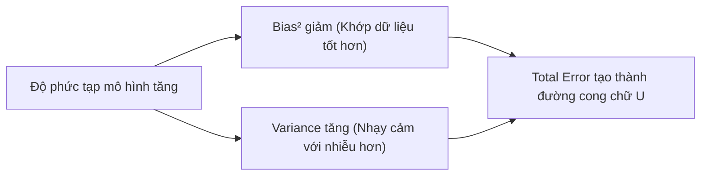

# Bias-Variance Tradeoff: Hiểu Tận Gốc Overfitting & Underfitting

> **Motto**: *"Mô hình quá đơn giản thì mù quáng (High Bias); mô hình quá phức tạp thì hoang tưởng (High Variance). Nghệ thuật ML là tìm điểm cân bằng ở giữa."*

---

## Thông tin nhanh (Quick Spec)

* **Loại bài (Type):** Thực chiến (Build) & Khái niệm (Concept)
* **Ngôn ngữ & Công cụ:** Python 3.12, NumPy
* **Kiến thức tiên quyết (Prerequisites):** Linear Regression (Bài 02), Model Evaluation (Bài 09)
* **Thời gian thực hành:** ~45 phút

---

## Mục tiêu bài học (Learning Objectives)

Sau bài học này, bạn sẽ có khả năng:
- [ ] Giải thích được công thức phân rã **Bias-Variance Decomposition** cho sai số bình phương (MSE).
- [ ] Chẩn đoán nhanh mô hình đang bị **Underfitting (High Bias)** hay **Overfitting (High Variance)** thông qua Train/Val Error.
- [ ] Tự tay mô phỏng thí nghiệm **Bias-Variance Tradeoff** trên hồi quy đa thức (Polynomial Regression) với **Ridge Regularization ($L_2$)** thuần **Python 3.12 + NumPy**.
- [ ] Áp dụng đúng chiến lược khắc phục cho từng loại bệnh của mô hình.

---

## 1. Vấn đề thực tế (The Problem)

Bạn huấn luyện một mô hình dự đoán giá nhà:
- **Kịch bản A:** Dùng Linear Regression đơn giản. Sai số trên tập Train là 500 triệu, trên tập Validation là 510 triệu. Mô hình quá "ngây thơ", không nắm bắt được quy luật phi tuyến.
- **Kịch bản B:** Dùng Polynomial Regression bậc 15. Sai số trên tập Train giảm xuống gần **0 triệu**! Bạn mừng thầm mang đi kiểm thử trên tập Validation, kết quả sai số vọt lên **2 tỷ đồng**. Mô hình đã học thuộc lòng cả nhiễu (noise) của tập Train.

Làm sao biết khi nào nên tăng độ phức tạp, khi nào nên kìm hãm mô hình lại? Câu trả lời nằm ở **Bias-Variance Tradeoff**.

---

## 2. Mô hình tư duy & Bản chất (The Concept)

Giả sử dữ liệu thực sinh ra bởi hàm $y = f(x) + \epsilon$ với nhiễu $\epsilon \sim \mathcal{N}(0, \sigma^2)$. Sai số kỳ vọng của mô hình $\hat{f}(x)$ tại một điểm $x$ được phân rã chính xác thành 3 thành phần:

$$\mathbb{E}\left[(y - \hat{f}(x))^2\right] = \underbrace{\left(\text{Bias}[\hat{f}(x)]\right)^2}_{\text{Sai lệch hệ thống}} + \underbrace{\text{Var}[\hat{f}(x)]}_{\text{Độ nhạy với dữ liệu train}} + \underbrace{\sigma^2}_{\text{Nhiễu không thể giảm}}$$



- **Bias (Độ chệch):** Sai số do giả định của mô hình quá đơn giản (ví dụ: dùng đường thẳng để khớp đường cong).
- **Variance (Phương sai):** Mức độ thay đổi của mô hình nếu ta thay đổi nhẹ tập dữ liệu huấn luyện.

---

## 3. Tự tay xây dựng từ đầu (Build It: From Scratch)

Chúng ta sẽ tự tay mô phỏng thí nghiệm kinh điển: tạo dữ liệu từ hàm $y = \sin(2\pi x) + \epsilon$, huấn luyện **Polynomial Regression** ở nhiều bậc khác nhau (bậc 1, 3, 12) trên 50 tập mẫu khác nhau để **đo trực tiếp $\text{Bias}^2$ và $\text{Variance}$** bằng NumPy!

### Bước 1: Xây dựng Polynomial Features & Ridge Regression (Closed-form)

```python
from __future__ import annotations
import numpy as np


def poly_features(x: np.ndarray, degree: int) -> np.ndarray:
    """Tạo ma trận đặc trưng đa thức [1, x, x^2, ..., x^degree]."""
    x = np.asarray(x, dtype=np.float64).ravel()
    return np.column_stack([x ** d for d in range(degree + 1)])


def fit_ridge(X: np.ndarray, y: np.ndarray, alpha: float = 0.0) -> np.ndarray:
    """Nghiệm đóng (Normal Equation) với L2 Regularization: (X^T X + alpha*I)^-1 X^T y."""
    n_features = X.shape[1]
    reg_matrix = alpha * np.eye(n_features)
    reg_matrix[0, 0] = 0.0  # Không phạt hệ số tự do (bias term)
    try:
        return np.linalg.solve(X.T @ X + reg_matrix, X.T @ y)
    except np.linalg.LinAlgError:
        return np.linalg.lstsq(X.T @ X + reg_matrix, X.T @ y, rcond=None)[0]
```

### Bước 2: Mô phỏng đo Bias² và Variance thực nghiệm

```python
def measure_bias_variance(
    degree: int, alpha: float = 0.0, n_trials: int = 100, n_train: int = 25
) -> tuple[float, float, float]:
    rng = np.random.default_rng(42)
    x_test = np.linspace(0, 1, 100)
    y_true_clean = np.sin(2 * np.pi * x_test)
    X_test_poly = poly_features(x_test, degree)

    predictions = np.zeros((n_trials, len(x_test)))

    for i in range(n_trials):
        x_tr = rng.uniform(0, 1, n_train)
        y_tr = np.sin(2 * np.pi * x_tr) + rng.normal(0, 0.25, n_train)
        X_tr_poly = poly_features(x_tr, degree)

        w = fit_ridge(X_tr_poly, y_tr, alpha=alpha)
        predictions[i] = X_test_poly @ w

    mean_pred = np.mean(predictions, axis=0)
    bias_sq = float(np.mean((mean_pred - y_true_clean) ** 2))
    variance = float(np.mean(np.var(predictions, axis=0)))
    return bias_sq, variance, bias_sq + variance


if __name__ == "__main__":
    print(f"{'Model':<22} | {'Bias^2':<10} | {'Variance':<10} | {'Total':<10}")
    print("-" * 60)
    for deg, alpha, label in [
        (1, 0.0, "Deg 1 (Underfit)"),
        (3, 0.0, "Deg 3 (Balanced)"),
        (12, 0.0, "Deg 12 (Overfit)"),
        (12, 1e-2, "Deg 12 + Ridge L2"),
    ]:
        b2, var, tot = measure_bias_variance(degree=deg, alpha=alpha)
        print(f"{label:<22} | {b2:<10.4f} | {var:<10.4f} | {tot:<10.4f}")
```

Khi chạy đoạn code trên, bạn sẽ thấy rõ:
- **Deg 1:** `Bias^2` rất cao, `Variance` thấp.
- **Deg 3:** Cân bằng tối ưu.
- **Deg 12:** `Bias^2` gần bằng 0, nhưng `Variance` bùng nổ.
- **Deg 12 + Ridge L2:** `Variance` giảm mạnh trở lại mức an toàn!

---

## 4. Ứng dụng thực tế & So sánh Framework (Use It)

Trong thực tế, **Regularization** là vũ khí chính để kiểm soát Bias-Variance:
* **L2 Regularization (Ridge / Weight Decay):** Phạt bình phương trọng số ($\alpha \sum w_j^2$), ép các trọng số nhỏ lại đều, giảm Variance hiệu quả.
* **L1 Regularization (Lasso):** Phạt trị tuyệt đối ($\alpha \sum |w_j|$), ép nhiều trọng số về **chính xác 0**, giúp chọn lọc đặc trưng (Feature Selection).
* **Deep Learning (Double Descent):** Trong các mạng Neural khổng lồ (Over-parameterized), khi số tham số vượt xa số mẫu dữ liệu, đường cong Variance có thể giảm trở lại (hiện tượng *Double Descent*) nếu được tối ưu bằng SGD và Weight Decay.

---

## 5. Đóng gói & Tái sử dụng (Ship It)

**Cheatsheet chẩn đoán & xử lý nhanh:**

| Triệu chứng | Chẩn đoán | Hành động khắc phục |
|---|---|---|
| Train Error **Cao**, Val Error **Cao** | **High Bias (Underfitting)** | Tăng độ phức tạp mô hình, thêm features, giảm $\alpha$ (Regularization). |
| Train Error **Thấp**, Val Error **Cao** | **High Variance (Overfitting)** | Thêm dữ liệu train, tăng $\alpha$ (L1/L2), dùng Dropout / Early Stopping / Bagging. |

---

## 6. Giải ngố thuật ngữ (Key Terms & Misconceptions)

| Thuật ngữ (Term) | Người ta thường nghĩ là... | Bản chất kỹ thuật thực sự là... |
|---|---|---|
| **Overfitting** | Mô hình học quá tốt. | Mô hình học thuộc lòng cả **nhiễu** (noise) của tập train nên mất khả năng tổng quát hóa. |
| **Thêm dữ liệu** | Luôn giúp giảm mọi loại lỗi. | Chỉ giúp giảm **Variance** (Overfitting); nếu mô hình bị High Bias (quá ngây thơ), thêm dữ liệu không giúp ích. |
| **Irreducible Error** | Lỗi do code sai hoặc chọn thuật toán dở. | Nhiễu tự nhiên trong dữ liệu ($\sigma^2$) — không một mô hình nào có thể vượt qua được giới hạn này. |

---

## 7. Bài tập thử thách (Hands-on Challenges)

1. 🟢 **Cơ bản (Easy):** Thay đổi `n_train` từ `25` lên `200` trong hàm `measure_bias_variance` cho `Deg 12` và quan sát `Variance` giảm xuống bao nhiêu.
2. 🟡 **Trung bình (Medium):** Viết hàm vẽ/in **Learning Curve** (Train MSE và Val MSE khi kích thước tập train tăng dần từ 10%, 20%... đến 100%).
3. 🔴 **Nâng cao (Hard):** Tự cài đặt **Elastic Net** (kết hợp cả L1 và L2 Regularization) bằng Gradient Descent thuần NumPy và so sánh trọng số thu được với Ridge.

---

## 8. Tài liệu đọc thêm (Further Reading)

- [Understanding the Bias-Variance Tradeoff (Scott Fortmann-Roe)](https://scott.fortmann-roe.com/docs/BiasVariance.html) — *Bài viết trực quan nhất về Bias và Variance với hình ảnh bia bắn.*
- [Reconciling modern machine-learning practice and the classical bias–variance trade-off](https://www.pnas.org/doi/10.1073/pnas.1903070116) — *Bài báo giải thích hiện tượng Double Descent trong Deep Learning.*
